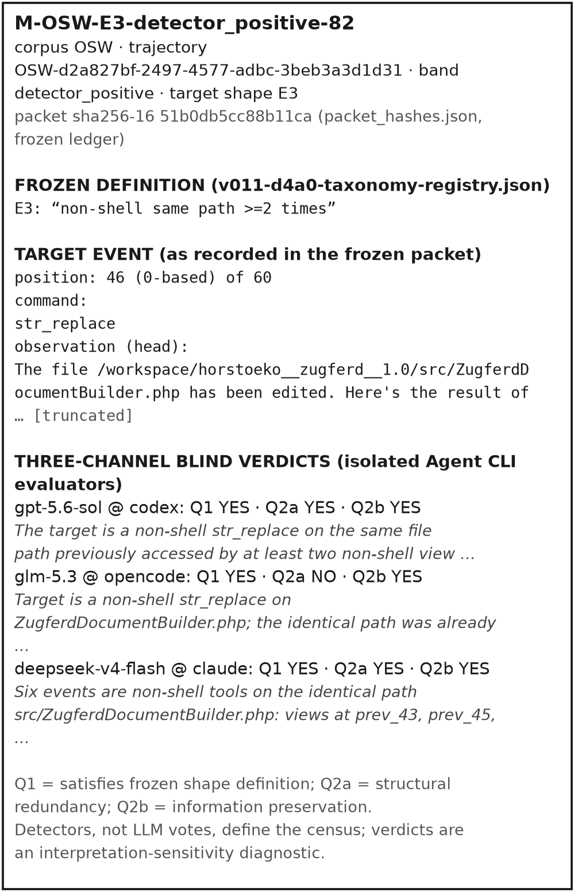
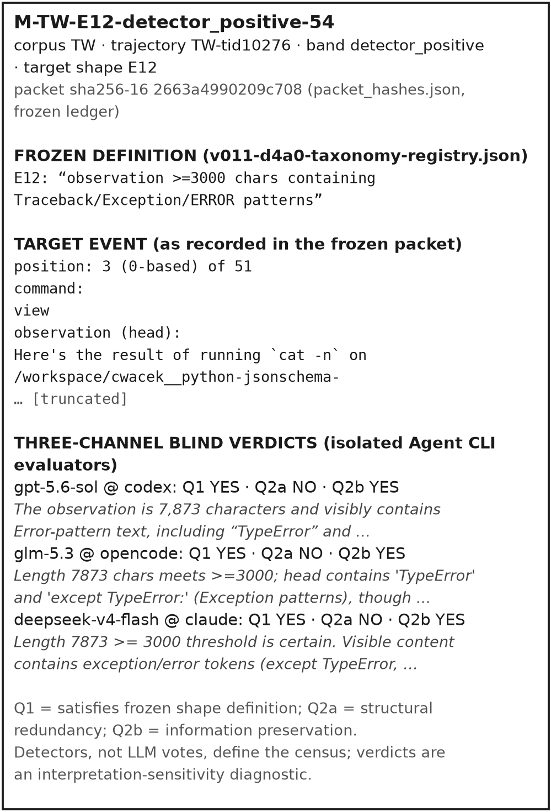
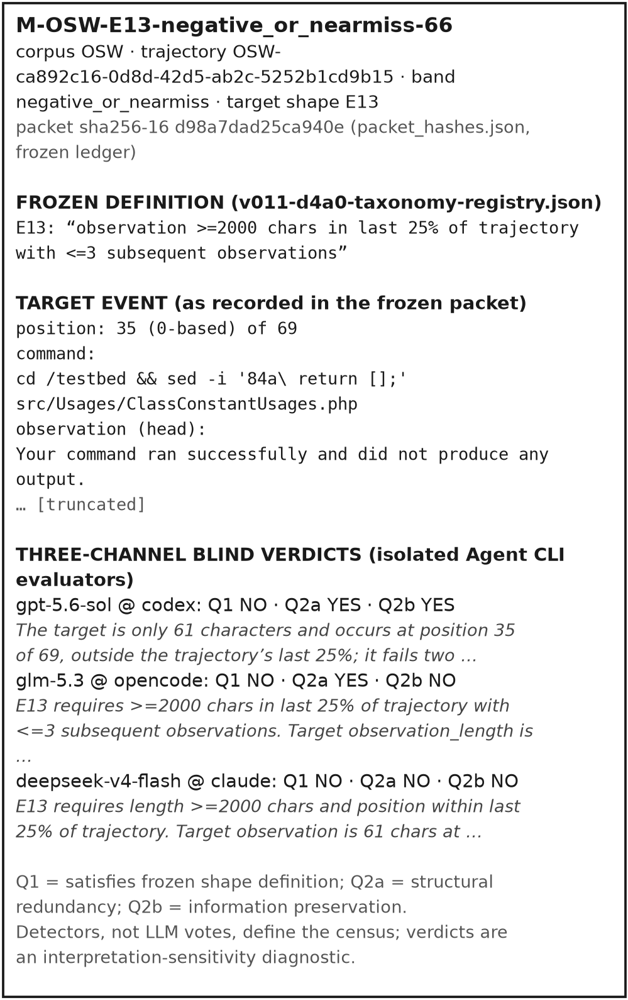

# Supplement B — Construct and heterogeneous-model interpretation audit

Evidence freeze: 2026-09-24. Cleanup checkpoint: `057477902627f0007aad42dcc853c7b6d52698e2`. All numerical tables are transcriptions of frozen fields; no experiment, aggregation, significance test, or detector is run during preparation. Original fractions are retained without calculating additional statistics.

## Protocol evolution and actual execution

The original 300-item human design plan was reused as a protocol template for a model interpretation audit. The actual manifest and reconciled artifact record 340 model-audit items; no claim is made that a formal human-to-model amendment or human adjudication was completed. Actual sample/result authority is the 340-item manifest and reconciled audit. The original protocol is reproduced below as historical design provenance only.

## Actual execution and authority

The completed study is a model audit, not human ground truth. The reconciled 340-paired-valid result supersedes the 292-pair report and partial aggregations. Taxonomy is mechanically reproducible; natural-language interpretation across shapes is uneven. Overall and per-shape results are jointly disclosed. No human precision, recall, or safe-compression validation is inferred.

[evidence/V1/paper/construct-validity/model-audit/model-audit-reconciled.json](sources/evidence/V1/paper/construct-validity/model-audit/model-audit-reconciled.json) — field: `root`

```json
{
  "schema_version": 2,
  "stage": "D4-P3R4R1 model audit reconciliation (all 48 GLM schema-invalid items recovered via parquet re-annotation; 340/340 paired valid)",
  "date": "2026-09-24",
  "provenance": {
    "detector_freeze_commit": "1865a160",
    "annotation_pack_commit": "420193e0",
    "dataset": "nvidia/Open-SWE-Traces v1.0 Minimax strata (rev f8fb5b3d2c78)",
    "glm_recovery": "48 items with Q1=None recovered via parquet re-annotation using packet A context and frozen shape definitions; isolation maintained (GPT results not read)"
  },
  "corpus_counts": {
    "manifest_total": 340,
    "glm_annotated": 340,
    "gpt_annotated": 340,
    "paired_valid": 340,
    "glm_schema_invalid_before_recovery": 48,
    "glm_schema_invalid_after_recovery": 0,
    "reconciliation": "FULL_340"
  },
  "agreement": {
    "Q1_shape_membership": {
      "raw_agreement": 0.5265,
      "cohens_kappa": 0.1531,
      "interpretation": "poor agreement; two AI models disagree on shape membership for ~47% of items"
    },
    "Q2_compression_opportunity": {
      "raw_agreement": 0.4941,
      "cohens_kappa": 0.0003,
      "interpretation": "essentially chance-level agreement; two AI models cannot agree on whether observations constitute compression opportunities"
    }
  },
  "per_shape_agreement": {
    "E1_repeated_exact_command": {
      "n": 28,
      "Q1_agree": 16,
      "Q2_agree": 11
    },
    "E2_repeated_similar_command": {
      "n": 28,
      "Q1_agree": 15,
      "Q2_agree": 14
    },
    "E3_same_file_reread": {
      "n": 28,
      "Q1_agree": 5,
      "Q2_agree": 0
    },
    "E4_overlapping_file_read": {
      "n": 8,
      "Q1_agree": 0,
      "Q2_agree": 5,
      "note": "SMALL_N"
    },
    "E5_same_search": {
      "n": 28,
      "Q1_agree": 18,
      "Q2_agree": 21
    },
    "E6_large_test_success": {
      "n": 28,
      "Q1_agree": 7,
      "Q2_agree": 19
    },
    "E7_large_test_failure": {
      "n": 28,
      "Q1_agree": 7,
      "Q2_agree": 18
    },
    "E8_large_lint_output": {
      "n": 8,
      "Q1_agree": 7,
      "Q2_agree": 5,
      "note": "SMALL_N"
    },
    "E9_large_build_output": {
      "n": 9,
      "Q1_agree": 7,
      "Q2_agree": 6,
      "note": "SMALL_N"
    },
    "E10_repeated_validation": {
      "n": 28,
      "Q1_agree": 18,
      "Q2_agree": 18
    },
    "E11_unchanged_validation": {
      "n": 19,
      "Q1_agree": 11,
      "Q2_agree": 12
    },
    "E12_large_diagnostic": {
      "n": 28,
      "Q1_agree": 22,
      "Q2_agree": 5
    },
    "E13_large_output_near_terminal": {
      "n": 28,
      "Q1_agree": 27,
      "Q2_agree": 22
    },
    "E14_output_followed_by_reread": {
      "n": 28,
      "Q1_agree": 11,
      "Q2_agree": 5
    },
    "E15_output_followed_by_rederivation": {
      "n": 16,
      "Q1_agree": 8,
      "Q2_agree": 7
    }
  },
  "key_findings": [
    "Inter-model Q1 agreement 52.65% (kappa 0.15) — two AI models disagree on shape membership for ~47% of items",
    "Inter-model Q2 agreement 49.41% (kappa 0.0003) — chance-level agreement on compression-opportunity judgment",
    "E13 shape membership agreement 96.4% but compression-opportunity agreement only 78.6% — shape definition is clear but opportunity judgment is not",
    "These results confirm that the compression-opportunity construct is genuinely ambiguous even between AI models using the same definitions",
    "The low inter-model agreement is consistent with (and partially explains) the low inter-model agreement found in D4-P3R4 (E5 online A/B), where trajectory variance was the dominant factor"
  ],
  "terminology_discipline": {
    "used": [
      "detector–model agreement",
      "cross-model annotation agreement",
      "model-audit disagreement",
      "high-priority human-review disagreement"
    ],
    "not_used": [
      "detector false-positive rate",
      "human precision",
      "construct validity validated",
      "compression opportunity is inherently subjective"
    ]
  },
  "verdict": "MODEL_AUDIT_RECONCILED",
  "disclaimer": "MODEL_ANNOTATION_AUDIT — not human construct-validity validation. Results are for diagnostic reference only."
}
```

## Statistics amendment (PAPER-A-ANNOTATION-STATISTICS-AMENDMENT, 2026-10-10)

The κ values inside the transcribed reconciled artifact above (Q1 κ=0.1531, Q2 κ=0.0003) are **superseded for publication**: their computation convention was not archived, and standard unweighted three-category Cohen's κ recomputed from the frozen raw evaluations (340 paired rows; locked script `evidence/tools/annotation_audit_statistics.py`; locked artifact `annotation-statistics-amendment.json`, sha256-16 `de30138fa71414a0`) gives **Q1 κ=0.2665** and **Q2 κ=0.2284**. Raw agreements reproduce exactly (52.65% / 49.41%). The recomputed Q2 κ is not chance-level; a large share of the Q2 disagreement reflects differing scale usage between the evaluators (GPT never used the UNCERTAIN option on Q2: 233 YES / 107 NO / 0 UNCERTAIN, versus GLM 68 / 224 / 48) — an observable response-style difference, not evidence about the underlying content.

Locked 3×3 contingency tables (rows = GLM, columns = GPT):

| Q1 | GPT YES | GPT UNCERTAIN | GPT NO |
| --- | --- | --- | --- |
| **GLM YES** | 34 | 48 | 18 |
| **GLM UNCERTAIN** | 20 | 103 | 75 |
| **GLM NO** | 0 | 0 | 42 |

| Q2 | GPT YES | GPT NO |
| --- | --- | --- |
| **GLM YES** | 68 | 0 |
| **GLM UNCERTAIN** | 41 | 7 |
| **GLM NO** | 124 | 100 |

Positive/negative agreement (denominators explicit): Q1 positive 34/120 = 0.2833, Q1 negative 42/135 = 0.3111; Q2 positive 68/233 = 0.2918, Q2 negative 100/231 = 0.4329. Per-shape κ where interpretable: E13 Q1 κ=0.9146 (the only shape with high, interpretable κ — a local property of its position-type definition; it does not generalize to other shapes, whose κ are degenerate or low). Detector-agreement figures under the current full-340 caliber: GLM accepts 84/220 (38.18%) and GPT accepts 53/220 (24.09%) of detector-positive items; both models reject (Q1≠YES) 117 detector-positive items; both accept 0 detector-negative items. The historical 84/180 (46.7%) and 50/180 (27.8%) figures in the superseded aggregation used a pre-recovery 292-item denominator and must not be mixed with the 340-item caliber.

The protocol-difference disclosure is unchanged: the original design was a 300-item two-human-annotator plan; the executed study is a 340-item heterogeneous-LLM audit and is not human ground truth, not a detector-precision estimate, and not a validation of safe compression.

## Sampling manifest

[evidence/V1/paper/construct-validity/sample-manifest.json](sources/evidence/V1/paper/construct-validity/sample-manifest.json) — field: `root`

```json
{
  "schema_version": 1,
  "protocol": "construct-validity/annotation-protocol.md (FROZEN)",
  "seed": 42,
  "total_items": 340,
  "shape_targets": {
    "E1": {
      "pos": 20,
      "neg": 8
    },
    "E2": {
      "pos": 20,
      "neg": 8
    },
    "E3": {
      "pos": 20,
      "neg": 8
    },
    "E4": {
      "pos": 20,
      "neg": 8
    },
    "E5": {
      "pos": 20,
      "neg": 8
    },
    "E6": {
      "pos": 20,
      "neg": 8
    },
    "E7": {
      "pos": 20,
      "neg": 8
    },
    "E8": {
      "pos": 20,
      "neg": 8
    },
    "E9": {
      "pos": 20,
      "neg": 8
    },
    "E10": {
      "pos": 20,
      "neg": 8
    },
    "E11": {
      "pos": 20,
      "neg": 8
    },
    "E12": {
      "pos": 20,
      "neg": 8
    },
    "E13": {
      "pos": 20,
      "neg": 8
    },
    "E14": {
      "pos": 20,
      "neg": 8
    },
    "E15": {
      "pos": 20,
      "neg": 8
    }
  },
  "source_corpus": "OSW 20K census (v2 manifest, sample-id-set 601318a7)",
  "items": [
    {
      "item_id": "ITEM-0232",
      "target_shape": "E11",
      "sample_type": "detector_positive",
      "anonymous_session_id": "69ace4ab",
      "trajectory_position": "46 / 74",
      "tool_command": "python -m pytest tests/test_headers.py -xvs 2>&1 | head -60",
      "observation_excerpt": "OBSERVATION:\n============================= test session starts ==============================\nplatform linux -- Python 3.7.17, pytest-7.4.4, pluggy-1.2.0 -- /usr/local/bin/python\ncachedir: .pytest_cache\nrootdir: /testbed\nconfigfile: setup.cfg\ncollecting ... collected 41 items\n\ntests/test_headers.py::TestHeaders::test_content_length PASSED\ntests/test_headers.py::TestHeaders::test_declare_content_length PASSED\ntests/test_headers.py::TestHeaders::test_declared_content_length_not_overriden_by_body_length PASSED\ntests/test_headers.py::TestHeaders::test_expires_header PASSED\ntests/test_headers.py::TestHeaders::test_default_value PASSED\ntests/test_headers.py::TestHeaders::test_unset_header[True] PASSED\ntests/test_headers.py::TestHeaders::test_unset_header[False] PASSED\ntests/test_headers.py::TestHeaders::test_required_header PASSED\ntests/test_headers.py::TestHeaders::test_no_content_length[204 No Content] PASSED\ntests/test_headers.py::TestHeaders::test_no_content_length[304 Not Modified] PASSED\ntests/test_headers.py::TestHeaders::test_content_header_missing PASSED\ntests/test_headers.py::TestHeaders::test_passthrough_request_headers PASSED\ntests/test_headers.py::TestHeaders::test_headers_as_list PASSED\ntests/test_headers.py::TestHeaders::test_default_media_type PASSED\ntests/test_headers.py::TestHeaders::test_override_default_media_type[text/plain; charset=UTF-8-Hello Unicode! \\U0001f638] PASSED\ntests/test_headers.py::TestHeaders::test_override_default_media_type[text/plain-Hello ISO-8859-1!] PASSED\ntests/test_headers.py::TestHeaders::test_override_default_media_type_missing_encoding PASSED\ntests/test_headers.py::TestHeaders::test_response_header_helpers_on_get PASSED\ntests/test_headers.py::TestHeaders::test_unicode_location_headers PASSED\ntests/test_headers.py::TestHeaders::test_unicode_headers_convertable PASSED\ntests/test_headers.py::TestHeaders::test_unicode_headers_not_convertable SKIPPED\ntests/test_headers.py::TestHeaders::test_response_set_and_get_header PASSED\ntests/\n...[TRUNCATED]...\nest_headers.py::TestHeaders::test_add_link_with_anchor PASSED\ntests/test_headers.py::TestHeaders::test_add_link_with_hreflang PASSED\ntests/test_headers.py::TestHeaders::test_add_link_with_hreflang_multi PASSED\ntests/test_headers.py::TestHeaders::test_add_link_with_type_hint PASSED\ntests/test_headers.py::TestHeaders::test_add_link_complex PASSED\ntests/test_headers.py::TestHeaders::test_content_length_options PASSED\n\n======================== 40 passed, 1 skipped in 0.14s =========================\n",
      "previous_events": [
        {
          "cmd": "python /testbed/test_fix.py 2>&1",
          "obs_excerpt": "OBSERVATION:\nHeaders: {}\nOK: set_header correctly raises HeaderNotSupported: Setting the \"Set-Cookie\" header directly is not supported; use set_cookie() or append_header() instead.\nOK: set_headers cor"
        },
        {
          "cmd": "str_replace",
          "obs_excerpt": "OBSERVATION:\nThe file /testbed/test_fix.py has been edited. Here's the result of running `cat -n` on a snippet of /testbed/test_fix.py:\n     2\timport pytest\n     3\tfrom falcon.response import Response"
        },
        {
          "cmd": "python /testbed/test_fix.py 2>&1",
          "obs_excerpt": "OBSERVATION:\nCookies list: ['foo=bar', 'baz=qux']\nOK: append_header correctly handles Set-Cookie headers\nOK: set_header correctly raises HeaderNotSupported: Setting the \"Set-Cookie\" header directly is"
        }
      ],
      "corpus": "Open-SWE v1.0 Minimax"
    },
    {
      "item_id": "ITEM-0119",
      "target_shape": "E5",
      "sample_type": "detector_negative",
      "anonymous_session_id": "21b5d213",
      "trajectory_position": "9 / 47",
      "tool_command": "cd /workspace/open-telemetry__opentelemetry-go-contrib__1.0/bridges/otelzap && go doc go.opentelemetry.io/otel/log | grep -i \"instrumentation\"",
      "observation_excerpt": "The API is designed to help inform an instrumentation author about this\n    func WithInstrumentationAttributes(attr ...attribute.KeyValue) LoggerOption\n    func WithInstrumentationVersion(version string) LoggerOption\n[The command completed with exit code 0.]\n[Current working directory: /workspace/open-telemetry__opentelemetry-go-contrib__1.0/bridges/otelzap]\n[Command finished with exit code 0]",
      "previous_events": [
        {
          "cmd": "cd /workspace/open-telemetry__opentelemetry-go-contrib__1.0 && grep -r \"WithInstrumentationAttributes\" --include=\"*.go\" -l",
          "obs_excerpt": "\n[The command completed with exit code 1.]\n[Current working directory: /workspace/open-telemetry__opentelemetry-go-contrib__1.0]\n[Command finished with exit code 1]"
        },
        {
          "cmd": "cd /workspace/open-telemetry__opentelemetry-go-contrib__1.0 && cat bridges/otelzap/go.mod",
          "obs_excerpt": "module go.opentelemetry.io/contrib/bridges/otelzap\n\ngo 1.23.0\n\nrequire (\n\tgithub.com/stretchr/testify v1.10.0\n\tgo.opentelemetry.io/otel v1.35.0\n\tgo.opentelemetry.io/otel/log v0.11.0\n\tgo.uber.org/zap v"
        },
        {
          "cmd": "cd /workspace/open-telemetry__opentelemetry-go-contrib__1.0 && go doc go.opentelemetry.io/otel/log.WithInstrumentationAttributes 2>/dev/null || echo \"Need to find the exact package location\"",
          "obs_excerpt": "Need to find the exact package location\n[The command completed with exit code 0.]\n[Current working directory: /workspace/open-telemetry__opentelemetry-go-contrib__1.0]\n[Command finished with exit code"
        }
      ],
      "corpus": "Open-SWE v1.0 Minimax"
    },
    {
      "item_id": "ITEM-0221",
      "target_shape": "E10",
      "sample_type": "detector_negative",
      "anonymous_session_id": "21b5d213",
      "trajectory_position": "10 / 47",
      "tool_command": "cd /workspace/open-telemetry__opentelemetry-go-contrib__1.0/bridges/otelzap && go doc go.opentelemetry.io/otel/log.WithInstrumentationAttributes",
      "observation_excerpt": "package log // import \"go.opentelemetry.io/otel/log\"\n\nfunc WithInstrumentationAttributes(attr ...attribute.KeyValue) LoggerOption\n    WithInstrumentationAttributes returns a LoggerOption that sets the\n    instrumentation attributes of a Logger.\n\n    The passed attributes will be de-duplicated.\n[The command completed with exit code 0.]\n[Current working directory: /workspace/open-telemetry__opentelemetry-go-contrib__1.0/bridges/otelzap]\n[Command finished with exit code 0]",
      "previous_events": [
        {
          "cmd": "cd /workspace/open-telemetry__opentelemetry-go-contrib__1.0 && cat bridges/otelzap/go.mod",
          "obs_excerpt": "module go.opentelemetry.io/contrib/bridges/otelzap\n\ngo 1.23.0\n\nrequire (\n\tgithub.com/stretchr/testify v1.10.0\n\tgo.opentelemetry.io/otel v1.35.0\n\tgo.opentelemetry.io/otel/log v0.11.0\n\tgo.uber.org/zap v"
        },
        {
          "cmd": "cd /workspace/open-telemetry__opentelemetry-go-contrib__1.0 && go doc go.opentelemetry.io/otel/log.WithInstrumentationAttributes 2>/dev/null || echo \"Need to find the exact package location\"",
          "obs_excerpt": "Need to find the exact package location\n[The command completed with exit code 0.]\n[Current working directory: /workspace/open-telemetry__opentelemetry-go-contrib__1.0]\n[Command finished with exit code"
        },
        {
          "cmd": "cd /workspace/open-telemetry__opentelemetry-go-contrib__1.0/bridges/otelzap && go doc go.opentelemetry.io/otel/log | grep -i \"instrumentation\"",
          "obs_excerpt": "The API is designed to help inform an instrumentation author about this\n    func WithInstrumentationAttributes(attr ...attribute.KeyValue) LoggerOption\n    func WithInstrumentationVersion(version stri"
        }
      ],
      "corpus": "Open-SWE v1.0 Minimax"
    },
    {
      "item_id": "ITEM-0327",
      "target_shape": "E15",
      "sample_type": "detector_positive",
      "anonymous_session_id": "c1c53f78",
      "trajectory_position": "29 / 89",
      "tool_command": "pytest --version 2>&1",
      "observation_excerpt": "OBSERVATION:\nTraceback (most recent call last):\n  File \"/usr/local/bin/pytest\", line 8, in <module>\n    sys.exit(main())\n  File \"/usr/local/lib/python3.7/site-packages/_pytest/config/__init__.py\", line 58, in main\n    config = _prepareconfig(args, plugins)\n  File \"/usr/local/lib/python3.7/site-packages/_pytest/config/__init__.py\", line 196, in _prepareconfig\n    pluginmanager=pluginmanager, args=args\n  File \"/usr/local/lib/python3.7/site-packages/pluggy/hooks.py\", line 286, in __call__\n    return self._hookexec(self, self.get_hookimpls(), kwargs)\n  File \"/usr/local/lib/python3.7/site-packages/pluggy/manager.py\", line 93, in _hookexec\n    return self._inner_hookexec(hook, methods, kwargs)\n  File \"/usr/local/lib/python3.7/site-packages/pluggy/manager.py\", line 87, in <lambda>\n    firstresult=hook.spec.opts.get(\"firstresult\") if hook.spec else False,\n  File \"/usr/local/lib/python3.7/site-packages/pluggy/callers.py\", line 203, in _multicall\n    gen.send(outcome)\n  File \"/usr/local/lib/python3.7/site-packages/_pytest/helpconfig.py\", line 93, in pytest_cmdline_parse\n    config = outcome.get_result()\n  File \"/usr/local/lib/python3.7/site-packages/pluggy/callers.py\", line 80, in get_result\n    raise ex[1].with_traceback(ex[2])\n  File \"/usr/local/lib/python3.7/site-packages/pluggy/callers.py\", line 187, in _multicall\n    res = hook_impl.function(*args)\n  File \"/usr/local/lib/python3.7/site-packages/_pytest/config/__init__.py\", line 675, in pytest_cmdline_parse\n    self.parse(args)\n  File \"/usr/local/lib/python3.7/site-packages/_pytest/config/__init__.py\", line 845, in parse\n    self._preparse(args, addopts=addopts)\n  File \"/usr/local/lib/python3.7/site-packages/_pytest/config/__init__.py\", line 799, in _preparse\n    self.pluginmanager.load_setuptools_entrypoints(\"pytest11\")\n  File \"/usr/local/lib/python3.7/site-packages/pluggy/manager.py\", line 299, in load_setuptools_entrypoints\n    plugin = ep.load()\n  File \"/usr/local/lib/python3.7/site-packages/setuptools/_vendor/importl\n...[TRUNCATED]...\ne 967, in _find_and_load_unlocked\n  File \"<frozen importlib._bootstrap>\", line 668, in _load_unlocked\n  File \"<frozen importlib._bootstrap>\", line 638, in _load_backward_compatible\n  File \"/usr/local/lib/python3.7/site-packages/_pytest/assertion/rewrite.py\", line 294, in load_module\n    six.exec_(co, mod.__dict__)\n  File \"/usr/local/lib/python3.7/site-packages/xdist/looponfail.py\", line 17, in <module>\n    from _pytest._io import TerminalWriter\nModuleNotFoundError: No module named '_pytest._io'\n",
      "previous_events": [
        {
          "cmd": "pip install pytest-cache 2>&1 | tail -5",
          "obs_excerpt": "OBSERVATION:\n  Stored in directory: /workspace/.cache/pip/wheels/76/fb/36/4304dce3f49d3aecf92d63f079db516641a8061a83a0b5a292\nSuccessfully built pytest-cache\nInstalling collected packages: pytest-cache"
        },
        {
          "cmd": "pytest --version 2>&1",
          "obs_excerpt": "OBSERVATION:\npytest 7.4.4\n"
        },
        {
          "cmd": "pip install 'pytest<4.0' 2>&1 | tail -5",
          "obs_excerpt": "OBSERVATION:\npytest-cov 4.1.0 requires pytest>=4.6, but you have pytest 3.10.1 which is incompatible.\npytest-timeout 2.4.0 requires pytest>=7.0.0, but you have pytest 3.10.1 which is incompatible.\npyt"
        }
      ],
      "corpus": "Open-SWE v1.0 Minimax"
    },
    {
      "item_id": "ITEM-0205",
      "target_shape": "E10",
      "sample_type": "detector_positive",
      "anonymous_session_id": "e867af63",
      "trajectory_position": "74 / 92",
      "tool_command": "python -m pytest /qibo/src/qibo/tests/test_hamiltonians.py -xvs 2>&1 | tail -30",
      "observation_excerpt": "../../qibo/src/qibo/tests/test_hamiltonians.py::test_tfim_hamiltonian_from_symbols[False-5] PASSED\n../../qibo/src/qibo/tests/test_hamiltonians.py::test_tfim_hamiltonian_from_symbols[True-4] PASSED\n../../qibo/src/qibo/tests/test_hamiltonians.py::test_tfim_hamiltonian_from_symbols[True-5] PASSED\n../../qibo/src/qibo/tests/test_hamiltonians.py::test_from_symbolic_with_power[False] PASSED\n../../qibo/src/qibo/tests/test_hamiltonians.py::test_from_symbolic_with_power[True] [Qibo|INFO|2026-04-21 16:31:15]: Aborting merge of one and two-qubit terms during TrotterHamiltonian creation because the two-qubit terms are not sufficiently many.\nPASSED\n../../qibo/src/qibo/tests/test_hamiltonians.py::test_from_symbolic_application_hamiltonian PASSED\n../../qibo/src/qibo/tests/test_hamiltonians.py::test_x_hamiltonian_from_symbols[False-4] PASSED\n../../qibo/src/qibo/tests/test_hamiltonians.py::test_x_hamiltonian_from_symbols[False-5] PASSED\n../../qibo/src/qibo/tests/test_hamiltonians.py::test_x_hamiltonian_from_symbols[True-4] PASSED\n../../qibo/src/qibo/tests/test_hamiltonians.py::test_x_hamiltonian_from_symbols[True-5] PASSED\n../../qibo/src/qibo/tests/test_hamiltonians.py::test_three_qubit_term_hamiltonian_from_symbols[False] PASSED\n../../qibo/src/qibo/tests/test_hamiltonians.py::test_three_qubit_term_hamiltonian_from_symbols[True] PASSED\n../../qibo/src/qibo/tests/test_hamiltonians.py::test_symbolic_hamiltonian_merge_one_qubit[True] PASSED\n../../qibo/src/qibo/tests/test_hamiltonians.py::test_symbolic_hamiltonian_merge_one_qubit[False] [Qibo|INFO|2026-04-21 16:31:15]: Aborting merge of one and two-qubit terms during TrotterHamiltonian creation because the two-qubit terms are not sufficiently many.\nPASSED\n../../qibo/src/qibo/tests/test_hamiltonians.py::test_symbolic_hamiltonian_errors [Qibo|ERROR|2026-04-21 16:31:15]: Symbolic Hamiltonian should be a `sympy` expression but is <class 'str'>.\n[Qibo|ERROR|2026-04-21 16:31:15]: Symbol map must be a dictionary but is <class 'str'>.\n[Qibo|ERROR\n...[TRUNCATED]...\nPASSED\n../../qibo/src/qibo/tests/test_hamiltonians.py::test_maxcut[True-4] PASSED\n../../qibo/src/qibo/tests/test_hamiltonians.py::test_maxcut[False-3] PASSED\n../../qibo/src/qibo/tests/test_hamiltonians.py::test_maxcut[False-4] PASSED\n\n============================= 180 passed in 0.65s ==============================\n[The command completed with exit code 0.]\n[Current working directory: /workspace/Quantum-TII__qibo__1.0]\n[Python interpreter: /usr/local/bin/python]\n[Command finished with exit code 0]",
      "previous_events": [
        {
          "cmd": "str_replace",
          "obs_excerpt": "The file /workspace/Quantum-TII__qibo__1.0/src/qibo/core/hamiltonians.py has been edited. Here's the result of running `cat -n` on a snippet of /workspace/Quantum-TII__qibo__1.0/src/qibo/core/hamilton"
        },
        {
          "cmd": "str_replace",
          "obs_excerpt": "The file /workspace/Quantum-TII__qibo__1.0/src/qibo/core/hamiltonians.py has been edited. Here's the result of running `cat -n` on a snippet of /workspace/Quantum-TII__qibo__1.0/src/qibo/core/hamilton"
        },
        {
          "cmd": "cp /workspace/Quantum-TII__qibo__1.0/src/qibo/core/hamiltonians.py /qibo/src/qibo/core/hamiltonians.py && cp /workspace/Quantum-TII__qibo__1.0/src/qibo/core/states.py /qibo/src/qibo/core/states.py && ",
          "obs_excerpt": "\n[The command completed with exit code 0.]\n[Current working directory: /workspace/Quantum-TII__qibo__1.0]\n[Python interpreter: /usr/local/bin/python]\n[Command finished with exit code 0]"
        }
      ],
      "corpus": "Open-SWE v1.0 Minimax"
    },
    {
      "item_id": "ITEM-0075",
      "target_shape": "E3",
      "sample_type": "detector_positive",
      "anonymous_session_id": "22c8b0c9",
      "trajectory_position": "18 / 43",
      "tool_command": "str_replace",
      "observation_excerpt": "The file /workspace/alibaba__fescar__1.0/core/src/main/java/com/alibaba/fescar/core/rpc/netty/TmRpcClient.java has been edited. Here's the result of running `cat -n` on a snippet of /workspace/alibaba__fescar__1.0/core/src/main/java/com/alibaba/fescar/core/rpc/netty/TmRpcClient.java:\n   362\t        poolConfig.maxWait = nettyClientConfig.getMaxAcquireConnMills();\n   363\t        poolConfig.testOnBorrow = nettyClientConfig.isPoolTestBorrow();\n   364\t        poolConfig.testOnReturn = nettyClientConfig.isPoolTestReturn();\n   365\t        poolConfig.lifo = nettyClientConfig.isPoolLifo();\n   366\t        return poolConfig;\n   367\t    }\n   368\t\n   369\t    @Override\n   370\t\nReview the changes and make sure they are as expected. Edit the file again if necessary.",
      "previous_events": [
        {
          "cmd": "view /workspace/alibaba__fescar__1.0/discovery/src/main/java/com/alibaba/fescar/discovery/loadbalance/AbstractLoadBalance.java",
          "obs_excerpt": "Here's the result of running `cat -n` on /workspace/alibaba__fescar__1.0/discovery/src/main/java/com/alibaba/fescar/discovery/loadbalance/AbstractLoadBalance.java:\n     1\t/*\n     2\t *  Copyright 1999-"
        },
        {
          "cmd": "find /workspace/alibaba__fescar__1.0 -type f -name \"*.java\" -path \"*/loadbalance/*\" | head -10",
          "obs_excerpt": "/workspace/alibaba__fescar__1.0/discovery/src/main/java/com/alibaba/fescar/discovery/loadbalance/LoadBalanceFactory.java\n/workspace/alibaba__fescar__1.0/discovery/src/main/java/com/alibaba/fescar/disc"
        },
        {
          "cmd": "str_replace",
          "obs_excerpt": "The file /workspace/alibaba__fescar__1.0/core/src/main/java/com/alibaba/fescar/core/rpc/netty/NettyClientConfig.java has been edited. Here's the result of running `cat -n` on a snippet of /workspace/a"
        }
      ],
      "corpus": "Open-SWE v1.0 Minimax"
    },
    {
      "item_id": "ITEM-0240",
      "target_shape": "E11",
      "sample_type": "detector_negative",
      "anonymous_session_id": "21b5d213",
      "trajectory_position": "10 / 47",
      "tool_command": "cd /workspace/open-telemetry__opentelemetry-go-contrib__1.0/bridges/otelzap && go doc go.opentelemetry.io/otel/log.WithInstrumentationAttributes",
      "observation_excerpt": "package log // import \"go.opentelemetry.io/otel/log\"\n\nfunc WithInstrumentationAttributes(attr ...attribute.KeyValue) LoggerOption\n    WithInstrumentationAttributes returns a LoggerOption that sets the\n    instrumentation attributes of a Logger.\n\n    The passed attributes will be de-duplicated.\n[The command completed with exit code 0.]\n[Current working directory: /workspace/open-telemetry__opentelemetry-go-contrib__1.0/bridges/otelzap]\n[Command finished with exit code 0]",
      "previous_events": [
        {
          "cmd": "cd /workspace/open-telemetry__opentelemetry-go-contrib__1.0 && cat bridges/otelzap/go.mod",
          "obs_excerpt": "module go.opentelemetry.io/contrib/bridges/otelzap\n\ngo 1.23.0\n\nrequire (\n\tgithub.com/stretchr/testify v1.10.0\n\tgo.opentelemetry.io/otel v1.35.0\n\tgo.opentelemetry.io/otel/log v0.11.0\n\tgo.uber.org/zap v"
        },
        {
          "cmd": "cd /workspace/open-telemetry__opentelemetry-go-contrib__1.0 && go doc go.opentelemetry.io/otel/log.WithInstrumentationAttributes 2>/dev/null || echo \"Need to find the exact package location\"",
          "obs_excerpt": "Need to find the exact package location\n[The command completed with exit code 0.]\n[Current working directory: /workspace/open-telemetry__opentelemetry-go-contrib__1.0]\n[Command finished with exit code"
        },
        {
          "cmd": "cd /workspace/open-telemetry__opentelemetry-go-contrib__1.0/bridges/otelzap && go doc go.opentelemetry.io/otel/log | grep -i \"instrumentation\"",
          "obs_excerpt": "The API is designed to help inform an instrumentation author about this\n    func WithInstrumentationAttributes(attr ...attribute.KeyValue) LoggerOption\n    func WithInstrumentationVersion(version stri"
        }
      ],
      "corpus": "Open-SWE v1.0 Minimax"
    },
    {
      "item_id": "ITEM-0297",
      "target_shape": "E14",
      "sample_type": "detector_positive",
      "anonymous_session_id": "21b5d213",
      "trajectory_position": "15 / 47",
      "tool_command": "str_replace",
      "observation_excerpt": "The file /workspace/open-telemetry__opentelemetry-go-contrib__1.0/bridges/otelzap/core.go has been edited. Here's the result of running `cat -n` on a snippet of /workspace/open-telemetry__opentelemetry-go-contrib__1.0/bridges/otelzap/core.go:\n    45\t\tsemconv \"go.opentelemetry.io/otel/semconv/v1.26.0\"\n    46\t)\n    47\t\n    48\ttype config struct {\n    49\t\tprovider    log.LoggerProvider\n    50\t\tversion     string\n    51\t\tschemaURL   string\n    52\t\tattr        []attribute.KeyValue\n    53\t}\n    54\t\n    55\tfunc newConfig(options []Option) config {\n    56\t\tvar c config\n    57\t\tfor _, opt := range options {\n    58\t\nReview the changes and make sure they are as expected. Edit the file again if necessary.",
      "previous_events": [
        {
          "cmd": "cd /workspace/open-telemetry__opentelemetry-go-contrib__1.0/bridges/otelzap && cat > /tmp/test_otelzap2.go << 'EOF'",
          "obs_excerpt": "cd /workspace/open-telemetry__opentelemetry-go-contrib__1.0/bridges/otelzap && cat > /tmp/test_otelzap.go << 'EOF'\npackage main\nimport (\n\"fmt\"\n\"go.opentelemetry.io/contrib/bridges/otelzap\"\n\"go.opentel"
        },
        {
          "cmd": "cd /workspace/open-telemetry__opentelemetry-go-contrib__1.0/bridges/otelzap && go doc go.opentelemetry.io/otel/log | grep -i \"attribute\"",
          "obs_excerpt": "func KeyValueFromAttribute(kv attribute.KeyValue) KeyValue\n    func WithInstrumentationAttributes(attr ...attribute.KeyValue) LoggerOption\n    func ValueFromAttribute(value attribute.Value) Value\n[The"
        },
        {
          "cmd": "str_replace",
          "obs_excerpt": "The file /workspace/open-telemetry__opentelemetry-go-contrib__1.0/bridges/otelzap/core.go has been edited. Here's the result of running `cat -n` on a snippet of /workspace/open-telemetry__opentelemetr"
        }
      ],
      "corpus": "Open-SWE v1.0 Minimax"
    },
    {
      "item_id": "ITEM-0121",
      "target_shape": "E6",
      "sample_type": "detector_positive",
      "anonymous_session_id": "7f381315",
      "trajectory_position": "61 / 63",
      "tool_command": "python -m pytest tests/test_core/test_tree.py -v -k \"compare\" --timeout=60 2>&1",
      "observation_excerpt": "========================================================================================================================================================================================================================================================================================================================================================================================================================================================================================================= test session starts ==========================================================================================================================================================================================================================================================================================================================================================================================================================================================================================================\nplatform linux -- Python 3.10.19, pytest-9.0.2, pluggy-1.6.0 -- /usr/local/bin/python\ncachedir: .pytest_cache\nrootdir: /workspace/cogent3__cogent3__1.0\nconfigfile: pyproject.toml\nplugins: xdist-3.8.0, cov-7.0.0, timeout-2.4.0\ntimeout: 60.0s\ntimeout method: signal\ntimeout func_only: False\ncollected 140 items / 135 deselected / 5 selected\n\ntests/test_core/test_tree.py::TreeNodeTests::test_compare_by_names PASSED                                                                                                                                                                                                                                                                                                                                                                                                                                                                                                                                                                                                          \n...[TRUNCATED]...\n============================================================================================================================================================================================================================================================================================================================\n[The command completed with exit code 0.]\n[Current working directory: /workspace/cogent3__cogent3__1.0]\n[Python interpreter: /usr/local/bin/python]\n[Command finished with exit code 0]",
      "previous_events": [
        {
          "cmd": "cd /workspace/cogent3__cogent3__1.0 && git diff src/cogent3/core/tree.py",
          "obs_excerpt": "diff --git a/src/cogent3/core/tree.py b/src/cogent3/core/tree.py\nindex 4c570fab2..4057395d8 100644\n--- a/src/cogent3/core/tree.py\n+++ b/src/cogent3/core/tree.py\n@@ -1428,6 +1428,40 @@ class TreeNode(o"
        },
        {
          "cmd": "python -m pytest tests/test_tree_distance.py -v --timeout=120 2>&1 | tail -30",
          "obs_excerpt": "\n[The command has no new output after 30 seconds. You may wait longer to see additional output by sending empty command '', send other commands to interact with the current process, send keys to inter"
        },
        {
          "cmd": "python -m pytest tests/test_phylo.py -v -k \"tree\" --timeout=60 2>&1 | head -50",
          "obs_excerpt": "============================= test session starts ==============================\nplatform linux -- Python 3.10.19, pytest-9.0.2, pluggy-1.6.0 -- /usr/local/bin/python\ncachedir: .pytest_cache\nrootdir: "
        }
      ],
      "corpus": "Open-SWE v1.0 Minimax"
    },
    {
      "item_id": "ITEM-0067",
      "target_shape": "E3",
      "sample_type": "detector_positive",
      "anonymous_session_id": "a73597e8",
      "trajectory_position": "16 / 61",
      "tool_command": "view /workspace/apache__dubbo-go-hessian2__1.0/encode.go",
      "observation_excerpt": "Here's the result of running `cat -n` on /workspace/apache__dubbo-go-hessian2__1.0/encode.go:\n   100\t\n   101\t\tcase int64:\n   102\t\t\te.buffer = encInt64(e.buffer, val)\n   103\t\tcase uint64:\n   104\t\t\te.buffer = encInt64(e.buffer, int64(val))\n   105\t\n   106\t\tcase time.Time:\n   107\t\t\tif ZeroDate == val {\n   108\t\t\t\te.buffer = encNull(e.buffer)\n   109\t\t\t} else {\n   110\t\t\t\te.buffer = encDateInMs(e.buffer, &val)\n   111\t\t\t\t// e.buffer = encDateInMimute(v.(time.Time), e.buffer)\n   112\t\t\t}\n   113\t\n   114\t\tcase float32:\n   115\t\t\te.buffer = encFloat32(e.buffer, val)\n   116\t\n   117\t\tcase float64:\n   118\t\t\te.buffer = encFloat(e.buffer, val)\n   119\t\n   120\t\tcase string:\n   121\t\t\te.buffer = encString(e.buffer, val)\n   122\t\n   123\t\tcase []byte:\n   124\t\t\te.buffer = encBinary(e.buffer, val)\n   125\t\n   126\t\tcase map[interface{}]interface{}:\n   127\t\t\treturn e.encUntypedMap(val)\n   128\t\n   129\t\tcase POJOEnum:\n   130\t\t\tif p, ok := v.(POJOEnum); ok {\n   131\t\t\t\treturn e.encObject(p)\n   132\t\t\t}\n   133\t\n   134\t\tdefault:\n   135\t\t\tt := UnpackPtrType(reflect.TypeOf(v))\n   136\t\t\tswitch t.Kind() {\n   137\t\t\tcase reflect.Struct:\n   138\t\t\t\tvv := reflect.ValueOf(v)\n   139\t\t\t\tvv = UnpackPtr(vv)\n   140\t\t\t\tif !vv.IsValid() {\n   141\t\t\t\t\te.buffer = encNull(e.buffer)\n   142\t\t\t\t\treturn nil\n   143\t\t\t\t}\n   144\t\t\t\tif vv.Type().String() == \"time.Time\" {\n   145\t\t\t\t\te.buffer = encDateInMs(e.buffer, v)\n   146\t\t\t\t\treturn nil\n   147\t\t\t\t}\n   148\t\t\t\tif p, ok := v.(POJO); ok {\n   149\t\t\t\t\tvar clazz string\n   150\t\t\t\t\tclazz = p.JavaClassName()\n   151\t\t\t\t\tif c, ok := GetSerializer(clazz); ok {\n   152\t\t\t\t\t\treturn c.EncObject(e, p)\n   153\t\t\t\t\t}\n   154\t\t\t\t\treturn e.encObject(p)\n   155\t\t\t\t}\n   156\t\n   157\t\t\t\treturn perrors.Errorf(\"struct type not Support! %s[%v] is not a instance of POJO!\", t.String(), v)\n   158\t\t\tcase reflect.Slice, reflect.Array:\n   159\t\t\t\treturn e.encList(v)\n   160\t\t\tcase reflect.Map: // the type must be map[string]int\n   161\t\t\t\treturn e.encMap(v)\n   162\t\t\tcase reflect.Bool:\n   163\t\t\t\tvv := v.(*bool)\n   164\t\t\t\tif vv != nil {\n   165\t\t\t\t\te.buffer = encBool(e.buffer, *vv)\n   166\t\t\t\t} else {\n   167\t\t\t\t\te.buffer = encBool(e.buffer, false)\n   168\t\t\t\t}\n   169\t\t\tcase reflect.Int32:\n   170\t\t\t\tvar err error\n   171\t\t\t\te.buffer, err = e.encTypeInt32(e.buffer, v)\n   172\t\t\t\tif err != nil {\n   173\t\t\t\t\treturn err\n   174\t\t\t\t}\n   175\t\t\tdefault:\n   176\t\t\t\treturn perrors.Errorf(\"type not supported! %s\", t.Kind().String())\n   177\t\t\t}\n   178\t\t}\n   179\t\n   180\t\treturn nil\n   181\t}\n",
      "previous_events": [
        {
          "cmd": "view /workspace/apache__dubbo-go-hessian2__1.0/hessian_test.go",
          "obs_excerpt": "Here's the result of running `cat -n` on /workspace/apache__dubbo-go-hessian2__1.0/hessian_test.go:\n     1\t/*\n     2\t * Licensed to the Apache Software Foundation (ASF) under one or more\n     3\t * con"
        },
        {
          "cmd": "view /workspace/apache__dubbo-go-hessian2__1.0/encode.go",
          "obs_excerpt": "Here's the result of running `cat -n` on /workspace/apache__dubbo-go-hessian2__1.0/encode.go:\n     1\t/*\n     2\t * Licensed to the Apache Software Foundation (ASF) under one or more\n     3\t * contribut"
        },
        {
          "cmd": "view /workspace/apache__dubbo-go-hessian2__1.0/encode.go",
          "obs_excerpt": "ERROR:\nInvalid `view_range` parameter: [100, 200]. Its second element `200` should be smaller than the number of lines in the file: `181`."
        }
      ],
      "corpus": "Open-SWE v1.0 Minimax"
    },
    {
      "item_id": "ITEM-0078",
      "target_shape": "E3",
      "sample_type": "detector_negative",
      "anonymous_session_id": "21b5d213",
      "trajectory_position": "2 / 47",
      "tool_command": "view /workspace/open-telemetry__opentelemetry-go-contrib__1.0/bridges/otelzap",
      "observation_excerpt": "Here's the files and directories up to 2 levels deep in /workspace/open-telemetry__opentelemetry-go-contrib__1.0/bridges/otelzap, excluding hidden items:\n/workspace/open-telemetry__opentelemetry-go-contrib__1.0/bridges/otelzap/\n/workspace/open-telemetry__opentelemetry-go-contrib__1.0/bridges/otelzap/README.md\n/workspace/open-telemetry__opentelemetry-go-contrib__1.0/bridges/otelzap/convert.go\n/workspace/open-telemetry__opentelemetry-go-contrib__1.0/bridges/otelzap/convert_test.go\n/workspace/open-telemetry__opentelemetry-go-contrib__1.0/bridges/otelzap/core.go\n/workspace/open-telemetry__opentelemetry-go-contrib__1.0/bridges/otelzap/core_test.go\n/workspace/open-telemetry__opentelemetry-go-contrib__1.0/bridges/otelzap/encoder.go\n/workspace/open-telemetry__opentelemetry-go-contrib__1.0/bridges/otelzap/encoder_test.go\n/workspace/open-telemetry__opentelemetry-go-contrib__1.0/bridges/otelzap/example_test.go\n/workspace/open-telemetry__opentelemetry-go-contrib__1.0/bridges/otelzap/gen.go\n/workspace/open-telemetry__opentelemetry-go-contrib__1.0/bridges/otelzap/go.mod\n/workspace/open-telemetry__opentelemetry-go-contrib__1.0/bridges/otelzap/go.sum",
      "previous_events": [
        {
          "cmd": "view /workspace/open-telemetry__opentelemetry-go-contrib__1.0",
          "obs_excerpt": "Here's the files and directories up to 2 levels deep in /workspace/open-telemetry__opentelemetry-go-contrib__1.0, excluding hidden items:\n/workspace/open-telemetry__opentelemetry-go-contrib__1.0/\n/wor"
        }
      ],
      "corpus": "Open-SWE v1.0 Minimax"
    },
    {
      "item_id": "ITEM-0174",
      "target_shape": "E7",
      "sample_type": "detector_negative",
      "anonymous_session_id": "21b5d213",
      "trajectory_position": "8 / 47",
      "tool_command": "cd /workspace/open-telemetry__opentelemetry-go-contrib__1.0 && go doc go.opentelemetry.io/otel/log.WithInstrumentationAttributes 2>/dev/null || echo \"Need to find the exact package location\"",
      "observation_excerpt": "Need to find the exact package location\n[The command completed with exit code 0.]\n[Current working directory: /workspace/open-telemetry__opentelemetry-go-contrib__1.0]\n[Command finished with exit code 0]",
      "previous_events": [
        {
          "cmd": "view /workspace/open-telemetry__opentelemetry-go-contrib__1.0/bridges/otelzap/core_test.go",
          "obs_excerpt": "Here's the result of running `cat -n` on /workspace/open-telemetry__opentelemetry-go-contrib__1.0/bridges/otelzap/core_test.go:\n     1\t// Copyright The OpenTelemetry Authors\n     2\t// SPDX-License-Ide"
        },
        {
          "cmd": "cd /workspace/open-telemetry__opentelemetry-go-contrib__1.0 && grep -r \"WithInstrumentationAttributes\" --include=\"*.go\" -l",
          "obs_excerpt": "\n[The command completed with exit code 1.]\n[Current working directory: /workspace/open-telemetry__opentelemetry-go-contrib__1.0]\n[Command finished with exit code 1]"
        },
        {
          "cmd": "cd /workspace/open-telemetry__opentelemetry-go-contrib__1.0 && cat bridges/otelzap/go.mod",
          "obs_excerpt": "module go.opentelemetry.io/contrib/bridges/otelzap\n\ngo 1.23.0\n\nrequire (\n\tgithub.com/stretchr/testify v1.10.0\n\tgo.opentelemetry.io/otel v1.35.0\n\tgo.opentelemetry.io/otel/log v0.11.0\n\tgo.uber.org/zap v"
        }
      ],
      "corpus": "Open-SWE v1.0 Minimax"
    },
    {
      "item_id": "ITEM-0092",
      "target_shape": "E4",
      "sample_type": "detector_negative",
      "anonymous_session_id": "21b5d213",
      "trajectory_position": "10 / 47",
      "tool_command": "cd /workspace/open-telemetry__opentelemetry-go-contrib__1.0/bridges/otelzap && go doc go.opentelemetry.io/otel/log.WithInstrumentationAttributes",
      "observation_excerpt": "package log // import \"go.opentelemetry.io/otel/log\"\n\nfunc WithInstrumentationAttributes(attr ...attribute.KeyValue) LoggerOption\n    WithInstrumentationAttributes returns a LoggerOption that sets the\n    instrumentation attributes of a Logger.\n\n    The passed attributes will be de-duplicated.\n[The command completed with exit code 0.]\n[Current working directory: /workspace/open-telemetry__opentelemetry-go-contrib__1.0/bridges/otelzap]\n[Command finished with exit code 0]",
      "previous_events": [
        {
          "cmd": "cd /workspace/open-telemetry__opentelemetry-go-contrib__1.0 && cat bridges/otelzap/go.mod",
          "obs_excerpt": "module go.opentelemetry.io/contrib/bridges/otelzap\n\ngo 1.23.0\n\nrequire (\n\tgithub.com/stretchr/testify v1.10.0\n\tgo.opentelemetry.io/otel v1.35.0\n\tgo.opentelemetry.io/otel/log v0.11.0\n\tgo.uber.org/zap v"
        },
        {
          "cmd": "cd /workspace/open-telemetry__opentelemetry-go-contrib__1.0 && go doc go.opentelemetry.io/otel/log.WithInstrumentationAttributes 2>/dev/null || echo \"Need to find the exact package location\"",
          "obs_excerpt": "Need to find the exact package location\n[The command completed with exit code 0.]\n[Current working directory: /workspace/open-telemetry__opentelemetry-go-contrib__1.0]\n[Command finished with exit code"
        },
        {
          "cmd": "cd /workspace/open-telemetry__opentelemetry-go-contrib__1.0/bridges/otelzap && go doc go.opentelemetry.io/otel/log | grep -i \"instrumentation\"",
          "obs_excerpt": "The API is designed to help inform an instrumentation author about this\n    func WithInstrumentationAttributes(attr ...attribute.KeyValue) LoggerOption\n    func WithInstrumentationVersion(version stri"
        }
      ],
      "corpus": "Open-SWE v1.0 Minimax"
    },
    {
      "item_id": "ITEM-0160",
      "target_shape": "E7",
      "sample_type": "detector_positive",
      "anonymous_session_id": "166fc13f",
      "trajectory_position": "47 / 61",
      "tool_command": "python -m pytest /testbed/tests/ -v 2>&1 | tail -40",
      "observation_excerpt": "OBSERVATION:\ntests/test_string_functions.py::TestSplitters::test_split_summary_and_description_with_colon PASSED [ 53%]\ntests/test_string_functions.py::TestSplitters::test_split_summary_and_description_with_exclamation PASSED [ 54%]\ntests/test_string_functions.py::TestSplitters::test_split_summary_and_description_with_question_mark PASSED [ 56%]\ntests/test_string_functions.py::TestSplitters::test_split_summary_and_description_with_quote PASSED [ 57%]\ntests/test_string_functions.py::TestSplitters::test_split_summary_and_description_with_late__punctuation PASSED [ 59%]\ntests/test_string_functions.py::TestSplitters::test_split_summary_and_description_without__punctuation PASSED [ 60%]\ntests/test_string_functions.py::TestSplitters::test_split_summary_and_description_with_abbreviation PASSED [ 62%]\ntests/test_string_functions.py::TestStrippers::test_remove_section_header PASSED [ 63%]\ntests/test_string_functions.py::TestStrippers::test_strip_docstring PASSED [ 65%]\ntests/test_string_functions.py::TestStrippers::test_strip_docstring_with_single_quotes PASSED [ 66%]\ntests/test_string_functions.py::TestStrippers::test_strip_docstring_with_empty_string PASSED [ 68%]\ntests/test_string_functions.py::TestStrippers::test_strip_docstring_with_raw_string PASSED [ 69%]\ntests/test_string_functions.py::TestStrippers::test_strip_docstring_with_unicode_string PASSED [ 71%]\ntests/test_string_functions.py::TestStrippers::test_strip_docstring_with_unknown PASSED [ 72%]\ntests/test_string_functions.py::TestStrippers::test_strip_docstring_with_double_quotes PASSED [ 74%]\ntests/test_utility_functions.py::TestFindPyFiles::test_is_hidden PASSED  [ 75%]\ntests/test_utility_functions.py::TestFindPyFiles::test_non_recursive_ignore_non_py_files XFAIL [ 77%]\ntests/test_utility_functions.py::TestFindPyFiles::test_recursive_ignore_non_py_files PASSED [ 78%]\ntests/test_utility_functions.py::TestFindPyFiles::test_is_excluded PASSED [ 80%]\ntests/test_utility_functions.py::TestFindPyFiles::test_nothing_is_\n...[TRUNCATED]...\ny ===============================\ntests/test_encoding_functions.py::TestDetectEncoding::test_detect_encoding_with_explicit_utf_8[# -*- coding: utf-8 -*-\\n]\n  /testbed/docformatter.py:682: PendingDeprecationWarning: lib2to3 package is deprecated and may not be able to parse Python 3.10+\n    from lib2to3.pgen2 import tokenize as lib2to3_tokenize\n\n-- Docs: https://docs.pytest.org/en/stable/how-to/capture-warnings.html\n=================== 65 passed, 1 xfailed, 1 warning in 0.23s ===================\n",
      "previous_events": [
        {
          "cmd": "str_replace",
          "obs_excerpt": "OBSERVATION:\nThe file /testbed/docformatter.py has been edited. Here's the result of running `cat -n` on a snippet of /testbed/docformatter.py:\n   212\t            and is_in_range(line_range, start[0],"
        },
        {
          "cmd": "python3 -c \"",
          "obs_excerpt": "OBSERVATION:\nTest 1 - Input:\n'def my_func():\\n\\n    \"\"\"Summary of my function\"\"\"\\n'\n\nTest 1 - Output:\n'def my_func():\\n    \"\"\"Summary of my function.\"\"\"\\n'\n\nTest 2 - Input:\n'def my_func():\\n    \"\"\"Sum"
        },
        {
          "cmd": "python -m pytest /testbed/test_docformatter.py -v 2>&1 | tail -30",
          "obs_excerpt": "OBSERVATION:\ntest_docformatter.py::TestUnits::test_format_docstring_with_weird_indentation_and_punctuation PASSED [ 72%]\ntest_docformatter.py::TestUnits::test_format_docstring_with_wrap PASSED  [ 73%]"
        }
      ],
      "corpus": "Open-SWE v1.0 Minimax"
    },
    {
      "item_id": "ITEM-0047",
      "target_shape": "E2",
      "sample_type": "detector_positive",
      "anonymous_session_id": "a73597e8",
      "trajectory_position": "44 / 61",
      "tool_command": "ls -la /workspace/apache__dubbo-go-hessian2__1.0/java8_time/",
      "observation_excerpt": "total 68\ndrwxr-xr-x 2 root root  400 Apr 24 01:05 .\ndrwxr-xr-x 8 root root 1380 Apr 24 00:12 ..\n-rw-r--r-- 1 root root 1194 Apr 24 00:23 duration.go\n-rw-r--r-- 1 root root 1201 Apr 24 00:27 instant.go\n-rw-r--r-- 1 root root 1241 Apr 24 00:14 local_date.go\n-rw-r--r-- 1 root root 1242 Apr 24 00:17 local_date_time.go\n-rw-r--r-- 1 root root 1274 Apr 24 00:15 local_time.go\n-rw-r--r-- 1 root root 1191 Apr 24 00:20 month_day.go\n-rw-r--r-- 1 root root 1279 Apr 24 00:44 offset_date_time.go\n-rw-r--r-- 1 root root 1235 Apr 24 00:40 offset_time.go\n-rw-r--r-- 1 root root 1222 Apr 24 00:13 period.go\n-rw-r--r-- 1 root root 1138 Apr 24 01:01 sqlTime.go\n-rw-r--r-- 1 root root 1199 Apr 24 01:05 sqlTimestamp.go\n-rw-r--r-- 1 root root 1138 Apr 24 00:57 sql_date.go\n-rw-r--r-- 1 root root 1135 Apr 24 00:12 year.go\n-rw-r--r-- 1 root root 1210 Apr 24 00:13 year_month.go\n-rw-r--r-- 1 root root 1150 Apr 24 00:48 zone_id.go\n-rw-r--r-- 1 root root 1193 Apr 24 00:36 zone_offset.go\n-rw-r--r-- 1 root root 1276 Apr 24 00:53 zoned_date_time.go\n[The command completed with exit code 0.]\n[Current working directory: /workspace/apache__dubbo-go-hessian2__1.0]\n[Command finished with exit code 0]",
      "previous_events": [
        {
          "cmd": "create /workspace/apache__dubbo-go-hessian2__1.0/java8_time/sqlTime.go",
          "obs_excerpt": "File created successfully at: /workspace/apache__dubbo-go-hessian2__1.0/java8_time/sqlTime.go"
        },
        {
          "cmd": "create /workspace/apache__dubbo-go-hessian2__1.0/java8_time/sqlTimestamp.go",
          "obs_excerpt": "File created successfully at: /workspace/apache__dubbo-go-hessian2__1.0/java8_time/sqlTimestamp.go"
        },
        {
          "cmd": "cd /workspace/apache__dubbo-go-hessian2__1.0 && go build ./...",
          "obs_excerpt": "\n[The command completed with exit code 0.]\n[Current working directory: /workspace/apache__dubbo-go-hessian2__1.0]\n[Command finished with exit code 0]"
        }
      ],
      "corpus": "Open-SWE v1.0 Minimax"
    },
    {
      "item_id": "ITEM-0295",
      "target_shape": "E13",
      "sample_type": "detector_negative",
      "anonymous_session_id": "21b5d213",
      "trajectory_position": "9 / 47",
      "tool_command": "cd /workspace/open-telemetry__opentelemetry-go-contrib__1.0/bridges/otelzap && go doc go.opentelemetry.io/otel/log | grep -i \"instrumentation\"",
      "observation_excerpt": "The API is designed to help inform an instrumentation author about this\n    func WithInstrumentationAttributes(attr ...attribute.KeyValue) LoggerOption\n    func WithInstrumentationVersion(version string) LoggerOption\n[The command completed with exit code 0.]\n[Current working directory: /workspace/open-telemetry__opentelemetry-go-contrib__1.0/bridges/otelzap]\n[Command finished with exit code 0]",
      "previous_events": [
        {
          "cmd": "cd /workspace/open-telemetry__opentelemetry-go-contrib__1.0 && grep -r \"WithInstrumentationAttributes\" --include=\"*.go\" -l",
          "obs_excerpt": "\n[The command completed with exit code 1.]\n[Current working directory: /workspace/open-telemetry__opentelemetry-go-contrib__1.0]\n[Command finished with exit code 1]"
        },
        {
          "cmd": "cd /workspace/open-telemetry__opentelemetry-go-contrib__1.0 && cat bridges/otelzap/go.mod",
          "obs_excerpt": "module go.opentelemetry.io/contrib/bridges/otelzap\n\ngo 1.23.0\n\nrequire (\n\tgithub.com/stretchr/testify v1.10.0\n\tgo.opentelemetry.io/otel v1.35.0\n\tgo.opentelemetry.io/otel/log v0.11.0\n\tgo.uber.org/zap v"
        },
        {
          "cmd": "cd /workspace/open-telemetry__opentelemetry-go-contrib__1.0 && go doc go.opentelemetry.io/otel/log.WithInstrumentationAttributes 2>/dev/null || echo \"Need to find the exact package location\"",
          "obs_excerpt": "Need to find the exact package location\n[The command completed with exit code 0.]\n[Current working directory: /workspace/open-telemetry__opentelemetry-go-contrib__1.0]\n[Command finished with exit code"
        }
      ],
      "corpus": "Open-SWE v1.0 Minimax"
    },
    {
      "item_id": "ITEM-0290",
      "target_shape": "E13",
      "sample_type": "detector_negative",
      "anonymous_session_id": "21b5d213",
      "trajectory_position": "2 / 47",
      "tool_command": "view /workspace/open-telemetry__opentelemetry-go-contrib__1.0/bridges/otelzap",
      "observation_excerpt": "Here's the files and directories up to 2 levels deep in /workspace/open-telemetry__opentelemetry-go-contrib__1.0/bridges/otelzap, excluding hidden items:\n/workspace/open-telemetry__opentelemetry-go-contrib__1.0/bridges/otelzap/\n/workspace/open-telemetry__opentelemetry-go-contrib__1.0/bridges/otelzap/README.md\n/workspace/open-telemetry__opentelemetry-go-contrib__1.0/bridges/otelzap/convert.go\n/workspace/open-telemetry__opentelemetry-go-contrib__1.0/bridges/otelzap/convert_test.go\n/workspace/open-telemetry__opentelemetry-go-contrib__1.0/bridges/otelzap/core.go\n/workspace/open-telemetry__opentelemetry-go-contrib__1.0/bridges/otelzap/core_test.go\n/workspace/open-telemetry__opentelemetry-go-contrib__1.0/bridges/otelzap/encoder.go\n/workspace/open-telemetry__opentelemetry-go-contrib__1.0/bridges/otelzap/encoder_test.go\n/workspace/open-telemetry__opentelemetry-go-contrib__1.0/bridges/otelzap/example_test.go\n/workspace/open-telemetry__opentelemetry-go-contrib__1.0/bridges/otelzap/gen.go\n/workspace/open-telemetry__opentelemetry-go-contrib__1.0/bridges/otelzap/go.mod\n/workspace/open-telemetry__opentelemetry-go-contrib__1.0/bridges/otelzap/go.sum",
      "previous_events": [
        {
          "cmd": "view /workspace/open-telemetry__opentelemetry-go-contrib__1.0",
          "obs_excerpt": "Here's the files and directories up to 2 levels deep in /workspace/open-telemetry__opentelemetry-go-contrib__1.0, excluding hidden items:\n/workspace/open-telemetry__opentelemetry-go-contrib__1.0/\n/wor"
        }
      ],
      "corpus": "Open-SWE v1.0 Minimax"
    },
    {
      "item_id": "ITEM-0172",
      "target_shape": "E7",
      "sample_type": "detector_negative",
      "anonymous_session_id": "21b5d213",
      "trajectory_position": "6 / 47",
      "tool_command": "cd /workspace/open-telemetry__opentelemetry-go-contrib__1.0 && grep -r \"WithInstrumentationAttributes\" --include=\"*.go\" -l",
      "observation_excerpt": "\n[The command completed with exit code 1.]\n[Current working directory: /workspace/open-telemetry__opentelemetry-go-contrib__1.0]\n[Command finished with exit code 1]",
      "previous_events": [
        {
          "cmd": "view /workspace/open-telemetry__opentelemetry-go-contrib__1.0/bridges/otelzap/core.go",
          "obs_excerpt": "Here's the result of running `cat -n` on /workspace/open-telemetry__opentelemetry-go-contrib__1.0/bridges/otelzap/core.go:\n     1\t// Copyright The OpenTelemetry Authors\n     2\t// SPDX-License-Identifi"
        },
        {
          "cmd": "cd /workspace/open-telemetry__opentelemetry-go-contrib__1.0 && grep -r \"WithInstrumentationAttributes\" --include=\"*.go\" | head -20",
          "obs_excerpt": "\n[The command completed with exit code 0.]\n[Current working directory: /workspace/open-telemetry__opentelemetry-go-contrib__1.0]\n[Command finished with exit code 0]"
        },
        {
          "cmd": "view /workspace/open-telemetry__opentelemetry-go-contrib__1.0/bridges/otelzap/core_test.go",
          "obs_excerpt": "Here's the result of running `cat -n` on /workspace/open-telemetry__opentelemetry-go-contrib__1.0/bridges/otelzap/core_test.go:\n     1\t// Copyright The OpenTelemetry Authors\n     2\t// SPDX-License-Ide"
        }
      ],
      "corpus": "Open-SWE v1.0 Minimax"
    },
    {
      "item_id": "ITEM-0279",
      "target_shape": "E13",
      "sample_type": "detector_positive",
      "anonymous_session_id": "c7b514c6",
      "trajectory_position": "61 / 64",
      "tool_command": "cd /workspace/ecmwf__earthkit-data__1.0 && python -m pytest tests/numpy_fs/test_numpy_fs_write.py -v --timeout=60",
      "observation_excerpt": "========================================================================================================================================================================================================================================================================================================================================================================================================================================================================================================= test session starts ==========================================================================================================================================================================================================================================================================================================================================================================================================================================================================================================\nplatform linux -- Python 3.10.19, pytest-9.0.2, pluggy-1.6.0 -- /usr/local/bin/python\ncachedir: .pytest_cache\nrootdir: /workspace/ecmwf__earthkit-data__1.0\nconfigfile: pytest.ini\nplugins: cov-7.0.0, timeout-2.4.0, forked-1.6.0\ntimeout: 60.0s\ntimeout method: signal\ntimeout func_only: False\ncollected 7 items\n\ntests/numpy_fs/test_numpy_fs_write.py::test_numpy_fs_grib_write_missing[_kwargs0] PASSED\ntests/numpy_fs/test_numpy_fs_write.py::test_numpy_fs_grib_write_missing[_kwargs1] PASSED\ntests/numpy_fs/test_numpy_fs_write.py::test_numpy_fs_grib_write_check_nans_bad ECCODES ERROR   :  Minimum value out of range: nan\nECCODES ERROR   :  GRIB1 simple packing: unable to set values (Encoding invalid)\nPASSED\ntests/numpy_fs/test_numpy_fs_write.py::test_numpy_fs_grib_write_append PASSED\ntests/numpy_fs/test_numpy_fs_write.py::test_numpy_fs_grib_write_generating_proc_id PASSED\ntests/numpy_fs/test_numpy_fs_write.py::test_numpy_fs_grib_write_bits_per_value[_kwargs0-16] PASSED\ntests/numpy_fs/test_numpy_f\n...[TRUNCATED]...\n========================================================================================================================================================================================================================================================================================================================\n[The command completed with exit code 0.]\n[Current working directory: /workspace/ecmwf__earthkit-data__1.0]\n[Python interpreter: /usr/local/bin/python]\n[Command finished with exit code 0]",
      "previous_events": [
        {
          "cmd": "str_replace",
          "obs_excerpt": "The file /workspace/ecmwf__earthkit-data__1.0/test_bits_per_value.py has been edited. Here's the result of running `cat -n` on a snippet of /workspace/ecmwf__earthkit-data__1.0/test_bits_per_value.py:"
        },
        {
          "cmd": "cd /workspace/ecmwf__earthkit-data__1.0 && python test_bits_per_value.py",
          "obs_excerpt": "Original bitsPerValue: [16, 16]\nAfter save (default): [16, 16]\nAfter save (12): [12, 12]\nAfter save (None): [16, 16]\n\nNumpyFieldList after save (default): [16]\nAfter save (12): [12]\nAfter save (None):"
        },
        {
          "cmd": "rm /workspace/ecmwf__earthkit-data__1.0/test_bits_per_value.py",
          "obs_excerpt": "\n[The command completed with exit code 0.]\n[Current working directory: /workspace/ecmwf__earthkit-data__1.0]\n[Python interpreter: /usr/local/bin/python]\n[Command finished with exit code 0]"
        }
      ],
      "corpus": "Open-SWE v1.0 Minimax"
    },
    {
      "item_id": "ITEM-0176",
      "target_shape": "E7",
      "sample_type": "detector_negative",
      "anonymous_session_id": "21b5d213",
      "trajectory_position": "10 / 47",
      "tool_command": "cd /workspace/open-telemetry__opentelemetry-go-contrib__1.0/bridges/otelzap && go doc go.opentelemetry.io/otel/log.WithInstrumentationAttributes",
      "observation_excerpt": "package log // import \"go.opentelemetry.io/otel/log\"\n\nfunc WithInstrumentationAttributes(attr ...attribute.KeyValue) LoggerOption\n    WithInstrumentationAttributes returns a LoggerOption that sets the\n    instrumentation attributes of a Logger.\n\n    The passed attributes will be de-duplicated.\n[The command completed with exit code 0.]\n[Current working directory: /workspace/open-telemetry__opentelemetry-go-contrib__1.0/bridges/otelzap]\n[Command finished with exit code 0]",
      "previous_events": [
        {
          "cmd": "cd /workspace/open-telemetry__opentelemetry-go-contrib__1.0 && cat bridges/otelzap/go.mod",
          "obs_excerpt": "module go.opentelemetry.io/contrib/bridges/otelzap\n\ngo 1.23.0\n\nrequire (\n\tgithub.com/stretchr/testify v1.10.0\n\tgo.opentelemetry.io/otel v1.35.0\n\tgo.opentelemetry.io/otel/log v0.11.0\n\tgo.uber.org/zap v"
        },
        {
          "cmd": "cd /workspace/open-telemetry__opentelemetry-go-contrib__1.0 && go doc go.opentelemetry.io/otel/log.WithInstrumentationAttributes 2>/dev/null || echo \"Need to find the exact package location\"",
          "obs_excerpt": "Need to find the exact package location\n[The command completed with exit code 0.]\n[Current working directory: /workspace/open-telemetry__opentelemetry-go-contrib__1.0]\n[Command finished with exit code"
        },
        {
          "cmd": "cd /workspace/open-telemetry__opentelemetry-go-contrib__1.0/bridges/otelzap && go doc go.opentelemetry.io/otel/log | grep -i \"instrumentation\"",
          "obs_excerpt": "The API is designed to help inform an instrumentation author about this\n    func WithInstrumentationAttributes(attr ...attribute.KeyValue) LoggerOption\n    func WithInstrumentationVersion(version stri"
        }
      ],
      "corpus": "Open-SWE v1.0 Minimax"
    },
    {
      "item_id": "ITEM-0020",
      "target_shape": "E1",
      "sample_type": "detector_positive",
      "anonymous_session_id": "22c8b0c9",
      "trajectory_position": "12 / 43",
      "tool_command": "view /workspace/alibaba__fescar__1.0/core/src/test/java/com/alibaba/fescar/core/rpc/netty/TmRpcClientTest.java",
      "observation_excerpt": "Here's the result of running `cat -n` on /workspace/alibaba__fescar__1.0/core/src/test/java/com/alibaba/fescar/core/rpc/netty/TmRpcClientTest.java:\n     1\t/*\n     2\t *  Copyright 1999-2018 Alibaba Group Holding Ltd.\n     3\t *\n     4\t *  Licensed under the Apache License, Version 2.0 (the \"License\");\n     5\t *  you may not use this file except in compliance with the License.\n     6\t *  You may obtain a copy of the License at\n     7\t *\n     8\t *       http://www.apache.org/licenses/LICENSE-2.0\n     9\t *\n    10\t *  Unless required by applicable law or agreed to in writing, software\n    11\t *  distributed under the License is distributed on an \"AS IS\" BASIS,\n    12\t *  WITHOUT WARRANTIES OR CONDITIONS OF ANY KIND, either express or implied.\n    13\t *  See the License for the specific language governing permissions and\n    14\t *  limitations under the License.\n    15\t */\n    16\t\n    17\tpackage com.alibaba.fescar.core.rpc.netty;\n    18\t\n    19\timport org.apache.commons.pool.impl.GenericKeyedObjectPool;\n    20\timport org.junit.Assert;\n    21\timport org.junit.Test;\n    22\t\n    23\timport java.lang.reflect.Field;\n    24\timport java.util.Map;\n    25\timport java.util.concurrent.LinkedBlockingQueue;\n    26\timport java.util.concurrent.ThreadPoolExecutor;\n    27\timport java.util.concurrent.TimeUnit;\n    28\t\n    29\timport io.netty.bootstrap.Bootstrap;\n    30\timport io.netty.bootstrap.ChannelFactory;\n    31\timport io.netty.channel.Channel;\n    32\timport io.netty.channel.ChannelOption;\n    33\timport io.netty.channel.socket.nio.NioSocketChannel;\n    34\t\n    35\t/**\n    36\t * The type Tm rpc client test.\n    37\t * @Author: jimin.jm@alibaba-inc.com\n    38\t * @Author: xiajun.0706@163.com\n    39\t * @Project: fescar-all\n    40\t * @DateTime: 2019/01/25 08:32\n    41\t * @FileName: TmRpcClientTest\n    42\t * @Description:\n    43\t */\n    44\tpublic class TmRpcClientTest {\n    45\t\n    46\t    private static final ThreadPoolExecutor\n    47\t        workingThreads = new ThreadPoolExecutor(100, 500, 500\n...[TRUNCATED]...\ntDeclaredField(Object object, String fieldName){\n   131\t        Field field = null ;\n   132\t        Class<?> clazz = object.getClass() ;\n   133\t        for(; clazz != Object.class ; clazz = clazz.getSuperclass()) {\n   134\t            try {\n   135\t                field = clazz.getDeclaredField(fieldName) ;\n   136\t                return field ;\n   137\t            } catch (Exception e) {\n   138\t\n   139\t            }\n   140\t        }\n   141\t\n   142\t        return null;\n   143\t    }\n   144\t}\n   145\t\n",
      "previous_events": [
        {
          "cmd": "cd /workspace/alibaba__fescar__1.0 && git log --oneline -20",
          "obs_excerpt": "c1b8497 (HEAD)  fix #409 update javadoc and dependency (#410)\naa19948  fix #405 change version to 0.2.1-SNAPSHOT (#406)\n5135df2  fix #401 release 0.2.0 (#402)\n0c2b204  fix #399 NacosConfiguration getC"
        },
        {
          "cmd": "find /workspace/alibaba__fescar__1.0 -type f -name \"*.java\" | xargs grep -l \"isPoolLifo\\|LoadBalance\" 2>/dev/null | grep -i test",
          "obs_excerpt": "/workspace/alibaba__fescar__1.0/discovery/src/test/java/com/alibaba/fescar/discovery/loadbalance/LoadBalanceFactoryTest.java\n[The command completed with exit code 0.]\n[Current working directory: /work"
        },
        {
          "cmd": "find /workspace/alibaba__fescar__1.0/core/src/test -type f -name \"*.java\" 2>/dev/null",
          "obs_excerpt": "/workspace/alibaba__fescar__1.0/core/src/test/java/com/alibaba/fescar/core/message/BranchCommitRequestTest.java\n/workspace/alibaba__fescar__1.0/core/src/test/java/com/alibaba/fescar/core/message/Globa"
        }
      ],
      "corpus": "Open-SWE v1.0 Minimax"
    },
    {
      "item_id": "ITEM-0105",
      "target_shape": "E5",
      "sample_type": "detector_positive",
      "anonymous_session_id": "10e6238a",
      "trajectory_position": "59 / 82",
      "tool_command": "grep -rn \"process.nextTick\" /workspace/streamich__memfs__1.0/src --include=\"*.ts\" | grep -v \"test.ts\"",
      "observation_excerpt": "/workspace/streamich__memfs__1.0/src/queueMicrotask.ts:3: * providing a lightweight alternative to `process.nextTick`.\n[The command completed with exit code 0.]\n[Current working directory: /workspace/streamich__memfs__1.0]\n[Command finished with exit code 0]",
      "previous_events": [
        {
          "cmd": "cd /workspace/streamich__memfs__1.0 && npm test -- --testPathPattern=\"process.test\" 2>&1",
          "obs_excerpt": "> memfs@4.3.0 test\n> jest --maxWorkers 2 --testPathPattern=process.test\n\n PASS  src/__tests__/process.test.ts\n  process\n    createProcess\n      ✓ Exports default object (2 ms)\n      ✓ .cwd()\n      ✓ ."
        },
        {
          "cmd": "cd /workspace/streamich__memfs__1.0 && npm test -- --testPathPattern=\"volume.test\" 2>&1 | head -100",
          "obs_excerpt": "> memfs@4.3.0 test\n> jest --maxWorkers 2 --testPathPattern=volume.test\n\nPASS src/__tests__/volume.test.ts\n  volume\n    ✓ genRndStr6() (12 ms)\n    filenameToSteps(filename): string[]\n      ✓ / -> [] (2"
        },
        {
          "cmd": "cd /workspace/streamich__memfs__1.0 && npm test -- --testPathPattern=\"src/__tests__\" 2>&1 | tail -50",
          "obs_excerpt": "> memfs@4.3.0 test\n> jest --maxWorkers 2 --testPathPattern=src/__tests__\n\nPASS src/__tests__/node.test.ts\nPASS src/__tests__/promises.test.ts\nPASS src/__tests__/volume/rmPromise.test.ts\nPASS src/__tes"
        }
      ],
      "corpus": "Open-SWE v1.0 Minimax"
    },
    {
      "item_id": "ITEM-0159",
      "target_shape": "E7",
      "sample_type": "detector_positive",
      "anonymous_session_id": "166fc13f",
      "trajectory_position": "34 / 61",
      "tool_command": "python -m pytest /testbed/test_docformatter.py -v 2>&1 | head -100",
      "observation_excerpt": "OBSERVATION:\n============================= test session starts ==============================\nplatform linux -- Python 3.10.19, pytest-9.0.2, pluggy-1.6.0 -- /usr/local/bin/python\ncachedir: .pytest_cache\nrootdir: /testbed\nconfigfile: pyproject.toml\nplugins: cov-7.0.0\ncollecting ... collected 75 items\n\ntest_docformatter.py::TestUnits::test_force_wrap PASSED                  [  1%]\ntest_docformatter.py::TestUnits::test_format_code PASSED                 [  2%]\ntest_docformatter.py::TestUnits::test_format_code_docstring_length PASSED [  4%]\ntest_docformatter.py::TestUnits::test_format_code_dominant_line_ending_style_preserved PASSED [  5%]\ntest_docformatter.py::TestUnits::test_format_code_range_hit PASSED       [  6%]\ntest_docformatter.py::TestUnits::test_format_code_range_miss PASSED      [  8%]\ntest_docformatter.py::TestUnits::test_format_code_raw_docstring_double_quotes PASSED [  9%]\ntest_docformatter.py::TestUnits::test_format_code_raw_docstring_single_quotes PASSED [ 10%]\ntest_docformatter.py::TestUnits::test_format_code_should_ignore_non_docstring PASSED [ 12%]\ntest_docformatter.py::TestUnits::test_format_code_skip_nested PASSED     [ 13%]\ntest_docformatter.py::TestUnits::test_format_code_unicode_docstring_double_quotes PASSED [ 14%]\ntest_docformatter.py::TestUnits::test_format_code_unicode_docstring_single_quotes PASSED [ 16%]\ntest_docformatter.py::TestUnits::test_format_code_with_assignment_on_first_line PASSED [ 17%]\ntest_docformatter.py::TestUnits::test_format_code_with_comments PASSED   [ 18%]\ntest_docformatter.py::TestUnits::test_format_code_with_empty_lines PASSED [ 20%]\ntest_docformatter.py::TestUnits::test_format_code_with_empty_string PASSED [ 21%]\ntest_docformatter.py::TestUnits::test_format_code_with_escaped_newline_in_inline_comment PASSED [ 22%]\ntest_docformatter.py::TestUnits::test_format_code_with_escaped_newlines PASSED [ 24%]\ntest_docformatter.py::TestUnits::test_format_code_with_mixed_tabs PASSED [ 25%]\ntest_docformatter.py::TestUnits::test_for\n...[TRUNCATED]...\nter.py::TestSystem::test_standard_in_with_invalid_options PASSED [100%]\n\n=================================== FAILURES ===================================\n___________ TestUnits.test_format_docstring_should_leave_list_alone ____________\n\nself = <test_docformatter.TestUnits testMethod=test_format_docstring_should_leave_list_alone>\n\n    def test_format_docstring_should_leave_list_alone(self):\n        docstring = '''\"\"\"\n    one\n    two\n    three\n    four\n    five\n    six\n    seven\n    eight\n    nine\n",
      "previous_events": [
        {
          "cmd": "python3 -c \"",
          "obs_excerpt": "OBSERVATION:\nTest 1 - Input:\n'def my_func():\\n\\n\"\"\"Summary of my function\"\"\"\\n'\n\nTest 1 - Output:\n'def my_func():\\n\\n\"\"\"Summary of my function\"\"\"\\n'\n\nTest 1 - Formatted:\ndef my_func():\n\n\"\"\"Summary of "
        },
        {
          "cmd": "python3 -c \"",
          "obs_excerpt": "OBSERVATION:\nTokens:\n 0: Type:  1 (NAME      ) String: 'def'                          Start: (1, 0)\n 1: Type:  1 (NAME      ) String: 'my_func'                      Start: (1, 4)\n 2: Type: 54 (OP     "
        },
        {
          "cmd": "python3 -c \"",
          "obs_excerpt": "OBSERVATION:\nTest 1 - Input:\n'def my_func():\\n\\n    \"\"\"Summary of my function\"\"\"\\n'\n\nTest 1 - Output:\n'def my_func():\\n    \"\"\"Summary of my function.\"\"\"\\n'\n\nTest 1 - Formatted:\ndef my_func():\n    \"\"\"S"
        }
      ],
      "corpus": "Open-SWE v1.0 Minimax"
    },
    {
      "item_id": "ITEM-0317",
      "target_shape": "E14",
      "sample_type": "detector_negative",
      "anonymous_session_id": "21b5d213",
      "trajectory_position": "1 / 47",
      "tool_command": "view /workspace/open-telemetry__opentelemetry-go-contrib__1.0",
      "observation_excerpt": "Here's the files and directories up to 2 levels deep in /workspace/open-telemetry__opentelemetry-go-contrib__1.0, excluding hidden items:\n/workspace/open-telemetry__opentelemetry-go-contrib__1.0/\n/workspace/open-telemetry__opentelemetry-go-contrib__1.0/CHANGELOG.md\n/workspace/open-telemetry__opentelemetry-go-contrib__1.0/CODEOWNERS\n/workspace/open-telemetry__opentelemetry-go-contrib__1.0/CONTRIBUTING.md\n/workspace/open-telemetry__opentelemetry-go-contrib__1.0/LICENSE\n/workspace/open-telemetry__opentelemetry-go-contrib__1.0/Makefile\n/workspace/open-telemetry__opentelemetry-go-contrib__1.0/README.md\n/workspace/open-telemetry__opentelemetry-go-contrib__1.0/RELEASING.md\n/workspace/open-telemetry__opentelemetry-go-contrib__1.0/bridges/\n/workspace/open-telemetry__opentelemetry-go-contrib__1.0/bridges/otellogr/\n/workspace/open-telemetry__opentelemetry-go-contrib__1.0/bridges/otellogrus/\n/workspace/open-telemetry__opentelemetry-go-contrib__1.0/bridges/otelslog/\n/workspace/open-telemetry__opentelemetry-go-contrib__1.0/bridges/otelzap/\n/workspace/open-telemetry__opentelemetry-go-contrib__1.0/bridges/prometheus/\n/workspace/open-telemetry__opentelemetry-go-contrib__1.0/dependencies.Dockerfile\n/workspace/open-telemetry__opentelemetry-go-contrib__1.0/detectors/\n/workspace/open-telemetry__opentelemetry-go-contrib__1.0/detectors/aws/\n/workspace/open-telemetry__opentelemetry-go-contrib__1.0/detectors/azure/\n/workspace/open-telemetry__opentelemetry-go-contrib__1.0/detectors/gcp/\n/workspace/open-telemetry__opentelemetry-go-contrib__1.0/doc.go\n/workspace/open-telemetry__opentelemetry-go-contrib__1.0/examples/\n/workspace/open-telemetry__opentelemetry-go-contrib__1.0/examples/dice/\n/workspace/open-telemetry__opentelemetry-go-contrib__1.0/examples/namedtracer/\n/workspace/open-telemetry__opentelemetry-go-contrib__1.0/examples/opencensus/\n/workspace/open-telemetry__opentelemetry-go-contrib__1.0/examples/otel-collector/\n/workspace/open-telemetry__opentelemetry-go-contrib__1.0/examples/passth\n...[TRUNCATED]...\nry-go-contrib__1.0/zpages/templates.go\n/workspace/open-telemetry__opentelemetry-go-contrib__1.0/zpages/templates_test.go\n/workspace/open-telemetry__opentelemetry-go-contrib__1.0/zpages/tracez.go\n/workspace/open-telemetry__opentelemetry-go-contrib__1.0/zpages/version.go\n/workspace/open-telemetry__opentelemetry-go-contrib__1.0/zpages/version_test.go\n\n8 hidden files/directories in this directory are excluded. You can use 'ls -la /workspace/open-telemetry__opentelemetry-go-contrib__1.0' to see them.",
      "previous_events": [],
      "corpus": "Open-SWE v1.0 Minimax"
    },
    {
      "item_id": "ITEM-0178",
      "target_shape": "E8",
      "sample_type": "detector_negative",
      "anonymous_session_id": "21b5d213",
      "trajectory_position": "2 / 47",
      "tool_command": "view /workspace/open-telemetry__opentelemetry-go-contrib__1.0/bridges/otelzap",
      "observation_excerpt": "Here's the files and directories up to 2 levels deep in /workspace/open-telemetry__opentelemetry-go-contrib__1.0/bridges/otelzap, excluding hidden items:\n/workspace/open-telemetry__opentelemetry-go-contrib__1.0/bridges/otelzap/\n/workspace/open-telemetry__opentelemetry-go-contrib__1.0/bridges/otelzap/README.md\n/workspace/open-telemetry__opentelemetry-go-contrib__1.0/bridges/otelzap/convert.go\n/workspace/open-telemetry__opentelemetry-go-contrib__1.0/bridges/otelzap/convert_test.go\n/workspace/open-telemetry__opentelemetry-go-contrib__1.0/bridges/otelzap/core.go\n/workspace/open-telemetry__opentelemetry-go-contrib__1.0/bridges/otelzap/core_test.go\n/workspace/open-telemetry__opentelemetry-go-contrib__1.0/bridges/otelzap/encoder.go\n/workspace/open-telemetry__opentelemetry-go-contrib__1.0/bridges/otelzap/encoder_test.go\n/workspace/open-telemetry__opentelemetry-go-contrib__1.0/bridges/otelzap/example_test.go\n/workspace/open-telemetry__opentelemetry-go-contrib__1.0/bridges/otelzap/gen.go\n/workspace/open-telemetry__opentelemetry-go-contrib__1.0/bridges/otelzap/go.mod\n/workspace/open-telemetry__opentelemetry-go-contrib__1.0/bridges/otelzap/go.sum",
      "previous_events": [
        {
          "cmd": "view /workspace/open-telemetry__opentelemetry-go-contrib__1.0",
          "obs_excerpt": "Here's the files and directories up to 2 levels deep in /workspace/open-telemetry__opentelemetry-go-contrib__1.0, excluding hidden items:\n/workspace/open-telemetry__opentelemetry-go-contrib__1.0/\n/wor"
        }
      ],
      "corpus": "Open-SWE v1.0 Minimax"
    },
    {
      "item_id": "ITEM-0335",
      "target_shape": "E15",
      "sample_type": "detector_negative",
      "anonymous_session_id": "21b5d213",
      "trajectory_position": "4 / 47",
      "tool_command": "cd /workspace/open-telemetry__opentelemetry-go-contrib__1.0 && grep -r \"WithInstrumentationAttributes\" --include=\"*.go\" | head -20",
      "observation_excerpt": "\n[The command completed with exit code 0.]\n[Current working directory: /workspace/open-telemetry__opentelemetry-go-contrib__1.0]\n[Command finished with exit code 0]",
      "previous_events": [
        {
          "cmd": "view /workspace/open-telemetry__opentelemetry-go-contrib__1.0",
          "obs_excerpt": "Here's the files and directories up to 2 levels deep in /workspace/open-telemetry__opentelemetry-go-contrib__1.0, excluding hidden items:\n/workspace/open-telemetry__opentelemetry-go-contrib__1.0/\n/wor"
        },
        {
          "cmd": "view /workspace/open-telemetry__opentelemetry-go-contrib__1.0/bridges/otelzap",
          "obs_excerpt": "Here's the files and directories up to 2 levels deep in /workspace/open-telemetry__opentelemetry-go-contrib__1.0/bridges/otelzap, excluding hidden items:\n/workspace/open-telemetry__opentelemetry-go-co"
        },
        {
          "cmd": "view /workspace/open-telemetry__opentelemetry-go-contrib__1.0/bridges/otelzap/core.go",
          "obs_excerpt": "Here's the result of running `cat -n` on /workspace/open-telemetry__opentelemetry-go-contrib__1.0/bridges/otelzap/core.go:\n     1\t// Copyright The OpenTelemetry Authors\n     2\t// SPDX-License-Identifi"
        }
      ],
      "corpus": "Open-SWE v1.0 Minimax"
    },
    {
      "item_id": "ITEM-0299",
      "target_shape": "E14",
      "sample_type": "detector_positive",
      "anonymous_session_id": "21b5d213",
      "trajectory_position": "17 / 47",
      "tool_command": "str_replace",
      "observation_excerpt": "The file /workspace/open-telemetry__opentelemetry-go-contrib__1.0/bridges/otelzap/core.go has been edited. Here's the result of running `cat -n` on a snippet of /workspace/open-telemetry__opentelemetry-go-contrib__1.0/bridges/otelzap/core.go:\n    94\t\t})\n    95\t}\n    96\t\n    97\t// WithLoggerProvider returns an [Option] that configures [log.LoggerProvider]\n    98\t// used by a [Core] to create its [log.Logger].\n    99\t//\n   100\t// By default if this Option is not provided, the Handler will use the global\n   101\t// LoggerProvider.\n   102\tfunc WithLoggerProvider(provider log.LoggerProvider) Option {\n   103\t\treturn optFunc(func(c config) config {\n   104\t\t\tc.provider = provider\n   105\t\t\treturn c\n   106\t\t})\n   107\t}\n   108\t\n   109\t// WithAttributes returns an [Option] that configures the instrumentation\n   110\t// attributes of the [log.Logger] used by a [Core].\n   111\tfunc WithAttributes(attr ...attribute.KeyValue) Option {\n   112\t\treturn optFunc(func(c config) config {\n   113\t\t\tc.attr = attr\n   114\t\t\treturn c\n   115\t\t})\n   116\t}\n   117\t\n   118\t// Core is a [zapcore.Core] that sends logging records to OpenTelemetry.\n   119\ttype Core struct {\n   120\t\tprovider log.LoggerProvider\n   121\t\nReview the changes and make sure they are as expected. Edit the file again if necessary.",
      "previous_events": [
        {
          "cmd": "str_replace",
          "obs_excerpt": "The file /workspace/open-telemetry__opentelemetry-go-contrib__1.0/bridges/otelzap/core.go has been edited. Here's the result of running `cat -n` on a snippet of /workspace/open-telemetry__opentelemetr"
        },
        {
          "cmd": "str_replace",
          "obs_excerpt": "The file /workspace/open-telemetry__opentelemetry-go-contrib__1.0/bridges/otelzap/core.go has been edited. Here's the result of running `cat -n` on a snippet of /workspace/open-telemetry__opentelemetr"
        },
        {
          "cmd": "view /workspace/open-telemetry__opentelemetry-go-contrib__1.0/bridges/otelzap/core.go",
          "obs_excerpt": "Here's the result of running `cat -n` on /workspace/open-telemetry__opentelemetry-go-contrib__1.0/bridges/otelzap/core.go:\n    90\tfunc WithSchemaURL(schemaURL string) Option {\n    91\t\treturn optFunc(f"
        }
      ],
      "corpus": "Open-SWE v1.0 Minimax"
    },
    {
      "item_id": "ITEM-0089",
      "target_shape": "E4",
      "sample_type": "detector_negative",
      "anonymous_session_id": "21b5d213",
      "trajectory_position": "7 / 47",
      "tool_command": "cd /workspace/open-telemetry__opentelemetry-go-contrib__1.0 && cat bridges/otelzap/go.mod",
      "observation_excerpt": "module go.opentelemetry.io/contrib/bridges/otelzap\n\ngo 1.23.0\n\nrequire (\n\tgithub.com/stretchr/testify v1.10.0\n\tgo.opentelemetry.io/otel v1.35.0\n\tgo.opentelemetry.io/otel/log v0.11.0\n\tgo.uber.org/zap v1.27.0\n)\n\nrequire (\n\tgithub.com/davecgh/go-spew v1.1.1 // indirect\n\tgithub.com/go-logr/logr v1.4.2 // indirect\n\tgithub.com/go-logr/stdr v1.2.2 // indirect\n\tgithub.com/pmezard/go-difflib v1.0.0 // indirect\n\tgo.opentelemetry.io/auto/sdk v1.1.0 // indirect\n\tgo.opentelemetry.io/otel/metric v1.35.0 // indirect\n\tgo.opentelemetry.io/otel/trace v1.35.0 // indirect\n\tgo.uber.org/multierr v1.11.0 // indirect\n\tgopkg.in/yaml.v3 v3.0.1 // indirect\n)\n[The command completed with exit code 0.]\n[Current working directory: /workspace/open-telemetry__opentelemetry-go-contrib__1.0]\n[Command finished with exit code 0]",
      "previous_events": [
        {
          "cmd": "cd /workspace/open-telemetry__opentelemetry-go-contrib__1.0 && grep -r \"WithInstrumentationAttributes\" --include=\"*.go\" | head -20",
          "obs_excerpt": "\n[The command completed with exit code 0.]\n[Current working directory: /workspace/open-telemetry__opentelemetry-go-contrib__1.0]\n[Command finished with exit code 0]"
        },
        {
          "cmd": "view /workspace/open-telemetry__opentelemetry-go-contrib__1.0/bridges/otelzap/core_test.go",
          "obs_excerpt": "Here's the result of running `cat -n` on /workspace/open-telemetry__opentelemetry-go-contrib__1.0/bridges/otelzap/core_test.go:\n     1\t// Copyright The OpenTelemetry Authors\n     2\t// SPDX-License-Ide"
        },
        {
          "cmd": "cd /workspace/open-telemetry__opentelemetry-go-contrib__1.0 && grep -r \"WithInstrumentationAttributes\" --include=\"*.go\" -l",
          "obs_excerpt": "\n[The command completed with exit code 1.]\n[Current working directory: /workspace/open-telemetry__opentelemetry-go-contrib__1.0]\n[Command finished with exit code 1]"
        }
      ],
      "corpus": "Open-SWE v1.0 Minimax"
    },
    {
      "item_id": "ITEM-0330",
      "target_shape": "E15",
      "sample_type": "detector_positive",
      "anonymous_session_id": "0a3ed580",
      "trajectory_position": "74 / 74",
      "tool_command": "npm test -- --testPathIgnorePatterns=\"button\" 2>&1",
      "observation_excerpt": "OBSERVATION:\n\n> idux@0.0.0-NOT-USED test\n> jest --testPathIgnorePatterns=button\n\nDetermining test suites to run...\n\r\r\n\r\r\n RUNS  packages/components/core/config/__tests__/useGlobalConfig.spec.ts\n\r\r\r\rPASS packages/components/core/config/__tests__/useGlobalConfig.spec.ts\n\n RUNS  packages/components/core/config/__tests__/useGlobalConfig.spec.ts\n\r\r\r\r  useGlobalConfig.ts\n\n RUNS  packages/components/core/config/__tests__/useGlobalConfig.spec.ts\n\r\r\r\r    ✓ GlobalConfig work (21 ms)\n\n RUNS  packages/components/core/config/__tests__/useGlobalConfig.spec.ts\n\r\r\r\r\n\n RUNS  packages/components/core/config/__tests__/useGlobalConfig.spec.ts\n\r\r\r\r\n RUNS  packages/components/core/config/__tests__/useGlobalConfig.spec.ts\n\r\r\r\r-------------------|---------|----------|---------|---------|-------------------\nFile               | % Stmts | % Branch | % Funcs | % Lines | Uncovered Line #s \n-------------------|---------|----------|---------|---------|-------------------\nAll files          |     100 |      100 |     100 |     100 |                   \n ...lobalConfig.ts |     100 |      100 |     100 |     100 |                   \n-------------------|---------|----------|---------|---------|-------------------\nTest Suites: 1 passed, 1 total\nTests:       1 passed, 1 total\nSnapshots:   0 total\nTime:        1.084 s\nRan all test suites.\n",
      "previous_events": [
        {
          "cmd": "npm test -- --listTests 2>&1 | grep -i clip",
          "obs_excerpt": "Your command ran successfully and did not produce any output."
        },
        {
          "cmd": "npm test -- --testPathIgnorePatterns=\"button\" 2>&1",
          "obs_excerpt": "OBSERVATION:\n\n> idux@0.0.0-NOT-USED test\n> jest --testPathIgnorePatterns=button\n\nDetermining test suites to run...\n\r\r\n\r\r\n RUNS  packages/components/core/config/__tests__/useGlobalConfig.spec.ts\n\r\r\r\rPA"
        },
        {
          "cmd": "git -C /testbed diff --staged --name-only | grep -i spec",
          "obs_excerpt": "Your command ran successfully and did not produce any output."
        }
      ],
      "corpus": "Open-SWE v1.0 Minimax"
    },
    {
      "item_id": "ITEM-0301",
      "target_shape": "E14",
      "sample_type": "detector_positive",
      "anonymous_session_id": "21b5d213",
      "trajectory_position": "19 / 47",
      "tool_command": "str_replace",
      "observation_excerpt": "The file /workspace/open-telemetry__opentelemetry-go-contrib__1.0/bridges/otelzap/core.go has been edited. Here's the result of running `cat -n` on a snippet of /workspace/open-telemetry__opentelemetry-go-contrib__1.0/bridges/otelzap/core.go:\n   127\t// Compile-time check *Core implements zapcore.Core.\n   128\tvar _ zapcore.Core = (*Core)(nil)\n   129\t\n   130\t// NewCore creates a new [zapcore.Core] that can be used with [go.uber.org/zap.New].\n   131\t// The name should be the package import path that is being logged.\n   132\t// The name is ignored for named loggers created using [go.uber.org/zap.Logger.Named].\n   133\tfunc NewCore(name string, opts ...Option) *Core {\n   134\t\tcfg := newConfig(opts)\n   135\t\n   136\t\tvar loggerOpts []log.LoggerOption\n   137\t\tif cfg.version != \"\" {\n   138\t\t\tloggerOpts = append(loggerOpts, log.WithInstrumentationVersion(cfg.version))\n   139\t\t}\n   140\t\tif cfg.schemaURL != \"\" {\n   141\t\t\tloggerOpts = append(loggerOpts, log.WithSchemaURL(cfg.schemaURL))\n   142\t\t}\n   143\t\tif len(cfg.attr) > 0 {\n   144\t\t\tloggerOpts = append(loggerOpts, log.WithInstrumentationAttributes(cfg.attr...))\n   145\t\t}\n   146\t\n   147\t\tlogger := cfg.provider.Logger(name, loggerOpts...)\n   148\t\n   149\t\treturn &Core{\n   150\t\t\tprovider: cfg.provider,\n   151\t\t\tlogger:   logger,\n   152\t\t\topts:     loggerOpts,\n   153\t\t\tctx:      context.Background(),\n   154\t\t}\n   155\t}\n   156\t\n   157\t// Enabled decides whether a given logging level is enabled when logging a message.\n   158\tfunc (o *Core) Enabled(level zapcore.Level) bool {\n   159\t\tparam := log.EnabledParameters{Severity: convertLevel(level)}\n   160\t\nReview the changes and make sure they are as expected. Edit the file again if necessary.",
      "previous_events": [
        {
          "cmd": "view /workspace/open-telemetry__opentelemetry-go-contrib__1.0/bridges/otelzap/core.go",
          "obs_excerpt": "Here's the result of running `cat -n` on /workspace/open-telemetry__opentelemetry-go-contrib__1.0/bridges/otelzap/core.go:\n    90\tfunc WithSchemaURL(schemaURL string) Option {\n    91\t\treturn optFunc(f"
        },
        {
          "cmd": "str_replace",
          "obs_excerpt": "The file /workspace/open-telemetry__opentelemetry-go-contrib__1.0/bridges/otelzap/core.go has been edited. Here's the result of running `cat -n` on a snippet of /workspace/open-telemetry__opentelemetr"
        },
        {
          "cmd": "view /workspace/open-telemetry__opentelemetry-go-contrib__1.0/bridges/otelzap/core.go",
          "obs_excerpt": "Here's the result of running `cat -n` on /workspace/open-telemetry__opentelemetry-go-contrib__1.0/bridges/otelzap/core.go:\n   125\t}\n   126\t\n   127\t// Compile-time check *Core implements zapcore.Core.\n"
        }
      ],
      "corpus": "Open-SWE v1.0 Minimax"
    },
    {
      "item_id": "ITEM-0199",
      "target_shape": "E10",
      "sample_type": "detector_positive",
      "anonymous_session_id": "cfcb821f",
      "trajectory_position": "77 / 88",
      "tool_command": "python -m pytest /pymovements/tests/unit/utils/filters_test.py -v 2>&1",
      "observation_excerpt": "========================================================================================================================================================================================================================================================================================================================================================================================================================================================================================================= test session starts ==========================================================================================================================================================================================================================================================================================================================================================================================================================================================================================================\nplatform linux -- Python 3.10.19, pytest-9.0.2, pluggy-1.6.0 -- /usr/local/bin/python\ncachedir: .pytest_cache\nrootdir: /pymovements\nconfigfile: pyproject.toml\nplugins: cov-7.0.0\ncollected 4 items\n\n../../pymovements/tests/unit/utils/filters_test.py::test_filters[test_filters] PASSED                                                                                                                                                                                                                                                                                                                                                                                                                                                                                                                                                                                                                                                                                                                                             \n...[TRUNCATED]...\n=======================================================================================================================================================================================================================================================================================================================\n[The command completed with exit code 0.]\n[Current working directory: /workspace/aeye-lab__pymovements__1.0]\n[Python interpreter: /usr/local/bin/python]\n[Command finished with exit code 0]",
      "previous_events": [
        {
          "cmd": "view /workspace/aeye-lab__pymovements__1.0/pyproject.toml",
          "obs_excerpt": "Here's the result of running `cat -n` on /workspace/aeye-lab__pymovements__1.0/pyproject.toml:\n   145\taddopts = \"-ra -l --tb=long --doctest-modules\"\n   146\tdoctest_optionflags = \"NORMALIZE_WHITESPACE\""
        },
        {
          "cmd": "str_replace",
          "obs_excerpt": "The file /workspace/aeye-lab__pymovements__1.0/pyproject.toml has been edited. Here's the result of running `cat -n` on a snippet of /workspace/aeye-lab__pymovements__1.0/pyproject.toml:\n   144\t[tool."
        },
        {
          "cmd": "cp /workspace/aeye-lab__pymovements__1.0/pyproject.toml /pymovements/",
          "obs_excerpt": "\n[The command completed with exit code 0.]\n[Current working directory: /workspace/aeye-lab__pymovements__1.0]\n[Python interpreter: /usr/local/bin/python]\n[Command finished with exit code 0]"
        }
      ],
      "corpus": "Open-SWE v1.0 Minimax"
    },
    {
      "item_id": "ITEM-0334",
      "target_shape": "E15",
      "sample_type": "detector_negative",
      "anonymous_session_id": "21b5d213",
      "trajectory_position": "2 / 47",
      "tool_command": "view /workspace/open-telemetry__opentelemetry-go-contrib__1.0/bridges/otelzap",
      "observation_excerpt": "Here's the files and directories up to 2 levels deep in /workspace/open-telemetry__opentelemetry-go-contrib__1.0/bridges/otelzap, excluding hidden items:\n/workspace/open-telemetry__opentelemetry-go-contrib__1.0/bridges/otelzap/\n/workspace/open-telemetry__opentelemetry-go-contrib__1.0/bridges/otelzap/README.md\n/workspace/open-telemetry__opentelemetry-go-contrib__1.0/bridges/otelzap/convert.go\n/workspace/open-telemetry__opentelemetry-go-contrib__1.0/bridges/otelzap/convert_test.go\n/workspace/open-telemetry__opentelemetry-go-contrib__1.0/bridges/otelzap/core.go\n/workspace/open-telemetry__opentelemetry-go-contrib__1.0/bridges/otelzap/core_test.go\n/workspace/open-telemetry__opentelemetry-go-contrib__1.0/bridges/otelzap/encoder.go\n/workspace/open-telemetry__opentelemetry-go-contrib__1.0/bridges/otelzap/encoder_test.go\n/workspace/open-telemetry__opentelemetry-go-contrib__1.0/bridges/otelzap/example_test.go\n/workspace/open-telemetry__opentelemetry-go-contrib__1.0/bridges/otelzap/gen.go\n/workspace/open-telemetry__opentelemetry-go-contrib__1.0/bridges/otelzap/go.mod\n/workspace/open-telemetry__opentelemetry-go-contrib__1.0/bridges/otelzap/go.sum",
      "previous_events": [
        {
          "cmd": "view /workspace/open-telemetry__opentelemetry-go-contrib__1.0",
          "obs_excerpt": "Here's the files and directories up to 2 levels deep in /workspace/open-telemetry__opentelemetry-go-contrib__1.0, excluding hidden items:\n/workspace/open-telemetry__opentelemetry-go-contrib__1.0/\n/wor"
        }
      ],
      "corpus": "Open-SWE v1.0 Minimax"
    },
    {
      "item_id": "ITEM-0256",
      "target_shape": "E12",
      "sample_type": "detector_positive",
      "anonymous_session_id": "8d45deaf",
      "trajectory_position": "5 / 41",
      "tool_command": "view /workspace/jhump__protoreflect__1.0/desc/protoparse/validate_test.go",
      "observation_excerpt": "Here's the result of running `cat -n` on /workspace/jhump__protoreflect__1.0/desc/protoparse/validate_test.go:\n     1\tpackage protoparse\n     2\t\n     3\timport (\n     4\t\t\"testing\"\n     5\t\n     6\t\t\"github.com/jhump/protoreflect/internal/testutil\"\n     7\t)\n     8\t\n     9\tfunc TestBasicValidation(t *testing.T) {\n    10\t\ttestCases := []struct {\n    11\t\t\tcontents string\n    12\t\t\tsucceeds bool\n    13\t\t\terrMsg   string\n    14\t\t}{\n    15\t\t\t{\n    16\t\t\t\tcontents: `message Foo { optional double bar = 1 [default = -18446744073709551615]; }`,\n    17\t\t\t\tsucceeds: true,\n    18\t\t\t},\n    19\t\t\t{\n    20\t\t\t\t// with byte order marker\n    21\t\t\t\tcontents: string([]byte{0xEF, 0xBB, 0xBF}) + `message Foo { optional double bar = 1 [default = -18446744073709551615]; }`,\n    22\t\t\t\tsucceeds: true,\n    23\t\t\t},\n    24\t\t\t{\n    25\t\t\t\tcontents: `message Foo { optional double bar = 1 [default = 18446744073709551616]; }`,\n    26\t\t\t\tsucceeds: true,\n    27\t\t\t},\n    28\t\t\t{\n    29\t\t\t\tcontents: `message Foo { oneof bar { group Baz = 1 [deprecated=true] { optional int abc = 1; } } }`,\n    30\t\t\t\tsucceeds: true,\n    31\t\t\t},\n    32\t\t\t{\n    33\t\t\t\tcontents: `message Foo { option message_set_wire_format = true; extensions 1 to 100; }`,\n    34\t\t\t\tsucceeds: true,\n    35\t\t\t},\n    36\t\t\t{\n    37\t\t\t\tcontents: `message Foo { optional double bar = 536870912; option message_set_wire_format = true; }`,\n    38\t\t\t\terrMsg:   \"test.proto:1:15: messages with message-set wire format cannot contain non-extension fields\",\n    39\t\t\t},\n    40\t\t\t{\n    41\t\t\t\tcontents: `message Foo { option message_set_wire_format = true; }`,\n    42\t\t\t\terrMsg:   \"test.proto:1:15: messages with message-set wire format must contain at least one extension range\",\n    43\t\t\t},\n    44\t\t\t{\n    45\t\t\t\tcontents: `syntax = \"proto1\";`,\n    46\t\t\t\terrMsg:   `test.proto:1:10: syntax value must be \"proto2\" or \"proto3\"`,\n    47\t\t\t},\n    48\t\t\t{\n    49\t\t\t\tcontents: `message Foo { optional string s = 5000000000; }`,\n    50\t\t\t\terrMsg:   `test.proto:1:35: tag number 50000000\n...[TRUNCATED]...\ns {\n   391\t\t\t_, err := Parser{\n   392\t\t\t\tAccessor:              FileContentsFromMap(map[string]string{\"test.proto\": tc.contents}),\n   393\t\t\t\tValidateUnlinkedFiles: true,\n   394\t\t\t}.ParseFilesButDoNotLink(\"test.proto\")\n   395\t\t\tif tc.succeeds {\n   396\t\t\t\ttestutil.Ok(t, err, \"case #%d should succeed\", i)\n   397\t\t\t} else {\n   398\t\t\t\ttestutil.Nok(t, err, \"case #%d should fail\", i)\n   399\t\t\t\ttestutil.Eq(t, tc.errMsg, err.Error(), \"case #%d bad error message\", i)\n   400\t\t\t}\n   401\t\t}\n   402\t}\n   403\t\n",
      "previous_events": [
        {
          "cmd": "view /workspace/jhump__protoreflect__1.0/desc/protoparse",
          "obs_excerpt": "Here's the files and directories up to 2 levels deep in /workspace/jhump__protoreflect__1.0/desc/protoparse, excluding hidden items:\n/workspace/jhump__protoreflect__1.0/desc/protoparse/\n/workspace/jhu"
        },
        {
          "cmd": "view /workspace/jhump__protoreflect__1.0/desc/protoparse/parser.go",
          "obs_excerpt": "Here's the result of running `cat -n` on /workspace/jhump__protoreflect__1.0/desc/protoparse/parser.go:\n     1\tpackage protoparse\n     2\t\n     3\timport (\n     4\t\t\"context\"\n     5\t\t\"fmt\"\n     6\t\t\"io\"\n "
        },
        {
          "cmd": "cd /workspace/jhump__protoreflect__1.0 && grep -n \"TestOptionsValidation\" desc/protoparse/validate_test.go",
          "obs_excerpt": "\n[The command completed with exit code 1.]\n[Current working directory: /workspace/jhump__protoreflect__1.0]\n[Command finished with exit code 1]"
        }
      ],
      "corpus": "Open-SWE v1.0 Minimax"
    },
    {
      "item_id": "ITEM-0094",
      "target_shape": "E5",
      "sample_type": "detector_positive",
      "anonymous_session_id": "ba806770",
      "trajectory_position": "37 / 62",
      "tool_command": "grep -r \"_pipeline\" /workspace/dadoonet__elasticsearch-beyonder__1.0/src/main --include=\"*.java\"",
      "observation_excerpt": "/workspace/dadoonet__elasticsearch-beyonder__1.0/src/main/java/fr/pilato/elasticsearch/tools/util/SettingsFinder.java:\t\tpublic static String PipelineDir = \"_pipelines\";\n[The command completed with exit code 0.]\n[Current working directory: /workspace/dadoonet__elasticsearch-beyonder__1.0]\n[Command finished with exit code 0]",
      "previous_events": [
        {
          "cmd": "grep -n \"PipelineDir\" /workspace/dadoonet__elasticsearch-beyonder__1.0/src/main/java/fr/pilato/elasticsearch/tools/util/ResourceList.java",
          "obs_excerpt": "186:                        !key.equals(SettingsFinder.Defaults.PipelineDir) &&\n[The command completed with exit code 0.]\n[Current working directory: /workspace/dadoonet__elasticsearch-beyonder__1.0]\n"
        },
        {
          "cmd": "cd /workspace/dadoonet__elasticsearch-beyonder__1.0 && mvn test -Dtest=BeyonderUnitTest -q",
          "obs_excerpt": "Picked up _JAVA_OPTIONS: -Djava.net.preferIPv6Addresses=true\n[ERROR] Picked up _JAVA_OPTIONS: -Djava.net.preferIPv6Addresses=true\n18:47:02,688 INFO  [f.p.e.t.AbstractBeyonderTest] --> scanning: [model"
        },
        {
          "cmd": "grep -A 10 \"abstract protected void testBeyonder\" /workspace/dadoonet__elasticsearch-beyonder__1.0/src/test/java/fr/pilato/elasticsearch/tools/AbstractBeyonderTest.java",
          "obs_excerpt": "abstract protected void testBeyonder(String root,\n                                         List<String> indices,\n                                         List<String> templates,\n                      "
        }
      ],
      "corpus": "Open-SWE v1.0 Minimax"
    },
    {
      "item_id": "ITEM-0157",
      "target_shape": "E7",
      "sample_type": "detector_positive",
      "anonymous_session_id": "e867af63",
      "trajectory_position": "81 / 92",
      "tool_command": "python -m pytest /qibo/src/qibo/tests_new/test_core_states.py -v 2>&1 | tail -30",
      "observation_excerpt": "../../qibo/src/qibo/tests_new/test_core_states.py::test_vector_state_tracout PASSED [ 70%]\n../../qibo/src/qibo/tests_new/test_core_states.py::test_matrix_state_tracout PASSED [ 72%]\n../../qibo/src/qibo/tests_new/test_core_states.py::test_state_probabilities[defaulteinsum-VectorState] PASSED [ 74%]\n../../qibo/src/qibo/tests_new/test_core_states.py::test_state_probabilities[defaulteinsum-MatrixState] PASSED [ 76%]\n../../qibo/src/qibo/tests_new/test_core_states.py::test_state_probabilities[matmuleinsum-VectorState] PASSED [ 78%]\n../../qibo/src/qibo/tests_new/test_core_states.py::test_state_probabilities[matmuleinsum-MatrixState] PASSED [ 80%]\n../../qibo/src/qibo/tests_new/test_core_states.py::test_state_probabilities[numpy_defaulteinsum-VectorState] PASSED [ 82%]\n../../qibo/src/qibo/tests_new/test_core_states.py::test_state_probabilities[numpy_defaulteinsum-MatrixState] PASSED [ 85%]\n../../qibo/src/qibo/tests_new/test_core_states.py::test_state_probabilities[numpy_matmuleinsum-VectorState] PASSED [ 87%]\n../../qibo/src/qibo/tests_new/test_core_states.py::test_state_probabilities[numpy_matmuleinsum-MatrixState] PASSED [ 89%]\n../../qibo/src/qibo/tests_new/test_core_states.py::test_state_measure[None] PASSED [ 91%]\n../../qibo/src/qibo/tests_new/test_core_states.py::test_state_measure[registers1] PASSED [ 93%]\n../../qibo/src/qibo/tests_new/test_core_states.py::test_state_set_measurements[None] PASSED [ 95%]\n../../qibo/src/qibo/tests_new/test_core_states.py::test_state_set_measurements[registers1] PASSED [ 97%]\n../../qibo/src/qibo/tests_new/test_core_states.py::test_state_apply_bitflips PASSED [100%]\n\n=============================== warnings summary ===============================\nsrc/qibo/tests_new/test_core_states.py::test_vector_state_tensor_setter[defaulteinsum-None]\nsrc/qibo/tests_new/test_core_states.py::test_vector_state_tensor_setter[defaulteinsum-2]\nsrc/qibo/tests_new/test_core_states.py::test_vector_state_tensor_setter[matmuleinsum-None]\nsrc/qibo/tests_new/test_cor\n...[TRUNCATED]...\nuide https://numpy.org/devdocs/numpy_2_0_migration_guide.html#adapting-to-changes-in-the-copy-keyword\n    np.testing.assert_allclose(np.array(state), np.ones(4))\n\n-- Docs: https://docs.pytest.org/en/stable/how-to/capture-warnings.html\n======================== 47 passed, 8 warnings in 0.14s ========================\n[The command completed with exit code 0.]\n[Current working directory: /workspace/Quantum-TII__qibo__1.0]\n[Python interpreter: /usr/local/bin/python]\n[Command finished with exit code 0]",
      "previous_events": [
        {
          "cmd": "cd /workspace/Quantum-TII__qibo__1.0 && python3 -c \"",
          "obs_excerpt": "cd /workspace/Quantum-TII__qibo__1.0 && python3 -c \"\nimport numpy as np\nfrom qibo import hamiltonians\nfrom qibo.core.states import VectorState\nnqubits = 3\nham = hamiltonians.TFIM(nqubits)\nnp.random.se"
        },
        {
          "cmd": "cd /workspace/Quantum-TII__qibo__1.0 && python3 -c \"",
          "obs_excerpt": "cd /workspace/Quantum-TII__qibo__1.0 && python3 -c \"\nimport numpy as np\nfrom qibo import hamiltonians\ndef random_density_matrix(nqubits):\n    shape = 2 * (2 ** nqubits,)\n    rho = np.random.random(sha"
        },
        {
          "cmd": "python -m pytest /qibo/src/qibo/tests/test_hamiltonians.py -v 2>&1 | tail -20",
          "obs_excerpt": "../../qibo/src/qibo/tests/test_hamiltonians.py::test_tfim_hamiltonian_from_symbols[True-4] PASSED [ 90%]\n../../qibo/src/qibo/tests/test_hamiltonians.py::test_tfim_hamiltonian_from_symbols[True-5] PASS"
        }
      ],
      "corpus": "Open-SWE v1.0 Minimax"
    },
    {
      "item_id": "ITEM-0039",
      "target_shape": "E2",
      "sample_type": "detector_positive",
      "anonymous_session_id": "21b5d213",
      "trajectory_position": "19 / 47",
      "tool_command": "str_replace",
      "observation_excerpt": "The file /workspace/open-telemetry__opentelemetry-go-contrib__1.0/bridges/otelzap/core.go has been edited. Here's the result of running `cat -n` on a snippet of /workspace/open-telemetry__opentelemetry-go-contrib__1.0/bridges/otelzap/core.go:\n   127\t// Compile-time check *Core implements zapcore.Core.\n   128\tvar _ zapcore.Core = (*Core)(nil)\n   129\t\n   130\t// NewCore creates a new [zapcore.Core] that can be used with [go.uber.org/zap.New].\n   131\t// The name should be the package import path that is being logged.\n   132\t// The name is ignored for named loggers created using [go.uber.org/zap.Logger.Named].\n   133\tfunc NewCore(name string, opts ...Option) *Core {\n   134\t\tcfg := newConfig(opts)\n   135\t\n   136\t\tvar loggerOpts []log.LoggerOption\n   137\t\tif cfg.version != \"\" {\n   138\t\t\tloggerOpts = append(loggerOpts, log.WithInstrumentationVersion(cfg.version))\n   139\t\t}\n   140\t\tif cfg.schemaURL != \"\" {\n   141\t\t\tloggerOpts = append(loggerOpts, log.WithSchemaURL(cfg.schemaURL))\n   142\t\t}\n   143\t\tif len(cfg.attr) > 0 {\n   144\t\t\tloggerOpts = append(loggerOpts, log.WithInstrumentationAttributes(cfg.attr...))\n   145\t\t}\n   146\t\n   147\t\tlogger := cfg.provider.Logger(name, loggerOpts...)\n   148\t\n   149\t\treturn &Core{\n   150\t\t\tprovider: cfg.provider,\n   151\t\t\tlogger:   logger,\n   152\t\t\topts:     loggerOpts,\n   153\t\t\tctx:      context.Background(),\n   154\t\t}\n   155\t}\n   156\t\n   157\t// Enabled decides whether a given logging level is enabled when logging a message.\n   158\tfunc (o *Core) Enabled(level zapcore.Level) bool {\n   159\t\tparam := log.EnabledParameters{Severity: convertLevel(level)}\n   160\t\nReview the changes and make sure they are as expected. Edit the file again if necessary.",
      "previous_events": [
        {
          "cmd": "view /workspace/open-telemetry__opentelemetry-go-contrib__1.0/bridges/otelzap/core.go",
          "obs_excerpt": "Here's the result of running `cat -n` on /workspace/open-telemetry__opentelemetry-go-contrib__1.0/bridges/otelzap/core.go:\n    90\tfunc WithSchemaURL(schemaURL string) Option {\n    91\t\treturn optFunc(f"
        },
        {
          "cmd": "str_replace",
          "obs_excerpt": "The file /workspace/open-telemetry__opentelemetry-go-contrib__1.0/bridges/otelzap/core.go has been edited. Here's the result of running `cat -n` on a snippet of /workspace/open-telemetry__opentelemetr"
        },
        {
          "cmd": "view /workspace/open-telemetry__opentelemetry-go-contrib__1.0/bridges/otelzap/core.go",
          "obs_excerpt": "Here's the result of running `cat -n` on /workspace/open-telemetry__opentelemetry-go-contrib__1.0/bridges/otelzap/core.go:\n   125\t}\n   126\t\n   127\t// Compile-time check *Core implements zapcore.Core.\n"
        }
      ],
      "corpus": "Open-SWE v1.0 Minimax"
    },
    {
      "item_id": "ITEM-0035",
      "target_shape": "E2",
      "sample_type": "detector_positive",
      "anonymous_session_id": "21b5d213",
      "trajectory_position": "25 / 47",
      "tool_command": "cd /workspace/open-telemetry__opentelemetry-go-contrib__1.0/bridges/otelzap && cat > /tmp/test_otelzap4.go << 'EOF'",
      "observation_excerpt": "cd /workspace/open-telemetry__opentelemetry-go-contrib__1.0/bridges/otelzap && cat > /tmp/test_otelzap4.go << 'EOF'\npackage main\nimport (\n\"fmt\"\n\"go.opentelemetry.io/contrib/bridges/otelzap\"\n\"go.opentelemetry.io/otel/log/logtest\"\n\"go.uber.org/zap\"\n\"go.opentelemetry.io/otel/attribute\"\n)\nfunc main() {\nrec := logtest.NewRecorder()\n// Test with WithAttributes\ncore := otelzap.NewCore(\"test\",\n\nREADME.md        convert.go       convert_test.go  core.go          core_test.go     encoder.go       encoder_test.go  example_test.go  gen.go           go.mod           go.sum\notelzap.WithLoggerProvider(rec),\n\nREADME.md        convert.go       convert_test.go  core.go          core_test.go     encoder.go       encoder_test.go  example_test.go  gen.go           go.mod           go.sum\notelzap.WithAttributes(attribute.String(\"key\", \"value\")),\n)\nlogger := zap.New(core)\nlogger.Info(\"test message\")\n// Check results\nresults := rec.Result()\nif len(results) != 1 {\n\nREADME.md        convert.go       convert_test.go  core.go          core_test.go     encoder.go       encoder_test.go  example_test.go  gen.go           go.mod           go.sum\nfmt.Printf(\"FAIL: expected 1 result, got %d\\n\", len(results))\n\nREADME.md        convert.go       convert_test.go  core.go          core_test.go     encoder.go       encoder_test.go  example_test.go  gen.go           go.mod           go.sum\nreturn\n}\nr := results[0]\nfmt.Printf(\"Logger Name: %s\\n\", r.Name)\nfmt.Printf(\"Logger Version: %s\\n\", r.Version)\nfmt.Printf(\"Logger SchemaURL: %s\\n\", r.SchemaURL)\n// Check attributes\nattrs := r.Attributes.ToSlice()\nfmt.Printf(\"Logger Attributes count: %d\\n\", len(attrs))\nfor _, kv := range attrs {\n\nREADME.md        convert.go       convert_test.go  core.go          core_test.go     encoder.go       encoder_test.go  example_test.go  gen.go           go.mod           go.sum\nfmt.Printf(\"  Attribute: %s = %v\\n\", kv.Key, kv.Value.AsInterface())\n}\n// Check the record\nif len(r.Records) != 1 {\n\nREADME.md        convert.go       con\n...[TRUNCATED]...\ntest.go  gen.go           go.mod           go.sum\nfmt.Println(\"FAIL: attribute 'key' not found with correct value\")\n}\n}\nEOF\n\n\ngo run /tmp/test_otelzap4.go\nLogger Name: test\nLogger Version:\nLogger SchemaURL:\nLogger Attributes count: 1\n  Attribute: key = value\nRecord: test message\nSUCCESS: WithAttributes works correctly!\n[The command completed with exit code 0.]\n[Current working directory: /workspace/open-telemetry__opentelemetry-go-contrib__1.0/bridges/otelzap]\n[Command finished with exit code 0]",
      "previous_events": [
        {
          "cmd": "cd /workspace/open-telemetry__opentelemetry-go-contrib__1.0/bridges/otelzap && go doc go.opentelemetry.io/otel/log/logtest.ScopeRecords",
          "obs_excerpt": "package logtest // import \"go.opentelemetry.io/otel/log/logtest\"\n\ntype ScopeRecords struct {\n\t// Name is the name of the instrumentation scope.\n\tName string\n\t// Version is the version of the instrumen"
        },
        {
          "cmd": "cd /workspace/open-telemetry__opentelemetry-go-contrib__1.0/bridges/otelzap && cat > /tmp/test_otelzap3.go << 'EOF'",
          "obs_excerpt": "cd /workspace/open-telemetry__opentelemetry-go-contrib__1.0/bridges/otelzap && cat > /tmp/test_otelzap3.go << 'EOF'\npackage main\nimport (\n\"fmt\"\n\"go.opentelemetry.io/contrib/bridges/otelzap\"\n\"go.opente"
        },
        {
          "cmd": "cd /workspace/open-telemetry__opentelemetry-go-contrib__1.0/bridges/otelzap && go doc go.opentelemetry.io/otel/attribute.Set",
          "obs_excerpt": "package attribute // import \"go.opentelemetry.io/otel/attribute\"\n\ntype Set struct {\n\t// Has unexported fields.\n}\n    Set is the representation for a distinct attribute set. It manages an\n    immutable"
        }
      ],
      "corpus": "Open-SWE v1.0 Minimax"
    },
    {
      "item_id": "ITEM-0038",
      "target_shape": "E2",
      "sample_type": "detector_positive",
      "anonymous_session_id": "21b5d213",
      "trajectory_position": "17 / 47",
      "tool_command": "str_replace",
      "observation_excerpt": "The file /workspace/open-telemetry__opentelemetry-go-contrib__1.0/bridges/otelzap/core.go has been edited. Here's the result of running `cat -n` on a snippet of /workspace/open-telemetry__opentelemetry-go-contrib__1.0/bridges/otelzap/core.go:\n    94\t\t})\n    95\t}\n    96\t\n    97\t// WithLoggerProvider returns an [Option] that configures [log.LoggerProvider]\n    98\t// used by a [Core] to create its [log.Logger].\n    99\t//\n   100\t// By default if this Option is not provided, the Handler will use the global\n   101\t// LoggerProvider.\n   102\tfunc WithLoggerProvider(provider log.LoggerProvider) Option {\n   103\t\treturn optFunc(func(c config) config {\n   104\t\t\tc.provider = provider\n   105\t\t\treturn c\n   106\t\t})\n   107\t}\n   108\t\n   109\t// WithAttributes returns an [Option] that configures the instrumentation\n   110\t// attributes of the [log.Logger] used by a [Core].\n   111\tfunc WithAttributes(attr ...attribute.KeyValue) Option {\n   112\t\treturn optFunc(func(c config) config {\n   113\t\t\tc.attr = attr\n   114\t\t\treturn c\n   115\t\t})\n   116\t}\n   117\t\n   118\t// Core is a [zapcore.Core] that sends logging records to OpenTelemetry.\n   119\ttype Core struct {\n   120\t\tprovider log.LoggerProvider\n   121\t\nReview the changes and make sure they are as expected. Edit the file again if necessary.",
      "previous_events": [
        {
          "cmd": "str_replace",
          "obs_excerpt": "The file /workspace/open-telemetry__opentelemetry-go-contrib__1.0/bridges/otelzap/core.go has been edited. Here's the result of running `cat -n` on a snippet of /workspace/open-telemetry__opentelemetr"
        },
        {
          "cmd": "str_replace",
          "obs_excerpt": "The file /workspace/open-telemetry__opentelemetry-go-contrib__1.0/bridges/otelzap/core.go has been edited. Here's the result of running `cat -n` on a snippet of /workspace/open-telemetry__opentelemetr"
        },
        {
          "cmd": "view /workspace/open-telemetry__opentelemetry-go-contrib__1.0/bridges/otelzap/core.go",
          "obs_excerpt": "Here's the result of running `cat -n` on /workspace/open-telemetry__opentelemetry-go-contrib__1.0/bridges/otelzap/core.go:\n    90\tfunc WithSchemaURL(schemaURL string) Option {\n    91\t\treturn optFunc(f"
        }
      ],
      "corpus": "Open-SWE v1.0 Minimax"
    },
    {
      "item_id": "ITEM-0179",
      "target_shape": "E8",
      "sample_type": "detector_negative",
      "anonymous_session_id": "21b5d213",
      "trajectory_position": "4 / 47",
      "tool_command": "cd /workspace/open-telemetry__opentelemetry-go-contrib__1.0 && grep -r \"WithInstrumentationAttributes\" --include=\"*.go\" | head -20",
      "observation_excerpt": "\n[The command completed with exit code 0.]\n[Current working directory: /workspace/open-telemetry__opentelemetry-go-contrib__1.0]\n[Command finished with exit code 0]",
      "previous_events": [
        {
          "cmd": "view /workspace/open-telemetry__opentelemetry-go-contrib__1.0",
          "obs_excerpt": "Here's the files and directories up to 2 levels deep in /workspace/open-telemetry__opentelemetry-go-contrib__1.0, excluding hidden items:\n/workspace/open-telemetry__opentelemetry-go-contrib__1.0/\n/wor"
        },
        {
          "cmd": "view /workspace/open-telemetry__opentelemetry-go-contrib__1.0/bridges/otelzap",
          "obs_excerpt": "Here's the files and directories up to 2 levels deep in /workspace/open-telemetry__opentelemetry-go-contrib__1.0/bridges/otelzap, excluding hidden items:\n/workspace/open-telemetry__opentelemetry-go-co"
        },
        {
          "cmd": "view /workspace/open-telemetry__opentelemetry-go-contrib__1.0/bridges/otelzap/core.go",
          "obs_excerpt": "Here's the result of running `cat -n` on /workspace/open-telemetry__opentelemetry-go-contrib__1.0/bridges/otelzap/core.go:\n     1\t// Copyright The OpenTelemetry Authors\n     2\t// SPDX-License-Identifi"
        }
      ],
      "corpus": "Open-SWE v1.0 Minimax"
    },
    {
      "item_id": "ITEM-0250",
      "target_shape": "E12",
      "sample_type": "detector_positive",
      "anonymous_session_id": "f8264a90",
      "trajectory_position": "2 / 74",
      "tool_command": "view /workspace/cloudtools__troposphere__1.0/troposphere/__init__.py",
      "observation_excerpt": "Here's the result of running `cat -n` on /workspace/cloudtools__troposphere__1.0/troposphere/__init__.py:\n     1\t# Copyright (c) 2012-2022, Mark Peek <mark@peek.org>\n     2\t# All rights reserved.\n     3\t#\n     4\t# See LICENSE file for full license.\n     5\tfrom __future__ import annotations\n     6\t\n     7\timport collections.abc\n     8\timport json\n     9\timport re\n    10\timport sys\n    11\timport types\n    12\tfrom typing import (\n    13\t    TYPE_CHECKING,\n    14\t    Any,\n    15\t    Callable,\n    16\t    ClassVar,\n    17\t    Dict,\n    18\t    List,\n    19\t    NoReturn,\n    20\t    Optional,\n    21\t    Set,\n    22\t    Tuple,\n    23\t    Type,\n    24\t    TypeVar,\n    25\t    Union,\n    26\t    cast,\n    27\t    overload,\n    28\t)\n    29\t\n    30\timport cfn_flip  # type: ignore\n    31\t\n    32\tfrom . import validators\n    33\t\n    34\tif TYPE_CHECKING:\n    35\t    from .type_defs.protocols import JSONreprProtocol, ToDictProtocol\n    36\t\n    37\t    # We cannot `from .type_defs.compat import Final` here for now\n    38\t    # https://github.com/microsoft/pyright/issues/4197\n    39\t    if sys.version_info < (3, 8):\n    40\t        from typing_extensions import Final\n    41\t    else:\n    42\t        from typing import Final\n    43\t\n    44\t__version__ = \"4.4.1\"\n    45\t\n    46\t# constants for DeletionPolicy and UpdateReplacePolicy\n    47\tDelete: Final = \"Delete\"\n    48\tRetain: Final = \"Retain\"\n    49\tRetainExceptOnCreate: Final = \"RetainExceptOnCreate\"\n    50\tSnapshot: Final = \"Snapshot\"\n    51\t\n    52\t# Pseudo Parameters\n    53\tAWS_ACCOUNT_ID: Final = \"AWS::AccountId\"\n    54\tAWS_NOTIFICATION_ARNS: Final = \"AWS::NotificationARNs\"\n    55\tAWS_NO_VALUE: Final = \"AWS::NoValue\"\n    56\tAWS_PARTITION: Final = \"AWS::Partition\"\n    57\tAWS_REGION: Final = \"AWS::Region\"\n    58\tAWS_STACK_ID: Final = \"AWS::StackId\"\n    59\tAWS_STACK_NAME: Final = \"AWS::StackName\"\n    60\tAWS_URL_SUFFIX: Final = \"AWS::URLSuffix\"\n    61\t\n    62\t# Template Limits\n    63\tMAX_MAPPINGS: Final[int] = 200\n    64\tMAX_OUTPUTS: Final[in\n...[TRUNCATED]...\nalueError(\"PauseTime should look like PT#H#M#S\")\n   479\t    return pausetime\n   480\t\n   481\t\n   482\tclass AWSHelperFn:\n   483\t    data: Any\n   484\t\n   485\t    def getdata(self, data: object) -> Any:\n   486\t        if isinstance(data, BaseAWSObject):<response clipped><NOTE>Due to the max output limit, only part of this file has been shown to you. You should retry this tool after you have searched inside the file with `grep -n` in order to find the line numbers of what you are looking for.</NOTE>\n",
      "previous_events": [
        {
          "cmd": "view /workspace/cloudtools__troposphere__1.0",
          "obs_excerpt": "Here's the files and directories up to 2 levels deep in /workspace/cloudtools__troposphere__1.0, excluding hidden items:\n/workspace/cloudtools__troposphere__1.0/\n/workspace/cloudtools__troposphere__1."
        }
      ],
      "corpus": "Open-SWE v1.0 Minimax"
    },
    {
      "item_id": "ITEM-0049",
      "target_shape": "E2",
      "sample_type": "detector_negative",
      "anonymous_session_id": "21b5d213",
      "trajectory_position": "1 / 47",
      "tool_command": "view /workspace/open-telemetry__opentelemetry-go-contrib__1.0",
      "observation_excerpt": "Here's the files and directories up to 2 levels deep in /workspace/open-telemetry__opentelemetry-go-contrib__1.0, excluding hidden items:\n/workspace/open-telemetry__opentelemetry-go-contrib__1.0/\n/workspace/open-telemetry__opentelemetry-go-contrib__1.0/CHANGELOG.md\n/workspace/open-telemetry__opentelemetry-go-contrib__1.0/CODEOWNERS\n/workspace/open-telemetry__opentelemetry-go-contrib__1.0/CONTRIBUTING.md\n/workspace/open-telemetry__opentelemetry-go-contrib__1.0/LICENSE\n/workspace/open-telemetry__opentelemetry-go-contrib__1.0/Makefile\n/workspace/open-telemetry__opentelemetry-go-contrib__1.0/README.md\n/workspace/open-telemetry__opentelemetry-go-contrib__1.0/RELEASING.md\n/workspace/open-telemetry__opentelemetry-go-contrib__1.0/bridges/\n/workspace/open-telemetry__opentelemetry-go-contrib__1.0/bridges/otellogr/\n/workspace/open-telemetry__opentelemetry-go-contrib__1.0/bridges/otellogrus/\n/workspace/open-telemetry__opentelemetry-go-contrib__1.0/bridges/otelslog/\n/workspace/open-telemetry__opentelemetry-go-contrib__1.0/bridges/otelzap/\n/workspace/open-telemetry__opentelemetry-go-contrib__1.0/bridges/prometheus/\n/workspace/open-telemetry__opentelemetry-go-contrib__1.0/dependencies.Dockerfile\n/workspace/open-telemetry__opentelemetry-go-contrib__1.0/detectors/\n/workspace/open-telemetry__opentelemetry-go-contrib__1.0/detectors/aws/\n/workspace/open-telemetry__opentelemetry-go-contrib__1.0/detectors/azure/\n/workspace/open-telemetry__opentelemetry-go-contrib__1.0/detectors/gcp/\n/workspace/open-telemetry__opentelemetry-go-contrib__1.0/doc.go\n/workspace/open-telemetry__opentelemetry-go-contrib__1.0/examples/\n/workspace/open-telemetry__opentelemetry-go-contrib__1.0/examples/dice/\n/workspace/open-telemetry__opentelemetry-go-contrib__1.0/examples/namedtracer/\n/workspace/open-telemetry__opentelemetry-go-contrib__1.0/examples/opencensus/\n/workspace/open-telemetry__opentelemetry-go-contrib__1.0/examples/otel-collector/\n/workspace/open-telemetry__opentelemetry-go-contrib__1.0/examples/passth\n...[TRUNCATED]...\nry-go-contrib__1.0/zpages/templates.go\n/workspace/open-telemetry__opentelemetry-go-contrib__1.0/zpages/templates_test.go\n/workspace/open-telemetry__opentelemetry-go-contrib__1.0/zpages/tracez.go\n/workspace/open-telemetry__opentelemetry-go-contrib__1.0/zpages/version.go\n/workspace/open-telemetry__opentelemetry-go-contrib__1.0/zpages/version_test.go\n\n8 hidden files/directories in this directory are excluded. You can use 'ls -la /workspace/open-telemetry__opentelemetry-go-contrib__1.0' to see them.",
      "previous_events": [],
      "corpus": "Open-SWE v1.0 Minimax"
    },
    {
      "item_id": "ITEM-0147",
      "target_shape": "E6",
      "sample_type": "detector_negative",
      "anonymous_session_id": "21b5d213",
      "trajectory_position": "9 / 47",
      "tool_command": "cd /workspace/open-telemetry__opentelemetry-go-contrib__1.0/bridges/otelzap && go doc go.opentelemetry.io/otel/log | grep -i \"instrumentation\"",
      "observation_excerpt": "The API is designed to help inform an instrumentation author about this\n    func WithInstrumentationAttributes(attr ...attribute.KeyValue) LoggerOption\n    func WithInstrumentationVersion(version string) LoggerOption\n[The command completed with exit code 0.]\n[Current working directory: /workspace/open-telemetry__opentelemetry-go-contrib__1.0/bridges/otelzap]\n[Command finished with exit code 0]",
      "previous_events": [
        {
          "cmd": "cd /workspace/open-telemetry__opentelemetry-go-contrib__1.0 && grep -r \"WithInstrumentationAttributes\" --include=\"*.go\" -l",
          "obs_excerpt": "\n[The command completed with exit code 1.]\n[Current working directory: /workspace/open-telemetry__opentelemetry-go-contrib__1.0]\n[Command finished with exit code 1]"
        },
        {
          "cmd": "cd /workspace/open-telemetry__opentelemetry-go-contrib__1.0 && cat bridges/otelzap/go.mod",
          "obs_excerpt": "module go.opentelemetry.io/contrib/bridges/otelzap\n\ngo 1.23.0\n\nrequire (\n\tgithub.com/stretchr/testify v1.10.0\n\tgo.opentelemetry.io/otel v1.35.0\n\tgo.opentelemetry.io/otel/log v0.11.0\n\tgo.uber.org/zap v"
        },
        {
          "cmd": "cd /workspace/open-telemetry__opentelemetry-go-contrib__1.0 && go doc go.opentelemetry.io/otel/log.WithInstrumentationAttributes 2>/dev/null || echo \"Need to find the exact package location\"",
          "obs_excerpt": "Need to find the exact package location\n[The command completed with exit code 0.]\n[Current working directory: /workspace/open-telemetry__opentelemetry-go-contrib__1.0]\n[Command finished with exit code"
        }
      ],
      "corpus": "Open-SWE v1.0 Minimax"
    },
    {
      "item_id": "ITEM-0145",
      "target_shape": "E6",
      "sample_type": "detector_negative",
      "anonymous_session_id": "21b5d213",
      "trajectory_position": "7 / 47",
      "tool_command": "cd /workspace/open-telemetry__opentelemetry-go-contrib__1.0 && cat bridges/otelzap/go.mod",
      "observation_excerpt": "module go.opentelemetry.io/contrib/bridges/otelzap\n\ngo 1.23.0\n\nrequire (\n\tgithub.com/stretchr/testify v1.10.0\n\tgo.opentelemetry.io/otel v1.35.0\n\tgo.opentelemetry.io/otel/log v0.11.0\n\tgo.uber.org/zap v1.27.0\n)\n\nrequire (\n\tgithub.com/davecgh/go-spew v1.1.1 // indirect\n\tgithub.com/go-logr/logr v1.4.2 // indirect\n\tgithub.com/go-logr/stdr v1.2.2 // indirect\n\tgithub.com/pmezard/go-difflib v1.0.0 // indirect\n\tgo.opentelemetry.io/auto/sdk v1.1.0 // indirect\n\tgo.opentelemetry.io/otel/metric v1.35.0 // indirect\n\tgo.opentelemetry.io/otel/trace v1.35.0 // indirect\n\tgo.uber.org/multierr v1.11.0 // indirect\n\tgopkg.in/yaml.v3 v3.0.1 // indirect\n)\n[The command completed with exit code 0.]\n[Current working directory: /workspace/open-telemetry__opentelemetry-go-contrib__1.0]\n[Command finished with exit code 0]",
      "previous_events": [
        {
          "cmd": "cd /workspace/open-telemetry__opentelemetry-go-contrib__1.0 && grep -r \"WithInstrumentationAttributes\" --include=\"*.go\" | head -20",
          "obs_excerpt": "\n[The command completed with exit code 0.]\n[Current working directory: /workspace/open-telemetry__opentelemetry-go-contrib__1.0]\n[Command finished with exit code 0]"
        },
        {
          "cmd": "view /workspace/open-telemetry__opentelemetry-go-contrib__1.0/bridges/otelzap/core_test.go",
          "obs_excerpt": "Here's the result of running `cat -n` on /workspace/open-telemetry__opentelemetry-go-contrib__1.0/bridges/otelzap/core_test.go:\n     1\t// Copyright The OpenTelemetry Authors\n     2\t// SPDX-License-Ide"
        },
        {
          "cmd": "cd /workspace/open-telemetry__opentelemetry-go-contrib__1.0 && grep -r \"WithInstrumentationAttributes\" --include=\"*.go\" -l",
          "obs_excerpt": "\n[The command completed with exit code 1.]\n[Current working directory: /workspace/open-telemetry__opentelemetry-go-contrib__1.0]\n[Command finished with exit code 1]"
        }
      ],
      "corpus": "Open-SWE v1.0 Minimax"
    },
    {
      "item_id": "ITEM-0245",
      "target_shape": "E12",
      "sample_type": "detector_positive",
      "anonymous_session_id": "a73597e8",
      "trajectory_position": "13 / 61",
      "tool_command": "view /workspace/apache__dubbo-go-hessian2__1.0/hessian_test.go",
      "observation_excerpt": "Here's the result of running `cat -n` on /workspace/apache__dubbo-go-hessian2__1.0/hessian_test.go:\n     1\t/*\n     2\t * Licensed to the Apache Software Foundation (ASF) under one or more\n     3\t * contributor license agreements.  See the NOTICE file distributed with\n     4\t * this work for additional information regarding copyright ownership.\n     5\t * The ASF licenses this file to You under the Apache License, Version 2.0\n     6\t * (the \"License\"); you may not use this file except in compliance with\n     7\t * the License.  You may obtain a copy of the License at\n     8\t *\n     9\t *     http://www.apache.org/licenses/LICENSE-2.0\n    10\t *\n    11\t * Unless required by applicable law or agreed to in writing, software\n    12\t * distributed under the License is distributed on an \"AS IS\" BASIS,\n    13\t * WITHOUT WARRANTIES OR CONDITIONS OF ANY KIND, either express or implied.\n    14\t * See the License for the specific language governing permissions and\n    15\t * limitations under the License.\n    16\t */\n    17\t\n    18\tpackage hessian\n    19\t\n    20\timport (\n    21\t\t\"bufio\"\n    22\t\t\"bytes\"\n    23\t\t\"reflect\"\n    24\t\t\"testing\"\n    25\t\t\"time\"\n    26\t)\n    27\t\n    28\timport (\n    29\t\t\"github.com/stretchr/testify/assert\"\n    30\t)\n    31\t\n    32\ttype Case struct {\n    33\t\tA string\n    34\t\tB int\n    35\t}\n    36\t\n    37\ttype CaseA struct {\n    38\t\tA string\n    39\t\tB int\n    40\t\tC Case\n    41\t}\n    42\t\n    43\ttype CaseB struct {\n    44\t\tA string\n    45\t\tB CaseA\n    46\t}\n    47\t\n    48\tfunc (c *CaseB) JavaClassName() string {\n    49\t\treturn \"com.test.caseb\"\n    50\t}\n    51\t\n    52\tfunc (c CaseA) JavaClassName() string {\n    53\t\treturn \"com.test.casea\"\n    54\t}\n    55\t\n    56\t//JavaClassName  java fully qualified path\n    57\tfunc (c Case) JavaClassName() string {\n    58\t\treturn \"com.test.case\"\n    59\t}\n    60\t\n    61\tfunc doTestHessianEncodeHeader(t *testing.T, packageType PackageType, responseStatus byte, body interface{}) ([]byte, error) {\n    62\t\tRegisterPOJO(&Case{})\n    63\t\tcod\n...[TRUNCATED]...\nNewReader(resp)))\n   206\t\th := &DubboHeader{}\n   207\t\tassert.NoError(t, codecR1.ReadHeader(h))\n   208\t\tt.Log(h)\n   209\t\tassert.NoError(t, codecR2.ReadHeader(h))\n   210\t\tt.Log(h)\n   211\t\n   212\t\terr = codecR1.ReadBody(body)\n   213\t\tassert.Equal(t, \"can not find go type name com.test.caseb in registry\", err.Error())\n   214\t\tattrs, err := codecR2.ReadAttachments()\n   215\t\tassert.NoError(t, err)\n   216\t\tassert.Equal(t, \"2.6.4\", attrs[DUBBO_VERSION_KEY])\n   217\t\n   218\t\tt.Log(attrs)\n   219\t}\n   220\t\n",
      "previous_events": [
        {
          "cmd": "cd /workspace/apache__dubbo-go-hessian2__1.0 && grep -r \"java8\" . 2>/dev/null",
          "obs_excerpt": "\n[The command completed with exit code 1.]\n[Current working directory: /workspace/apache__dubbo-go-hessian2__1.0]\n[Command finished with exit code 1]"
        },
        {
          "cmd": "cd /workspace/apache__dubbo-go-hessian2__1.0 && grep -r \"Instant\\|LocalDate\\|LocalTime\\|Year\\|Period\\|Duration\\|MonthDay\" --include=\"*_test.go\" | head -40",
          "obs_excerpt": "java_exception_test.go:\tdoTestException(t, \"throw_InstantiationException\", \"InstantiationException\")\n[The command completed with exit code 0.]\n[Current working directory: /workspace/apache__dubbo-go-h"
        },
        {
          "cmd": "view /workspace/apache__dubbo-go-hessian2__1.0/date_test.go",
          "obs_excerpt": "Here's the result of running `cat -n` on /workspace/apache__dubbo-go-hessian2__1.0/date_test.go:\n     1\t/*\n     2\t * Licensed to the Apache Software Foundation (ASF) under one or more\n     3\t * contri"
        }
      ],
      "corpus": "Open-SWE v1.0 Minimax"
    },
    {
      "item_id": "ITEM-0189",
      "target_shape": "E9",
      "sample_type": "detector_negative",
      "anonymous_session_id": "21b5d213",
      "trajectory_position": "6 / 47",
      "tool_command": "cd /workspace/open-telemetry__opentelemetry-go-contrib__1.0 && grep -r \"WithInstrumentationAttributes\" --include=\"*.go\" -l",
      "observation_excerpt": "\n[The command completed with exit code 1.]\n[Current working directory: /workspace/open-telemetry__opentelemetry-go-contrib__1.0]\n[Command finished with exit code 1]",
      "previous_events": [
        {
          "cmd": "view /workspace/open-telemetry__opentelemetry-go-contrib__1.0/bridges/otelzap/core.go",
          "obs_excerpt": "Here's the result of running `cat -n` on /workspace/open-telemetry__opentelemetry-go-contrib__1.0/bridges/otelzap/core.go:\n     1\t// Copyright The OpenTelemetry Authors\n     2\t// SPDX-License-Identifi"
        },
        {
          "cmd": "cd /workspace/open-telemetry__opentelemetry-go-contrib__1.0 && grep -r \"WithInstrumentationAttributes\" --include=\"*.go\" | head -20",
          "obs_excerpt": "\n[The command completed with exit code 0.]\n[Current working directory: /workspace/open-telemetry__opentelemetry-go-contrib__1.0]\n[Command finished with exit code 0]"
        },
        {
          "cmd": "view /workspace/open-telemetry__opentelemetry-go-contrib__1.0/bridges/otelzap/core_test.go",
          "obs_excerpt": "Here's the result of running `cat -n` on /workspace/open-telemetry__opentelemetry-go-contrib__1.0/bridges/otelzap/core_test.go:\n     1\t// Copyright The OpenTelemetry Authors\n     2\t// SPDX-License-Ide"
        }
      ],
      "corpus": "Open-SWE v1.0 Minimax"
    },
    {
      "item_id": "ITEM-0073",
      "target_shape": "E3",
      "sample_type": "detector_positive",
      "anonymous_session_id": "22c8b0c9",
      "trajectory_position": "17 / 43",
      "tool_command": "str_replace",
      "observation_excerpt": "The file /workspace/alibaba__fescar__1.0/core/src/main/java/com/alibaba/fescar/core/rpc/netty/NettyClientConfig.java has been edited. Here's the result of running `cat -n` on a snippet of /workspace/alibaba__fescar__1.0/core/src/main/java/com/alibaba/fescar/core/rpc/netty/NettyClientConfig.java:\n   418\t        return DEFAULT_POOL_TEST_RETURN;\n   419\t    }\n   420\t\n   421\t    /**\n   422\t     * Is pool fifo boolean.\n   423\t     *\n   424\t     * @return the boolean\n   425\t     */\n   426\t    public boolean isPoolFifo() {\n   427\t        return DEFAULT_POOL_FIFO;\n   428\t    }\n   429\t\n   430\t    /**\n   431\t     * Is pool lifo boolean.\n   432\t     *\n   433\t     * @return the boolean\n   434\t     */\n   435\t    public boolean isPoolLifo() {\n   436\t        return DEFAULT_POOL_FIFO;\n   437\t    }\n   438\t\n   439\t    /**\n   440\t     * Gets tm dispatch thread prefix.\n   441\t     *\n   442\t\nReview the changes and make sure they are as expected. Edit the file again if necessary.",
      "previous_events": [
        {
          "cmd": "find /workspace/alibaba__fescar__1.0 -type f -name \"*.java\" | xargs grep -l \"implements LoadBalance\\|extends LoadBalance\" 2>/dev/null",
          "obs_excerpt": "/workspace/alibaba__fescar__1.0/discovery/src/main/java/com/alibaba/fescar/discovery/loadbalance/AbstractLoadBalance.java\n[The command completed with exit code 0.]\n[Current working directory: /workspa"
        },
        {
          "cmd": "view /workspace/alibaba__fescar__1.0/discovery/src/main/java/com/alibaba/fescar/discovery/loadbalance/AbstractLoadBalance.java",
          "obs_excerpt": "Here's the result of running `cat -n` on /workspace/alibaba__fescar__1.0/discovery/src/main/java/com/alibaba/fescar/discovery/loadbalance/AbstractLoadBalance.java:\n     1\t/*\n     2\t *  Copyright 1999-"
        },
        {
          "cmd": "find /workspace/alibaba__fescar__1.0 -type f -name \"*.java\" -path \"*/loadbalance/*\" | head -10",
          "obs_excerpt": "/workspace/alibaba__fescar__1.0/discovery/src/main/java/com/alibaba/fescar/discovery/loadbalance/LoadBalanceFactory.java\n/workspace/alibaba__fescar__1.0/discovery/src/main/java/com/alibaba/fescar/disc"
        }
      ],
      "corpus": "Open-SWE v1.0 Minimax"
    },
    {
      "item_id": "ITEM-0331",
      "target_shape": "E15",
      "sample_type": "detector_positive",
      "anonymous_session_id": "1031b0bf",
      "trajectory_position": "76 / 119",
      "tool_command": "python -m pytest /testbed/pyfakefs/tests/fake_filesystem_test.py::DriveLetterSupportTest::test_split_path_with_drive -xvs 2>&1 | tail -20",
      "observation_excerpt": "OBSERVATION:\n============================= test session starts ==============================\nplatform linux -- Python 3.10.19, pytest-9.0.2, pluggy-1.6.0 -- /usr/local/bin/python\ncachedir: .pytest_cache\nrootdir: /testbed\ncollecting ... collected 1 item\n\npyfakefs/tests/fake_filesystem_test.py::DriveLetterSupportTest::test_split_path_with_drive PASSED\n\n============================== 1 passed in 0.04s ===============================\n",
      "previous_events": [
        {
          "cmd": "git stash",
          "obs_excerpt": "OBSERVATION:\nSaved working directory and index state WIP on (no branch): 7419c61 Release 4.5.1\n"
        },
        {
          "cmd": "python -m pytest /testbed/pyfakefs/tests/fake_filesystem_test.py::DriveLetterSupportTest::test_split_path_with_drive -xvs 2>&1 | tail -20",
          "obs_excerpt": "OBSERVATION:\n============================= test session starts ==============================\nplatform linux -- Python 3.10.19, pytest-9.0.2, pluggy-1.6.0 -- /usr/local/bin/python\ncachedir: .pytest_ca"
        },
        {
          "cmd": "git status",
          "obs_excerpt": "OBSERVATION:\nNot currently on any branch.\nnothing to commit, working tree clean\n"
        }
      ],
      "corpus": "Open-SWE v1.0 Minimax"
    },
    {
      "item_id": "ITEM-0315",
      "target_shape": "E14",
      "sample_type": "detector_positive",
      "anonymous_session_id": "276ec9e7",
      "trajectory_position": "25 / 60",
      "tool_command": "str_replace",
      "observation_excerpt": "The file /workspace/crossbeam-rs__crossbeam__1.0/crossbeam-utils/src/thread.rs has been edited. Here's the result of running `cat -n` on a snippet of /workspace/crossbeam-rs__crossbeam__1.0/crossbeam-utils/src/thread.rs:\n   588\t                self.as_pthread_t()\n   589\t            }\n   590\t        }\n   591\t    } else if #[cfg(windows)] {\n   592\t        /// Windows-specific extensions for `ScopedJoinHandle`.\n   593\t        pub mod windows {\n   594\t            use std::os::windows::io::RawHandle;\n   595\t\n   596\t            /// A trait for accessing the raw handle of a scoped thread.\n   597\t            pub trait AsRawHandle {\n   598\t                /// Returns the raw handle of this scoped thread.\n   599\t                fn as_raw_handle(&self) -> RawHandle;\n   600\t            }\n   601\t\n   602\t            /// A trait for consuming a scoped thread and returning its raw handle.\n   603\t            pub trait IntoRawHandle {\n   604\t                /// Consumes this scoped thread and returns the raw handle.\n   605\t                fn into_raw_handle(self) -> RawHandle;\n   606\t            }\n   607\t        }\n   608\t\n   609\t        use std::os::windows::io::{AsRawHandle as StdAsRawHandle, IntoRawHandle as StdIntoRawHandle, RawHandle};\n   610\t\n   611\t        impl<T> windows::AsRawHandle for ScopedJoinHandle<'_, T> {\n   612\t            fn as_raw_handle(&self) -> RawHandle {\n   613\t                // Borrow the handle. The handle will surely be available because the root scope waits\n   614\t                // for nested scopes before joining remaining threads.\n   615\t                let handle = self.handle.lock().unwrap();\n   616\t\nReview the changes and make sure they are as expected. Edit the file again if necessary.",
      "previous_events": [
        {
          "cmd": "str_replace",
          "obs_excerpt": "The file /workspace/crossbeam-rs__crossbeam__1.0/crossbeam-utils/src/thread.rs has been edited. Here's the result of running `cat -n` on a snippet of /workspace/crossbeam-rs__crossbeam__1.0/crossbeam-"
        },
        {
          "cmd": "cd /workspace/crossbeam-rs__crossbeam__1.0 && cargo build -p crossbeam-utils 2>&1 | tail -20",
          "obs_excerpt": "[lints.rust]\n            unexpected_cfgs = { level = \"warn\", check-cfg = ['cfg(crossbeam_loom)'] }\n   = help: or consider adding `println!(\"cargo::rustc-check-cfg=cfg(crossbeam_loom)\");` to the top of"
        },
        {
          "cmd": "view /workspace/crossbeam-rs__crossbeam__1.0/crossbeam-utils/src/thread.rs",
          "obs_excerpt": "Here's the result of running `cat -n` on /workspace/crossbeam-rs__crossbeam__1.0/crossbeam-utils/src/thread.rs:\n   588\t                self.as_pthread_t()\n   589\t            }\n   590\t        }\n   591\t"
        }
      ],
      "corpus": "Open-SWE v1.0 Minimax"
    },
    {
      "item_id": "ITEM-0019",
      "target_shape": "E1",
      "sample_type": "detector_positive",
      "anonymous_session_id": "a73597e8",
      "trajectory_position": "52 / 61",
      "tool_command": "cd /workspace/apache__dubbo-go-hessian2__1.0 && go run test_time_types.go 2>&1",
      "observation_excerpt": "Year: {Year:2024} -> &{Year:2024}\nYearMonth: {Year:2024 Month:6} -> &{Year:2024 Month:6}\nPeriod: {Years:1 Months:2 Days:3} -> &{Years:1 Months:2 Days:3}\nLocalDate: {Year:2024 Month:6 Day:15} -> &{Year:2024 Month:6 Day:15}\nLocalTime: {Hour:14 Minute:30 Second:45 Nano:123456789} -> &{Hour:14 Minute:30 Second:45 Nano:123456789}\nLocalDateTime: {Date:{Year:2024 Month:6 Day:15} Time:{Hour:14 Minute:30 Second:45 Nano:123456789}} -> &{Date:{Year:2024 Month:6 Day:15} Time:{Hour:14 Minute:30 Second:45 Nano:123456789}}\nMonthDay: {Month:6 Day:15} -> &{Month:6 Day:15}\nDuration: {Second:3600 Nano:500000000} -> &{Second:3600 Nano:500000000}\nInstant: {Seconds:1609459200 Nanos:123456789} -> &{Seconds:1609459200 Nanos:123456789}\nOffsetTime: {LocalTime:{Hour:14 Minute:30 Second:45 Nano:123456789} Offset:{TotalSeconds:28800}} -> &{LocalTime:{Hour:14 Minute:30 Second:45 Nano:123456789} Offset:{TotalSeconds:28800}}\nOffsetDateTime: {LocalDateTime:{Date:{Year:2024 Month:6 Day:15} Time:{Hour:14 Minute:30 Second:45 Nano:123456789}} Offset:{TotalSeconds:28800}} -> &{LocalDateTime:{Date:{Year:2024 Month:6 Day:15} Time:{Hour:14 Minute:30 Second:45 Nano:123456789}} Offset:{TotalSeconds:28800}}\nZonedDateTime: {LocalDateTime:{Date:{Year:2024 Month:6 Day:15} Time:{Hour:14 Minute:30 Second:45 Nano:123456789}} ZoneId:{Id:America/New_York}} -> &{LocalDateTime:{Date:{Year:2024 Month:6 Day:15} Time:{Hour:14 Minute:30 Second:45 Nano:123456789}} ZoneId:{Id:America/New_York}}\n\n--- Registered Types Check ---\nType: Year                      JavaClassName: java.time.Year\nType: YearMonth                 JavaClassName: java.time.YearMonth\nType: Period                    JavaClassName: java.time.Period\nType: LocalDate                 JavaClassName: java.time.LocalDate\nType: LocalTime                 JavaClassName: java.time.LocalTime\nType: LocalDateTime             JavaClassName: java.time.LocalDateTime\nType: MonthDay                  JavaClassName: java.time.MonthDay\nType: Duration                  JavaClassNam\n...[TRUNCATED]...\n\nSqlTimestamp: {Time:0001-01-01 00:00:00 +0000 UTC Nanos:0} -> &{Time:0001-01-01 00:00:00 +0000 UTC Nanos:0}\n\n--- Registered SQL Types Check ---\nType: SqlDate                   JavaClassName: java.sql.Date\nType: SqlTime                   JavaClassName: java.sql.Time\nType: SqlTimestamp              JavaClassName: java.sql.Timestamp\n\nAll tests passed!\n[The command completed with exit code 0.]\n[Current working directory: /workspace/apache__dubbo-go-hessian2__1.0]\n[Command finished with exit code 0]",
      "previous_events": [
        {
          "cmd": "create /workspace/apache__dubbo-go-hessian2__1.0/test_time_types.go",
          "obs_excerpt": "File created successfully at: /workspace/apache__dubbo-go-hessian2__1.0/test_time_types.go"
        },
        {
          "cmd": "cd /workspace/apache__dubbo-go-hessian2__1.0 && go run test_time_types.go 2>&1",
          "obs_excerpt": "Year: {Year:2024} -> &{Year:2024}\nYearMonth: {Year:2024 Month:6} -> &{Year:2024 Month:6}\nPeriod: {Years:1 Months:2 Days:3} -> &{Years:1 Months:2 Days:3}\nLocalDate: {Year:2024 Month:6 Day:15} -> &{Year"
        },
        {
          "cmd": "str_replace",
          "obs_excerpt": "The file /workspace/apache__dubbo-go-hessian2__1.0/test_time_types.go has been edited. Here's the result of running `cat -n` on a snippet of /workspace/apache__dubbo-go-hessian2__1.0/test_time_types.g"
        }
      ],
      "corpus": "Open-SWE v1.0 Minimax"
    },
    {
      "item_id": "ITEM-0229",
      "target_shape": "E11",
      "sample_type": "detector_positive",
      "anonymous_session_id": "0a3ed580",
      "trajectory_position": "74 / 74",
      "tool_command": "npm test -- --testPathIgnorePatterns=\"button\" 2>&1",
      "observation_excerpt": "OBSERVATION:\n\n> idux@0.0.0-NOT-USED test\n> jest --testPathIgnorePatterns=button\n\nDetermining test suites to run...\n\r\r\n\r\r\n RUNS  packages/components/core/config/__tests__/useGlobalConfig.spec.ts\n\r\r\r\rPASS packages/components/core/config/__tests__/useGlobalConfig.spec.ts\n\n RUNS  packages/components/core/config/__tests__/useGlobalConfig.spec.ts\n\r\r\r\r  useGlobalConfig.ts\n\n RUNS  packages/components/core/config/__tests__/useGlobalConfig.spec.ts\n\r\r\r\r    ✓ GlobalConfig work (21 ms)\n\n RUNS  packages/components/core/config/__tests__/useGlobalConfig.spec.ts\n\r\r\r\r\n\n RUNS  packages/components/core/config/__tests__/useGlobalConfig.spec.ts\n\r\r\r\r\n RUNS  packages/components/core/config/__tests__/useGlobalConfig.spec.ts\n\r\r\r\r-------------------|---------|----------|---------|---------|-------------------\nFile               | % Stmts | % Branch | % Funcs | % Lines | Uncovered Line #s \n-------------------|---------|----------|---------|---------|-------------------\nAll files          |     100 |      100 |     100 |     100 |                   \n ...lobalConfig.ts |     100 |      100 |     100 |     100 |                   \n-------------------|---------|----------|---------|---------|-------------------\nTest Suites: 1 passed, 1 total\nTests:       1 passed, 1 total\nSnapshots:   0 total\nTime:        1.084 s\nRan all test suites.\n",
      "previous_events": [
        {
          "cmd": "npm test -- --listTests 2>&1 | grep -i clip",
          "obs_excerpt": "Your command ran successfully and did not produce any output."
        },
        {
          "cmd": "npm test -- --testPathIgnorePatterns=\"button\" 2>&1",
          "obs_excerpt": "OBSERVATION:\n\n> idux@0.0.0-NOT-USED test\n> jest --testPathIgnorePatterns=button\n\nDetermining test suites to run...\n\r\r\n\r\r\n RUNS  packages/components/core/config/__tests__/useGlobalConfig.spec.ts\n\r\r\r\rPA"
        },
        {
          "cmd": "git -C /testbed diff --staged --name-only | grep -i spec",
          "obs_excerpt": "Your command ran successfully and did not produce any output."
        }
      ],
      "corpus": "Open-SWE v1.0 Minimax"
    },
    {
      "item_id": "ITEM-0273",
      "target_shape": "E13",
      "sample_type": "detector_positive",
      "anonymous_session_id": "f8264a90",
      "trajectory_position": "74 / 74",
      "tool_command": "cd /workspace/cloudtools__troposphere__1.0 && python -c \"",
      "observation_excerpt": "cd /workspace/cloudtools__troposphere__1.0 && python -c \"\nfrom troposphere import Template, Ref, Join, Base64, If, GetAtt, Sub, Equals, And, Or, Not, Cidr, Split, Select, ImportValue, FindInMap\nfrom troposphere import ec2\nprint('=== Verifying issue requirements ===')\n# Test BaseAWSObject.__eq__ and __ne__\nprint('\\n--- BaseAWSObject comparison ---')\nt1 = Template()\ni1 = t1.add_resource(ec2.Instance('TestInstance', ImageId='ami-123'))\nt2 = Template()\ni2 = t2.add_resource(ec2.Instance('TestInstance', ImageId='ami-123'))\n# Same subclass with same title and JSON\nprint(f'Same title+props == : {i1 == i2}')  # True\n# Compare against dict\nprint(f'Instance == dict: {i1 == i1.to_dict()}')  # True\n# __ne__ should be opposite\nprint(f'__ne__: {i1 != i2}')  # False\n# Test AWSHelperFn.__eq__ and __ne__\nprint('\\n--- AWSHelperFn comparison ---')\n# Same class with identical JSON representation\nj1 = Join(':', ['a', 'b'])\nj2 = Join(':', ['a', 'b'])\nprint(f'Join == Join: {j1 == j2}')  # True\nprint(f'Join == dict: {j1 == {\\\"Fn::Join\\\": [\\\":\\\", [\\\"a\\\", \\\"b\\\"]]}}')  # True\nprint(f'Join != Join: {j1 != j2}')  # False\n# Different class should return False\nprint(f'Ref != Join: {Ref(\\\"x\\\") != Join(\\\":\\\", [\\\"x\\\"])}')  # True\n# Test that hash now works for AWSHelperFn (needed for dict keys)\nprint('\\n--- Hash for AWSHelperFn ---')\ns = Sub('\\${Var}')\nd = {s: 'value'}\nprint(f'Using Sub as dict key: {d}')  # Works!\nprint('\\n=== All requirements verified ===')\n\"\n=== Verifying issue requirements ===\n\n--- BaseAWSObject comparison ---\nSame title+props == : True\nInstance == dict: True\n__ne__: False\n\n--- AWSHelperFn comparison ---\nJoin == Join: True\nJoin == dict: True\nJoin != Join: False\nRef != Join: True\n\n--- Hash for AWSHelperFn ---\nUsing Sub as dict key: {<troposphere.Sub object at 0x155554c4a4d0>: 'value'}\n\n=== All requirements verified ===\n[The command completed with exit code 0.]\n[Current working directory: /workspace/cloudtools__troposphere__1.0]\n[Python interpreter: /usr/local/bin/python]\n[Command finished with exit code 0]",
      "previous_events": [
        {
          "cmd": "cd /workspace/cloudtools__troposphere__1.0 && python -m pytest tests/ --ignore=tests/test_examples.py --ignore=tests/test_examples_template_generator.py -q 2>&1 | tail -20",
          "obs_excerpt": "........................................................................ [ 19%]\n........................................................................ [ 38%]\n........................................"
        },
        {
          "cmd": "view /workspace/cloudtools__troposphere__1.0/troposphere/__init__.py",
          "obs_excerpt": "Here's the result of running `cat -n` on /workspace/cloudtools__troposphere__1.0/troposphere/__init__.py:\n   348\t                if k != \"Properties\":\n   349\t                    d[k] = v\n   350\t      "
        },
        {
          "cmd": "view /workspace/cloudtools__troposphere__1.0/troposphere/__init__.py",
          "obs_excerpt": "Here's the result of running `cat -n` on /workspace/cloudtools__troposphere__1.0/troposphere/__init__.py:\n   490\t\n   491\t\n   492\tclass AWSHelperFn:\n   493\t    data: Any\n   494\t\n   495\t    def getdata("
        }
      ],
      "corpus": "Open-SWE v1.0 Minimax"
    },
    {
      "item_id": "ITEM-0054",
      "target_shape": "E2",
      "sample_type": "detector_negative",
      "anonymous_session_id": "21b5d213",
      "trajectory_position": "8 / 47",
      "tool_command": "cd /workspace/open-telemetry__opentelemetry-go-contrib__1.0 && go doc go.opentelemetry.io/otel/log.WithInstrumentationAttributes 2>/dev/null || echo \"Need to find the exact package location\"",
      "observation_excerpt": "Need to find the exact package location\n[The command completed with exit code 0.]\n[Current working directory: /workspace/open-telemetry__opentelemetry-go-contrib__1.0]\n[Command finished with exit code 0]",
      "previous_events": [
        {
          "cmd": "view /workspace/open-telemetry__opentelemetry-go-contrib__1.0/bridges/otelzap/core_test.go",
          "obs_excerpt": "Here's the result of running `cat -n` on /workspace/open-telemetry__opentelemetry-go-contrib__1.0/bridges/otelzap/core_test.go:\n     1\t// Copyright The OpenTelemetry Authors\n     2\t// SPDX-License-Ide"
        },
        {
          "cmd": "cd /workspace/open-telemetry__opentelemetry-go-contrib__1.0 && grep -r \"WithInstrumentationAttributes\" --include=\"*.go\" -l",
          "obs_excerpt": "\n[The command completed with exit code 1.]\n[Current working directory: /workspace/open-telemetry__opentelemetry-go-contrib__1.0]\n[Command finished with exit code 1]"
        },
        {
          "cmd": "cd /workspace/open-telemetry__opentelemetry-go-contrib__1.0 && cat bridges/otelzap/go.mod",
          "obs_excerpt": "module go.opentelemetry.io/contrib/bridges/otelzap\n\ngo 1.23.0\n\nrequire (\n\tgithub.com/stretchr/testify v1.10.0\n\tgo.opentelemetry.io/otel v1.35.0\n\tgo.opentelemetry.io/otel/log v0.11.0\n\tgo.uber.org/zap v"
        }
      ],
      "corpus": "Open-SWE v1.0 Minimax"
    },
    {
      "item_id": "ITEM-0223",
      "target_shape": "E11",
      "sample_type": "detector_positive",
      "anonymous_session_id": "405103b6",
      "trajectory_position": "34 / 48",
      "tool_command": "python -m pytest tests/ -v 2>&1",
      "observation_excerpt": "========================================================================================================================================================================================================================================================================================================================================================================================================================================================================================================= test session starts ==========================================================================================================================================================================================================================================================================================================================================================================================================================================================================================================\nplatform linux -- Python 3.10.19, pytest-9.0.2, pluggy-1.6.0 -- /usr/local/bin/python\ncachedir: .pytest_cache\nrootdir: /workspace/getindata__kedro-kubeflow__1.0\nplugins: anyio-4.12.1, cov-7.0.0\ncollected 15 items\n\ntests/test_function.py::test_app PASSED                                                                                                                                                                                                                                                                                                                                                                                                                                                                                                                                                                                                                                                                                                                                                                          \n...[TRUNCATED]...\n===================================================================================================================================================================================================================================================================================================================\n[The command completed with exit code 0.]\n[Current working directory: /workspace/getindata__kedro-kubeflow__1.0]\n[Python interpreter: /usr/local/bin/python]\n[Command finished with exit code 0]",
      "previous_events": [
        {
          "cmd": "python -c \"",
          "obs_excerpt": "python -c \"\nfrom kedro_kubeflow.utils import strip_margin\n# Test case 1: Basic usage\nresult = strip_margin('|hello\\n|world')\nprint('Test 1:', repr(result))\nassert result == 'hello\\nworld', f'Expected "
        },
        {
          "cmd": "str_replace",
          "obs_excerpt": "The file /workspace/getindata__kedro-kubeflow__1.0/kedro_kubeflow/utils.py has been edited. Here's the result of running `cat -n` on a snippet of /workspace/getindata__kedro-kubeflow__1.0/kedro_kubefl"
        },
        {
          "cmd": "python -c \"",
          "obs_excerpt": "python -c \"\nfrom kedro_kubeflow.utils import strip_margin\n# Test case 1: Basic usage\nresult = strip_margin('|hello\\n|world')\nprint('Test 1:', repr(result))\nassert result == 'hello\\nworld', f'Expected "
        }
      ],
      "corpus": "Open-SWE v1.0 Minimax"
    },
    {
      "item_id": "ITEM-0323",
      "target_shape": "E14",
      "sample_type": "detector_negative",
      "anonymous_session_id": "21b5d213",
      "trajectory_position": "9 / 47",
      "tool_command": "cd /workspace/open-telemetry__opentelemetry-go-contrib__1.0/bridges/otelzap && go doc go.opentelemetry.io/otel/log | grep -i \"instrumentation\"",
      "observation_excerpt": "The API is designed to help inform an instrumentation author about this\n    func WithInstrumentationAttributes(attr ...attribute.KeyValue) LoggerOption\n    func WithInstrumentationVersion(version string) LoggerOption\n[The command completed with exit code 0.]\n[Current working directory: /workspace/open-telemetry__opentelemetry-go-contrib__1.0/bridges/otelzap]\n[Command finished with exit code 0]",
      "previous_events": [
        {
          "cmd": "cd /workspace/open-telemetry__opentelemetry-go-contrib__1.0 && grep -r \"WithInstrumentationAttributes\" --include=\"*.go\" -l",
          "obs_excerpt": "\n[The command completed with exit code 1.]\n[Current working directory: /workspace/open-telemetry__opentelemetry-go-contrib__1.0]\n[Command finished with exit code 1]"
        },
        {
          "cmd": "cd /workspace/open-telemetry__opentelemetry-go-contrib__1.0 && cat bridges/otelzap/go.mod",
          "obs_excerpt": "module go.opentelemetry.io/contrib/bridges/otelzap\n\ngo 1.23.0\n\nrequire (\n\tgithub.com/stretchr/testify v1.10.0\n\tgo.opentelemetry.io/otel v1.35.0\n\tgo.opentelemetry.io/otel/log v0.11.0\n\tgo.uber.org/zap v"
        },
        {
          "cmd": "cd /workspace/open-telemetry__opentelemetry-go-contrib__1.0 && go doc go.opentelemetry.io/otel/log.WithInstrumentationAttributes 2>/dev/null || echo \"Need to find the exact package location\"",
          "obs_excerpt": "Need to find the exact package location\n[The command completed with exit code 0.]\n[Current working directory: /workspace/open-telemetry__opentelemetry-go-contrib__1.0]\n[Command finished with exit code"
        }
      ],
      "corpus": "Open-SWE v1.0 Minimax"
    },
    {
      "item_id": "ITEM-0241",
      "target_shape": "E12",
      "sample_type": "detector_positive",
      "anonymous_session_id": "21b5d213",
      "trajectory_position": "5 / 47",
      "tool_command": "view /workspace/open-telemetry__opentelemetry-go-contrib__1.0/bridges/otelzap/core_test.go",
      "observation_excerpt": "Here's the result of running `cat -n` on /workspace/open-telemetry__opentelemetry-go-contrib__1.0/bridges/otelzap/core_test.go:\n     1\t// Copyright The OpenTelemetry Authors\n     2\t// SPDX-License-Identifier: Apache-2.0\n     3\t\n     4\tpackage otelzap\n     5\t\n     6\timport (\n     7\t\t\"context\"\n     8\t\t\"fmt\"\n     9\t\t\"testing\"\n    10\t\t\"time\"\n    11\t\n    12\t\t\"github.com/stretchr/testify/assert\"\n    13\t\t\"github.com/stretchr/testify/require\"\n    14\t\t\"go.uber.org/zap\"\n    15\t\t\"go.uber.org/zap/zapcore\"\n    16\t\n    17\t\t\"go.opentelemetry.io/otel/log\"\n    18\t\t\"go.opentelemetry.io/otel/log/global\"\n    19\t\t\"go.opentelemetry.io/otel/log/logtest\"\n    20\t\tsemconv \"go.opentelemetry.io/otel/semconv/v1.26.0\"\n    21\t)\n    22\t\n    23\tvar (\n    24\t\ttestMessage = \"log message\"\n    25\t\tloggerName  = \"name\"\n    26\t\ttestKey     = \"key\"\n    27\t\ttestValue   = \"value\"\n    28\t\ttestEntry   = zapcore.Entry{\n    29\t\t\tLevel:   zap.InfoLevel,\n    30\t\t\tMessage: testMessage,\n    31\t\t}\n    32\t)\n    33\t\n    34\tfunc TestCore(t *testing.T) {\n    35\t\trec := logtest.NewRecorder()\n    36\t\tzc := NewCore(loggerName, WithLoggerProvider(rec))\n    37\t\tlogger := zap.New(zc)\n    38\t\n    39\t\tt.Run(\"Write\", func(t *testing.T) {\n    40\t\t\tlogger.Info(testMessage, zap.String(testKey, testValue))\n    41\t\t\tgot := rec.Result()[0].Records[0]\n    42\t\t\tassert.Equal(t, testMessage, got.Body().AsString())\n    43\t\t\tassert.Equal(t, log.SeverityInfo, got.Severity())\n    44\t\t\tassert.Equal(t, zap.InfoLevel.String(), got.SeverityText())\n    45\t\t\tassert.Equal(t, 1, got.AttributesLen())\n    46\t\t\tgot.WalkAttributes(func(kv log.KeyValue) bool {\n    47\t\t\t\tassert.Equal(t, testKey, kv.Key)\n    48\t\t\t\tassert.Equal(t, testValue, value2Result(kv.Value))\n    49\t\t\t\treturn true\n    50\t\t\t})\n    51\t\t})\n    52\t\n    53\t\trec.Reset()\n    54\t\n    55\t\tt.Run(\"Write Context\", func(t *testing.T) {\n    56\t\t\tctx := context.Background()\n    57\t\t\tctx = context.WithValue(ctx, testEntry, true)\n    58\t\t\tlogger.Info(testMessage, zap.Any(\"ctx\", ctx))\n    59\t\t\tgot := re\n...[TRUNCATED]...\n346\t\n   347\t\tfor _, bm := range benchmarks {\n   348\t\t\tb.Run(fmt.Sprint(\"With\", bm.name), func(b *testing.B) {\n   349\t\t\t\tzc := NewCore(loggerName)\n   350\t\t\t\tzc1 := zc.With(bm.fields)\n   351\t\t\t\tb.ReportAllocs()\n   352\t\t\t\tb.RunParallel(func(pb *testing.PB) {\n   353\t\t\t\t\tfor pb.Next() {\n   354\t\t\t\t\t\terr := zc1.Write(testEntry, []zapcore.Field{})\n   355\t\t\t\t\t\tif err != nil {\n   356\t\t\t\t\t\t\tb.Errorf(\"Unexpected error: %v\", err)\n   357\t\t\t\t\t\t}\n   358\t\t\t\t\t}\n   359\t\t\t\t})\n   360\t\t\t})\n   361\t\t}\n   362\t}\n   363\t\n",
      "previous_events": [
        {
          "cmd": "view /workspace/open-telemetry__opentelemetry-go-contrib__1.0/bridges/otelzap",
          "obs_excerpt": "Here's the files and directories up to 2 levels deep in /workspace/open-telemetry__opentelemetry-go-contrib__1.0/bridges/otelzap, excluding hidden items:\n/workspace/open-telemetry__opentelemetry-go-co"
        },
        {
          "cmd": "view /workspace/open-telemetry__opentelemetry-go-contrib__1.0/bridges/otelzap/core.go",
          "obs_excerpt": "Here's the result of running `cat -n` on /workspace/open-telemetry__opentelemetry-go-contrib__1.0/bridges/otelzap/core.go:\n     1\t// Copyright The OpenTelemetry Authors\n     2\t// SPDX-License-Identifi"
        },
        {
          "cmd": "cd /workspace/open-telemetry__opentelemetry-go-contrib__1.0 && grep -r \"WithInstrumentationAttributes\" --include=\"*.go\" | head -20",
          "obs_excerpt": "\n[The command completed with exit code 0.]\n[Current working directory: /workspace/open-telemetry__opentelemetry-go-contrib__1.0]\n[Command finished with exit code 0]"
        }
      ],
      "corpus": "Open-SWE v1.0 Minimax"
    },
    {
      "item_id": "ITEM-0312",
      "target_shape": "E14",
      "sample_type": "detector_positive",
      "anonymous_session_id": "276ec9e7",
      "trajectory_position": "19 / 60",
      "tool_command": "str_replace",
      "observation_excerpt": "The file /workspace/crossbeam-rs__crossbeam__1.0/crossbeam-utils/src/thread.rs has been edited. Here's the result of running `cat -n` on a snippet of /workspace/crossbeam-rs__crossbeam__1.0/crossbeam-utils/src/thread.rs:\n   548\t    }\n   549\t}\n   550\t\n   551\tcfg_if! {\n   552\t    if #[cfg(unix)] {\n   553\t        /// Unix-specific extensions for `ScopedJoinHandle`.\n   554\t        pub mod unix {\n   555\t            use std::os::unix::thread::{RawPthread, JoinHandleExt as StdJoinHandleExt};\n   556\t\n   557\t            /// A trait for accessing the raw pthread handle of a scoped thread.\n   558\t            pub trait JoinHandleExt {\n   559\t                /// Returns the raw pthread handle of this scoped thread.\n   560\t                ///\n   561\t                /// This function is analogous to `std::thread::JoinHandleExt::as_pthread_t`,\n   562\t                /// but is defined for crossbeam's `ScopedJoinHandle` rather than\n   563\t                /// `std::thread::JoinHandle`.\n   564\t                fn as_pthread_t(&self) -> RawPthread;\n   565\t\n   566\t                /// Consumes this scoped thread and returns the raw pthread handle.\n   567\t                ///\n   568\t                /// This function is analogous to `std::thread::JoinHandleExt::into_pthread_t`,\n   569\t                /// but is defined for crossbeam's `ScopedJoinHandle` rather than\n   570\t                /// `std::thread::JoinHandle`.\n   571\t                ///\n   572\t                /// Note: The caller is responsible for ensuring the pthread is\n   573\t                /// either joined or detached to avoid resource leaks.\n   574\t                fn into_pthread_t(self) -> RawPthread;\n   575\t            }\n   576\t        }\n   577\t\n   578\t        use std::os::unix::thread::JoinHandleExt as StdJoinHandleExt;\n   579\t\n   580\t        impl<T> unix::JoinHandleExt for ScopedJoinHandle<'_, T> {\n   581\t            fn as_pthread_t(&self) -> RawPthread {\n   582\t                // Borrow the handle. The handle will surely \n...[TRUNCATED]...\npl<T> windows::IntoRawHandle for ScopedJoinHandle<'_, T> {\n   621\t            fn into_raw_handle(self) -> RawHandle {\n   622\t                self.as_raw_handle()\n   623\t            }\n   624\t        }\n   625\t    }\n   626\t}\n   627\t\n   628\timpl<T> fmt::Debug for ScopedJoinHandle<'_, T> {\n   629\t    fn fmt(&self, f: &mut fmt::Formatter<'_>) -> fmt::Result {\n   630\t        f.pad(\"ScopedJoinHandle { .. }\")\n   631\t\nReview the changes and make sure they are as expected. Edit the file again if necessary.",
      "previous_events": [
        {
          "cmd": "view /workspace/crossbeam-rs__crossbeam__1.0/crossbeam-utils/src/thread.rs",
          "obs_excerpt": "Here's the result of running `cat -n` on /workspace/crossbeam-rs__crossbeam__1.0/crossbeam-utils/src/thread.rs:\n   545\t    /// ```\n   546\t    pub fn thread(&self) -> &thread::Thread {\n   547\t        &"
        },
        {
          "cmd": "wc -l /workspace/crossbeam-rs__crossbeam__1.0/crossbeam-utils/src/thread.rs",
          "obs_excerpt": "590 /workspace/crossbeam-rs__crossbeam__1.0/crossbeam-utils/src/thread.rs\n[The command completed with exit code 0.]\n[Current working directory: /workspace/crossbeam-rs__crossbeam__1.0]\n[Python interpr"
        },
        {
          "cmd": "cd /workspace/crossbeam-rs__crossbeam__1.0 && cat > /tmp/test_ext.rs << 'EOF'",
          "obs_excerpt": "cd /workspace/crossbeam-rs__crossbeam__1.0 && cat > /tmp/test_ext.rs << 'EOF'\nuse crossbeam_utils::thread;\nuse std::time::Duration;\nuse std::thread::sleep;\nfn main() {\n    // Test 1: Use our own trait"
        }
      ],
      "corpus": "Open-SWE v1.0 Minimax"
    },
    {
      "item_id": "ITEM-0026",
      "target_shape": "E1",
      "sample_type": "detector_negative",
      "anonymous_session_id": "21b5d213",
      "trajectory_position": "8 / 47",
      "tool_command": "cd /workspace/open-telemetry__opentelemetry-go-contrib__1.0 && go doc go.opentelemetry.io/otel/log.WithInstrumentationAttributes 2>/dev/null || echo \"Need to find the exact package location\"",
      "observation_excerpt": "Need to find the exact package location\n[The command completed with exit code 0.]\n[Current working directory: /workspace/open-telemetry__opentelemetry-go-contrib__1.0]\n[Command finished with exit code 0]",
      "previous_events": [
        {
          "cmd": "view /workspace/open-telemetry__opentelemetry-go-contrib__1.0/bridges/otelzap/core_test.go",
          "obs_excerpt": "Here's the result of running `cat -n` on /workspace/open-telemetry__opentelemetry-go-contrib__1.0/bridges/otelzap/core_test.go:\n     1\t// Copyright The OpenTelemetry Authors\n     2\t// SPDX-License-Ide"
        },
        {
          "cmd": "cd /workspace/open-telemetry__opentelemetry-go-contrib__1.0 && grep -r \"WithInstrumentationAttributes\" --include=\"*.go\" -l",
          "obs_excerpt": "\n[The command completed with exit code 1.]\n[Current working directory: /workspace/open-telemetry__opentelemetry-go-contrib__1.0]\n[Command finished with exit code 1]"
        },
        {
          "cmd": "cd /workspace/open-telemetry__opentelemetry-go-contrib__1.0 && cat bridges/otelzap/go.mod",
          "obs_excerpt": "module go.opentelemetry.io/contrib/bridges/otelzap\n\ngo 1.23.0\n\nrequire (\n\tgithub.com/stretchr/testify v1.10.0\n\tgo.opentelemetry.io/otel v1.35.0\n\tgo.opentelemetry.io/otel/log v0.11.0\n\tgo.uber.org/zap v"
        }
      ],
      "corpus": "Open-SWE v1.0 Minimax"
    },
    {
      "item_id": "ITEM-0095",
      "target_shape": "E5",
      "sample_type": "detector_positive",
      "anonymous_session_id": "f2f79327",
      "trajectory_position": "5 / 36",
      "tool_command": "grep -n \"mockBuffer\" /workspace/brightcove__hot-shots__1.0/test/test_statsd.js",
      "observation_excerpt": "\n[The command completed with exit code 1.]\n[Current working directory: /workspace/brightcove__hot-shots__1.0]\n[Command finished with exit code 1]",
      "previous_events": [
        {
          "cmd": "view /workspace/brightcove__hot-shots__1.0/lib/statsd.js",
          "obs_excerpt": "Here's the result of running `cat -n` on /workspace/brightcove__hot-shots__1.0/lib/statsd.js:\n     1\t\"use strict\";\n     2\t\n     3\tvar dgram         = require('dgram'),\n     4\t    util          = requi"
        },
        {
          "cmd": "view /workspace/brightcove__hot-shots__1.0/test/test_statsd.js",
          "obs_excerpt": "Here's the result of running `cat -n` on /workspace/brightcove__hot-shots__1.0/test/test_statsd.js:\n     1\t\"use strict\";\n     2\t\n     3\tvar dgram = require('dgram'),\n     4\t    domain = require('domai"
        },
        {
          "cmd": "grep -n \"mockBuffer\\|send\\|mock\" /workspace/brightcove__hot-shots__1.0/test/test_statsd.js | head -100",
          "obs_excerpt": "51:      assert.equal(statsd.mock, true);\n63:        mock: true,\n72:      assert.equal(statsd.mock, true);\n89:      // replace the dns lookup function with our mock dns lookup\n108:      // replace the"
        }
      ],
      "corpus": "Open-SWE v1.0 Minimax"
    },
    {
      "item_id": "ITEM-0311",
      "target_shape": "E14",
      "sample_type": "detector_positive",
      "anonymous_session_id": "276ec9e7",
      "trajectory_position": "11 / 60",
      "tool_command": "view /workspace/crossbeam-rs__crossbeam__1.0/crossbeam-utils/src/thread.rs",
      "observation_excerpt": "Here's the result of running `cat -n` on /workspace/crossbeam-rs__crossbeam__1.0/crossbeam-utils/src/thread.rs:\n   160\t    };\n   161\t\n   162\t    // Execute the scoped function, but catch any panics.\n   163\t    let result = panic::catch_unwind(panic::AssertUnwindSafe(|| f(&scope)));\n   164\t\n   165\t    // Wait until all nested scopes are dropped.\n   166\t    drop(scope.wait_group);\n   167\t    wg.wait();\n   168\t\n   169\t    // Join all remaining spawned threads.\n   170\t    let panics: Vec<_> = scope\n   171\t        .handles\n   172\t        .lock()\n   173\t        .unwrap()\n   174\t        // Filter handles that haven't been joined, join them, and collect errors.\n   175\t        .drain(..)\n   176\t        .filter_map(|handle| handle.lock().unwrap().take())\n   177\t        .filter_map(|handle| handle.join().err())\n   178\t        .collect();\n   179\t\n   180\t    // If `f` has panicked, resume unwinding.\n   181\t    // If any of the child threads have panicked, return the panic errors.\n   182\t    // Otherwise, everything is OK and return the result of `f`.\n   183\t    match result {\n   184\t        Err(err) => panic::resume_unwind(err),\n   185\t        Ok(res) => {\n   186\t            if panics.is_empty() {\n   187\t                Ok(res)\n   188\t            } else {\n   189\t                Err(Box::new(panics))\n   190\t            }\n   191\t        }\n   192\t    }\n   193\t}\n   194\t\n   195\t/// A scope for spawning threads.\n   196\tpub struct Scope<'env> {\n   197\t    /// The list of the thread join handles.\n   198\t    handles: SharedVec<SharedOption<thread::JoinHandle<()>>>,\n   199\t\n   200\t    /// Used to wait until all subscopes all dropped.\n   201\t    wait_group: WaitGroup,\n   202\t\n   203\t    /// Borrows data with invariant lifetime `'env`.\n   204\t    _marker: PhantomData<&'env mut &'env ()>,\n   205\t}\n   206\t\n   207\tunsafe impl Sync for Scope<'_> {}\n   208\t\n   209\timpl<'env> Scope<'env> {\n   210\t    /// Spawns a scoped thread.\n   211\t    ///\n   212\t    /// This method is similar to the [`spawn`]\n...[TRUNCATED]...\n/ is that this thread is scoped, meaning it's guaranteed to terminate before the scope exits,\n   214\t    /// allowing it to reference variables outside the scope.\n   215\t    ///\n   216\t    /// The scoped thread is passed a reference to this scope as an argument, which can be used for\n   217\t    /// spawning nested threads.\n   218\t    ///\n   219\t    /// The returned [handle](ScopedJoinHandle) can be used to manually\n   220\t    /// [join](ScopedJoinHandle::join) the thread before the scope exits.\n",
      "previous_events": [
        {
          "cmd": "view /workspace/crossbeam-rs__crossbeam__1.0/crossbeam-utils/src/thread.rs",
          "obs_excerpt": "Here's the result of running `cat -n` on /workspace/crossbeam-rs__crossbeam__1.0/crossbeam-utils/src/thread.rs:\n   350\t    }\n   351\t\n   352\t    /// Sets the size of the stack for the new thread.\n   35"
        },
        {
          "cmd": "view /workspace/crossbeam-rs__crossbeam__1.0/crossbeam-utils/src/thread.rs",
          "obs_excerpt": "Here's the result of running `cat -n` on /workspace/crossbeam-rs__crossbeam__1.0/crossbeam-utils/src/thread.rs:\n    95\t//!     });\n    96\t//! });\n    97\t//! ```\n    98\t//!\n    99\t//! Fortunately, ther"
        },
        {
          "cmd": "grep -n \"pub mod unix\" /workspace/crossbeam-rs__crossbeam__1.0/crossbeam-utils/src/thread.rs",
          "obs_excerpt": "\n[The command completed with exit code 1.]\n[Current working directory: /workspace/crossbeam-rs__crossbeam__1.0]\n[Python interpreter: /opt/conda/bin/python]\n[Command finished with exit code 1]"
        }
      ],
      "corpus": "Open-SWE v1.0 Minimax"
    },
    {
      "item_id": "ITEM-0134",
      "target_shape": "E6",
      "sample_type": "detector_positive",
      "anonymous_session_id": "adc84ce9",
      "trajectory_position": "72 / 74",
      "tool_command": "python -m pytest /pandas/pandas/tests/api/test_api.py::test_set_module -v",
      "observation_excerpt": "/usr/local/lib/python3.10/site-packages/pytest_cython/__init__.py:2: UserWarning: pkg_resources is deprecated as an API. See https://setuptools.pypa.io/en/latest/pkg_resources.html. The pkg_resources package is slated for removal as early as 2025-11-30. Refrain from using this package or pin to Setuptools<81.\n  from pkg_resources import get_distribution\n========================================================================================================================================================================================================================================================================================================================================================================================================================================================================================================= test session starts ==========================================================================================================================================================================================================================================================================================================================================================================================================================================================================================================\nplatform linux -- Python 3.10.19, pytest-9.0.2, pluggy-1.6.0 -- /usr/local/bin/python\ncachedir: .pytest_cache\nhypothesis profile 'ci' -> deadline=None, suppress_health_check=(HealthCheck.too_slow, HealthCheck.differing_executors)\nrootdir: /pandas\nconfigfile: pyproject.toml\nplugins: localserver-0.10.0, cython-0.3.1, xdist-3.8.0, anyio-4.12.1, hypothesis-6.151.9, cov-7.0.0\ncollected 1 item\n\npandas/tests/api/test_api.py::test_set_module PASSED\n\n-----------------------------------------------------------------------------------------------------------------------------------------------------------------------------------------------------\n...[TRUNCATED]...\n=====================================================================================================================================================================================================================================================================================================================================================\n[The command completed with exit code 0.]\n[Current working directory: /pandas]\n[Python interpreter: /usr/local/bin/python]\n[Command finished with exit code 0]",
      "previous_events": [
        {
          "cmd": "cd /pandas && git diff",
          "obs_excerpt": "diff --git a/pandas/core/arrays/string_.py b/pandas/core/arrays/string_.py\nindex de129df257..ab4f4c3ffd 100644\n--- a/pandas/core/arrays/string_.py\n+++ b/pandas/core/arrays/string_.py\n@@ -28,7 +28,10 @"
        },
        {
          "cmd": "diff /workspace/pandas-dev__pandas__1.0/pandas/core/arrays/string_.py /pandas/pandas/core/arrays/string_.py",
          "obs_excerpt": "\n[The command completed with exit code 0.]\n[Current working directory: /pandas]\n[Python interpreter: /usr/local/bin/python]\n[Command finished with exit code 0]"
        },
        {
          "cmd": "python -c \"",
          "obs_excerpt": "python -c \"\nimport pandas as pd\nprint('Testing all public API objects that should have __module__ == \\\"pandas\\\"')\nprint()\n# This is the same list as in test_set_module, plus StringDtype\nobjects_to_tes"
        }
      ],
      "corpus": "Open-SWE v1.0 Minimax"
    },
    {
      "item_id": "ITEM-0071",
      "target_shape": "E3",
      "sample_type": "detector_positive",
      "anonymous_session_id": "a73597e8",
      "trajectory_position": "51 / 61",
      "tool_command": "str_replace",
      "observation_excerpt": "The file /workspace/apache__dubbo-go-hessian2__1.0/test_time_types.go has been edited. Here's the result of running `cat -n` on a snippet of /workspace/apache__dubbo-go-hessian2__1.0/test_time_types.go:\n   250\t\t\tfmt.Printf(\"Type: %-25s JavaClassName: %s\\n\", reflect.TypeOf(t).Elem().Name(), pojo.JavaClassName())\n   251\t\t}\n   252\t\n   253\t\t// Test SqlDate\n   254\t\tsqlDate := java8_time.SqlDate{}\n   255\t\tenc = hessian.NewEncoder()\n   256\t\terr = enc.Encode(sqlDate)\n   257\t\tif err != nil {\n   258\t\t\tfmt.Printf(\"Error encoding SqlDate: %v\\n\", err)\n   259\t\t\treturn\n   260\t\t}\n   261\t\tdec = hessian.NewDecoder(enc.Buffer())\n   262\t\tresult, err = dec.Decode()\n   263\t\tif err != nil {\n   264\t\t\tfmt.Printf(\"Error decoding SqlDate: %v\\n\", err)\n   265\t\t\treturn\n   266\t\t}\n   267\t\tfmt.Printf(\"SqlDate: %+v -> %+v\\n\", sqlDate, result)\n   268\t\n   269\t\t// Test SqlTime\n   270\t\tsqlTime := java8_time.SqlTime{}\n   271\t\tenc = hessian.NewEncoder()\n   272\t\terr = enc.Encode(sqlTime)\n   273\t\tif err != nil {\n   274\t\t\tfmt.Printf(\"Error encoding SqlTime: %v\\n\", err)\n   275\t\t\treturn\n   276\t\t}\n   277\t\tdec = hessian.NewDecoder(enc.Buffer())\n   278\t\tresult, err = dec.Decode()\n   279\t\tif err != nil {\n   280\t\t\tfmt.Printf(\"Error decoding SqlTime: %v\\n\", err)\n   281\t\t\treturn\n   282\t\t}\n   283\t\tfmt.Printf(\"SqlTime: %+v -> %+v\\n\", sqlTime, result)\n   284\t\n   285\t\t// Test SqlTimestamp\n   286\t\tsqlTimestamp := java8_time.SqlTimestamp{}\n   287\t\tenc = hessian.NewEncoder()\n   288\t\terr = enc.Encode(sqlTimestamp)\n   289\t\tif err != nil {\n   290\t\t\tfmt.Printf(\"Error encoding SqlTimestamp: %v\\n\", err)\n   291\t\t\treturn\n   292\t\t}\n   293\t\tdec = hessian.NewDecoder(enc.Buffer())\n   294\t\tresult, err = dec.Decode()\n   295\t\tif err != nil {\n   296\t\t\tfmt.Printf(\"Error decoding SqlTimestamp: %v\\n\", err)\n   297\t\t\treturn\n   298\t\t}\n   299\t\tfmt.Printf(\"SqlTimestamp: %+v -> %+v\\n\", sqlTimestamp, result)\n   300\t\n   301\t\t// Verify SQL types are registered\n   302\t\tfmt.Println(\"\\n--- Registered SQL Types Check ---\")\n   303\t\tsqlTypes := []interface{\n...[TRUNCATED]...\nlTimestamp{},\n   307\t\t}\n   308\t\n   309\t\tfor _, t := range sqlTypes {\n   310\t\t\tpojo, ok := t.(hessian.POJO)\n   311\t\t\tif !ok {\n   312\t\t\t\tfmt.Printf(\"Type %v does not implement POJO\\n\", reflect.TypeOf(t))\n   313\t\t\t\tcontinue\n   314\t\t\t}\n   315\t\t\tfmt.Printf(\"Type: %-25s JavaClassName: %s\\n\", reflect.TypeOf(t).Elem().Name(), pojo.JavaClassName())\n   316\t\t}\n   317\t\n   318\t\tfmt.Println(\"\\nAll tests passed!\")\n   319\t}\nReview the changes and make sure they are as expected. Edit the file again if necessary.",
      "previous_events": [
        {
          "cmd": "cd /workspace/apache__dubbo-go-hessian2__1.0 && go test -v -run \"TestEnc\" . 2>&1",
          "obs_excerpt": "=== RUN   TestEncBinary\n    binary_test.go:43: decode([]) = [], <nil>\n    binary_test.go:48: encode([10 9 8 7 6 5 4 3 2 1 97 98 99 100]) = [46 10 9 8 7 6 5 4 3 2 1 97 98 99 100]\n    binary_test.go:54:"
        },
        {
          "cmd": "create /workspace/apache__dubbo-go-hessian2__1.0/test_time_types.go",
          "obs_excerpt": "File created successfully at: /workspace/apache__dubbo-go-hessian2__1.0/test_time_types.go"
        },
        {
          "cmd": "cd /workspace/apache__dubbo-go-hessian2__1.0 && go run test_time_types.go 2>&1",
          "obs_excerpt": "Year: {Year:2024} -> &{Year:2024}\nYearMonth: {Year:2024 Month:6} -> &{Year:2024 Month:6}\nPeriod: {Years:1 Months:2 Days:3} -> &{Years:1 Months:2 Days:3}\nLocalDate: {Year:2024 Month:6 Day:15} -> &{Year"
        }
      ],
      "corpus": "Open-SWE v1.0 Minimax"
    },
    {
      "item_id": "ITEM-0027",
      "target_shape": "E1",
      "sample_type": "detector_negative",
      "anonymous_session_id": "21b5d213",
      "trajectory_position": "9 / 47",
      "tool_command": "cd /workspace/open-telemetry__opentelemetry-go-contrib__1.0/bridges/otelzap && go doc go.opentelemetry.io/otel/log | grep -i \"instrumentation\"",
      "observation_excerpt": "The API is designed to help inform an instrumentation author about this\n    func WithInstrumentationAttributes(attr ...attribute.KeyValue) LoggerOption\n    func WithInstrumentationVersion(version string) LoggerOption\n[The command completed with exit code 0.]\n[Current working directory: /workspace/open-telemetry__opentelemetry-go-contrib__1.0/bridges/otelzap]\n[Command finished with exit code 0]",
      "previous_events": [
        {
          "cmd": "cd /workspace/open-telemetry__opentelemetry-go-contrib__1.0 && grep -r \"WithInstrumentationAttributes\" --include=\"*.go\" -l",
          "obs_excerpt": "\n[The command completed with exit code 1.]\n[Current working directory: /workspace/open-telemetry__opentelemetry-go-contrib__1.0]\n[Command finished with exit code 1]"
        },
        {
          "cmd": "cd /workspace/open-telemetry__opentelemetry-go-contrib__1.0 && cat bridges/otelzap/go.mod",
          "obs_excerpt": "module go.opentelemetry.io/contrib/bridges/otelzap\n\ngo 1.23.0\n\nrequire (\n\tgithub.com/stretchr/testify v1.10.0\n\tgo.opentelemetry.io/otel v1.35.0\n\tgo.opentelemetry.io/otel/log v0.11.0\n\tgo.uber.org/zap v"
        },
        {
          "cmd": "cd /workspace/open-telemetry__opentelemetry-go-contrib__1.0 && go doc go.opentelemetry.io/otel/log.WithInstrumentationAttributes 2>/dev/null || echo \"Need to find the exact package location\"",
          "obs_excerpt": "Need to find the exact package location\n[The command completed with exit code 0.]\n[Current working directory: /workspace/open-telemetry__opentelemetry-go-contrib__1.0]\n[Command finished with exit code"
        }
      ],
      "corpus": "Open-SWE v1.0 Minimax"
    },
    {
      "item_id": "ITEM-0011",
      "target_shape": "E1",
      "sample_type": "detector_positive",
      "anonymous_session_id": "a73597e8",
      "trajectory_position": "14 / 61",
      "tool_command": "view /workspace/apache__dubbo-go-hessian2__1.0/encode.go",
      "observation_excerpt": "Here's the result of running `cat -n` on /workspace/apache__dubbo-go-hessian2__1.0/encode.go:\n     1\t/*\n     2\t * Licensed to the Apache Software Foundation (ASF) under one or more\n     3\t * contributor license agreements.  See the NOTICE file distributed with\n     4\t * this work for additional information regarding copyright ownership.\n     5\t * The ASF licenses this file to You under the Apache License, Version 2.0\n     6\t * (the \"License\"); you may not use this file except in compliance with\n     7\t * the License.  You may obtain a copy of the License at\n     8\t *\n     9\t *     http://www.apache.org/licenses/LICENSE-2.0\n    10\t *\n    11\t * Unless required by applicable law or agreed to in writing, software\n    12\t * distributed under the License is distributed on an \"AS IS\" BASIS,\n    13\t * WITHOUT WARRANTIES OR CONDITIONS OF ANY KIND, either express or implied.\n    14\t * See the License for the specific language governing permissions and\n    15\t * limitations under the License.\n    16\t */\n    17\t\n    18\tpackage hessian\n    19\t\n    20\timport (\n    21\t\t\"reflect\"\n    22\t\t\"time\"\n    23\t\t\"unsafe\"\n    24\t)\n    25\t\n    26\timport (\n    27\t\tperrors \"github.com/pkg/errors\"\n    28\t)\n    29\t\n    30\t// nil bool int8 int32 int64 float32 float64 time.Time\n    31\t// string []byte []interface{} map[interface{}]interface{}\n    32\t// array object struct\n    33\t\n    34\t// Encoder struct\n    35\ttype Encoder struct {\n    36\t\tclassInfoList []classInfo\n    37\t\tbuffer        []byte\n    38\t\trefMap        map[unsafe.Pointer]_refElem\n    39\t}\n    40\t\n    41\t// NewEncoder generate an encoder instance\n    42\tfunc NewEncoder() *Encoder {\n    43\t\tvar buffer = make([]byte, 64)\n    44\t\n    45\t\treturn &Encoder{\n    46\t\t\tbuffer: buffer[:0],\n    47\t\t\trefMap: make(map[unsafe.Pointer]_refElem, 7),\n    48\t\t}\n    49\t}\n    50\t\n    51\t// Buffer returns byte buffer\n    52\tfunc (e *Encoder) Buffer() []byte {\n    53\t\treturn e.buffer[:]\n    54\t}\n    55\t\n    56\t// Append byte arr to encoder buffer\n    57\tfunc\n...[TRUNCATED]...\n int64(val))\n    88\t\n    89\t\tcase int:\n    90\t\t\t// if v.(int) >= -2147483648 && v.(int) <= 2147483647 {\n    91\t\t\t// \tb = encInt32(int32(v.(int)), b)\n    92\t\t\t// } else {\n    93\t\t\t// \tb = encInt64(int64(v.(int)), b)\n    94\t\t\t// }\n    95\t\t\t// use int64 type to handle int, to avoid  panic like :  reflect: Call using int32 as type int64 [recovered]\n    96\t\t\t// when decode\n    97\t\t\te.buffer = encInt64(e.buffer, int64(val))\n    98\t\tcase uint:\n    99\t\t\te.buffer = encInt64(e.buffer, int64(val))\n   100\t\n",
      "previous_events": [
        {
          "cmd": "cd /workspace/apache__dubbo-go-hessian2__1.0 && grep -r \"Instant\\|LocalDate\\|LocalTime\\|Year\\|Period\\|Duration\\|MonthDay\" --include=\"*_test.go\" | head -40",
          "obs_excerpt": "java_exception_test.go:\tdoTestException(t, \"throw_InstantiationException\", \"InstantiationException\")\n[The command completed with exit code 0.]\n[Current working directory: /workspace/apache__dubbo-go-h"
        },
        {
          "cmd": "view /workspace/apache__dubbo-go-hessian2__1.0/date_test.go",
          "obs_excerpt": "Here's the result of running `cat -n` on /workspace/apache__dubbo-go-hessian2__1.0/date_test.go:\n     1\t/*\n     2\t * Licensed to the Apache Software Foundation (ASF) under one or more\n     3\t * contri"
        },
        {
          "cmd": "view /workspace/apache__dubbo-go-hessian2__1.0/hessian_test.go",
          "obs_excerpt": "Here's the result of running `cat -n` on /workspace/apache__dubbo-go-hessian2__1.0/hessian_test.go:\n     1\t/*\n     2\t * Licensed to the Apache Software Foundation (ASF) under one or more\n     3\t * con"
        }
      ],
      "corpus": "Open-SWE v1.0 Minimax"
    },
    {
      "item_id": "ITEM-0114",
      "target_shape": "E5",
      "sample_type": "detector_negative",
      "anonymous_session_id": "21b5d213",
      "trajectory_position": "2 / 47",
      "tool_command": "view /workspace/open-telemetry__opentelemetry-go-contrib__1.0/bridges/otelzap",
      "observation_excerpt": "Here's the files and directories up to 2 levels deep in /workspace/open-telemetry__opentelemetry-go-contrib__1.0/bridges/otelzap, excluding hidden items:\n/workspace/open-telemetry__opentelemetry-go-contrib__1.0/bridges/otelzap/\n/workspace/open-telemetry__opentelemetry-go-contrib__1.0/bridges/otelzap/README.md\n/workspace/open-telemetry__opentelemetry-go-contrib__1.0/bridges/otelzap/convert.go\n/workspace/open-telemetry__opentelemetry-go-contrib__1.0/bridges/otelzap/convert_test.go\n/workspace/open-telemetry__opentelemetry-go-contrib__1.0/bridges/otelzap/core.go\n/workspace/open-telemetry__opentelemetry-go-contrib__1.0/bridges/otelzap/core_test.go\n/workspace/open-telemetry__opentelemetry-go-contrib__1.0/bridges/otelzap/encoder.go\n/workspace/open-telemetry__opentelemetry-go-contrib__1.0/bridges/otelzap/encoder_test.go\n/workspace/open-telemetry__opentelemetry-go-contrib__1.0/bridges/otelzap/example_test.go\n/workspace/open-telemetry__opentelemetry-go-contrib__1.0/bridges/otelzap/gen.go\n/workspace/open-telemetry__opentelemetry-go-contrib__1.0/bridges/otelzap/go.mod\n/workspace/open-telemetry__opentelemetry-go-contrib__1.0/bridges/otelzap/go.sum",
      "previous_events": [
        {
          "cmd": "view /workspace/open-telemetry__opentelemetry-go-contrib__1.0",
          "obs_excerpt": "Here's the files and directories up to 2 levels deep in /workspace/open-telemetry__opentelemetry-go-contrib__1.0, excluding hidden items:\n/workspace/open-telemetry__opentelemetry-go-contrib__1.0/\n/wor"
        }
      ],
      "corpus": "Open-SWE v1.0 Minimax"
    },
    {
      "item_id": "ITEM-0012",
      "target_shape": "E1",
      "sample_type": "detector_positive",
      "anonymous_session_id": "a73597e8",
      "trajectory_position": "15 / 61",
      "tool_command": "view /workspace/apache__dubbo-go-hessian2__1.0/encode.go",
      "observation_excerpt": "ERROR:\nInvalid `view_range` parameter: [100, 200]. Its second element `200` should be smaller than the number of lines in the file: `181`.",
      "previous_events": [
        {
          "cmd": "view /workspace/apache__dubbo-go-hessian2__1.0/date_test.go",
          "obs_excerpt": "Here's the result of running `cat -n` on /workspace/apache__dubbo-go-hessian2__1.0/date_test.go:\n     1\t/*\n     2\t * Licensed to the Apache Software Foundation (ASF) under one or more\n     3\t * contri"
        },
        {
          "cmd": "view /workspace/apache__dubbo-go-hessian2__1.0/hessian_test.go",
          "obs_excerpt": "Here's the result of running `cat -n` on /workspace/apache__dubbo-go-hessian2__1.0/hessian_test.go:\n     1\t/*\n     2\t * Licensed to the Apache Software Foundation (ASF) under one or more\n     3\t * con"
        },
        {
          "cmd": "view /workspace/apache__dubbo-go-hessian2__1.0/encode.go",
          "obs_excerpt": "Here's the result of running `cat -n` on /workspace/apache__dubbo-go-hessian2__1.0/encode.go:\n     1\t/*\n     2\t * Licensed to the Apache Software Foundation (ASF) under one or more\n     3\t * contribut"
        }
      ],
      "corpus": "Open-SWE v1.0 Minimax"
    },
    {
      "item_id": "ITEM-0002",
      "target_shape": "E1",
      "sample_type": "detector_positive",
      "anonymous_session_id": "21b5d213",
      "trajectory_position": "16 / 47",
      "tool_command": "view /workspace/open-telemetry__opentelemetry-go-contrib__1.0/bridges/otelzap/core.go",
      "observation_excerpt": "Here's the result of running `cat -n` on /workspace/open-telemetry__opentelemetry-go-contrib__1.0/bridges/otelzap/core.go:\n    90\tfunc WithSchemaURL(schemaURL string) Option {\n    91\t\treturn optFunc(func(c config) config {\n    92\t\t\tc.schemaURL = schemaURL\n    93\t\t\treturn c\n    94\t\t})\n    95\t}\n    96\t\n    97\t// WithLoggerProvider returns an [Option] that configures [log.LoggerProvider]\n    98\t// used by a [Core] to create its [log.Logger].\n    99\t//\n   100\t// By default if this Option is not provided, the Handler will use the global\n   101\t// LoggerProvider.\n   102\tfunc WithLoggerProvider(provider log.LoggerProvider) Option {\n   103\t\treturn optFunc(func(c config) config {\n   104\t\t\tc.provider = provider\n   105\t\t\treturn c\n   106\t\t})\n   107\t}\n   108\t\n   109\t// Core is a [zapcore.Core] that sends logging records to OpenTelemetry.\n   110\ttype Core struct {\n   111\t\tprovider log.LoggerProvider\n   112\t\tlogger   log.Logger\n   113\t\topts     []log.LoggerOption\n   114\t\tattr     []log.KeyValue\n   115\t\tctx      context.Context\n   116\t}\n   117\t\n   118\t// Compile-time check *Core implements zapcore.Core.\n   119\tvar _ zapcore.Core = (*Core)(nil)\n   120\t\n",
      "previous_events": [
        {
          "cmd": "cd /workspace/open-telemetry__opentelemetry-go-contrib__1.0/bridges/otelzap && go doc go.opentelemetry.io/otel/log | grep -i \"attribute\"",
          "obs_excerpt": "func KeyValueFromAttribute(kv attribute.KeyValue) KeyValue\n    func WithInstrumentationAttributes(attr ...attribute.KeyValue) LoggerOption\n    func ValueFromAttribute(value attribute.Value) Value\n[The"
        },
        {
          "cmd": "str_replace",
          "obs_excerpt": "The file /workspace/open-telemetry__opentelemetry-go-contrib__1.0/bridges/otelzap/core.go has been edited. Here's the result of running `cat -n` on a snippet of /workspace/open-telemetry__opentelemetr"
        },
        {
          "cmd": "str_replace",
          "obs_excerpt": "The file /workspace/open-telemetry__opentelemetry-go-contrib__1.0/bridges/otelzap/core.go has been edited. Here's the result of running `cat -n` on a snippet of /workspace/open-telemetry__opentelemetr"
        }
      ],
      "corpus": "Open-SWE v1.0 Minimax"
    },
    {
      "item_id": "ITEM-0090",
      "target_shape": "E4",
      "sample_type": "detector_negative",
      "anonymous_session_id": "21b5d213",
      "trajectory_position": "8 / 47",
      "tool_command": "cd /workspace/open-telemetry__opentelemetry-go-contrib__1.0 && go doc go.opentelemetry.io/otel/log.WithInstrumentationAttributes 2>/dev/null || echo \"Need to find the exact package location\"",
      "observation_excerpt": "Need to find the exact package location\n[The command completed with exit code 0.]\n[Current working directory: /workspace/open-telemetry__opentelemetry-go-contrib__1.0]\n[Command finished with exit code 0]",
      "previous_events": [
        {
          "cmd": "view /workspace/open-telemetry__opentelemetry-go-contrib__1.0/bridges/otelzap/core_test.go",
          "obs_excerpt": "Here's the result of running `cat -n` on /workspace/open-telemetry__opentelemetry-go-contrib__1.0/bridges/otelzap/core_test.go:\n     1\t// Copyright The OpenTelemetry Authors\n     2\t// SPDX-License-Ide"
        },
        {
          "cmd": "cd /workspace/open-telemetry__opentelemetry-go-contrib__1.0 && grep -r \"WithInstrumentationAttributes\" --include=\"*.go\" -l",
          "obs_excerpt": "\n[The command completed with exit code 1.]\n[Current working directory: /workspace/open-telemetry__opentelemetry-go-contrib__1.0]\n[Command finished with exit code 1]"
        },
        {
          "cmd": "cd /workspace/open-telemetry__opentelemetry-go-contrib__1.0 && cat bridges/otelzap/go.mod",
          "obs_excerpt": "module go.opentelemetry.io/contrib/bridges/otelzap\n\ngo 1.23.0\n\nrequire (\n\tgithub.com/stretchr/testify v1.10.0\n\tgo.opentelemetry.io/otel v1.35.0\n\tgo.opentelemetry.io/otel/log v0.11.0\n\tgo.uber.org/zap v"
        }
      ],
      "corpus": "Open-SWE v1.0 Minimax"
    },
    {
      "item_id": "ITEM-0296",
      "target_shape": "E13",
      "sample_type": "detector_negative",
      "anonymous_session_id": "21b5d213",
      "trajectory_position": "10 / 47",
      "tool_command": "cd /workspace/open-telemetry__opentelemetry-go-contrib__1.0/bridges/otelzap && go doc go.opentelemetry.io/otel/log.WithInstrumentationAttributes",
      "observation_excerpt": "package log // import \"go.opentelemetry.io/otel/log\"\n\nfunc WithInstrumentationAttributes(attr ...attribute.KeyValue) LoggerOption\n    WithInstrumentationAttributes returns a LoggerOption that sets the\n    instrumentation attributes of a Logger.\n\n    The passed attributes will be de-duplicated.\n[The command completed with exit code 0.]\n[Current working directory: /workspace/open-telemetry__opentelemetry-go-contrib__1.0/bridges/otelzap]\n[Command finished with exit code 0]",
      "previous_events": [
        {
          "cmd": "cd /workspace/open-telemetry__opentelemetry-go-contrib__1.0 && cat bridges/otelzap/go.mod",
          "obs_excerpt": "module go.opentelemetry.io/contrib/bridges/otelzap\n\ngo 1.23.0\n\nrequire (\n\tgithub.com/stretchr/testify v1.10.0\n\tgo.opentelemetry.io/otel v1.35.0\n\tgo.opentelemetry.io/otel/log v0.11.0\n\tgo.uber.org/zap v"
        },
        {
          "cmd": "cd /workspace/open-telemetry__opentelemetry-go-contrib__1.0 && go doc go.opentelemetry.io/otel/log.WithInstrumentationAttributes 2>/dev/null || echo \"Need to find the exact package location\"",
          "obs_excerpt": "Need to find the exact package location\n[The command completed with exit code 0.]\n[Current working directory: /workspace/open-telemetry__opentelemetry-go-contrib__1.0]\n[Command finished with exit code"
        },
        {
          "cmd": "cd /workspace/open-telemetry__opentelemetry-go-contrib__1.0/bridges/otelzap && go doc go.opentelemetry.io/otel/log | grep -i \"instrumentation\"",
          "obs_excerpt": "The API is designed to help inform an instrumentation author about this\n    func WithInstrumentationAttributes(attr ...attribute.KeyValue) LoggerOption\n    func WithInstrumentationVersion(version stri"
        }
      ],
      "corpus": "Open-SWE v1.0 Minimax"
    },
    {
      "item_id": "ITEM-0246",
      "target_shape": "E12",
      "sample_type": "detector_positive",
      "anonymous_session_id": "22c8b0c9",
      "trajectory_position": "4 / 43",
      "tool_command": "view /workspace/alibaba__fescar__1.0/core/src/main/java/com/alibaba/fescar/core/rpc/netty/TmRpcClient.java",
      "observation_excerpt": "Here's the result of running `cat -n` on /workspace/alibaba__fescar__1.0/core/src/main/java/com/alibaba/fescar/core/rpc/netty/TmRpcClient.java:\n     1\t/*\n     2\t *  Copyright 1999-2018 Alibaba Group Holding Ltd.\n     3\t *\n     4\t *  Licensed under the Apache License, Version 2.0 (the \"License\");\n     5\t *  you may not use this file except in compliance with the License.\n     6\t *  You may obtain a copy of the License at\n     7\t *\n     8\t *       http://www.apache.org/licenses/LICENSE-2.0\n     9\t *\n    10\t *  Unless required by applicable law or agreed to in writing, software\n    11\t *  distributed under the License is distributed on an \"AS IS\" BASIS,\n    12\t *  WITHOUT WARRANTIES OR CONDITIONS OF ANY KIND, either express or implied.\n    13\t *  See the License for the specific language governing permissions and\n    14\t *  limitations under the License.\n    15\t */\n    16\t\n    17\tpackage com.alibaba.fescar.core.rpc.netty;\n    18\t\n    19\timport java.net.InetSocketAddress;\n    20\timport java.util.List;\n    21\timport java.util.concurrent.ConcurrentHashMap;\n    22\timport java.util.concurrent.ConcurrentMap;\n    23\timport java.util.concurrent.ExecutorService;\n    24\timport java.util.concurrent.LinkedBlockingQueue;\n    25\timport java.util.concurrent.ThreadPoolExecutor;\n    26\timport java.util.concurrent.TimeUnit;\n    27\timport java.util.concurrent.TimeoutException;\n    28\timport java.util.concurrent.atomic.AtomicBoolean;\n    29\t\n    30\timport com.alibaba.fescar.common.XID;\n    31\timport com.alibaba.fescar.common.exception.FrameworkErrorCode;\n    32\timport com.alibaba.fescar.common.exception.FrameworkException;\n    33\timport com.alibaba.fescar.common.thread.NamedThreadFactory;\n    34\timport com.alibaba.fescar.common.util.NetUtil;\n    35\timport com.alibaba.fescar.config.Configuration;\n    36\timport com.alibaba.fescar.config.ConfigurationFactory;\n    37\timport com.alibaba.fescar.core.context.RootContext;\n    38\timport com.alibaba.fescar.core.protocol.AbstractMessage;\n    39\timpo\n...[TRUNCATED]...\n (Exception exx) {\n   393\t            LOGGER.error(\"get channel from pool error.\", exx);\n   394\t            throw new FrameworkException(\"can not register TM,err:\" + exx.getMessage());\n   395\t        }\n   396\t        return channelToServer;\n   397\t <response clipped><NOTE>Due to the max output limit, only part of this file has been shown to you. You should retry this tool after you have searched inside the file with `grep -n` in order to find the line numbers of what you are looking for.</NOTE>\n",
      "previous_events": [
        {
          "cmd": "view /workspace/alibaba__fescar__1.0",
          "obs_excerpt": "Here's the files and directories up to 2 levels deep in /workspace/alibaba__fescar__1.0, excluding hidden items:\n/workspace/alibaba__fescar__1.0/\n/workspace/alibaba__fescar__1.0/CHANGELOG.md\n/workspac"
        },
        {
          "cmd": "find /workspace/alibaba__fescar__1.0 -type f -name \"*.java\" | xargs grep -l \"isPoolFifo\\|isPoolLifo\" 2>/dev/null",
          "obs_excerpt": "/workspace/alibaba__fescar__1.0/core/src/main/java/com/alibaba/fescar/core/rpc/netty/TmRpcClient.java\n/workspace/alibaba__fescar__1.0/core/src/main/java/com/alibaba/fescar/core/rpc/netty/NettyClientCo"
        },
        {
          "cmd": "view /workspace/alibaba__fescar__1.0/core/src/main/java/com/alibaba/fescar/core/rpc/netty/NettyClientConfig.java",
          "obs_excerpt": "Here's the result of running `cat -n` on /workspace/alibaba__fescar__1.0/core/src/main/java/com/alibaba/fescar/core/rpc/netty/NettyClientConfig.java:\n     1\t/*\n     2\t *  Copyright 1999-2018 Alibaba G"
        }
      ],
      "corpus": "Open-SWE v1.0 Minimax"
    },
    {
      "item_id": "ITEM-0207",
      "target_shape": "E10",
      "sample_type": "detector_positive",
      "anonymous_session_id": "166fc13f",
      "trajectory_position": "34 / 61",
      "tool_command": "python -m pytest /testbed/test_docformatter.py -v 2>&1 | head -100",
      "observation_excerpt": "OBSERVATION:\n============================= test session starts ==============================\nplatform linux -- Python 3.10.19, pytest-9.0.2, pluggy-1.6.0 -- /usr/local/bin/python\ncachedir: .pytest_cache\nrootdir: /testbed\nconfigfile: pyproject.toml\nplugins: cov-7.0.0\ncollecting ... collected 75 items\n\ntest_docformatter.py::TestUnits::test_force_wrap PASSED                  [  1%]\ntest_docformatter.py::TestUnits::test_format_code PASSED                 [  2%]\ntest_docformatter.py::TestUnits::test_format_code_docstring_length PASSED [  4%]\ntest_docformatter.py::TestUnits::test_format_code_dominant_line_ending_style_preserved PASSED [  5%]\ntest_docformatter.py::TestUnits::test_format_code_range_hit PASSED       [  6%]\ntest_docformatter.py::TestUnits::test_format_code_range_miss PASSED      [  8%]\ntest_docformatter.py::TestUnits::test_format_code_raw_docstring_double_quotes PASSED [  9%]\ntest_docformatter.py::TestUnits::test_format_code_raw_docstring_single_quotes PASSED [ 10%]\ntest_docformatter.py::TestUnits::test_format_code_should_ignore_non_docstring PASSED [ 12%]\ntest_docformatter.py::TestUnits::test_format_code_skip_nested PASSED     [ 13%]\ntest_docformatter.py::TestUnits::test_format_code_unicode_docstring_double_quotes PASSED [ 14%]\ntest_docformatter.py::TestUnits::test_format_code_unicode_docstring_single_quotes PASSED [ 16%]\ntest_docformatter.py::TestUnits::test_format_code_with_assignment_on_first_line PASSED [ 17%]\ntest_docformatter.py::TestUnits::test_format_code_with_comments PASSED   [ 18%]\ntest_docformatter.py::TestUnits::test_format_code_with_empty_lines PASSED [ 20%]\ntest_docformatter.py::TestUnits::test_format_code_with_empty_string PASSED [ 21%]\ntest_docformatter.py::TestUnits::test_format_code_with_escaped_newline_in_inline_comment PASSED [ 22%]\ntest_docformatter.py::TestUnits::test_format_code_with_escaped_newlines PASSED [ 24%]\ntest_docformatter.py::TestUnits::test_format_code_with_mixed_tabs PASSED [ 25%]\ntest_docformatter.py::TestUnits::test_for\n...[TRUNCATED]...\nter.py::TestSystem::test_standard_in_with_invalid_options PASSED [100%]\n\n=================================== FAILURES ===================================\n___________ TestUnits.test_format_docstring_should_leave_list_alone ____________\n\nself = <test_docformatter.TestUnits testMethod=test_format_docstring_should_leave_list_alone>\n\n    def test_format_docstring_should_leave_list_alone(self):\n        docstring = '''\"\"\"\n    one\n    two\n    three\n    four\n    five\n    six\n    seven\n    eight\n    nine\n",
      "previous_events": [
        {
          "cmd": "python3 -c \"",
          "obs_excerpt": "OBSERVATION:\nTest 1 - Input:\n'def my_func():\\n\\n\"\"\"Summary of my function\"\"\"\\n'\n\nTest 1 - Output:\n'def my_func():\\n\\n\"\"\"Summary of my function\"\"\"\\n'\n\nTest 1 - Formatted:\ndef my_func():\n\n\"\"\"Summary of "
        },
        {
          "cmd": "python3 -c \"",
          "obs_excerpt": "OBSERVATION:\nTokens:\n 0: Type:  1 (NAME      ) String: 'def'                          Start: (1, 0)\n 1: Type:  1 (NAME      ) String: 'my_func'                      Start: (1, 4)\n 2: Type: 54 (OP     "
        },
        {
          "cmd": "python3 -c \"",
          "obs_excerpt": "OBSERVATION:\nTest 1 - Input:\n'def my_func():\\n\\n    \"\"\"Summary of my function\"\"\"\\n'\n\nTest 1 - Output:\n'def my_func():\\n    \"\"\"Summary of my function.\"\"\"\\n'\n\nTest 1 - Formatted:\ndef my_func():\n    \"\"\"S"
        }
      ],
      "corpus": "Open-SWE v1.0 Minimax"
    },
    {
      "item_id": "ITEM-0124",
      "target_shape": "E6",
      "sample_type": "detector_positive",
      "anonymous_session_id": "405103b6",
      "trajectory_position": "27 / 48",
      "tool_command": "python -m pytest tests/ -v 2>&1",
      "observation_excerpt": "========================================================================================================================================================================================================================================================================================================================================================================================================================================================================================================= test session starts ==========================================================================================================================================================================================================================================================================================================================================================================================================================================================================================================\nplatform linux -- Python 3.10.19, pytest-9.0.2, pluggy-1.6.0 -- /usr/local/bin/python\ncachedir: .pytest_cache\nrootdir: /workspace/getindata__kedro-kubeflow__1.0\nplugins: anyio-4.12.1, cov-7.0.0\ncollected 15 items\n\ntests/test_function.py::test_app PASSED                                                                                                                                                                                                                                                                                                                                                                                                                                                                                                                                                                                                                                                                                                                                                                          \n...[TRUNCATED]...\n===================================================================================================================================================================================================================================================================================================================\n[The command completed with exit code 0.]\n[Current working directory: /workspace/getindata__kedro-kubeflow__1.0]\n[Python interpreter: /usr/local/bin/python]\n[Command finished with exit code 0]",
      "previous_events": [
        {
          "cmd": "python -c \"from kedro_kubeflow.utils import strip_margin; print('Module exists!')\" 2>&1",
          "obs_excerpt": "bash: !': event not found\n[The command completed with exit code 0.]\n[Current working directory: /workspace/getindata__kedro-kubeflow__1.0]\n[Python interpreter: /usr/local/bin/python]\n[Command finished"
        },
        {
          "cmd": "python -c \"from kedro_kubeflow.utils import strip_margin; print('Module exists')\"",
          "obs_excerpt": "Traceback (most recent call last):\n  File \"<string>\", line 1, in <module>\nModuleNotFoundError: No module named 'kedro_kubeflow.utils'\n[The command completed with exit code 1.]\n[Current working directo"
        },
        {
          "cmd": "view /workspace/getindata__kedro-kubeflow__1.0/tests/test_mod.py",
          "obs_excerpt": "Here's the result of running `cat -n` on /workspace/getindata__kedro-kubeflow__1.0/tests/test_mod.py:\n     1\t\"\"\"Test kedro_kubeflow module.\"\"\"\n     2\t\n     3\timport os\n     4\timport re\n     5\timport u"
        }
      ],
      "corpus": "Open-SWE v1.0 Minimax"
    },
    {
      "item_id": "ITEM-0155",
      "target_shape": "E7",
      "sample_type": "detector_positive",
      "anonymous_session_id": "34b8d692",
      "trajectory_position": "42 / 63",
      "tool_command": "python -m pytest /spikeinterface/src/spikeinterface/sorters/tests/test_container_tools.py -v --tb=short 2>&1 | head -50",
      "observation_excerpt": "============================= test session starts ==============================\nplatform linux -- Python 3.10.19, pytest-9.0.2, pluggy-1.6.0 -- /usr/local/bin/python\ncachedir: .pytest_cache\nrootdir: /spikeinterface\nconfigfile: pyproject.toml\nplugins: dependency-0.6.1\ncollecting ... collected 3 items\n\n../../spikeinterface/src/spikeinterface/sorters/tests/test_container_tools.py::test_find_recording_folders ERROR [ 33%]\n../../spikeinterface/src/spikeinterface/sorters/tests/test_container_tools.py::test_ContainerClient FAILED [ 66%]\n../../spikeinterface/src/spikeinterface/sorters/tests/test_container_tools.py::test_install_package_in_container FAILED [100%]\n\n==================================== ERRORS ====================================\n________________ ERROR at setup of test_find_recording_folders _________________\n/spikeinterface/src/spikeinterface/sorters/tests/test_container_tools.py:23: in setup_module\n    rec1 = rec1.save(folder=cache_folder / \"mono\")\n/spikeinterface/src/spikeinterface/core/base.py:836: in save\n    loaded_extractor = self.save_to_folder(**kwargs)\n/spikeinterface/src/spikeinterface/core/base.py:942: in save_to_folder\n    cached = self._save(folder=folder, verbose=verbose, **save_kwargs)\n/spikeinterface/src/spikeinterface/core/baserecording.py:536: in _save\n    binary_rec.dump(folder / \"binary.json\", relative_to=folder)\n/spikeinterface/src/spikeinterface/core/base.py:626: in dump\n    self.dump_to_json(file_path, relative_to=relative_to, folder_metadata=folder_metadata)\n/spikeinterface/src/spikeinterface/core/base.py:669: in dump_to_json\n    json.dumps(dump_dict, indent=4, cls=SIJsonEncoder),\n/usr/local/lib/python3.10/json/__init__.py:238: in dumps\n    **kw).encode(obj)\n/usr/local/lib/python3.10/json/encoder.py:201: in encode\n    chunks = list(chunks)\n/usr/local/lib/python3.10/json/encoder.py:431: in _iterencode\n    yield from _iterencode_dict(o, _current_indent_level)\n/usr/local/lib/python3.10/json/encoder.py:405: in _iterencode_dict\n    yield fr\n...[TRUNCATED]...\n--------------- Captured stderr setup -----------------------------\nwrite_binary_recording: 100%|##########| 10/10 [00:00<00:00, 233.80it/s]\n=================================== FAILURES ===================================\n_____________________________ test_ContainerClient _____________________________\n[The command completed with exit code 0.]\n[Current working directory: /workspace/SpikeInterface__spikeinterface__1.0]\n[Python interpreter: /usr/local/bin/python]\n[Command finished with exit code 0]",
      "previous_events": [
        {
          "cmd": "python -c \"",
          "obs_excerpt": "python -c \"\nimport sys\nfrom unittest.mock import patch, MagicMock\n# Import the functions to test\nfrom spikeinterface.sorters import run_sorter\nfrom spikeinterface.sorters.utils import has_docker, has_"
        },
        {
          "cmd": "python -m pytest /spikeinterface/src/spikeinterface/sorters/tests/test_runsorter.py -v --tb=short 2>&1 | head -50",
          "obs_excerpt": "============================= test session starts ==============================\nplatform linux -- Python 3.10.19, pytest-9.0.2, pluggy-1.6.0 -- /usr/local/bin/python\ncachedir: .pytest_cache\nrootdir: "
        },
        {
          "cmd": "python -c \"",
          "obs_excerpt": "python -c \"\n# Verify that the new functions can be imported from the expected locations\n# Test 1: Import from sorters.utils\nfrom spikeinterface.sorters.utils import (\n    has_spython,\n    has_docker_p"
        }
      ],
      "corpus": "Open-SWE v1.0 Minimax"
    },
    {
      "item_id": "ITEM-0198",
      "target_shape": "E10",
      "sample_type": "detector_positive",
      "anonymous_session_id": "cfcb821f",
      "trajectory_position": "69 / 88",
      "tool_command": "python -m pytest /pymovements/tests/unit/utils/filters_test.py -v 2>&1",
      "observation_excerpt": "========================================================================================================================================================================================================================================================================================================================================================================================================================================================================================================= test session starts ==========================================================================================================================================================================================================================================================================================================================================================================================================================================================================================================\nplatform linux -- Python 3.10.19, pytest-9.0.2, pluggy-1.6.0 -- /usr/local/bin/python\ncachedir: .pytest_cache\nrootdir: /pymovements\nconfigfile: pyproject.toml\nplugins: cov-7.0.0\ncollected 0 items / 2 errors\n\n================================================================================================================================================================================================================================================================================================================================================================================================================================================================================================================ ERRORS ===============================================================================================================================================================================================================================================================================================\n...[TRUNCATED]...\n=======================================================================================================================================================================================================================================================================================================================\n[The command completed with exit code 2.]\n[Current working directory: /workspace/aeye-lab__pymovements__1.0]\n[Python interpreter: /usr/local/bin/python]\n[Command finished with exit code 2]",
      "previous_events": [
        {
          "cmd": "cd /workspace/aeye-lab__pymovements__1.0 && git status",
          "obs_excerpt": "Not currently on any branch.\nChanges not staged for commit:\n  (use \"git add <file>...\" to update what will be committed)\n  (use \"git restore <file>...\" to discard changes in working directory)\n\tmodifi"
        },
        {
          "cmd": "cd /workspace/aeye-lab__pymovements__1.0 && git diff src/pymovements/events/detection/_idt.py",
          "obs_excerpt": "diff --git a/src/pymovements/events/detection/_idt.py b/src/pymovements/events/detection/_idt.py\nindex 82916aa..c6783e5 100644\n--- a/src/pymovements/events/detection/_idt.py\n+++ b/src/pymovements/even"
        },
        {
          "cmd": "cd /workspace/aeye-lab__pymovements__1.0 && git diff src/pymovements/utils/filters.py",
          "obs_excerpt": "diff --git a/src/pymovements/utils/filters.py b/src/pymovements/utils/filters.py\nindex cf2f147..e902ef5 100644\n--- a/src/pymovements/utils/filters.py\n+++ b/src/pymovements/utils/filters.py\n@@ -17,83 +"
        }
      ],
      "corpus": "Open-SWE v1.0 Minimax"
    },
    {
      "item_id": "ITEM-0222",
      "target_shape": "E11",
      "sample_type": "detector_positive",
      "anonymous_session_id": "405103b6",
      "trajectory_position": "30 / 48",
      "tool_command": "python -m pytest tests/ -v 2>&1",
      "observation_excerpt": "========================================================================================================================================================================================================================================================================================================================================================================================================================================================================================================= test session starts ==========================================================================================================================================================================================================================================================================================================================================================================================================================================================================================================\nplatform linux -- Python 3.10.19, pytest-9.0.2, pluggy-1.6.0 -- /usr/local/bin/python\ncachedir: .pytest_cache\nrootdir: /workspace/getindata__kedro-kubeflow__1.0\nplugins: anyio-4.12.1, cov-7.0.0\ncollected 15 items\n\ntests/test_function.py::test_app PASSED                                                                                                                                                                                                                                                                                                                                                                                                                                                                                                                                                                                                                                                                                                                                                                          \n...[TRUNCATED]...\n===================================================================================================================================================================================================================================================================================================================\n[The command completed with exit code 0.]\n[Current working directory: /workspace/getindata__kedro-kubeflow__1.0]\n[Python interpreter: /usr/local/bin/python]\n[Command finished with exit code 0]",
      "previous_events": [
        {
          "cmd": "python -m pytest tests/ -v 2>&1",
          "obs_excerpt": "========================================================================================================================================================================================================"
        },
        {
          "cmd": "create /workspace/getindata__kedro-kubeflow__1.0/kedro_kubeflow/utils.py",
          "obs_excerpt": "File created successfully at: /workspace/getindata__kedro-kubeflow__1.0/kedro_kubeflow/utils.py"
        },
        {
          "cmd": "python -c \"from kedro_kubeflow.utils import strip_margin; print('Module exists'); print(strip_margin('|hello\\n|world'))\"",
          "obs_excerpt": "Module exists\n|hello\nworld\n[The command completed with exit code 0.]\n[Current working directory: /workspace/getindata__kedro-kubeflow__1.0]\n[Python interpreter: /usr/local/bin/python]\n[Command finishe"
        }
      ],
      "corpus": "Open-SWE v1.0 Minimax"
    },
    {
      "item_id": "ITEM-0107",
      "target_shape": "E5",
      "sample_type": "detector_positive",
      "anonymous_session_id": "016b0d69",
      "trajectory_position": "6 / 18",
      "tool_command": "grep -n \"requried\" /workspace/fluid-cloudnative__fluid__1.0/api/v1alpha1/dataprocess_types.go",
      "observation_excerpt": "99:\t// +requried\n[The command completed with exit code 0.]\n[Current working directory: /workspace/fluid-cloudnative__fluid__1.0]\n[Command finished with exit code 0]",
      "previous_events": [
        {
          "cmd": "cd /workspace/fluid-cloudnative__fluid__1.0 && go vet ./api/v1alpha1/dataprocess_types.go 2>&1",
          "obs_excerpt": "bash: go: command not found\n[The command completed with exit code 127.]\n[Current working directory: /workspace/fluid-cloudnative__fluid__1.0]\n[Command finished with exit code 127]"
        },
        {
          "cmd": "which go || find /usr -name \"go\" -type f 2>/dev/null | head -5",
          "obs_excerpt": "/usr/local/go/bin/go\n[The command completed with exit code 0.]\n[Current working directory: /workspace/fluid-cloudnative__fluid__1.0]\n[Command finished with exit code 0]"
        },
        {
          "cmd": "export PATH=$PATH:/usr/local/go/bin && cd /workspace/fluid-cloudnative__fluid__1.0 && go vet ./api/v1alpha1/dataprocess_types.go 2>&1",
          "obs_excerpt": "# command-line-arguments\nvet: api/v1alpha1/dataprocess_types.go:26:2: undeclared name: TargetDataset\n[The command completed with exit code 1.]\n[Current working directory: /workspace/fluid-cloudnative_"
        }
      ],
      "corpus": "Open-SWE v1.0 Minimax"
    },
    {
      "item_id": "ITEM-0247",
      "target_shape": "E12",
      "sample_type": "detector_positive",
      "anonymous_session_id": "22c8b0c9",
      "trajectory_position": "8 / 43",
      "tool_command": "view /workspace/alibaba__fescar__1.0/discovery/src/test/java/com/alibaba/fescar/discovery/loadbalance/LoadBalanceFactoryTest.java",
      "observation_excerpt": "Here's the result of running `cat -n` on /workspace/alibaba__fescar__1.0/discovery/src/test/java/com/alibaba/fescar/discovery/loadbalance/LoadBalanceFactoryTest.java:\n     1\t/*\n     2\t *  Copyright 1999-2018 Alibaba Group Holding Ltd.\n     3\t *\n     4\t *  Licensed under the Apache License, Version 2.0 (the \"License\");\n     5\t *  you may not use this file except in compliance with the License.\n     6\t *  You may obtain a copy of the License at\n     7\t *\n     8\t *       http://www.apache.org/licenses/LICENSE-2.0\n     9\t *\n    10\t *  Unless required by applicable law or agreed to in writing, software\n    11\t *  distributed under the License is distributed on an \"AS IS\" BASIS,\n    12\t *  WITHOUT WARRANTIES OR CONDITIONS OF ANY KIND, either express or implied.\n    13\t *  See the License for the specific language governing permissions and\n    14\t *  limitations under the License.\n    15\t */\n    16\t\n    17\tpackage com.alibaba.fescar.discovery.loadbalance;\n    18\t\n    19\timport java.net.InetSocketAddress;\n    20\timport java.util.ArrayList;\n    21\timport java.util.List;\n    22\t\n    23\timport com.alibaba.fescar.discovery.registry.RegistryFactory;\n    24\timport com.alibaba.fescar.discovery.registry.RegistryService;\n    25\t\n    26\timport org.junit.Assert;\n    27\timport org.junit.Ignore;\n    28\timport org.testng.annotations.DataProvider;\n    29\timport org.testng.annotations.Test;\n    30\t\n    31\t/**\n    32\t * The type Load balance factory test.\n    33\t *\n    34\t * @author: jimin.jm @alibaba-inc.com\n    35\t * @date 2019 /02/12\n    36\t */\n    37\tpublic class LoadBalanceFactoryTest {\n    38\t\n    39\t    /**\n    40\t     * Test get registry.\n    41\t     *\n    42\t     * @param loadBalance the load balance\n    43\t     * @throws Exception the exception\n    44\t     */\n    45\t    @Test(dataProvider = \"instanceProvider\")\n    46\t    @Ignore\n    47\t    public void testGetRegistry(LoadBalance loadBalance) throws Exception {\n    48\t        Assert.assertNotNull(loadBalance);\n    49\t        Regist\n...[TRUNCATED]...\neAddress = loadBalance.select(addressList);\n    72\t        Assert.assertEquals(address, balanceAddress);\n    73\t    }\n    74\t\n    75\t    /**\n    76\t     * Instance provider object [ ] [ ].\n    77\t     *\n    78\t     * @return the object [ ] [ ]\n    79\t     */\n    80\t    @DataProvider\n    81\t    public static Object[][] instanceProvider() {\n    82\t        LoadBalance loadBalance = LoadBalanceFactory.getInstance();\n    83\t        return new Object[][] {{loadBalance}};\n    84\t    }\n    85\t\n    86\t}\n",
      "previous_events": [
        {
          "cmd": "grep -n \"isPoolFifo\\|isPoolLifo\" /workspace/alibaba__fescar__1.0/core/src/main/java/com/alibaba/fescar/core/rpc/netty/*.java",
          "obs_excerpt": "/workspace/alibaba__fescar__1.0/core/src/main/java/com/alibaba/fescar/core/rpc/netty/NettyClientConfig.java:426:    public boolean isPoolFifo() {\n/workspace/alibaba__fescar__1.0/core/src/main/java/com"
        },
        {
          "cmd": "find /workspace/alibaba__fescar__1.0 -type f -name \"LoadBalance*.java\" | head -10",
          "obs_excerpt": "/workspace/alibaba__fescar__1.0/discovery/src/main/java/com/alibaba/fescar/discovery/loadbalance/LoadBalanceFactory.java\n/workspace/alibaba__fescar__1.0/discovery/src/main/java/com/alibaba/fescar/disc"
        },
        {
          "cmd": "view /workspace/alibaba__fescar__1.0/discovery/src/main/java/com/alibaba/fescar/discovery/loadbalance/LoadBalance.java",
          "obs_excerpt": "Here's the result of running `cat -n` on /workspace/alibaba__fescar__1.0/discovery/src/main/java/com/alibaba/fescar/discovery/loadbalance/LoadBalance.java:\n     1\t/*\n     2\t *  Copyright 1999-2018 Ali"
        }
      ],
      "corpus": "Open-SWE v1.0 Minimax"
    },
    {
      "item_id": "ITEM-0208",
      "target_shape": "E10",
      "sample_type": "detector_positive",
      "anonymous_session_id": "166fc13f",
      "trajectory_position": "40 / 61",
      "tool_command": "python -m pytest /testbed/test_docformatter.py -v 2>&1 | tail -30",
      "observation_excerpt": "OBSERVATION:\ntest_docformatter.py::TestUnits::test_format_docstring_with_weird_indentation_and_punctuation PASSED [ 72%]\ntest_docformatter.py::TestUnits::test_format_docstring_with_wrap PASSED  [ 73%]\ntest_docformatter.py::TestUnits::test_ignore_code_with_double_quote PASSED [ 74%]\ntest_docformatter.py::TestUnits::test_ignore_code_with_single_quote PASSED [ 76%]\ntest_docformatter.py::TestUnits::test_unwrap_summary PASSED              [ 77%]\ntest_docformatter.py::TestSystem::test_check_mode_correct_docstring PASSED [ 78%]\ntest_docformatter.py::TestSystem::test_check_mode_incorrect_docstring PASSED [ 80%]\ntest_docformatter.py::TestSystem::test_diff PASSED                       [ 81%]\ntest_docformatter.py::TestSystem::test_diff_with_nonexistent_file PASSED [ 82%]\ntest_docformatter.py::TestSystem::test_end_to_end PASSED                 [ 84%]\ntest_docformatter.py::TestSystem::test_end_to_end_all_options PASSED     [ 85%]\ntest_docformatter.py::TestSystem::test_end_to_end_no_wrapping_period PASSED [ 86%]\ntest_docformatter.py::TestSystem::test_end_to_end_with_no_wrapping PASSED [ 88%]\ntest_docformatter.py::TestSystem::test_end_to_end_with_no_wrapping_2 PASSED [ 89%]\ntest_docformatter.py::TestSystem::test_end_to_end_with_wrapping PASSED   [ 90%]\ntest_docformatter.py::TestSystem::test_ignore_hidden_directories PASSED  [ 92%]\ntest_docformatter.py::TestSystem::test_in_place PASSED                   [ 93%]\ntest_docformatter.py::TestSystem::test_invalid_range PASSED              [ 94%]\ntest_docformatter.py::TestSystem::test_io_error_exit_code PASSED         [ 96%]\ntest_docformatter.py::TestSystem::test_no_arguments PASSED               [ 97%]\ntest_docformatter.py::TestSystem::test_standard_in PASSED                [ 98%]\ntest_docformatter.py::TestSystem::test_standard_in_with_invalid_options PASSED [100%]\n\n=============================== warnings summary ===============================\ntest_docformatter.py::TestSystem::test_check_mode_correct_docstring\n  /testbed/docformatter.py:683: PendingDeprecationWarning: lib2to3 package is deprecated and may not be able to parse Python 3.10+\n    from lib2to3.pgen2 import tokenize as lib2to3_tokenize\n\n-- Docs: https://docs.pytest.org/en/stable/how-to/capture-warnings.html\n======================== 75 passed, 1 warning in 0.91s =========================\n",
      "previous_events": [
        {
          "cmd": "str_replace",
          "obs_excerpt": "OBSERVATION:\nThe file /testbed/docformatter.py has been edited. Here's the result of running `cat -n` on a snippet of /testbed/docformatter.py:\n   434\t        delimiter = \"\"\n   435\t\n   436\t    return "
        },
        {
          "cmd": "str_replace",
          "obs_excerpt": "OBSERVATION:\nThe file /testbed/docformatter.py has been edited. Here's the result of running `cat -n` on a snippet of /testbed/docformatter.py:\n   248\t        modified_tokens.append((token_type, token"
        },
        {
          "cmd": "str_replace",
          "obs_excerpt": "OBSERVATION:\nThe file /testbed/docformatter.py has been edited. Here's the result of running `cat -n` on a snippet of /testbed/docformatter.py:\n   164\t        return normalize_line_endings(code.splitl"
        }
      ],
      "corpus": "Open-SWE v1.0 Minimax"
    },
    {
      "item_id": "ITEM-0196",
      "target_shape": "E10",
      "sample_type": "detector_positive",
      "anonymous_session_id": "405103b6",
      "trajectory_position": "34 / 48",
      "tool_command": "python -m pytest tests/ -v 2>&1",
      "observation_excerpt": "========================================================================================================================================================================================================================================================================================================================================================================================================================================================================================================= test session starts ==========================================================================================================================================================================================================================================================================================================================================================================================================================================================================================================\nplatform linux -- Python 3.10.19, pytest-9.0.2, pluggy-1.6.0 -- /usr/local/bin/python\ncachedir: .pytest_cache\nrootdir: /workspace/getindata__kedro-kubeflow__1.0\nplugins: anyio-4.12.1, cov-7.0.0\ncollected 15 items\n\ntests/test_function.py::test_app PASSED                                                                                                                                                                                                                                                                                                                                                                                                                                                                                                                                                                                                                                                                                                                                                                          \n...[TRUNCATED]...\n===================================================================================================================================================================================================================================================================================================================\n[The command completed with exit code 0.]\n[Current working directory: /workspace/getindata__kedro-kubeflow__1.0]\n[Python interpreter: /usr/local/bin/python]\n[Command finished with exit code 0]",
      "previous_events": [
        {
          "cmd": "python -c \"",
          "obs_excerpt": "python -c \"\nfrom kedro_kubeflow.utils import strip_margin\n# Test case 1: Basic usage\nresult = strip_margin('|hello\\n|world')\nprint('Test 1:', repr(result))\nassert result == 'hello\\nworld', f'Expected "
        },
        {
          "cmd": "str_replace",
          "obs_excerpt": "The file /workspace/getindata__kedro-kubeflow__1.0/kedro_kubeflow/utils.py has been edited. Here's the result of running `cat -n` on a snippet of /workspace/getindata__kedro-kubeflow__1.0/kedro_kubefl"
        },
        {
          "cmd": "python -c \"",
          "obs_excerpt": "python -c \"\nfrom kedro_kubeflow.utils import strip_margin\n# Test case 1: Basic usage\nresult = strip_margin('|hello\\n|world')\nprint('Test 1:', repr(result))\nassert result == 'hello\\nworld', f'Expected "
        }
      ],
      "corpus": "Open-SWE v1.0 Minimax"
    },
    {
      "item_id": "ITEM-0284",
      "target_shape": "E13",
      "sample_type": "detector_positive",
      "anonymous_session_id": "10cf0129",
      "trajectory_position": "33 / 33",
      "tool_command": "cd /workspace/wntrblm__nox__1.0 && python -m pytest tests/test_tasks.py tests/test_manifest.py tests/test_workflow.py -v 2>&1 | tail -30",
      "observation_excerpt": "tests/test_manifest.py::test_force_pythons[None-force_pythons0-expected0] PASSED [ 75%]\ntests/test_manifest.py::test_force_pythons[None-force_pythons1-expected1] PASSED [ 76%]\ntests/test_manifest.py::test_force_pythons[None-force_pythons2-expected2] PASSED [ 77%]\ntests/test_manifest.py::test_force_pythons[False-force_pythons3-expected3] PASSED [ 78%]\ntests/test_manifest.py::test_force_pythons[False-force_pythons4-expected4] PASSED [ 79%]\ntests/test_manifest.py::test_force_pythons[False-force_pythons5-expected5] PASSED [ 80%]\ntests/test_manifest.py::test_force_pythons[3.5-force_pythons6-expected6] PASSED [ 81%]\ntests/test_manifest.py::test_force_pythons[3.5-force_pythons7-expected7] PASSED [ 82%]\ntests/test_manifest.py::test_force_pythons[3.5-force_pythons8-expected8] PASSED [ 83%]\ntests/test_manifest.py::test_force_pythons[python9-force_pythons9-expected9] PASSED [ 83%]\ntests/test_manifest.py::test_force_pythons[python10-force_pythons10-expected10] PASSED [ 84%]\ntests/test_manifest.py::test_force_pythons[python11-force_pythons11-expected11] PASSED [ 85%]\ntests/test_manifest.py::test_force_pythons[python12-force_pythons12-expected12] PASSED [ 86%]\ntests/test_manifest.py::test_add_session_parametrized PASSED             [ 87%]\ntests/test_manifest.py::test_add_session_parametrized_multiple_pythons PASSED [ 88%]\ntests/test_manifest.py::test_add_session_parametrized_noop PASSED        [ 89%]\ntests/test_manifest.py::test_notify PASSED                               [ 90%]\ntests/test_manifest.py::test_notify_noop PASSED                          [ 91%]\ntests/test_manifest.py::test_notify_with_posargs PASSED                  [ 91%]\ntests/test_manifest.py::test_notify_error PASSED                         [ 92%]\ntests/test_manifest.py::test_add_session_idempotent PASSED               [ 93%]\ntests/test_manifest.py::test_null_session_function PASSED                [ 94%]\ntests/test_manifest.py::test_keyword_locals_length PASSED                [ 95%]\ntests/test_manifest.py::test_k\n...[TRUNCATED]...\nests/test_workflow.py::test_simple_workflow PASSED                      [ 98%]\ntests/test_workflow.py::test_workflow_int_cutoff PASSED                  [ 99%]\ntests/test_workflow.py::test_workflow_interrupted PASSED                 [100%]\n\n============================= 112 passed in 0.29s ==============================\n[The command completed with exit code 0.]\n[Current working directory: /workspace/wntrblm__nox__1.0]\n[Python interpreter: /usr/local/bin/python]\n[Command finished with exit code 0]",
      "previous_events": [
        {
          "cmd": "cd /workspace/wntrblm__nox__1.0 && python -m pytest tests/test_sessions.py tests/test_command.py -v 2>&1 | tail -40",
          "obs_excerpt": "tests/test_sessions.py::TestResult::test__log_error PASSED               [ 81%]\ntests/test_sessions.py::TestResult::test__serialize PASSED               [ 82%]\ntests/test_command.py::test_run_defaults"
        },
        {
          "cmd": "cd /workspace/wntrblm__nox__1.0 && git diff",
          "obs_excerpt": "diff --git a/nox/sessions.py b/nox/sessions.py\nindex b9d2669..8181101 100644\n--- a/nox/sessions.py\n+++ b/nox/sessions.py\n@@ -269,13 +269,11 @@ class Session:\n     cd = chdir\n     \"\"\"An alias for :meth"
        },
        {
          "cmd": "cd /workspace/wntrblm__nox__1.0 && python -m pytest tests/test_sessions.py tests/test_command.py -v --tb=short 2>&1 | grep -E \"PASSED|FAILED|ERROR|test_\"",
          "obs_excerpt": "cachedir: .pytest_cache\ntests/test_sessions.py::test__normalize_path PASSED                      [  0%]\ntests/test_sessions.py::test__normalize_path_hash PASSED                 [  1%]\ntests/test_sessi"
        }
      ],
      "corpus": "Open-SWE v1.0 Minimax"
    },
    {
      "item_id": "ITEM-0210",
      "target_shape": "E10",
      "sample_type": "detector_positive",
      "anonymous_session_id": "166fc13f",
      "trajectory_position": "50 / 61",
      "tool_command": "python -m pytest /testbed/test_docformatter.py /testbed/tests/ -v 2>&1 | tail -20",
      "observation_excerpt": "OBSERVATION:\ntests/test_utility_functions.py::TestHasCorrectLength::test_has_correct_length PASSED [ 92%]\ntests/test_utility_functions.py::TestHasCorrectLength::test_not_correct_length PASSED [ 92%]\ntests/test_utility_functions.py::TestIsInRange::test_is_in_range_none PASSED [ 93%]\ntests/test_utility_functions.py::TestIsInRange::test_is_in_range PASSED  [ 94%]\ntests/test_utility_functions.py::TestIsInRange::test_not_in_range PASSED [ 95%]\ntests/test_utility_functions.py::TestIsProbablySentence::test_is_probably_beginning_of_sentence PASSED [ 95%]\ntests/test_utility_functions.py::TestIsProbablySentence::test_is_probably_beginning_of_sentence_pydoc_ref PASSED [ 96%]\ntests/test_utility_functions.py::TestIsSomeSortdOfList::test_is_some_sort_of_list PASSED [ 97%]\ntests/test_utility_functions.py::TestIsSomeSortdOfList::test_is_some_sort_of_list_with_dashes PASSED [ 97%]\ntests/test_utility_functions.py::TestIsSomeSortdOfList::test_is_some_sort_of_list_without_special_symbol PASSED [ 98%]\ntests/test_utility_functions.py::TestIsSomeSortdOfList::test_is_some_sort_of_list_of_parameter_list_with_newline PASSED [ 99%]\ntests/test_utility_functions.py::TestIsSomeSortOfCode::test_is_some_sort_of_code PASSED [100%]\n\n=============================== warnings summary ===============================\ntest_docformatter.py::TestSystem::test_check_mode_correct_docstring\n  /testbed/docformatter.py:682: PendingDeprecationWarning: lib2to3 package is deprecated and may not be able to parse Python 3.10+\n    from lib2to3.pgen2 import tokenize as lib2to3_tokenize\n\n-- Docs: https://docs.pytest.org/en/stable/how-to/capture-warnings.html\n================== 140 passed, 1 xfailed, 1 warning in 0.99s ===================\n",
      "previous_events": [
        {
          "cmd": "python -m pytest /testbed/tests/ -v 2>&1 | tail -40",
          "obs_excerpt": "OBSERVATION:\ntests/test_string_functions.py::TestSplitters::test_split_summary_and_description_with_colon PASSED [ 53%]\ntests/test_string_functions.py::TestSplitters::test_split_summary_and_descriptio"
        },
        {
          "cmd": "python3 -c \"",
          "obs_excerpt": "OBSERVATION:\nEdge case 1 - Class with empty line:\nInput: 'class MyClass:\\n\\n    \"\"\"Summary of my class\"\"\"\\n'\nOutput: 'class MyClass:\\n    \"\"\"Summary of my class.\"\"\"\\n'\n\nEdge case 2 - Module docstring:"
        },
        {
          "cmd": "python3 -c \"",
          "obs_excerpt": "OBSERVATION:\nTest 1 - format_docstring with strict=False (default):\nOutput: '\"\"\"\\none\\ntwo\\nthree\\nfour\\nfive\\nsix\\nseven\\neight\\nnine\\nten\\neleven\\n\"\"\"'\n\nTest 2 - format_docstring with strict=True:\nO"
        }
      ],
      "corpus": "Open-SWE v1.0 Minimax"
    },
    {
      "item_id": "ITEM-0140",
      "target_shape": "E6",
      "sample_type": "detector_positive",
      "anonymous_session_id": "78349939",
      "trajectory_position": "22 / 67",
      "tool_command": "npm test -- --testPathPattern=\"RoString.test\" 2>&1 | head -80",
      "observation_excerpt": "OBSERVATION:\n\n> brs@0.42.0 test\n> jest --testPathPattern=RoString.test\n\nPASS test/brsTypes/components/RoString.test.js\n  RoString\n    ✓ toString\n    constructor\n      ✓ starts with empty string when no arg is passed to constructor (2 ms)\n    equality\n      ✓ compares to intrinsic strings\n      ✓ compares to boxed strings (1 ms)\n    ifString\n      ✓ getString (1 ms)\n      setString\n        ✓ sets a string into the object (2 ms)\n        ✓ overwrites string value previously set (1 ms)\n    ifStringOps\n      appendString\n        ✓ appends positive `len` characters (1 ms)\n        ✓ appends nothing for zero `len`\n        ✓ appends nothing for negative `len` (1 ms)\n      len\n        ✓ returns the length of the intrinsic string\n      left\n        ✓ returns the entire string for `len` greater than string length (1 ms)\n        ✓ returns the first `len` characters for positive `len`\n        ✓ returns an empty string for non-positive `len` (1 ms)\n      right\n        ✓ returns the entire string for `len` greater than string length (1 ms)\n        ✓ returns the last `len` characters for positive `len`\n        ✓ returns an empty string for non-positive `len` (1 ms)\n      mid\n        without `len`\n          ✓ returns all characters after positive `start_point`\n          ✓ returns entire string for zero `start_point` (1 ms)\n          ✓ returns entire string for negative `start_point`\n          ✓ returns empty string for `start_point` greater than string length (1 ms)\n        with `len`\n          ✓ returns `len` characters after positive `start_point`\n          ✓ returns string starting at 0 for negative `start_point` and positive `len` (1 ms)\n          ✓ returns empty string for negative `start_point` and negative `len`\n          ✓ returns empty string for `start_point` greater than string length\n      instr\n        without start_index\n          ✓ returns the index of the first occurrence (1 ms)\n          ✓ returns -1 for not-found substrings\n          ✎ todo returns 0 for empty subst\n...[TRUNCATED]...\n  ✎ todo splits by single-character delimiter\n        ✎ todo splits by multi-character delimiter\n      seString\n        ✓ overwrites its stored string\n        ✓ overwrites an empty string for zero `len`\n        ✓ overwrites an empty string for negative `len`\n      split\n        ✓ splits characters with an empty string (1 ms)\n        ✓ returns one section for not-found delimiters\n        ✓ returns empty strings for leading and trailing matches (1 ms)\n        ✓ splits on multi-character sequences\n",
      "previous_events": [
        {
          "cmd": "grep -n \"isEmpty\" /testbed/test/brsTypes/components/RoString.test.js",
          "obs_excerpt": "Your command ran successfully and did not produce any output."
        },
        {
          "cmd": "cd /testbed && node -e \"",
          "obs_excerpt": "OBSERVATION:\n[eval]:4\nconst results = Lexer.scan('myvar = 1234567890%');\n                      ^\n\nTypeError: Cannot read properties of undefined (reading 'scan')\n    at [eval]:4:23\n    at Script.runIn"
        },
        {
          "cmd": "cd /testbed && node -e \"",
          "obs_excerpt": "OBSERVATION:\nTokens: [\n  { kind: 'Identifier', text: 'myvar' },\n  { kind: 'Equal', text: '=' },\n  { kind: 'Double', text: '1234567890' },\n  { kind: 'Eof', text: '\\x00' }\n]\nErrors: [\n  BrsError: Unexpe"
        }
      ],
      "corpus": "Open-SWE v1.0 Minimax"
    },
    {
      "item_id": "ITEM-0321",
      "target_shape": "E14",
      "sample_type": "detector_negative",
      "anonymous_session_id": "21b5d213",
      "trajectory_position": "7 / 47",
      "tool_command": "cd /workspace/open-telemetry__opentelemetry-go-contrib__1.0 && cat bridges/otelzap/go.mod",
      "observation_excerpt": "module go.opentelemetry.io/contrib/bridges/otelzap\n\ngo 1.23.0\n\nrequire (\n\tgithub.com/stretchr/testify v1.10.0\n\tgo.opentelemetry.io/otel v1.35.0\n\tgo.opentelemetry.io/otel/log v0.11.0\n\tgo.uber.org/zap v1.27.0\n)\n\nrequire (\n\tgithub.com/davecgh/go-spew v1.1.1 // indirect\n\tgithub.com/go-logr/logr v1.4.2 // indirect\n\tgithub.com/go-logr/stdr v1.2.2 // indirect\n\tgithub.com/pmezard/go-difflib v1.0.0 // indirect\n\tgo.opentelemetry.io/auto/sdk v1.1.0 // indirect\n\tgo.opentelemetry.io/otel/metric v1.35.0 // indirect\n\tgo.opentelemetry.io/otel/trace v1.35.0 // indirect\n\tgo.uber.org/multierr v1.11.0 // indirect\n\tgopkg.in/yaml.v3 v3.0.1 // indirect\n)\n[The command completed with exit code 0.]\n[Current working directory: /workspace/open-telemetry__opentelemetry-go-contrib__1.0]\n[Command finished with exit code 0]",
      "previous_events": [
        {
          "cmd": "cd /workspace/open-telemetry__opentelemetry-go-contrib__1.0 && grep -r \"WithInstrumentationAttributes\" --include=\"*.go\" | head -20",
          "obs_excerpt": "\n[The command completed with exit code 0.]\n[Current working directory: /workspace/open-telemetry__opentelemetry-go-contrib__1.0]\n[Command finished with exit code 0]"
        },
        {
          "cmd": "view /workspace/open-telemetry__opentelemetry-go-contrib__1.0/bridges/otelzap/core_test.go",
          "obs_excerpt": "Here's the result of running `cat -n` on /workspace/open-telemetry__opentelemetry-go-contrib__1.0/bridges/otelzap/core_test.go:\n     1\t// Copyright The OpenTelemetry Authors\n     2\t// SPDX-License-Ide"
        },
        {
          "cmd": "cd /workspace/open-telemetry__opentelemetry-go-contrib__1.0 && grep -r \"WithInstrumentationAttributes\" --include=\"*.go\" -l",
          "obs_excerpt": "\n[The command completed with exit code 1.]\n[Current working directory: /workspace/open-telemetry__opentelemetry-go-contrib__1.0]\n[Command finished with exit code 1]"
        }
      ],
      "corpus": "Open-SWE v1.0 Minimax"
    },
    {
      "item_id": "ITEM-0044",
      "target_shape": "E2",
      "sample_type": "detector_positive",
      "anonymous_session_id": "a73597e8",
      "trajectory_position": "16 / 61",
      "tool_command": "view /workspace/apache__dubbo-go-hessian2__1.0/encode.go",
      "observation_excerpt": "Here's the result of running `cat -n` on /workspace/apache__dubbo-go-hessian2__1.0/encode.go:\n   100\t\n   101\t\tcase int64:\n   102\t\t\te.buffer = encInt64(e.buffer, val)\n   103\t\tcase uint64:\n   104\t\t\te.buffer = encInt64(e.buffer, int64(val))\n   105\t\n   106\t\tcase time.Time:\n   107\t\t\tif ZeroDate == val {\n   108\t\t\t\te.buffer = encNull(e.buffer)\n   109\t\t\t} else {\n   110\t\t\t\te.buffer = encDateInMs(e.buffer, &val)\n   111\t\t\t\t// e.buffer = encDateInMimute(v.(time.Time), e.buffer)\n   112\t\t\t}\n   113\t\n   114\t\tcase float32:\n   115\t\t\te.buffer = encFloat32(e.buffer, val)\n   116\t\n   117\t\tcase float64:\n   118\t\t\te.buffer = encFloat(e.buffer, val)\n   119\t\n   120\t\tcase string:\n   121\t\t\te.buffer = encString(e.buffer, val)\n   122\t\n   123\t\tcase []byte:\n   124\t\t\te.buffer = encBinary(e.buffer, val)\n   125\t\n   126\t\tcase map[interface{}]interface{}:\n   127\t\t\treturn e.encUntypedMap(val)\n   128\t\n   129\t\tcase POJOEnum:\n   130\t\t\tif p, ok := v.(POJOEnum); ok {\n   131\t\t\t\treturn e.encObject(p)\n   132\t\t\t}\n   133\t\n   134\t\tdefault:\n   135\t\t\tt := UnpackPtrType(reflect.TypeOf(v))\n   136\t\t\tswitch t.Kind() {\n   137\t\t\tcase reflect.Struct:\n   138\t\t\t\tvv := reflect.ValueOf(v)\n   139\t\t\t\tvv = UnpackPtr(vv)\n   140\t\t\t\tif !vv.IsValid() {\n   141\t\t\t\t\te.buffer = encNull(e.buffer)\n   142\t\t\t\t\treturn nil\n   143\t\t\t\t}\n   144\t\t\t\tif vv.Type().String() == \"time.Time\" {\n   145\t\t\t\t\te.buffer = encDateInMs(e.buffer, v)\n   146\t\t\t\t\treturn nil\n   147\t\t\t\t}\n   148\t\t\t\tif p, ok := v.(POJO); ok {\n   149\t\t\t\t\tvar clazz string\n   150\t\t\t\t\tclazz = p.JavaClassName()\n   151\t\t\t\t\tif c, ok := GetSerializer(clazz); ok {\n   152\t\t\t\t\t\treturn c.EncObject(e, p)\n   153\t\t\t\t\t}\n   154\t\t\t\t\treturn e.encObject(p)\n   155\t\t\t\t}\n   156\t\n   157\t\t\t\treturn perrors.Errorf(\"struct type not Support! %s[%v] is not a instance of POJO!\", t.String(), v)\n   158\t\t\tcase reflect.Slice, reflect.Array:\n   159\t\t\t\treturn e.encList(v)\n   160\t\t\tcase reflect.Map: // the type must be map[string]int\n   161\t\t\t\treturn e.encMap(v)\n   162\t\t\tcase reflect.Bool:\n   163\t\t\t\tvv := v.(*bool)\n   164\t\t\t\tif vv != nil {\n   165\t\t\t\t\te.buffer = encBool(e.buffer, *vv)\n   166\t\t\t\t} else {\n   167\t\t\t\t\te.buffer = encBool(e.buffer, false)\n   168\t\t\t\t}\n   169\t\t\tcase reflect.Int32:\n   170\t\t\t\tvar err error\n   171\t\t\t\te.buffer, err = e.encTypeInt32(e.buffer, v)\n   172\t\t\t\tif err != nil {\n   173\t\t\t\t\treturn err\n   174\t\t\t\t}\n   175\t\t\tdefault:\n   176\t\t\t\treturn perrors.Errorf(\"type not supported! %s\", t.Kind().String())\n   177\t\t\t}\n   178\t\t}\n   179\t\n   180\t\treturn nil\n   181\t}\n",
      "previous_events": [
        {
          "cmd": "view /workspace/apache__dubbo-go-hessian2__1.0/hessian_test.go",
          "obs_excerpt": "Here's the result of running `cat -n` on /workspace/apache__dubbo-go-hessian2__1.0/hessian_test.go:\n     1\t/*\n     2\t * Licensed to the Apache Software Foundation (ASF) under one or more\n     3\t * con"
        },
        {
          "cmd": "view /workspace/apache__dubbo-go-hessian2__1.0/encode.go",
          "obs_excerpt": "Here's the result of running `cat -n` on /workspace/apache__dubbo-go-hessian2__1.0/encode.go:\n     1\t/*\n     2\t * Licensed to the Apache Software Foundation (ASF) under one or more\n     3\t * contribut"
        },
        {
          "cmd": "view /workspace/apache__dubbo-go-hessian2__1.0/encode.go",
          "obs_excerpt": "ERROR:\nInvalid `view_range` parameter: [100, 200]. Its second element `200` should be smaller than the number of lines in the file: `181`."
        }
      ],
      "corpus": "Open-SWE v1.0 Minimax"
    },
    {
      "item_id": "ITEM-0204",
      "target_shape": "E10",
      "sample_type": "detector_positive",
      "anonymous_session_id": "e867af63",
      "trajectory_position": "69 / 92",
      "tool_command": "python -m pytest /qibo/src/qibo/tests/test_hamiltonians.py -xvs 2>&1 | tail -50",
      "observation_excerpt": "\"\"\"Test errors in ``TrotterHamiltonian`` addition and subtraction.\"\"\"\n        # test addition with different number of parts\n        h1 = TFIM(nqubits=5, trotter=True)\n        term = TFIM(nqubits=2, numpy=True)\n        h2 = TrotterHamiltonian({(0, 1): term, (2, 3): term, (4, 0): term},\n                                {(1, 2): term, (3, 4): term})\n        with pytest.raises(ValueError):\n            h = h1 + h2\n        # test subtraction with incompatible parts\n        h2 = TrotterHamiltonian({(0, 1): term, (2, 3): term},\n                                {(1, 2): term}, {(4, 0): term})\n        with pytest.raises(ValueError):\n            h = h1 - h2\n        # test matmul with bad type\n        with pytest.raises(NotImplementedError):\n            s = h1 @ \"abc\"\n        # test matmul with bad shape\n        with pytest.raises(ValueError):\n>           s = h1 @ np.zeros((2, 2))\n\n/qibo/src/qibo/tests/test_hamiltonians.py:529:\n_ _ _ _ _ _ _ _ _ _ _ _ _ _ _ _ _ _ _ _ _ _ _ _ _ _ _ _ _ _ _ _ _ _ _ _ _ _ _ _\n/qibo/src/qibo/core/hamiltonians.py:582: in __matmul__\n    return self.dense @ state\n/qibo/src/qibo/core/hamiltonians.py:166: in __matmul__\n    return self.K.matmul(self.matrix, o)\n/qibo/src/qibo/backends/numpy.py:134: in matmul\n    return self.backend.matmul(x, y)\n/usr/local/lib/python3.10/site-packages/tensorflow/python/ops/weak_tensor_ops.py:142: in wrapper\n    return op(*args, **kwargs)\n/usr/local/lib/python3.10/site-packages/tensorflow/python/util/traceback_utils.py:153: in error_handler\n    raise e.with_traceback(filtered_tb) from None\n_ _ _ _ _ _ _ _ _ _ _ _ _ _ _ _ _ _ _ _ _ _ _ _ _ _ _ _ _ _ _ _ _ _ _ _ _ _ _ _\n\ne = _NotOkStatusException(), name = None\n\n    def raise_from_not_ok_status(e, name) -> NoReturn:\n      e.message += (\" name: \" + str(name if name is not None else \"\"))\n>     raise core._status_to_exception(e) from None  # pylint: disable=protected-access\nE     tensorflow.python.framework.errors_impl.InvalidArgumentError: {{function_node __wrapped__MatMul_devic\n...[TRUNCATED]...\n=== short test summary info ============================\nFAILED ../../qibo/src/qibo/tests/test_hamiltonians.py::test_trotter_hamiltonian_operation_errors\n!!!!!!!!!!!!!!!!!!!!!!!!!! stopping after 1 failures !!!!!!!!!!!!!!!!!!!!!!!!!!!\n======================== 1 failed, 159 passed in 0.87s =========================\n[The command completed with exit code 0.]\n[Current working directory: /workspace/Quantum-TII__qibo__1.0]\n[Python interpreter: /usr/local/bin/python]\n[Command finished with exit code 0]",
      "previous_events": [
        {
          "cmd": "cd /workspace/Quantum-TII__qibo__1.0 && cp /workspace/Quantum-TII__qibo__1.0/src/qibo/core/hamiltonians.py /qibo/src/qibo/core/hamiltonians.py",
          "obs_excerpt": "\n[The command completed with exit code 0.]\n[Current working directory: /workspace/Quantum-TII__qibo__1.0]\n[Python interpreter: /usr/local/bin/python]\n[Command finished with exit code 0]"
        },
        {
          "cmd": "cd /workspace/Quantum-TII__qibo__1.0 && python -m pytest src/qibo/tests/test_hamiltonians.py::test_hamiltonian_expectation -xvs 2>&1 | tail -30",
          "obs_excerpt": "ImportError while loading conftest '/workspace/Quantum-TII__qibo__1.0/src/qibo/tests/conftest.py'.\nsrc/qibo/__init__.py:3: in <module>\n    from qibo.backends import set_precision, set_backend, set_dev"
        },
        {
          "cmd": "python -m pytest /qibo/src/qibo/tests/test_hamiltonians.py::test_hamiltonian_expectation -xvs 2>&1 | tail -30",
          "obs_excerpt": "[Qibo|WARNING|2026-04-21 16:29:49]: Custom operators not found, skipping custom operators load.\n[Qibo|WARNING|2026-04-21 16:29:49]: Removing custom operators from available backends.\n[Qibo|WARNING|202"
        }
      ],
      "corpus": "Open-SWE v1.0 Minimax"
    },
    {
      "item_id": "ITEM-0123",
      "target_shape": "E6",
      "sample_type": "detector_positive",
      "anonymous_session_id": "f7292df8",
      "trajectory_position": "39 / 54",
      "tool_command": "python -m pytest tests/ -v --tb=short 2>&1 | head -100",
      "observation_excerpt": "============================= test session starts ==============================\nplatform linux -- Python 3.10.19, pytest-9.0.2, pluggy-1.6.0 -- /usr/local/bin/python\ncachedir: .pytest_cache\nrootdir: /workspace/pallets__click__1.0\nconfigfile: pyproject.toml\ncollecting ... collected 753 items\n\ntests/test_arguments.py::test_nargs_star PASSED                          [  0%]\ntests/test_arguments.py::test_argument_unbounded_nargs_cant_have_default PASSED [  0%]\ntests/test_arguments.py::test_nargs_tup PASSED                           [  0%]\ntests/test_arguments.py::test_nargs_tup_composite[opts0] PASSED          [  0%]\ntests/test_arguments.py::test_nargs_tup_composite[opts1] PASSED          [  0%]\ntests/test_arguments.py::test_nargs_tup_composite[opts2] PASSED          [  0%]\ntests/test_arguments.py::test_nargs_tup_composite[opts3] PASSED          [  0%]\ntests/test_arguments.py::test_nargs_err PASSED                           [  1%]\ntests/test_arguments.py::test_bytes_args PASSED                          [  1%]\ntests/test_arguments.py::test_file_args PASSED                           [  1%]\ntests/test_arguments.py::test_path_allow_dash PASSED                     [  1%]\ntests/test_arguments.py::test_file_atomics PASSED                        [  1%]\ntests/test_arguments.py::test_stdout_default PASSED                      [  1%]\ntests/test_arguments.py::test_nargs_envvar[2--None] PASSED               [  1%]\ntests/test_arguments.py::test_nargs_envvar[2-a-Takes 2 values but 1 was given.] PASSED [  1%]\ntests/test_arguments.py::test_nargs_envvar[2-a b-expect2] PASSED         [  2%]\ntests/test_arguments.py::test_nargs_envvar[2-a b c-Takes 2 values but 3 were given.] PASSED [  2%]\ntests/test_arguments.py::test_nargs_envvar[-1-a b c-expect4] PASSED      [  2%]\ntests/test_arguments.py::test_nargs_envvar[-1--expect5] PASSED           [  2%]\ntests/test_arguments.py::test_envvar_flag_value PASSED                   [  2%]\ntests/test_arguments.py::test_nargs_envvar_only_if_values_empty PA\n...[TRUNCATED]...\nests/test_basic.py::test_choice_argument_enum PASSED                    [ 11%]\ntests/test_basic.py::test_choice_argument_custom_type PASSED             [ 12%]\ntests/test_basic.py::test_choice_argument_none PASSED                    [ 12%]\ntests/test_basic.py::test_datetime_option_default PASSED                 [ 12%]\n[The command completed with exit code 0.]\n[Current working directory: /workspace/pallets__click__1.0]\n[Python interpreter: /usr/local/bin/python]\n[Command finished with exit code 0]",
      "previous_events": [
        {
          "cmd": "ls -la /workspace/pallets__click__1.0/tests/ | grep -i completion",
          "obs_excerpt": "-rw-r--r--  1 root root 14917 Apr 23 21:57 test_shell_completion.py\n[The command completed with exit code 0.]\n[Current working directory: /workspace/pallets__click__1.0]\n[Python interpreter: /usr/loca"
        },
        {
          "cmd": "python -m pytest tests/test_shell_completion.py -v",
          "obs_excerpt": "========================================================================================================================================================================================================"
        },
        {
          "cmd": "python -c \"",
          "obs_excerpt": "python -c \"\nimport click\nfrom click.shell_completion import _resolve_context\n# Create a chain group structure\n@click.group(chain=True)\ndef main():\n    pass\n@main.command('cmd1')\n@click.option('--opt1'"
        }
      ],
      "corpus": "Open-SWE v1.0 Minimax"
    },
    {
      "item_id": "ITEM-0097",
      "target_shape": "E5",
      "sample_type": "detector_positive",
      "anonymous_session_id": "c8981d97",
      "trajectory_position": "34 / 111",
      "tool_command": "grep -n \"func (is \\*InfoSyncer) getTopologyInfo\" /workspace/pingcap__tidb__1.0/pkg/domain/infosync/info.go",
      "observation_excerpt": "690:func (is *InfoSyncer) getTopologyInfo() TopologyInfo {\n[The command completed with exit code 0.]\n[Current working directory: /workspace/pingcap__tidb__1.0]\n[Command finished with exit code 0]",
      "previous_events": [
        {
          "cmd": "grep -n \"func getServerInfo\" /workspace/pingcap__tidb__1.0/pkg/domain/infosync/info.go",
          "obs_excerpt": "1017:func getServerInfo(id string, serverIDGetter func() uint64) *ServerInfo {\n[The command completed with exit code 0.]\n[Current working directory: /workspace/pingcap__tidb__1.0]\n[Command finished wi"
        },
        {
          "cmd": "view /workspace/pingcap__tidb__1.0/pkg/domain/infosync/info.go",
          "obs_excerpt": "Here's the result of running `cat -n` on /workspace/pingcap__tidb__1.0/pkg/domain/infosync/info.go:\n  1010\t\t\t}\n  1011\t\t\treturn allInfo, nil\n  1012\t\t}\n  1013\t\treturn nil, errors.Trace(err)\n  1014\t}\n  1"
        },
        {
          "cmd": "str_replace",
          "obs_excerpt": "The file /workspace/pingcap__tidb__1.0/pkg/domain/infosync/info.go has been edited. Here's the result of running `cat -n` on a snippet of /workspace/pingcap__tidb__1.0/pkg/domain/infosync/info.go:\n  1"
        }
      ],
      "corpus": "Open-SWE v1.0 Minimax"
    },
    {
      "item_id": "ITEM-0263",
      "target_shape": "E12",
      "sample_type": "detector_negative",
      "anonymous_session_id": "21b5d213",
      "trajectory_position": "4 / 47",
      "tool_command": "cd /workspace/open-telemetry__opentelemetry-go-contrib__1.0 && grep -r \"WithInstrumentationAttributes\" --include=\"*.go\" | head -20",
      "observation_excerpt": "\n[The command completed with exit code 0.]\n[Current working directory: /workspace/open-telemetry__opentelemetry-go-contrib__1.0]\n[Command finished with exit code 0]",
      "previous_events": [
        {
          "cmd": "view /workspace/open-telemetry__opentelemetry-go-contrib__1.0",
          "obs_excerpt": "Here's the files and directories up to 2 levels deep in /workspace/open-telemetry__opentelemetry-go-contrib__1.0, excluding hidden items:\n/workspace/open-telemetry__opentelemetry-go-contrib__1.0/\n/wor"
        },
        {
          "cmd": "view /workspace/open-telemetry__opentelemetry-go-contrib__1.0/bridges/otelzap",
          "obs_excerpt": "Here's the files and directories up to 2 levels deep in /workspace/open-telemetry__opentelemetry-go-contrib__1.0/bridges/otelzap, excluding hidden items:\n/workspace/open-telemetry__opentelemetry-go-co"
        },
        {
          "cmd": "view /workspace/open-telemetry__opentelemetry-go-contrib__1.0/bridges/otelzap/core.go",
          "obs_excerpt": "Here's the result of running `cat -n` on /workspace/open-telemetry__opentelemetry-go-contrib__1.0/bridges/otelzap/core.go:\n     1\t// Copyright The OpenTelemetry Authors\n     2\t// SPDX-License-Identifi"
        }
      ],
      "corpus": "Open-SWE v1.0 Minimax"
    },
    {
      "item_id": "ITEM-0268",
      "target_shape": "E12",
      "sample_type": "detector_negative",
      "anonymous_session_id": "21b5d213",
      "trajectory_position": "10 / 47",
      "tool_command": "cd /workspace/open-telemetry__opentelemetry-go-contrib__1.0/bridges/otelzap && go doc go.opentelemetry.io/otel/log.WithInstrumentationAttributes",
      "observation_excerpt": "package log // import \"go.opentelemetry.io/otel/log\"\n\nfunc WithInstrumentationAttributes(attr ...attribute.KeyValue) LoggerOption\n    WithInstrumentationAttributes returns a LoggerOption that sets the\n    instrumentation attributes of a Logger.\n\n    The passed attributes will be de-duplicated.\n[The command completed with exit code 0.]\n[Current working directory: /workspace/open-telemetry__opentelemetry-go-contrib__1.0/bridges/otelzap]\n[Command finished with exit code 0]",
      "previous_events": [
        {
          "cmd": "cd /workspace/open-telemetry__opentelemetry-go-contrib__1.0 && cat bridges/otelzap/go.mod",
          "obs_excerpt": "module go.opentelemetry.io/contrib/bridges/otelzap\n\ngo 1.23.0\n\nrequire (\n\tgithub.com/stretchr/testify v1.10.0\n\tgo.opentelemetry.io/otel v1.35.0\n\tgo.opentelemetry.io/otel/log v0.11.0\n\tgo.uber.org/zap v"
        },
        {
          "cmd": "cd /workspace/open-telemetry__opentelemetry-go-contrib__1.0 && go doc go.opentelemetry.io/otel/log.WithInstrumentationAttributes 2>/dev/null || echo \"Need to find the exact package location\"",
          "obs_excerpt": "Need to find the exact package location\n[The command completed with exit code 0.]\n[Current working directory: /workspace/open-telemetry__opentelemetry-go-contrib__1.0]\n[Command finished with exit code"
        },
        {
          "cmd": "cd /workspace/open-telemetry__opentelemetry-go-contrib__1.0/bridges/otelzap && go doc go.opentelemetry.io/otel/log | grep -i \"instrumentation\"",
          "obs_excerpt": "The API is designed to help inform an instrumentation author about this\n    func WithInstrumentationAttributes(attr ...attribute.KeyValue) LoggerOption\n    func WithInstrumentationVersion(version stri"
        }
      ],
      "corpus": "Open-SWE v1.0 Minimax"
    },
    {
      "item_id": "ITEM-0224",
      "target_shape": "E11",
      "sample_type": "detector_positive",
      "anonymous_session_id": "405103b6",
      "trajectory_position": "43 / 48",
      "tool_command": "python -m pytest tests/ -v 2>&1",
      "observation_excerpt": "========================================================================================================================================================================================================================================================================================================================================================================================================================================================================================================= test session starts ==========================================================================================================================================================================================================================================================================================================================================================================================================================================================================================================\nplatform linux -- Python 3.10.19, pytest-9.0.2, pluggy-1.6.0 -- /usr/local/bin/python\ncachedir: .pytest_cache\nrootdir: /workspace/getindata__kedro-kubeflow__1.0\nplugins: anyio-4.12.1, cov-7.0.0\ncollected 15 items\n\ntests/test_function.py::test_app PASSED                                                                                                                                                                                                                                                                                                                                                                                                                                                                                                                                                                                                                                                                                                                                                                          \n...[TRUNCATED]...\n===================================================================================================================================================================================================================================================================================================================\n[The command completed with exit code 0.]\n[Current working directory: /workspace/getindata__kedro-kubeflow__1.0]\n[Python interpreter: /usr/local/bin/python]\n[Command finished with exit code 0]",
      "previous_events": [
        {
          "cmd": "ls -la /workspace/getindata__kedro-kubeflow__1.0/.github/",
          "obs_excerpt": "total 0\ndrwxr-xr-x 3 root root  80 Apr 25 01:09 .\ndrwxr-xr-x 7 root root 400 Apr 25 01:12 ..\ndrwxr-xr-x 2 root root 120 Apr 25 01:09 workflows\n[The command completed with exit code 0.]\n[Current workin"
        },
        {
          "cmd": "str_replace",
          "obs_excerpt": "The file /workspace/getindata__kedro-kubeflow__1.0/CONTRIBUTING.md has been edited. Here's the result of running `cat -n` on a snippet of /workspace/getindata__kedro-kubeflow__1.0/CONTRIBUTING.md:\n   "
        },
        {
          "cmd": "create /workspace/getindata__kedro-kubeflow__1.0/.github/PULL_REQUEST_TEMPLATE.md",
          "obs_excerpt": "File created successfully at: /workspace/getindata__kedro-kubeflow__1.0/.github/PULL_REQUEST_TEMPLATE.md"
        }
      ],
      "corpus": "Open-SWE v1.0 Minimax"
    },
    {
      "item_id": "ITEM-0007",
      "target_shape": "E1",
      "sample_type": "detector_positive",
      "anonymous_session_id": "21b5d213",
      "trajectory_position": "17 / 47",
      "tool_command": "str_replace",
      "observation_excerpt": "The file /workspace/open-telemetry__opentelemetry-go-contrib__1.0/bridges/otelzap/core.go has been edited. Here's the result of running `cat -n` on a snippet of /workspace/open-telemetry__opentelemetry-go-contrib__1.0/bridges/otelzap/core.go:\n    94\t\t})\n    95\t}\n    96\t\n    97\t// WithLoggerProvider returns an [Option] that configures [log.LoggerProvider]\n    98\t// used by a [Core] to create its [log.Logger].\n    99\t//\n   100\t// By default if this Option is not provided, the Handler will use the global\n   101\t// LoggerProvider.\n   102\tfunc WithLoggerProvider(provider log.LoggerProvider) Option {\n   103\t\treturn optFunc(func(c config) config {\n   104\t\t\tc.provider = provider\n   105\t\t\treturn c\n   106\t\t})\n   107\t}\n   108\t\n   109\t// WithAttributes returns an [Option] that configures the instrumentation\n   110\t// attributes of the [log.Logger] used by a [Core].\n   111\tfunc WithAttributes(attr ...attribute.KeyValue) Option {\n   112\t\treturn optFunc(func(c config) config {\n   113\t\t\tc.attr = attr\n   114\t\t\treturn c\n   115\t\t})\n   116\t}\n   117\t\n   118\t// Core is a [zapcore.Core] that sends logging records to OpenTelemetry.\n   119\ttype Core struct {\n   120\t\tprovider log.LoggerProvider\n   121\t\nReview the changes and make sure they are as expected. Edit the file again if necessary.",
      "previous_events": [
        {
          "cmd": "str_replace",
          "obs_excerpt": "The file /workspace/open-telemetry__opentelemetry-go-contrib__1.0/bridges/otelzap/core.go has been edited. Here's the result of running `cat -n` on a snippet of /workspace/open-telemetry__opentelemetr"
        },
        {
          "cmd": "str_replace",
          "obs_excerpt": "The file /workspace/open-telemetry__opentelemetry-go-contrib__1.0/bridges/otelzap/core.go has been edited. Here's the result of running `cat -n` on a snippet of /workspace/open-telemetry__opentelemetr"
        },
        {
          "cmd": "view /workspace/open-telemetry__opentelemetry-go-contrib__1.0/bridges/otelzap/core.go",
          "obs_excerpt": "Here's the result of running `cat -n` on /workspace/open-telemetry__opentelemetry-go-contrib__1.0/bridges/otelzap/core.go:\n    90\tfunc WithSchemaURL(schemaURL string) Option {\n    91\t\treturn optFunc(f"
        }
      ],
      "corpus": "Open-SWE v1.0 Minimax"
    },
    {
      "item_id": "ITEM-0060",
      "target_shape": "E3",
      "sample_type": "detector_positive",
      "anonymous_session_id": "21b5d213",
      "trajectory_position": "16 / 47",
      "tool_command": "view /workspace/open-telemetry__opentelemetry-go-contrib__1.0/bridges/otelzap/core.go",
      "observation_excerpt": "Here's the result of running `cat -n` on /workspace/open-telemetry__opentelemetry-go-contrib__1.0/bridges/otelzap/core.go:\n    90\tfunc WithSchemaURL(schemaURL string) Option {\n    91\t\treturn optFunc(func(c config) config {\n    92\t\t\tc.schemaURL = schemaURL\n    93\t\t\treturn c\n    94\t\t})\n    95\t}\n    96\t\n    97\t// WithLoggerProvider returns an [Option] that configures [log.LoggerProvider]\n    98\t// used by a [Core] to create its [log.Logger].\n    99\t//\n   100\t// By default if this Option is not provided, the Handler will use the global\n   101\t// LoggerProvider.\n   102\tfunc WithLoggerProvider(provider log.LoggerProvider) Option {\n   103\t\treturn optFunc(func(c config) config {\n   104\t\t\tc.provider = provider\n   105\t\t\treturn c\n   106\t\t})\n   107\t}\n   108\t\n   109\t// Core is a [zapcore.Core] that sends logging records to OpenTelemetry.\n   110\ttype Core struct {\n   111\t\tprovider log.LoggerProvider\n   112\t\tlogger   log.Logger\n   113\t\topts     []log.LoggerOption\n   114\t\tattr     []log.KeyValue\n   115\t\tctx      context.Context\n   116\t}\n   117\t\n   118\t// Compile-time check *Core implements zapcore.Core.\n   119\tvar _ zapcore.Core = (*Core)(nil)\n   120\t\n",
      "previous_events": [
        {
          "cmd": "cd /workspace/open-telemetry__opentelemetry-go-contrib__1.0/bridges/otelzap && go doc go.opentelemetry.io/otel/log | grep -i \"attribute\"",
          "obs_excerpt": "func KeyValueFromAttribute(kv attribute.KeyValue) KeyValue\n    func WithInstrumentationAttributes(attr ...attribute.KeyValue) LoggerOption\n    func ValueFromAttribute(value attribute.Value) Value\n[The"
        },
        {
          "cmd": "str_replace",
          "obs_excerpt": "The file /workspace/open-telemetry__opentelemetry-go-contrib__1.0/bridges/otelzap/core.go has been edited. Here's the result of running `cat -n` on a snippet of /workspace/open-telemetry__opentelemetr"
        },
        {
          "cmd": "str_replace",
          "obs_excerpt": "The file /workspace/open-telemetry__opentelemetry-go-contrib__1.0/bridges/otelzap/core.go has been edited. Here's the result of running `cat -n` on a snippet of /workspace/open-telemetry__opentelemetr"
        }
      ],
      "corpus": "Open-SWE v1.0 Minimax"
    },
    {
      "item_id": "ITEM-0100",
      "target_shape": "E5",
      "sample_type": "detector_positive",
      "anonymous_session_id": "0ac7f29c",
      "trajectory_position": "28 / 64",
      "tool_command": "grep -n \"react-a11y\" /workspace/typescript-eslint__tslint-to-eslint-config__1.0/src/converters/lintConfigs/rules/ruleConverters.ts",
      "observation_excerpt": "256:import { convertReactA11yAccessibleHeadings } from \"./ruleConverters/react-a11y-accessible-headings\";\n257:import { convertReactA11yAnchors } from \"./ruleConverters/react-a11y-anchors\";\n258:import { convertReactA11yProps } from \"./ruleConverters/react-a11y-props\";\n259:import { convertReactA11yTabIndexNoPositive } from \"./ruleConverters/react-a11y-tabindex-no-positive\";\n305:    [\"convert-react-a11y-accessible-headings\", convertReactA11yAccessibleHeadings],\n496:    [\"react-a11y-anchors\", convertReactA11yAnchors],\n497:    [\"react-a11y-props\", convertReactA11yProps],\n498:    [\"react-a11y-tabindex-no-positive\", convertReactA11yTabIndexNoPositive],\n[The command completed with exit code 0.]\n[Current working directory: /workspace/typescript-eslint__tslint-to-eslint-config__1.0]\n[Command finished with exit code 0]",
      "previous_events": [
        {
          "cmd": "create /workspace/typescript-eslint__tslint-to-eslint-config__1.0/src/converters/lintConfigs/rules/ruleConverters/react-a11y-image-button-has-alt.ts",
          "obs_excerpt": "File created successfully at: /workspace/typescript-eslint__tslint-to-eslint-config__1.0/src/converters/lintConfigs/rules/ruleConverters/react-a11y-image-button-has-alt.ts"
        },
        {
          "cmd": "view /workspace/typescript-eslint__tslint-to-eslint-config__1.0/src/converters/lintConfigs/rules/ruleMergers/indent.ts",
          "obs_excerpt": "Here's the result of running `cat -n` on /workspace/typescript-eslint__tslint-to-eslint-config__1.0/src/converters/lintConfigs/rules/ruleMergers/indent.ts:\n     1\timport { RuleMerger } from \"../ruleMe"
        },
        {
          "cmd": "create /workspace/typescript-eslint__tslint-to-eslint-config__1.0/src/converters/lintConfigs/rules/ruleMergers/jsx-a11y-alt-text.ts",
          "obs_excerpt": "File created successfully at: /workspace/typescript-eslint__tslint-to-eslint-config__1.0/src/converters/lintConfigs/rules/ruleMergers/jsx-a11y-alt-text.ts"
        }
      ],
      "corpus": "Open-SWE v1.0 Minimax"
    },
    {
      "item_id": "ITEM-0243",
      "target_shape": "E12",
      "sample_type": "detector_positive",
      "anonymous_session_id": "a73597e8",
      "trajectory_position": "2 / 61",
      "tool_command": "ls -la /workspace/apache__dubbo-go-hessian2__1.0/",
      "observation_excerpt": "total 416\ndrwxr-xr-x 7 root root  1360 Apr 24 00:04 .\ndrwxr-xr-x 3 root root    80 Apr 24 00:04 ..\n-rw-r--r-- 1 root root   196 Apr 24 00:04 .asf.yaml\ndrwxr-xr-x 8 root root   300 Apr 24 00:04 .git\ndrwxr-xr-x 3 root root   100 Apr 24 00:04 .github\n-rw-r--r-- 1 root root    26 Apr 24 00:04 .gitignore\n-rw-r--r-- 1 root root  1245 Apr 24 00:04 .golangci.yml\n-rw-r--r-- 1 root root   911 Apr 24 00:04 .travis.yml\n-rw-r--r-- 1 root root  2223 Apr 24 00:04 CHANGE.md\n-rwxr-xr-x 1 root root 11526 Apr 24 00:04 LICENSE\n-rw-r--r-- 1 root root   993 Apr 24 00:04 Makefile\n-rw-r--r-- 1 root root   178 Apr 24 00:04 NOTICE\n-rw-r--r-- 1 root root  9577 Apr 24 00:04 README.md\n-rw-r--r-- 1 root root  1272 Apr 24 00:04 before_validate_license.sh\n-rw-r--r-- 1 root root  3980 Apr 24 00:04 binary.go\n-rw-r--r-- 1 root root  3842 Apr 24 00:04 binary_test.go\n-rw-r--r-- 1 root root  1066 Apr 24 00:04 boolean.go\n-rw-r--r-- 1 root root  1421 Apr 24 00:04 boolean_test.go\n-rw-r--r-- 1 root root 11375 Apr 24 00:04 codec.go\n-rw-r--r-- 1 root root  1899 Apr 24 00:04 codec_test.go\n-rw-r--r-- 1 root root  6970 Apr 24 00:04 const.go\n-rw-r--r-- 1 root root  1083 Apr 24 00:04 contributing.md\n-rw-r--r-- 1 root root  2691 Apr 24 00:04 date.go\n-rw-r--r-- 1 root root  4009 Apr 24 00:04 date_test.go\n-rw-r--r-- 1 root root  7673 Apr 24 00:04 decode.go\n-rw-r--r-- 1 root root  3982 Apr 24 00:04 decode_test.go\n-rw-r--r-- 1 root root   819 Apr 24 00:04 doc.go\n-rw-r--r-- 1 root root  4169 Apr 24 00:04 double.go\n-rw-r--r-- 1 root root  2959 Apr 24 00:04 double_test.go\n-rw-r--r-- 1 root root  4462 Apr 24 00:04 encode.go\n-rw-r--r-- 1 root root  2025 Apr 24 00:04 encode_test.go\n-rw-r--r-- 1 root root   154 Apr 24 00:04 go.mod\n-rw-r--r-- 1 root root  1455 Apr 24 00:04 go.sum\n-rw-r--r-- 1 root root  6436 Apr 24 00:04 hessian.go\n-rw-r--r-- 1 root root  6663 Apr 24 00:04 hessian_test.go\n-rw-r--r-- 1 root root  3429 Apr 24 00:04 int.go\n-rw-r--r-- 1 root root  5153 Apr 24 00:04 int_test.go\n-rw-r--r-- 1 root root  3773 Apr 24 0\n...[TRUNCATED]...\n04 response_test.go\n-rw-r--r-- 1 root root  2810 Apr 24 00:04 serialize.go\n-rw-r--r-- 1 root root  4567 Apr 24 00:04 serialize_test.go\n-rw-r--r-- 1 root root 14077 Apr 24 00:04 string.go\n-rw-r--r-- 1 root root  5374 Apr 24 00:04 string_test.go\ndrwxr-xr-x 3 root root   140 Apr 24 00:04 test_dubbo\ndrwxr-xr-x 3 root root   140 Apr 24 00:04 test_hessian\n[The command completed with exit code 0.]\n[Current working directory: /workspace/apache__dubbo-go-hessian2__1.0]\n[Command finished with exit code 0]",
      "previous_events": [
        {
          "cmd": "view /workspace/apache__dubbo-go-hessian2__1.0",
          "obs_excerpt": "Here's the files and directories up to 2 levels deep in /workspace/apache__dubbo-go-hessian2__1.0, excluding hidden items:\n/workspace/apache__dubbo-go-hessian2__1.0/\n/workspace/apache__dubbo-go-hessia"
        }
      ],
      "corpus": "Open-SWE v1.0 Minimax"
    },
    {
      "item_id": "ITEM-0183",
      "target_shape": "E8",
      "sample_type": "detector_negative",
      "anonymous_session_id": "21b5d213",
      "trajectory_position": "9 / 47",
      "tool_command": "cd /workspace/open-telemetry__opentelemetry-go-contrib__1.0/bridges/otelzap && go doc go.opentelemetry.io/otel/log | grep -i \"instrumentation\"",
      "observation_excerpt": "The API is designed to help inform an instrumentation author about this\n    func WithInstrumentationAttributes(attr ...attribute.KeyValue) LoggerOption\n    func WithInstrumentationVersion(version string) LoggerOption\n[The command completed with exit code 0.]\n[Current working directory: /workspace/open-telemetry__opentelemetry-go-contrib__1.0/bridges/otelzap]\n[Command finished with exit code 0]",
      "previous_events": [
        {
          "cmd": "cd /workspace/open-telemetry__opentelemetry-go-contrib__1.0 && grep -r \"WithInstrumentationAttributes\" --include=\"*.go\" -l",
          "obs_excerpt": "\n[The command completed with exit code 1.]\n[Current working directory: /workspace/open-telemetry__opentelemetry-go-contrib__1.0]\n[Command finished with exit code 1]"
        },
        {
          "cmd": "cd /workspace/open-telemetry__opentelemetry-go-contrib__1.0 && cat bridges/otelzap/go.mod",
          "obs_excerpt": "module go.opentelemetry.io/contrib/bridges/otelzap\n\ngo 1.23.0\n\nrequire (\n\tgithub.com/stretchr/testify v1.10.0\n\tgo.opentelemetry.io/otel v1.35.0\n\tgo.opentelemetry.io/otel/log v0.11.0\n\tgo.uber.org/zap v"
        },
        {
          "cmd": "cd /workspace/open-telemetry__opentelemetry-go-contrib__1.0 && go doc go.opentelemetry.io/otel/log.WithInstrumentationAttributes 2>/dev/null || echo \"Need to find the exact package location\"",
          "obs_excerpt": "Need to find the exact package location\n[The command completed with exit code 0.]\n[Current working directory: /workspace/open-telemetry__opentelemetry-go-contrib__1.0]\n[Command finished with exit code"
        }
      ],
      "corpus": "Open-SWE v1.0 Minimax"
    },
    {
      "item_id": "ITEM-0056",
      "target_shape": "E2",
      "sample_type": "detector_negative",
      "anonymous_session_id": "21b5d213",
      "trajectory_position": "10 / 47",
      "tool_command": "cd /workspace/open-telemetry__opentelemetry-go-contrib__1.0/bridges/otelzap && go doc go.opentelemetry.io/otel/log.WithInstrumentationAttributes",
      "observation_excerpt": "package log // import \"go.opentelemetry.io/otel/log\"\n\nfunc WithInstrumentationAttributes(attr ...attribute.KeyValue) LoggerOption\n    WithInstrumentationAttributes returns a LoggerOption that sets the\n    instrumentation attributes of a Logger.\n\n    The passed attributes will be de-duplicated.\n[The command completed with exit code 0.]\n[Current working directory: /workspace/open-telemetry__opentelemetry-go-contrib__1.0/bridges/otelzap]\n[Command finished with exit code 0]",
      "previous_events": [
        {
          "cmd": "cd /workspace/open-telemetry__opentelemetry-go-contrib__1.0 && cat bridges/otelzap/go.mod",
          "obs_excerpt": "module go.opentelemetry.io/contrib/bridges/otelzap\n\ngo 1.23.0\n\nrequire (\n\tgithub.com/stretchr/testify v1.10.0\n\tgo.opentelemetry.io/otel v1.35.0\n\tgo.opentelemetry.io/otel/log v0.11.0\n\tgo.uber.org/zap v"
        },
        {
          "cmd": "cd /workspace/open-telemetry__opentelemetry-go-contrib__1.0 && go doc go.opentelemetry.io/otel/log.WithInstrumentationAttributes 2>/dev/null || echo \"Need to find the exact package location\"",
          "obs_excerpt": "Need to find the exact package location\n[The command completed with exit code 0.]\n[Current working directory: /workspace/open-telemetry__opentelemetry-go-contrib__1.0]\n[Command finished with exit code"
        },
        {
          "cmd": "cd /workspace/open-telemetry__opentelemetry-go-contrib__1.0/bridges/otelzap && go doc go.opentelemetry.io/otel/log | grep -i \"instrumentation\"",
          "obs_excerpt": "The API is designed to help inform an instrumentation author about this\n    func WithInstrumentationAttributes(attr ...attribute.KeyValue) LoggerOption\n    func WithInstrumentationVersion(version stri"
        }
      ],
      "corpus": "Open-SWE v1.0 Minimax"
    },
    {
      "item_id": "ITEM-0085",
      "target_shape": "E4",
      "sample_type": "detector_negative",
      "anonymous_session_id": "21b5d213",
      "trajectory_position": "1 / 47",
      "tool_command": "view /workspace/open-telemetry__opentelemetry-go-contrib__1.0",
      "observation_excerpt": "Here's the files and directories up to 2 levels deep in /workspace/open-telemetry__opentelemetry-go-contrib__1.0, excluding hidden items:\n/workspace/open-telemetry__opentelemetry-go-contrib__1.0/\n/workspace/open-telemetry__opentelemetry-go-contrib__1.0/CHANGELOG.md\n/workspace/open-telemetry__opentelemetry-go-contrib__1.0/CODEOWNERS\n/workspace/open-telemetry__opentelemetry-go-contrib__1.0/CONTRIBUTING.md\n/workspace/open-telemetry__opentelemetry-go-contrib__1.0/LICENSE\n/workspace/open-telemetry__opentelemetry-go-contrib__1.0/Makefile\n/workspace/open-telemetry__opentelemetry-go-contrib__1.0/README.md\n/workspace/open-telemetry__opentelemetry-go-contrib__1.0/RELEASING.md\n/workspace/open-telemetry__opentelemetry-go-contrib__1.0/bridges/\n/workspace/open-telemetry__opentelemetry-go-contrib__1.0/bridges/otellogr/\n/workspace/open-telemetry__opentelemetry-go-contrib__1.0/bridges/otellogrus/\n/workspace/open-telemetry__opentelemetry-go-contrib__1.0/bridges/otelslog/\n/workspace/open-telemetry__opentelemetry-go-contrib__1.0/bridges/otelzap/\n/workspace/open-telemetry__opentelemetry-go-contrib__1.0/bridges/prometheus/\n/workspace/open-telemetry__opentelemetry-go-contrib__1.0/dependencies.Dockerfile\n/workspace/open-telemetry__opentelemetry-go-contrib__1.0/detectors/\n/workspace/open-telemetry__opentelemetry-go-contrib__1.0/detectors/aws/\n/workspace/open-telemetry__opentelemetry-go-contrib__1.0/detectors/azure/\n/workspace/open-telemetry__opentelemetry-go-contrib__1.0/detectors/gcp/\n/workspace/open-telemetry__opentelemetry-go-contrib__1.0/doc.go\n/workspace/open-telemetry__opentelemetry-go-contrib__1.0/examples/\n/workspace/open-telemetry__opentelemetry-go-contrib__1.0/examples/dice/\n/workspace/open-telemetry__opentelemetry-go-contrib__1.0/examples/namedtracer/\n/workspace/open-telemetry__opentelemetry-go-contrib__1.0/examples/opencensus/\n/workspace/open-telemetry__opentelemetry-go-contrib__1.0/examples/otel-collector/\n/workspace/open-telemetry__opentelemetry-go-contrib__1.0/examples/passth\n...[TRUNCATED]...\nry-go-contrib__1.0/zpages/templates.go\n/workspace/open-telemetry__opentelemetry-go-contrib__1.0/zpages/templates_test.go\n/workspace/open-telemetry__opentelemetry-go-contrib__1.0/zpages/tracez.go\n/workspace/open-telemetry__opentelemetry-go-contrib__1.0/zpages/version.go\n/workspace/open-telemetry__opentelemetry-go-contrib__1.0/zpages/version_test.go\n\n8 hidden files/directories in this directory are excluded. You can use 'ls -la /workspace/open-telemetry__opentelemetry-go-contrib__1.0' to see them.",
      "previous_events": [],
      "corpus": "Open-SWE v1.0 Minimax"
    },
    {
      "item_id": "ITEM-0209",
      "target_shape": "E10",
      "sample_type": "detector_positive",
      "anonymous_session_id": "166fc13f",
      "trajectory_position": "46 / 61",
      "tool_command": "python -m pytest /testbed/test_docformatter.py -v 2>&1 | tail -30",
      "observation_excerpt": "OBSERVATION:\ntest_docformatter.py::TestUnits::test_format_docstring_with_weird_indentation_and_punctuation PASSED [ 72%]\ntest_docformatter.py::TestUnits::test_format_docstring_with_wrap PASSED  [ 73%]\ntest_docformatter.py::TestUnits::test_ignore_code_with_double_quote PASSED [ 74%]\ntest_docformatter.py::TestUnits::test_ignore_code_with_single_quote PASSED [ 76%]\ntest_docformatter.py::TestUnits::test_unwrap_summary PASSED              [ 77%]\ntest_docformatter.py::TestSystem::test_check_mode_correct_docstring PASSED [ 78%]\ntest_docformatter.py::TestSystem::test_check_mode_incorrect_docstring PASSED [ 80%]\ntest_docformatter.py::TestSystem::test_diff PASSED                       [ 81%]\ntest_docformatter.py::TestSystem::test_diff_with_nonexistent_file PASSED [ 82%]\ntest_docformatter.py::TestSystem::test_end_to_end PASSED                 [ 84%]\ntest_docformatter.py::TestSystem::test_end_to_end_all_options PASSED     [ 85%]\ntest_docformatter.py::TestSystem::test_end_to_end_no_wrapping_period PASSED [ 86%]\ntest_docformatter.py::TestSystem::test_end_to_end_with_no_wrapping PASSED [ 88%]\ntest_docformatter.py::TestSystem::test_end_to_end_with_no_wrapping_2 PASSED [ 89%]\ntest_docformatter.py::TestSystem::test_end_to_end_with_wrapping PASSED   [ 90%]\ntest_docformatter.py::TestSystem::test_ignore_hidden_directories PASSED  [ 92%]\ntest_docformatter.py::TestSystem::test_in_place PASSED                   [ 93%]\ntest_docformatter.py::TestSystem::test_invalid_range PASSED              [ 94%]\ntest_docformatter.py::TestSystem::test_io_error_exit_code PASSED         [ 96%]\ntest_docformatter.py::TestSystem::test_no_arguments PASSED               [ 97%]\ntest_docformatter.py::TestSystem::test_standard_in PASSED                [ 98%]\ntest_docformatter.py::TestSystem::test_standard_in_with_invalid_options PASSED [100%]\n\n=============================== warnings summary ===============================\ntest_docformatter.py::TestSystem::test_check_mode_correct_docstring\n  /testbed/docformatter.py:682: PendingDeprecationWarning: lib2to3 package is deprecated and may not be able to parse Python 3.10+\n    from lib2to3.pgen2 import tokenize as lib2to3_tokenize\n\n-- Docs: https://docs.pytest.org/en/stable/how-to/capture-warnings.html\n======================== 75 passed, 1 warning in 0.88s =========================\n",
      "previous_events": [
        {
          "cmd": "view /testbed/docformatter.py",
          "obs_excerpt": "OBSERVATION:\nHere's the result of running `cat -n` on /testbed/docformatter.py:\n   215\t            indentation = \"\" if only_comments_so_far else previous_token_string\n   216\t\n   217\t            # Chec"
        },
        {
          "cmd": "str_replace",
          "obs_excerpt": "OBSERVATION:\nThe file /testbed/docformatter.py has been edited. Here's the result of running `cat -n` on a snippet of /testbed/docformatter.py:\n   212\t            and is_in_range(line_range, start[0],"
        },
        {
          "cmd": "python3 -c \"",
          "obs_excerpt": "OBSERVATION:\nTest 1 - Input:\n'def my_func():\\n\\n    \"\"\"Summary of my function\"\"\"\\n'\n\nTest 1 - Output:\n'def my_func():\\n    \"\"\"Summary of my function.\"\"\"\\n'\n\nTest 2 - Input:\n'def my_func():\\n    \"\"\"Sum"
        }
      ],
      "corpus": "Open-SWE v1.0 Minimax"
    },
    {
      "item_id": "ITEM-0220",
      "target_shape": "E10",
      "sample_type": "detector_negative",
      "anonymous_session_id": "21b5d213",
      "trajectory_position": "9 / 47",
      "tool_command": "cd /workspace/open-telemetry__opentelemetry-go-contrib__1.0/bridges/otelzap && go doc go.opentelemetry.io/otel/log | grep -i \"instrumentation\"",
      "observation_excerpt": "The API is designed to help inform an instrumentation author about this\n    func WithInstrumentationAttributes(attr ...attribute.KeyValue) LoggerOption\n    func WithInstrumentationVersion(version string) LoggerOption\n[The command completed with exit code 0.]\n[Current working directory: /workspace/open-telemetry__opentelemetry-go-contrib__1.0/bridges/otelzap]\n[Command finished with exit code 0]",
      "previous_events": [
        {
          "cmd": "cd /workspace/open-telemetry__opentelemetry-go-contrib__1.0 && grep -r \"WithInstrumentationAttributes\" --include=\"*.go\" -l",
          "obs_excerpt": "\n[The command completed with exit code 1.]\n[Current working directory: /workspace/open-telemetry__opentelemetry-go-contrib__1.0]\n[Command finished with exit code 1]"
        },
        {
          "cmd": "cd /workspace/open-telemetry__opentelemetry-go-contrib__1.0 && cat bridges/otelzap/go.mod",
          "obs_excerpt": "module go.opentelemetry.io/contrib/bridges/otelzap\n\ngo 1.23.0\n\nrequire (\n\tgithub.com/stretchr/testify v1.10.0\n\tgo.opentelemetry.io/otel v1.35.0\n\tgo.opentelemetry.io/otel/log v0.11.0\n\tgo.uber.org/zap v"
        },
        {
          "cmd": "cd /workspace/open-telemetry__opentelemetry-go-contrib__1.0 && go doc go.opentelemetry.io/otel/log.WithInstrumentationAttributes 2>/dev/null || echo \"Need to find the exact package location\"",
          "obs_excerpt": "Need to find the exact package location\n[The command completed with exit code 0.]\n[Current working directory: /workspace/open-telemetry__opentelemetry-go-contrib__1.0]\n[Command finished with exit code"
        }
      ],
      "corpus": "Open-SWE v1.0 Minimax"
    },
    {
      "item_id": "ITEM-0025",
      "target_shape": "E1",
      "sample_type": "detector_negative",
      "anonymous_session_id": "21b5d213",
      "trajectory_position": "7 / 47",
      "tool_command": "cd /workspace/open-telemetry__opentelemetry-go-contrib__1.0 && cat bridges/otelzap/go.mod",
      "observation_excerpt": "module go.opentelemetry.io/contrib/bridges/otelzap\n\ngo 1.23.0\n\nrequire (\n\tgithub.com/stretchr/testify v1.10.0\n\tgo.opentelemetry.io/otel v1.35.0\n\tgo.opentelemetry.io/otel/log v0.11.0\n\tgo.uber.org/zap v1.27.0\n)\n\nrequire (\n\tgithub.com/davecgh/go-spew v1.1.1 // indirect\n\tgithub.com/go-logr/logr v1.4.2 // indirect\n\tgithub.com/go-logr/stdr v1.2.2 // indirect\n\tgithub.com/pmezard/go-difflib v1.0.0 // indirect\n\tgo.opentelemetry.io/auto/sdk v1.1.0 // indirect\n\tgo.opentelemetry.io/otel/metric v1.35.0 // indirect\n\tgo.opentelemetry.io/otel/trace v1.35.0 // indirect\n\tgo.uber.org/multierr v1.11.0 // indirect\n\tgopkg.in/yaml.v3 v3.0.1 // indirect\n)\n[The command completed with exit code 0.]\n[Current working directory: /workspace/open-telemetry__opentelemetry-go-contrib__1.0]\n[Command finished with exit code 0]",
      "previous_events": [
        {
          "cmd": "cd /workspace/open-telemetry__opentelemetry-go-contrib__1.0 && grep -r \"WithInstrumentationAttributes\" --include=\"*.go\" | head -20",
          "obs_excerpt": "\n[The command completed with exit code 0.]\n[Current working directory: /workspace/open-telemetry__opentelemetry-go-contrib__1.0]\n[Command finished with exit code 0]"
        },
        {
          "cmd": "view /workspace/open-telemetry__opentelemetry-go-contrib__1.0/bridges/otelzap/core_test.go",
          "obs_excerpt": "Here's the result of running `cat -n` on /workspace/open-telemetry__opentelemetry-go-contrib__1.0/bridges/otelzap/core_test.go:\n     1\t// Copyright The OpenTelemetry Authors\n     2\t// SPDX-License-Ide"
        },
        {
          "cmd": "cd /workspace/open-telemetry__opentelemetry-go-contrib__1.0 && grep -r \"WithInstrumentationAttributes\" --include=\"*.go\" -l",
          "obs_excerpt": "\n[The command completed with exit code 1.]\n[Current working directory: /workspace/open-telemetry__opentelemetry-go-contrib__1.0]\n[Command finished with exit code 1]"
        }
      ],
      "corpus": "Open-SWE v1.0 Minimax"
    },
    {
      "item_id": "ITEM-0304",
      "target_shape": "E14",
      "sample_type": "detector_positive",
      "anonymous_session_id": "a73597e8",
      "trajectory_position": "51 / 61",
      "tool_command": "str_replace",
      "observation_excerpt": "The file /workspace/apache__dubbo-go-hessian2__1.0/test_time_types.go has been edited. Here's the result of running `cat -n` on a snippet of /workspace/apache__dubbo-go-hessian2__1.0/test_time_types.go:\n   250\t\t\tfmt.Printf(\"Type: %-25s JavaClassName: %s\\n\", reflect.TypeOf(t).Elem().Name(), pojo.JavaClassName())\n   251\t\t}\n   252\t\n   253\t\t// Test SqlDate\n   254\t\tsqlDate := java8_time.SqlDate{}\n   255\t\tenc = hessian.NewEncoder()\n   256\t\terr = enc.Encode(sqlDate)\n   257\t\tif err != nil {\n   258\t\t\tfmt.Printf(\"Error encoding SqlDate: %v\\n\", err)\n   259\t\t\treturn\n   260\t\t}\n   261\t\tdec = hessian.NewDecoder(enc.Buffer())\n   262\t\tresult, err = dec.Decode()\n   263\t\tif err != nil {\n   264\t\t\tfmt.Printf(\"Error decoding SqlDate: %v\\n\", err)\n   265\t\t\treturn\n   266\t\t}\n   267\t\tfmt.Printf(\"SqlDate: %+v -> %+v\\n\", sqlDate, result)\n   268\t\n   269\t\t// Test SqlTime\n   270\t\tsqlTime := java8_time.SqlTime{}\n   271\t\tenc = hessian.NewEncoder()\n   272\t\terr = enc.Encode(sqlTime)\n   273\t\tif err != nil {\n   274\t\t\tfmt.Printf(\"Error encoding SqlTime: %v\\n\", err)\n   275\t\t\treturn\n   276\t\t}\n   277\t\tdec = hessian.NewDecoder(enc.Buffer())\n   278\t\tresult, err = dec.Decode()\n   279\t\tif err != nil {\n   280\t\t\tfmt.Printf(\"Error decoding SqlTime: %v\\n\", err)\n   281\t\t\treturn\n   282\t\t}\n   283\t\tfmt.Printf(\"SqlTime: %+v -> %+v\\n\", sqlTime, result)\n   284\t\n   285\t\t// Test SqlTimestamp\n   286\t\tsqlTimestamp := java8_time.SqlTimestamp{}\n   287\t\tenc = hessian.NewEncoder()\n   288\t\terr = enc.Encode(sqlTimestamp)\n   289\t\tif err != nil {\n   290\t\t\tfmt.Printf(\"Error encoding SqlTimestamp: %v\\n\", err)\n   291\t\t\treturn\n   292\t\t}\n   293\t\tdec = hessian.NewDecoder(enc.Buffer())\n   294\t\tresult, err = dec.Decode()\n   295\t\tif err != nil {\n   296\t\t\tfmt.Printf(\"Error decoding SqlTimestamp: %v\\n\", err)\n   297\t\t\treturn\n   298\t\t}\n   299\t\tfmt.Printf(\"SqlTimestamp: %+v -> %+v\\n\", sqlTimestamp, result)\n   300\t\n   301\t\t// Verify SQL types are registered\n   302\t\tfmt.Println(\"\\n--- Registered SQL Types Check ---\")\n   303\t\tsqlTypes := []interface{\n...[TRUNCATED]...\nlTimestamp{},\n   307\t\t}\n   308\t\n   309\t\tfor _, t := range sqlTypes {\n   310\t\t\tpojo, ok := t.(hessian.POJO)\n   311\t\t\tif !ok {\n   312\t\t\t\tfmt.Printf(\"Type %v does not implement POJO\\n\", reflect.TypeOf(t))\n   313\t\t\t\tcontinue\n   314\t\t\t}\n   315\t\t\tfmt.Printf(\"Type: %-25s JavaClassName: %s\\n\", reflect.TypeOf(t).Elem().Name(), pojo.JavaClassName())\n   316\t\t}\n   317\t\n   318\t\tfmt.Println(\"\\nAll tests passed!\")\n   319\t}\nReview the changes and make sure they are as expected. Edit the file again if necessary.",
      "previous_events": [
        {
          "cmd": "cd /workspace/apache__dubbo-go-hessian2__1.0 && go test -v -run \"TestEnc\" . 2>&1",
          "obs_excerpt": "=== RUN   TestEncBinary\n    binary_test.go:43: decode([]) = [], <nil>\n    binary_test.go:48: encode([10 9 8 7 6 5 4 3 2 1 97 98 99 100]) = [46 10 9 8 7 6 5 4 3 2 1 97 98 99 100]\n    binary_test.go:54:"
        },
        {
          "cmd": "create /workspace/apache__dubbo-go-hessian2__1.0/test_time_types.go",
          "obs_excerpt": "File created successfully at: /workspace/apache__dubbo-go-hessian2__1.0/test_time_types.go"
        },
        {
          "cmd": "cd /workspace/apache__dubbo-go-hessian2__1.0 && go run test_time_types.go 2>&1",
          "obs_excerpt": "Year: {Year:2024} -> &{Year:2024}\nYearMonth: {Year:2024 Month:6} -> &{Year:2024 Month:6}\nPeriod: {Years:1 Months:2 Days:3} -> &{Years:1 Months:2 Days:3}\nLocalDate: {Year:2024 Month:6 Day:15} -> &{Year"
        }
      ],
      "corpus": "Open-SWE v1.0 Minimax"
    },
    {
      "item_id": "ITEM-0104",
      "target_shape": "E5",
      "sample_type": "detector_positive",
      "anonymous_session_id": "6de77e1c",
      "trajectory_position": "46 / 58",
      "tool_command": "grep -n \"encoding\" /workspace/sindresorhus__execa__1.0/index.js",
      "observation_excerpt": "44:\t\tencoding: 'utf8',\n[The command completed with exit code 0.]\n[Current working directory: /workspace/sindresorhus__execa__1.0]\n[Command finished with exit code 0]",
      "previous_events": [
        {
          "cmd": "cd /workspace/sindresorhus__execa__1.0 && npm test 2>&1",
          "obs_excerpt": "> execa@8.0.0 test\n> xo && c8 ava && tsd\n\n\n  ✔ stdio › execa() undefined\n  ✔ stdio › execa() null\n  ✔ stdio › execa() { stdio: 'inherit' }\n  ✔ stdio › execa() { stdio: 'pipe' }\n  ✔ stdio › execa() { s"
        },
        {
          "cmd": "cd /workspace/sindresorhus__execa__1.0 && npm run test -- tsd 2>&1",
          "obs_excerpt": "> execa@8.0.0 test\n> xo && c8 ava && tsd tsd\n\n\n  ✔ stdio › execa() undefined\n  ✔ stdio › execa() null\n  ✔ stdio › execa() { stdio: 'inherit' }\n  ✔ stdio › execa() { stdio: 'pipe' }\n  ✔ stdio › execa()"
        },
        {
          "cmd": "cd /workspace/sindresorhus__execa__1.0 && npx tsd 2>&1",
          "obs_excerpt": "\n[The command completed with exit code 0.]\n[Current working directory: /workspace/sindresorhus__execa__1.0]\n[Command finished with exit code 0]"
        }
      ],
      "corpus": "Open-SWE v1.0 Minimax"
    },
    {
      "item_id": "ITEM-0101",
      "target_shape": "E5",
      "sample_type": "detector_positive",
      "anonymous_session_id": "5c49b66c",
      "trajectory_position": "4 / 22",
      "tool_command": "grep -n \"label_values\" /workspace/pingcap__tidb__1.0/br/metrics/grafana/br.json | head -30",
      "observation_excerpt": "2897:        \"query\": \"label_values(tikv_engine_size_bytes, k8s_cluster)\",\n2920:        \"query\": \"label_values(tikv_engine_size_bytes{k8s_cluster=\\\"$k8s_cluster\\\", tidb_cluster)\",\n2936:        \"definition\": \"label_values(tikv_engine_size_bytes, instance)\",\n2943:        \"query\": \"label_values(tikv_engine_size_bytes, instance)\",\n[The command completed with exit code 0.]\n[Current working directory: /workspace/pingcap__tidb__1.0]\n[Command finished with exit code 0]",
      "previous_events": [
        {
          "cmd": "find /workspace/pingcap__tidb__1.0 -type f -name \"*.json\" | head -50",
          "obs_excerpt": "/workspace/pingcap__tidb__1.0/cmd/importer/stats.json\n/workspace/pingcap__tidb__1.0/pkg/server/testdata/optimizer_suite_in.json\n/workspace/pingcap__tidb__1.0/pkg/server/testdata/optimizer_suite_out.js"
        },
        {
          "cmd": "find /workspace/pingcap__tidb__1.0 -type f -name \"*.json\" | xargs grep -l \"Backup.*Import\" 2>/dev/null | head -20",
          "obs_excerpt": "/workspace/pingcap__tidb__1.0/br/metrics/grafana/br.json\n[The command completed with exit code 0.]\n[Current working directory: /workspace/pingcap__tidb__1.0]\n[Command finished with exit code 0]"
        },
        {
          "cmd": "view /workspace/pingcap__tidb__1.0/br/metrics/grafana",
          "obs_excerpt": "Here's the files and directories up to 2 levels deep in /workspace/pingcap__tidb__1.0/br/metrics/grafana, excluding hidden items:\n/workspace/pingcap__tidb__1.0/br/metrics/grafana/\n/workspace/pingcap__"
        }
      ],
      "corpus": "Open-SWE v1.0 Minimax"
    },
    {
      "item_id": "ITEM-0032",
      "target_shape": "E2",
      "sample_type": "detector_positive",
      "anonymous_session_id": "21b5d213",
      "trajectory_position": "28 / 47",
      "tool_command": "view /workspace/open-telemetry__opentelemetry-go-contrib__1.0/bridges/otelzap/core.go",
      "observation_excerpt": "Here's the result of running `cat -n` on /workspace/open-telemetry__opentelemetry-go-contrib__1.0/bridges/otelzap/core.go:\n     1\t// Copyright The OpenTelemetry Authors\n     2\t// SPDX-License-Identifier: Apache-2.0\n     3\t\n     4\t// Package otelzap provides a bridge between the [go.uber.org/zap] and\n     5\t// [OpenTelemetry].\n     6\t//\n     7\t// # Record Conversion\n     8\t//\n     9\t// The [zapcore.Entry] and [zapcore.Field] are converted to OpenTelemetry [log.Record] in the following\n    10\t// way:\n    11\t//\n    12\t//   - Time is set as the Timestamp.\n    13\t//   - Message is set as the Body using a [log.StringValue].\n    14\t//   - Level is transformed and set as the Severity. The SeverityText is also\n    15\t//     set.\n    16\t//   - Fields are transformed and set as the Attributes.\n    17\t//   - Field value of type [context.Context] is used as context when emitting log records.\n    18\t//   - For named loggers, LoggerName is used to access [log.Logger] from [log.LoggerProvider]\n    19\t//\n    20\t// The Level is transformed to the OpenTelemetry Severity types in the following way.\n    21\t//\n    22\t//   - [zapcore.DebugLevel] is transformed to [log.SeverityDebug]\n    23\t//   - [zapcore.InfoLevel] is transformed to [log.SeverityInfo]\n    24\t//   - [zapcore.WarnLevel] is transformed to [log.SeverityWarn]\n    25\t//   - [zapcore.ErrorLevel] is transformed to [log.SeverityError]\n    26\t//   - [zapcore.DPanicLevel] is transformed to [log.SeverityFatal1]\n    27\t//   - [zapcore.PanicLevel] is transformed to [log.SeverityFatal2]\n    28\t//   - [zapcore.FatalLevel] is transformed to [log.SeverityFatal3]\n    29\t//\n    30\t// Fields are transformed based on their type into log attributes, or\n    31\t// into a string value encoded using [fmt.Sprintf] if there is no matching type.\n    32\t//\n    33\t// [OpenTelemetry]: https://opentelemetry.io/docs/concepts/signals/logs/\n    34\tpackage otelzap // import \"go.opentelemetry.io/contrib/bridges/otelzap\"\n    35\t\n    36\timport (\n    37\t\t\"contex\n...[TRUNCATED]...\ng.SeverityDebug\n   261\t\tcase zapcore.InfoLevel:\n   262\t\t\treturn log.SeverityInfo\n   263\t\tcase zapcore.WarnLevel:\n   264\t\t\treturn log.SeverityWarn\n   265\t\tcase zapcore.ErrorLevel:\n   266\t\t\treturn log.SeverityError\n   267\t\tcase zapcore.DPanicLevel:\n   268\t\t\treturn log.SeverityFatal1\n   269\t\tcase zapcore.PanicLevel:\n   270\t\t\treturn log.SeverityFatal2\n   271\t\tcase zapcore.FatalLevel:\n   272\t\t\treturn log.SeverityFatal3\n   273\t\tdefault:\n   274\t\t\treturn log.SeverityUndefined\n   275\t\t}\n   276\t}\n   277\t\n",
      "previous_events": [
        {
          "cmd": "cd /workspace/open-telemetry__opentelemetry-go-contrib__1.0/bridges/otelzap && cat > /tmp/test_otelzap4.go << 'EOF'",
          "obs_excerpt": "cd /workspace/open-telemetry__opentelemetry-go-contrib__1.0/bridges/otelzap && cat > /tmp/test_otelzap4.go << 'EOF'\npackage main\nimport (\n\"fmt\"\n\"go.opentelemetry.io/contrib/bridges/otelzap\"\n\"go.opente"
        },
        {
          "cmd": "cd /workspace/open-telemetry__opentelemetry-go-contrib__1.0/bridges/otelzap && go test -v",
          "obs_excerpt": "go: downloading github.com/stretchr/testify v1.10.0\ngo: downloading github.com/davecgh/go-spew v1.1.1\ngo: downloading gopkg.in/yaml.v3 v3.0.1\ngo: downloading github.com/pmezard/go-difflib v1.0.0\n=== R"
        },
        {
          "cmd": "cd /workspace/open-telemetry__opentelemetry-go-contrib__1.0/bridges/otelzap && cat > /tmp/test_edge_cases.go << 'EOF'",
          "obs_excerpt": "cd /workspace/open-telemetry__opentelemetry-go-contrib__1.0/bridges/otelzap && cat > /tmp/test_edge_cases.go << 'EOF'\npackage main\nimport (\n\"fmt\"\n\"go.opentelemetry.io/contrib/bridges/otelzap\"\n\"go.open"
        }
      ],
      "corpus": "Open-SWE v1.0 Minimax"
    },
    {
      "item_id": "ITEM-0061",
      "target_shape": "E3",
      "sample_type": "detector_positive",
      "anonymous_session_id": "21b5d213",
      "trajectory_position": "17 / 47",
      "tool_command": "str_replace",
      "observation_excerpt": "The file /workspace/open-telemetry__opentelemetry-go-contrib__1.0/bridges/otelzap/core.go has been edited. Here's the result of running `cat -n` on a snippet of /workspace/open-telemetry__opentelemetry-go-contrib__1.0/bridges/otelzap/core.go:\n    94\t\t})\n    95\t}\n    96\t\n    97\t// WithLoggerProvider returns an [Option] that configures [log.LoggerProvider]\n    98\t// used by a [Core] to create its [log.Logger].\n    99\t//\n   100\t// By default if this Option is not provided, the Handler will use the global\n   101\t// LoggerProvider.\n   102\tfunc WithLoggerProvider(provider log.LoggerProvider) Option {\n   103\t\treturn optFunc(func(c config) config {\n   104\t\t\tc.provider = provider\n   105\t\t\treturn c\n   106\t\t})\n   107\t}\n   108\t\n   109\t// WithAttributes returns an [Option] that configures the instrumentation\n   110\t// attributes of the [log.Logger] used by a [Core].\n   111\tfunc WithAttributes(attr ...attribute.KeyValue) Option {\n   112\t\treturn optFunc(func(c config) config {\n   113\t\t\tc.attr = attr\n   114\t\t\treturn c\n   115\t\t})\n   116\t}\n   117\t\n   118\t// Core is a [zapcore.Core] that sends logging records to OpenTelemetry.\n   119\ttype Core struct {\n   120\t\tprovider log.LoggerProvider\n   121\t\nReview the changes and make sure they are as expected. Edit the file again if necessary.",
      "previous_events": [
        {
          "cmd": "str_replace",
          "obs_excerpt": "The file /workspace/open-telemetry__opentelemetry-go-contrib__1.0/bridges/otelzap/core.go has been edited. Here's the result of running `cat -n` on a snippet of /workspace/open-telemetry__opentelemetr"
        },
        {
          "cmd": "str_replace",
          "obs_excerpt": "The file /workspace/open-telemetry__opentelemetry-go-contrib__1.0/bridges/otelzap/core.go has been edited. Here's the result of running `cat -n` on a snippet of /workspace/open-telemetry__opentelemetr"
        },
        {
          "cmd": "view /workspace/open-telemetry__opentelemetry-go-contrib__1.0/bridges/otelzap/core.go",
          "obs_excerpt": "Here's the result of running `cat -n` on /workspace/open-telemetry__opentelemetry-go-contrib__1.0/bridges/otelzap/core.go:\n    90\tfunc WithSchemaURL(schemaURL string) Option {\n    91\t\treturn optFunc(f"
        }
      ],
      "corpus": "Open-SWE v1.0 Minimax"
    },
    {
      "item_id": "ITEM-0106",
      "target_shape": "E5",
      "sample_type": "detector_positive",
      "anonymous_session_id": "10e6238a",
      "trajectory_position": "74 / 82",
      "tool_command": "grep -rn \"process.nextTick\" /workspace/streamich__memfs__1.0/src --include=\"*.ts\" | grep -v \"test.ts\"",
      "observation_excerpt": "/workspace/streamich__memfs__1.0/src/queueMicrotask.ts:3: * providing a lightweight alternative to `process.nextTick`.\n[The command completed with exit code 0.]\n[Current working directory: /workspace/streamich__memfs__1.0]\n[Command finished with exit code 0]",
      "previous_events": [
        {
          "cmd": "cd /workspace/streamich__memfs__1.0 && git diff src/node/util.ts",
          "obs_excerpt": "diff --git a/src/node/util.ts b/src/node/util.ts\nindex 0fb3417..e73e7dd 100644\n--- a/src/node/util.ts\n+++ b/src/node/util.ts\n@@ -4,6 +4,7 @@ import type { FsCallbackApi } from './types';\n import type "
        },
        {
          "cmd": "cd /workspace/streamich__memfs__1.0 && git diff src/volume.ts | head -100",
          "obs_excerpt": "diff --git a/src/volume.ts b/src/volume.ts\nindex e77ef17..ecd3732 100644\n--- a/src/volume.ts\n+++ b/src/volume.ts\n@@ -6,6 +6,7 @@ import { Buffer, bufferAllocUnsafe, bufferFrom } from './internal/buffe"
        },
        {
          "cmd": "cd /workspace/streamich__memfs__1.0 && git diff src/fsa-to-node/FsaNodeFs.ts src/fsa-to-node/FsaNodeWriteStream.ts",
          "obs_excerpt": "diff --git a/src/fsa-to-node/FsaNodeFs.ts b/src/fsa-to-node/FsaNodeFs.ts\nindex 1ff691c..3c41747 100644\n--- a/src/fsa-to-node/FsaNodeFs.ts\n+++ b/src/fsa-to-node/FsaNodeFs.ts\n@@ -9,7 +9,7 @@ import { Fs"
        }
      ],
      "corpus": "Open-SWE v1.0 Minimax"
    },
    {
      "item_id": "ITEM-0074",
      "target_shape": "E3",
      "sample_type": "detector_positive",
      "anonymous_session_id": "22c8b0c9",
      "trajectory_position": "4 / 43",
      "tool_command": "view /workspace/alibaba__fescar__1.0/core/src/main/java/com/alibaba/fescar/core/rpc/netty/TmRpcClient.java",
      "observation_excerpt": "Here's the result of running `cat -n` on /workspace/alibaba__fescar__1.0/core/src/main/java/com/alibaba/fescar/core/rpc/netty/TmRpcClient.java:\n     1\t/*\n     2\t *  Copyright 1999-2018 Alibaba Group Holding Ltd.\n     3\t *\n     4\t *  Licensed under the Apache License, Version 2.0 (the \"License\");\n     5\t *  you may not use this file except in compliance with the License.\n     6\t *  You may obtain a copy of the License at\n     7\t *\n     8\t *       http://www.apache.org/licenses/LICENSE-2.0\n     9\t *\n    10\t *  Unless required by applicable law or agreed to in writing, software\n    11\t *  distributed under the License is distributed on an \"AS IS\" BASIS,\n    12\t *  WITHOUT WARRANTIES OR CONDITIONS OF ANY KIND, either express or implied.\n    13\t *  See the License for the specific language governing permissions and\n    14\t *  limitations under the License.\n    15\t */\n    16\t\n    17\tpackage com.alibaba.fescar.core.rpc.netty;\n    18\t\n    19\timport java.net.InetSocketAddress;\n    20\timport java.util.List;\n    21\timport java.util.concurrent.ConcurrentHashMap;\n    22\timport java.util.concurrent.ConcurrentMap;\n    23\timport java.util.concurrent.ExecutorService;\n    24\timport java.util.concurrent.LinkedBlockingQueue;\n    25\timport java.util.concurrent.ThreadPoolExecutor;\n    26\timport java.util.concurrent.TimeUnit;\n    27\timport java.util.concurrent.TimeoutException;\n    28\timport java.util.concurrent.atomic.AtomicBoolean;\n    29\t\n    30\timport com.alibaba.fescar.common.XID;\n    31\timport com.alibaba.fescar.common.exception.FrameworkErrorCode;\n    32\timport com.alibaba.fescar.common.exception.FrameworkException;\n    33\timport com.alibaba.fescar.common.thread.NamedThreadFactory;\n    34\timport com.alibaba.fescar.common.util.NetUtil;\n    35\timport com.alibaba.fescar.config.Configuration;\n    36\timport com.alibaba.fescar.config.ConfigurationFactory;\n    37\timport com.alibaba.fescar.core.context.RootContext;\n    38\timport com.alibaba.fescar.core.protocol.AbstractMessage;\n    39\timpo\n...[TRUNCATED]...\n (Exception exx) {\n   393\t            LOGGER.error(\"get channel from pool error.\", exx);\n   394\t            throw new FrameworkException(\"can not register TM,err:\" + exx.getMessage());\n   395\t        }\n   396\t        return channelToServer;\n   397\t <response clipped><NOTE>Due to the max output limit, only part of this file has been shown to you. You should retry this tool after you have searched inside the file with `grep -n` in order to find the line numbers of what you are looking for.</NOTE>\n",
      "previous_events": [
        {
          "cmd": "view /workspace/alibaba__fescar__1.0",
          "obs_excerpt": "Here's the files and directories up to 2 levels deep in /workspace/alibaba__fescar__1.0, excluding hidden items:\n/workspace/alibaba__fescar__1.0/\n/workspace/alibaba__fescar__1.0/CHANGELOG.md\n/workspac"
        },
        {
          "cmd": "find /workspace/alibaba__fescar__1.0 -type f -name \"*.java\" | xargs grep -l \"isPoolFifo\\|isPoolLifo\" 2>/dev/null",
          "obs_excerpt": "/workspace/alibaba__fescar__1.0/core/src/main/java/com/alibaba/fescar/core/rpc/netty/TmRpcClient.java\n/workspace/alibaba__fescar__1.0/core/src/main/java/com/alibaba/fescar/core/rpc/netty/NettyClientCo"
        },
        {
          "cmd": "view /workspace/alibaba__fescar__1.0/core/src/main/java/com/alibaba/fescar/core/rpc/netty/NettyClientConfig.java",
          "obs_excerpt": "Here's the result of running `cat -n` on /workspace/alibaba__fescar__1.0/core/src/main/java/com/alibaba/fescar/core/rpc/netty/NettyClientConfig.java:\n     1\t/*\n     2\t *  Copyright 1999-2018 Alibaba G"
        }
      ],
      "corpus": "Open-SWE v1.0 Minimax"
    },
    {
      "item_id": "ITEM-0163",
      "target_shape": "E7",
      "sample_type": "detector_positive",
      "anonymous_session_id": "6023dce3",
      "trajectory_position": "24 / 61",
      "tool_command": "python -m pytest tests/preprocessing/test_positionfixes.py::TestGenerate_staypoints -v 2>&1",
      "observation_excerpt": "OBSERVATION:\n============================= test session starts ==============================\nplatform linux -- Python 3.10.19, pytest-9.0.2, pluggy-1.6.0 -- /usr/local/bin/python\ncachedir: .pytest_cache\nrootdir: /testbed\ncollecting ... \rcollecting 0 items                                                             \rcollected 14 items                                                             \n\ntests/preprocessing/test_positionfixes.py::TestGenerate_staypoints::test_empty_generation PASSED [  7%]\ntests/preprocessing/test_positionfixes.py::TestGenerate_staypoints::test_parallel_computing FAILED [ 14%]\ntests/preprocessing/test_positionfixes.py::TestGenerate_staypoints::test_duplicate_pfs_warning FAILED [ 21%]\ntests/preprocessing/test_positionfixes.py::TestGenerate_staypoints::test_duplicate_pfs_filtering PASSED [ 28%]\ntests/preprocessing/test_positionfixes.py::TestGenerate_staypoints::test_duplicate_columns FAILED [ 35%]\ntests/preprocessing/test_positionfixes.py::TestGenerate_staypoints::test_sliding_min FAILED [ 42%]\ntests/preprocessing/test_positionfixes.py::TestGenerate_staypoints::test_sliding_max PASSED [ 50%]\ntests/preprocessing/test_positionfixes.py::TestGenerate_staypoints::test_missing_link PASSED [ 57%]\ntests/preprocessing/test_positionfixes.py::TestGenerate_staypoints::test_dtype_consistent ERROR [ 64%]\ntests/preprocessing/test_positionfixes.py::TestGenerate_staypoints::test_index_start ERROR [ 71%]\ntests/preprocessing/test_positionfixes.py::TestGenerate_staypoints::test_include_last FAILED [ 78%]\ntests/preprocessing/test_positionfixes.py::TestGenerate_staypoints::test_print_progress FAILED [ 85%]\ntests/preprocessing/test_positionfixes.py::TestGenerate_staypoints::test_temporal FAILED [ 92%]\ntests/preprocessing/test_positionfixes.py::TestGenerate_staypoints::test_gap_threshold FAILED [100%]\n\n==================================== ERRORS ====================================\n_______ ERROR at setup of TestGenerate_staypoints.test_dtype_consistent ________\n\n    \n...[TRUNCATED]...\n \"None of [Index(['staypoint_id'], dtype='object')] are in the [co...\nERROR tests/preprocessing/test_positionfixes.py::TestGenerate_staypoints::test_dtype_consistent - KeyError: \"None of [Index(['staypoint_id'], dtype='object')] are in the [co...\nERROR tests/preprocessing/test_positionfixes.py::TestGenerate_staypoints::test_index_start - KeyError: \"None of [Index(['staypoint_id'], dtype='object')] are in the [co...\n============== 8 failed, 4 passed, 14 warnings, 2 errors in 4.89s ==============\n",
      "previous_events": [
        {
          "cmd": "python -m pytest tests/preprocessing/test_positionfixes.py::TestGenerateStaypoints::test_generate_staypoints_sliding -v 2>&1 | head -100",
          "obs_excerpt": "OBSERVATION:\n============================= test session starts ==============================\nplatform linux -- Python 3.10.19, pytest-9.0.2, pluggy-1.6.0 -- /usr/local/bin/python\ncachedir: .pytest_ca"
        },
        {
          "cmd": "python -m pytest tests/preprocessing/test_positionfixes.py -v --collect-only 2>&1 | head -50",
          "obs_excerpt": "OBSERVATION:\n============================= test session starts ==============================\nplatform linux -- Python 3.10.19, pytest-9.0.2, pluggy-1.6.0 -- /usr/local/bin/python\ncachedir: .pytest_ca"
        },
        {
          "cmd": "python -m pytest tests/preprocessing/test_positionfixes.py::TestGenerate_staypoints::test_empty_generation -v 2>&1",
          "obs_excerpt": "OBSERVATION:\n============================= test session starts ==============================\nplatform linux -- Python 3.10.19, pytest-9.0.2, pluggy-1.6.0 -- /usr/local/bin/python\ncachedir: .pytest_ca"
        }
      ],
      "corpus": "Open-SWE v1.0 Minimax"
    },
    {
      "item_id": "ITEM-0132",
      "target_shape": "E6",
      "sample_type": "detector_positive",
      "anonymous_session_id": "09d2ed16",
      "trajectory_position": "69 / 76",
      "tool_command": "python -m pytest src/tqec/circuit/circuit_test.py -v 2>&1",
      "observation_excerpt": "========================================================================================================================================================================================================================================================================================================================================================================================================================================================================================================= test session starts ==========================================================================================================================================================================================================================================================================================================================================================================================================================================================================================================\nplatform linux -- Python 3.10.19, pytest-9.0.2, pluggy-1.6.0 -- /usr/local/bin/python\ncachedir: .pytest_cache\nrootdir: /workspace/QCHackers__tqec__1.0\nconfigfile: pyproject.toml\nplugins: cov-7.0.0, anyio-4.12.1\ncollected 5 items\n\nsrc/tqec/circuit/circuit_test.py::test_generate_circuit_list PASSED                                                                                                                                                                                                                                                                                                                                                                                                                                                                                                                                                                                                                                                                                                                              \n...[TRUNCATED]...\n=============================================================================================================================================================================================================================================================================================================================\n[The command completed with exit code 0.]\n[Current working directory: /workspace/QCHackers__tqec__1.0]\n[Python interpreter: /usr/local/bin/python]\n[Command finished with exit code 0]",
      "previous_events": [
        {
          "cmd": "view /workspace/QCHackers__tqec__1.0/src/tqec/circuit/circuit.py",
          "obs_excerpt": "Here's the result of running `cat -n` on /workspace/QCHackers__tqec__1.0/src/tqec/circuit/circuit.py:\n     1\tfrom __future__ import annotations\n     2\t\n     3\timport typing as ty\n     4\tfrom collectio"
        },
        {
          "cmd": "cat /workspace/QCHackers__tqec__1.0/src/tqec/plaquette/__init__.py",
          "obs_excerpt": "from .plaquette import Plaquette\nfrom .qubit import (\n    PlaquetteQubit,\n    PlaquetteQubits,\n    RoundedPlaquetteQubits,\n    SquarePlaquetteQubits,\n)\n[The command completed with exit code 0.]\n[Curre"
        },
        {
          "cmd": "str_replace",
          "obs_excerpt": "The file /workspace/QCHackers__tqec__1.0/src/tqec/plaquette/__init__.py has been edited. Here's the result of running `cat -n` on a snippet of /workspace/QCHackers__tqec__1.0/src/tqec/plaquette/__init"
        }
      ],
      "corpus": "Open-SWE v1.0 Minimax"
    },
    {
      "item_id": "ITEM-0070",
      "target_shape": "E3",
      "sample_type": "detector_positive",
      "anonymous_session_id": "a73597e8",
      "trajectory_position": "49 / 61",
      "tool_command": "create /workspace/apache__dubbo-go-hessian2__1.0/test_time_types.go",
      "observation_excerpt": "File created successfully at: /workspace/apache__dubbo-go-hessian2__1.0/test_time_types.go",
      "previous_events": [
        {
          "cmd": "cd /workspace/apache__dubbo-go-hessian2__1.0 && go test -v -run \"TestEncDateNull\" . 2>&1",
          "obs_excerpt": "=== RUN   TestEncDateNull\n--- PASS: TestEncDateNull (0.00s)\nPASS\nok  \tgithub.com/apache/dubbo-go-hessian2\t0.005s\n[The command completed with exit code 0.]\n[Current working directory: /workspace/apache"
        },
        {
          "cmd": "cd /workspace/apache__dubbo-go-hessian2__1.0 && go test -v -run \"Test\" . 2>&1 | head -50",
          "obs_excerpt": "=== RUN   TestEncBinary\n    binary_test.go:43: decode([]) = [], <nil>\n    binary_test.go:48: encode([10 9 8 7 6 5 4 3 2 1 97 98 99 100]) = [46 10 9 8 7 6 5 4 3 2 1 97 98 99 100]\n    binary_test.go:54:"
        },
        {
          "cmd": "cd /workspace/apache__dubbo-go-hessian2__1.0 && go test -v -run \"TestEnc\" . 2>&1",
          "obs_excerpt": "=== RUN   TestEncBinary\n    binary_test.go:43: decode([]) = [], <nil>\n    binary_test.go:48: encode([10 9 8 7 6 5 4 3 2 1 97 98 99 100]) = [46 10 9 8 7 6 5 4 3 2 1 97 98 99 100]\n    binary_test.go:54:"
        }
      ],
      "corpus": "Open-SWE v1.0 Minimax"
    },
    {
      "item_id": "ITEM-0181",
      "target_shape": "E8",
      "sample_type": "detector_negative",
      "anonymous_session_id": "21b5d213",
      "trajectory_position": "7 / 47",
      "tool_command": "cd /workspace/open-telemetry__opentelemetry-go-contrib__1.0 && cat bridges/otelzap/go.mod",
      "observation_excerpt": "module go.opentelemetry.io/contrib/bridges/otelzap\n\ngo 1.23.0\n\nrequire (\n\tgithub.com/stretchr/testify v1.10.0\n\tgo.opentelemetry.io/otel v1.35.0\n\tgo.opentelemetry.io/otel/log v0.11.0\n\tgo.uber.org/zap v1.27.0\n)\n\nrequire (\n\tgithub.com/davecgh/go-spew v1.1.1 // indirect\n\tgithub.com/go-logr/logr v1.4.2 // indirect\n\tgithub.com/go-logr/stdr v1.2.2 // indirect\n\tgithub.com/pmezard/go-difflib v1.0.0 // indirect\n\tgo.opentelemetry.io/auto/sdk v1.1.0 // indirect\n\tgo.opentelemetry.io/otel/metric v1.35.0 // indirect\n\tgo.opentelemetry.io/otel/trace v1.35.0 // indirect\n\tgo.uber.org/multierr v1.11.0 // indirect\n\tgopkg.in/yaml.v3 v3.0.1 // indirect\n)\n[The command completed with exit code 0.]\n[Current working directory: /workspace/open-telemetry__opentelemetry-go-contrib__1.0]\n[Command finished with exit code 0]",
      "previous_events": [
        {
          "cmd": "cd /workspace/open-telemetry__opentelemetry-go-contrib__1.0 && grep -r \"WithInstrumentationAttributes\" --include=\"*.go\" | head -20",
          "obs_excerpt": "\n[The command completed with exit code 0.]\n[Current working directory: /workspace/open-telemetry__opentelemetry-go-contrib__1.0]\n[Command finished with exit code 0]"
        },
        {
          "cmd": "view /workspace/open-telemetry__opentelemetry-go-contrib__1.0/bridges/otelzap/core_test.go",
          "obs_excerpt": "Here's the result of running `cat -n` on /workspace/open-telemetry__opentelemetry-go-contrib__1.0/bridges/otelzap/core_test.go:\n     1\t// Copyright The OpenTelemetry Authors\n     2\t// SPDX-License-Ide"
        },
        {
          "cmd": "cd /workspace/open-telemetry__opentelemetry-go-contrib__1.0 && grep -r \"WithInstrumentationAttributes\" --include=\"*.go\" -l",
          "obs_excerpt": "\n[The command completed with exit code 1.]\n[Current working directory: /workspace/open-telemetry__opentelemetry-go-contrib__1.0]\n[Command finished with exit code 1]"
        }
      ],
      "corpus": "Open-SWE v1.0 Minimax"
    },
    {
      "item_id": "ITEM-0063",
      "target_shape": "E3",
      "sample_type": "detector_positive",
      "anonymous_session_id": "21b5d213",
      "trajectory_position": "19 / 47",
      "tool_command": "str_replace",
      "observation_excerpt": "The file /workspace/open-telemetry__opentelemetry-go-contrib__1.0/bridges/otelzap/core.go has been edited. Here's the result of running `cat -n` on a snippet of /workspace/open-telemetry__opentelemetry-go-contrib__1.0/bridges/otelzap/core.go:\n   127\t// Compile-time check *Core implements zapcore.Core.\n   128\tvar _ zapcore.Core = (*Core)(nil)\n   129\t\n   130\t// NewCore creates a new [zapcore.Core] that can be used with [go.uber.org/zap.New].\n   131\t// The name should be the package import path that is being logged.\n   132\t// The name is ignored for named loggers created using [go.uber.org/zap.Logger.Named].\n   133\tfunc NewCore(name string, opts ...Option) *Core {\n   134\t\tcfg := newConfig(opts)\n   135\t\n   136\t\tvar loggerOpts []log.LoggerOption\n   137\t\tif cfg.version != \"\" {\n   138\t\t\tloggerOpts = append(loggerOpts, log.WithInstrumentationVersion(cfg.version))\n   139\t\t}\n   140\t\tif cfg.schemaURL != \"\" {\n   141\t\t\tloggerOpts = append(loggerOpts, log.WithSchemaURL(cfg.schemaURL))\n   142\t\t}\n   143\t\tif len(cfg.attr) > 0 {\n   144\t\t\tloggerOpts = append(loggerOpts, log.WithInstrumentationAttributes(cfg.attr...))\n   145\t\t}\n   146\t\n   147\t\tlogger := cfg.provider.Logger(name, loggerOpts...)\n   148\t\n   149\t\treturn &Core{\n   150\t\t\tprovider: cfg.provider,\n   151\t\t\tlogger:   logger,\n   152\t\t\topts:     loggerOpts,\n   153\t\t\tctx:      context.Background(),\n   154\t\t}\n   155\t}\n   156\t\n   157\t// Enabled decides whether a given logging level is enabled when logging a message.\n   158\tfunc (o *Core) Enabled(level zapcore.Level) bool {\n   159\t\tparam := log.EnabledParameters{Severity: convertLevel(level)}\n   160\t\nReview the changes and make sure they are as expected. Edit the file again if necessary.",
      "previous_events": [
        {
          "cmd": "view /workspace/open-telemetry__opentelemetry-go-contrib__1.0/bridges/otelzap/core.go",
          "obs_excerpt": "Here's the result of running `cat -n` on /workspace/open-telemetry__opentelemetry-go-contrib__1.0/bridges/otelzap/core.go:\n    90\tfunc WithSchemaURL(schemaURL string) Option {\n    91\t\treturn optFunc(f"
        },
        {
          "cmd": "str_replace",
          "obs_excerpt": "The file /workspace/open-telemetry__opentelemetry-go-contrib__1.0/bridges/otelzap/core.go has been edited. Here's the result of running `cat -n` on a snippet of /workspace/open-telemetry__opentelemetr"
        },
        {
          "cmd": "view /workspace/open-telemetry__opentelemetry-go-contrib__1.0/bridges/otelzap/core.go",
          "obs_excerpt": "Here's the result of running `cat -n` on /workspace/open-telemetry__opentelemetry-go-contrib__1.0/bridges/otelzap/core.go:\n   125\t}\n   126\t\n   127\t// Compile-time check *Core implements zapcore.Core.\n"
        }
      ],
      "corpus": "Open-SWE v1.0 Minimax"
    },
    {
      "item_id": "ITEM-0086",
      "target_shape": "E4",
      "sample_type": "detector_negative",
      "anonymous_session_id": "21b5d213",
      "trajectory_position": "2 / 47",
      "tool_command": "view /workspace/open-telemetry__opentelemetry-go-contrib__1.0/bridges/otelzap",
      "observation_excerpt": "Here's the files and directories up to 2 levels deep in /workspace/open-telemetry__opentelemetry-go-contrib__1.0/bridges/otelzap, excluding hidden items:\n/workspace/open-telemetry__opentelemetry-go-contrib__1.0/bridges/otelzap/\n/workspace/open-telemetry__opentelemetry-go-contrib__1.0/bridges/otelzap/README.md\n/workspace/open-telemetry__opentelemetry-go-contrib__1.0/bridges/otelzap/convert.go\n/workspace/open-telemetry__opentelemetry-go-contrib__1.0/bridges/otelzap/convert_test.go\n/workspace/open-telemetry__opentelemetry-go-contrib__1.0/bridges/otelzap/core.go\n/workspace/open-telemetry__opentelemetry-go-contrib__1.0/bridges/otelzap/core_test.go\n/workspace/open-telemetry__opentelemetry-go-contrib__1.0/bridges/otelzap/encoder.go\n/workspace/open-telemetry__opentelemetry-go-contrib__1.0/bridges/otelzap/encoder_test.go\n/workspace/open-telemetry__opentelemetry-go-contrib__1.0/bridges/otelzap/example_test.go\n/workspace/open-telemetry__opentelemetry-go-contrib__1.0/bridges/otelzap/gen.go\n/workspace/open-telemetry__opentelemetry-go-contrib__1.0/bridges/otelzap/go.mod\n/workspace/open-telemetry__opentelemetry-go-contrib__1.0/bridges/otelzap/go.sum",
      "previous_events": [
        {
          "cmd": "view /workspace/open-telemetry__opentelemetry-go-contrib__1.0",
          "obs_excerpt": "Here's the files and directories up to 2 levels deep in /workspace/open-telemetry__opentelemetry-go-contrib__1.0, excluding hidden items:\n/workspace/open-telemetry__opentelemetry-go-contrib__1.0/\n/wor"
        }
      ],
      "corpus": "Open-SWE v1.0 Minimax"
    },
    {
      "item_id": "ITEM-0251",
      "target_shape": "E12",
      "sample_type": "detector_positive",
      "anonymous_session_id": "f8264a90",
      "trajectory_position": "29 / 74",
      "tool_command": "cd /workspace/cloudtools__troposphere__1.0 && python -m pytest tests/ -x 2>&1 | tail -50",
      "observation_excerpt": "============================= test session starts ==============================\nplatform linux -- Python 3.10.19, pytest-9.0.2, pluggy-1.6.0\nrootdir: /workspace/cloudtools__troposphere__1.0\nconfigfile: pyproject.toml\nplugins: cov-7.0.0\ncollected 374 items\n\ntests/test_apigateway.py ..                                              [  0%]\ntests/test_apigatewayv2.py ...                                           [  1%]\ntests/test_appconfig.py .....                                            [  2%]\ntests/test_appsync.py ..                                                 [  3%]\ntests/test_asg.py .........                                              [  5%]\ntests/test_awslambda.py ........................                         [ 12%]\ntests/test_basic.py .................................................... [ 25%]\n...                                                                      [ 26%]\ntests/test_cloudformation.py ...                                         [ 27%]\ntests/test_cloudfront.py .                                               [ 27%]\ntests/test_cloudwatch.py ...                                             [ 28%]\ntests/test_codebuild.py ..............                                   [ 32%]\ntests/test_codecommit.py .                                               [ 32%]\ntests/test_config.py ..                                                  [ 33%]\ntests/test_dict.py .......                                               [ 35%]\ntests/test_dlm.py ...                                                    [ 35%]\ntests/test_ec2.py ......                                                 [ 37%]\ntests/test_ecr.py .                                                      [ 37%]\ntests/test_ecs.py ...............                                        [ 41%]\ntests/test_efs.py .....                                                  [ 43%]\ntests/test_eks.py ....                                                   [ 44%]\ntests/test_elasticloadbalancerv2.py ................          \n...[TRUNCATED]...\n============= short test summary info ============================\nFAILED tests/test_examples.py::TestExamples::test_example - TypeError: expect...\n!!!!!!!!!!!!!!!!!!!!!!!!!! stopping after 1 failures !!!!!!!!!!!!!!!!!!!!!!!!!!!\n======================== 1 failed, 184 passed in 0.48s =========================\n[The command completed with exit code 0.]\n[Current working directory: /workspace/cloudtools__troposphere__1.0]\n[Python interpreter: /usr/local/bin/python]\n[Command finished with exit code 0]",
      "previous_events": [
        {
          "cmd": "cd /workspace/cloudtools__troposphere__1.0 && python -m pytest tests/test_basic.py::TestRef -xvs 2>&1 | head -50",
          "obs_excerpt": "============================= test session starts ==============================\nplatform linux -- Python 3.10.19, pytest-9.0.2, pluggy-1.6.0 -- /usr/local/bin/python\ncachedir: .pytest_cache\nrootdir: "
        },
        {
          "cmd": "cd /workspace/cloudtools__troposphere__1.0 && python -m pytest tests/test_template.py::TestEquality -xvs 2>&1",
          "obs_excerpt": "========================================================================================================================================================================================================"
        },
        {
          "cmd": "cd /workspace/cloudtools__troposphere__1.0 && python -m pytest tests/ -x --timeout=60 2>&1 | tail -40",
          "obs_excerpt": "ERROR: usage: __main__.py [options] [file_or_dir] [file_or_dir] [...]\n__main__.py: error: unrecognized arguments: --timeout=60\n  inifile: /workspace/cloudtools__troposphere__1.0/pyproject.toml\n  rootd"
        }
      ],
      "corpus": "Open-SWE v1.0 Minimax"
    },
    {
      "item_id": "ITEM-0135",
      "target_shape": "E6",
      "sample_type": "detector_positive",
      "anonymous_session_id": "34b8d692",
      "trajectory_position": "43 / 63",
      "tool_command": "python -m pytest /spikeinterface/src/spikeinterface/sorters/tests/test_sorterlist.py -v --tb=short 2>&1",
      "observation_excerpt": "========================================================================================================================================================================================================================================================================================================================================================================================================================================================================================================= test session starts ==========================================================================================================================================================================================================================================================================================================================================================================================================================================================================================================\nplatform linux -- Python 3.10.19, pytest-9.0.2, pluggy-1.6.0 -- /usr/local/bin/python\ncachedir: .pytest_cache\nrootdir: /spikeinterface\nconfigfile: pyproject.toml\nplugins: dependency-0.6.1\ncollected 1 item\n\n../../spikeinterface/src/spikeinterface/sorters/tests/test_sorterlist.py::test_print_sorter_versions PASSED                                                                                                                                                                                                                                                                                                                                                                                                                                                                                                                                                                                                                                                                                                              \n...[TRUNCATED]...\n==============================================================================================================================================================================================================================================================================================================\n[The command completed with exit code 0.]\n[Current working directory: /workspace/SpikeInterface__spikeinterface__1.0]\n[Python interpreter: /usr/local/bin/python]\n[Command finished with exit code 0]",
      "previous_events": [
        {
          "cmd": "python -m pytest /spikeinterface/src/spikeinterface/sorters/tests/test_runsorter.py -v --tb=short 2>&1 | head -50",
          "obs_excerpt": "============================= test session starts ==============================\nplatform linux -- Python 3.10.19, pytest-9.0.2, pluggy-1.6.0 -- /usr/local/bin/python\ncachedir: .pytest_cache\nrootdir: "
        },
        {
          "cmd": "python -c \"",
          "obs_excerpt": "python -c \"\n# Verify that the new functions can be imported from the expected locations\n# Test 1: Import from sorters.utils\nfrom spikeinterface.sorters.utils import (\n    has_spython,\n    has_docker_p"
        },
        {
          "cmd": "python -m pytest /spikeinterface/src/spikeinterface/sorters/tests/test_container_tools.py -v --tb=short 2>&1 | head -50",
          "obs_excerpt": "============================= test session starts ==============================\nplatform linux -- Python 3.10.19, pytest-9.0.2, pluggy-1.6.0 -- /usr/local/bin/python\ncachedir: .pytest_cache\nrootdir: "
        }
      ],
      "corpus": "Open-SWE v1.0 Minimax"
    },
    {
      "item_id": "ITEM-0066",
      "target_shape": "E3",
      "sample_type": "detector_positive",
      "anonymous_session_id": "a73597e8",
      "trajectory_position": "15 / 61",
      "tool_command": "view /workspace/apache__dubbo-go-hessian2__1.0/encode.go",
      "observation_excerpt": "ERROR:\nInvalid `view_range` parameter: [100, 200]. Its second element `200` should be smaller than the number of lines in the file: `181`.",
      "previous_events": [
        {
          "cmd": "view /workspace/apache__dubbo-go-hessian2__1.0/date_test.go",
          "obs_excerpt": "Here's the result of running `cat -n` on /workspace/apache__dubbo-go-hessian2__1.0/date_test.go:\n     1\t/*\n     2\t * Licensed to the Apache Software Foundation (ASF) under one or more\n     3\t * contri"
        },
        {
          "cmd": "view /workspace/apache__dubbo-go-hessian2__1.0/hessian_test.go",
          "obs_excerpt": "Here's the result of running `cat -n` on /workspace/apache__dubbo-go-hessian2__1.0/hessian_test.go:\n     1\t/*\n     2\t * Licensed to the Apache Software Foundation (ASF) under one or more\n     3\t * con"
        },
        {
          "cmd": "view /workspace/apache__dubbo-go-hessian2__1.0/encode.go",
          "obs_excerpt": "Here's the result of running `cat -n` on /workspace/apache__dubbo-go-hessian2__1.0/encode.go:\n     1\t/*\n     2\t * Licensed to the Apache Software Foundation (ASF) under one or more\n     3\t * contribut"
        }
      ],
      "corpus": "Open-SWE v1.0 Minimax"
    },
    {
      "item_id": "ITEM-0166",
      "target_shape": "E7",
      "sample_type": "detector_positive",
      "anonymous_session_id": "34a364a8",
      "trajectory_position": "65 / 84",
      "tool_command": "python -m pytest --version",
      "observation_excerpt": "OBSERVATION:\n/usr/local/lib/python3.10/site-packages/_pytest/config/__init__.py:318: PluggyTeardownRaisedWarning: A plugin raised an exception during an old-style hookwrapper teardown.\nPlugin: helpconfig, Hook: pytest_cmdline_parse\nPytestConfigWarning: could not load initial conftests: /testbed/tests/conftest.py\nFor more information see https://pluggy.readthedocs.io/en/stable/api_reference.html#pluggy.PluggyTeardownRaisedWarning\n  config = pluginmanager.hook.pytest_cmdline_parse(\nTraceback (most recent call last):\n  File \"/usr/local/lib/python3.10/site-packages/_pytest/config/__init__.py\", line 570, in _importconftest\n    mod = import_path(conftestpath, mode=importmode)\n  File \"/usr/local/lib/python3.10/site-packages/_pytest/pathlib.py\", line 524, in import_path\n    importlib.import_module(module_name)\n  File \"/usr/local/lib/python3.10/importlib/__init__.py\", line 126, in import_module\n    return _bootstrap._gcd_import(name[level:], package, level)\n  File \"<frozen importlib._bootstrap>\", line 1050, in _gcd_import\n  File \"<frozen importlib._bootstrap>\", line 1027, in _find_and_load\n  File \"<frozen importlib._bootstrap>\", line 1006, in _find_and_load_unlocked\n  File \"<frozen importlib._bootstrap>\", line 688, in _load_unlocked\n  File \"/usr/local/lib/python3.10/site-packages/_pytest/assertion/rewrite.py\", line 170, in exec_module\n    exec(co, module.__dict__)\n  File \"/testbed/tests/conftest.py\", line 50, in <module>\n    def env():\n  File \"/usr/local/lib/python3.10/site-packages/_pytest/fixtures.py\", line 1352, in yield_fixture\n    warnings.warn(YIELD_FIXTURE, stacklevel=2)\npytest.PytestDeprecationWarning: @pytest.yield_fixture is deprecated.\nUse @pytest.fixture instead; they are the same.\n\nThe above exception was the direct cause of the following exception:\n\nTraceback (most recent call last):\n  File \"/usr/local/lib/python3.10/site-packages/_pytest/config/__init__.py\", line 1191, in _preparse\n    self.hook.pytest_load_initial_conftests(\n  File \"/usr/local/lib/python3.10/\n...[TRUNCATED]...\n0/site-packages/_pytest/config/__init__.py\", line 1283, in parse\n    self._preparse(args, addopts=addopts)\n  File \"/usr/local/lib/python3.10/site-packages/_pytest/config/__init__.py\", line 1198, in _preparse\n    self.issue_config_time_warning(\n  File \"/usr/local/lib/python3.10/site-packages/_pytest/config/__init__.py\", line 1321, in issue_config_time_warning\n    warnings.warn(warning, stacklevel=stacklevel)\npytest.PytestConfigWarning: could not load initial conftests: /testbed/tests/conftest.py\n",
      "previous_events": [
        {
          "cmd": "cd /testbed && pip install pytest==6.2.5 -q && python -m pytest tests/test_decorator.py -v 2>&1",
          "obs_excerpt": "OBSERVATION:\nWARNING: Running pip as the 'root' user can result in broken permissions and conflicting behaviour with the system package manager, possibly rendering your system unusable. It is recommen"
        },
        {
          "cmd": "view /testbed/tests/conftest.py",
          "obs_excerpt": "OBSERVATION:\nHere's the result of running `cat -n` on /testbed/tests/conftest.py:\n    48\t\n    49\t@pytest.yield_fixture\n    50\tdef env():\n    51\t    setenv = SetEnv()\n    52\t\n    53\t    yield setenv\n  "
        },
        {
          "cmd": "pip install 'pytest<7' -q 2>&1 | tail -5",
          "obs_excerpt": "OBSERVATION:\nWARNING: Running pip as the 'root' user can result in broken permissions and conflicting behaviour with the system package manager, possibly rendering your system unusable. It is recommen"
        }
      ],
      "corpus": "Open-SWE v1.0 Minimax"
    },
    {
      "item_id": "ITEM-0148",
      "target_shape": "E6",
      "sample_type": "detector_negative",
      "anonymous_session_id": "21b5d213",
      "trajectory_position": "10 / 47",
      "tool_command": "cd /workspace/open-telemetry__opentelemetry-go-contrib__1.0/bridges/otelzap && go doc go.opentelemetry.io/otel/log.WithInstrumentationAttributes",
      "observation_excerpt": "package log // import \"go.opentelemetry.io/otel/log\"\n\nfunc WithInstrumentationAttributes(attr ...attribute.KeyValue) LoggerOption\n    WithInstrumentationAttributes returns a LoggerOption that sets the\n    instrumentation attributes of a Logger.\n\n    The passed attributes will be de-duplicated.\n[The command completed with exit code 0.]\n[Current working directory: /workspace/open-telemetry__opentelemetry-go-contrib__1.0/bridges/otelzap]\n[Command finished with exit code 0]",
      "previous_events": [
        {
          "cmd": "cd /workspace/open-telemetry__opentelemetry-go-contrib__1.0 && cat bridges/otelzap/go.mod",
          "obs_excerpt": "module go.opentelemetry.io/contrib/bridges/otelzap\n\ngo 1.23.0\n\nrequire (\n\tgithub.com/stretchr/testify v1.10.0\n\tgo.opentelemetry.io/otel v1.35.0\n\tgo.opentelemetry.io/otel/log v0.11.0\n\tgo.uber.org/zap v"
        },
        {
          "cmd": "cd /workspace/open-telemetry__opentelemetry-go-contrib__1.0 && go doc go.opentelemetry.io/otel/log.WithInstrumentationAttributes 2>/dev/null || echo \"Need to find the exact package location\"",
          "obs_excerpt": "Need to find the exact package location\n[The command completed with exit code 0.]\n[Current working directory: /workspace/open-telemetry__opentelemetry-go-contrib__1.0]\n[Command finished with exit code"
        },
        {
          "cmd": "cd /workspace/open-telemetry__opentelemetry-go-contrib__1.0/bridges/otelzap && go doc go.opentelemetry.io/otel/log | grep -i \"instrumentation\"",
          "obs_excerpt": "The API is designed to help inform an instrumentation author about this\n    func WithInstrumentationAttributes(attr ...attribute.KeyValue) LoggerOption\n    func WithInstrumentationVersion(version stri"
        }
      ],
      "corpus": "Open-SWE v1.0 Minimax"
    },
    {
      "item_id": "ITEM-0306",
      "target_shape": "E14",
      "sample_type": "detector_positive",
      "anonymous_session_id": "276ec9e7",
      "trajectory_position": "4 / 60",
      "tool_command": "view /workspace/crossbeam-rs__crossbeam__1.0/crossbeam-utils/src/thread.rs",
      "observation_excerpt": "Here's the result of running `cat -n` on /workspace/crossbeam-rs__crossbeam__1.0/crossbeam-utils/src/thread.rs:\n     1\t//! Threads that can borrow variables from the stack.\n     2\t//!\n     3\t//! Create a scope when spawned threads need to access variables on the stack:\n     4\t//!\n     5\t//! ```\n     6\t//! use crossbeam_utils::thread;\n     7\t//!\n     8\t//! let people = vec![\n     9\t//!     \"Alice\".to_string(),\n    10\t//!     \"Bob\".to_string(),\n    11\t//!     \"Carol\".to_string(),\n    12\t//! ];\n    13\t//!\n    14\t//! thread::scope(|s| {\n    15\t//!     for person in &people {\n    16\t//!         s.spawn(move |_| {\n    17\t//!             println!(\"Hello, {}!\", person);\n    18\t//!         });\n    19\t//!     }\n    20\t//! }).unwrap();\n    21\t//! ```\n    22\t//!\n    23\t//! # Why scoped threads?\n    24\t//!\n    25\t//! Suppose we wanted to re-write the previous example using plain threads:\n    26\t//!\n    27\t//! ```compile_fail,E0597\n    28\t//! use std::thread;\n    29\t//!\n    30\t//! let people = vec![\n    31\t//!     \"Alice\".to_string(),\n    32\t//!     \"Bob\".to_string(),\n    33\t//!     \"Carol\".to_string(),\n    34\t//! ];\n    35\t//!\n    36\t//! let mut threads = Vec::new();\n    37\t//!\n    38\t//! for person in &people {\n    39\t//!     threads.push(thread::spawn(move || {\n    40\t//!         println!(\"Hello, {}!\", person);\n    41\t//!     }));\n    42\t//! }\n    43\t//!\n    44\t//! for thread in threads {\n    45\t//!     thread.join().unwrap();\n    46\t//! }\n    47\t//! ```\n    48\t//!\n    49\t//! This doesn't work because the borrow checker complains about `people` not living long enough:\n    50\t//!\n",
      "previous_events": [
        {
          "cmd": "view /workspace/crossbeam-rs__crossbeam__1.0",
          "obs_excerpt": "Here's the files and directories up to 2 levels deep in /workspace/crossbeam-rs__crossbeam__1.0, excluding hidden items:\n/workspace/crossbeam-rs__crossbeam__1.0/\n/workspace/crossbeam-rs__crossbeam__1."
        },
        {
          "cmd": "view /workspace/crossbeam-rs__crossbeam__1.0/crossbeam-utils/src",
          "obs_excerpt": "Here's the files and directories up to 2 levels deep in /workspace/crossbeam-rs__crossbeam__1.0/crossbeam-utils/src, excluding hidden items:\n/workspace/crossbeam-rs__crossbeam__1.0/crossbeam-utils/src"
        },
        {
          "cmd": "view /workspace/crossbeam-rs__crossbeam__1.0/crossbeam-utils/src/thread.rs",
          "obs_excerpt": "Here's the result of running `cat -n` on /workspace/crossbeam-rs__crossbeam__1.0/crossbeam-utils/src/thread.rs:\n   540\t    ///\n   541\t    /// thread::scope(|s| {\n   542\t    ///     let handle = s.spaw"
        }
      ],
      "corpus": "Open-SWE v1.0 Minimax"
    },
    {
      "item_id": "ITEM-0266",
      "target_shape": "E12",
      "sample_type": "detector_negative",
      "anonymous_session_id": "21b5d213",
      "trajectory_position": "8 / 47",
      "tool_command": "cd /workspace/open-telemetry__opentelemetry-go-contrib__1.0 && go doc go.opentelemetry.io/otel/log.WithInstrumentationAttributes 2>/dev/null || echo \"Need to find the exact package location\"",
      "observation_excerpt": "Need to find the exact package location\n[The command completed with exit code 0.]\n[Current working directory: /workspace/open-telemetry__opentelemetry-go-contrib__1.0]\n[Command finished with exit code 0]",
      "previous_events": [
        {
          "cmd": "view /workspace/open-telemetry__opentelemetry-go-contrib__1.0/bridges/otelzap/core_test.go",
          "obs_excerpt": "Here's the result of running `cat -n` on /workspace/open-telemetry__opentelemetry-go-contrib__1.0/bridges/otelzap/core_test.go:\n     1\t// Copyright The OpenTelemetry Authors\n     2\t// SPDX-License-Ide"
        },
        {
          "cmd": "cd /workspace/open-telemetry__opentelemetry-go-contrib__1.0 && grep -r \"WithInstrumentationAttributes\" --include=\"*.go\" -l",
          "obs_excerpt": "\n[The command completed with exit code 1.]\n[Current working directory: /workspace/open-telemetry__opentelemetry-go-contrib__1.0]\n[Command finished with exit code 1]"
        },
        {
          "cmd": "cd /workspace/open-telemetry__opentelemetry-go-contrib__1.0 && cat bridges/otelzap/go.mod",
          "obs_excerpt": "module go.opentelemetry.io/contrib/bridges/otelzap\n\ngo 1.23.0\n\nrequire (\n\tgithub.com/stretchr/testify v1.10.0\n\tgo.opentelemetry.io/otel v1.35.0\n\tgo.opentelemetry.io/otel/log v0.11.0\n\tgo.uber.org/zap v"
        }
      ],
      "corpus": "Open-SWE v1.0 Minimax"
    },
    {
      "item_id": "ITEM-0158",
      "target_shape": "E7",
      "sample_type": "detector_positive",
      "anonymous_session_id": "e867af63",
      "trajectory_position": "92 / 92",
      "tool_command": "python -m pytest /qibo/src/qibo/tests/test_hamiltonians.py /qibo/src/qibo/tests_new/test_core_states.py /qibo/src/qibo/tests_new/test_abstract_states.py -v 2>&1 | tail -40",
      "observation_excerpt": "../../qibo/src/qibo/tests_new/test_core_states.py::test_vector_state_to_density_matrix[defaulteinsum] PASSED [ 89%]\n../../qibo/src/qibo/tests_new/test_core_states.py::test_vector_state_to_density_matrix[matmuleinsum] PASSED [ 90%]\n../../qibo/src/qibo/tests_new/test_core_states.py::test_vector_state_to_density_matrix[numpy_defaulteinsum] PASSED [ 90%]\n../../qibo/src/qibo/tests_new/test_core_states.py::test_vector_state_to_density_matrix[numpy_matmuleinsum] PASSED [ 90%]\n../../qibo/src/qibo/tests_new/test_core_states.py::test_vector_state_tracout PASSED [ 91%]\n../../qibo/src/qibo/tests_new/test_core_states.py::test_matrix_state_tracout PASSED [ 91%]\n../../qibo/src/qibo/tests_new/test_core_states.py::test_state_probabilities[defaulteinsum-VectorState] PASSED [ 92%]\n../../qibo/src/qibo/tests_new/test_core_states.py::test_state_probabilities[defaulteinsum-MatrixState] PASSED [ 92%]\n../../qibo/src/qibo/tests_new/test_core_states.py::test_state_probabilities[matmuleinsum-VectorState] PASSED [ 93%]\n../../qibo/src/qibo/tests_new/test_core_states.py::test_state_probabilities[matmuleinsum-MatrixState] PASSED [ 93%]\n../../qibo/src/qibo/tests_new/test_core_states.py::test_state_probabilities[numpy_defaulteinsum-VectorState] PASSED [ 93%]\n../../qibo/src/qibo/tests_new/test_core_states.py::test_state_probabilities[numpy_defaulteinsum-MatrixState] PASSED [ 94%]\n../../qibo/src/qibo/tests_new/test_core_states.py::test_state_probabilities[numpy_matmuleinsum-VectorState] PASSED [ 94%]\n../../qibo/src/qibo/tests_new/test_core_states.py::test_state_probabilities[numpy_matmuleinsum-MatrixState] PASSED [ 95%]\n../../qibo/src/qibo/tests_new/test_core_states.py::test_state_measure[None] PASSED [ 95%]\n../../qibo/src/qibo/tests_new/test_core_states.py::test_state_measure[registers1] PASSED [ 96%]\n../../qibo/src/qibo/tests_new/test_core_states.py::test_state_set_measurements[None] PASSED [ 96%]\n../../qibo/src/qibo/tests_new/test_core_states.py::test_state_set_measurements[registers1] PASSED [ 96%\n...[TRUNCATED]...\nuide https://numpy.org/devdocs/numpy_2_0_migration_guide.html#adapting-to-changes-in-the-copy-keyword\n    np.testing.assert_allclose(np.array(state), np.ones(4))\n\n-- Docs: https://docs.pytest.org/en/stable/how-to/capture-warnings.html\n======================= 233 passed, 8 warnings in 0.86s ========================\n[The command completed with exit code 0.]\n[Current working directory: /workspace/Quantum-TII__qibo__1.0]\n[Python interpreter: /usr/local/bin/python]\n[Command finished with exit code 0]",
      "previous_events": [
        {
          "cmd": "cd /workspace/Quantum-TII__qibo__1.0 && git diff src/qibo/abstractions/states.py",
          "obs_excerpt": "diff --git a/src/qibo/abstractions/states.py b/src/qibo/abstractions/states.py\nindex cd303550..a0096195 100644\n--- a/src/qibo/abstractions/states.py\n+++ b/src/qibo/abstractions/states.py\n@@ -262,3 +26"
        },
        {
          "cmd": "cd /workspace/Quantum-TII__qibo__1.0 && git diff src/qibo/core/states.py",
          "obs_excerpt": "diff --git a/src/qibo/core/states.py b/src/qibo/core/states.py\nindex d57a2c52..46118453 100644\n--- a/src/qibo/core/states.py\n+++ b/src/qibo/core/states.py\n@@ -127,6 +127,27 @@ class VectorState(Abstra"
        },
        {
          "cmd": "cd /workspace/Quantum-TII__qibo__1.0 && git diff src/qibo/core/hamiltonians.py",
          "obs_excerpt": "diff --git a/src/qibo/core/hamiltonians.py b/src/qibo/core/hamiltonians.py\nindex 03f788d8..8c783519 100644\n--- a/src/qibo/core/hamiltonians.py\n+++ b/src/qibo/core/hamiltonians.py\n@@ -51,15 +51,40 @@ c"
        }
      ],
      "corpus": "Open-SWE v1.0 Minimax"
    },
    {
      "item_id": "ITEM-0009",
      "target_shape": "E1",
      "sample_type": "detector_positive",
      "anonymous_session_id": "a73597e8",
      "trajectory_position": "7 / 61",
      "tool_command": "cd /workspace/apache__dubbo-go-hessian2__1.0 && git status",
      "observation_excerpt": "Not currently on any branch.\nnothing to commit, working tree clean\n[The command completed with exit code 0.]\n[Current working directory: /workspace/apache__dubbo-go-hessian2__1.0]\n[Command finished with exit code 0]",
      "previous_events": [
        {
          "cmd": "view /workspace/apache__dubbo-go-hessian2__1.0/pojo.go",
          "obs_excerpt": "Here's the result of running `cat -n` on /workspace/apache__dubbo-go-hessian2__1.0/pojo.go:\n     1\t/*\n     2\t * Licensed to the Apache Software Foundation (ASF) under one or more\n     3\t * contributor"
        },
        {
          "cmd": "view /workspace/apache__dubbo-go-hessian2__1.0/date.go",
          "obs_excerpt": "Here's the result of running `cat -n` on /workspace/apache__dubbo-go-hessian2__1.0/date.go:\n     1\t/*\n     2\t * Licensed to the Apache Software Foundation (ASF) under one or more\n     3\t * contributor"
        },
        {
          "cmd": "view /workspace/apache__dubbo-go-hessian2__1.0/java_exception/exception.go",
          "obs_excerpt": "Here's the result of running `cat -n` on /workspace/apache__dubbo-go-hessian2__1.0/java_exception/exception.go:\n     1\t/*\n     2\t * Licensed to the Apache Software Foundation (ASF) under one or more\n "
        }
      ],
      "corpus": "Open-SWE v1.0 Minimax"
    },
    {
      "item_id": "ITEM-0200",
      "target_shape": "E10",
      "sample_type": "detector_positive",
      "anonymous_session_id": "09d2ed16",
      "trajectory_position": "57 / 76",
      "tool_command": "python -m pytest src/tqec/ -v 2>&1 | tail -50",
      "observation_excerpt": "\"numpy 2.0 onwards\", name=None)\n        elif attr == \"core\":\n            import numpy.core as core\n            return core\n        elif attr == \"strings\":\n            import numpy.strings as strings\n            return strings\n        elif attr == \"distutils\":\n            if 'distutils' in __numpy_submodules__:\n                import numpy.distutils as distutils\n                return distutils\n            else:\n                raise AttributeError(\"`numpy.distutils` is not available from \"\n                                     \"Python 3.12 onwards\", name=None)\n\n        if attr in __future_scalars__:\n            # And future warnings for those that will change, but also give\n            # the AttributeError\n            warnings.warn(\n                f\"In the future `np.{attr}` will be defined as the \"\n                \"corresponding NumPy scalar.\", FutureWarning, stacklevel=2)\n\n        if attr in __former_attrs__:\n            raise AttributeError(__former_attrs__[attr], name=None)\n\n        if attr in __expired_attributes__:\n>           raise AttributeError(\n                f\"`np.{attr}` was removed in the NumPy 2.0 release. \"\n                f\"{__expired_attributes__[attr]}\",\n                name=None\n            )\nE           AttributeError: `np.float_` was removed in the NumPy 2.0 release. Use `np.float64` instead.\n\n/usr/local/lib/python3.10/site-packages/numpy/__init__.py:400: AttributeError\n=============================== warnings summary ===============================\nsrc/tqec/circuit/operations/measurement_map_test.py: 12 warnings\n  /usr/local/lib/python3.10/site-packages/cirq/circuits/circuit_operation.py:173: FutureWarning: In cirq 1.6 the default value of `use_repetition_ids` will change to\n  `use_repetition_ids=False`. To make this warning go away, please pass\n  explicit `use_repetition_ids`, e.g., to preserve current behavior, use\n\n    CircuitOperations(..., use_repetition_ids=True)\n    warnings.warn(msg, FutureWarning)\n\n-- Docs: https://docs.pytest.org/en/\n...[TRUNCATED]...\nsketchup/collada_test.py::test_logical_cnot_collada_write_read[1.0]\nFAILED src/tqec/sketchup/collada_test.py::test_logical_cnot_collada_write_read[2.0]\nFAILED src/tqec/sketchup/collada_test.py::test_logical_cnot_collada_write_read[10.0]\n================= 4 failed, 216 passed, 12 warnings in 23.18s ==================\n[The command completed with exit code 0.]\n[Current working directory: /workspace/QCHackers__tqec__1.0]\n[Python interpreter: /usr/local/bin/python]\n[Command finished with exit code 0]",
      "previous_events": [
        {
          "cmd": "python -c \"",
          "obs_excerpt": "python -c \"\nimport sys\n# Clear any cached modules\nfor key in list(sys.modules.keys()):\n    if 'tqec' in key:\n        del sys.modules[key]\nsys.path.insert(0, '/workspace/QCHackers__tqec__1.0/src')\nfrom"
        },
        {
          "cmd": "python -c \"",
          "obs_excerpt": "python -c \"\nimport sys\nfor key in list(sys.modules.keys()):\n    if 'tqec' in key:\n        del sys.modules[key]\nsys.path.insert(0, '/workspace/QCHackers__tqec__1.0/src')\nfrom tqec.circuit.circuit impor"
        },
        {
          "cmd": "python -m pytest src/tqec/circuit/circuit_test.py -v 2>&1 | head -30",
          "obs_excerpt": "============================= test session starts ==============================\nplatform linux -- Python 3.10.19, pytest-9.0.2, pluggy-1.6.0 -- /usr/local/bin/python\ncachedir: .pytest_cache\nrootdir: "
        }
      ],
      "corpus": "Open-SWE v1.0 Minimax"
    },
    {
      "item_id": "ITEM-0008",
      "target_shape": "E1",
      "sample_type": "detector_positive",
      "anonymous_session_id": "21b5d213",
      "trajectory_position": "19 / 47",
      "tool_command": "str_replace",
      "observation_excerpt": "The file /workspace/open-telemetry__opentelemetry-go-contrib__1.0/bridges/otelzap/core.go has been edited. Here's the result of running `cat -n` on a snippet of /workspace/open-telemetry__opentelemetry-go-contrib__1.0/bridges/otelzap/core.go:\n   127\t// Compile-time check *Core implements zapcore.Core.\n   128\tvar _ zapcore.Core = (*Core)(nil)\n   129\t\n   130\t// NewCore creates a new [zapcore.Core] that can be used with [go.uber.org/zap.New].\n   131\t// The name should be the package import path that is being logged.\n   132\t// The name is ignored for named loggers created using [go.uber.org/zap.Logger.Named].\n   133\tfunc NewCore(name string, opts ...Option) *Core {\n   134\t\tcfg := newConfig(opts)\n   135\t\n   136\t\tvar loggerOpts []log.LoggerOption\n   137\t\tif cfg.version != \"\" {\n   138\t\t\tloggerOpts = append(loggerOpts, log.WithInstrumentationVersion(cfg.version))\n   139\t\t}\n   140\t\tif cfg.schemaURL != \"\" {\n   141\t\t\tloggerOpts = append(loggerOpts, log.WithSchemaURL(cfg.schemaURL))\n   142\t\t}\n   143\t\tif len(cfg.attr) > 0 {\n   144\t\t\tloggerOpts = append(loggerOpts, log.WithInstrumentationAttributes(cfg.attr...))\n   145\t\t}\n   146\t\n   147\t\tlogger := cfg.provider.Logger(name, loggerOpts...)\n   148\t\n   149\t\treturn &Core{\n   150\t\t\tprovider: cfg.provider,\n   151\t\t\tlogger:   logger,\n   152\t\t\topts:     loggerOpts,\n   153\t\t\tctx:      context.Background(),\n   154\t\t}\n   155\t}\n   156\t\n   157\t// Enabled decides whether a given logging level is enabled when logging a message.\n   158\tfunc (o *Core) Enabled(level zapcore.Level) bool {\n   159\t\tparam := log.EnabledParameters{Severity: convertLevel(level)}\n   160\t\nReview the changes and make sure they are as expected. Edit the file again if necessary.",
      "previous_events": [
        {
          "cmd": "view /workspace/open-telemetry__opentelemetry-go-contrib__1.0/bridges/otelzap/core.go",
          "obs_excerpt": "Here's the result of running `cat -n` on /workspace/open-telemetry__opentelemetry-go-contrib__1.0/bridges/otelzap/core.go:\n    90\tfunc WithSchemaURL(schemaURL string) Option {\n    91\t\treturn optFunc(f"
        },
        {
          "cmd": "str_replace",
          "obs_excerpt": "The file /workspace/open-telemetry__opentelemetry-go-contrib__1.0/bridges/otelzap/core.go has been edited. Here's the result of running `cat -n` on a snippet of /workspace/open-telemetry__opentelemetr"
        },
        {
          "cmd": "view /workspace/open-telemetry__opentelemetry-go-contrib__1.0/bridges/otelzap/core.go",
          "obs_excerpt": "Here's the result of running `cat -n` on /workspace/open-telemetry__opentelemetry-go-contrib__1.0/bridges/otelzap/core.go:\n   125\t}\n   126\t\n   127\t// Compile-time check *Core implements zapcore.Core.\n"
        }
      ],
      "corpus": "Open-SWE v1.0 Minimax"
    },
    {
      "item_id": "ITEM-0249",
      "target_shape": "E12",
      "sample_type": "detector_positive",
      "anonymous_session_id": "22c8b0c9",
      "trajectory_position": "34 / 43",
      "tool_command": "cd /workspace/alibaba__fescar__1.0 && git diff HEAD",
      "observation_excerpt": "diff --git a/core/src/main/java/com/alibaba/fescar/core/rpc/netty/NettyClientConfig.java b/core/src/main/java/com/alibaba/fescar/core/rpc/netty/NettyClientConfig.java\nindex 51872a6..e39ad7d 100644\n--- a/core/src/main/java/com/alibaba/fescar/core/rpc/netty/NettyClientConfig.java\n+++ b/core/src/main/java/com/alibaba/fescar/core/rpc/netty/NettyClientConfig.java\n@@ -427,6 +427,15 @@ public class NettyClientConfig extends NettyBaseConfig {\n         return DEFAULT_POOL_FIFO;\n     }\n\n+    /**\n+     * Is pool lifo boolean.\n+     *\n+     * @return the boolean\n+     */\n+    public boolean isPoolLifo() {\n+        return DEFAULT_POOL_FIFO;\n+    }\n+\n     /**\n      * Gets tm dispatch thread prefix.\n      *\ndiff --git a/core/src/main/java/com/alibaba/fescar/core/rpc/netty/RmRpcClient.java b/core/src/main/java/com/alibaba/fescar/core/rpc/netty/RmRpcClient.java\nindex 212349a..2f57ee2 100644\n--- a/core/src/main/java/com/alibaba/fescar/core/rpc/netty/RmRpcClient.java\n+++ b/core/src/main/java/com/alibaba/fescar/core/rpc/netty/RmRpcClient.java\n@@ -190,7 +190,7 @@ public final class RmRpcClient extends AbstractRpcRemotingClient {\n         poolConfig.maxWait = rmClientConfig.getMaxAcquireConnMills();\n         poolConfig.testOnBorrow = rmClientConfig.isPoolTestBorrow();\n         poolConfig.testOnReturn = rmClientConfig.isPoolTestReturn();\n-        poolConfig.lifo = rmClientConfig.isPoolFifo();\n+        poolConfig.lifo = rmClientConfig.isPoolLifo();\n         return poolConfig;\n     }\n\ndiff --git a/core/src/main/java/com/alibaba/fescar/core/rpc/netty/TmRpcClient.java b/core/src/main/java/com/alibaba/fescar/core/rpc/netty/TmRpcClient.java\nindex 5cdd38a..6902b52 100644\n--- a/core/src/main/java/com/alibaba/fescar/core/rpc/netty/TmRpcClient.java\n+++ b/core/src/main/java/com/alibaba/fescar/core/rpc/netty/TmRpcClient.java\n@@ -362,7 +362,7 @@ public final class TmRpcClient extends AbstractRpcRemotingClient {\n         poolConfig.maxWait = nettyClientConfig.getMaxAcquireConnMills();\n         poolConf\n...[TRUNCATED]...\nparameter\n-     * @param invokers the invokers\n+     * @param <T>        the type parameter\n+     * @param candidates the candidates\n      * @return the t\n-     * @throws Exception the exception\n+     * @throws IllegalArgumentException if the list is empty\n      */\n-    <T> T select(List<T> invokers) throws Exception;\n+    <T> T select(List<T> candidates);\n }\n[The command completed with exit code 0.]\n[Current working directory: /workspace/alibaba__fescar__1.0]\n[Command finished with exit code 0]",
      "previous_events": [
        {
          "cmd": "cd /workspace/alibaba__fescar__1.0 && grep -A5 -B5 \"LoadBalanceFactory.getInstance().select\" core/src/main/java/com/alibaba/fescar/core/rpc/netty/TmRpcClient.java",
          "obs_excerpt": "private String loadBalance() {\n        InetSocketAddress address = null;\n        try {\n            List<InetSocketAddress> inetSocketAddressList = RegistryFactory.getInstance().lookup(\n               "
        },
        {
          "cmd": "cd /workspace/alibaba__fescar__1.0 && mvn test -pl core,discovery -q 2>&1 | tail -50",
          "obs_excerpt": "at org.junit.runners.ParentRunner$3.run(ParentRunner.java:290)\n\tat org.junit.runners.ParentRunner$1.schedule(ParentRunner.java:71)\n\tat org.junit.runners.ParentRunner.runChildren(ParentRunner.java:288)"
        },
        {
          "cmd": "cd /workspace/alibaba__fescar__1.0 && mvn test -pl core,discovery 2>&1 | grep -E \"Tests run:|BUILD|FAILURE|ERROR\" | tail -20",
          "obs_excerpt": "[INFO] Tests run: 2, Failures: 0, Errors: 0, Skipped: 0, Time elapsed: 0.364 s -- in com.alibaba.fescar.discovery.loadbalance.LoadBalanceFactoryTest\n[INFO] Tests run: 2, Failures: 0, Errors: 0, Skippe"
        }
      ],
      "corpus": "Open-SWE v1.0 Minimax"
    },
    {
      "item_id": "ITEM-0091",
      "target_shape": "E4",
      "sample_type": "detector_negative",
      "anonymous_session_id": "21b5d213",
      "trajectory_position": "9 / 47",
      "tool_command": "cd /workspace/open-telemetry__opentelemetry-go-contrib__1.0/bridges/otelzap && go doc go.opentelemetry.io/otel/log | grep -i \"instrumentation\"",
      "observation_excerpt": "The API is designed to help inform an instrumentation author about this\n    func WithInstrumentationAttributes(attr ...attribute.KeyValue) LoggerOption\n    func WithInstrumentationVersion(version string) LoggerOption\n[The command completed with exit code 0.]\n[Current working directory: /workspace/open-telemetry__opentelemetry-go-contrib__1.0/bridges/otelzap]\n[Command finished with exit code 0]",
      "previous_events": [
        {
          "cmd": "cd /workspace/open-telemetry__opentelemetry-go-contrib__1.0 && grep -r \"WithInstrumentationAttributes\" --include=\"*.go\" -l",
          "obs_excerpt": "\n[The command completed with exit code 1.]\n[Current working directory: /workspace/open-telemetry__opentelemetry-go-contrib__1.0]\n[Command finished with exit code 1]"
        },
        {
          "cmd": "cd /workspace/open-telemetry__opentelemetry-go-contrib__1.0 && cat bridges/otelzap/go.mod",
          "obs_excerpt": "module go.opentelemetry.io/contrib/bridges/otelzap\n\ngo 1.23.0\n\nrequire (\n\tgithub.com/stretchr/testify v1.10.0\n\tgo.opentelemetry.io/otel v1.35.0\n\tgo.opentelemetry.io/otel/log v0.11.0\n\tgo.uber.org/zap v"
        },
        {
          "cmd": "cd /workspace/open-telemetry__opentelemetry-go-contrib__1.0 && go doc go.opentelemetry.io/otel/log.WithInstrumentationAttributes 2>/dev/null || echo \"Need to find the exact package location\"",
          "obs_excerpt": "Need to find the exact package location\n[The command completed with exit code 0.]\n[Current working directory: /workspace/open-telemetry__opentelemetry-go-contrib__1.0]\n[Command finished with exit code"
        }
      ],
      "corpus": "Open-SWE v1.0 Minimax"
    },
    {
      "item_id": "ITEM-0010",
      "target_shape": "E1",
      "sample_type": "detector_positive",
      "anonymous_session_id": "a73597e8",
      "trajectory_position": "57 / 61",
      "tool_command": "cd /workspace/apache__dubbo-go-hessian2__1.0 && git status",
      "observation_excerpt": "Not currently on any branch.\nUntracked files:\n  (use \"git add <file>...\" to include in what will be committed)\n\tjava8_time/\n\nnothing added to commit but untracked files present (use \"git add\" to track)\n[The command completed with exit code 0.]\n[Current working directory: /workspace/apache__dubbo-go-hessian2__1.0]\n[Command finished with exit code 0]",
      "previous_events": [
        {
          "cmd": "ls -la /workspace/apache__dubbo-go-hessian2__1.0/java8_time/",
          "obs_excerpt": "total 68\ndrwxr-xr-x 2 root root  400 Apr 24 01:05 .\ndrwxr-xr-x 8 root root 1380 Apr 24 01:45 ..\n-rw-r--r-- 1 root root 1194 Apr 24 00:23 duration.go\n-rw-r--r-- 1 root root 1201 Apr 24 00:27 instant.go"
        },
        {
          "cmd": "cd /workspace/apache__dubbo-go-hessian2__1.0 && go vet ./...",
          "obs_excerpt": "\n[The command completed with exit code 0.]\n[Current working directory: /workspace/apache__dubbo-go-hessian2__1.0]\n[Command finished with exit code 0]"
        },
        {
          "cmd": "cd /workspace/apache__dubbo-go-hessian2__1.0 && go test -v -run \"TestEnc\" . 2>&1 | tail -30",
          "obs_excerpt": "map_test.go:50: decode(map[false:true true:true 100.101:101910 100:100 hello:world]) = map[false:true true:true 100.101:101910 100:100 hello:world], <nil>\n--- PASS: TestEncUntypedMap (0.00s)\n=== RUN  "
        }
      ],
      "corpus": "Open-SWE v1.0 Minimax"
    },
    {
      "item_id": "ITEM-0169",
      "target_shape": "E7",
      "sample_type": "detector_negative",
      "anonymous_session_id": "21b5d213",
      "trajectory_position": "1 / 47",
      "tool_command": "view /workspace/open-telemetry__opentelemetry-go-contrib__1.0",
      "observation_excerpt": "Here's the files and directories up to 2 levels deep in /workspace/open-telemetry__opentelemetry-go-contrib__1.0, excluding hidden items:\n/workspace/open-telemetry__opentelemetry-go-contrib__1.0/\n/workspace/open-telemetry__opentelemetry-go-contrib__1.0/CHANGELOG.md\n/workspace/open-telemetry__opentelemetry-go-contrib__1.0/CODEOWNERS\n/workspace/open-telemetry__opentelemetry-go-contrib__1.0/CONTRIBUTING.md\n/workspace/open-telemetry__opentelemetry-go-contrib__1.0/LICENSE\n/workspace/open-telemetry__opentelemetry-go-contrib__1.0/Makefile\n/workspace/open-telemetry__opentelemetry-go-contrib__1.0/README.md\n/workspace/open-telemetry__opentelemetry-go-contrib__1.0/RELEASING.md\n/workspace/open-telemetry__opentelemetry-go-contrib__1.0/bridges/\n/workspace/open-telemetry__opentelemetry-go-contrib__1.0/bridges/otellogr/\n/workspace/open-telemetry__opentelemetry-go-contrib__1.0/bridges/otellogrus/\n/workspace/open-telemetry__opentelemetry-go-contrib__1.0/bridges/otelslog/\n/workspace/open-telemetry__opentelemetry-go-contrib__1.0/bridges/otelzap/\n/workspace/open-telemetry__opentelemetry-go-contrib__1.0/bridges/prometheus/\n/workspace/open-telemetry__opentelemetry-go-contrib__1.0/dependencies.Dockerfile\n/workspace/open-telemetry__opentelemetry-go-contrib__1.0/detectors/\n/workspace/open-telemetry__opentelemetry-go-contrib__1.0/detectors/aws/\n/workspace/open-telemetry__opentelemetry-go-contrib__1.0/detectors/azure/\n/workspace/open-telemetry__opentelemetry-go-contrib__1.0/detectors/gcp/\n/workspace/open-telemetry__opentelemetry-go-contrib__1.0/doc.go\n/workspace/open-telemetry__opentelemetry-go-contrib__1.0/examples/\n/workspace/open-telemetry__opentelemetry-go-contrib__1.0/examples/dice/\n/workspace/open-telemetry__opentelemetry-go-contrib__1.0/examples/namedtracer/\n/workspace/open-telemetry__opentelemetry-go-contrib__1.0/examples/opencensus/\n/workspace/open-telemetry__opentelemetry-go-contrib__1.0/examples/otel-collector/\n/workspace/open-telemetry__opentelemetry-go-contrib__1.0/examples/passth\n...[TRUNCATED]...\nry-go-contrib__1.0/zpages/templates.go\n/workspace/open-telemetry__opentelemetry-go-contrib__1.0/zpages/templates_test.go\n/workspace/open-telemetry__opentelemetry-go-contrib__1.0/zpages/tracez.go\n/workspace/open-telemetry__opentelemetry-go-contrib__1.0/zpages/version.go\n/workspace/open-telemetry__opentelemetry-go-contrib__1.0/zpages/version_test.go\n\n8 hidden files/directories in this directory are excluded. You can use 'ls -la /workspace/open-telemetry__opentelemetry-go-contrib__1.0' to see them.",
      "previous_events": [],
      "corpus": "Open-SWE v1.0 Minimax"
    },
    {
      "item_id": "ITEM-0226",
      "target_shape": "E11",
      "sample_type": "detector_positive",
      "anonymous_session_id": "94bbaa10",
      "trajectory_position": "23 / 46",
      "tool_command": "python -m pytest /testbed/tests/ --ignore=/testbed/tests/utils/test_shell_util.py 2>&1 | tail -30",
      "observation_excerpt": "OBSERVATION:\n\n-- Docs: https://docs.pytest.org/en/stable/how-to/capture-warnings.html\n=========================== short test summary info ============================\nFAILED tests/common/osutil/test_default.py::TestOSUtil::test_conf_sshd - Asse...\nFAILED tests/common/osutil/test_default.py::TestOSUtil::test_conf_sshd_with_match\nFAILED tests/common/osutil/test_default.py::TestOSUtil::test_conf_sshd_with_match_last\nFAILED tests/common/osutil/test_default.py::TestOSUtil::test_conf_sshd_with_match_middle\nFAILED tests/common/osutil/test_default.py::TestOSUtil::test_conf_sshd_with_match_multiple\nFAILED tests/common/osutil/test_default.py::TestOSUtil::test_conf_sshd_with_match_multiple_first_last\nFAILED tests/daemon/test_daemon.py::TestDaemon::test_does_not_set_openssl_fips\nFAILED tests/distro/test_resourceDisk.py::TestResourceDisk::test_mkfile_xfs_fs\nFAILED tests/ga/test_extension.py::TestExtension::test_ext_handler - KeyError...\nFAILED tests/ga/test_extension.py::TestExtension::test_ext_handler_download_failure\nFAILED tests/ga/test_extension.py::TestExtension::test_ext_handler_io_error\nFAILED tests/ga/test_extension.py::TestExtension::test_ext_handler_no_ext - K...\nFAILED tests/ga/test_extension.py::TestExtension::test_ext_handler_no_public_settings\nFAILED tests/ga/test_extension.py::TestExtension::test_ext_handler_no_reporting_status\nFAILED tests/ga/test_extension.py::TestExtension::test_ext_handler_no_settings\nFAILED tests/ga/test_extension.py::TestExtension::test_ext_handler_rollingupgrade\nFAILED tests/ga/test_extension.py::TestExtension::test_ext_handler_version_decide_autoupgrade_internalversion\nFAILED tests/ga/test_extension.py::TestExtension::test_ext_handler_version_decide_between_minor_versions\nFAILED tests/ga/test_extension.py::TestExtension::test_handle_ext_handlers_on_hold_false\nFAILED tests/ga/test_extension.py::TestExtension::test_handle_ext_handlers_on_hold_true\nFAILED tests/ga/test_update.py::TestUpdate::test_run_latest_forwards_output\nFAILED tests/protocol/test_wire.py::TestWireProtocol::test_getters - KeyError...\nFAILED tests/protocol/test_wire.py::TestWireProtocol::test_getters_ext_no_public\nFAILED tests/protocol/test_wire.py::TestWireProtocol::test_getters_ext_no_settings\nFAILED tests/protocol/test_wire.py::TestWireProtocol::test_getters_no_ext - K...\nFAILED tests/protocol/test_wire.py::TestWireProtocol::test_getters_with_stale_goal_state\n================ 26 failed, 366 passed, 1211 warnings in 14.79s ================\n",
      "previous_events": [
        {
          "cmd": "python -c \"from azurelinuxagent.common.errorstate import ErrorState, ERROR_STATE_DELTA; print('Import successful'); print('ERROR_STATE_DELTA:', ERROR_STATE_DELTA)\"",
          "obs_excerpt": "OBSERVATION:\nImport successful\nERROR_STATE_DELTA: 0:15:00\n"
        },
        {
          "cmd": "python -c \"",
          "obs_excerpt": "OBSERVATION:\nTest 1 - Initial state:\n  count: 0\n  timestamp: None\n  is_triggered: False\nTest 2 - After first incr:\n  count: 1\n  timestamp: 2026-04-24 14:18:59.978176\n  is_triggered: False\nTest 3 - Aft"
        },
        {
          "cmd": "python -c \"",
          "obs_excerpt": "OBSERVATION:\nis_triggered (with 0 second delta): True\nis_triggered (with 1 hour delta, just inc'd): False\nAdditional tests passed!\n"
        }
      ],
      "corpus": "Open-SWE v1.0 Minimax"
    },
    {
      "item_id": "ITEM-0059",
      "target_shape": "E3",
      "sample_type": "detector_positive",
      "anonymous_session_id": "21b5d213",
      "trajectory_position": "15 / 47",
      "tool_command": "str_replace",
      "observation_excerpt": "The file /workspace/open-telemetry__opentelemetry-go-contrib__1.0/bridges/otelzap/core.go has been edited. Here's the result of running `cat -n` on a snippet of /workspace/open-telemetry__opentelemetry-go-contrib__1.0/bridges/otelzap/core.go:\n    45\t\tsemconv \"go.opentelemetry.io/otel/semconv/v1.26.0\"\n    46\t)\n    47\t\n    48\ttype config struct {\n    49\t\tprovider    log.LoggerProvider\n    50\t\tversion     string\n    51\t\tschemaURL   string\n    52\t\tattr        []attribute.KeyValue\n    53\t}\n    54\t\n    55\tfunc newConfig(options []Option) config {\n    56\t\tvar c config\n    57\t\tfor _, opt := range options {\n    58\t\nReview the changes and make sure they are as expected. Edit the file again if necessary.",
      "previous_events": [
        {
          "cmd": "cd /workspace/open-telemetry__opentelemetry-go-contrib__1.0/bridges/otelzap && cat > /tmp/test_otelzap2.go << 'EOF'",
          "obs_excerpt": "cd /workspace/open-telemetry__opentelemetry-go-contrib__1.0/bridges/otelzap && cat > /tmp/test_otelzap.go << 'EOF'\npackage main\nimport (\n\"fmt\"\n\"go.opentelemetry.io/contrib/bridges/otelzap\"\n\"go.opentel"
        },
        {
          "cmd": "cd /workspace/open-telemetry__opentelemetry-go-contrib__1.0/bridges/otelzap && go doc go.opentelemetry.io/otel/log | grep -i \"attribute\"",
          "obs_excerpt": "func KeyValueFromAttribute(kv attribute.KeyValue) KeyValue\n    func WithInstrumentationAttributes(attr ...attribute.KeyValue) LoggerOption\n    func ValueFromAttribute(value attribute.Value) Value\n[The"
        },
        {
          "cmd": "str_replace",
          "obs_excerpt": "The file /workspace/open-telemetry__opentelemetry-go-contrib__1.0/bridges/otelzap/core.go has been edited. Here's the result of running `cat -n` on a snippet of /workspace/open-telemetry__opentelemetr"
        }
      ],
      "corpus": "Open-SWE v1.0 Minimax"
    },
    {
      "item_id": "ITEM-0006",
      "target_shape": "E1",
      "sample_type": "detector_positive",
      "anonymous_session_id": "21b5d213",
      "trajectory_position": "15 / 47",
      "tool_command": "str_replace",
      "observation_excerpt": "The file /workspace/open-telemetry__opentelemetry-go-contrib__1.0/bridges/otelzap/core.go has been edited. Here's the result of running `cat -n` on a snippet of /workspace/open-telemetry__opentelemetry-go-contrib__1.0/bridges/otelzap/core.go:\n    45\t\tsemconv \"go.opentelemetry.io/otel/semconv/v1.26.0\"\n    46\t)\n    47\t\n    48\ttype config struct {\n    49\t\tprovider    log.LoggerProvider\n    50\t\tversion     string\n    51\t\tschemaURL   string\n    52\t\tattr        []attribute.KeyValue\n    53\t}\n    54\t\n    55\tfunc newConfig(options []Option) config {\n    56\t\tvar c config\n    57\t\tfor _, opt := range options {\n    58\t\nReview the changes and make sure they are as expected. Edit the file again if necessary.",
      "previous_events": [
        {
          "cmd": "cd /workspace/open-telemetry__opentelemetry-go-contrib__1.0/bridges/otelzap && cat > /tmp/test_otelzap2.go << 'EOF'",
          "obs_excerpt": "cd /workspace/open-telemetry__opentelemetry-go-contrib__1.0/bridges/otelzap && cat > /tmp/test_otelzap.go << 'EOF'\npackage main\nimport (\n\"fmt\"\n\"go.opentelemetry.io/contrib/bridges/otelzap\"\n\"go.opentel"
        },
        {
          "cmd": "cd /workspace/open-telemetry__opentelemetry-go-contrib__1.0/bridges/otelzap && go doc go.opentelemetry.io/otel/log | grep -i \"attribute\"",
          "obs_excerpt": "func KeyValueFromAttribute(kv attribute.KeyValue) KeyValue\n    func WithInstrumentationAttributes(attr ...attribute.KeyValue) LoggerOption\n    func ValueFromAttribute(value attribute.Value) Value\n[The"
        },
        {
          "cmd": "str_replace",
          "obs_excerpt": "The file /workspace/open-telemetry__opentelemetry-go-contrib__1.0/bridges/otelzap/core.go has been edited. Here's the result of running `cat -n` on a snippet of /workspace/open-telemetry__opentelemetr"
        }
      ],
      "corpus": "Open-SWE v1.0 Minimax"
    },
    {
      "item_id": "ITEM-0087",
      "target_shape": "E4",
      "sample_type": "detector_negative",
      "anonymous_session_id": "21b5d213",
      "trajectory_position": "4 / 47",
      "tool_command": "cd /workspace/open-telemetry__opentelemetry-go-contrib__1.0 && grep -r \"WithInstrumentationAttributes\" --include=\"*.go\" | head -20",
      "observation_excerpt": "\n[The command completed with exit code 0.]\n[Current working directory: /workspace/open-telemetry__opentelemetry-go-contrib__1.0]\n[Command finished with exit code 0]",
      "previous_events": [
        {
          "cmd": "view /workspace/open-telemetry__opentelemetry-go-contrib__1.0",
          "obs_excerpt": "Here's the files and directories up to 2 levels deep in /workspace/open-telemetry__opentelemetry-go-contrib__1.0, excluding hidden items:\n/workspace/open-telemetry__opentelemetry-go-contrib__1.0/\n/wor"
        },
        {
          "cmd": "view /workspace/open-telemetry__opentelemetry-go-contrib__1.0/bridges/otelzap",
          "obs_excerpt": "Here's the files and directories up to 2 levels deep in /workspace/open-telemetry__opentelemetry-go-contrib__1.0/bridges/otelzap, excluding hidden items:\n/workspace/open-telemetry__opentelemetry-go-co"
        },
        {
          "cmd": "view /workspace/open-telemetry__opentelemetry-go-contrib__1.0/bridges/otelzap/core.go",
          "obs_excerpt": "Here's the result of running `cat -n` on /workspace/open-telemetry__opentelemetry-go-contrib__1.0/bridges/otelzap/core.go:\n     1\t// Copyright The OpenTelemetry Authors\n     2\t// SPDX-License-Identifi"
        }
      ],
      "corpus": "Open-SWE v1.0 Minimax"
    },
    {
      "item_id": "ITEM-0211",
      "target_shape": "E10",
      "sample_type": "detector_positive",
      "anonymous_session_id": "166fc13f",
      "trajectory_position": "57 / 61",
      "tool_command": "python -m pytest /testbed/test_docformatter.py /testbed/tests/ -v 2>&1 | tail -5",
      "observation_excerpt": "OBSERVATION:\n  /testbed/docformatter.py:682: PendingDeprecationWarning: lib2to3 package is deprecated and may not be able to parse Python 3.10+\n    from lib2to3.pgen2 import tokenize as lib2to3_tokenize\n\n-- Docs: https://docs.pytest.org/en/stable/how-to/capture-warnings.html\n================== 140 passed, 1 xfailed, 1 warning in 1.04s ===================\n",
      "previous_events": [
        {
          "cmd": "python -m pytest /testbed/test_docformatter.py /testbed/tests/ -v 2>&1 | grep -E \"(PASSED|FAILED|ERROR)\"",
          "obs_excerpt": "OBSERVATION:\ntest_docformatter.py::TestUnits::test_force_wrap PASSED                  [  0%]\ntest_docformatter.py::TestUnits::test_format_code PASSED                 [  1%]\ntest_docformatter.py::TestU"
        },
        {
          "cmd": "python3 -c \"",
          "obs_excerpt": "OBSERVATION:\nTest - Comment between function and docstring:\nInput: 'def my_func():\\n    # This is a comment\\n    \"\"\"Summary of my function\"\"\"\\n'\nOutput: 'def my_func():\\n    # This is a comment    \"\"\""
        },
        {
          "cmd": "git -C /testbed diff HEAD~1 docformatter.py 2>/dev/null || echo \"No git history available\"",
          "obs_excerpt": "OBSERVATION:\ndiff --git a/docformatter.py b/docformatter.py\nindex 07ef887..dbceb8c 100755\n--- a/docformatter.py\n+++ b/docformatter.py\n@@ -24,6 +24,7 @@\n \n \"\"\"Formats docstrings to follow PEP 257.\"\"\"\n "
        }
      ],
      "corpus": "Open-SWE v1.0 Minimax"
    },
    {
      "item_id": "ITEM-0339",
      "target_shape": "E15",
      "sample_type": "detector_negative",
      "anonymous_session_id": "21b5d213",
      "trajectory_position": "9 / 47",
      "tool_command": "cd /workspace/open-telemetry__opentelemetry-go-contrib__1.0/bridges/otelzap && go doc go.opentelemetry.io/otel/log | grep -i \"instrumentation\"",
      "observation_excerpt": "The API is designed to help inform an instrumentation author about this\n    func WithInstrumentationAttributes(attr ...attribute.KeyValue) LoggerOption\n    func WithInstrumentationVersion(version string) LoggerOption\n[The command completed with exit code 0.]\n[Current working directory: /workspace/open-telemetry__opentelemetry-go-contrib__1.0/bridges/otelzap]\n[Command finished with exit code 0]",
      "previous_events": [
        {
          "cmd": "cd /workspace/open-telemetry__opentelemetry-go-contrib__1.0 && grep -r \"WithInstrumentationAttributes\" --include=\"*.go\" -l",
          "obs_excerpt": "\n[The command completed with exit code 1.]\n[Current working directory: /workspace/open-telemetry__opentelemetry-go-contrib__1.0]\n[Command finished with exit code 1]"
        },
        {
          "cmd": "cd /workspace/open-telemetry__opentelemetry-go-contrib__1.0 && cat bridges/otelzap/go.mod",
          "obs_excerpt": "module go.opentelemetry.io/contrib/bridges/otelzap\n\ngo 1.23.0\n\nrequire (\n\tgithub.com/stretchr/testify v1.10.0\n\tgo.opentelemetry.io/otel v1.35.0\n\tgo.opentelemetry.io/otel/log v0.11.0\n\tgo.uber.org/zap v"
        },
        {
          "cmd": "cd /workspace/open-telemetry__opentelemetry-go-contrib__1.0 && go doc go.opentelemetry.io/otel/log.WithInstrumentationAttributes 2>/dev/null || echo \"Need to find the exact package location\"",
          "obs_excerpt": "Need to find the exact package location\n[The command completed with exit code 0.]\n[Current working directory: /workspace/open-telemetry__opentelemetry-go-contrib__1.0]\n[Command finished with exit code"
        }
      ],
      "corpus": "Open-SWE v1.0 Minimax"
    },
    {
      "item_id": "ITEM-0267",
      "target_shape": "E12",
      "sample_type": "detector_negative",
      "anonymous_session_id": "21b5d213",
      "trajectory_position": "9 / 47",
      "tool_command": "cd /workspace/open-telemetry__opentelemetry-go-contrib__1.0/bridges/otelzap && go doc go.opentelemetry.io/otel/log | grep -i \"instrumentation\"",
      "observation_excerpt": "The API is designed to help inform an instrumentation author about this\n    func WithInstrumentationAttributes(attr ...attribute.KeyValue) LoggerOption\n    func WithInstrumentationVersion(version string) LoggerOption\n[The command completed with exit code 0.]\n[Current working directory: /workspace/open-telemetry__opentelemetry-go-contrib__1.0/bridges/otelzap]\n[Command finished with exit code 0]",
      "previous_events": [
        {
          "cmd": "cd /workspace/open-telemetry__opentelemetry-go-contrib__1.0 && grep -r \"WithInstrumentationAttributes\" --include=\"*.go\" -l",
          "obs_excerpt": "\n[The command completed with exit code 1.]\n[Current working directory: /workspace/open-telemetry__opentelemetry-go-contrib__1.0]\n[Command finished with exit code 1]"
        },
        {
          "cmd": "cd /workspace/open-telemetry__opentelemetry-go-contrib__1.0 && cat bridges/otelzap/go.mod",
          "obs_excerpt": "module go.opentelemetry.io/contrib/bridges/otelzap\n\ngo 1.23.0\n\nrequire (\n\tgithub.com/stretchr/testify v1.10.0\n\tgo.opentelemetry.io/otel v1.35.0\n\tgo.opentelemetry.io/otel/log v0.11.0\n\tgo.uber.org/zap v"
        },
        {
          "cmd": "cd /workspace/open-telemetry__opentelemetry-go-contrib__1.0 && go doc go.opentelemetry.io/otel/log.WithInstrumentationAttributes 2>/dev/null || echo \"Need to find the exact package location\"",
          "obs_excerpt": "Need to find the exact package location\n[The command completed with exit code 0.]\n[Current working directory: /workspace/open-telemetry__opentelemetry-go-contrib__1.0]\n[Command finished with exit code"
        }
      ],
      "corpus": "Open-SWE v1.0 Minimax"
    },
    {
      "item_id": "ITEM-0031",
      "target_shape": "E2",
      "sample_type": "detector_positive",
      "anonymous_session_id": "21b5d213",
      "trajectory_position": "18 / 47",
      "tool_command": "view /workspace/open-telemetry__opentelemetry-go-contrib__1.0/bridges/otelzap/core.go",
      "observation_excerpt": "Here's the result of running `cat -n` on /workspace/open-telemetry__opentelemetry-go-contrib__1.0/bridges/otelzap/core.go:\n   125\t}\n   126\t\n   127\t// Compile-time check *Core implements zapcore.Core.\n   128\tvar _ zapcore.Core = (*Core)(nil)\n   129\t\n   130\t// NewCore creates a new [zapcore.Core] that can be used with [go.uber.org/zap.New].\n   131\t// The name should be the package import path that is being logged.\n   132\t// The name is ignored for named loggers created using [go.uber.org/zap.Logger.Named].\n   133\tfunc NewCore(name string, opts ...Option) *Core {\n   134\t\tcfg := newConfig(opts)\n   135\t\n   136\t\tvar loggerOpts []log.LoggerOption\n   137\t\tif cfg.version != \"\" {\n   138\t\t\tloggerOpts = append(loggerOpts, log.WithInstrumentationVersion(cfg.version))\n   139\t\t}\n   140\t\tif cfg.schemaURL != \"\" {\n   141\t\t\tloggerOpts = append(loggerOpts, log.WithSchemaURL(cfg.schemaURL))\n   142\t\t}\n   143\t\n   144\t\tlogger := cfg.provider.Logger(name, loggerOpts...)\n   145\t\n   146\t\treturn &Core{\n   147\t\t\tprovider: cfg.provider,\n   148\t\t\tlogger:   logger,\n   149\t\t\topts:     loggerOpts,\n   150\t\t\tctx:      context.Background(),\n   151\t\t}\n   152\t}\n   153\t\n   154\t// Enabled decides whether a given logging level is enabled when logging a message.\n   155\tfunc (o *Core) Enabled(level zapcore.Level) bool {\n",
      "previous_events": [
        {
          "cmd": "str_replace",
          "obs_excerpt": "The file /workspace/open-telemetry__opentelemetry-go-contrib__1.0/bridges/otelzap/core.go has been edited. Here's the result of running `cat -n` on a snippet of /workspace/open-telemetry__opentelemetr"
        },
        {
          "cmd": "view /workspace/open-telemetry__opentelemetry-go-contrib__1.0/bridges/otelzap/core.go",
          "obs_excerpt": "Here's the result of running `cat -n` on /workspace/open-telemetry__opentelemetry-go-contrib__1.0/bridges/otelzap/core.go:\n    90\tfunc WithSchemaURL(schemaURL string) Option {\n    91\t\treturn optFunc(f"
        },
        {
          "cmd": "str_replace",
          "obs_excerpt": "The file /workspace/open-telemetry__opentelemetry-go-contrib__1.0/bridges/otelzap/core.go has been edited. Here's the result of running `cat -n` on a snippet of /workspace/open-telemetry__opentelemetr"
        }
      ],
      "corpus": "Open-SWE v1.0 Minimax"
    },
    {
      "item_id": "ITEM-0116",
      "target_shape": "E5",
      "sample_type": "detector_negative",
      "anonymous_session_id": "21b5d213",
      "trajectory_position": "6 / 47",
      "tool_command": "cd /workspace/open-telemetry__opentelemetry-go-contrib__1.0 && grep -r \"WithInstrumentationAttributes\" --include=\"*.go\" -l",
      "observation_excerpt": "\n[The command completed with exit code 1.]\n[Current working directory: /workspace/open-telemetry__opentelemetry-go-contrib__1.0]\n[Command finished with exit code 1]",
      "previous_events": [
        {
          "cmd": "view /workspace/open-telemetry__opentelemetry-go-contrib__1.0/bridges/otelzap/core.go",
          "obs_excerpt": "Here's the result of running `cat -n` on /workspace/open-telemetry__opentelemetry-go-contrib__1.0/bridges/otelzap/core.go:\n     1\t// Copyright The OpenTelemetry Authors\n     2\t// SPDX-License-Identifi"
        },
        {
          "cmd": "cd /workspace/open-telemetry__opentelemetry-go-contrib__1.0 && grep -r \"WithInstrumentationAttributes\" --include=\"*.go\" | head -20",
          "obs_excerpt": "\n[The command completed with exit code 0.]\n[Current working directory: /workspace/open-telemetry__opentelemetry-go-contrib__1.0]\n[Command finished with exit code 0]"
        },
        {
          "cmd": "view /workspace/open-telemetry__opentelemetry-go-contrib__1.0/bridges/otelzap/core_test.go",
          "obs_excerpt": "Here's the result of running `cat -n` on /workspace/open-telemetry__opentelemetry-go-contrib__1.0/bridges/otelzap/core_test.go:\n     1\t// Copyright The OpenTelemetry Authors\n     2\t// SPDX-License-Ide"
        }
      ],
      "corpus": "Open-SWE v1.0 Minimax"
    },
    {
      "item_id": "ITEM-0133",
      "target_shape": "E6",
      "sample_type": "detector_positive",
      "anonymous_session_id": "adc84ce9",
      "trajectory_position": "65 / 74",
      "tool_command": "python -m pytest /pandas/pandas/tests/api/test_api.py::test_set_module -v",
      "observation_excerpt": "/usr/local/lib/python3.10/site-packages/pytest_cython/__init__.py:2: UserWarning: pkg_resources is deprecated as an API. See https://setuptools.pypa.io/en/latest/pkg_resources.html. The pkg_resources package is slated for removal as early as 2025-11-30. Refrain from using this package or pin to Setuptools<81.\n  from pkg_resources import get_distribution\n========================================================================================================================================================================================================================================================================================================================================================================================================================================================================================================= test session starts ==========================================================================================================================================================================================================================================================================================================================================================================================================================================================================================================\nplatform linux -- Python 3.10.19, pytest-9.0.2, pluggy-1.6.0 -- /usr/local/bin/python\ncachedir: .pytest_cache\nhypothesis profile 'ci' -> deadline=None, suppress_health_check=(HealthCheck.too_slow, HealthCheck.differing_executors)\nrootdir: /pandas\nconfigfile: pyproject.toml\nplugins: localserver-0.10.0, cython-0.3.1, xdist-3.8.0, anyio-4.12.1, hypothesis-6.151.9, cov-7.0.0\ncollected 1 item\n\n../../pandas/pandas/tests/api/test_api.py::test_set_module PASSED\n\n----------------------------------------------------------------------------------------------------------------------------------------------------------------------------------------\n...[TRUNCATED]...\n==========================================================================================================================================================================================================================================================================================================================\n[The command completed with exit code 0.]\n[Current working directory: /workspace/pandas-dev__pandas__1.0]\n[Python interpreter: /usr/local/bin/python]\n[Command finished with exit code 0]",
      "previous_events": [
        {
          "cmd": "cat /workspace/pandas-dev__pandas__1.0/pandas/tests/api/test_api.py | grep -A50 \"def test_set_module\"",
          "obs_excerpt": "def test_set_module():\n    assert pd.DataFrame.__module__ == \"pandas\"\n    assert pd.CategoricalDtype.__module__ == \"pandas\"\n    assert pd.PeriodDtype.__module__ == \"pandas\"\n    assert pd.IntervalDtype"
        },
        {
          "cmd": "cat /pandas/pandas/tests/api/test_api.py | grep -A50 \"def test_set_module\"",
          "obs_excerpt": "def test_set_module():\n    assert pd.DataFrame.__module__ == \"pandas\"\n    assert pd.CategoricalDtype.__module__ == \"pandas\"\n    assert pd.PeriodDtype.__module__ == \"pandas\"\n    assert pd.IntervalDtype"
        },
        {
          "cmd": "cd /workspace/pandas-dev__pandas__1.0 && git log --oneline -5",
          "obs_excerpt": "b4344767e4 (HEAD) ENH: set `__module__` on `Series` (#60263)\n4fcee0e431 Update mypy version from 1.11.2 to 1.13.0 (#60260)\n084b1999cf TST (string dtype): resolve xfails in pandas/tests/copy_view (#602"
        }
      ],
      "corpus": "Open-SWE v1.0 Minimax"
    },
    {
      "item_id": "ITEM-0264",
      "target_shape": "E12",
      "sample_type": "detector_negative",
      "anonymous_session_id": "21b5d213",
      "trajectory_position": "6 / 47",
      "tool_command": "cd /workspace/open-telemetry__opentelemetry-go-contrib__1.0 && grep -r \"WithInstrumentationAttributes\" --include=\"*.go\" -l",
      "observation_excerpt": "\n[The command completed with exit code 1.]\n[Current working directory: /workspace/open-telemetry__opentelemetry-go-contrib__1.0]\n[Command finished with exit code 1]",
      "previous_events": [
        {
          "cmd": "view /workspace/open-telemetry__opentelemetry-go-contrib__1.0/bridges/otelzap/core.go",
          "obs_excerpt": "Here's the result of running `cat -n` on /workspace/open-telemetry__opentelemetry-go-contrib__1.0/bridges/otelzap/core.go:\n     1\t// Copyright The OpenTelemetry Authors\n     2\t// SPDX-License-Identifi"
        },
        {
          "cmd": "cd /workspace/open-telemetry__opentelemetry-go-contrib__1.0 && grep -r \"WithInstrumentationAttributes\" --include=\"*.go\" | head -20",
          "obs_excerpt": "\n[The command completed with exit code 0.]\n[Current working directory: /workspace/open-telemetry__opentelemetry-go-contrib__1.0]\n[Command finished with exit code 0]"
        },
        {
          "cmd": "view /workspace/open-telemetry__opentelemetry-go-contrib__1.0/bridges/otelzap/core_test.go",
          "obs_excerpt": "Here's the result of running `cat -n` on /workspace/open-telemetry__opentelemetry-go-contrib__1.0/bridges/otelzap/core_test.go:\n     1\t// Copyright The OpenTelemetry Authors\n     2\t// SPDX-License-Ide"
        }
      ],
      "corpus": "Open-SWE v1.0 Minimax"
    },
    {
      "item_id": "ITEM-0305",
      "target_shape": "E14",
      "sample_type": "detector_positive",
      "anonymous_session_id": "22c8b0c9",
      "trajectory_position": "21 / 43",
      "tool_command": "str_replace",
      "observation_excerpt": "The file /workspace/alibaba__fescar__1.0/core/src/main/java/com/alibaba/fescar/core/rpc/netty/RmRpcClient.java has been edited. Here's the result of running `cat -n` on a snippet of /workspace/alibaba__fescar__1.0/core/src/main/java/com/alibaba/fescar/core/rpc/netty/RmRpcClient.java:\n   190\t        poolConfig.maxWait = rmClientConfig.getMaxAcquireConnMills();\n   191\t        poolConfig.testOnBorrow = rmClientConfig.isPoolTestBorrow();\n   192\t        poolConfig.testOnReturn = rmClientConfig.isPoolTestReturn();\n   193\t        poolConfig.lifo = rmClientConfig.isPoolLifo();\n   194\t        return poolConfig;\n   195\t    }\n   196\t\n   197\t    @Override\n   198\t\nReview the changes and make sure they are as expected. Edit the file again if necessary.",
      "previous_events": [
        {
          "cmd": "str_replace",
          "obs_excerpt": "The file /workspace/alibaba__fescar__1.0/core/src/main/java/com/alibaba/fescar/core/rpc/netty/TmRpcClient.java has been edited. Here's the result of running `cat -n` on a snippet of /workspace/alibaba"
        },
        {
          "cmd": "grep -n \"isPoolFifo\\|isPoolLifo\" /workspace/alibaba__fescar__1.0/core/src/main/java/com/alibaba/fescar/core/rpc/netty/RmRpcClient.java",
          "obs_excerpt": "193:        poolConfig.lifo = rmClientConfig.isPoolFifo();\n[The command completed with exit code 0.]\n[Current working directory: /workspace/alibaba__fescar__1.0]\n[Command finished with exit code 0]"
        },
        {
          "cmd": "view /workspace/alibaba__fescar__1.0/core/src/main/java/com/alibaba/fescar/core/rpc/netty/RmRpcClient.java",
          "obs_excerpt": "Here's the result of running `cat -n` on /workspace/alibaba__fescar__1.0/core/src/main/java/com/alibaba/fescar/core/rpc/netty/RmRpcClient.java:\n   188\t        poolConfig.maxActive = rmClientConfig.get"
        }
      ],
      "corpus": "Open-SWE v1.0 Minimax"
    },
    {
      "item_id": "ITEM-0228",
      "target_shape": "E11",
      "sample_type": "detector_positive",
      "anonymous_session_id": "34a364a8",
      "trajectory_position": "69 / 84",
      "tool_command": "python -m pytest tests/test_decorator.py -v 2>&1",
      "observation_excerpt": "OBSERVATION:\nImportError while loading conftest '/testbed/tests/conftest.py'.\nTypeError: required field \"lineno\" missing from alias\n",
      "previous_events": [
        {
          "cmd": "pip install 'pytest==6.0.0' -q 2>&1 | tail -5",
          "obs_excerpt": "OBSERVATION:\nWARNING: Running pip as the 'root' user can result in broken permissions and conflicting behaviour with the system package manager, possibly rendering your system unusable. It is recommen"
        },
        {
          "cmd": "python -m pytest tests/test_decorator.py -v 2>&1",
          "obs_excerpt": "OBSERVATION:\nImportError while loading conftest '/testbed/tests/conftest.py'.\nTypeError: required field \"lineno\" missing from alias\n"
        },
        {
          "cmd": "pip install 'pytest==5.4.3' -q 2>&1 | tail -5",
          "obs_excerpt": "OBSERVATION:\nWARNING: Running pip as the 'root' user can result in broken permissions and conflicting behaviour with the system package manager, possibly rendering your system unusable. It is recommen"
        }
      ],
      "corpus": "Open-SWE v1.0 Minimax"
    },
    {
      "item_id": "ITEM-0307",
      "target_shape": "E14",
      "sample_type": "detector_positive",
      "anonymous_session_id": "276ec9e7",
      "trajectory_position": "5 / 60",
      "tool_command": "view /workspace/crossbeam-rs__crossbeam__1.0/crossbeam-utils/src/thread.rs",
      "observation_excerpt": "ERROR:\nInvalid `view_range` parameter: [580, 650]. Its second element `650` should be smaller than the number of lines in the file: `590`.",
      "previous_events": [
        {
          "cmd": "view /workspace/crossbeam-rs__crossbeam__1.0/crossbeam-utils/src",
          "obs_excerpt": "Here's the files and directories up to 2 levels deep in /workspace/crossbeam-rs__crossbeam__1.0/crossbeam-utils/src, excluding hidden items:\n/workspace/crossbeam-rs__crossbeam__1.0/crossbeam-utils/src"
        },
        {
          "cmd": "view /workspace/crossbeam-rs__crossbeam__1.0/crossbeam-utils/src/thread.rs",
          "obs_excerpt": "Here's the result of running `cat -n` on /workspace/crossbeam-rs__crossbeam__1.0/crossbeam-utils/src/thread.rs:\n   540\t    ///\n   541\t    /// thread::scope(|s| {\n   542\t    ///     let handle = s.spaw"
        },
        {
          "cmd": "view /workspace/crossbeam-rs__crossbeam__1.0/crossbeam-utils/src/thread.rs",
          "obs_excerpt": "Here's the result of running `cat -n` on /workspace/crossbeam-rs__crossbeam__1.0/crossbeam-utils/src/thread.rs:\n     1\t//! Threads that can borrow variables from the stack.\n     2\t//!\n     3\t//! Creat"
        }
      ],
      "corpus": "Open-SWE v1.0 Minimax"
    },
    {
      "item_id": "ITEM-0281",
      "target_shape": "E13",
      "sample_type": "detector_positive",
      "anonymous_session_id": "c7b514c6",
      "trajectory_position": "63 / 64",
      "tool_command": "cd /workspace/ecmwf__earthkit-data__1.0 && git diff HEAD",
      "observation_excerpt": "diff --git a/earthkit/data/readers/grib/codes.py b/earthkit/data/readers/grib/codes.py\nindex 62a3b5c..fbcb245 100644\n--- a/earthkit/data/readers/grib/codes.py\n+++ b/earthkit/data/readers/grib/codes.py\n@@ -291,16 +291,33 @@ class GribField(Field):\n     #         name = \"paramId\"\n     #     return self.handle.get(name)\n\n-    def write(self, f):\n+    def write(self, f, bits_per_value=None):\n         r\"\"\"Writes the message to a file object.\n\n         Parameters\n         ----------\n         f: file object\n             The target file object.\n+        bits_per_value: int, optional\n+            Number of bits per value to use when encoding. If not specified,\n+            the original value from the GRIB message is used. If the original\n+            value is not available, a default of 16 is used.\n         \"\"\"\n         # assert isinstance(f, io.IOBase)\n-        self.handle.write_to(f)\n+        if bits_per_value is not None:\n+            handle = self.handle.clone()\n+            handle.set_long(\"bitsPerValue\", bits_per_value)\n+            handle.write_to(f)\n+        else:\n+            # Try to get bitsPerValue from the original message\n+            original_bits = self.handle.get(\"bitsPerValue\")\n+            if original_bits is not None:\n+                self.handle.write_to(f)\n+            else:\n+                # Use default of 16 if original value not available\n+                handle = self.handle.clone()\n+                handle.set_long(\"bitsPerValue\", 16)\n+                handle.write_to(f)\n\n     def message(self):\n         r\"\"\"Returns a buffer containing the encoded message.\ndiff --git a/earthkit/data/readers/grib/index/__init__.py b/earthkit/data/readers/grib/index/__init__.py\nindex bdb9128..0cec14b 100644\n--- a/earthkit/data/readers/grib/index/__init__.py\n+++ b/earthkit/data/readers/grib/index/__init__.py\n@@ -179,6 +179,22 @@ class GribFieldList(PandasMixIn, XarrayMixIn, FieldList):\n     def _normalize_kwargs_names(self, **kwargs):\n         return kwargs\n\n+    def s\n...[TRUNCATED]...\n use default of 16\n+            metadata_bits = metadata.get(\"bitsPerValue\")\n+            if metadata_bits is not None:\n+                handle.set_long(\"bitsPerValue\", metadata_bits)\n+            else:\n+                handle.set_long(\"bitsPerValue\", 16)\n\n         if check_nans:\n             import numpy as np\n[The command completed with exit code 0.]\n[Current working directory: /workspace/ecmwf__earthkit-data__1.0]\n[Python interpreter: /usr/local/bin/python]\n[Command finished with exit code 0]",
      "previous_events": [
        {
          "cmd": "rm /workspace/ecmwf__earthkit-data__1.0/test_bits_per_value.py",
          "obs_excerpt": "\n[The command completed with exit code 0.]\n[Current working directory: /workspace/ecmwf__earthkit-data__1.0]\n[Python interpreter: /usr/local/bin/python]\n[Command finished with exit code 0]"
        },
        {
          "cmd": "cd /workspace/ecmwf__earthkit-data__1.0 && python -m pytest tests/numpy_fs/test_numpy_fs_write.py -v --timeout=60",
          "obs_excerpt": "========================================================================================================================================================================================================"
        },
        {
          "cmd": "cd /workspace/ecmwf__earthkit-data__1.0 && python -m pytest tests/grib/test_grib_memory.py tests/grib/test_grib_output.py tests/grib/test_grib_concat.py -v --timeout=60",
          "obs_excerpt": "========================================================================================================================================================================================================"
        }
      ],
      "corpus": "Open-SWE v1.0 Minimax"
    },
    {
      "item_id": "ITEM-0171",
      "target_shape": "E7",
      "sample_type": "detector_negative",
      "anonymous_session_id": "21b5d213",
      "trajectory_position": "4 / 47",
      "tool_command": "cd /workspace/open-telemetry__opentelemetry-go-contrib__1.0 && grep -r \"WithInstrumentationAttributes\" --include=\"*.go\" | head -20",
      "observation_excerpt": "\n[The command completed with exit code 0.]\n[Current working directory: /workspace/open-telemetry__opentelemetry-go-contrib__1.0]\n[Command finished with exit code 0]",
      "previous_events": [
        {
          "cmd": "view /workspace/open-telemetry__opentelemetry-go-contrib__1.0",
          "obs_excerpt": "Here's the files and directories up to 2 levels deep in /workspace/open-telemetry__opentelemetry-go-contrib__1.0, excluding hidden items:\n/workspace/open-telemetry__opentelemetry-go-contrib__1.0/\n/wor"
        },
        {
          "cmd": "view /workspace/open-telemetry__opentelemetry-go-contrib__1.0/bridges/otelzap",
          "obs_excerpt": "Here's the files and directories up to 2 levels deep in /workspace/open-telemetry__opentelemetry-go-contrib__1.0/bridges/otelzap, excluding hidden items:\n/workspace/open-telemetry__opentelemetry-go-co"
        },
        {
          "cmd": "view /workspace/open-telemetry__opentelemetry-go-contrib__1.0/bridges/otelzap/core.go",
          "obs_excerpt": "Here's the result of running `cat -n` on /workspace/open-telemetry__opentelemetry-go-contrib__1.0/bridges/otelzap/core.go:\n     1\t// Copyright The OpenTelemetry Authors\n     2\t// SPDX-License-Identifi"
        }
      ],
      "corpus": "Open-SWE v1.0 Minimax"
    },
    {
      "item_id": "ITEM-0248",
      "target_shape": "E12",
      "sample_type": "detector_positive",
      "anonymous_session_id": "22c8b0c9",
      "trajectory_position": "12 / 43",
      "tool_command": "view /workspace/alibaba__fescar__1.0/core/src/test/java/com/alibaba/fescar/core/rpc/netty/TmRpcClientTest.java",
      "observation_excerpt": "Here's the result of running `cat -n` on /workspace/alibaba__fescar__1.0/core/src/test/java/com/alibaba/fescar/core/rpc/netty/TmRpcClientTest.java:\n     1\t/*\n     2\t *  Copyright 1999-2018 Alibaba Group Holding Ltd.\n     3\t *\n     4\t *  Licensed under the Apache License, Version 2.0 (the \"License\");\n     5\t *  you may not use this file except in compliance with the License.\n     6\t *  You may obtain a copy of the License at\n     7\t *\n     8\t *       http://www.apache.org/licenses/LICENSE-2.0\n     9\t *\n    10\t *  Unless required by applicable law or agreed to in writing, software\n    11\t *  distributed under the License is distributed on an \"AS IS\" BASIS,\n    12\t *  WITHOUT WARRANTIES OR CONDITIONS OF ANY KIND, either express or implied.\n    13\t *  See the License for the specific language governing permissions and\n    14\t *  limitations under the License.\n    15\t */\n    16\t\n    17\tpackage com.alibaba.fescar.core.rpc.netty;\n    18\t\n    19\timport org.apache.commons.pool.impl.GenericKeyedObjectPool;\n    20\timport org.junit.Assert;\n    21\timport org.junit.Test;\n    22\t\n    23\timport java.lang.reflect.Field;\n    24\timport java.util.Map;\n    25\timport java.util.concurrent.LinkedBlockingQueue;\n    26\timport java.util.concurrent.ThreadPoolExecutor;\n    27\timport java.util.concurrent.TimeUnit;\n    28\t\n    29\timport io.netty.bootstrap.Bootstrap;\n    30\timport io.netty.bootstrap.ChannelFactory;\n    31\timport io.netty.channel.Channel;\n    32\timport io.netty.channel.ChannelOption;\n    33\timport io.netty.channel.socket.nio.NioSocketChannel;\n    34\t\n    35\t/**\n    36\t * The type Tm rpc client test.\n    37\t * @Author: jimin.jm@alibaba-inc.com\n    38\t * @Author: xiajun.0706@163.com\n    39\t * @Project: fescar-all\n    40\t * @DateTime: 2019/01/25 08:32\n    41\t * @FileName: TmRpcClientTest\n    42\t * @Description:\n    43\t */\n    44\tpublic class TmRpcClientTest {\n    45\t\n    46\t    private static final ThreadPoolExecutor\n    47\t        workingThreads = new ThreadPoolExecutor(100, 500, 500\n...[TRUNCATED]...\ntDeclaredField(Object object, String fieldName){\n   131\t        Field field = null ;\n   132\t        Class<?> clazz = object.getClass() ;\n   133\t        for(; clazz != Object.class ; clazz = clazz.getSuperclass()) {\n   134\t            try {\n   135\t                field = clazz.getDeclaredField(fieldName) ;\n   136\t                return field ;\n   137\t            } catch (Exception e) {\n   138\t\n   139\t            }\n   140\t        }\n   141\t\n   142\t        return null;\n   143\t    }\n   144\t}\n   145\t\n",
      "previous_events": [
        {
          "cmd": "cd /workspace/alibaba__fescar__1.0 && git log --oneline -20",
          "obs_excerpt": "c1b8497 (HEAD)  fix #409 update javadoc and dependency (#410)\naa19948  fix #405 change version to 0.2.1-SNAPSHOT (#406)\n5135df2  fix #401 release 0.2.0 (#402)\n0c2b204  fix #399 NacosConfiguration getC"
        },
        {
          "cmd": "find /workspace/alibaba__fescar__1.0 -type f -name \"*.java\" | xargs grep -l \"isPoolLifo\\|LoadBalance\" 2>/dev/null | grep -i test",
          "obs_excerpt": "/workspace/alibaba__fescar__1.0/discovery/src/test/java/com/alibaba/fescar/discovery/loadbalance/LoadBalanceFactoryTest.java\n[The command completed with exit code 0.]\n[Current working directory: /work"
        },
        {
          "cmd": "find /workspace/alibaba__fescar__1.0/core/src/test -type f -name \"*.java\" 2>/dev/null",
          "obs_excerpt": "/workspace/alibaba__fescar__1.0/core/src/test/java/com/alibaba/fescar/core/message/BranchCommitRequestTest.java\n/workspace/alibaba__fescar__1.0/core/src/test/java/com/alibaba/fescar/core/message/Globa"
        }
      ],
      "corpus": "Open-SWE v1.0 Minimax"
    },
    {
      "item_id": "ITEM-0213",
      "target_shape": "E10",
      "sample_type": "detector_positive",
      "anonymous_session_id": "94bbaa10",
      "trajectory_position": "17 / 46",
      "tool_command": "python -m pytest /testbed/tests/ --ignore=/testbed/tests/utils/test_shell_util.py 2>&1 | tail -30",
      "observation_excerpt": "OBSERVATION:\n\n-- Docs: https://docs.pytest.org/en/stable/how-to/capture-warnings.html\n=========================== short test summary info ============================\nFAILED tests/common/osutil/test_default.py::TestOSUtil::test_conf_sshd - Asse...\nFAILED tests/common/osutil/test_default.py::TestOSUtil::test_conf_sshd_with_match\nFAILED tests/common/osutil/test_default.py::TestOSUtil::test_conf_sshd_with_match_last\nFAILED tests/common/osutil/test_default.py::TestOSUtil::test_conf_sshd_with_match_middle\nFAILED tests/common/osutil/test_default.py::TestOSUtil::test_conf_sshd_with_match_multiple\nFAILED tests/common/osutil/test_default.py::TestOSUtil::test_conf_sshd_with_match_multiple_first_last\nFAILED tests/daemon/test_daemon.py::TestDaemon::test_does_not_set_openssl_fips\nFAILED tests/distro/test_resourceDisk.py::TestResourceDisk::test_mkfile_xfs_fs\nFAILED tests/ga/test_extension.py::TestExtension::test_ext_handler - KeyError...\nFAILED tests/ga/test_extension.py::TestExtension::test_ext_handler_download_failure\nFAILED tests/ga/test_extension.py::TestExtension::test_ext_handler_io_error\nFAILED tests/ga/test_extension.py::TestExtension::test_ext_handler_no_ext - K...\nFAILED tests/ga/test_extension.py::TestExtension::test_ext_handler_no_public_settings\nFAILED tests/ga/test_extension.py::TestExtension::test_ext_handler_no_reporting_status\nFAILED tests/ga/test_extension.py::TestExtension::test_ext_handler_no_settings\nFAILED tests/ga/test_extension.py::TestExtension::test_ext_handler_rollingupgrade\nFAILED tests/ga/test_extension.py::TestExtension::test_ext_handler_version_decide_autoupgrade_internalversion\nFAILED tests/ga/test_extension.py::TestExtension::test_ext_handler_version_decide_between_minor_versions\nFAILED tests/ga/test_extension.py::TestExtension::test_handle_ext_handlers_on_hold_false\nFAILED tests/ga/test_extension.py::TestExtension::test_handle_ext_handlers_on_hold_true\nFAILED tests/ga/test_update.py::TestUpdate::test_run_latest_forwards_output\nFAILED tests/protocol/test_wire.py::TestWireProtocol::test_getters - KeyError...\nFAILED tests/protocol/test_wire.py::TestWireProtocol::test_getters_ext_no_public\nFAILED tests/protocol/test_wire.py::TestWireProtocol::test_getters_ext_no_settings\nFAILED tests/protocol/test_wire.py::TestWireProtocol::test_getters_no_ext - K...\nFAILED tests/protocol/test_wire.py::TestWireProtocol::test_getters_with_stale_goal_state\n================ 26 failed, 366 passed, 1211 warnings in 13.96s ================\n",
      "previous_events": [
        {
          "cmd": "python -c \"import azurelinuxagent.common.errorstate\" 2>&1",
          "obs_excerpt": "OBSERVATION:\nTraceback (most recent call last):\n  File \"<string>\", line 1, in <module>\nModuleNotFoundError: No module named 'azurelinuxagent.common.errorstate'\n"
        },
        {
          "cmd": "python -m pytest --collect-only /testbed/tests/ 2>&1 | head -50",
          "obs_excerpt": "OBSERVATION:\n============================= test session starts ==============================\nplatform linux -- Python 3.7.17, pytest-7.4.4, pluggy-1.2.0\nrootdir: /testbed\ncollected 392 items / 1 erro"
        },
        {
          "cmd": "python -m pytest /testbed/tests/ 2>&1 | tail -30",
          "obs_excerpt": "OBSERVATION:\n==================================== ERRORS ====================================\n_______________ ERROR collecting tests/utils/test_shell_util.py ________________\nImportError while importi"
        }
      ],
      "corpus": "Open-SWE v1.0 Minimax"
    },
    {
      "item_id": "ITEM-0170",
      "target_shape": "E7",
      "sample_type": "detector_negative",
      "anonymous_session_id": "21b5d213",
      "trajectory_position": "2 / 47",
      "tool_command": "view /workspace/open-telemetry__opentelemetry-go-contrib__1.0/bridges/otelzap",
      "observation_excerpt": "Here's the files and directories up to 2 levels deep in /workspace/open-telemetry__opentelemetry-go-contrib__1.0/bridges/otelzap, excluding hidden items:\n/workspace/open-telemetry__opentelemetry-go-contrib__1.0/bridges/otelzap/\n/workspace/open-telemetry__opentelemetry-go-contrib__1.0/bridges/otelzap/README.md\n/workspace/open-telemetry__opentelemetry-go-contrib__1.0/bridges/otelzap/convert.go\n/workspace/open-telemetry__opentelemetry-go-contrib__1.0/bridges/otelzap/convert_test.go\n/workspace/open-telemetry__opentelemetry-go-contrib__1.0/bridges/otelzap/core.go\n/workspace/open-telemetry__opentelemetry-go-contrib__1.0/bridges/otelzap/core_test.go\n/workspace/open-telemetry__opentelemetry-go-contrib__1.0/bridges/otelzap/encoder.go\n/workspace/open-telemetry__opentelemetry-go-contrib__1.0/bridges/otelzap/encoder_test.go\n/workspace/open-telemetry__opentelemetry-go-contrib__1.0/bridges/otelzap/example_test.go\n/workspace/open-telemetry__opentelemetry-go-contrib__1.0/bridges/otelzap/gen.go\n/workspace/open-telemetry__opentelemetry-go-contrib__1.0/bridges/otelzap/go.mod\n/workspace/open-telemetry__opentelemetry-go-contrib__1.0/bridges/otelzap/go.sum",
      "previous_events": [
        {
          "cmd": "view /workspace/open-telemetry__opentelemetry-go-contrib__1.0",
          "obs_excerpt": "Here's the files and directories up to 2 levels deep in /workspace/open-telemetry__opentelemetry-go-contrib__1.0, excluding hidden items:\n/workspace/open-telemetry__opentelemetry-go-contrib__1.0/\n/wor"
        }
      ],
      "corpus": "Open-SWE v1.0 Minimax"
    },
    {
      "item_id": "ITEM-0289",
      "target_shape": "E13",
      "sample_type": "detector_negative",
      "anonymous_session_id": "21b5d213",
      "trajectory_position": "1 / 47",
      "tool_command": "view /workspace/open-telemetry__opentelemetry-go-contrib__1.0",
      "observation_excerpt": "Here's the files and directories up to 2 levels deep in /workspace/open-telemetry__opentelemetry-go-contrib__1.0, excluding hidden items:\n/workspace/open-telemetry__opentelemetry-go-contrib__1.0/\n/workspace/open-telemetry__opentelemetry-go-contrib__1.0/CHANGELOG.md\n/workspace/open-telemetry__opentelemetry-go-contrib__1.0/CODEOWNERS\n/workspace/open-telemetry__opentelemetry-go-contrib__1.0/CONTRIBUTING.md\n/workspace/open-telemetry__opentelemetry-go-contrib__1.0/LICENSE\n/workspace/open-telemetry__opentelemetry-go-contrib__1.0/Makefile\n/workspace/open-telemetry__opentelemetry-go-contrib__1.0/README.md\n/workspace/open-telemetry__opentelemetry-go-contrib__1.0/RELEASING.md\n/workspace/open-telemetry__opentelemetry-go-contrib__1.0/bridges/\n/workspace/open-telemetry__opentelemetry-go-contrib__1.0/bridges/otellogr/\n/workspace/open-telemetry__opentelemetry-go-contrib__1.0/bridges/otellogrus/\n/workspace/open-telemetry__opentelemetry-go-contrib__1.0/bridges/otelslog/\n/workspace/open-telemetry__opentelemetry-go-contrib__1.0/bridges/otelzap/\n/workspace/open-telemetry__opentelemetry-go-contrib__1.0/bridges/prometheus/\n/workspace/open-telemetry__opentelemetry-go-contrib__1.0/dependencies.Dockerfile\n/workspace/open-telemetry__opentelemetry-go-contrib__1.0/detectors/\n/workspace/open-telemetry__opentelemetry-go-contrib__1.0/detectors/aws/\n/workspace/open-telemetry__opentelemetry-go-contrib__1.0/detectors/azure/\n/workspace/open-telemetry__opentelemetry-go-contrib__1.0/detectors/gcp/\n/workspace/open-telemetry__opentelemetry-go-contrib__1.0/doc.go\n/workspace/open-telemetry__opentelemetry-go-contrib__1.0/examples/\n/workspace/open-telemetry__opentelemetry-go-contrib__1.0/examples/dice/\n/workspace/open-telemetry__opentelemetry-go-contrib__1.0/examples/namedtracer/\n/workspace/open-telemetry__opentelemetry-go-contrib__1.0/examples/opencensus/\n/workspace/open-telemetry__opentelemetry-go-contrib__1.0/examples/otel-collector/\n/workspace/open-telemetry__opentelemetry-go-contrib__1.0/examples/passth\n...[TRUNCATED]...\nry-go-contrib__1.0/zpages/templates.go\n/workspace/open-telemetry__opentelemetry-go-contrib__1.0/zpages/templates_test.go\n/workspace/open-telemetry__opentelemetry-go-contrib__1.0/zpages/tracez.go\n/workspace/open-telemetry__opentelemetry-go-contrib__1.0/zpages/version.go\n/workspace/open-telemetry__opentelemetry-go-contrib__1.0/zpages/version_test.go\n\n8 hidden files/directories in this directory are excluded. You can use 'ls -la /workspace/open-telemetry__opentelemetry-go-contrib__1.0' to see them.",
      "previous_events": [],
      "corpus": "Open-SWE v1.0 Minimax"
    },
    {
      "item_id": "ITEM-0043",
      "target_shape": "E2",
      "sample_type": "detector_positive",
      "anonymous_session_id": "a73597e8",
      "trajectory_position": "15 / 61",
      "tool_command": "view /workspace/apache__dubbo-go-hessian2__1.0/encode.go",
      "observation_excerpt": "ERROR:\nInvalid `view_range` parameter: [100, 200]. Its second element `200` should be smaller than the number of lines in the file: `181`.",
      "previous_events": [
        {
          "cmd": "view /workspace/apache__dubbo-go-hessian2__1.0/date_test.go",
          "obs_excerpt": "Here's the result of running `cat -n` on /workspace/apache__dubbo-go-hessian2__1.0/date_test.go:\n     1\t/*\n     2\t * Licensed to the Apache Software Foundation (ASF) under one or more\n     3\t * contri"
        },
        {
          "cmd": "view /workspace/apache__dubbo-go-hessian2__1.0/hessian_test.go",
          "obs_excerpt": "Here's the result of running `cat -n` on /workspace/apache__dubbo-go-hessian2__1.0/hessian_test.go:\n     1\t/*\n     2\t * Licensed to the Apache Software Foundation (ASF) under one or more\n     3\t * con"
        },
        {
          "cmd": "view /workspace/apache__dubbo-go-hessian2__1.0/encode.go",
          "obs_excerpt": "Here's the result of running `cat -n` on /workspace/apache__dubbo-go-hessian2__1.0/encode.go:\n     1\t/*\n     2\t * Licensed to the Apache Software Foundation (ASF) under one or more\n     3\t * contribut"
        }
      ],
      "corpus": "Open-SWE v1.0 Minimax"
    },
    {
      "item_id": "ITEM-0337",
      "target_shape": "E15",
      "sample_type": "detector_negative",
      "anonymous_session_id": "21b5d213",
      "trajectory_position": "7 / 47",
      "tool_command": "cd /workspace/open-telemetry__opentelemetry-go-contrib__1.0 && cat bridges/otelzap/go.mod",
      "observation_excerpt": "module go.opentelemetry.io/contrib/bridges/otelzap\n\ngo 1.23.0\n\nrequire (\n\tgithub.com/stretchr/testify v1.10.0\n\tgo.opentelemetry.io/otel v1.35.0\n\tgo.opentelemetry.io/otel/log v0.11.0\n\tgo.uber.org/zap v1.27.0\n)\n\nrequire (\n\tgithub.com/davecgh/go-spew v1.1.1 // indirect\n\tgithub.com/go-logr/logr v1.4.2 // indirect\n\tgithub.com/go-logr/stdr v1.2.2 // indirect\n\tgithub.com/pmezard/go-difflib v1.0.0 // indirect\n\tgo.opentelemetry.io/auto/sdk v1.1.0 // indirect\n\tgo.opentelemetry.io/otel/metric v1.35.0 // indirect\n\tgo.opentelemetry.io/otel/trace v1.35.0 // indirect\n\tgo.uber.org/multierr v1.11.0 // indirect\n\tgopkg.in/yaml.v3 v3.0.1 // indirect\n)\n[The command completed with exit code 0.]\n[Current working directory: /workspace/open-telemetry__opentelemetry-go-contrib__1.0]\n[Command finished with exit code 0]",
      "previous_events": [
        {
          "cmd": "cd /workspace/open-telemetry__opentelemetry-go-contrib__1.0 && grep -r \"WithInstrumentationAttributes\" --include=\"*.go\" | head -20",
          "obs_excerpt": "\n[The command completed with exit code 0.]\n[Current working directory: /workspace/open-telemetry__opentelemetry-go-contrib__1.0]\n[Command finished with exit code 0]"
        },
        {
          "cmd": "view /workspace/open-telemetry__opentelemetry-go-contrib__1.0/bridges/otelzap/core_test.go",
          "obs_excerpt": "Here's the result of running `cat -n` on /workspace/open-telemetry__opentelemetry-go-contrib__1.0/bridges/otelzap/core_test.go:\n     1\t// Copyright The OpenTelemetry Authors\n     2\t// SPDX-License-Ide"
        },
        {
          "cmd": "cd /workspace/open-telemetry__opentelemetry-go-contrib__1.0 && grep -r \"WithInstrumentationAttributes\" --include=\"*.go\" -l",
          "obs_excerpt": "\n[The command completed with exit code 1.]\n[Current working directory: /workspace/open-telemetry__opentelemetry-go-contrib__1.0]\n[Command finished with exit code 1]"
        }
      ],
      "corpus": "Open-SWE v1.0 Minimax"
    },
    {
      "item_id": "ITEM-0122",
      "target_shape": "E6",
      "sample_type": "detector_positive",
      "anonymous_session_id": "f7292df8",
      "trajectory_position": "37 / 54",
      "tool_command": "python -m pytest tests/test_shell_completion.py -v",
      "observation_excerpt": "========================================================================================================================================================================================================================================================================================================================================================================================================================================================================================================= test session starts ==========================================================================================================================================================================================================================================================================================================================================================================================================================================================================================================\nplatform linux -- Python 3.10.19, pytest-9.0.2, pluggy-1.6.0 -- /usr/local/bin/python\ncachedir: .pytest_cache\nrootdir: /workspace/pallets__click__1.0\nconfigfile: pyproject.toml\ncollected 41 items\n\ntests/test_shell_completion.py::test_command PASSED                                                                                                                                                                                                                                                                                                                                                                                                                                                                                                                                                                                                                                                                                                                                                                               \n...[TRUNCATED]...\n==============================================================================================================================================================================================================================================================================================================================\n[The command completed with exit code 0.]\n[Current working directory: /workspace/pallets__click__1.0]\n[Python interpreter: /usr/local/bin/python]\n[Command finished with exit code 0]",
      "previous_events": [
        {
          "cmd": "view /workspace/pallets__click__1.0/src/click/shell_completion.py",
          "obs_excerpt": "Here's the result of running `cat -n` on /workspace/pallets__click__1.0/src/click/shell_completion.py:\n   598\t\n   599\t\n   600\tdef _resolve_incomplete(\n   601\t    ctx: Context, args: list[str], incompl"
        },
        {
          "cmd": "python -c \"",
          "obs_excerpt": "python -c \"\nimport click\nfrom click.shell_completion import _resolve_context\n# Create the nested group structure from the issue\n@click.group\ndef main():\n    pass\n@main.group\ndef subgroup():\n    pass\n@"
        },
        {
          "cmd": "ls -la /workspace/pallets__click__1.0/tests/ | grep -i completion",
          "obs_excerpt": "-rw-r--r--  1 root root 14917 Apr 23 21:57 test_shell_completion.py\n[The command completed with exit code 0.]\n[Current working directory: /workspace/pallets__click__1.0]\n[Python interpreter: /usr/loca"
        }
      ],
      "corpus": "Open-SWE v1.0 Minimax"
    },
    {
      "item_id": "ITEM-0152",
      "target_shape": "E7",
      "sample_type": "detector_positive",
      "anonymous_session_id": "cfcb821f",
      "trajectory_position": "83 / 88",
      "tool_command": "python -m pytest /pymovements/tests/unit/utils/filters_test.py /pymovements/tests/unit/events/detection/ -v 2>&1 | tail -30",
      "observation_excerpt": "../../pymovements/tests/unit/events/detection/ivt_test.py::test_ivt_detects_fixations[constant_position_single_fixation] PASSED [ 62%]\n../../pymovements/tests/unit/events/detection/ivt_test.py::test_ivt_detects_fixations[constant_position_single_fixation_custom_name] PASSED [ 63%]\n../../pymovements/tests/unit/events/detection/ivt_test.py::test_ivt_detects_fixations[three_steps_two_fixations] PASSED [ 65%]\n../../pymovements/tests/unit/events/detection/ivt_test.py::test_ivt_detects_fixations[two_fixations_nan_remove_leading_ending] PASSED [ 66%]\n../../pymovements/tests/unit/events/detection/ivt_test.py::test_ivt_detects_fixations[one_fixation_nan_remove_leading_ending] PASSED [ 68%]\n../../pymovements/tests/unit/events/detection/ivt_test.py::test_ivt_detects_fixations[constant_position_single_fixation_with_timesteps] PASSED [ 69%]\n../../pymovements/tests/unit/events/detection/library_test.py::test_transform_registered[idt] PASSED [ 71%]\n../../pymovements/tests/unit/events/detection/library_test.py::test_transform_registered[ivt] PASSED [ 72%]\n../../pymovements/tests/unit/events/detection/library_test.py::test_transform_registered[microsaccades] PASSED [ 74%]\n../../pymovements/tests/unit/events/detection/library_test.py::test_transform_registered[fill] PASSED [ 75%]\n../../pymovements/tests/unit/events/detection/microsaccades_test.py::test_microsaccades_raises_error[non_2d_tuple_threshold_raise_value_error] PASSED [ 77%]\n../../pymovements/tests/unit/events/detection/microsaccades_test.py::test_microsaccades_raises_error[low_variance_yaw_threshold_raise_runtime_error] PASSED [ 78%]\n../../pymovements/tests/unit/events/detection/microsaccades_test.py::test_microsaccades_raises_error[low_variance_pitch_threshold_raise_runtime_error] PASSED [ 80%]\n../../pymovements/tests/unit/events/detection/microsaccades_test.py::test_microsaccades_detects_saccades[two_steps_one_saccade_high_threshold_no_events] PASSED [ 81%]\n../../pymovements/tests/unit/events/detection/microsaccades_test.\n...[TRUNCATED]...\n========= short test summary info ============================\nXFAIL ../../pymovements/tests/unit/events/detection/idt_test.py::test_idt_detects_fixations[constant_position_single_fixation_with_timesteps_float_with_decimal] - #532\n======================== 65 passed, 1 xfailed in 1.51s =========================\n[The command completed with exit code 0.]\n[Current working directory: /workspace/aeye-lab__pymovements__1.0]\n[Python interpreter: /usr/local/bin/python]\n[Command finished with exit code 0]",
      "previous_events": [
        {
          "cmd": "C-c",
          "obs_excerpt": "^C\n[The command completed with exit code 130. CTRL+C was sent.]\n[Current working directory: /workspace/aeye-lab__pymovements__1.0]\n[Python interpreter: /usr/local/bin/python]\n[Command finished with ex"
        },
        {
          "cmd": "python -c \"",
          "obs_excerpt": "python -c \"\nimport warnings\nwarnings.simplefilter('always')\n# Test 1: New location - no deprecation warning\nprint('Test 1: New location (pymovements.events._utils._filters)')\nfrom pymovements.events._"
        },
        {
          "cmd": "cd /workspace/aeye-lab__pymovements__1.0 && git status",
          "obs_excerpt": "Not currently on any branch.\nChanges not staged for commit:\n  (use \"git add <file>...\" to update what will be committed)\n  (use \"git restore <file>...\" to discard changes in working directory)\n\tmodifi"
        }
      ],
      "corpus": "Open-SWE v1.0 Minimax"
    },
    {
      "item_id": "ITEM-0033",
      "target_shape": "E2",
      "sample_type": "detector_positive",
      "anonymous_session_id": "21b5d213",
      "trajectory_position": "12 / 47",
      "tool_command": "cd /workspace/open-telemetry__opentelemetry-go-contrib__1.0/bridges/otelzap && cat > /tmp/test_otelzap2.go << 'EOF'",
      "observation_excerpt": "cd /workspace/open-telemetry__opentelemetry-go-contrib__1.0/bridges/otelzap && cat > /tmp/test_otelzap.go << 'EOF'\npackage main\nimport (\n\"fmt\"\n\"go.opentelemetry.io/contrib/bridges/otelzap\"\n\"go.opentelemetry.io/otel/log\"\n\"go.opentelemetry.io/otel/log/logtest\"\n\"go.uber.org/zap\"\n\"go.uber.org/zap/zapcore\"\n\"go.opentelemetry.io/otel/attribute\"\n)\nfunc main() {\nrec := logtest.NewRecorder()\n// Try to use WithAttributes - this should fail if not implemented\n// Commenting it out to test if it compiles first\n// core := otelzap.NewCore(\"test\", otelzap.WithLoggerProvider(rec), otelzap.WithAttributes(attribute.String(\"key\", \"value\")))\ncore := otelzap.NewCore(\"test\", otelzap.WithLoggerProvider(rec))\nlogger := zap.New(core)\nlogger.Info(\"test message\")\n// Print results\nfor _, r := range rec.Result() {\n\nREADME.md        convert.go       convert_test.go  core.go          core_test.go     encoder.go       encoder_test.go  example_test.go  gen.go           go.mod           go.sum\nfmt.Printf(\"Logger: %s, Version: %s, SchemaURL: %s\\n\", r.Name, r.Version, r.SchemaURL)\n\nREADME.md        convert.go       convert_test.go  core.go          core_test.go     encoder.go       encoder_test.go  example_test.go  gen.go           go.mod           go.sum\nfor _, rec := range r.Records {\n\nREADME.md        convert.go       convert_test.go  core.go          core_test.go     encoder.go       encoder_test.go  example_test.go  gen.go           go.mod           go.sum\n\nREADME.md        convert.go       convert_test.go  core.go          core_test.go     encoder.go       encoder_test.go  example_test.go  gen.go           go.mod           go.sum\nfmt.Printf(\"  Record: %s\\n\", rec.Body().AsString())\n\nREADME.md        convert.go       convert_test.go  core.go          core_test.go     encoder.go       encoder_test.go  example_test.go  gen.go           go.mod           go.sum\n}\n}\nfmt.Println(\"Test passed - current implementation works\")\n}\nEOF\n\n\ngo run /tmp/test_otelzap.go\ngo: downloading go.uber.org/zap v1.27.0\n^Lgo: \n...[TRUNCATED]...\nonvert_test.go  core.go          core_test.go     encoder.go       encoder_test.go  example_test.go  gen.go           go.mod           go.sum\n}\n}\nfmt.Println(\"Test passed - WithAttributes works\")\n}\nEOF\n\n\ngo run /tmp/test_otelzap2.go\n# command-line-arguments\n/tmp/test_otelzap2.go:15:74: undefined: otelzap.WithAttributes\n[The command completed with exit code 1.]\n[Current working directory: /workspace/open-telemetry__opentelemetry-go-contrib__1.0/bridges/otelzap]\n[Command finished with exit code 1]",
      "previous_events": [
        {
          "cmd": "cd /workspace/open-telemetry__opentelemetry-go-contrib__1.0/bridges/otelzap && go doc go.opentelemetry.io/otel/log | grep -i \"instrumentation\"",
          "obs_excerpt": "The API is designed to help inform an instrumentation author about this\n    func WithInstrumentationAttributes(attr ...attribute.KeyValue) LoggerOption\n    func WithInstrumentationVersion(version stri"
        },
        {
          "cmd": "cd /workspace/open-telemetry__opentelemetry-go-contrib__1.0/bridges/otelzap && go doc go.opentelemetry.io/otel/log.WithInstrumentationAttributes",
          "obs_excerpt": "package log // import \"go.opentelemetry.io/otel/log\"\n\nfunc WithInstrumentationAttributes(attr ...attribute.KeyValue) LoggerOption\n    WithInstrumentationAttributes returns a LoggerOption that sets the"
        },
        {
          "cmd": "cd /workspace/open-telemetry__opentelemetry-go-contrib__1.0/bridges/otelzap && cat > /tmp/test_otelzap.go << 'EOF'",
          "obs_excerpt": "cd /workspace/open-telemetry__opentelemetry-go-contrib__1.0/bridges/otelzap && cat > /tmp/test_otelzap.go << 'EOF'\npackage main\nimport (\n\"fmt\"\n\"go.opentelemetry.io/contrib/bridges/otelzap\"\n\"go.opentel"
        }
      ],
      "corpus": "Open-SWE v1.0 Minimax"
    },
    {
      "item_id": "ITEM-0272",
      "target_shape": "E13",
      "sample_type": "detector_positive",
      "anonymous_session_id": "276ec9e7",
      "trajectory_position": "58 / 60",
      "tool_command": "cd /workspace/crossbeam-rs__crossbeam__1.0 && git diff crossbeam-utils/src/thread.rs",
      "observation_excerpt": "diff --git a/crossbeam-utils/src/thread.rs b/crossbeam-utils/src/thread.rs\nindex 2985790..49485b2 100644\n--- a/crossbeam-utils/src/thread.rs\n+++ b/crossbeam-utils/src/thread.rs\n@@ -550,9 +550,34 @@ impl<T> ScopedJoinHandle<'_, T> {\n\n cfg_if! {\n     if #[cfg(unix)] {\n-        use std::os::unix::thread::{JoinHandleExt, RawPthread};\n+        /// Unix-specific extensions for `ScopedJoinHandle`.\n+        pub mod unix {\n+            use std::os::unix::thread::RawPthread;\n+\n+            /// A trait for accessing the raw pthread handle of a scoped thread.\n+            pub trait JoinHandleExt {\n+                /// Returns the raw pthread handle of this scoped thread.\n+                ///\n+                /// This function is analogous to `std::thread::JoinHandleExt::as_pthread_t`,\n+                /// but is defined for crossbeam's `ScopedJoinHandle` rather than\n+                /// `std::thread::JoinHandle`.\n+                fn as_pthread_t(&self) -> RawPthread;\n+\n+                /// Consumes this scoped thread and returns the raw pthread handle.\n+                ///\n+                /// This function is analogous to `std::thread::JoinHandleExt::into_pthread_t`,\n+                /// but is defined for crossbeam's `ScopedJoinHandle` rather than\n+                /// `std::thread::JoinHandle`.\n+                ///\n+                /// Note: The caller is responsible for ensuring the pthread is\n+                /// either joined or detached to avoid resource leaks.\n+                fn into_pthread_t(self) -> RawPthread;\n+            }\n+        }\n+\n+        use std::os::unix::thread::{JoinHandleExt as StdJoinHandleExt, RawPthread};\n\n-        impl<T> JoinHandleExt for ScopedJoinHandle<'_, T> {\n+        impl<T> unix::JoinHandleExt for ScopedJoinHandle<'_, T> {\n             fn as_pthread_t(&self) -> RawPthread {\n                 // Borrow the handle. The handle will surely be available because the root scope waits\n                 // for nested scopes before joining remaining thr\n...[TRUNCATED]...\ne for ScopedJoinHandle<'_, T> {\n+            fn into_raw_handle(self) -> RawHandle {\n+                // Use the internal handle directly since we consume self\n+                let handle = self.handle.lock().unwrap();\n+                handle.as_ref().unwrap().as_raw_handle()\n             }\n         }\n     }\n[The command completed with exit code 0.]\n[Current working directory: /workspace/crossbeam-rs__crossbeam__1.0]\n[Python interpreter: /opt/conda/bin/python]\n[Command finished with exit code 0]",
      "previous_events": [
        {
          "cmd": "cd /workspace/crossbeam-rs__crossbeam__1.0 && rustc --edition 2021 -L target/debug/deps --extern crossbeam_utils=target/debug/libcrossbeam_utils.rlib -o /tmp/test_comprehensive /tmp/test_comprehensive",
          "obs_excerpt": "\n[The command completed with exit code 0.]\n[Current working directory: /workspace/crossbeam-rs__crossbeam__1.0]\n[Python interpreter: /opt/conda/bin/python]\n[Command finished with exit code 0]"
        },
        {
          "cmd": "/tmp/test_comprehensive",
          "obs_excerpt": "Test 1 - Own trait as_pthread_t: 140737351747264\nTest 2 - Own trait into_pthread_t: 140737351747264\nTest 3 - Std trait as_pthread_t: 140737351747264\nTest 4 - Std trait into_pthread_t: 140737351747264\n"
        },
        {
          "cmd": "cd /workspace/crossbeam-rs__crossbeam__1.0 && git diff --stat",
          "obs_excerpt": "crossbeam-utils/src/thread.rs | 95 ++++++++++++++++++++++++++++++++++++++++++++++++++++++++++++++++++++++++++++++++++++++++-------\n 1 file changed, 88 insertions(+), 7 deletions(-)\n[The command comple"
        }
      ],
      "corpus": "Open-SWE v1.0 Minimax"
    },
    {
      "item_id": "ITEM-0018",
      "target_shape": "E1",
      "sample_type": "detector_positive",
      "anonymous_session_id": "a73597e8",
      "trajectory_position": "50 / 61",
      "tool_command": "cd /workspace/apache__dubbo-go-hessian2__1.0 && go run test_time_types.go 2>&1",
      "observation_excerpt": "Year: {Year:2024} -> &{Year:2024}\nYearMonth: {Year:2024 Month:6} -> &{Year:2024 Month:6}\nPeriod: {Years:1 Months:2 Days:3} -> &{Years:1 Months:2 Days:3}\nLocalDate: {Year:2024 Month:6 Day:15} -> &{Year:2024 Month:6 Day:15}\nLocalTime: {Hour:14 Minute:30 Second:45 Nano:123456789} -> &{Hour:14 Minute:30 Second:45 Nano:123456789}\nLocalDateTime: {Date:{Year:2024 Month:6 Day:15} Time:{Hour:14 Minute:30 Second:45 Nano:123456789}} -> &{Date:{Year:2024 Month:6 Day:15} Time:{Hour:14 Minute:30 Second:45 Nano:123456789}}\nMonthDay: {Month:6 Day:15} -> &{Month:6 Day:15}\nDuration: {Second:3600 Nano:500000000} -> &{Second:3600 Nano:500000000}\nInstant: {Seconds:1609459200 Nanos:123456789} -> &{Seconds:1609459200 Nanos:123456789}\nOffsetTime: {LocalTime:{Hour:14 Minute:30 Second:45 Nano:123456789} Offset:{TotalSeconds:28800}} -> &{LocalTime:{Hour:14 Minute:30 Second:45 Nano:123456789} Offset:{TotalSeconds:28800}}\nOffsetDateTime: {LocalDateTime:{Date:{Year:2024 Month:6 Day:15} Time:{Hour:14 Minute:30 Second:45 Nano:123456789}} Offset:{TotalSeconds:28800}} -> &{LocalDateTime:{Date:{Year:2024 Month:6 Day:15} Time:{Hour:14 Minute:30 Second:45 Nano:123456789}} Offset:{TotalSeconds:28800}}\nZonedDateTime: {LocalDateTime:{Date:{Year:2024 Month:6 Day:15} Time:{Hour:14 Minute:30 Second:45 Nano:123456789}} ZoneId:{Id:America/New_York}} -> &{LocalDateTime:{Date:{Year:2024 Month:6 Day:15} Time:{Hour:14 Minute:30 Second:45 Nano:123456789}} ZoneId:{Id:America/New_York}}\n\n--- Registered Types Check ---\nType: Year                      JavaClassName: java.time.Year\nType: YearMonth                 JavaClassName: java.time.YearMonth\nType: Period                    JavaClassName: java.time.Period\nType: LocalDate                 JavaClassName: java.time.LocalDate\nType: LocalTime                 JavaClassName: java.time.LocalTime\nType: LocalDateTime             JavaClassName: java.time.LocalDateTime\nType: MonthDay                  JavaClassName: java.time.MonthDay\nType: Duration                  JavaClassNam\n...[TRUNCATED]...\netTime                JavaClassName: java.time.OffsetTime\nType: OffsetDateTime            JavaClassName: java.time.OffsetDateTime\nType: ZonedDateTime             JavaClassName: java.time.ZonedDateTime\nType: ZoneId                    JavaClassName: java.time.ZoneId\nType: ZoneOffset                JavaClassName: java.time.ZoneOffset\n\nAll tests passed!\n[The command completed with exit code 0.]\n[Current working directory: /workspace/apache__dubbo-go-hessian2__1.0]\n[Command finished with exit code 0]",
      "previous_events": [
        {
          "cmd": "cd /workspace/apache__dubbo-go-hessian2__1.0 && go test -v -run \"Test\" . 2>&1 | head -50",
          "obs_excerpt": "=== RUN   TestEncBinary\n    binary_test.go:43: decode([]) = [], <nil>\n    binary_test.go:48: encode([10 9 8 7 6 5 4 3 2 1 97 98 99 100]) = [46 10 9 8 7 6 5 4 3 2 1 97 98 99 100]\n    binary_test.go:54:"
        },
        {
          "cmd": "cd /workspace/apache__dubbo-go-hessian2__1.0 && go test -v -run \"TestEnc\" . 2>&1",
          "obs_excerpt": "=== RUN   TestEncBinary\n    binary_test.go:43: decode([]) = [], <nil>\n    binary_test.go:48: encode([10 9 8 7 6 5 4 3 2 1 97 98 99 100]) = [46 10 9 8 7 6 5 4 3 2 1 97 98 99 100]\n    binary_test.go:54:"
        },
        {
          "cmd": "create /workspace/apache__dubbo-go-hessian2__1.0/test_time_types.go",
          "obs_excerpt": "File created successfully at: /workspace/apache__dubbo-go-hessian2__1.0/test_time_types.go"
        }
      ],
      "corpus": "Open-SWE v1.0 Minimax"
    },
    {
      "item_id": "ITEM-0125",
      "target_shape": "E6",
      "sample_type": "detector_positive",
      "anonymous_session_id": "405103b6",
      "trajectory_position": "30 / 48",
      "tool_command": "python -m pytest tests/ -v 2>&1",
      "observation_excerpt": "========================================================================================================================================================================================================================================================================================================================================================================================================================================================================================================= test session starts ==========================================================================================================================================================================================================================================================================================================================================================================================================================================================================================================\nplatform linux -- Python 3.10.19, pytest-9.0.2, pluggy-1.6.0 -- /usr/local/bin/python\ncachedir: .pytest_cache\nrootdir: /workspace/getindata__kedro-kubeflow__1.0\nplugins: anyio-4.12.1, cov-7.0.0\ncollected 15 items\n\ntests/test_function.py::test_app PASSED                                                                                                                                                                                                                                                                                                                                                                                                                                                                                                                                                                                                                                                                                                                                                                          \n...[TRUNCATED]...\n===================================================================================================================================================================================================================================================================================================================\n[The command completed with exit code 0.]\n[Current working directory: /workspace/getindata__kedro-kubeflow__1.0]\n[Python interpreter: /usr/local/bin/python]\n[Command finished with exit code 0]",
      "previous_events": [
        {
          "cmd": "python -m pytest tests/ -v 2>&1",
          "obs_excerpt": "========================================================================================================================================================================================================"
        },
        {
          "cmd": "create /workspace/getindata__kedro-kubeflow__1.0/kedro_kubeflow/utils.py",
          "obs_excerpt": "File created successfully at: /workspace/getindata__kedro-kubeflow__1.0/kedro_kubeflow/utils.py"
        },
        {
          "cmd": "python -c \"from kedro_kubeflow.utils import strip_margin; print('Module exists'); print(strip_margin('|hello\\n|world'))\"",
          "obs_excerpt": "Module exists\n|hello\nworld\n[The command completed with exit code 0.]\n[Current working directory: /workspace/getindata__kedro-kubeflow__1.0]\n[Python interpreter: /usr/local/bin/python]\n[Command finishe"
        }
      ],
      "corpus": "Open-SWE v1.0 Minimax"
    },
    {
      "item_id": "ITEM-0022",
      "target_shape": "E1",
      "sample_type": "detector_negative",
      "anonymous_session_id": "21b5d213",
      "trajectory_position": "2 / 47",
      "tool_command": "view /workspace/open-telemetry__opentelemetry-go-contrib__1.0/bridges/otelzap",
      "observation_excerpt": "Here's the files and directories up to 2 levels deep in /workspace/open-telemetry__opentelemetry-go-contrib__1.0/bridges/otelzap, excluding hidden items:\n/workspace/open-telemetry__opentelemetry-go-contrib__1.0/bridges/otelzap/\n/workspace/open-telemetry__opentelemetry-go-contrib__1.0/bridges/otelzap/README.md\n/workspace/open-telemetry__opentelemetry-go-contrib__1.0/bridges/otelzap/convert.go\n/workspace/open-telemetry__opentelemetry-go-contrib__1.0/bridges/otelzap/convert_test.go\n/workspace/open-telemetry__opentelemetry-go-contrib__1.0/bridges/otelzap/core.go\n/workspace/open-telemetry__opentelemetry-go-contrib__1.0/bridges/otelzap/core_test.go\n/workspace/open-telemetry__opentelemetry-go-contrib__1.0/bridges/otelzap/encoder.go\n/workspace/open-telemetry__opentelemetry-go-contrib__1.0/bridges/otelzap/encoder_test.go\n/workspace/open-telemetry__opentelemetry-go-contrib__1.0/bridges/otelzap/example_test.go\n/workspace/open-telemetry__opentelemetry-go-contrib__1.0/bridges/otelzap/gen.go\n/workspace/open-telemetry__opentelemetry-go-contrib__1.0/bridges/otelzap/go.mod\n/workspace/open-telemetry__opentelemetry-go-contrib__1.0/bridges/otelzap/go.sum",
      "previous_events": [
        {
          "cmd": "view /workspace/open-telemetry__opentelemetry-go-contrib__1.0",
          "obs_excerpt": "Here's the files and directories up to 2 levels deep in /workspace/open-telemetry__opentelemetry-go-contrib__1.0, excluding hidden items:\n/workspace/open-telemetry__opentelemetry-go-contrib__1.0/\n/wor"
        }
      ],
      "corpus": "Open-SWE v1.0 Minimax"
    },
    {
      "item_id": "ITEM-0021",
      "target_shape": "E1",
      "sample_type": "detector_negative",
      "anonymous_session_id": "21b5d213",
      "trajectory_position": "1 / 47",
      "tool_command": "view /workspace/open-telemetry__opentelemetry-go-contrib__1.0",
      "observation_excerpt": "Here's the files and directories up to 2 levels deep in /workspace/open-telemetry__opentelemetry-go-contrib__1.0, excluding hidden items:\n/workspace/open-telemetry__opentelemetry-go-contrib__1.0/\n/workspace/open-telemetry__opentelemetry-go-contrib__1.0/CHANGELOG.md\n/workspace/open-telemetry__opentelemetry-go-contrib__1.0/CODEOWNERS\n/workspace/open-telemetry__opentelemetry-go-contrib__1.0/CONTRIBUTING.md\n/workspace/open-telemetry__opentelemetry-go-contrib__1.0/LICENSE\n/workspace/open-telemetry__opentelemetry-go-contrib__1.0/Makefile\n/workspace/open-telemetry__opentelemetry-go-contrib__1.0/README.md\n/workspace/open-telemetry__opentelemetry-go-contrib__1.0/RELEASING.md\n/workspace/open-telemetry__opentelemetry-go-contrib__1.0/bridges/\n/workspace/open-telemetry__opentelemetry-go-contrib__1.0/bridges/otellogr/\n/workspace/open-telemetry__opentelemetry-go-contrib__1.0/bridges/otellogrus/\n/workspace/open-telemetry__opentelemetry-go-contrib__1.0/bridges/otelslog/\n/workspace/open-telemetry__opentelemetry-go-contrib__1.0/bridges/otelzap/\n/workspace/open-telemetry__opentelemetry-go-contrib__1.0/bridges/prometheus/\n/workspace/open-telemetry__opentelemetry-go-contrib__1.0/dependencies.Dockerfile\n/workspace/open-telemetry__opentelemetry-go-contrib__1.0/detectors/\n/workspace/open-telemetry__opentelemetry-go-contrib__1.0/detectors/aws/\n/workspace/open-telemetry__opentelemetry-go-contrib__1.0/detectors/azure/\n/workspace/open-telemetry__opentelemetry-go-contrib__1.0/detectors/gcp/\n/workspace/open-telemetry__opentelemetry-go-contrib__1.0/doc.go\n/workspace/open-telemetry__opentelemetry-go-contrib__1.0/examples/\n/workspace/open-telemetry__opentelemetry-go-contrib__1.0/examples/dice/\n/workspace/open-telemetry__opentelemetry-go-contrib__1.0/examples/namedtracer/\n/workspace/open-telemetry__opentelemetry-go-contrib__1.0/examples/opencensus/\n/workspace/open-telemetry__opentelemetry-go-contrib__1.0/examples/otel-collector/\n/workspace/open-telemetry__opentelemetry-go-contrib__1.0/examples/passth\n...[TRUNCATED]...\nry-go-contrib__1.0/zpages/templates.go\n/workspace/open-telemetry__opentelemetry-go-contrib__1.0/zpages/templates_test.go\n/workspace/open-telemetry__opentelemetry-go-contrib__1.0/zpages/tracez.go\n/workspace/open-telemetry__opentelemetry-go-contrib__1.0/zpages/version.go\n/workspace/open-telemetry__opentelemetry-go-contrib__1.0/zpages/version_test.go\n\n8 hidden files/directories in this directory are excluded. You can use 'ls -la /workspace/open-telemetry__opentelemetry-go-contrib__1.0' to see them.",
      "previous_events": [],
      "corpus": "Open-SWE v1.0 Minimax"
    },
    {
      "item_id": "ITEM-0252",
      "target_shape": "E12",
      "sample_type": "detector_positive",
      "anonymous_session_id": "f8264a90",
      "trajectory_position": "34 / 74",
      "tool_command": "cd /workspace/cloudtools__troposphere__1.0 && python -m pytest tests/test_tags.py -xvs 2>&1",
      "observation_excerpt": "========================================================================================================================================================================================================================================================================================================================================================================================================================================================================================================= test session starts ==========================================================================================================================================================================================================================================================================================================================================================================================================================================================================================================\nplatform linux -- Python 3.10.19, pytest-9.0.2, pluggy-1.6.0 -- /usr/local/bin/python\ncachedir: .pytest_cache\nrootdir: /workspace/cloudtools__troposphere__1.0\nconfigfile: pyproject.toml\nplugins: cov-7.0.0\ncollected 5 items\n\ntests/test_tags.py::TestTags::test_ASTagAddition PASSED\ntests/test_tags.py::TestTags::test_Formats PASSED\ntests/test_tags.py::TestTags::test_TagAddition PASSED\ntests/test_tags.py::TestTags::test_TagConditional PASSED\ntests/test_tags.py::TestTags::test_Unsortable FAILED\n\n=============================================================================================================================================================================================================================================================================================================================================================================================================================================================================================================== FAILURES\n...[TRUNCATED]...\n=====================================================================================================================================================================================================================================================================================================================\n[The command completed with exit code 1.]\n[Current working directory: /workspace/cloudtools__troposphere__1.0]\n[Python interpreter: /usr/local/bin/python]\n[Command finished with exit code 1]",
      "previous_events": [
        {
          "cmd": "cd /workspace/cloudtools__troposphere__1.0 && python -m pytest tests/ -x --ignore=tests/test_examples.py --ignore=tests/test_examples_template_generator.py 2>&1 | tail -40",
          "obs_excerpt": "tests/test_language_extensions.py ..                                     [ 52%]\ntests/test_logs.py ....                                                  [ 53%]\ntests/test_mappings.py ..               "
        },
        {
          "cmd": "view /workspace/cloudtools__troposphere__1.0/tests/test_tags.py",
          "obs_excerpt": "Here's the result of running `cat -n` on /workspace/cloudtools__troposphere__1.0/tests/test_tags.py:\n    40\t            {\"Value\": \"fooval\", \"Key\": \"foo\", \"PropagateAtLaunch\": True},\n    41\t           "
        },
        {
          "cmd": "str_replace",
          "obs_excerpt": "The file /workspace/cloudtools__troposphere__1.0/troposphere/__init__.py has been edited. Here's the result of running `cat -n` on a snippet of /workspace/cloudtools__troposphere__1.0/troposphere/__in"
        }
      ],
      "corpus": "Open-SWE v1.0 Minimax"
    },
    {
      "item_id": "ITEM-0180",
      "target_shape": "E8",
      "sample_type": "detector_negative",
      "anonymous_session_id": "21b5d213",
      "trajectory_position": "6 / 47",
      "tool_command": "cd /workspace/open-telemetry__opentelemetry-go-contrib__1.0 && grep -r \"WithInstrumentationAttributes\" --include=\"*.go\" -l",
      "observation_excerpt": "\n[The command completed with exit code 1.]\n[Current working directory: /workspace/open-telemetry__opentelemetry-go-contrib__1.0]\n[Command finished with exit code 1]",
      "previous_events": [
        {
          "cmd": "view /workspace/open-telemetry__opentelemetry-go-contrib__1.0/bridges/otelzap/core.go",
          "obs_excerpt": "Here's the result of running `cat -n` on /workspace/open-telemetry__opentelemetry-go-contrib__1.0/bridges/otelzap/core.go:\n     1\t// Copyright The OpenTelemetry Authors\n     2\t// SPDX-License-Identifi"
        },
        {
          "cmd": "cd /workspace/open-telemetry__opentelemetry-go-contrib__1.0 && grep -r \"WithInstrumentationAttributes\" --include=\"*.go\" | head -20",
          "obs_excerpt": "\n[The command completed with exit code 0.]\n[Current working directory: /workspace/open-telemetry__opentelemetry-go-contrib__1.0]\n[Command finished with exit code 0]"
        },
        {
          "cmd": "view /workspace/open-telemetry__opentelemetry-go-contrib__1.0/bridges/otelzap/core_test.go",
          "obs_excerpt": "Here's the result of running `cat -n` on /workspace/open-telemetry__opentelemetry-go-contrib__1.0/bridges/otelzap/core_test.go:\n     1\t// Copyright The OpenTelemetry Authors\n     2\t// SPDX-License-Ide"
        }
      ],
      "corpus": "Open-SWE v1.0 Minimax"
    },
    {
      "item_id": "ITEM-0015",
      "target_shape": "E1",
      "sample_type": "detector_positive",
      "anonymous_session_id": "a73597e8",
      "trajectory_position": "43 / 61",
      "tool_command": "cd /workspace/apache__dubbo-go-hessian2__1.0 && go build ./...",
      "observation_excerpt": "\n[The command completed with exit code 0.]\n[Current working directory: /workspace/apache__dubbo-go-hessian2__1.0]\n[Command finished with exit code 0]",
      "previous_events": [
        {
          "cmd": "create /workspace/apache__dubbo-go-hessian2__1.0/java8_time/sql_date.go",
          "obs_excerpt": "File created successfully at: /workspace/apache__dubbo-go-hessian2__1.0/java8_time/sql_date.go"
        },
        {
          "cmd": "create /workspace/apache__dubbo-go-hessian2__1.0/java8_time/sqlTime.go",
          "obs_excerpt": "File created successfully at: /workspace/apache__dubbo-go-hessian2__1.0/java8_time/sqlTime.go"
        },
        {
          "cmd": "create /workspace/apache__dubbo-go-hessian2__1.0/java8_time/sqlTimestamp.go",
          "obs_excerpt": "File created successfully at: /workspace/apache__dubbo-go-hessian2__1.0/java8_time/sqlTimestamp.go"
        }
      ],
      "corpus": "Open-SWE v1.0 Minimax"
    },
    {
      "item_id": "ITEM-0062",
      "target_shape": "E3",
      "sample_type": "detector_positive",
      "anonymous_session_id": "21b5d213",
      "trajectory_position": "18 / 47",
      "tool_command": "view /workspace/open-telemetry__opentelemetry-go-contrib__1.0/bridges/otelzap/core.go",
      "observation_excerpt": "Here's the result of running `cat -n` on /workspace/open-telemetry__opentelemetry-go-contrib__1.0/bridges/otelzap/core.go:\n   125\t}\n   126\t\n   127\t// Compile-time check *Core implements zapcore.Core.\n   128\tvar _ zapcore.Core = (*Core)(nil)\n   129\t\n   130\t// NewCore creates a new [zapcore.Core] that can be used with [go.uber.org/zap.New].\n   131\t// The name should be the package import path that is being logged.\n   132\t// The name is ignored for named loggers created using [go.uber.org/zap.Logger.Named].\n   133\tfunc NewCore(name string, opts ...Option) *Core {\n   134\t\tcfg := newConfig(opts)\n   135\t\n   136\t\tvar loggerOpts []log.LoggerOption\n   137\t\tif cfg.version != \"\" {\n   138\t\t\tloggerOpts = append(loggerOpts, log.WithInstrumentationVersion(cfg.version))\n   139\t\t}\n   140\t\tif cfg.schemaURL != \"\" {\n   141\t\t\tloggerOpts = append(loggerOpts, log.WithSchemaURL(cfg.schemaURL))\n   142\t\t}\n   143\t\n   144\t\tlogger := cfg.provider.Logger(name, loggerOpts...)\n   145\t\n   146\t\treturn &Core{\n   147\t\t\tprovider: cfg.provider,\n   148\t\t\tlogger:   logger,\n   149\t\t\topts:     loggerOpts,\n   150\t\t\tctx:      context.Background(),\n   151\t\t}\n   152\t}\n   153\t\n   154\t// Enabled decides whether a given logging level is enabled when logging a message.\n   155\tfunc (o *Core) Enabled(level zapcore.Level) bool {\n",
      "previous_events": [
        {
          "cmd": "str_replace",
          "obs_excerpt": "The file /workspace/open-telemetry__opentelemetry-go-contrib__1.0/bridges/otelzap/core.go has been edited. Here's the result of running `cat -n` on a snippet of /workspace/open-telemetry__opentelemetr"
        },
        {
          "cmd": "view /workspace/open-telemetry__opentelemetry-go-contrib__1.0/bridges/otelzap/core.go",
          "obs_excerpt": "Here's the result of running `cat -n` on /workspace/open-telemetry__opentelemetry-go-contrib__1.0/bridges/otelzap/core.go:\n    90\tfunc WithSchemaURL(schemaURL string) Option {\n    91\t\treturn optFunc(f"
        },
        {
          "cmd": "str_replace",
          "obs_excerpt": "The file /workspace/open-telemetry__opentelemetry-go-contrib__1.0/bridges/otelzap/core.go has been edited. Here's the result of running `cat -n` on a snippet of /workspace/open-telemetry__opentelemetr"
        }
      ],
      "corpus": "Open-SWE v1.0 Minimax"
    },
    {
      "item_id": "ITEM-0079",
      "target_shape": "E3",
      "sample_type": "detector_negative",
      "anonymous_session_id": "21b5d213",
      "trajectory_position": "4 / 47",
      "tool_command": "cd /workspace/open-telemetry__opentelemetry-go-contrib__1.0 && grep -r \"WithInstrumentationAttributes\" --include=\"*.go\" | head -20",
      "observation_excerpt": "\n[The command completed with exit code 0.]\n[Current working directory: /workspace/open-telemetry__opentelemetry-go-contrib__1.0]\n[Command finished with exit code 0]",
      "previous_events": [
        {
          "cmd": "view /workspace/open-telemetry__opentelemetry-go-contrib__1.0",
          "obs_excerpt": "Here's the files and directories up to 2 levels deep in /workspace/open-telemetry__opentelemetry-go-contrib__1.0, excluding hidden items:\n/workspace/open-telemetry__opentelemetry-go-contrib__1.0/\n/wor"
        },
        {
          "cmd": "view /workspace/open-telemetry__opentelemetry-go-contrib__1.0/bridges/otelzap",
          "obs_excerpt": "Here's the files and directories up to 2 levels deep in /workspace/open-telemetry__opentelemetry-go-contrib__1.0/bridges/otelzap, excluding hidden items:\n/workspace/open-telemetry__opentelemetry-go-co"
        },
        {
          "cmd": "view /workspace/open-telemetry__opentelemetry-go-contrib__1.0/bridges/otelzap/core.go",
          "obs_excerpt": "Here's the result of running `cat -n` on /workspace/open-telemetry__opentelemetry-go-contrib__1.0/bridges/otelzap/core.go:\n     1\t// Copyright The OpenTelemetry Authors\n     2\t// SPDX-License-Identifi"
        }
      ],
      "corpus": "Open-SWE v1.0 Minimax"
    },
    {
      "item_id": "ITEM-0244",
      "target_shape": "E12",
      "sample_type": "detector_positive",
      "anonymous_session_id": "a73597e8",
      "trajectory_position": "6 / 61",
      "tool_command": "view /workspace/apache__dubbo-go-hessian2__1.0/java_exception/exception.go",
      "observation_excerpt": "Here's the result of running `cat -n` on /workspace/apache__dubbo-go-hessian2__1.0/java_exception/exception.go:\n     1\t/*\n     2\t * Licensed to the Apache Software Foundation (ASF) under one or more\n     3\t * contributor license agreements.  See the NOTICE file distributed with\n     4\t * this work for additional information regarding copyright ownership.\n     5\t * The ASF licenses this file to You under the Apache License, Version 2.0\n     6\t * (the \"License\"); you may not use this file except in compliance with\n     7\t * the License.  You may obtain a copy of the License at\n     8\t *\n     9\t *     http://www.apache.org/licenses/LICENSE-2.0\n    10\t *\n    11\t * Unless required by applicable law or agreed to in writing, software\n    12\t * distributed under the License is distributed on an \"AS IS\" BASIS,\n    13\t * WITHOUT WARRANTIES OR CONDITIONS OF ANY KIND, either express or implied.\n    14\t * See the License for the specific language governing permissions and\n    15\t * limitations under the License.\n    16\t */\n    17\t\n    18\tpackage java_exception\n    19\t\n    20\t////////////////////////////\n    21\t// Throwable interface\n    22\t////////////////////////////\n    23\t\n    24\t// Throwabler represents an exception of the same name in java\n    25\ttype Throwabler interface {\n    26\t\tError() string\n    27\t\tJavaClassName() string\n    28\t\tGetStackTrace() []StackTraceElement\n    29\t}\n    30\t\n    31\t////////////////////////////\n    32\t// Throwable\n    33\t////////////////////////////\n    34\t// Throwable represents an exception of the same name in java\n    35\ttype Throwable struct {\n    36\t\tSerialVersionUID     int64\n    37\t\tDetailMessage        string\n    38\t\tSuppressedExceptions []Throwabler\n    39\t\tStackTrace           []StackTraceElement\n    40\t\tCause                Throwabler\n    41\t}\n    42\t\n    43\t// NewThrowable is the constructor\n    44\tfunc NewThrowable(detailMessage string) *Throwable {\n    45\t\treturn &Throwable{DetailMessage: detailMessage, StackTrace: []StackTraceEleme\n...[TRUNCATED]...\nh\n   105\tfunc (StackTraceElement) JavaClassName() string {\n   106\t\treturn \"java.lang.StackTraceElement\"\n   107\t}\n   108\t\n   109\ttype Class struct {\n   110\t\tName string\n   111\t}\n   112\t\n   113\ttype Method struct {\n   114\t\tName string\n   115\t}\n   116\t\n   117\t//JavaClassName  java fully qualified path\n   118\tfunc (Method) JavaClassName() string {\n   119\t\treturn \"java.lang.reflect.Method\"\n   120\t}\n   121\t\n   122\tfunc (Class) JavaClassName() string {\n   123\t\treturn \"java.lang.Class\"\n   124\t}\n   125\t\n",
      "previous_events": [
        {
          "cmd": "find /workspace/apache__dubbo-go-hessian2__1.0 -name \"*java8*\" -o -name \"*time*\" -o -name \"*Time*\" 2>/dev/null | head -50",
          "obs_excerpt": "/workspace/apache__dubbo-go-hessian2__1.0/java_exception/date_time_exception.go\n/workspace/apache__dubbo-go-hessian2__1.0/java_exception/date_time_parse_exception.go\n/workspace/apache__dubbo-go-hessia"
        },
        {
          "cmd": "view /workspace/apache__dubbo-go-hessian2__1.0/pojo.go",
          "obs_excerpt": "Here's the result of running `cat -n` on /workspace/apache__dubbo-go-hessian2__1.0/pojo.go:\n     1\t/*\n     2\t * Licensed to the Apache Software Foundation (ASF) under one or more\n     3\t * contributor"
        },
        {
          "cmd": "view /workspace/apache__dubbo-go-hessian2__1.0/date.go",
          "obs_excerpt": "Here's the result of running `cat -n` on /workspace/apache__dubbo-go-hessian2__1.0/date.go:\n     1\t/*\n     2\t * Licensed to the Apache Software Foundation (ASF) under one or more\n     3\t * contributor"
        }
      ],
      "corpus": "Open-SWE v1.0 Minimax"
    },
    {
      "item_id": "ITEM-0197",
      "target_shape": "E10",
      "sample_type": "detector_positive",
      "anonymous_session_id": "405103b6",
      "trajectory_position": "43 / 48",
      "tool_command": "python -m pytest tests/ -v 2>&1",
      "observation_excerpt": "========================================================================================================================================================================================================================================================================================================================================================================================================================================================================================================= test session starts ==========================================================================================================================================================================================================================================================================================================================================================================================================================================================================================================\nplatform linux -- Python 3.10.19, pytest-9.0.2, pluggy-1.6.0 -- /usr/local/bin/python\ncachedir: .pytest_cache\nrootdir: /workspace/getindata__kedro-kubeflow__1.0\nplugins: anyio-4.12.1, cov-7.0.0\ncollected 15 items\n\ntests/test_function.py::test_app PASSED                                                                                                                                                                                                                                                                                                                                                                                                                                                                                                                                                                                                                                                                                                                                                                          \n...[TRUNCATED]...\n===================================================================================================================================================================================================================================================================================================================\n[The command completed with exit code 0.]\n[Current working directory: /workspace/getindata__kedro-kubeflow__1.0]\n[Python interpreter: /usr/local/bin/python]\n[Command finished with exit code 0]",
      "previous_events": [
        {
          "cmd": "ls -la /workspace/getindata__kedro-kubeflow__1.0/.github/",
          "obs_excerpt": "total 0\ndrwxr-xr-x 3 root root  80 Apr 25 01:09 .\ndrwxr-xr-x 7 root root 400 Apr 25 01:12 ..\ndrwxr-xr-x 2 root root 120 Apr 25 01:09 workflows\n[The command completed with exit code 0.]\n[Current workin"
        },
        {
          "cmd": "str_replace",
          "obs_excerpt": "The file /workspace/getindata__kedro-kubeflow__1.0/CONTRIBUTING.md has been edited. Here's the result of running `cat -n` on a snippet of /workspace/getindata__kedro-kubeflow__1.0/CONTRIBUTING.md:\n   "
        },
        {
          "cmd": "create /workspace/getindata__kedro-kubeflow__1.0/.github/PULL_REQUEST_TEMPLATE.md",
          "obs_excerpt": "File created successfully at: /workspace/getindata__kedro-kubeflow__1.0/.github/PULL_REQUEST_TEMPLATE.md"
        }
      ],
      "corpus": "Open-SWE v1.0 Minimax"
    },
    {
      "item_id": "ITEM-0005",
      "target_shape": "E1",
      "sample_type": "detector_positive",
      "anonymous_session_id": "21b5d213",
      "trajectory_position": "14 / 47",
      "tool_command": "str_replace",
      "observation_excerpt": "The file /workspace/open-telemetry__opentelemetry-go-contrib__1.0/bridges/otelzap/core.go has been edited. Here's the result of running `cat -n` on a snippet of /workspace/open-telemetry__opentelemetry-go-contrib__1.0/bridges/otelzap/core.go:\n    33\t// [OpenTelemetry]: https://opentelemetry.io/docs/concepts/signals/logs/\n    34\tpackage otelzap // import \"go.opentelemetry.io/contrib/bridges/otelzap\"\n    35\t\n    36\timport (\n    37\t\t\"context\"\n    38\t\t\"slices\"\n    39\t\n    40\t\t\"go.opentelemetry.io/otel/attribute\"\n    41\t\t\"go.uber.org/zap/zapcore\"\n    42\t\n    43\t\t\"go.opentelemetry.io/otel/log\"\n    44\t\t\"go.opentelemetry.io/otel/log/global\"\n    45\t\tsemconv \"go.opentelemetry.io/otel/semconv/v1.26.0\"\n    46\t)\n    47\t\n    48\ttype config struct {\n    49\t\tprovider  log.LoggerProvider\n    50\t\tversion   string\n    51\t\nReview the changes and make sure they are as expected. Edit the file again if necessary.",
      "previous_events": [
        {
          "cmd": "cd /workspace/open-telemetry__opentelemetry-go-contrib__1.0/bridges/otelzap && cat > /tmp/test_otelzap.go << 'EOF'",
          "obs_excerpt": "cd /workspace/open-telemetry__opentelemetry-go-contrib__1.0/bridges/otelzap && cat > /tmp/test_otelzap.go << 'EOF'\npackage main\nimport (\n\"fmt\"\n\"go.opentelemetry.io/contrib/bridges/otelzap\"\n\"go.opentel"
        },
        {
          "cmd": "cd /workspace/open-telemetry__opentelemetry-go-contrib__1.0/bridges/otelzap && cat > /tmp/test_otelzap2.go << 'EOF'",
          "obs_excerpt": "cd /workspace/open-telemetry__opentelemetry-go-contrib__1.0/bridges/otelzap && cat > /tmp/test_otelzap.go << 'EOF'\npackage main\nimport (\n\"fmt\"\n\"go.opentelemetry.io/contrib/bridges/otelzap\"\n\"go.opentel"
        },
        {
          "cmd": "cd /workspace/open-telemetry__opentelemetry-go-contrib__1.0/bridges/otelzap && go doc go.opentelemetry.io/otel/log | grep -i \"attribute\"",
          "obs_excerpt": "func KeyValueFromAttribute(kv attribute.KeyValue) KeyValue\n    func WithInstrumentationAttributes(attr ...attribute.KeyValue) LoggerOption\n    func ValueFromAttribute(value attribute.Value) Value\n[The"
        }
      ],
      "corpus": "Open-SWE v1.0 Minimax"
    },
    {
      "item_id": "ITEM-0269",
      "target_shape": "E13",
      "sample_type": "detector_positive",
      "anonymous_session_id": "21b5d213",
      "trajectory_position": "44 / 47",
      "tool_command": "view /workspace/open-telemetry__opentelemetry-go-contrib__1.0/bridges/otelzap/example_test.go",
      "observation_excerpt": "Here's the result of running `cat -n` on /workspace/open-telemetry__opentelemetry-go-contrib__1.0/bridges/otelzap/example_test.go:\n     1\t// Copyright The OpenTelemetry Authors\n     2\t// SPDX-License-Identifier: Apache-2.0\n     3\t\n     4\tpackage otelzap_test\n     5\t\n     6\timport (\n     7\t\t\"context\"\n     8\t\t\"os\"\n     9\t\n    10\t\t\"go.opentelemetry.io/contrib/bridges/otelzap\"\n    11\t\t\"go.opentelemetry.io/otel/log/noop\"\n    12\t\n    13\t\t\"go.uber.org/zap\"\n    14\t\t\"go.uber.org/zap/zapcore\"\n    15\t)\n    16\t\n    17\tfunc Example() {\n    18\t\t// Use a working LoggerProvider implementation instead e.g. use go.opentelemetry.io/otel/sdk/log.\n    19\t\tprovider := noop.NewLoggerProvider()\n    20\t\n    21\t\t// Initialize a zap logger with the otelzap bridge core.\n    22\t\t// This method actually doesn't log anything on your STDOUT, as everything\n    23\t\t// is shipped to a configured otel endpoint.\n    24\t\tlogger := zap.New(otelzap.NewCore(\"my/pkg/name\", otelzap.WithLoggerProvider(provider)))\n    25\t\n    26\t\t// You can now use your logger in your code.\n    27\t\tlogger.Info(\"something really cool\")\n    28\t\n    29\t\t// You can set context for trace correlation using zap.Any or zap.Reflect\n    30\t\tctx := context.Background()\n    31\t\tlogger.Info(\"setting context\", zap.Any(\"context\", ctx))\n    32\t}\n    33\t\n    34\tfunc Example_multiple() {\n    35\t\t// Use a working LoggerProvider implementation instead e.g. use go.opentelemetry.io/otel/sdk/log.\n    36\t\tprovider := noop.NewLoggerProvider()\n    37\t\n    38\t\t// If you want to log also on stdout, you can initialize a new zap.Core\n    39\t\t// that has multiple outputs using the method zap.NewTee(). With the following code,\n    40\t\t// logs will be written to stdout and also exported to the OTEL endpoint through the bridge.\n    41\t\tcore := zapcore.NewTee(\n    42\t\t\tzapcore.NewCore(zapcore.NewJSONEncoder(zap.NewProductionEncoderConfig()), zapcore.AddSync(os.Stdout), zapcore.InfoLevel),\n    43\t\t\totelzap.NewCore(\"my/pkg/name\", otelzap.WithLoggerProvider(provider)),\n    44\t\t)\n    45\t\tlogger := zap.New(core)\n    46\t\n    47\t\t// You can now use your logger in your code.\n    48\t\tlogger.Info(\"something really cool\")\n    49\t}\n    50\t\n",
      "previous_events": [
        {
          "cmd": "cd /workspace/open-telemetry__opentelemetry-go-contrib__1.0/bridges/otelzap && cat > /tmp/test_no_attr.go << 'EOF'",
          "obs_excerpt": "cd /workspace/open-telemetry__opentelemetry-go-contrib__1.0/bridges/otelzap && cat > /tmp/test_no_attr.go << 'EOF'\npackage main\nimport (\n\"fmt\"\n\"go.opentelemetry.io/contrib/bridges/otelzap\"\n\"go.opentel"
        },
        {
          "cmd": "rm -f /tmp/test_no_attr.go",
          "obs_excerpt": "\n[The command completed with exit code 0.]\n[Current working directory: /workspace/open-telemetry__opentelemetry-go-contrib__1.0/bridges/otelzap]\n[Command finished with exit code 0]"
        },
        {
          "cmd": "cd /workspace/open-telemetry__opentelemetry-go-contrib__1.0/bridges/otelzap && go test -v -run Example 2>&1",
          "obs_excerpt": "testing: warning: no tests to run\nPASS\nok  \tgo.opentelemetry.io/contrib/bridges/otelzap\t0.006s\n[The command completed with exit code 0.]\n[Current working directory: /workspace/open-telemetry__opentele"
        }
      ],
      "corpus": "Open-SWE v1.0 Minimax"
    },
    {
      "item_id": "ITEM-0083",
      "target_shape": "E3",
      "sample_type": "detector_negative",
      "anonymous_session_id": "21b5d213",
      "trajectory_position": "9 / 47",
      "tool_command": "cd /workspace/open-telemetry__opentelemetry-go-contrib__1.0/bridges/otelzap && go doc go.opentelemetry.io/otel/log | grep -i \"instrumentation\"",
      "observation_excerpt": "The API is designed to help inform an instrumentation author about this\n    func WithInstrumentationAttributes(attr ...attribute.KeyValue) LoggerOption\n    func WithInstrumentationVersion(version string) LoggerOption\n[The command completed with exit code 0.]\n[Current working directory: /workspace/open-telemetry__opentelemetry-go-contrib__1.0/bridges/otelzap]\n[Command finished with exit code 0]",
      "previous_events": [
        {
          "cmd": "cd /workspace/open-telemetry__opentelemetry-go-contrib__1.0 && grep -r \"WithInstrumentationAttributes\" --include=\"*.go\" -l",
          "obs_excerpt": "\n[The command completed with exit code 1.]\n[Current working directory: /workspace/open-telemetry__opentelemetry-go-contrib__1.0]\n[Command finished with exit code 1]"
        },
        {
          "cmd": "cd /workspace/open-telemetry__opentelemetry-go-contrib__1.0 && cat bridges/otelzap/go.mod",
          "obs_excerpt": "module go.opentelemetry.io/contrib/bridges/otelzap\n\ngo 1.23.0\n\nrequire (\n\tgithub.com/stretchr/testify v1.10.0\n\tgo.opentelemetry.io/otel v1.35.0\n\tgo.opentelemetry.io/otel/log v0.11.0\n\tgo.uber.org/zap v"
        },
        {
          "cmd": "cd /workspace/open-telemetry__opentelemetry-go-contrib__1.0 && go doc go.opentelemetry.io/otel/log.WithInstrumentationAttributes 2>/dev/null || echo \"Need to find the exact package location\"",
          "obs_excerpt": "Need to find the exact package location\n[The command completed with exit code 0.]\n[Current working directory: /workspace/open-telemetry__opentelemetry-go-contrib__1.0]\n[Command finished with exit code"
        }
      ],
      "corpus": "Open-SWE v1.0 Minimax"
    },
    {
      "item_id": "ITEM-0154",
      "target_shape": "E7",
      "sample_type": "detector_positive",
      "anonymous_session_id": "adc84ce9",
      "trajectory_position": "54 / 74",
      "tool_command": "python -m pytest /pandas/pandas/tests/api/test_api.py -v 2>&1 | head -100",
      "observation_excerpt": "/usr/local/lib/python3.10/site-packages/pytest_cython/__init__.py:2: UserWarning: pkg_resources is deprecated as an API. See https://setuptools.pypa.io/en/latest/pkg_resources.html. The pkg_resources package is slated for removal as early as 2025-11-30. Refrain from using this package or pin to Setuptools<81.\n  from pkg_resources import get_distribution\n============================= test session starts ==============================\nplatform linux -- Python 3.10.19, pytest-9.0.2, pluggy-1.6.0 -- /usr/local/bin/python\ncachedir: .pytest_cache\nhypothesis profile 'ci' -> deadline=None, suppress_health_check=(HealthCheck.too_slow, HealthCheck.differing_executors)\nrootdir: /pandas\nconfigfile: pyproject.toml\nplugins: localserver-0.10.0, cython-0.3.1, xdist-3.8.0, anyio-4.12.1, hypothesis-6.151.9, cov-7.0.0\ncollecting ... collected 14 items\n\n../../pandas/pandas/tests/api/test_api.py::TestPDApi::test_api PASSED\n../../pandas/pandas/tests/api/test_api.py::TestPDApi::test_api_all PASSED\n../../pandas/pandas/tests/api/test_api.py::TestPDApi::test_depr PASSED\n../../pandas/pandas/tests/api/test_api.py::TestApi::test_api FAILED\n../../pandas/pandas/tests/api/test_api.py::TestApi::test_api_typing PASSED\n../../pandas/pandas/tests/api/test_api.py::TestApi::test_api_types PASSED\n../../pandas/pandas/tests/api/test_api.py::TestApi::test_api_interchange PASSED\n../../pandas/pandas/tests/api/test_api.py::TestApi::test_api_indexers PASSED\n../../pandas/pandas/tests/api/test_api.py::TestApi::test_api_extensions PASSED\n../../pandas/pandas/tests/api/test_api.py::TestErrors::test_errors PASSED\n../../pandas/pandas/tests/api/test_api.py::TestUtil::test_util PASSED\n../../pandas/pandas/tests/api/test_api.py::TestTesting::test_testing PASSED\n../../pandas/pandas/tests/api/test_api.py::TestTesting::test_util_in_top_level PASSED\n../../pandas/pandas/tests/api/test_api.py::test_set_module PASSED\n\n=================================== FAILURES ===================================\n_______________________________ \n...[TRUNCATED]...\n====\n\n(30 durations < 0.005s hidden.  Use -vv to show these durations.)\n=========================== short test summary info ============================\nFAILED ../../pandas/pandas/tests/api/test_api.py::TestApi::test_api - Asserti...\n========================= 1 failed, 13 passed in 0.09s =========================\n[The command completed with exit code 0.]\n[Current working directory: /workspace/pandas-dev__pandas__1.0]\n[Python interpreter: /usr/local/bin/python]\n[Command finished with exit code 0]",
      "previous_events": [
        {
          "cmd": "diff /workspace/pandas-dev__pandas__1.0/pandas/core/arrays/string_.py /pandas/pandas/core/arrays/string_.py",
          "obs_excerpt": "\n[The command completed with exit code 0.]\n[Current working directory: /workspace/pandas-dev__pandas__1.0]\n[Python interpreter: /usr/local/bin/python]\n[Command finished with exit code 0]"
        },
        {
          "cmd": "python -c \"import pandas as pd; print(repr(pd.StringDtype)); print(repr(pd.DataFrame))\"",
          "obs_excerpt": "<class 'pandas.StringDtype'>\n<class 'pandas.DataFrame'>\n[The command completed with exit code 0.]\n[Current working directory: /workspace/pandas-dev__pandas__1.0]\n[Python interpreter: /usr/local/bin/py"
        },
        {
          "cmd": "python -m pytest /pandas/pandas/tests/api/test_api.py -v -k \"module\" 2>&1 | head -50",
          "obs_excerpt": "/usr/local/lib/python3.10/site-packages/pytest_cython/__init__.py:2: UserWarning: pkg_resources is deprecated as an API. See https://setuptools.pypa.io/en/latest/pkg_resources.html. The pkg_resources "
        }
      ],
      "corpus": "Open-SWE v1.0 Minimax"
    },
    {
      "item_id": "ITEM-0188",
      "target_shape": "E9",
      "sample_type": "detector_negative",
      "anonymous_session_id": "21b5d213",
      "trajectory_position": "4 / 47",
      "tool_command": "cd /workspace/open-telemetry__opentelemetry-go-contrib__1.0 && grep -r \"WithInstrumentationAttributes\" --include=\"*.go\" | head -20",
      "observation_excerpt": "\n[The command completed with exit code 0.]\n[Current working directory: /workspace/open-telemetry__opentelemetry-go-contrib__1.0]\n[Command finished with exit code 0]",
      "previous_events": [
        {
          "cmd": "view /workspace/open-telemetry__opentelemetry-go-contrib__1.0",
          "obs_excerpt": "Here's the files and directories up to 2 levels deep in /workspace/open-telemetry__opentelemetry-go-contrib__1.0, excluding hidden items:\n/workspace/open-telemetry__opentelemetry-go-contrib__1.0/\n/wor"
        },
        {
          "cmd": "view /workspace/open-telemetry__opentelemetry-go-contrib__1.0/bridges/otelzap",
          "obs_excerpt": "Here's the files and directories up to 2 levels deep in /workspace/open-telemetry__opentelemetry-go-contrib__1.0/bridges/otelzap, excluding hidden items:\n/workspace/open-telemetry__opentelemetry-go-co"
        },
        {
          "cmd": "view /workspace/open-telemetry__opentelemetry-go-contrib__1.0/bridges/otelzap/core.go",
          "obs_excerpt": "Here's the result of running `cat -n` on /workspace/open-telemetry__opentelemetry-go-contrib__1.0/bridges/otelzap/core.go:\n     1\t// Copyright The OpenTelemetry Authors\n     2\t// SPDX-License-Identifi"
        }
      ],
      "corpus": "Open-SWE v1.0 Minimax"
    },
    {
      "item_id": "ITEM-0258",
      "target_shape": "E12",
      "sample_type": "detector_positive",
      "anonymous_session_id": "8d45deaf",
      "trajectory_position": "27 / 41",
      "tool_command": "cd /workspace/jhump__protoreflect__1.0 && git diff HEAD~1",
      "observation_excerpt": "diff --git a/README.md b/README.md\nindex 8e40470..8e495d0 100644\n--- a/README.md\n+++ b/README.md\n@@ -11,24 +11,28 @@ RPC services.\n\n [](https://godoc.org/github.com/jhump/protoreflect)\n\n-----\n-\n-### ⚠️ Note\n-\n-This repo was originally built to work with the \"V1\" API of the Protobuf runtime for Go: `github.com/golang/protobuf`.\n-\n-Since the creation of this repo, a new runtime for Go has been release, a \"V2\" of the API in `google.golang.org/protobuf`. This new API now includes support for functionality that this repo implements:\n-  * _Descriptors_: This repo provides `github.com/jhump/protoreflect/desc`. The new API now provides alternative types in [`google.golang.org/protobuf/reflect/protoreflect`](https://pkg.go.dev/google.golang.org/protobuf/reflect/protoreflect). It also provides ways to access descriptors for statically linked types in [`google.golang.org/protobuf/reflect/protoregistry`](https://pkg.go.dev/google.golang.org/protobuf/reflect/protoregistry) and the ability to convert between these descriptor types and their \"poorer cousins\", [descriptor protos](https://pkg.go.dev/google.golang.org/protobuf/types/descriptorpb), in [`google.golang.org/protobuf/reflect/protodesc`](https://pkg.go.dev/google.golang.org/protobuf/reflect/protodesc)\n-  * _Dynamic Messages_: This repo provides `github.com/jhump/protoreflect/dynamic`. The new API now provides an alternative in [`google.golang.org/protobuf/types/dynamicpb`](https://pkg.go.dev/google.golang.org/protobuf/types/dynamicpb).\n-  * _Binary Wire Format_: This repo provides `github.com/jhump/protoreflect/codec`. The new API now provides an alternative in [`google.golang.org/protobuf/encoding/protowire`](https://pkg.go.dev/google.golang.org/protobuf/encoding/protowire).\n+> [!IMPORTANT]\n+> This repo was originally built to work with the \"V1\" API of the Protobuf runtime for Go: `github.com/golang/protobuf`.\n+>\n+> Since the creation of this repo, a new \n...[TRUNCATED]...\n658b/go.mod h1:qYOHts0dSfpeUzUFpOMr/WGzszTmLH+DiWniOlNbLDw=\n gopkg.in/check.v1 v0.0.0-20161208181325-20d25e280405/go.mod h1:Co6ibVJAznAaIkqp8huTwlJQCZ016jof/cbN4VW5Yz0=\n gopkg.in/check.v1 v1.0.0-20190902080502-41f04d3bba15/go.mod h1:Co6ibVJAznAaIkqp8huTwlJQCZ016jof/cbN4VW5Yz0=\n gopkg.in/yaml.v2 v2.2.2/go.mod h1:hI93XBmqTisBFMUTm0b8Fm+jr3Dg1NNxqwp+5A1VGuI=\n[The command completed with exit code 0.]\n[Current working directory: /workspace/jhump__protoreflect__1.0]\n[Command finished with exit code 0]",
      "previous_events": [
        {
          "cmd": "cd /workspace/jhump__protoreflect__1.0 && go test -run=TestOptionsValidation ./desc/protoparse/ -v 2>&1",
          "obs_excerpt": "=== RUN   TestOptionsValidationFixed\n    verify_test.go:25: Got expected error: panic while interpreting options: runtime error: invalid memory address or nil pointer dereference\n--- PASS: TestOptions"
        },
        {
          "cmd": "cd /workspace/jhump__protoreflect__1.0 && go test ./... 2>&1",
          "obs_excerpt": "?   \tgithub.com/jhump/protoreflect/codec\t[no test files]\nok  \tgithub.com/jhump/protoreflect/desc\t(cached)\nok  \tgithub.com/jhump/protoreflect/desc/builder\t(cached)\nok  \tgithub.com/jhump/protoreflect/de"
        },
        {
          "cmd": "cd /workspace/jhump__protoreflect__1.0 && rm /workspace/jhump__protoreflect__1.0/desc/protoparse/verify_test.go",
          "obs_excerpt": "\n[The command completed with exit code 0.]\n[Current working directory: /workspace/jhump__protoreflect__1.0]\n[Command finished with exit code 0]"
        }
      ],
      "corpus": "Open-SWE v1.0 Minimax"
    },
    {
      "item_id": "ITEM-0265",
      "target_shape": "E12",
      "sample_type": "detector_negative",
      "anonymous_session_id": "21b5d213",
      "trajectory_position": "7 / 47",
      "tool_command": "cd /workspace/open-telemetry__opentelemetry-go-contrib__1.0 && cat bridges/otelzap/go.mod",
      "observation_excerpt": "module go.opentelemetry.io/contrib/bridges/otelzap\n\ngo 1.23.0\n\nrequire (\n\tgithub.com/stretchr/testify v1.10.0\n\tgo.opentelemetry.io/otel v1.35.0\n\tgo.opentelemetry.io/otel/log v0.11.0\n\tgo.uber.org/zap v1.27.0\n)\n\nrequire (\n\tgithub.com/davecgh/go-spew v1.1.1 // indirect\n\tgithub.com/go-logr/logr v1.4.2 // indirect\n\tgithub.com/go-logr/stdr v1.2.2 // indirect\n\tgithub.com/pmezard/go-difflib v1.0.0 // indirect\n\tgo.opentelemetry.io/auto/sdk v1.1.0 // indirect\n\tgo.opentelemetry.io/otel/metric v1.35.0 // indirect\n\tgo.opentelemetry.io/otel/trace v1.35.0 // indirect\n\tgo.uber.org/multierr v1.11.0 // indirect\n\tgopkg.in/yaml.v3 v3.0.1 // indirect\n)\n[The command completed with exit code 0.]\n[Current working directory: /workspace/open-telemetry__opentelemetry-go-contrib__1.0]\n[Command finished with exit code 0]",
      "previous_events": [
        {
          "cmd": "cd /workspace/open-telemetry__opentelemetry-go-contrib__1.0 && grep -r \"WithInstrumentationAttributes\" --include=\"*.go\" | head -20",
          "obs_excerpt": "\n[The command completed with exit code 0.]\n[Current working directory: /workspace/open-telemetry__opentelemetry-go-contrib__1.0]\n[Command finished with exit code 0]"
        },
        {
          "cmd": "view /workspace/open-telemetry__opentelemetry-go-contrib__1.0/bridges/otelzap/core_test.go",
          "obs_excerpt": "Here's the result of running `cat -n` on /workspace/open-telemetry__opentelemetry-go-contrib__1.0/bridges/otelzap/core_test.go:\n     1\t// Copyright The OpenTelemetry Authors\n     2\t// SPDX-License-Ide"
        },
        {
          "cmd": "cd /workspace/open-telemetry__opentelemetry-go-contrib__1.0 && grep -r \"WithInstrumentationAttributes\" --include=\"*.go\" -l",
          "obs_excerpt": "\n[The command completed with exit code 1.]\n[Current working directory: /workspace/open-telemetry__opentelemetry-go-contrib__1.0]\n[Command finished with exit code 1]"
        }
      ],
      "corpus": "Open-SWE v1.0 Minimax"
    },
    {
      "item_id": "ITEM-0042",
      "target_shape": "E2",
      "sample_type": "detector_positive",
      "anonymous_session_id": "a73597e8",
      "trajectory_position": "14 / 61",
      "tool_command": "view /workspace/apache__dubbo-go-hessian2__1.0/encode.go",
      "observation_excerpt": "Here's the result of running `cat -n` on /workspace/apache__dubbo-go-hessian2__1.0/encode.go:\n     1\t/*\n     2\t * Licensed to the Apache Software Foundation (ASF) under one or more\n     3\t * contributor license agreements.  See the NOTICE file distributed with\n     4\t * this work for additional information regarding copyright ownership.\n     5\t * The ASF licenses this file to You under the Apache License, Version 2.0\n     6\t * (the \"License\"); you may not use this file except in compliance with\n     7\t * the License.  You may obtain a copy of the License at\n     8\t *\n     9\t *     http://www.apache.org/licenses/LICENSE-2.0\n    10\t *\n    11\t * Unless required by applicable law or agreed to in writing, software\n    12\t * distributed under the License is distributed on an \"AS IS\" BASIS,\n    13\t * WITHOUT WARRANTIES OR CONDITIONS OF ANY KIND, either express or implied.\n    14\t * See the License for the specific language governing permissions and\n    15\t * limitations under the License.\n    16\t */\n    17\t\n    18\tpackage hessian\n    19\t\n    20\timport (\n    21\t\t\"reflect\"\n    22\t\t\"time\"\n    23\t\t\"unsafe\"\n    24\t)\n    25\t\n    26\timport (\n    27\t\tperrors \"github.com/pkg/errors\"\n    28\t)\n    29\t\n    30\t// nil bool int8 int32 int64 float32 float64 time.Time\n    31\t// string []byte []interface{} map[interface{}]interface{}\n    32\t// array object struct\n    33\t\n    34\t// Encoder struct\n    35\ttype Encoder struct {\n    36\t\tclassInfoList []classInfo\n    37\t\tbuffer        []byte\n    38\t\trefMap        map[unsafe.Pointer]_refElem\n    39\t}\n    40\t\n    41\t// NewEncoder generate an encoder instance\n    42\tfunc NewEncoder() *Encoder {\n    43\t\tvar buffer = make([]byte, 64)\n    44\t\n    45\t\treturn &Encoder{\n    46\t\t\tbuffer: buffer[:0],\n    47\t\t\trefMap: make(map[unsafe.Pointer]_refElem, 7),\n    48\t\t}\n    49\t}\n    50\t\n    51\t// Buffer returns byte buffer\n    52\tfunc (e *Encoder) Buffer() []byte {\n    53\t\treturn e.buffer[:]\n    54\t}\n    55\t\n    56\t// Append byte arr to encoder buffer\n    57\tfunc\n...[TRUNCATED]...\n int64(val))\n    88\t\n    89\t\tcase int:\n    90\t\t\t// if v.(int) >= -2147483648 && v.(int) <= 2147483647 {\n    91\t\t\t// \tb = encInt32(int32(v.(int)), b)\n    92\t\t\t// } else {\n    93\t\t\t// \tb = encInt64(int64(v.(int)), b)\n    94\t\t\t// }\n    95\t\t\t// use int64 type to handle int, to avoid  panic like :  reflect: Call using int32 as type int64 [recovered]\n    96\t\t\t// when decode\n    97\t\t\te.buffer = encInt64(e.buffer, int64(val))\n    98\t\tcase uint:\n    99\t\t\te.buffer = encInt64(e.buffer, int64(val))\n   100\t\n",
      "previous_events": [
        {
          "cmd": "cd /workspace/apache__dubbo-go-hessian2__1.0 && grep -r \"Instant\\|LocalDate\\|LocalTime\\|Year\\|Period\\|Duration\\|MonthDay\" --include=\"*_test.go\" | head -40",
          "obs_excerpt": "java_exception_test.go:\tdoTestException(t, \"throw_InstantiationException\", \"InstantiationException\")\n[The command completed with exit code 0.]\n[Current working directory: /workspace/apache__dubbo-go-h"
        },
        {
          "cmd": "view /workspace/apache__dubbo-go-hessian2__1.0/date_test.go",
          "obs_excerpt": "Here's the result of running `cat -n` on /workspace/apache__dubbo-go-hessian2__1.0/date_test.go:\n     1\t/*\n     2\t * Licensed to the Apache Software Foundation (ASF) under one or more\n     3\t * contri"
        },
        {
          "cmd": "view /workspace/apache__dubbo-go-hessian2__1.0/hessian_test.go",
          "obs_excerpt": "Here's the result of running `cat -n` on /workspace/apache__dubbo-go-hessian2__1.0/hessian_test.go:\n     1\t/*\n     2\t * Licensed to the Apache Software Foundation (ASF) under one or more\n     3\t * con"
        }
      ],
      "corpus": "Open-SWE v1.0 Minimax"
    },
    {
      "item_id": "ITEM-0096",
      "target_shape": "E5",
      "sample_type": "detector_positive",
      "anonymous_session_id": "f2f79327",
      "trajectory_position": "34 / 36",
      "tool_command": "grep -n \"mockBuffer\" /workspace/brightcove__hot-shots__1.0/test/test_statsd.js",
      "observation_excerpt": "\n[The command completed with exit code 1.]\n[Current working directory: /workspace/brightcove__hot-shots__1.0]\n[Command finished with exit code 1]",
      "previous_events": [
        {
          "cmd": "cd /workspace/brightcove__hot-shots__1.0 && rm final_test.js",
          "obs_excerpt": "\n[The command completed with exit code 0.]\n[Current working directory: /workspace/brightcove__hot-shots__1.0]\n[Command finished with exit code 0]"
        },
        {
          "cmd": "view /workspace/brightcove__hot-shots__1.0/lib/statsd.js",
          "obs_excerpt": "Here's the result of running `cat -n` on /workspace/brightcove__hot-shots__1.0/lib/statsd.js:\n    52\t  this.host        = options.host || 'localhost';\n    53\t  this.port        = options.port || 8125;"
        },
        {
          "cmd": "view /workspace/brightcove__hot-shots__1.0/lib/statsd.js",
          "obs_excerpt": "Here's the result of running `cat -n` on /workspace/brightcove__hot-shots__1.0/lib/statsd.js:\n   243\t  // Only send this stat if we're not a mock Client.\n   244\t  if(!this.mock) {\n   245\t    if(this.m"
        }
      ],
      "corpus": "Open-SWE v1.0 Minimax"
    },
    {
      "item_id": "ITEM-0218",
      "target_shape": "E10",
      "sample_type": "detector_negative",
      "anonymous_session_id": "21b5d213",
      "trajectory_position": "7 / 47",
      "tool_command": "cd /workspace/open-telemetry__opentelemetry-go-contrib__1.0 && cat bridges/otelzap/go.mod",
      "observation_excerpt": "module go.opentelemetry.io/contrib/bridges/otelzap\n\ngo 1.23.0\n\nrequire (\n\tgithub.com/stretchr/testify v1.10.0\n\tgo.opentelemetry.io/otel v1.35.0\n\tgo.opentelemetry.io/otel/log v0.11.0\n\tgo.uber.org/zap v1.27.0\n)\n\nrequire (\n\tgithub.com/davecgh/go-spew v1.1.1 // indirect\n\tgithub.com/go-logr/logr v1.4.2 // indirect\n\tgithub.com/go-logr/stdr v1.2.2 // indirect\n\tgithub.com/pmezard/go-difflib v1.0.0 // indirect\n\tgo.opentelemetry.io/auto/sdk v1.1.0 // indirect\n\tgo.opentelemetry.io/otel/metric v1.35.0 // indirect\n\tgo.opentelemetry.io/otel/trace v1.35.0 // indirect\n\tgo.uber.org/multierr v1.11.0 // indirect\n\tgopkg.in/yaml.v3 v3.0.1 // indirect\n)\n[The command completed with exit code 0.]\n[Current working directory: /workspace/open-telemetry__opentelemetry-go-contrib__1.0]\n[Command finished with exit code 0]",
      "previous_events": [
        {
          "cmd": "cd /workspace/open-telemetry__opentelemetry-go-contrib__1.0 && grep -r \"WithInstrumentationAttributes\" --include=\"*.go\" | head -20",
          "obs_excerpt": "\n[The command completed with exit code 0.]\n[Current working directory: /workspace/open-telemetry__opentelemetry-go-contrib__1.0]\n[Command finished with exit code 0]"
        },
        {
          "cmd": "view /workspace/open-telemetry__opentelemetry-go-contrib__1.0/bridges/otelzap/core_test.go",
          "obs_excerpt": "Here's the result of running `cat -n` on /workspace/open-telemetry__opentelemetry-go-contrib__1.0/bridges/otelzap/core_test.go:\n     1\t// Copyright The OpenTelemetry Authors\n     2\t// SPDX-License-Ide"
        },
        {
          "cmd": "cd /workspace/open-telemetry__opentelemetry-go-contrib__1.0 && grep -r \"WithInstrumentationAttributes\" --include=\"*.go\" -l",
          "obs_excerpt": "\n[The command completed with exit code 1.]\n[Current working directory: /workspace/open-telemetry__opentelemetry-go-contrib__1.0]\n[Command finished with exit code 1]"
        }
      ],
      "corpus": "Open-SWE v1.0 Minimax"
    },
    {
      "item_id": "ITEM-0051",
      "target_shape": "E2",
      "sample_type": "detector_negative",
      "anonymous_session_id": "21b5d213",
      "trajectory_position": "4 / 47",
      "tool_command": "cd /workspace/open-telemetry__opentelemetry-go-contrib__1.0 && grep -r \"WithInstrumentationAttributes\" --include=\"*.go\" | head -20",
      "observation_excerpt": "\n[The command completed with exit code 0.]\n[Current working directory: /workspace/open-telemetry__opentelemetry-go-contrib__1.0]\n[Command finished with exit code 0]",
      "previous_events": [
        {
          "cmd": "view /workspace/open-telemetry__opentelemetry-go-contrib__1.0",
          "obs_excerpt": "Here's the files and directories up to 2 levels deep in /workspace/open-telemetry__opentelemetry-go-contrib__1.0, excluding hidden items:\n/workspace/open-telemetry__opentelemetry-go-contrib__1.0/\n/wor"
        },
        {
          "cmd": "view /workspace/open-telemetry__opentelemetry-go-contrib__1.0/bridges/otelzap",
          "obs_excerpt": "Here's the files and directories up to 2 levels deep in /workspace/open-telemetry__opentelemetry-go-contrib__1.0/bridges/otelzap, excluding hidden items:\n/workspace/open-telemetry__opentelemetry-go-co"
        },
        {
          "cmd": "view /workspace/open-telemetry__opentelemetry-go-contrib__1.0/bridges/otelzap/core.go",
          "obs_excerpt": "Here's the result of running `cat -n` on /workspace/open-telemetry__opentelemetry-go-contrib__1.0/bridges/otelzap/core.go:\n     1\t// Copyright The OpenTelemetry Authors\n     2\t// SPDX-License-Identifi"
        }
      ],
      "corpus": "Open-SWE v1.0 Minimax"
    },
    {
      "item_id": "ITEM-0156",
      "target_shape": "E7",
      "sample_type": "detector_positive",
      "anonymous_session_id": "e867af63",
      "trajectory_position": "69 / 92",
      "tool_command": "python -m pytest /qibo/src/qibo/tests/test_hamiltonians.py -xvs 2>&1 | tail -50",
      "observation_excerpt": "\"\"\"Test errors in ``TrotterHamiltonian`` addition and subtraction.\"\"\"\n        # test addition with different number of parts\n        h1 = TFIM(nqubits=5, trotter=True)\n        term = TFIM(nqubits=2, numpy=True)\n        h2 = TrotterHamiltonian({(0, 1): term, (2, 3): term, (4, 0): term},\n                                {(1, 2): term, (3, 4): term})\n        with pytest.raises(ValueError):\n            h = h1 + h2\n        # test subtraction with incompatible parts\n        h2 = TrotterHamiltonian({(0, 1): term, (2, 3): term},\n                                {(1, 2): term}, {(4, 0): term})\n        with pytest.raises(ValueError):\n            h = h1 - h2\n        # test matmul with bad type\n        with pytest.raises(NotImplementedError):\n            s = h1 @ \"abc\"\n        # test matmul with bad shape\n        with pytest.raises(ValueError):\n>           s = h1 @ np.zeros((2, 2))\n\n/qibo/src/qibo/tests/test_hamiltonians.py:529:\n_ _ _ _ _ _ _ _ _ _ _ _ _ _ _ _ _ _ _ _ _ _ _ _ _ _ _ _ _ _ _ _ _ _ _ _ _ _ _ _\n/qibo/src/qibo/core/hamiltonians.py:582: in __matmul__\n    return self.dense @ state\n/qibo/src/qibo/core/hamiltonians.py:166: in __matmul__\n    return self.K.matmul(self.matrix, o)\n/qibo/src/qibo/backends/numpy.py:134: in matmul\n    return self.backend.matmul(x, y)\n/usr/local/lib/python3.10/site-packages/tensorflow/python/ops/weak_tensor_ops.py:142: in wrapper\n    return op(*args, **kwargs)\n/usr/local/lib/python3.10/site-packages/tensorflow/python/util/traceback_utils.py:153: in error_handler\n    raise e.with_traceback(filtered_tb) from None\n_ _ _ _ _ _ _ _ _ _ _ _ _ _ _ _ _ _ _ _ _ _ _ _ _ _ _ _ _ _ _ _ _ _ _ _ _ _ _ _\n\ne = _NotOkStatusException(), name = None\n\n    def raise_from_not_ok_status(e, name) -> NoReturn:\n      e.message += (\" name: \" + str(name if name is not None else \"\"))\n>     raise core._status_to_exception(e) from None  # pylint: disable=protected-access\nE     tensorflow.python.framework.errors_impl.InvalidArgumentError: {{function_node __wrapped__MatMul_devic\n...[TRUNCATED]...\n=== short test summary info ============================\nFAILED ../../qibo/src/qibo/tests/test_hamiltonians.py::test_trotter_hamiltonian_operation_errors\n!!!!!!!!!!!!!!!!!!!!!!!!!! stopping after 1 failures !!!!!!!!!!!!!!!!!!!!!!!!!!!\n======================== 1 failed, 159 passed in 0.87s =========================\n[The command completed with exit code 0.]\n[Current working directory: /workspace/Quantum-TII__qibo__1.0]\n[Python interpreter: /usr/local/bin/python]\n[Command finished with exit code 0]",
      "previous_events": [
        {
          "cmd": "cd /workspace/Quantum-TII__qibo__1.0 && cp /workspace/Quantum-TII__qibo__1.0/src/qibo/core/hamiltonians.py /qibo/src/qibo/core/hamiltonians.py",
          "obs_excerpt": "\n[The command completed with exit code 0.]\n[Current working directory: /workspace/Quantum-TII__qibo__1.0]\n[Python interpreter: /usr/local/bin/python]\n[Command finished with exit code 0]"
        },
        {
          "cmd": "cd /workspace/Quantum-TII__qibo__1.0 && python -m pytest src/qibo/tests/test_hamiltonians.py::test_hamiltonian_expectation -xvs 2>&1 | tail -30",
          "obs_excerpt": "ImportError while loading conftest '/workspace/Quantum-TII__qibo__1.0/src/qibo/tests/conftest.py'.\nsrc/qibo/__init__.py:3: in <module>\n    from qibo.backends import set_precision, set_backend, set_dev"
        },
        {
          "cmd": "python -m pytest /qibo/src/qibo/tests/test_hamiltonians.py::test_hamiltonian_expectation -xvs 2>&1 | tail -30",
          "obs_excerpt": "[Qibo|WARNING|2026-04-21 16:29:49]: Custom operators not found, skipping custom operators load.\n[Qibo|WARNING|2026-04-21 16:29:49]: Removing custom operators from available backends.\n[Qibo|WARNING|202"
        }
      ],
      "corpus": "Open-SWE v1.0 Minimax"
    },
    {
      "item_id": "ITEM-0274",
      "target_shape": "E13",
      "sample_type": "detector_positive",
      "anonymous_session_id": "708727b7",
      "trajectory_position": "50 / 52",
      "tool_command": "cd /workspace/projectmesa__mesa__1.0 && git diff",
      "observation_excerpt": "diff --git a/mesa/visualization/ModularVisualization.py b/mesa/visualization/ModularVisualization.py\nindex 63dea4e..c1a0957 100644\n--- a/mesa/visualization/ModularVisualization.py\n+++ b/mesa/visualization/ModularVisualization.py\n@@ -238,6 +238,37 @@ class SocketHandler(tornado.websocket.WebSocketHandler):\n                 print(\"Unexpected message!\")\n\n\n+class FunctionElement(VisualizationElement):\n+    \"\"\"A VisualizationElement that wraps a function.\n+\n+    This allows users to pass a simple function as a visualization element,\n+    which will be automatically converted to a TextElement.\n+    \"\"\"\n+\n+    package_includes = [\"TextModule.js\"]\n+    js_code = \"elements.push(new TextModule());\"\n+\n+    def __init__(self, func):\n+        \"\"\"Create a new FunctionElement.\n+\n+        Args:\n+            func: A function that takes a model and returns a string.\n+        \"\"\"\n+        super().__init__()\n+        self.func = func\n+\n+    def render(self, model):\n+        \"\"\"Render the function's return value.\n+\n+        Args:\n+            model: The model to render.\n+\n+        Returns:\n+            The result of calling the function with the model.\n+        \"\"\"\n+        return self.func(model)\n+\n+\n class ModularServer(tornado.web.Application):\n     \"\"\"Main visualization application.\"\"\"\n\n@@ -272,8 +303,18 @@ class ModularServer(tornado.web.Application):\n         \"\"\"Create a new visualization server with the given elements.\"\"\"\n         if model_params is None:\n             model_params = {}\n-        # Prep visualization elements:\n-        self.visualization_elements = visualization_elements\n+        # Prep visualization elements: Convert functions to TextElement\n+        self.visualization_elements = []\n+        for element in visualization_elements:\n+            if callable(element) and not isinstance(\n+                element, (VisualizationElement, type)\n+            ):\n+                # Convert function to TextElement\n+                self.visualization_elements.append(\n+        \n...[TRUNCATED]...\nice,\n+    StaticText,\n+    NumberInput,\n+)\n+\n+from mesa.visualization.ModularVisualization import ModularServer, VisualizationElement\n+\n+from mesa.visualization.modules import (\n+    CanvasGrid,\n+    ChartModule,\n+    PieChartModule,\n+    BarChartModule,\n+    TextElement,\n+    CanvasHexGrid,\n+    NetworkModule,\n+)\n[The command completed with exit code 0.]\n[Current working directory: /workspace/projectmesa__mesa__1.0]\n[Python interpreter: /usr/local/bin/python]\n[Command finished with exit code 0]",
      "previous_events": [
        {
          "cmd": "cd /workspace/projectmesa__mesa__1.0 && python test_changes.py",
          "obs_excerpt": "Testing NumberInput class...\n  NumberInput with int: value=123, name=My Number\n  NumberInput with float: value=1.5\n  NumberInput with description: A description\n/workspace/projectmesa__mesa__1.0/mesa/"
        },
        {
          "cmd": "rm /workspace/projectmesa__mesa__1.0/test_changes.py",
          "obs_excerpt": "\n[The command completed with exit code 0.]\n[Current working directory: /workspace/projectmesa__mesa__1.0]\n[Python interpreter: /usr/local/bin/python]\n[Command finished with exit code 0]"
        },
        {
          "cmd": "cd /workspace/projectmesa__mesa__1.0 && git diff --stat",
          "obs_excerpt": "mesa/visualization/ModularVisualization.py | 45 +++++++++++++++++++++++++++++++++++++++++++--\n mesa/visualization/UserParam.py            | 30 ++++++++++++++++++++++++++++++\n mesa/visualization/__init"
        }
      ],
      "corpus": "Open-SWE v1.0 Minimax"
    },
    {
      "item_id": "ITEM-0164",
      "target_shape": "E7",
      "sample_type": "detector_positive",
      "anonymous_session_id": "6023dce3",
      "trajectory_position": "42 / 61",
      "tool_command": "python -m pytest tests/preprocessing/test_positionfixes.py::TestGenerate_staypoints -v 2>&1 | head -50",
      "observation_excerpt": "OBSERVATION:\n============================= test session starts ==============================\nplatform linux -- Python 3.10.19, pytest-9.0.2, pluggy-1.6.0 -- /usr/local/bin/python\ncachedir: .pytest_cache\nrootdir: /testbed\ncollecting ... collected 14 items\n\ntests/preprocessing/test_positionfixes.py::TestGenerate_staypoints::test_empty_generation PASSED [  7%]\ntests/preprocessing/test_positionfixes.py::TestGenerate_staypoints::test_parallel_computing PASSED [ 14%]\ntests/preprocessing/test_positionfixes.py::TestGenerate_staypoints::test_duplicate_pfs_warning FAILED [ 21%]\ntests/preprocessing/test_positionfixes.py::TestGenerate_staypoints::test_duplicate_pfs_filtering PASSED [ 28%]\ntests/preprocessing/test_positionfixes.py::TestGenerate_staypoints::test_duplicate_columns PASSED [ 35%]\ntests/preprocessing/test_positionfixes.py::TestGenerate_staypoints::test_sliding_min PASSED [ 42%]\ntests/preprocessing/test_positionfixes.py::TestGenerate_staypoints::test_sliding_max PASSED [ 50%]\ntests/preprocessing/test_positionfixes.py::TestGenerate_staypoints::test_missing_link PASSED [ 57%]\ntests/preprocessing/test_positionfixes.py::TestGenerate_staypoints::test_dtype_consistent PASSED [ 64%]\ntests/preprocessing/test_positionfixes.py::TestGenerate_staypoints::test_index_start PASSED [ 71%]\ntests/preprocessing/test_positionfixes.py::TestGenerate_staypoints::test_include_last PASSED [ 78%]\ntests/preprocessing/test_positionfixes.py::TestGenerate_staypoints::test_print_progress PASSED [ 85%]\ntests/preprocessing/test_positionfixes.py::TestGenerate_staypoints::test_temporal PASSED [ 92%]\ntests/preprocessing/test_positionfixes.py::TestGenerate_staypoints::test_gap_threshold PASSED [100%]\n\n=================================== FAILURES ===================================\n______________ TestGenerate_staypoints.test_duplicate_pfs_warning ______________\n\nself = <tests.preprocessing.test_positionfixes.TestGenerate_staypoints object at 0x155432bdbdf0>\nexample_positionfixes =     user_id            \n...[TRUNCATED]...\nical\n        pfs_duplicate_all = pfs_duplicate_loc.copy()\n        pfs_duplicate_all.loc[0, \"tracked_at\"] = pfs_duplicate_all.loc[1, \"tracked_at\"]\n    \n        warn_string = \".* duplicates were dropped from your positionfixes.\"\n>       with pytest.warns(None) as record:\n\ntests/preprocessing/test_positionfixes.py:125: \n_ _ _ _ _ _ _ _ _ _ _ _ _ _ _ _ _ _ _ _ _ _ _ _ _ _ _ _ _ _ _ _ _ _ _ _ _ _ _ _ \n\nself = WarningsChecker(record=True), expected_warning = None, match_expr = None\n\n    def __init__(\n",
      "previous_events": [
        {
          "cmd": "git -C /testbed log --oneline -10",
          "obs_excerpt": "OBSERVATION:\ne53f2cb (HEAD) TST: Fix ci (#371)\n1ff2323 ENH: Computing speed per positionfix and mean speed per tripleg (#361)\n3a67d0c Merge pull request #367 from bifbof/bug_locs_extent\nfbe1c94 Merge "
        },
        {
          "cmd": "view /testbed/trackintel/preprocessing/positionfixes.py",
          "obs_excerpt": "OBSERVATION:\nHere's the result of running `cat -n` on /testbed/trackintel/preprocessing/positionfixes.py:\n   140\t        ).reset_index(drop=True)\n   141\t\n   142\t        # index management\n   143\t     "
        },
        {
          "cmd": "str_replace",
          "obs_excerpt": "OBSERVATION:\nThe file /testbed/trackintel/preprocessing/positionfixes.py has been edited. Here's the result of running `cat -n` on a snippet of /testbed/trackintel/preprocessing/positionfixes.py:\n   1"
        }
      ],
      "corpus": "Open-SWE v1.0 Minimax"
    },
    {
      "item_id": "ITEM-0077",
      "target_shape": "E3",
      "sample_type": "detector_negative",
      "anonymous_session_id": "21b5d213",
      "trajectory_position": "1 / 47",
      "tool_command": "view /workspace/open-telemetry__opentelemetry-go-contrib__1.0",
      "observation_excerpt": "Here's the files and directories up to 2 levels deep in /workspace/open-telemetry__opentelemetry-go-contrib__1.0, excluding hidden items:\n/workspace/open-telemetry__opentelemetry-go-contrib__1.0/\n/workspace/open-telemetry__opentelemetry-go-contrib__1.0/CHANGELOG.md\n/workspace/open-telemetry__opentelemetry-go-contrib__1.0/CODEOWNERS\n/workspace/open-telemetry__opentelemetry-go-contrib__1.0/CONTRIBUTING.md\n/workspace/open-telemetry__opentelemetry-go-contrib__1.0/LICENSE\n/workspace/open-telemetry__opentelemetry-go-contrib__1.0/Makefile\n/workspace/open-telemetry__opentelemetry-go-contrib__1.0/README.md\n/workspace/open-telemetry__opentelemetry-go-contrib__1.0/RELEASING.md\n/workspace/open-telemetry__opentelemetry-go-contrib__1.0/bridges/\n/workspace/open-telemetry__opentelemetry-go-contrib__1.0/bridges/otellogr/\n/workspace/open-telemetry__opentelemetry-go-contrib__1.0/bridges/otellogrus/\n/workspace/open-telemetry__opentelemetry-go-contrib__1.0/bridges/otelslog/\n/workspace/open-telemetry__opentelemetry-go-contrib__1.0/bridges/otelzap/\n/workspace/open-telemetry__opentelemetry-go-contrib__1.0/bridges/prometheus/\n/workspace/open-telemetry__opentelemetry-go-contrib__1.0/dependencies.Dockerfile\n/workspace/open-telemetry__opentelemetry-go-contrib__1.0/detectors/\n/workspace/open-telemetry__opentelemetry-go-contrib__1.0/detectors/aws/\n/workspace/open-telemetry__opentelemetry-go-contrib__1.0/detectors/azure/\n/workspace/open-telemetry__opentelemetry-go-contrib__1.0/detectors/gcp/\n/workspace/open-telemetry__opentelemetry-go-contrib__1.0/doc.go\n/workspace/open-telemetry__opentelemetry-go-contrib__1.0/examples/\n/workspace/open-telemetry__opentelemetry-go-contrib__1.0/examples/dice/\n/workspace/open-telemetry__opentelemetry-go-contrib__1.0/examples/namedtracer/\n/workspace/open-telemetry__opentelemetry-go-contrib__1.0/examples/opencensus/\n/workspace/open-telemetry__opentelemetry-go-contrib__1.0/examples/otel-collector/\n/workspace/open-telemetry__opentelemetry-go-contrib__1.0/examples/passth\n...[TRUNCATED]...\nry-go-contrib__1.0/zpages/templates.go\n/workspace/open-telemetry__opentelemetry-go-contrib__1.0/zpages/templates_test.go\n/workspace/open-telemetry__opentelemetry-go-contrib__1.0/zpages/tracez.go\n/workspace/open-telemetry__opentelemetry-go-contrib__1.0/zpages/version.go\n/workspace/open-telemetry__opentelemetry-go-contrib__1.0/zpages/version_test.go\n\n8 hidden files/directories in this directory are excluded. You can use 'ls -la /workspace/open-telemetry__opentelemetry-go-contrib__1.0' to see them.",
      "previous_events": [],
      "corpus": "Open-SWE v1.0 Minimax"
    },
    {
      "item_id": "ITEM-0310",
      "target_shape": "E14",
      "sample_type": "detector_positive",
      "anonymous_session_id": "276ec9e7",
      "trajectory_position": "9 / 60",
      "tool_command": "view /workspace/crossbeam-rs__crossbeam__1.0/crossbeam-utils/src/thread.rs",
      "observation_excerpt": "Here's the result of running `cat -n` on /workspace/crossbeam-rs__crossbeam__1.0/crossbeam-utils/src/thread.rs:\n    95\t//!     });\n    96\t//! });\n    97\t//! ```\n    98\t//!\n    99\t//! Fortunately, there is a solution. Every scoped thread is passed a reference to its scope as an\n   100\t//! argument, which can be used for spawning nested threads:\n   101\t//!\n   102\t//! ```\n   103\t//! use crossbeam_utils::thread;\n   104\t//!\n   105\t//! thread::scope(|s| {\n   106\t//!     // Note the `|s|` here.\n   107\t//!     s.spawn(|s| {\n   108\t//!         // Yay, this works because we're using a fresh argument `s`! :)\n   109\t//!         s.spawn(|_| println!(\"nested thread\"));\n   110\t//!     });\n   111\t//! }).unwrap();\n   112\t//! ```\n   113\t\n   114\tuse std::fmt;\n   115\tuse std::io;\n   116\tuse std::marker::PhantomData;\n   117\tuse std::mem;\n   118\tuse std::panic;\n   119\tuse std::sync::{Arc, Mutex};\n   120\tuse std::thread;\n   121\t\n   122\tuse crate::sync::WaitGroup;\n   123\tuse cfg_if::cfg_if;\n   124\t\n   125\ttype SharedVec<T> = Arc<Mutex<Vec<T>>>;\n   126\ttype SharedOption<T> = Arc<Mutex<Option<T>>>;\n   127\t\n   128\t/// Creates a new scope for spawning threads.\n   129\t///\n   130\t/// All child threads that haven't been manually joined will be automatically joined just before\n   131\t/// this function invocation ends. If all joined threads have successfully completed, `Ok` is\n   132\t/// returned with the return value of `f`. If any of the joined threads has panicked, an `Err` is\n   133\t/// returned containing errors from panicked threads. Note that if panics are implemented by\n   134\t/// aborting the process, no error is returned; see the notes of [std::panic::catch_unwind].\n   135\t///\n   136\t/// **Note:** Since Rust 1.63, this function is soft-deprecated in favor of the more efficient [`std::thread::scope`].\n   137\t///\n   138\t/// # Examples\n   139\t///\n   140\t/// ```\n   141\t/// use crossbeam_utils::thread;\n   142\t///\n   143\t/// let var = vec![1, 2, 3];\n   144\t///\n   145\t/// thread::scope(|s| {\n   146\t///     s.spawn(|_| {\n   147\t///         println!(\"A child thread borrowing `var`: {:?}\", var);\n   148\t///     });\n   149\t/// }).unwrap();\n   150\t/// ```\n",
      "previous_events": [
        {
          "cmd": "view /workspace/crossbeam-rs__crossbeam__1.0/crossbeam-utils/src/thread.rs",
          "obs_excerpt": "Here's the result of running `cat -n` on /workspace/crossbeam-rs__crossbeam__1.0/crossbeam-utils/src/thread.rs:\n   570\t            fn as_raw_handle(&self) -> RawHandle {\n   571\t                // Borr"
        },
        {
          "cmd": "view /workspace/crossbeam-rs__crossbeam__1.0/crossbeam-utils/src/lib.rs",
          "obs_excerpt": "Here's the result of running `cat -n` on /workspace/crossbeam-rs__crossbeam__1.0/crossbeam-utils/src/lib.rs:\n     1\t//! Miscellaneous tools for concurrent programming.\n     2\t//!\n     3\t//! ## Atomics"
        },
        {
          "cmd": "view /workspace/crossbeam-rs__crossbeam__1.0/crossbeam-utils/src/thread.rs",
          "obs_excerpt": "Here's the result of running `cat -n` on /workspace/crossbeam-rs__crossbeam__1.0/crossbeam-utils/src/thread.rs:\n   350\t    }\n   351\t\n   352\t    /// Sets the size of the stack for the new thread.\n   35"
        }
      ],
      "corpus": "Open-SWE v1.0 Minimax"
    },
    {
      "item_id": "ITEM-0028",
      "target_shape": "E1",
      "sample_type": "detector_negative",
      "anonymous_session_id": "21b5d213",
      "trajectory_position": "10 / 47",
      "tool_command": "cd /workspace/open-telemetry__opentelemetry-go-contrib__1.0/bridges/otelzap && go doc go.opentelemetry.io/otel/log.WithInstrumentationAttributes",
      "observation_excerpt": "package log // import \"go.opentelemetry.io/otel/log\"\n\nfunc WithInstrumentationAttributes(attr ...attribute.KeyValue) LoggerOption\n    WithInstrumentationAttributes returns a LoggerOption that sets the\n    instrumentation attributes of a Logger.\n\n    The passed attributes will be de-duplicated.\n[The command completed with exit code 0.]\n[Current working directory: /workspace/open-telemetry__opentelemetry-go-contrib__1.0/bridges/otelzap]\n[Command finished with exit code 0]",
      "previous_events": [
        {
          "cmd": "cd /workspace/open-telemetry__opentelemetry-go-contrib__1.0 && cat bridges/otelzap/go.mod",
          "obs_excerpt": "module go.opentelemetry.io/contrib/bridges/otelzap\n\ngo 1.23.0\n\nrequire (\n\tgithub.com/stretchr/testify v1.10.0\n\tgo.opentelemetry.io/otel v1.35.0\n\tgo.opentelemetry.io/otel/log v0.11.0\n\tgo.uber.org/zap v"
        },
        {
          "cmd": "cd /workspace/open-telemetry__opentelemetry-go-contrib__1.0 && go doc go.opentelemetry.io/otel/log.WithInstrumentationAttributes 2>/dev/null || echo \"Need to find the exact package location\"",
          "obs_excerpt": "Need to find the exact package location\n[The command completed with exit code 0.]\n[Current working directory: /workspace/open-telemetry__opentelemetry-go-contrib__1.0]\n[Command finished with exit code"
        },
        {
          "cmd": "cd /workspace/open-telemetry__opentelemetry-go-contrib__1.0/bridges/otelzap && go doc go.opentelemetry.io/otel/log | grep -i \"instrumentation\"",
          "obs_excerpt": "The API is designed to help inform an instrumentation author about this\n    func WithInstrumentationAttributes(attr ...attribute.KeyValue) LoggerOption\n    func WithInstrumentationVersion(version stri"
        }
      ],
      "corpus": "Open-SWE v1.0 Minimax"
    },
    {
      "item_id": "ITEM-0130",
      "target_shape": "E6",
      "sample_type": "detector_positive",
      "anonymous_session_id": "cfcb821f",
      "trajectory_position": "77 / 88",
      "tool_command": "python -m pytest /pymovements/tests/unit/utils/filters_test.py -v 2>&1",
      "observation_excerpt": "========================================================================================================================================================================================================================================================================================================================================================================================================================================================================================================= test session starts ==========================================================================================================================================================================================================================================================================================================================================================================================================================================================================================================\nplatform linux -- Python 3.10.19, pytest-9.0.2, pluggy-1.6.0 -- /usr/local/bin/python\ncachedir: .pytest_cache\nrootdir: /pymovements\nconfigfile: pyproject.toml\nplugins: cov-7.0.0\ncollected 4 items\n\n../../pymovements/tests/unit/utils/filters_test.py::test_filters[test_filters] PASSED                                                                                                                                                                                                                                                                                                                                                                                                                                                                                                                                                                                                                                                                                                                                             \n...[TRUNCATED]...\n=======================================================================================================================================================================================================================================================================================================================\n[The command completed with exit code 0.]\n[Current working directory: /workspace/aeye-lab__pymovements__1.0]\n[Python interpreter: /usr/local/bin/python]\n[Command finished with exit code 0]",
      "previous_events": [
        {
          "cmd": "view /workspace/aeye-lab__pymovements__1.0/pyproject.toml",
          "obs_excerpt": "Here's the result of running `cat -n` on /workspace/aeye-lab__pymovements__1.0/pyproject.toml:\n   145\taddopts = \"-ra -l --tb=long --doctest-modules\"\n   146\tdoctest_optionflags = \"NORMALIZE_WHITESPACE\""
        },
        {
          "cmd": "str_replace",
          "obs_excerpt": "The file /workspace/aeye-lab__pymovements__1.0/pyproject.toml has been edited. Here's the result of running `cat -n` on a snippet of /workspace/aeye-lab__pymovements__1.0/pyproject.toml:\n   144\t[tool."
        },
        {
          "cmd": "cp /workspace/aeye-lab__pymovements__1.0/pyproject.toml /pymovements/",
          "obs_excerpt": "\n[The command completed with exit code 0.]\n[Current working directory: /workspace/aeye-lab__pymovements__1.0]\n[Python interpreter: /usr/local/bin/python]\n[Command finished with exit code 0]"
        }
      ],
      "corpus": "Open-SWE v1.0 Minimax"
    },
    {
      "item_id": "ITEM-0046",
      "target_shape": "E2",
      "sample_type": "detector_positive",
      "anonymous_session_id": "a73597e8",
      "trajectory_position": "43 / 61",
      "tool_command": "cd /workspace/apache__dubbo-go-hessian2__1.0 && go build ./...",
      "observation_excerpt": "\n[The command completed with exit code 0.]\n[Current working directory: /workspace/apache__dubbo-go-hessian2__1.0]\n[Command finished with exit code 0]",
      "previous_events": [
        {
          "cmd": "create /workspace/apache__dubbo-go-hessian2__1.0/java8_time/sql_date.go",
          "obs_excerpt": "File created successfully at: /workspace/apache__dubbo-go-hessian2__1.0/java8_time/sql_date.go"
        },
        {
          "cmd": "create /workspace/apache__dubbo-go-hessian2__1.0/java8_time/sqlTime.go",
          "obs_excerpt": "File created successfully at: /workspace/apache__dubbo-go-hessian2__1.0/java8_time/sqlTime.go"
        },
        {
          "cmd": "create /workspace/apache__dubbo-go-hessian2__1.0/java8_time/sqlTimestamp.go",
          "obs_excerpt": "File created successfully at: /workspace/apache__dubbo-go-hessian2__1.0/java8_time/sqlTimestamp.go"
        }
      ],
      "corpus": "Open-SWE v1.0 Minimax"
    },
    {
      "item_id": "ITEM-0129",
      "target_shape": "E6",
      "sample_type": "detector_positive",
      "anonymous_session_id": "cfcb821f",
      "trajectory_position": "59 / 88",
      "tool_command": "python -m pytest /pymovements/tests/unit/events/detection/ -v -W ignore::DeprecationWarning 2>&1 | head -60",
      "observation_excerpt": "============================= test session starts ==============================\nplatform linux -- Python 3.10.19, pytest-9.0.2, pluggy-1.6.0 -- /usr/local/bin/python\ncachedir: .pytest_cache\nrootdir: /pymovements\nconfigfile: pyproject.toml\nplugins: cov-7.0.0\ncollecting ... collected 62 items\n\ntests/unit/events/detection/fill_test.py::test_fill_fills_events[fixation_from_start_to_end_no_fill] PASSED [  1%]\ntests/unit/events/detection/fill_test.py::test_fill_fills_events[fixation_10_ms_after_start_to_end_single_fill] PASSED [  3%]\ntests/unit/events/detection/fill_test.py::test_fill_fills_events[fixation_from_start_to_10_ms_before_end_single_fill] PASSED [  4%]\ntests/unit/events/detection/fill_test.py::test_fill_fills_events[fixation_10_ms_break_at_40ms_single_fill] PASSED [  6%]\ntests/unit/events/detection/fill_test.py::test_fill_fills_events[fixation_10_ms_break_then_saccade_until_end_single_fill] PASSED [  8%]\ntests/unit/events/detection/idt_test.py::test_idt_raises_error[positions_none_raises_value_error] PASSED [  9%]\ntests/unit/events/detection/idt_test.py::test_idt_raises_error[dispersion_threshold_none_raises_type_error] PASSED [ 11%]\ntests/unit/events/detection/idt_test.py::test_idt_raises_error[duration_threshold_none_raises_type_error] PASSED [ 12%]\ntests/unit/events/detection/idt_test.py::test_idt_raises_error[positions_not_array_like_raises_value_error] PASSED [ 14%]\ntests/unit/events/detection/idt_test.py::test_idt_raises_error[positions_1d_raises_value_error] PASSED [ 16%]\ntests/unit/events/detection/idt_test.py::test_idt_raises_error[positions_not_2_elements_in_second_dimension_raises_value_error] PASSED [ 17%]\ntests/unit/events/detection/idt_test.py::test_idt_raises_error[dispersion_threshold_not_greater_than_0_raises_value_error] PASSED [ 19%]\ntests/unit/events/detection/idt_test.py::test_idt_raises_error[duration_threshold_not_greater_than_0_raises_value_error] PASSED [ 20%]\ntests/unit/events/detection/idt_test.py::test_idt_raises_error[duration_thre\n...[TRUNCATED]...\ntects_saccades[two_steps_one_saccade_high_threshold_no_events] PASSED [ 80%]\ntests/unit/events/detection/microsaccades_test.py::test_microsaccades_detects_saccades[two_steps_one_saccade] PASSED [ 82%]\ntests/unit/events/detection/microsaccades_test.py::test_microsaccades_detects_saccades[two_steps_one_saccade_custom_name] PASSED [ 83%]\n[The command completed with exit code 0.]\n[Current working directory: /pymovements]\n[Python interpreter: /usr/local/bin/python]\n[Command finished with exit code 0]",
      "previous_events": [
        {
          "cmd": "view /workspace/aeye-lab__pymovements__1.0/tests/unit/utils/filters_test.py",
          "obs_excerpt": "Here's the result of running `cat -n` on /workspace/aeye-lab__pymovements__1.0/tests/unit/utils/filters_test.py:\n     1\t# Copyright (c) 2023-2025 The pymovements Project Authors\n     2\t#\n     3\t# Perm"
        },
        {
          "cmd": "cd /pymovements && python -m pytest tests/unit/utils/filters_test.py -v 2>&1 | head -80",
          "obs_excerpt": "============================= test session starts ==============================\nplatform linux -- Python 3.10.19, pytest-9.0.2, pluggy-1.6.0 -- /usr/local/bin/python\ncachedir: .pytest_cache\nrootdir: "
        },
        {
          "cmd": "python -m pytest /pymovements/tests/unit/utils/filters_test.py -v -W ignore::DeprecationWarning 2>&1",
          "obs_excerpt": "========================================================================================================================================================================================================"
        }
      ],
      "corpus": "Open-SWE v1.0 Minimax"
    },
    {
      "item_id": "ITEM-0278",
      "target_shape": "E13",
      "sample_type": "detector_positive",
      "anonymous_session_id": "77c25eab",
      "trajectory_position": "60 / 60",
      "tool_command": "cd /workspace/pypa__pipx__1.0 && python -m pytest tests/test_environment.py -v 2>&1",
      "observation_excerpt": "========================================================================================================================================================================================================================================================================================================================================================================================================================================================================================================= test session starts ==========================================================================================================================================================================================================================================================================================================================================================================================================================================================================================================\nplatform linux -- Python 3.10.19, pytest-9.0.2, pluggy-1.6.0 -- /usr/local/bin/python\ncachedir: .pytest_cache\nrootdir: /workspace/pypa__pipx__1.0\nconfigfile: pyproject.toml\nplugins: cov-7.0.0\ncollected 5 items\n\ntests/test_environment.py::test_cli PASSED                                                                                                                                                                                                                                                                                                                                                                                                                                                                                                                                                                                                                                                                                                                                                                          \n...[TRUNCATED]...\n==================================================================================================================================================================================================================================================================================================================================\n[The command completed with exit code 0.]\n[Current working directory: /workspace/pypa__pipx__1.0]\n[Python interpreter: /usr/local/bin/python]\n[Command finished with exit code 0]",
      "previous_events": [
        {
          "cmd": "cd /workspace/pypa__pipx__1.0 && PIPX_GLOBAL_HOME=/custom/global PIPX_GLOBAL_BIN_DIR=/custom/bin PIPX_GLOBAL_MAN_DIR=/custom/man pipx environment --global 2>&1",
          "obs_excerpt": "Environment variables (set by user):\n\nPIPX_HOME=\nPIPX_GLOBAL_HOME=/custom/global\nPIPX_BIN_DIR=\nPIPX_GLOBAL_BIN_DIR=/custom/bin\nPIPX_MAN_DIR=\nPIPX_GLOBAL_MAN_DIR=/custom/man\nPIPX_SHARED_LIBS=\nPIPX_DEFA"
        },
        {
          "cmd": "cd /workspace/pypa__pipx__1.0 && python -c \"",
          "obs_excerpt": "cd /workspace/pypa__pipx__1.0 && python -c \"\nfrom pipx.commands.environment import ENVIRONMENT_VARIABLES\nprint('ENVIRONMENT_VARIABLES:', ENVIRONMENT_VARIABLES)\nprint()\nprint('Checking all expected var"
        },
        {
          "cmd": "cd /workspace/pypa__pipx__1.0 && git diff",
          "obs_excerpt": "diff --git a/src/pipx/commands/environment.py b/src/pipx/commands/environment.py\nindex 78cb734..39271dd 100644\n--- a/src/pipx/commands/environment.py\n+++ b/src/pipx/commands/environment.py\n@@ -7,18 +7"
        }
      ],
      "corpus": "Open-SWE v1.0 Minimax"
    },
    {
      "item_id": "ITEM-0277",
      "target_shape": "E13",
      "sample_type": "detector_positive",
      "anonymous_session_id": "77c25eab",
      "trajectory_position": "59 / 60",
      "tool_command": "cd /workspace/pypa__pipx__1.0 && git diff",
      "observation_excerpt": "diff --git a/src/pipx/commands/environment.py b/src/pipx/commands/environment.py\nindex 78cb734..39271dd 100644\n--- a/src/pipx/commands/environment.py\n+++ b/src/pipx/commands/environment.py\n@@ -7,18 +7,24 @@ from pipx.interpreter import DEFAULT_PYTHON\n from pipx.util import PipxError\n\n\n+ENVIRONMENT_VARIABLES = [\n+    \"PIPX_HOME\",\n+    \"PIPX_GLOBAL_HOME\",\n+    \"PIPX_BIN_DIR\",\n+    \"PIPX_GLOBAL_BIN_DIR\",\n+    \"PIPX_MAN_DIR\",\n+    \"PIPX_GLOBAL_MAN_DIR\",\n+    \"PIPX_SHARED_LIBS\",\n+    \"PIPX_DEFAULT_PYTHON\",\n+    \"PIPX_FETCH_MISSING_PYTHON\",\n+    \"USE_EMOJI\",\n+    \"PIPX_HOME_ALLOW_SPACE\",\n+]\n+\n+\n def environment(value: str) -> ExitCode:\n     \"\"\"Print a list of environment variables and paths used by pipx\"\"\"\n-    environment_variables = [\n-        \"PIPX_HOME\",\n-        \"PIPX_BIN_DIR\",\n-        \"PIPX_MAN_DIR\",\n-        \"PIPX_SHARED_LIBS\",\n-        \"PIPX_DEFAULT_PYTHON\",\n-        \"PIPX_FETCH_MISSING_PYTHON\",\n-        \"USE_EMOJI\",\n-        \"PIPX_HOME_ALLOW_SPACE\",\n-    ]\n+    environment_variables = ENVIRONMENT_VARIABLES\n     derived_values = {\n         \"PIPX_HOME\": paths.ctx.home,\n         \"PIPX_BIN_DIR\": paths.ctx.bin_dir,\ndiff --git a/src/pipx/main.py b/src/pipx/main.py\nindex 76cf1dc..ab2aae8 100644\n--- a/src/pipx/main.py\n+++ b/src/pipx/main.py\n@@ -20,6 +20,7 @@ import platformdirs\n from packaging.utils import canonicalize_name\n\n from pipx import commands, constants, paths\n+from pipx.commands.environment import ENVIRONMENT_VARIABLES\n from pipx.animate import hide_cursor, show_cursor\n from pipx.colors import bold, green\n from pipx.constants import (\n@@ -85,8 +86,11 @@ PIPX_DESCRIPTION += pipx_wrap(\n     \"\"\"\n     optional environment variables:\n       PIPX_HOME              Overrides default pipx location. Virtual Environments will be installed to $PIPX_HOME/venvs.\n+      PIPX_GLOBAL_HOME       Overrides default global pipx location. Requires --global.\n       PIPX_BIN_DIR           Overrides location of app installations. Apps are symlinked or copied here.\n+      PIPX_GLOBAL_\n...[TRUNCATED]...\n_LOCAL_VENVS,\n-            PIPX_LOG_DIR, PIPX_TRASH_DIR, PIPX_VENV_CACHEDIR, PIPX_DEFAULT_PYTHON, USE_EMOJI, PIPX_HOME_ALLOW_SPACE\n+            {\", \".join(ENVIRONMENT_VARIABLES)}, PIPX_LOCAL_VENVS,\n+            PIPX_LOG_DIR, PIPX_TRASH_DIR, PIPX_VENV_CACHEDIR\n             \"\"\"\n         ),\n         parents=[shared_parser],\n[The command completed with exit code 0.]\n[Current working directory: /workspace/pypa__pipx__1.0]\n[Python interpreter: /usr/local/bin/python]\n[Command finished with exit code 0]",
      "previous_events": [
        {
          "cmd": "cd /workspace/pypa__pipx__1.0 && python -m pytest tests/test_environment.py tests/test_main.py -v 2>&1",
          "obs_excerpt": "========================================================================================================================================================================================================"
        },
        {
          "cmd": "cd /workspace/pypa__pipx__1.0 && PIPX_GLOBAL_HOME=/custom/global PIPX_GLOBAL_BIN_DIR=/custom/bin PIPX_GLOBAL_MAN_DIR=/custom/man pipx environment --global 2>&1",
          "obs_excerpt": "Environment variables (set by user):\n\nPIPX_HOME=\nPIPX_GLOBAL_HOME=/custom/global\nPIPX_BIN_DIR=\nPIPX_GLOBAL_BIN_DIR=/custom/bin\nPIPX_MAN_DIR=\nPIPX_GLOBAL_MAN_DIR=/custom/man\nPIPX_SHARED_LIBS=\nPIPX_DEFA"
        },
        {
          "cmd": "cd /workspace/pypa__pipx__1.0 && python -c \"",
          "obs_excerpt": "cd /workspace/pypa__pipx__1.0 && python -c \"\nfrom pipx.commands.environment import ENVIRONMENT_VARIABLES\nprint('ENVIRONMENT_VARIABLES:', ENVIRONMENT_VARIABLES)\nprint()\nprint('Checking all expected var"
        }
      ],
      "corpus": "Open-SWE v1.0 Minimax"
    },
    {
      "item_id": "ITEM-0201",
      "target_shape": "E10",
      "sample_type": "detector_positive",
      "anonymous_session_id": "09d2ed16",
      "trajectory_position": "71 / 76",
      "tool_command": "python -m pytest src/tqec/ -v 2>&1 | tail -20",
      "observation_excerpt": ")\nE           AttributeError: `np.float_` was removed in the NumPy 2.0 release. Use `np.float64` instead.\n\n/usr/local/lib/python3.10/site-packages/numpy/__init__.py:400: AttributeError\n=============================== warnings summary ===============================\nsrc/tqec/circuit/operations/measurement_map_test.py: 12 warnings\n  /usr/local/lib/python3.10/site-packages/cirq/circuits/circuit_operation.py:173: FutureWarning: In cirq 1.6 the default value of `use_repetition_ids` will change to\n  `use_repetition_ids=False`. To make this warning go away, please pass\n  explicit `use_repetition_ids`, e.g., to preserve current behavior, use\n\n    CircuitOperations(..., use_repetition_ids=True)\n    warnings.warn(msg, FutureWarning)\n\n-- Docs: https://docs.pytest.org/en/stable/how-to/capture-warnings.html\n=========================== short test summary info ============================\nFAILED src/tqec/sketchup/collada_test.py::test_logical_cnot_collada_write_read[0.5]\nFAILED src/tqec/sketchup/collada_test.py::test_logical_cnot_collada_write_read[1.0]\nFAILED src/tqec/sketchup/collada_test.py::test_logical_cnot_collada_write_read[2.0]\nFAILED src/tqec/sketchup/collada_test.py::test_logical_cnot_collada_write_read[10.0]\n================= 4 failed, 216 passed, 12 warnings in 22.73s ==================\n[The command completed with exit code 0.]\n[Current working directory: /workspace/QCHackers__tqec__1.0]\n[Python interpreter: /usr/local/bin/python]\n[Command finished with exit code 0]",
      "previous_events": [
        {
          "cmd": "str_replace",
          "obs_excerpt": "The file /workspace/QCHackers__tqec__1.0/src/tqec/plaquette/__init__.py has been edited. Here's the result of running `cat -n` on a snippet of /workspace/QCHackers__tqec__1.0/src/tqec/plaquette/__init"
        },
        {
          "cmd": "python -m pytest src/tqec/circuit/circuit_test.py -v 2>&1",
          "obs_excerpt": "========================================================================================================================================================================================================"
        },
        {
          "cmd": "python -c \"",
          "obs_excerpt": "python -c \"\nimport sys\nfor key in list(sys.modules.keys()):\n    if 'tqec' in key:\n        del sys.modules[key]\nsys.path.insert(0, '/workspace/QCHackers__tqec__1.0/src')\n# Test that Plaquettes is now a"
        }
      ],
      "corpus": "Open-SWE v1.0 Minimax"
    },
    {
      "item_id": "ITEM-0001",
      "target_shape": "E1",
      "sample_type": "detector_positive",
      "anonymous_session_id": "21b5d213",
      "trajectory_position": "3 / 47",
      "tool_command": "view /workspace/open-telemetry__opentelemetry-go-contrib__1.0/bridges/otelzap/core.go",
      "observation_excerpt": "Here's the result of running `cat -n` on /workspace/open-telemetry__opentelemetry-go-contrib__1.0/bridges/otelzap/core.go:\n     1\t// Copyright The OpenTelemetry Authors\n     2\t// SPDX-License-Identifier: Apache-2.0\n     3\t\n     4\t// Package otelzap provides a bridge between the [go.uber.org/zap] and\n     5\t// [OpenTelemetry].\n     6\t//\n     7\t// # Record Conversion\n     8\t//\n     9\t// The [zapcore.Entry] and [zapcore.Field] are converted to OpenTelemetry [log.Record] in the following\n    10\t// way:\n    11\t//\n    12\t//   - Time is set as the Timestamp.\n    13\t//   - Message is set as the Body using a [log.StringValue].\n    14\t//   - Level is transformed and set as the Severity. The SeverityText is also\n    15\t//     set.\n    16\t//   - Fields are transformed and set as the Attributes.\n    17\t//   - Field value of type [context.Context] is used as context when emitting log records.\n    18\t//   - For named loggers, LoggerName is used to access [log.Logger] from [log.LoggerProvider]\n    19\t//\n    20\t// The Level is transformed to the OpenTelemetry Severity types in the following way.\n    21\t//\n    22\t//   - [zapcore.DebugLevel] is transformed to [log.SeverityDebug]\n    23\t//   - [zapcore.InfoLevel] is transformed to [log.SeverityInfo]\n    24\t//   - [zapcore.WarnLevel] is transformed to [log.SeverityWarn]\n    25\t//   - [zapcore.ErrorLevel] is transformed to [log.SeverityError]\n    26\t//   - [zapcore.DPanicLevel] is transformed to [log.SeverityFatal1]\n    27\t//   - [zapcore.PanicLevel] is transformed to [log.SeverityFatal2]\n    28\t//   - [zapcore.FatalLevel] is transformed to [log.SeverityFatal3]\n    29\t//\n    30\t// Fields are transformed based on their type into log attributes, or\n    31\t// into a string value encoded using [fmt.Sprintf] if there is no matching type.\n    32\t//\n    33\t// [OpenTelemetry]: https://opentelemetry.io/docs/concepts/signals/logs/\n    34\tpackage otelzap // import \"go.opentelemetry.io/contrib/bridges/otelzap\"\n    35\t\n    36\timport (\n    37\t\t\"contex\n...[TRUNCATED]...\ng.SeverityDebug\n   247\t\tcase zapcore.InfoLevel:\n   248\t\t\treturn log.SeverityInfo\n   249\t\tcase zapcore.WarnLevel:\n   250\t\t\treturn log.SeverityWarn\n   251\t\tcase zapcore.ErrorLevel:\n   252\t\t\treturn log.SeverityError\n   253\t\tcase zapcore.DPanicLevel:\n   254\t\t\treturn log.SeverityFatal1\n   255\t\tcase zapcore.PanicLevel:\n   256\t\t\treturn log.SeverityFatal2\n   257\t\tcase zapcore.FatalLevel:\n   258\t\t\treturn log.SeverityFatal3\n   259\t\tdefault:\n   260\t\t\treturn log.SeverityUndefined\n   261\t\t}\n   262\t}\n   263\t\n",
      "previous_events": [
        {
          "cmd": "view /workspace/open-telemetry__opentelemetry-go-contrib__1.0",
          "obs_excerpt": "Here's the files and directories up to 2 levels deep in /workspace/open-telemetry__opentelemetry-go-contrib__1.0, excluding hidden items:\n/workspace/open-telemetry__opentelemetry-go-contrib__1.0/\n/wor"
        },
        {
          "cmd": "view /workspace/open-telemetry__opentelemetry-go-contrib__1.0/bridges/otelzap",
          "obs_excerpt": "Here's the files and directories up to 2 levels deep in /workspace/open-telemetry__opentelemetry-go-contrib__1.0/bridges/otelzap, excluding hidden items:\n/workspace/open-telemetry__opentelemetry-go-co"
        }
      ],
      "corpus": "Open-SWE v1.0 Minimax"
    },
    {
      "item_id": "ITEM-0285",
      "target_shape": "E13",
      "sample_type": "detector_positive",
      "anonymous_session_id": "849758b5",
      "trajectory_position": "44 / 47",
      "tool_command": "mkdir -p /tmp/hertztmp && cat > /tmp/hertztmp/main_test.go << 'EOF'",
      "observation_excerpt": "mkdir -p /tmp/hertztmp && cat > /tmp/hertztmp/main_test.go << 'EOF'\npackage main\nimport (\n\"context\"\n\"testing\"\n\"github.com/cloudwego/hertz/pkg/app\"\n\"github.com/cloudwego/hertz/pkg/common/config\"\n\"github.com/cloudwego/hertz/pkg/route\"\n)\nfunc TestClientIPWithOption_TrustedProxy(t *testing.T) {\n// Create an engine\nopt := config.NewOptions([]config.Option{})\ne := route.NewEngine(opt)\n// Set up ClientIPWithOption with trusted proxy\nopts := app.ClientIPOptions{\n\n.codecov.yml        .git/               .github/            .gitignore          .golangci.yaml      .licenserc.yaml     CODE_OF_CONDUCT.md  CONTRIBUTING.md     LICENSE             Makefile            NOTICE              README.md           README_cn.md        ROADMAP.md          _typos.toml         cmd/                examples/           go.mod              go.sum              images/             internal/           licenses/           pkg/                script/             version.go\nRemoteIPHeaders: []string{\"X-Real-IP\", \"X-Forwarded-For\"},\n\n.codecov.yml        .git/               .github/            .gitignore          .golangci.yaml      .licenserc.yaml     CODE_OF_CONDUCT.md  CONTRIBUTING.md     LICENSE             Makefile            NOTICE              README.md           README_cn.md        ROADMAP.md          _typos.toml         cmd/                examples/           go.mod              go.sum              images/             internal/           licenses/           pkg/                script/             version.go\nTrustedProxies: map[string]bool{\n\n.codecov.yml        .git/               .github/            .gitignore          .golangci.yaml      .licenserc.yaml     CODE_OF_CONDUCT.md  CONTRIBUTING.md     LICENSE             Makefile            NOTICE              README.md           README_cn.md        ROADMAP.md          _typos.toml         cmd/                examples/           go.mod              go.sum              images/             internal/           licenses/           pkg/                scri\n...[TRUNCATED]...\n        README_cn.md        ROADMAP.md          _typos.toml         cmd/                examples/           go.mod              go.sum              images/             internal/           licenses/           pkg/                script/             version.go\nnil, nil)\n}\nEOF\n\n\n\n\ncd /workspace/cloudwego__hertz__1.0 && go test -v /tmp/hertztmp/main_test.go 2>&1\n[The command completed with exit code 0.]\n[Current working directory: /workspace/cloudwego__hertz__1.0]\n[Command finished with exit code 0]",
      "previous_events": [
        {
          "cmd": "cd /workspace/cloudwego__hertz__1.0 && go test ./pkg/app -run \"ClientIP\" -v 2>&1",
          "obs_excerpt": "=== RUN   TestSetClientIPFunc\n--- PASS: TestSetClientIPFunc (0.00s)\nPASS\nok  \tgithub.com/cloudwego/hertz/pkg/app\t0.020s\n[The command completed with exit code 0.]\n[Current working directory: /workspace"
        },
        {
          "cmd": "cd /workspace/cloudwego__hertz__1.0 && go build ./...",
          "obs_excerpt": "\n[The command completed with exit code 0.]\n[Current working directory: /workspace/cloudwego__hertz__1.0]\n[Command finished with exit code 0]"
        },
        {
          "cmd": "cd /workspace/cloudwego__hertz__1.0 && go test ./pkg/route -count=1 2>&1 | tail -10",
          "obs_excerpt": "ok  \tgithub.com/cloudwego/hertz/pkg/route\t1.239s\n[The command completed with exit code 0.]\n[Current working directory: /workspace/cloudwego__hertz__1.0]\n[Command finished with exit code 0]"
        }
      ],
      "corpus": "Open-SWE v1.0 Minimax"
    },
    {
      "item_id": "ITEM-0216",
      "target_shape": "E10",
      "sample_type": "detector_negative",
      "anonymous_session_id": "21b5d213",
      "trajectory_position": "4 / 47",
      "tool_command": "cd /workspace/open-telemetry__opentelemetry-go-contrib__1.0 && grep -r \"WithInstrumentationAttributes\" --include=\"*.go\" | head -20",
      "observation_excerpt": "\n[The command completed with exit code 0.]\n[Current working directory: /workspace/open-telemetry__opentelemetry-go-contrib__1.0]\n[Command finished with exit code 0]",
      "previous_events": [
        {
          "cmd": "view /workspace/open-telemetry__opentelemetry-go-contrib__1.0",
          "obs_excerpt": "Here's the files and directories up to 2 levels deep in /workspace/open-telemetry__opentelemetry-go-contrib__1.0, excluding hidden items:\n/workspace/open-telemetry__opentelemetry-go-contrib__1.0/\n/wor"
        },
        {
          "cmd": "view /workspace/open-telemetry__opentelemetry-go-contrib__1.0/bridges/otelzap",
          "obs_excerpt": "Here's the files and directories up to 2 levels deep in /workspace/open-telemetry__opentelemetry-go-contrib__1.0/bridges/otelzap, excluding hidden items:\n/workspace/open-telemetry__opentelemetry-go-co"
        },
        {
          "cmd": "view /workspace/open-telemetry__opentelemetry-go-contrib__1.0/bridges/otelzap/core.go",
          "obs_excerpt": "Here's the result of running `cat -n` on /workspace/open-telemetry__opentelemetry-go-contrib__1.0/bridges/otelzap/core.go:\n     1\t// Copyright The OpenTelemetry Authors\n     2\t// SPDX-License-Identifi"
        }
      ],
      "corpus": "Open-SWE v1.0 Minimax"
    },
    {
      "item_id": "ITEM-0325",
      "target_shape": "E15",
      "sample_type": "detector_positive",
      "anonymous_session_id": "405103b6",
      "trajectory_position": "30 / 48",
      "tool_command": "python -m pytest tests/ -v 2>&1",
      "observation_excerpt": "========================================================================================================================================================================================================================================================================================================================================================================================================================================================================================================= test session starts ==========================================================================================================================================================================================================================================================================================================================================================================================================================================================================================================\nplatform linux -- Python 3.10.19, pytest-9.0.2, pluggy-1.6.0 -- /usr/local/bin/python\ncachedir: .pytest_cache\nrootdir: /workspace/getindata__kedro-kubeflow__1.0\nplugins: anyio-4.12.1, cov-7.0.0\ncollected 15 items\n\ntests/test_function.py::test_app PASSED                                                                                                                                                                                                                                                                                                                                                                                                                                                                                                                                                                                                                                                                                                                                                                          \n...[TRUNCATED]...\n===================================================================================================================================================================================================================================================================================================================\n[The command completed with exit code 0.]\n[Current working directory: /workspace/getindata__kedro-kubeflow__1.0]\n[Python interpreter: /usr/local/bin/python]\n[Command finished with exit code 0]",
      "previous_events": [
        {
          "cmd": "python -m pytest tests/ -v 2>&1",
          "obs_excerpt": "========================================================================================================================================================================================================"
        },
        {
          "cmd": "create /workspace/getindata__kedro-kubeflow__1.0/kedro_kubeflow/utils.py",
          "obs_excerpt": "File created successfully at: /workspace/getindata__kedro-kubeflow__1.0/kedro_kubeflow/utils.py"
        },
        {
          "cmd": "python -c \"from kedro_kubeflow.utils import strip_margin; print('Module exists'); print(strip_margin('|hello\\n|world'))\"",
          "obs_excerpt": "Module exists\n|hello\nworld\n[The command completed with exit code 0.]\n[Current working directory: /workspace/getindata__kedro-kubeflow__1.0]\n[Python interpreter: /usr/local/bin/python]\n[Command finishe"
        }
      ],
      "corpus": "Open-SWE v1.0 Minimax"
    },
    {
      "item_id": "ITEM-0076",
      "target_shape": "E3",
      "sample_type": "detector_positive",
      "anonymous_session_id": "22c8b0c9",
      "trajectory_position": "7 / 43",
      "tool_command": "view /workspace/alibaba__fescar__1.0/discovery/src/main/java/com/alibaba/fescar/discovery/loadbalance/LoadBalance.java",
      "observation_excerpt": "Here's the result of running `cat -n` on /workspace/alibaba__fescar__1.0/discovery/src/main/java/com/alibaba/fescar/discovery/loadbalance/LoadBalance.java:\n     1\t/*\n     2\t *  Copyright 1999-2018 Alibaba Group Holding Ltd.\n     3\t *\n     4\t *  Licensed under the Apache License, Version 2.0 (the \"License\");\n     5\t *  you may not use this file except in compliance with the License.\n     6\t *  You may obtain a copy of the License at\n     7\t *\n     8\t *       http://www.apache.org/licenses/LICENSE-2.0\n     9\t *\n    10\t *  Unless required by applicable law or agreed to in writing, software\n    11\t *  distributed under the License is distributed on an \"AS IS\" BASIS,\n    12\t *  WITHOUT WARRANTIES OR CONDITIONS OF ANY KIND, either express or implied.\n    13\t *  See the License for the specific language governing permissions and\n    14\t *  limitations under the License.\n    15\t */\n    16\t\n    17\tpackage com.alibaba.fescar.discovery.loadbalance;\n    18\t\n    19\timport java.util.List;\n    20\t\n    21\t/**\n    22\t * The interface Load balance.\n    23\t *\n    24\t * @author: jimin.jm @alibaba-inc.com\n    25\t * @date 2019 /02/12\n    26\t */\n    27\tpublic interface LoadBalance {\n    28\t\n    29\t    /**\n    30\t     * Select t.\n    31\t     *\n    32\t     * @param <T>      the type parameter\n    33\t     * @param invokers the invokers\n    34\t     * @return the t\n    35\t     * @throws Exception the exception\n    36\t     */\n    37\t    <T> T select(List<T> invokers) throws Exception;\n    38\t}\n    39\t\n",
      "previous_events": [
        {
          "cmd": "view /workspace/alibaba__fescar__1.0/core/src/main/java/com/alibaba/fescar/core/rpc/netty/TmRpcClient.java",
          "obs_excerpt": "Here's the result of running `cat -n` on /workspace/alibaba__fescar__1.0/core/src/main/java/com/alibaba/fescar/core/rpc/netty/TmRpcClient.java:\n     1\t/*\n     2\t *  Copyright 1999-2018 Alibaba Group H"
        },
        {
          "cmd": "grep -n \"isPoolFifo\\|isPoolLifo\" /workspace/alibaba__fescar__1.0/core/src/main/java/com/alibaba/fescar/core/rpc/netty/*.java",
          "obs_excerpt": "/workspace/alibaba__fescar__1.0/core/src/main/java/com/alibaba/fescar/core/rpc/netty/NettyClientConfig.java:426:    public boolean isPoolFifo() {\n/workspace/alibaba__fescar__1.0/core/src/main/java/com"
        },
        {
          "cmd": "find /workspace/alibaba__fescar__1.0 -type f -name \"LoadBalance*.java\" | head -10",
          "obs_excerpt": "/workspace/alibaba__fescar__1.0/discovery/src/main/java/com/alibaba/fescar/discovery/loadbalance/LoadBalanceFactory.java\n/workspace/alibaba__fescar__1.0/discovery/src/main/java/com/alibaba/fescar/disc"
        }
      ],
      "corpus": "Open-SWE v1.0 Minimax"
    },
    {
      "item_id": "ITEM-0219",
      "target_shape": "E10",
      "sample_type": "detector_negative",
      "anonymous_session_id": "21b5d213",
      "trajectory_position": "8 / 47",
      "tool_command": "cd /workspace/open-telemetry__opentelemetry-go-contrib__1.0 && go doc go.opentelemetry.io/otel/log.WithInstrumentationAttributes 2>/dev/null || echo \"Need to find the exact package location\"",
      "observation_excerpt": "Need to find the exact package location\n[The command completed with exit code 0.]\n[Current working directory: /workspace/open-telemetry__opentelemetry-go-contrib__1.0]\n[Command finished with exit code 0]",
      "previous_events": [
        {
          "cmd": "view /workspace/open-telemetry__opentelemetry-go-contrib__1.0/bridges/otelzap/core_test.go",
          "obs_excerpt": "Here's the result of running `cat -n` on /workspace/open-telemetry__opentelemetry-go-contrib__1.0/bridges/otelzap/core_test.go:\n     1\t// Copyright The OpenTelemetry Authors\n     2\t// SPDX-License-Ide"
        },
        {
          "cmd": "cd /workspace/open-telemetry__opentelemetry-go-contrib__1.0 && grep -r \"WithInstrumentationAttributes\" --include=\"*.go\" -l",
          "obs_excerpt": "\n[The command completed with exit code 1.]\n[Current working directory: /workspace/open-telemetry__opentelemetry-go-contrib__1.0]\n[Command finished with exit code 1]"
        },
        {
          "cmd": "cd /workspace/open-telemetry__opentelemetry-go-contrib__1.0 && cat bridges/otelzap/go.mod",
          "obs_excerpt": "module go.opentelemetry.io/contrib/bridges/otelzap\n\ngo 1.23.0\n\nrequire (\n\tgithub.com/stretchr/testify v1.10.0\n\tgo.opentelemetry.io/otel v1.35.0\n\tgo.opentelemetry.io/otel/log v0.11.0\n\tgo.uber.org/zap v"
        }
      ],
      "corpus": "Open-SWE v1.0 Minimax"
    },
    {
      "item_id": "ITEM-0270",
      "target_shape": "E13",
      "sample_type": "detector_positive",
      "anonymous_session_id": "21b5d213",
      "trajectory_position": "45 / 47",
      "tool_command": "cd /workspace/open-telemetry__opentelemetry-go-contrib__1.0/bridges/otelzap && go test -v -count=1 ./... 2>&1 | head -50",
      "observation_excerpt": "=== RUN   TestConvertValue\n=== RUN   TestConvertValue/bool\n=== RUN   TestConvertValue/string\n=== RUN   TestConvertValue/int\n=== RUN   TestConvertValue/int8\n=== RUN   TestConvertValue/int16\n=== RUN   TestConvertValue/int32\n=== RUN   TestConvertValue/int64\n=== RUN   TestConvertValue/uint\n=== RUN   TestConvertValue/uint8\n=== RUN   TestConvertValue/uint16\n=== RUN   TestConvertValue/uint32\n=== RUN   TestConvertValue/uint64\n=== RUN   TestConvertValue/uint64-max\n=== RUN   TestConvertValue/uintptr\n=== RUN   TestConvertValue/float64\n=== RUN   TestConvertValue/time.Duration\n=== RUN   TestConvertValue/complex64\n=== RUN   TestConvertValue/complex128\n=== RUN   TestConvertValue/time.Time\n=== RUN   TestConvertValue/[]byte\n=== RUN   TestConvertValue/error\n=== RUN   TestConvertValue/error#01\n=== RUN   TestConvertValue/error-nested\n=== RUN   TestConvertValue/nil\n=== RUN   TestConvertValue/nil_ptr\n=== RUN   TestConvertValue/int_ptr\n=== RUN   TestConvertValue/string_ptr\n=== RUN   TestConvertValue/bool_ptr\n=== RUN   TestConvertValue/int_empty_array\n=== RUN   TestConvertValue/int_array\n=== RUN   TestConvertValue/key_value_map\n=== RUN   TestConvertValue/int_string_map\n=== RUN   TestConvertValue/nested_map\n=== RUN   TestConvertValue/struct_key_map\n=== RUN   TestConvertValue/struct\n=== RUN   TestConvertValue/struct_ptr\n=== RUN   TestConvertValue/nil_struct_ptr\n=== RUN   TestConvertValue/ctx\n=== RUN   TestConvertValue/unhandled_type\n--- PASS: TestConvertValue (0.00s)\n    --- PASS: TestConvertValue/bool (0.00s)\n    --- PASS: TestConvertValue/string (0.00s)\n    --- PASS: TestConvertValue/int (0.00s)\n    --- PASS: TestConvertValue/int8 (0.00s)\n    --- PASS: TestConvertValue/int16 (0.00s)\n    --- PASS: TestConvertValue/int32 (0.00s)\n    --- PASS: TestConvertValue/int64 (0.00s)\n    --- PASS: TestConvertValue/uint (0.00s)\n    --- PASS: TestConvertValue/uint8 (0.00s)\n[The command completed with exit code 0.]\n[Current working directory: /workspace/open-telemetry__opentelemetry-go-contrib__1.0/bridges/otelzap]\n[Command finished with exit code 0]",
      "previous_events": [
        {
          "cmd": "rm -f /tmp/test_no_attr.go",
          "obs_excerpt": "\n[The command completed with exit code 0.]\n[Current working directory: /workspace/open-telemetry__opentelemetry-go-contrib__1.0/bridges/otelzap]\n[Command finished with exit code 0]"
        },
        {
          "cmd": "cd /workspace/open-telemetry__opentelemetry-go-contrib__1.0/bridges/otelzap && go test -v -run Example 2>&1",
          "obs_excerpt": "testing: warning: no tests to run\nPASS\nok  \tgo.opentelemetry.io/contrib/bridges/otelzap\t0.006s\n[The command completed with exit code 0.]\n[Current working directory: /workspace/open-telemetry__opentele"
        },
        {
          "cmd": "view /workspace/open-telemetry__opentelemetry-go-contrib__1.0/bridges/otelzap/example_test.go",
          "obs_excerpt": "Here's the result of running `cat -n` on /workspace/open-telemetry__opentelemetry-go-contrib__1.0/bridges/otelzap/example_test.go:\n     1\t// Copyright The OpenTelemetry Authors\n     2\t// SPDX-License-"
        }
      ],
      "corpus": "Open-SWE v1.0 Minimax"
    },
    {
      "item_id": "ITEM-0253",
      "target_shape": "E12",
      "sample_type": "detector_positive",
      "anonymous_session_id": "f8264a90",
      "trajectory_position": "60 / 74",
      "tool_command": "view /workspace/cloudtools__troposphere__1.0/test_comparison.py",
      "observation_excerpt": "Here's the result of running `cat -n` on /workspace/cloudtools__troposphere__1.0/test_comparison.py:\n     1\t#!/usr/bin/env python3\n     2\t\"\"\"Test script to check comparison capabilities for CloudFormation intrinsic function objects\"\"\"\n     3\t\n     4\timport sys\n     5\tsys.path.insert(0, '/workspace/cloudtools__troposphere__1.0')\n     6\t\n     7\tfrom troposphere import Template, Ref, GetAtt, Join, Sub, If, And, Or, Not, Equals, FindInMap, Cidr, Split, Select, Base64, ImportValue\n     8\tfrom troposphere import AWSObject, AWSProperty\n     9\tfrom troposphere.cloudformation import WaitConditionHandle\n    10\tfrom troposphere import ec2\n    11\t\n    12\t# Test AWSHelperFn comparison (currently only Ref has __eq__)\n    13\tprint(\"=== Testing Ref comparison (has __eq__) ===\")\n    14\tref1 = Ref(\"MyParam\")\n    15\tref2 = Ref(\"MyParam\")\n    16\tref3 = Ref(\"OtherParam\")\n    17\t\n    18\tprint(f\"Ref('MyParam') == Ref('MyParam'): {ref1 == ref2}\")  # Should be True\n    19\tprint(f\"Ref('MyParam') == 'MyParam': {ref1 == 'MyParam'}\")  # Should be True\n    20\tprint(f\"Ref('MyParam') == Ref('OtherParam'): {ref1 == ref3}\")  # Should be False\n    21\tprint(f\"Ref('MyParam') != Ref('OtherParam'): {ref1 != ref3}\")  # Should be True\n    22\t\n    23\t# Test Join comparison\n    24\tprint(\"\\n=== Testing Join comparison (should have __eq__) ===\")\n    25\tjoin1 = Join(\":\", [\"a\", \"b\", \"c\"])\n    26\tjoin2 = Join(\":\", [\"a\", \"b\", \"c\"])\n    27\tjoin3 = Join(\"-\", [\"a\", \"b\", \"c\"])\n    28\t\n    29\ttry:\n    30\t    print(f\"Join(':', ['a', 'b', 'c']) == Join(':', ['a', 'b', 'c']): {join1 == join2}\")\n    31\texcept Exception as e:\n    32\t    print(f\"Error comparing Join: {e}\")\n    33\t\n    34\ttry:\n    35\t    # Note: Join's data is {\"Fn::Join\": [delimiter, values]}, so we compare against dict\n    36\t    expected_dict = {\"Fn::Join\": [\":\", [\"a\", \"b\", \"c\"]]}\n    37\t    print(f\"Join(':', ['a', 'b', 'c']) == {expected_dict}: {join1 == expected_dict}\")\n    38\texcept Exception as e:\n    39\t    print(f\"Error comparing Join to dict: {e}\")\n\n...[TRUNCATED]...\n(\"MyInstance\", ImageId=\"ami-12345\"))\n   273\tt2 = Template()\n   274\ti2 = t2.add_resource(ec2.Instance(\"MyInstance\", ImageId=\"ami-12345\"))\n   275\tt3 = Template()\n   276\ti3 = t3.add_resource(ec2.Instance(\"OtherInstance\", ImageId=\"ami-12345\"))\n   277\tprint(f\"Instance('MyInstance') != Instance('MyInstance'): {i1 != i2}\")  # Should be False\n   278\tprint(f\"Instance('MyInstance') != Instance('OtherInstance'): {i1 != i3}\")  # Should be True\n   279\t\n   280\tprint(\"\\n=== All edge case tests completed ===\")\n",
      "previous_events": [
        {
          "cmd": "cd /workspace/cloudtools__troposphere__1.0 && python -c \"",
          "obs_excerpt": "cd /workspace/cloudtools__troposphere__1.0 && python -c \"\nfrom troposphere import Join\njoin = Join(':', ['a', 'b'])\nprint(f'join.data: {join.data}')\nl = [':', ['a', 'b']]\nprint(f'Comparing data with l"
        },
        {
          "cmd": "view /workspace/cloudtools__troposphere__1.0/troposphere/__init__.py",
          "obs_excerpt": "Here's the result of running `cat -n` on /workspace/cloudtools__troposphere__1.0/troposphere/__init__.py:\n   580\t\n   581\tclass Or(AWSHelperFn):\n   582\t    def __init__(self, cond_one: object, cond_two"
        },
        {
          "cmd": "str_replace",
          "obs_excerpt": "The file /workspace/cloudtools__troposphere__1.0/test_comparison.py has been edited. Here's the result of running `cat -n` on a snippet of /workspace/cloudtools__troposphere__1.0/test_comparison.py:\n "
        }
      ],
      "corpus": "Open-SWE v1.0 Minimax"
    },
    {
      "item_id": "ITEM-0069",
      "target_shape": "E3",
      "sample_type": "detector_positive",
      "anonymous_session_id": "a73597e8",
      "trajectory_position": "59 / 61",
      "tool_command": "view /workspace/apache__dubbo-go-hessian2__1.0/java8_time/instant.go",
      "observation_excerpt": "Here's the result of running `cat -n` on /workspace/apache__dubbo-go-hessian2__1.0/java8_time/instant.go:\n     1\t/*\n     2\t * Licensed to the Apache Software Foundation (ASF) under one or more\n     3\t * contributor license agreements.  See the NOTICE file distributed with\n     4\t * this work for additional information regarding copyright ownership.\n     5\t * The ASF licenses this file to You under the Apache License, Version 2.0\n     6\t * (the \"License\"); you may not use this file except in compliance with\n     7\t * the License.  You may obtain a copy of the License at\n     8\t *\n     9\t *     http://www.apache.org/licenses/LICENSE-2.0\n    10\t *\n    11\t * Unless required by applicable law or agreed to in writing, software\n    12\t * distributed under the License is distributed on an \"AS IS\" BASIS,\n    13\t * WITHOUT WARRANTIES OR CONDITIONS OF ANY KIND, either express or implied.\n    14\t * See the License for the specific language governing permissions and\n    15\t * limitations under the License.\n    16\t */\n    17\t\n    18\tpackage java8_time\n    19\t\n    20\timport (\n    21\t\t\"github.com/apache/dubbo-go-hessian2\"\n    22\t)\n    23\t\n    24\t// Instant represents an instant in time in the Java 8 Date Time API\n    25\ttype Instant struct {\n    26\t\tSeconds int64 `hessian:\"seconds\"`\n    27\t\tNanos   int32 `hessian:\"nanos\"`\n    28\t}\n    29\t\n    30\t// JavaClassName returns the Java class name\n    31\tfunc (Instant) JavaClassName() string {\n    32\t\treturn \"java.time.Instant\"\n    33\t}\n    34\t\n    35\tfunc init() {\n    36\t\thessian.RegisterPOJO(&Instant{})\n    37\t}\n",
      "previous_events": [
        {
          "cmd": "cd /workspace/apache__dubbo-go-hessian2__1.0 && go test -v -run \"TestEnc\" . 2>&1 | tail -30",
          "obs_excerpt": "map_test.go:50: decode(map[false:true true:true 100.101:101910 100:100 hello:world]) = map[false:true true:true 100.101:101910 100:100 hello:world], <nil>\n--- PASS: TestEncUntypedMap (0.00s)\n=== RUN  "
        },
        {
          "cmd": "cd /workspace/apache__dubbo-go-hessian2__1.0 && git status",
          "obs_excerpt": "Not currently on any branch.\nUntracked files:\n  (use \"git add <file>...\" to include in what will be committed)\n\tjava8_time/\n\nnothing added to commit but untracked files present (use \"git add\" to track"
        },
        {
          "cmd": "view /workspace/apache__dubbo-go-hessian2__1.0/java8_time",
          "obs_excerpt": "Here's the files and directories up to 2 levels deep in /workspace/apache__dubbo-go-hessian2__1.0/java8_time, excluding hidden items:\n/workspace/apache__dubbo-go-hessian2__1.0/java8_time/\n/workspace/a"
        }
      ],
      "corpus": "Open-SWE v1.0 Minimax"
    },
    {
      "item_id": "ITEM-0193",
      "target_shape": "E9",
      "sample_type": "detector_negative",
      "anonymous_session_id": "21b5d213",
      "trajectory_position": "10 / 47",
      "tool_command": "cd /workspace/open-telemetry__opentelemetry-go-contrib__1.0/bridges/otelzap && go doc go.opentelemetry.io/otel/log.WithInstrumentationAttributes",
      "observation_excerpt": "package log // import \"go.opentelemetry.io/otel/log\"\n\nfunc WithInstrumentationAttributes(attr ...attribute.KeyValue) LoggerOption\n    WithInstrumentationAttributes returns a LoggerOption that sets the\n    instrumentation attributes of a Logger.\n\n    The passed attributes will be de-duplicated.\n[The command completed with exit code 0.]\n[Current working directory: /workspace/open-telemetry__opentelemetry-go-contrib__1.0/bridges/otelzap]\n[Command finished with exit code 0]",
      "previous_events": [
        {
          "cmd": "cd /workspace/open-telemetry__opentelemetry-go-contrib__1.0 && cat bridges/otelzap/go.mod",
          "obs_excerpt": "module go.opentelemetry.io/contrib/bridges/otelzap\n\ngo 1.23.0\n\nrequire (\n\tgithub.com/stretchr/testify v1.10.0\n\tgo.opentelemetry.io/otel v1.35.0\n\tgo.opentelemetry.io/otel/log v0.11.0\n\tgo.uber.org/zap v"
        },
        {
          "cmd": "cd /workspace/open-telemetry__opentelemetry-go-contrib__1.0 && go doc go.opentelemetry.io/otel/log.WithInstrumentationAttributes 2>/dev/null || echo \"Need to find the exact package location\"",
          "obs_excerpt": "Need to find the exact package location\n[The command completed with exit code 0.]\n[Current working directory: /workspace/open-telemetry__opentelemetry-go-contrib__1.0]\n[Command finished with exit code"
        },
        {
          "cmd": "cd /workspace/open-telemetry__opentelemetry-go-contrib__1.0/bridges/otelzap && go doc go.opentelemetry.io/otel/log | grep -i \"instrumentation\"",
          "obs_excerpt": "The API is designed to help inform an instrumentation author about this\n    func WithInstrumentationAttributes(attr ...attribute.KeyValue) LoggerOption\n    func WithInstrumentationVersion(version stri"
        }
      ],
      "corpus": "Open-SWE v1.0 Minimax"
    },
    {
      "item_id": "ITEM-0254",
      "target_shape": "E12",
      "sample_type": "detector_positive",
      "anonymous_session_id": "010ca90a",
      "trajectory_position": "5 / 49",
      "tool_command": "view /workspace/w3c__epubcheck__1.0/src/main/java/com/adobe/epubcheck/tool/EpubChecker.java",
      "observation_excerpt": "Here's the result of running `cat -n` on /workspace/w3c__epubcheck__1.0/src/main/java/com/adobe/epubcheck/tool/EpubChecker.java:\n     1\t/*\n     2\t * Copyright (c) 2007 Adobe Systems Incorporated\n     3\t *\n     4\t *  Permission is hereby granted, free of charge, to any person obtaining a copy of\n     5\t *  this software and associated documentation files (the \"Software\"), to deal in\n     6\t *  the Software without restriction, including without limitation the rights to\n     7\t *  use, copy, modify, merge, publish, distribute, sublicense, and/or sell copies of\n     8\t *  the Software, and to permit persons to whom the Software is furnished to do so,\n     9\t *  subject to the following conditions:\n    10\t *\n    11\t *  The above copyright notice and this permission notice shall be included in all\n    12\t *  copies or substantial portions of the Software.\n    13\t *\n    14\t *  THE SOFTWARE IS PROVIDED \"AS IS\", WITHOUT WARRANTY OF ANY KIND, EXPRESS OR\n    15\t *  IMPLIED, INCLUDING BUT NOT LIMITED TO THE WARRANTIES OF MERCHANTABILITY, FITNESS\n    16\t *  FOR A PARTICULAR PURPOSE AND NONINFRINGEMENT. IN NO EVENT SHALL THE AUTHORS OR\n    17\t *  COPYRIGHT HOLDERS BE LIABLE FOR ANY CLAIM, DAMAGES OR OTHER LIABILITY, WHETHER\n    18\t *  IN AN ACTION OF CONTRACT, TORT OR OTHERWISE, ARISING FROM, OUT OF OR IN\n    19\t *  CONNECTION WITH THE SOFTWARE OR THE USE OR OTHER DEALINGS IN THE SOFTWARE.\n    20\t *\n    21\t *    <AdobeIP#0000474>\n    22\t */\n    23\t\n    24\tpackage com.adobe.epubcheck.tool;\n    25\t\n    26\timport java.io.File;\n    27\timport java.io.FileWriter;\n    28\timport java.io.IOException;\n    29\timport java.io.OutputStreamWriter;\n    30\timport java.io.PrintWriter;\n    31\timport java.util.HashMap;\n    32\timport java.util.Locale;\n    33\timport java.util.Map;\n    34\timport java.util.regex.Matcher;\n    35\timport java.util.regex.Pattern;\n    36\t\n    37\timport org.w3c.epubcheck.core.Checker;\n    38\timport org.w3c.epubcheck.util.url.URLUtils;\n    39\t\n    40\timport com.adobe.epubchec\n...[TRUNCATED]...\n outWriter.println(messages.get(\"display_help\"));\n   519\t                  throw new RuntimeException(new InvalidVersionException(\n   520\t                      InvalidVersionException.UNSUPPORTED_VERSION));\n   521\t                }\n   522\t          <response clipped><NOTE>Due to the max output limit, only part of this file has been shown to you. You should retry this tool after you have searched inside the file with `grep -n` in order to find the line numbers of what you are looking for.</NOTE>\n",
      "previous_events": [
        {
          "cmd": "view /workspace/w3c__epubcheck__1.0/src",
          "obs_excerpt": "Here's the files and directories up to 2 levels deep in /workspace/w3c__epubcheck__1.0/src, excluding hidden items:\n/workspace/w3c__epubcheck__1.0/src/\n/workspace/w3c__epubcheck__1.0/src/build/\n/works"
        },
        {
          "cmd": "view /workspace/w3c__epubcheck__1.0/src/main/java",
          "obs_excerpt": "Here's the files and directories up to 2 levels deep in /workspace/w3c__epubcheck__1.0/src/main/java, excluding hidden items:\n/workspace/w3c__epubcheck__1.0/src/main/java/\n/workspace/w3c__epubcheck__1"
        },
        {
          "cmd": "find /workspace/w3c__epubcheck__1.0 -name \"*.java\" | xargs grep -l \"failonwarnings\" 2>/dev/null | head -20",
          "obs_excerpt": "/workspace/w3c__epubcheck__1.0/src/main/java/com/adobe/epubcheck/tool/EpubChecker.java\n[The command completed with exit code 0.]\n[Current working directory: /workspace/w3c__epubcheck__1.0]\n[Command fi"
        }
      ],
      "corpus": "Open-SWE v1.0 Minimax"
    },
    {
      "item_id": "ITEM-0202",
      "target_shape": "E10",
      "sample_type": "detector_positive",
      "anonymous_session_id": "adc84ce9",
      "trajectory_position": "65 / 74",
      "tool_command": "python -m pytest /pandas/pandas/tests/api/test_api.py::test_set_module -v",
      "observation_excerpt": "/usr/local/lib/python3.10/site-packages/pytest_cython/__init__.py:2: UserWarning: pkg_resources is deprecated as an API. See https://setuptools.pypa.io/en/latest/pkg_resources.html. The pkg_resources package is slated for removal as early as 2025-11-30. Refrain from using this package or pin to Setuptools<81.\n  from pkg_resources import get_distribution\n========================================================================================================================================================================================================================================================================================================================================================================================================================================================================================================= test session starts ==========================================================================================================================================================================================================================================================================================================================================================================================================================================================================================================\nplatform linux -- Python 3.10.19, pytest-9.0.2, pluggy-1.6.0 -- /usr/local/bin/python\ncachedir: .pytest_cache\nhypothesis profile 'ci' -> deadline=None, suppress_health_check=(HealthCheck.too_slow, HealthCheck.differing_executors)\nrootdir: /pandas\nconfigfile: pyproject.toml\nplugins: localserver-0.10.0, cython-0.3.1, xdist-3.8.0, anyio-4.12.1, hypothesis-6.151.9, cov-7.0.0\ncollected 1 item\n\n../../pandas/pandas/tests/api/test_api.py::test_set_module PASSED\n\n----------------------------------------------------------------------------------------------------------------------------------------------------------------------------------------\n...[TRUNCATED]...\n==========================================================================================================================================================================================================================================================================================================================\n[The command completed with exit code 0.]\n[Current working directory: /workspace/pandas-dev__pandas__1.0]\n[Python interpreter: /usr/local/bin/python]\n[Command finished with exit code 0]",
      "previous_events": [
        {
          "cmd": "cat /workspace/pandas-dev__pandas__1.0/pandas/tests/api/test_api.py | grep -A50 \"def test_set_module\"",
          "obs_excerpt": "def test_set_module():\n    assert pd.DataFrame.__module__ == \"pandas\"\n    assert pd.CategoricalDtype.__module__ == \"pandas\"\n    assert pd.PeriodDtype.__module__ == \"pandas\"\n    assert pd.IntervalDtype"
        },
        {
          "cmd": "cat /pandas/pandas/tests/api/test_api.py | grep -A50 \"def test_set_module\"",
          "obs_excerpt": "def test_set_module():\n    assert pd.DataFrame.__module__ == \"pandas\"\n    assert pd.CategoricalDtype.__module__ == \"pandas\"\n    assert pd.PeriodDtype.__module__ == \"pandas\"\n    assert pd.IntervalDtype"
        },
        {
          "cmd": "cd /workspace/pandas-dev__pandas__1.0 && git log --oneline -5",
          "obs_excerpt": "b4344767e4 (HEAD) ENH: set `__module__` on `Series` (#60263)\n4fcee0e431 Update mypy version from 1.11.2 to 1.13.0 (#60260)\n084b1999cf TST (string dtype): resolve xfails in pandas/tests/copy_view (#602"
        }
      ],
      "corpus": "Open-SWE v1.0 Minimax"
    },
    {
      "item_id": "ITEM-0030",
      "target_shape": "E2",
      "sample_type": "detector_positive",
      "anonymous_session_id": "21b5d213",
      "trajectory_position": "16 / 47",
      "tool_command": "view /workspace/open-telemetry__opentelemetry-go-contrib__1.0/bridges/otelzap/core.go",
      "observation_excerpt": "Here's the result of running `cat -n` on /workspace/open-telemetry__opentelemetry-go-contrib__1.0/bridges/otelzap/core.go:\n    90\tfunc WithSchemaURL(schemaURL string) Option {\n    91\t\treturn optFunc(func(c config) config {\n    92\t\t\tc.schemaURL = schemaURL\n    93\t\t\treturn c\n    94\t\t})\n    95\t}\n    96\t\n    97\t// WithLoggerProvider returns an [Option] that configures [log.LoggerProvider]\n    98\t// used by a [Core] to create its [log.Logger].\n    99\t//\n   100\t// By default if this Option is not provided, the Handler will use the global\n   101\t// LoggerProvider.\n   102\tfunc WithLoggerProvider(provider log.LoggerProvider) Option {\n   103\t\treturn optFunc(func(c config) config {\n   104\t\t\tc.provider = provider\n   105\t\t\treturn c\n   106\t\t})\n   107\t}\n   108\t\n   109\t// Core is a [zapcore.Core] that sends logging records to OpenTelemetry.\n   110\ttype Core struct {\n   111\t\tprovider log.LoggerProvider\n   112\t\tlogger   log.Logger\n   113\t\topts     []log.LoggerOption\n   114\t\tattr     []log.KeyValue\n   115\t\tctx      context.Context\n   116\t}\n   117\t\n   118\t// Compile-time check *Core implements zapcore.Core.\n   119\tvar _ zapcore.Core = (*Core)(nil)\n   120\t\n",
      "previous_events": [
        {
          "cmd": "cd /workspace/open-telemetry__opentelemetry-go-contrib__1.0/bridges/otelzap && go doc go.opentelemetry.io/otel/log | grep -i \"attribute\"",
          "obs_excerpt": "func KeyValueFromAttribute(kv attribute.KeyValue) KeyValue\n    func WithInstrumentationAttributes(attr ...attribute.KeyValue) LoggerOption\n    func ValueFromAttribute(value attribute.Value) Value\n[The"
        },
        {
          "cmd": "str_replace",
          "obs_excerpt": "The file /workspace/open-telemetry__opentelemetry-go-contrib__1.0/bridges/otelzap/core.go has been edited. Here's the result of running `cat -n` on a snippet of /workspace/open-telemetry__opentelemetr"
        },
        {
          "cmd": "str_replace",
          "obs_excerpt": "The file /workspace/open-telemetry__opentelemetry-go-contrib__1.0/bridges/otelzap/core.go has been edited. Here's the result of running `cat -n` on a snippet of /workspace/open-telemetry__opentelemetr"
        }
      ],
      "corpus": "Open-SWE v1.0 Minimax"
    },
    {
      "item_id": "ITEM-0185",
      "target_shape": "E9",
      "sample_type": "detector_positive",
      "anonymous_session_id": "860e9db2",
      "trajectory_position": "13 / 64",
      "tool_command": "mvn test -pl wdtk-wikibaseapi -Dtest=WikibaseDataEditorTest -DfailIfNoTests=false 2>&1 | head -100",
      "observation_excerpt": "OBSERVATION:\nPicked up _JAVA_OPTIONS: -Djava.net.preferIPv6Addresses=true\n[INFO] Scanning for projects...\n[INFO] Inspecting build with total of 1 modules...\n[INFO] Installing Nexus Staging features:\n[INFO]   ... total of 1 executions of maven-deploy-plugin replaced with nexus-staging-maven-plugin\n[INFO] \n[INFO] -----------------< org.wikidata.wdtk:wdtk-wikibaseapi >-----------------\n[INFO] Building Wikidata Toolkit Wikibase API 0.13.2-SNAPSHOT\n[INFO]   from pom.xml\n[INFO] --------------------------------[ jar ]---------------------------------\n[INFO] \n[INFO] --- jacoco:0.8.7:prepare-agent (prepare-agent) @ wdtk-wikibaseapi ---\n[INFO] argLine set to -javaagent:/root/.m2/repository/org/jacoco/org.jacoco.agent/0.8.7/org.jacoco.agent-0.8.7-runtime.jar=destfile=/testbed/wdtk-wikibaseapi/target/jacoco.exec\n[INFO] \n[INFO] --- license:2.0.0:update-file-header (first) @ wdtk-wikibaseapi ---\n[INFO] Adding a license repository jar:file:/root/.m2/repository/org/codehaus/mojo/license-maven-plugin/2.0.0/license-maven-plugin-2.0.0.jar!/META-INF/licenses\n[INFO] register GNU Free Documentation License (FDL) version 1.3\n[INFO] register GNU General Lesser Public License (LGPL) version 3.0\n[INFO] register GNU Affero General Public License (AGPL) version 3.0\n[INFO] register GNU General Public License (GPL) version 3.0\n[INFO] register GNU General Public License (GPL) version 2.0\n[INFO] register GNU General Public License (GPL) version 1.0\n[INFO] register Apache License version 2.0\n[INFO] register Eclipse Public License - v 2.0 with Secondary License\n[INFO] register Eclipse Public License - v 2.0\n[INFO] register Eclipse Public License - v 1.0\n[INFO] register Eclipse Public + Distribution License - v 1.0\n[INFO] register COMMON DEVELOPMENT AND DISTRIBUTION LICENSE (CDDL) Version 1.0\n[INFO] register GNU General Lesser Public License (LGPL) version 2.1\n[INFO] register MIT-License\n[INFO] register BSD 2-Clause License\n[INFO] register BSD 3-Clause License\n[INFO] register European Union Public Li\n...[TRUNCATED]...\napsed: 1.282 s - in org.wikidata.wdtk.wikibaseapi.WikibaseDataEditorTest\n[INFO] \n[INFO] Results:\n[INFO] \n[INFO] Tests run: 39, Failures: 0, Errors: 0, Skipped: 0\n[INFO] \n[INFO] ------------------------------------------------------------------------\n[INFO] BUILD SUCCESS\n[INFO] ------------------------------------------------------------------------\n[INFO] Total time:  5.977 s\n[INFO] Finished at: 2026-04-24T08:17:16Z\n[INFO] ------------------------------------------------------------------------\n",
      "previous_events": [
        {
          "cmd": "grep -n \"createEntityDocument\\|UnsupportedOperationException\\|MediaInfoDocument\" /testbed/wdtk-wikibaseapi/src/test/java/org/wikidata/wdtk/wikibaseapi/WikibaseDataEditorTest.java 2>/dev/null",
          "obs_excerpt": "OBSERVATION:\n66:import org.wikidata.wdtk.datamodel.interfaces.MediaInfoDocument;\n448:\t\tMediaInfoDocument mediaInfoDocument = Datamodel.makeMediaInfoDocument(id)\n450:\t\tMediaInfoDocument expectedResultD"
        },
        {
          "cmd": "wc -l /testbed/wdtk-wikibaseapi/src/test/java/org/wikidata/wdtk/wikibaseapi/WikibaseDataEditorTest.java",
          "obs_excerpt": "OBSERVATION:\n1036 /testbed/wdtk-wikibaseapi/src/test/java/org/wikidata/wdtk/wikibaseapi/WikibaseDataEditorTest.java\n"
        },
        {
          "cmd": "view /testbed/wdtk-wikibaseapi/src/test/java/org/wikidata/wdtk/wikibaseapi/WikibaseDataEditorTest.java",
          "obs_excerpt": "OBSERVATION:\nHere's the result of running `cat -n` on /testbed/wdtk-wikibaseapi/src/test/java/org/wikidata/wdtk/wikibaseapi/WikibaseDataEditorTest.java:\n   440\t        @Test\n   441\t        @Deprecated"
        }
      ],
      "corpus": "Open-SWE v1.0 Minimax"
    },
    {
      "item_id": "ITEM-0214",
      "target_shape": "E10",
      "sample_type": "detector_negative",
      "anonymous_session_id": "21b5d213",
      "trajectory_position": "1 / 47",
      "tool_command": "view /workspace/open-telemetry__opentelemetry-go-contrib__1.0",
      "observation_excerpt": "Here's the files and directories up to 2 levels deep in /workspace/open-telemetry__opentelemetry-go-contrib__1.0, excluding hidden items:\n/workspace/open-telemetry__opentelemetry-go-contrib__1.0/\n/workspace/open-telemetry__opentelemetry-go-contrib__1.0/CHANGELOG.md\n/workspace/open-telemetry__opentelemetry-go-contrib__1.0/CODEOWNERS\n/workspace/open-telemetry__opentelemetry-go-contrib__1.0/CONTRIBUTING.md\n/workspace/open-telemetry__opentelemetry-go-contrib__1.0/LICENSE\n/workspace/open-telemetry__opentelemetry-go-contrib__1.0/Makefile\n/workspace/open-telemetry__opentelemetry-go-contrib__1.0/README.md\n/workspace/open-telemetry__opentelemetry-go-contrib__1.0/RELEASING.md\n/workspace/open-telemetry__opentelemetry-go-contrib__1.0/bridges/\n/workspace/open-telemetry__opentelemetry-go-contrib__1.0/bridges/otellogr/\n/workspace/open-telemetry__opentelemetry-go-contrib__1.0/bridges/otellogrus/\n/workspace/open-telemetry__opentelemetry-go-contrib__1.0/bridges/otelslog/\n/workspace/open-telemetry__opentelemetry-go-contrib__1.0/bridges/otelzap/\n/workspace/open-telemetry__opentelemetry-go-contrib__1.0/bridges/prometheus/\n/workspace/open-telemetry__opentelemetry-go-contrib__1.0/dependencies.Dockerfile\n/workspace/open-telemetry__opentelemetry-go-contrib__1.0/detectors/\n/workspace/open-telemetry__opentelemetry-go-contrib__1.0/detectors/aws/\n/workspace/open-telemetry__opentelemetry-go-contrib__1.0/detectors/azure/\n/workspace/open-telemetry__opentelemetry-go-contrib__1.0/detectors/gcp/\n/workspace/open-telemetry__opentelemetry-go-contrib__1.0/doc.go\n/workspace/open-telemetry__opentelemetry-go-contrib__1.0/examples/\n/workspace/open-telemetry__opentelemetry-go-contrib__1.0/examples/dice/\n/workspace/open-telemetry__opentelemetry-go-contrib__1.0/examples/namedtracer/\n/workspace/open-telemetry__opentelemetry-go-contrib__1.0/examples/opencensus/\n/workspace/open-telemetry__opentelemetry-go-contrib__1.0/examples/otel-collector/\n/workspace/open-telemetry__opentelemetry-go-contrib__1.0/examples/passth\n...[TRUNCATED]...\nry-go-contrib__1.0/zpages/templates.go\n/workspace/open-telemetry__opentelemetry-go-contrib__1.0/zpages/templates_test.go\n/workspace/open-telemetry__opentelemetry-go-contrib__1.0/zpages/tracez.go\n/workspace/open-telemetry__opentelemetry-go-contrib__1.0/zpages/version.go\n/workspace/open-telemetry__opentelemetry-go-contrib__1.0/zpages/version_test.go\n\n8 hidden files/directories in this directory are excluded. You can use 'ls -la /workspace/open-telemetry__opentelemetry-go-contrib__1.0' to see them.",
      "previous_events": [],
      "corpus": "Open-SWE v1.0 Minimax"
    },
    {
      "item_id": "ITEM-0003",
      "target_shape": "E1",
      "sample_type": "detector_positive",
      "anonymous_session_id": "21b5d213",
      "trajectory_position": "18 / 47",
      "tool_command": "view /workspace/open-telemetry__opentelemetry-go-contrib__1.0/bridges/otelzap/core.go",
      "observation_excerpt": "Here's the result of running `cat -n` on /workspace/open-telemetry__opentelemetry-go-contrib__1.0/bridges/otelzap/core.go:\n   125\t}\n   126\t\n   127\t// Compile-time check *Core implements zapcore.Core.\n   128\tvar _ zapcore.Core = (*Core)(nil)\n   129\t\n   130\t// NewCore creates a new [zapcore.Core] that can be used with [go.uber.org/zap.New].\n   131\t// The name should be the package import path that is being logged.\n   132\t// The name is ignored for named loggers created using [go.uber.org/zap.Logger.Named].\n   133\tfunc NewCore(name string, opts ...Option) *Core {\n   134\t\tcfg := newConfig(opts)\n   135\t\n   136\t\tvar loggerOpts []log.LoggerOption\n   137\t\tif cfg.version != \"\" {\n   138\t\t\tloggerOpts = append(loggerOpts, log.WithInstrumentationVersion(cfg.version))\n   139\t\t}\n   140\t\tif cfg.schemaURL != \"\" {\n   141\t\t\tloggerOpts = append(loggerOpts, log.WithSchemaURL(cfg.schemaURL))\n   142\t\t}\n   143\t\n   144\t\tlogger := cfg.provider.Logger(name, loggerOpts...)\n   145\t\n   146\t\treturn &Core{\n   147\t\t\tprovider: cfg.provider,\n   148\t\t\tlogger:   logger,\n   149\t\t\topts:     loggerOpts,\n   150\t\t\tctx:      context.Background(),\n   151\t\t}\n   152\t}\n   153\t\n   154\t// Enabled decides whether a given logging level is enabled when logging a message.\n   155\tfunc (o *Core) Enabled(level zapcore.Level) bool {\n",
      "previous_events": [
        {
          "cmd": "str_replace",
          "obs_excerpt": "The file /workspace/open-telemetry__opentelemetry-go-contrib__1.0/bridges/otelzap/core.go has been edited. Here's the result of running `cat -n` on a snippet of /workspace/open-telemetry__opentelemetr"
        },
        {
          "cmd": "view /workspace/open-telemetry__opentelemetry-go-contrib__1.0/bridges/otelzap/core.go",
          "obs_excerpt": "Here's the result of running `cat -n` on /workspace/open-telemetry__opentelemetry-go-contrib__1.0/bridges/otelzap/core.go:\n    90\tfunc WithSchemaURL(schemaURL string) Option {\n    91\t\treturn optFunc(f"
        },
        {
          "cmd": "str_replace",
          "obs_excerpt": "The file /workspace/open-telemetry__opentelemetry-go-contrib__1.0/bridges/otelzap/core.go has been edited. Here's the result of running `cat -n` on a snippet of /workspace/open-telemetry__opentelemetr"
        }
      ],
      "corpus": "Open-SWE v1.0 Minimax"
    },
    {
      "item_id": "ITEM-0142",
      "target_shape": "E6",
      "sample_type": "detector_negative",
      "anonymous_session_id": "21b5d213",
      "trajectory_position": "2 / 47",
      "tool_command": "view /workspace/open-telemetry__opentelemetry-go-contrib__1.0/bridges/otelzap",
      "observation_excerpt": "Here's the files and directories up to 2 levels deep in /workspace/open-telemetry__opentelemetry-go-contrib__1.0/bridges/otelzap, excluding hidden items:\n/workspace/open-telemetry__opentelemetry-go-contrib__1.0/bridges/otelzap/\n/workspace/open-telemetry__opentelemetry-go-contrib__1.0/bridges/otelzap/README.md\n/workspace/open-telemetry__opentelemetry-go-contrib__1.0/bridges/otelzap/convert.go\n/workspace/open-telemetry__opentelemetry-go-contrib__1.0/bridges/otelzap/convert_test.go\n/workspace/open-telemetry__opentelemetry-go-contrib__1.0/bridges/otelzap/core.go\n/workspace/open-telemetry__opentelemetry-go-contrib__1.0/bridges/otelzap/core_test.go\n/workspace/open-telemetry__opentelemetry-go-contrib__1.0/bridges/otelzap/encoder.go\n/workspace/open-telemetry__opentelemetry-go-contrib__1.0/bridges/otelzap/encoder_test.go\n/workspace/open-telemetry__opentelemetry-go-contrib__1.0/bridges/otelzap/example_test.go\n/workspace/open-telemetry__opentelemetry-go-contrib__1.0/bridges/otelzap/gen.go\n/workspace/open-telemetry__opentelemetry-go-contrib__1.0/bridges/otelzap/go.mod\n/workspace/open-telemetry__opentelemetry-go-contrib__1.0/bridges/otelzap/go.sum",
      "previous_events": [
        {
          "cmd": "view /workspace/open-telemetry__opentelemetry-go-contrib__1.0",
          "obs_excerpt": "Here's the files and directories up to 2 levels deep in /workspace/open-telemetry__opentelemetry-go-contrib__1.0, excluding hidden items:\n/workspace/open-telemetry__opentelemetry-go-contrib__1.0/\n/wor"
        }
      ],
      "corpus": "Open-SWE v1.0 Minimax"
    },
    {
      "item_id": "ITEM-0065",
      "target_shape": "E3",
      "sample_type": "detector_positive",
      "anonymous_session_id": "a73597e8",
      "trajectory_position": "14 / 61",
      "tool_command": "view /workspace/apache__dubbo-go-hessian2__1.0/encode.go",
      "observation_excerpt": "Here's the result of running `cat -n` on /workspace/apache__dubbo-go-hessian2__1.0/encode.go:\n     1\t/*\n     2\t * Licensed to the Apache Software Foundation (ASF) under one or more\n     3\t * contributor license agreements.  See the NOTICE file distributed with\n     4\t * this work for additional information regarding copyright ownership.\n     5\t * The ASF licenses this file to You under the Apache License, Version 2.0\n     6\t * (the \"License\"); you may not use this file except in compliance with\n     7\t * the License.  You may obtain a copy of the License at\n     8\t *\n     9\t *     http://www.apache.org/licenses/LICENSE-2.0\n    10\t *\n    11\t * Unless required by applicable law or agreed to in writing, software\n    12\t * distributed under the License is distributed on an \"AS IS\" BASIS,\n    13\t * WITHOUT WARRANTIES OR CONDITIONS OF ANY KIND, either express or implied.\n    14\t * See the License for the specific language governing permissions and\n    15\t * limitations under the License.\n    16\t */\n    17\t\n    18\tpackage hessian\n    19\t\n    20\timport (\n    21\t\t\"reflect\"\n    22\t\t\"time\"\n    23\t\t\"unsafe\"\n    24\t)\n    25\t\n    26\timport (\n    27\t\tperrors \"github.com/pkg/errors\"\n    28\t)\n    29\t\n    30\t// nil bool int8 int32 int64 float32 float64 time.Time\n    31\t// string []byte []interface{} map[interface{}]interface{}\n    32\t// array object struct\n    33\t\n    34\t// Encoder struct\n    35\ttype Encoder struct {\n    36\t\tclassInfoList []classInfo\n    37\t\tbuffer        []byte\n    38\t\trefMap        map[unsafe.Pointer]_refElem\n    39\t}\n    40\t\n    41\t// NewEncoder generate an encoder instance\n    42\tfunc NewEncoder() *Encoder {\n    43\t\tvar buffer = make([]byte, 64)\n    44\t\n    45\t\treturn &Encoder{\n    46\t\t\tbuffer: buffer[:0],\n    47\t\t\trefMap: make(map[unsafe.Pointer]_refElem, 7),\n    48\t\t}\n    49\t}\n    50\t\n    51\t// Buffer returns byte buffer\n    52\tfunc (e *Encoder) Buffer() []byte {\n    53\t\treturn e.buffer[:]\n    54\t}\n    55\t\n    56\t// Append byte arr to encoder buffer\n    57\tfunc\n...[TRUNCATED]...\n int64(val))\n    88\t\n    89\t\tcase int:\n    90\t\t\t// if v.(int) >= -2147483648 && v.(int) <= 2147483647 {\n    91\t\t\t// \tb = encInt32(int32(v.(int)), b)\n    92\t\t\t// } else {\n    93\t\t\t// \tb = encInt64(int64(v.(int)), b)\n    94\t\t\t// }\n    95\t\t\t// use int64 type to handle int, to avoid  panic like :  reflect: Call using int32 as type int64 [recovered]\n    96\t\t\t// when decode\n    97\t\t\te.buffer = encInt64(e.buffer, int64(val))\n    98\t\tcase uint:\n    99\t\t\te.buffer = encInt64(e.buffer, int64(val))\n   100\t\n",
      "previous_events": [
        {
          "cmd": "cd /workspace/apache__dubbo-go-hessian2__1.0 && grep -r \"Instant\\|LocalDate\\|LocalTime\\|Year\\|Period\\|Duration\\|MonthDay\" --include=\"*_test.go\" | head -40",
          "obs_excerpt": "java_exception_test.go:\tdoTestException(t, \"throw_InstantiationException\", \"InstantiationException\")\n[The command completed with exit code 0.]\n[Current working directory: /workspace/apache__dubbo-go-h"
        },
        {
          "cmd": "view /workspace/apache__dubbo-go-hessian2__1.0/date_test.go",
          "obs_excerpt": "Here's the result of running `cat -n` on /workspace/apache__dubbo-go-hessian2__1.0/date_test.go:\n     1\t/*\n     2\t * Licensed to the Apache Software Foundation (ASF) under one or more\n     3\t * contri"
        },
        {
          "cmd": "view /workspace/apache__dubbo-go-hessian2__1.0/hessian_test.go",
          "obs_excerpt": "Here's the result of running `cat -n` on /workspace/apache__dubbo-go-hessian2__1.0/hessian_test.go:\n     1\t/*\n     2\t * Licensed to the Apache Software Foundation (ASF) under one or more\n     3\t * con"
        }
      ],
      "corpus": "Open-SWE v1.0 Minimax"
    },
    {
      "item_id": "ITEM-0298",
      "target_shape": "E14",
      "sample_type": "detector_positive",
      "anonymous_session_id": "21b5d213",
      "trajectory_position": "16 / 47",
      "tool_command": "view /workspace/open-telemetry__opentelemetry-go-contrib__1.0/bridges/otelzap/core.go",
      "observation_excerpt": "Here's the result of running `cat -n` on /workspace/open-telemetry__opentelemetry-go-contrib__1.0/bridges/otelzap/core.go:\n    90\tfunc WithSchemaURL(schemaURL string) Option {\n    91\t\treturn optFunc(func(c config) config {\n    92\t\t\tc.schemaURL = schemaURL\n    93\t\t\treturn c\n    94\t\t})\n    95\t}\n    96\t\n    97\t// WithLoggerProvider returns an [Option] that configures [log.LoggerProvider]\n    98\t// used by a [Core] to create its [log.Logger].\n    99\t//\n   100\t// By default if this Option is not provided, the Handler will use the global\n   101\t// LoggerProvider.\n   102\tfunc WithLoggerProvider(provider log.LoggerProvider) Option {\n   103\t\treturn optFunc(func(c config) config {\n   104\t\t\tc.provider = provider\n   105\t\t\treturn c\n   106\t\t})\n   107\t}\n   108\t\n   109\t// Core is a [zapcore.Core] that sends logging records to OpenTelemetry.\n   110\ttype Core struct {\n   111\t\tprovider log.LoggerProvider\n   112\t\tlogger   log.Logger\n   113\t\topts     []log.LoggerOption\n   114\t\tattr     []log.KeyValue\n   115\t\tctx      context.Context\n   116\t}\n   117\t\n   118\t// Compile-time check *Core implements zapcore.Core.\n   119\tvar _ zapcore.Core = (*Core)(nil)\n   120\t\n",
      "previous_events": [
        {
          "cmd": "cd /workspace/open-telemetry__opentelemetry-go-contrib__1.0/bridges/otelzap && go doc go.opentelemetry.io/otel/log | grep -i \"attribute\"",
          "obs_excerpt": "func KeyValueFromAttribute(kv attribute.KeyValue) KeyValue\n    func WithInstrumentationAttributes(attr ...attribute.KeyValue) LoggerOption\n    func ValueFromAttribute(value attribute.Value) Value\n[The"
        },
        {
          "cmd": "str_replace",
          "obs_excerpt": "The file /workspace/open-telemetry__opentelemetry-go-contrib__1.0/bridges/otelzap/core.go has been edited. Here's the result of running `cat -n` on a snippet of /workspace/open-telemetry__opentelemetr"
        },
        {
          "cmd": "str_replace",
          "obs_excerpt": "The file /workspace/open-telemetry__opentelemetry-go-contrib__1.0/bridges/otelzap/core.go has been edited. Here's the result of running `cat -n` on a snippet of /workspace/open-telemetry__opentelemetr"
        }
      ],
      "corpus": "Open-SWE v1.0 Minimax"
    },
    {
      "item_id": "ITEM-0282",
      "target_shape": "E13",
      "sample_type": "detector_positive",
      "anonymous_session_id": "10cf0129",
      "trajectory_position": "30 / 33",
      "tool_command": "cd /workspace/wntrblm__nox__1.0 && python -m pytest tests/test_sessions.py tests/test_command.py -v 2>&1 | tail -40",
      "observation_excerpt": "tests/test_sessions.py::TestResult::test__log_error PASSED               [ 81%]\ntests/test_sessions.py::TestResult::test__serialize PASSED               [ 82%]\ntests/test_command.py::test_run_defaults PASSED                          [ 82%]\ntests/test_command.py::test_run_silent PASSED                            [ 83%]\ntests/test_command.py::test_run_not_in_path PASSED                       [ 83%]\ntests/test_command.py::test_run_verbosity PASSED                         [ 84%]\ntests/test_command.py::test_run_verbosity_failed_command PASSED          [ 84%]\ntests/test_command.py::test_run_non_str PASSED                           [ 85%]\ntests/test_command.py::test_run_env_unicode PASSED                       [ 85%]\ntests/test_command.py::test_run_env_remove PASSED                        [ 86%]\ntests/test_command.py::test_run_env_systemroot PASSED                    [ 86%]\ntests/test_command.py::test_run_not_found PASSED                         [ 87%]\ntests/test_command.py::test_run_path_nonexistent PASSED                  [ 88%]\ntests/test_command.py::test_run_path_existent PASSED                     [ 88%]\ntests/test_command.py::test_run_external_warns PASSED                    [ 89%]\ntests/test_command.py::test_run_external_silences PASSED                 [ 89%]\ntests/test_command.py::test_run_external_raises PASSED                   [ 90%]\ntests/test_command.py::test_exit_codes PASSED                            [ 90%]\ntests/test_command.py::test_fail_with_silent PASSED                      [ 91%]\ntests/test_command.py::test_interrupt_raises[\\n        {MAIN}\\n        ] PASSED [ 91%]\ntests/test_command.py::test_interrupt_raises[\\n        import signal\\n\\n        signal.signal(signal.SIGINT, signal.SIG_IGN)\\n\\n        {MAIN}\\n        ] PASSED [ 92%]\ntests/test_command.py::test_interrupt_raises[\\n        import signal\\n\\n        signal.signal(signal.SIGINT, signal.SIG_IGN)\\n        signal.signal(signal.SIGTERM, signal.SIG_IGN)\\n\\n        {MAIN}\\n        ] PASSED [ 92%]\nte\n...[TRUNCATED]...\n           [100%]\n\n=========================== short test summary info ============================\nSKIPPED [1] tests/test_command.py:375: Only run this test on Windows.\nSKIPPED [1] tests/test_command.py:397: Only run this test on Windows.\n======================== 182 passed, 2 skipped in 3.12s ========================\n[The command completed with exit code 0.]\n[Current working directory: /workspace/wntrblm__nox__1.0]\n[Python interpreter: /usr/local/bin/python]\n[Command finished with exit code 0]",
      "previous_events": [
        {
          "cmd": "cd /workspace/wntrblm__nox__1.0 && python3 << 'EOF'",
          "obs_excerpt": "cd /workspace/wntrblm__nox__1.0 && python3 << 'EOF'\nimport sys\nsys.path.insert(0, '.')\nfrom unittest import mock\nimport nox.sessions\nimport nox.manifest\nimport nox.virtualenv\nfrom nox import _options\n"
        },
        {
          "cmd": "cd /workspace/wntrblm__nox__1.0 && python -m pytest tests/ -v --ignore=tests/test_action_helper.py -x 2>&1 | tail -60",
          "obs_excerpt": "\n[The command has no new output after 30 seconds. You may wait longer to see additional output by sending empty command '', send other commands to interact with the current process, send keys to inter"
        },
        {
          "cmd": "C-c",
          "obs_excerpt": "^C\n[The command completed with exit code 130. CTRL+C was sent.]\n[Current working directory: /workspace/wntrblm__nox__1.0]\n[Python interpreter: /usr/local/bin/python]\n[Command finished with exit code 1"
        }
      ],
      "corpus": "Open-SWE v1.0 Minimax"
    },
    {
      "item_id": "ITEM-0212",
      "target_shape": "E10",
      "sample_type": "detector_positive",
      "anonymous_session_id": "166fc13f",
      "trajectory_position": "60 / 61",
      "tool_command": "python -m pytest /testbed/test_docformatter.py /testbed/tests/ -v 2>&1 | tail -10",
      "observation_excerpt": "OBSERVATION:\ntests/test_utility_functions.py::TestIsSomeSortdOfList::test_is_some_sort_of_list_of_parameter_list_with_newline PASSED [ 99%]\ntests/test_utility_functions.py::TestIsSomeSortOfCode::test_is_some_sort_of_code PASSED [100%]\n\n=============================== warnings summary ===============================\ntest_docformatter.py::TestSystem::test_check_mode_correct_docstring\n  /testbed/docformatter.py:682: PendingDeprecationWarning: lib2to3 package is deprecated and may not be able to parse Python 3.10+\n    from lib2to3.pgen2 import tokenize as lib2to3_tokenize\n\n-- Docs: https://docs.pytest.org/en/stable/how-to/capture-warnings.html\n================== 140 passed, 1 xfailed, 1 warning in 1.03s ===================\n",
      "previous_events": [
        {
          "cmd": "python -m pytest /testbed/test_docformatter.py /testbed/tests/ -v 2>&1 | tail -5",
          "obs_excerpt": "OBSERVATION:\n  /testbed/docformatter.py:682: PendingDeprecationWarning: lib2to3 package is deprecated and may not be able to parse Python 3.10+\n    from lib2to3.pgen2 import tokenize as lib2to3_tokeni"
        },
        {
          "cmd": "view /testbed/docformatter.py",
          "obs_excerpt": "OBSERVATION:\nHere's the result of running `cat -n` on /testbed/docformatter.py:\n   215\t            indentation = \"\" if only_comments_so_far else previous_token_string\n   216\t\n   217\t            # Chec"
        },
        {
          "cmd": "python3 -c \"",
          "obs_excerpt": "OBSERVATION:\n=== Final Comprehensive Tests ===\n\nTest 1 - Basic case: PASSED\n  Result: 'def my_func():\\n    \"\"\"Summary of my function.\"\"\"\\n'\n\nTest 2 - No empty line: PASSED\n  Result: 'def my_func():\\n "
        }
      ],
      "corpus": "Open-SWE v1.0 Minimax"
    },
    {
      "item_id": "ITEM-0098",
      "target_shape": "E5",
      "sample_type": "detector_positive",
      "anonymous_session_id": "c8981d97",
      "trajectory_position": "38 / 111",
      "tool_command": "grep -n \"func (is \\*InfoSyncer) getTopologyInfo\" /workspace/pingcap__tidb__1.0/pkg/domain/infosync/info.go",
      "observation_excerpt": "739:func (is *InfoSyncer) getTopologyInfo() TopologyInfo {\n[The command completed with exit code 0.]\n[Current working directory: /workspace/pingcap__tidb__1.0]\n[Command finished with exit code 0]",
      "previous_events": [
        {
          "cmd": "view /workspace/pingcap__tidb__1.0/pkg/domain/infosync/info.go",
          "obs_excerpt": "Here's the result of running `cat -n` on /workspace/pingcap__tidb__1.0/pkg/domain/infosync/info.go:\n   685\t\tDeployPath     string            `json:\"deploy_path\"`\n   686\t\tStartTimestamp int64          "
        },
        {
          "cmd": "view /workspace/pingcap__tidb__1.0/pkg/domain/infosync/info.go",
          "obs_excerpt": "Here's the result of running `cat -n` on /workspace/pingcap__tidb__1.0/pkg/domain/infosync/info.go:\n   170\t// Unmarshal `ServerInfo` from bytes.\n   171\tfunc (info *ServerInfo) Unmarshal(v []byte) erro"
        },
        {
          "cmd": "str_replace",
          "obs_excerpt": "The file /workspace/pingcap__tidb__1.0/pkg/domain/infosync/info.go has been edited. Here's the result of running `cat -n` on a snippet of /workspace/pingcap__tidb__1.0/pkg/domain/infosync/info.go:\n   "
        }
      ],
      "corpus": "Open-SWE v1.0 Minimax"
    },
    {
      "item_id": "ITEM-0320",
      "target_shape": "E14",
      "sample_type": "detector_negative",
      "anonymous_session_id": "21b5d213",
      "trajectory_position": "6 / 47",
      "tool_command": "cd /workspace/open-telemetry__opentelemetry-go-contrib__1.0 && grep -r \"WithInstrumentationAttributes\" --include=\"*.go\" -l",
      "observation_excerpt": "\n[The command completed with exit code 1.]\n[Current working directory: /workspace/open-telemetry__opentelemetry-go-contrib__1.0]\n[Command finished with exit code 1]",
      "previous_events": [
        {
          "cmd": "view /workspace/open-telemetry__opentelemetry-go-contrib__1.0/bridges/otelzap/core.go",
          "obs_excerpt": "Here's the result of running `cat -n` on /workspace/open-telemetry__opentelemetry-go-contrib__1.0/bridges/otelzap/core.go:\n     1\t// Copyright The OpenTelemetry Authors\n     2\t// SPDX-License-Identifi"
        },
        {
          "cmd": "cd /workspace/open-telemetry__opentelemetry-go-contrib__1.0 && grep -r \"WithInstrumentationAttributes\" --include=\"*.go\" | head -20",
          "obs_excerpt": "\n[The command completed with exit code 0.]\n[Current working directory: /workspace/open-telemetry__opentelemetry-go-contrib__1.0]\n[Command finished with exit code 0]"
        },
        {
          "cmd": "view /workspace/open-telemetry__opentelemetry-go-contrib__1.0/bridges/otelzap/core_test.go",
          "obs_excerpt": "Here's the result of running `cat -n` on /workspace/open-telemetry__opentelemetry-go-contrib__1.0/bridges/otelzap/core_test.go:\n     1\t// Copyright The OpenTelemetry Authors\n     2\t// SPDX-License-Ide"
        }
      ],
      "corpus": "Open-SWE v1.0 Minimax"
    },
    {
      "item_id": "ITEM-0260",
      "target_shape": "E12",
      "sample_type": "detector_positive",
      "anonymous_session_id": "708727b7",
      "trajectory_position": "38 / 52",
      "tool_command": "str_replace",
      "observation_excerpt": "The file /workspace/projectmesa__mesa__1.0/test_changes.py has been edited. Here's the result of running `cat -n` on a snippet of /workspace/projectmesa__mesa__1.0/test_changes.py:\n     1\t\"\"\"\n     2\tTest script to verify the changes for TextElement simplification and NumberInput.\n     3\t\"\"\"\n     4\timport warnings\n     5\t\n     6\t# Test 1: NumberInput class\n     7\tprint(\"Testing NumberInput class...\")\n     8\tfrom mesa.visualization.UserParam import NumberInput\n     9\t\n    10\t# Test with int value\n    11\tnum_input = NumberInput(\"My Number\", value=123)\n    12\tassert num_input.value == 123, f\"Expected 123, got {num_input.value}\"\n    13\tassert num_input.name == \"My Number\", f\"Expected 'My Number', got {num_input.name}\"\n    14\tprint(f\"  NumberInput with int: value={num_input.value}, name={num_input.name}\")\n    15\t\n    16\t# Test with float value\n    17\tnum_input_float = NumberInput(\"My Float\", value=1.5)\n    18\tassert num_input_float.value == 1.5, f\"Expected 1.5, got {num_input_float.value}\"\n    19\tprint(f\"  NumberInput with float: value={num_input_float.value}\")\n    20\t\n    21\t# Test with description\n    22\tnum_input_desc = NumberInput(\"With Description\", value=42, description=\"A description\")\n    23\tassert num_input_desc.description == \"A description\", f\"Expected 'A description', got {num_input_desc.description}\"\n    24\tprint(f\"  NumberInput with description: {num_input_desc.description}\")\n    25\t\n    26\t# Test with invalid value (should raise warning and error)\n    27\ttry:\n    28\t    num_input_invalid = NumberInput(\"Invalid\", value=\"not a number\")\n    29\t    print(\"  ERROR: Should have raised ValueError for invalid value\")\n    30\texcept ValueError as e:\n    31\t    print(f\"  NumberInput with invalid value correctly raised ValueError\")\n    32\t\n    33\t# Test value setter\n    34\tnum_input.value = 456\n    35\tassert num_input.value == 456, f\"Expected 456, got {num_input.value}\"\n    36\tprint(f\"  NumberInput value setter works\")\n    37\t\n    38\t# Test json property\n    39\tjson_da\n...[TRUNCATED]...\n: NumberInput with default values\n   168\ttry:\n   169\t    num_input_default = NumberInput()\n   170\t    print(f\"  NumberInput with defaults: value={num_input_default.value}, name={num_input_default.name}\")\n   171\texcept ValueError as e:\n   172\t    print(f\"  NumberInput without value correctly raises error: {e}\")\n   173\t\n   174\tprint(\"Edge case tests passed!\")\n   175\t\n   176\tprint(\"\\n=== All tests passed! ===\")\nReview the changes and make sure they are as expected. Edit the file again if necessary.",
      "previous_events": [
        {
          "cmd": "cd /workspace/projectmesa__mesa__1.0 && python -c \"from mesa.visualization.UserParam import *; print(NumberInput)\"",
          "obs_excerpt": "<class 'mesa.visualization.UserParam.NumberInput'>\n[The command completed with exit code 0.]\n[Current working directory: /workspace/projectmesa__mesa__1.0]\n[Python interpreter: /usr/local/bin/python]\n"
        },
        {
          "cmd": "cd /workspace/projectmesa__mesa__1.0 && python -c \"from mesa.flat.visualization import NumberInput; print('NumberInput imported from flat visualization:', NumberInput)\"",
          "obs_excerpt": "NumberInput imported from flat visualization: <class 'mesa.visualization.UserParam.NumberInput'>\n[The command completed with exit code 0.]\n[Current working directory: /workspace/projectmesa__mesa__1.0"
        },
        {
          "cmd": "cd /workspace/projectmesa__mesa__1.0 && python -c \"from mesa.flat.visualization import FunctionElement; print('FunctionElement imported:', FunctionElement)\"",
          "obs_excerpt": "FunctionElement imported: <class 'mesa.visualization.ModularVisualization.FunctionElement'>\n[The command completed with exit code 0.]\n[Current working directory: /workspace/projectmesa__mesa__1.0]\n[Py"
        }
      ],
      "corpus": "Open-SWE v1.0 Minimax"
    },
    {
      "item_id": "ITEM-0153",
      "target_shape": "E7",
      "sample_type": "detector_positive",
      "anonymous_session_id": "cfcb821f",
      "trajectory_position": "88 / 88",
      "tool_command": "python -m pytest /pymovements/tests/unit/utils/filters_test.py /pymovements/tests/unit/events/detection/ -v --tb=short 2>&1 | tail -40",
      "observation_excerpt": "../../pymovements/tests/unit/events/detection/idt_test.py::test_idt_timesteps_exceptions[constant_position_single_fixation_with_timesteps_float_with_fractions] PASSED [ 46%]\n../../pymovements/tests/unit/events/detection/idt_test.py::test_idt_timesteps_exceptions[minimum_duration_1_sample] PASSED [ 48%]\n../../pymovements/tests/unit/events/detection/ivt_test.py::test_ivt_raise_error[velocities_none_raises_value_error] PASSED [ 50%]\n../../pymovements/tests/unit/events/detection/ivt_test.py::test_ivt_raise_error[velocities_not_array_like_raises_value_error] PASSED [ 51%]\n../../pymovements/tests/unit/events/detection/ivt_test.py::test_ivt_raise_error[velocities_not_2d_array_raises_value_error] PASSED [ 53%]\n../../pymovements/tests/unit/events/detection/ivt_test.py::test_ivt_raise_error[velocities_not_2_elements_in_second_dimension_raises_value_error] PASSED [ 54%]\n../../pymovements/tests/unit/events/detection/ivt_test.py::test_ivt_raise_error[velocity_threshold_none_raises_value_error] PASSED [ 56%]\n../../pymovements/tests/unit/events/detection/ivt_test.py::test_ivt_raise_error[velocity_threshold_not_float_raises_type_error] PASSED [ 57%]\n../../pymovements/tests/unit/events/detection/ivt_test.py::test_ivt_raise_error[velocity_threshold_not_greater_than_0_raises_value_error] PASSED [ 59%]\n../../pymovements/tests/unit/events/detection/ivt_test.py::test_ivt_detects_fixations[constant_velocity_no_fixation] PASSED [ 60%]\n../../pymovements/tests/unit/events/detection/ivt_test.py::test_ivt_detects_fixations[constant_position_single_fixation] PASSED [ 62%]\n../../pymovements/tests/unit/events/detection/ivt_test.py::test_ivt_detects_fixations[constant_position_single_fixation_custom_name] PASSED [ 63%]\n../../pymovements/tests/unit/events/detection/ivt_test.py::test_ivt_detects_fixations[three_steps_two_fixations] PASSED [ 65%]\n../../pymovements/tests/unit/events/detection/ivt_test.py::test_ivt_detects_fixations[two_fixations_nan_remove_leading_ending] PASSED [ 66%]\n../../pymovemen\n...[TRUNCATED]...\n========= short test summary info ============================\nXFAIL ../../pymovements/tests/unit/events/detection/idt_test.py::test_idt_detects_fixations[constant_position_single_fixation_with_timesteps_float_with_decimal] - #532\n======================== 65 passed, 1 xfailed in 2.23s =========================\n[The command completed with exit code 0.]\n[Current working directory: /workspace/aeye-lab__pymovements__1.0]\n[Python interpreter: /usr/local/bin/python]\n[Command finished with exit code 0]",
      "previous_events": [
        {
          "cmd": "cd /workspace/aeye-lab__pymovements__1.0 && git diff --stat",
          "obs_excerpt": "pyproject.toml                                     |   3 ++-\n src/pymovements/events/detection/_idt.py           |   4 ++--\n src/pymovements/events/detection/_ivt.py           |   2 +-\n src/pymovement"
        },
        {
          "cmd": "ls -la /workspace/aeye-lab__pymovements__1.0/src/pymovements/events/_utils/",
          "obs_excerpt": "total 8\ndrwxr-xr-x 2 root root  100 Apr 20 18:19 .\ndrwxr-xr-x 4 root root  200 Apr 20 18:18 ..\n-rw-r--r-- 1 root root 1109 Apr 20 18:18 __init__.py\n-rw-r--r-- 1 root root 3573 Apr 20 18:19 _filters.py"
        },
        {
          "cmd": "python -c \"",
          "obs_excerpt": "python -c \"\n# Final comprehensive test\nprint('=== Final Verification ===\\n')\n# 1. Test new module location\nprint('1. Testing new module location (pymovements.events._utils._filters)')\nfrom pymovements"
        }
      ],
      "corpus": "Open-SWE v1.0 Minimax"
    },
    {
      "item_id": "ITEM-0109",
      "target_shape": "E5",
      "sample_type": "detector_positive",
      "anonymous_session_id": "66f489c0",
      "trajectory_position": "17 / 58",
      "tool_command": "grep -n -A 50 \"def test_stack\" /workspace/modin-project__modin__1.0/modin/tests/pandas/dataframe/test_default.py | head -60",
      "observation_excerpt": "1121:def test_stack(data, is_multi_idx, is_multi_col):\n1122-    pandas_df = pandas.DataFrame(data)\n1123-    modin_df = pd.DataFrame(data)\n1124-\n1125-    if is_multi_idx:\n1126-        if len(pandas_df.index) == 256:\n1127-            index = pd.MultiIndex.from_product(\n1128-                [\n1129-                    [\"a\", \"b\", \"c\", \"d\"],\n1130-                    [\"x\", \"y\", \"z\", \"last\"],\n1131-                    [\"i\", \"j\", \"k\", \"index\"],\n1132-                    [1, 2, 3, 4],\n1133-                ]\n1134-            )\n1135-        elif len(pandas_df.index) == 100:\n1136-            index = pd.MultiIndex.from_product(\n1137-                [\n1138-                    [\"x\", \"y\", \"z\", \"last\"],\n1139-                    [\"a\", \"b\", \"c\", \"d\", \"f\"],\n1140-                    [\"i\", \"j\", \"k\", \"l\", \"index\"],\n1141-                ]\n1142-            )\n1143-        else:\n1144-            index = pd.MultiIndex.from_tuples(\n1145-                [(i, i * 2, i * 3) for i in range(len(pandas_df.index))]\n1146-            )\n1147-    else:\n1148-        index = pandas_df.index\n1149-\n1150-    if is_multi_col:\n1151-        if len(pandas_df.columns) == 64:\n1152-            columns = pd.MultiIndex.from_product(\n1153-                [[\"A\", \"B\", \"C\", \"D\"], [\"xx\", \"yy\", \"zz\", \"LAST\"], [10, 20, 30, 40]]\n1154-            )\n1155-        elif len(pandas_df.columns) == 100:\n1156-            columns = pd.MultiIndex.from_product(\n1157-                [\n1158-                    [\"xx\", \"yy\", \"zz\", \"LAST\"],\n1159-                    [\"A\", \"B\", \"C\", \"D\", \"F\"],\n1160-                    [\"I\", \"J\", \"K\", \"L\", \"INDEX\"],\n1161-                ]\n1162-            )\n1163-        else:\n1164-            columns = pd.MultiIndex.from_tuples(\n1165-                [(i, i * 2, i * 3) for i in range(len(pandas_df.columns))]\n1166-            )\n1167-    else:\n1168-        columns = pandas_df.columns\n1169-\n1170-    pandas_df.columns = columns\n1171-    pandas_df.index = index\n[The command completed with exit code 0.]\n[Current working directory: /workspace/modin-project__modin__1.0]\n[Python interpreter: /usr/local/bin/python]\n[Command finished with exit code 0]",
      "previous_events": [
        {
          "cmd": "cd /workspace/modin-project__modin__1.0 && python -c \"import pandas; help(pandas.DataFrame.stack)\" 2>&1 | head -60",
          "obs_excerpt": "Help on function stack in module pandas.core.frame:\n\nstack(self, level: 'IndexLabel' = -1, dropna: 'bool | lib.NoDefault' = <no_default>, sort: 'bool | lib.NoDefault' = <no_default>, future_stack: 'bo"
        },
        {
          "cmd": "grep -r \"test_stack_sort\" /workspace/modin-project__modin__1.0 --include=\"*.py\"",
          "obs_excerpt": "\n[The command completed with exit code 1.]\n[Current working directory: /workspace/modin-project__modin__1.0]\n[Python interpreter: /usr/local/bin/python]\n[Command finished with exit code 1]"
        },
        {
          "cmd": "grep -r \"def test.*stack\" /workspace/modin-project__modin__1.0 --include=\"*.py\"",
          "obs_excerpt": "/workspace/modin-project__modin__1.0/modin/tests/pandas/dataframe/test_default.py:def test_stack(data, is_multi_idx, is_multi_col):\n/workspace/modin-project__modin__1.0/modin/tests/pandas/dataframe/te"
        }
      ],
      "corpus": "Open-SWE v1.0 Minimax"
    },
    {
      "item_id": "ITEM-0322",
      "target_shape": "E14",
      "sample_type": "detector_negative",
      "anonymous_session_id": "21b5d213",
      "trajectory_position": "8 / 47",
      "tool_command": "cd /workspace/open-telemetry__opentelemetry-go-contrib__1.0 && go doc go.opentelemetry.io/otel/log.WithInstrumentationAttributes 2>/dev/null || echo \"Need to find the exact package location\"",
      "observation_excerpt": "Need to find the exact package location\n[The command completed with exit code 0.]\n[Current working directory: /workspace/open-telemetry__opentelemetry-go-contrib__1.0]\n[Command finished with exit code 0]",
      "previous_events": [
        {
          "cmd": "view /workspace/open-telemetry__opentelemetry-go-contrib__1.0/bridges/otelzap/core_test.go",
          "obs_excerpt": "Here's the result of running `cat -n` on /workspace/open-telemetry__opentelemetry-go-contrib__1.0/bridges/otelzap/core_test.go:\n     1\t// Copyright The OpenTelemetry Authors\n     2\t// SPDX-License-Ide"
        },
        {
          "cmd": "cd /workspace/open-telemetry__opentelemetry-go-contrib__1.0 && grep -r \"WithInstrumentationAttributes\" --include=\"*.go\" -l",
          "obs_excerpt": "\n[The command completed with exit code 1.]\n[Current working directory: /workspace/open-telemetry__opentelemetry-go-contrib__1.0]\n[Command finished with exit code 1]"
        },
        {
          "cmd": "cd /workspace/open-telemetry__opentelemetry-go-contrib__1.0 && cat bridges/otelzap/go.mod",
          "obs_excerpt": "module go.opentelemetry.io/contrib/bridges/otelzap\n\ngo 1.23.0\n\nrequire (\n\tgithub.com/stretchr/testify v1.10.0\n\tgo.opentelemetry.io/otel v1.35.0\n\tgo.opentelemetry.io/otel/log v0.11.0\n\tgo.uber.org/zap v"
        }
      ],
      "corpus": "Open-SWE v1.0 Minimax"
    },
    {
      "item_id": "ITEM-0203",
      "target_shape": "E10",
      "sample_type": "detector_positive",
      "anonymous_session_id": "adc84ce9",
      "trajectory_position": "72 / 74",
      "tool_command": "python -m pytest /pandas/pandas/tests/api/test_api.py::test_set_module -v",
      "observation_excerpt": "/usr/local/lib/python3.10/site-packages/pytest_cython/__init__.py:2: UserWarning: pkg_resources is deprecated as an API. See https://setuptools.pypa.io/en/latest/pkg_resources.html. The pkg_resources package is slated for removal as early as 2025-11-30. Refrain from using this package or pin to Setuptools<81.\n  from pkg_resources import get_distribution\n========================================================================================================================================================================================================================================================================================================================================================================================================================================================================================================= test session starts ==========================================================================================================================================================================================================================================================================================================================================================================================================================================================================================================\nplatform linux -- Python 3.10.19, pytest-9.0.2, pluggy-1.6.0 -- /usr/local/bin/python\ncachedir: .pytest_cache\nhypothesis profile 'ci' -> deadline=None, suppress_health_check=(HealthCheck.too_slow, HealthCheck.differing_executors)\nrootdir: /pandas\nconfigfile: pyproject.toml\nplugins: localserver-0.10.0, cython-0.3.1, xdist-3.8.0, anyio-4.12.1, hypothesis-6.151.9, cov-7.0.0\ncollected 1 item\n\npandas/tests/api/test_api.py::test_set_module PASSED\n\n-----------------------------------------------------------------------------------------------------------------------------------------------------------------------------------------------------\n...[TRUNCATED]...\n=====================================================================================================================================================================================================================================================================================================================================================\n[The command completed with exit code 0.]\n[Current working directory: /pandas]\n[Python interpreter: /usr/local/bin/python]\n[Command finished with exit code 0]",
      "previous_events": [
        {
          "cmd": "cd /pandas && git diff",
          "obs_excerpt": "diff --git a/pandas/core/arrays/string_.py b/pandas/core/arrays/string_.py\nindex de129df257..ab4f4c3ffd 100644\n--- a/pandas/core/arrays/string_.py\n+++ b/pandas/core/arrays/string_.py\n@@ -28,7 +28,10 @"
        },
        {
          "cmd": "diff /workspace/pandas-dev__pandas__1.0/pandas/core/arrays/string_.py /pandas/pandas/core/arrays/string_.py",
          "obs_excerpt": "\n[The command completed with exit code 0.]\n[Current working directory: /pandas]\n[Python interpreter: /usr/local/bin/python]\n[Command finished with exit code 0]"
        },
        {
          "cmd": "python -c \"",
          "obs_excerpt": "python -c \"\nimport pandas as pd\nprint('Testing all public API objects that should have __module__ == \\\"pandas\\\"')\nprint()\n# This is the same list as in test_set_module, plus StringDtype\nobjects_to_tes"
        }
      ],
      "corpus": "Open-SWE v1.0 Minimax"
    },
    {
      "item_id": "ITEM-0291",
      "target_shape": "E13",
      "sample_type": "detector_negative",
      "anonymous_session_id": "21b5d213",
      "trajectory_position": "4 / 47",
      "tool_command": "cd /workspace/open-telemetry__opentelemetry-go-contrib__1.0 && grep -r \"WithInstrumentationAttributes\" --include=\"*.go\" | head -20",
      "observation_excerpt": "\n[The command completed with exit code 0.]\n[Current working directory: /workspace/open-telemetry__opentelemetry-go-contrib__1.0]\n[Command finished with exit code 0]",
      "previous_events": [
        {
          "cmd": "view /workspace/open-telemetry__opentelemetry-go-contrib__1.0",
          "obs_excerpt": "Here's the files and directories up to 2 levels deep in /workspace/open-telemetry__opentelemetry-go-contrib__1.0, excluding hidden items:\n/workspace/open-telemetry__opentelemetry-go-contrib__1.0/\n/wor"
        },
        {
          "cmd": "view /workspace/open-telemetry__opentelemetry-go-contrib__1.0/bridges/otelzap",
          "obs_excerpt": "Here's the files and directories up to 2 levels deep in /workspace/open-telemetry__opentelemetry-go-contrib__1.0/bridges/otelzap, excluding hidden items:\n/workspace/open-telemetry__opentelemetry-go-co"
        },
        {
          "cmd": "view /workspace/open-telemetry__opentelemetry-go-contrib__1.0/bridges/otelzap/core.go",
          "obs_excerpt": "Here's the result of running `cat -n` on /workspace/open-telemetry__opentelemetry-go-contrib__1.0/bridges/otelzap/core.go:\n     1\t// Copyright The OpenTelemetry Authors\n     2\t// SPDX-License-Identifi"
        }
      ],
      "corpus": "Open-SWE v1.0 Minimax"
    },
    {
      "item_id": "ITEM-0161",
      "target_shape": "E7",
      "sample_type": "detector_positive",
      "anonymous_session_id": "f52b86dd",
      "trajectory_position": "22 / 104",
      "tool_command": "go test ./... 2>&1 | head -50",
      "observation_excerpt": "OBSERVATION:\ngo: downloading github.com/jhump/protoreflect v1.16.0\ngo: downloading github.com/stretchr/testify v1.9.0\ngo: downloading golang.org/x/text v0.14.0\ngo: downloading github.com/protocolbuffers/txtpbfmt v0.0.0-20240820135758-21b1d9897dc7\ngo: downloading github.com/xuri/excelize/v2 v2.6.1\ngo: downloading github.com/subchen/go-xmldom v1.1.2\ngo: downloading gopkg.in/yaml.v3 v3.0.1\ngo: downloading google.golang.org/protobuf v1.34.2\ngo: downloading github.com/pkg/errors v0.9.1\ngo: downloading github.com/spf13/cobra v1.7.0\ngo: downloading github.com/emirpasic/gods v1.18.1\ngo: downloading github.com/davecgh/go-spew v1.1.1\ngo: downloading golang.org/x/sync v0.6.0\ngo: downloading gopkg.in/natefinch/lumberjack.v2 v2.2.1\ngo: downloading go.uber.org/zap v1.24.0\ngo: downloading go.uber.org/multierr v1.8.0\ngo: downloading github.com/rogpeppe/go-internal v1.10.0\ngo: downloading github.com/pmezard/go-difflib v1.0.0\ngo: downloading github.com/antchfx/xpath v1.2.3\ngo: downloading go.uber.org/atomic v1.7.0\ngo: downloading github.com/mitchellh/go-wordwrap v1.0.1\ngo: downloading github.com/spf13/pflag v1.0.5\ngo: downloading github.com/mohae/deepcopy v0.0.0-20170929034955-c48cc78d4826\ngo: downloading github.com/richardlehane/mscfb v1.0.4\ngo: downloading golang.org/x/crypto v0.21.0\ngo: downloading github.com/xuri/efp v0.0.0-20220603152613-6918739fd470\ngo: downloading golang.org/x/net v0.22.0\ngo: downloading github.com/xuri/nfp v0.0.0-20220409054826-5e722a1d9e22\ngo: downloading github.com/bufbuild/protocompile v0.10.0\ngo: downloading github.com/golang/protobuf v1.5.4\ngo: downloading github.com/richardlehane/msoleps v1.0.3\n# github.com/tableauio/tableau/test/dev\ntest/dev/tableau_test.go:15:2: no required module provides package github.com/tableauio/tableau/test/dev/protoconf; to add it:\n\tgo get github.com/tableauio/tableau/test/dev/protoconf\nFAIL\tgithub.com/tableauio/tableau/test/dev [setup failed]\n?   \tgithub.com/tableauio/tableau\t[no test files]\n?   \tgithub.com/tableauio/tableau/\n...[TRUNCATED]...\nist.proto, workbook options: name:\"excel/nesting/ListInList#*.csv\"\n2026-04-26T04:13:23.627Z\tDEBUG\tconfgen/confgen.go:148\tproto: xml__list__list.proto, workbook options: name:\"xml/list/List.xml\"\n2026-04-26T04:13:23.628Z\tDEBUG\tconfgen/confgen.go:148\tproto: excel__nesting__struct_in_map.proto, workbook options: name:\"excel/nesting/StructInMap#*.csv\"\n2026-04-26T04:13:23.630Z\tDEBUG\tconfgen/confgen.go:148\tproto: excel__nesting__list_in_map.proto, workbook options: name:\"excel/nesting/ListInMap#*.csv\"\n",
      "previous_events": [
        {
          "cmd": "ls -la /testbed/internal/",
          "obs_excerpt": "OBSERVATION:\ntotal 0\ndrwxr-xr-x 13 root root 280 Apr 26 04:10 .\ndrwxr-xr-x 17 root root 560 Apr 26 04:10 ..\ndrwxr-xr-x  2 root root 100 Apr 26 04:10 camelcase\ndrwxr-xr-x  4 root root 300 Apr 26 04:10 "
        },
        {
          "cmd": "go list -m -json all | jq -r 'select(.Path | contains(\"strcase\")) | .Dir'",
          "obs_excerpt": "OBSERVATION:\nbash: jq: command not found\n"
        },
        {
          "cmd": "go list -m -json all 2>/dev/null | grep -A1 \"strcase\"",
          "obs_excerpt": "OBSERVATION:\n\t\"Path\": \"github.com/iancoleman/strcase\",\n\t\"Version\": \"v0.3.0\",\n--\n\t\"Dir\": \"/root/go/pkg/mod/github.com/iancoleman/strcase@v0.3.0\",\n\t\"GoMod\": \"/root/go/pkg/mod/cache/download/github.com/i"
        }
      ],
      "corpus": "Open-SWE v1.0 Minimax"
    },
    {
      "item_id": "ITEM-0040",
      "target_shape": "E2",
      "sample_type": "detector_positive",
      "anonymous_session_id": "a73597e8",
      "trajectory_position": "7 / 61",
      "tool_command": "cd /workspace/apache__dubbo-go-hessian2__1.0 && git status",
      "observation_excerpt": "Not currently on any branch.\nnothing to commit, working tree clean\n[The command completed with exit code 0.]\n[Current working directory: /workspace/apache__dubbo-go-hessian2__1.0]\n[Command finished with exit code 0]",
      "previous_events": [
        {
          "cmd": "view /workspace/apache__dubbo-go-hessian2__1.0/pojo.go",
          "obs_excerpt": "Here's the result of running `cat -n` on /workspace/apache__dubbo-go-hessian2__1.0/pojo.go:\n     1\t/*\n     2\t * Licensed to the Apache Software Foundation (ASF) under one or more\n     3\t * contributor"
        },
        {
          "cmd": "view /workspace/apache__dubbo-go-hessian2__1.0/date.go",
          "obs_excerpt": "Here's the result of running `cat -n` on /workspace/apache__dubbo-go-hessian2__1.0/date.go:\n     1\t/*\n     2\t * Licensed to the Apache Software Foundation (ASF) under one or more\n     3\t * contributor"
        },
        {
          "cmd": "view /workspace/apache__dubbo-go-hessian2__1.0/java_exception/exception.go",
          "obs_excerpt": "Here's the result of running `cat -n` on /workspace/apache__dubbo-go-hessian2__1.0/java_exception/exception.go:\n     1\t/*\n     2\t * Licensed to the Apache Software Foundation (ASF) under one or more\n "
        }
      ],
      "corpus": "Open-SWE v1.0 Minimax"
    },
    {
      "item_id": "ITEM-0262",
      "target_shape": "E12",
      "sample_type": "detector_negative",
      "anonymous_session_id": "21b5d213",
      "trajectory_position": "2 / 47",
      "tool_command": "view /workspace/open-telemetry__opentelemetry-go-contrib__1.0/bridges/otelzap",
      "observation_excerpt": "Here's the files and directories up to 2 levels deep in /workspace/open-telemetry__opentelemetry-go-contrib__1.0/bridges/otelzap, excluding hidden items:\n/workspace/open-telemetry__opentelemetry-go-contrib__1.0/bridges/otelzap/\n/workspace/open-telemetry__opentelemetry-go-contrib__1.0/bridges/otelzap/README.md\n/workspace/open-telemetry__opentelemetry-go-contrib__1.0/bridges/otelzap/convert.go\n/workspace/open-telemetry__opentelemetry-go-contrib__1.0/bridges/otelzap/convert_test.go\n/workspace/open-telemetry__opentelemetry-go-contrib__1.0/bridges/otelzap/core.go\n/workspace/open-telemetry__opentelemetry-go-contrib__1.0/bridges/otelzap/core_test.go\n/workspace/open-telemetry__opentelemetry-go-contrib__1.0/bridges/otelzap/encoder.go\n/workspace/open-telemetry__opentelemetry-go-contrib__1.0/bridges/otelzap/encoder_test.go\n/workspace/open-telemetry__opentelemetry-go-contrib__1.0/bridges/otelzap/example_test.go\n/workspace/open-telemetry__opentelemetry-go-contrib__1.0/bridges/otelzap/gen.go\n/workspace/open-telemetry__opentelemetry-go-contrib__1.0/bridges/otelzap/go.mod\n/workspace/open-telemetry__opentelemetry-go-contrib__1.0/bridges/otelzap/go.sum",
      "previous_events": [
        {
          "cmd": "view /workspace/open-telemetry__opentelemetry-go-contrib__1.0",
          "obs_excerpt": "Here's the files and directories up to 2 levels deep in /workspace/open-telemetry__opentelemetry-go-contrib__1.0, excluding hidden items:\n/workspace/open-telemetry__opentelemetry-go-contrib__1.0/\n/wor"
        }
      ],
      "corpus": "Open-SWE v1.0 Minimax"
    },
    {
      "item_id": "ITEM-0338",
      "target_shape": "E15",
      "sample_type": "detector_negative",
      "anonymous_session_id": "21b5d213",
      "trajectory_position": "8 / 47",
      "tool_command": "cd /workspace/open-telemetry__opentelemetry-go-contrib__1.0 && go doc go.opentelemetry.io/otel/log.WithInstrumentationAttributes 2>/dev/null || echo \"Need to find the exact package location\"",
      "observation_excerpt": "Need to find the exact package location\n[The command completed with exit code 0.]\n[Current working directory: /workspace/open-telemetry__opentelemetry-go-contrib__1.0]\n[Command finished with exit code 0]",
      "previous_events": [
        {
          "cmd": "view /workspace/open-telemetry__opentelemetry-go-contrib__1.0/bridges/otelzap/core_test.go",
          "obs_excerpt": "Here's the result of running `cat -n` on /workspace/open-telemetry__opentelemetry-go-contrib__1.0/bridges/otelzap/core_test.go:\n     1\t// Copyright The OpenTelemetry Authors\n     2\t// SPDX-License-Ide"
        },
        {
          "cmd": "cd /workspace/open-telemetry__opentelemetry-go-contrib__1.0 && grep -r \"WithInstrumentationAttributes\" --include=\"*.go\" -l",
          "obs_excerpt": "\n[The command completed with exit code 1.]\n[Current working directory: /workspace/open-telemetry__opentelemetry-go-contrib__1.0]\n[Command finished with exit code 1]"
        },
        {
          "cmd": "cd /workspace/open-telemetry__opentelemetry-go-contrib__1.0 && cat bridges/otelzap/go.mod",
          "obs_excerpt": "module go.opentelemetry.io/contrib/bridges/otelzap\n\ngo 1.23.0\n\nrequire (\n\tgithub.com/stretchr/testify v1.10.0\n\tgo.opentelemetry.io/otel v1.35.0\n\tgo.opentelemetry.io/otel/log v0.11.0\n\tgo.uber.org/zap v"
        }
      ],
      "corpus": "Open-SWE v1.0 Minimax"
    },
    {
      "item_id": "ITEM-0293",
      "target_shape": "E13",
      "sample_type": "detector_negative",
      "anonymous_session_id": "21b5d213",
      "trajectory_position": "7 / 47",
      "tool_command": "cd /workspace/open-telemetry__opentelemetry-go-contrib__1.0 && cat bridges/otelzap/go.mod",
      "observation_excerpt": "module go.opentelemetry.io/contrib/bridges/otelzap\n\ngo 1.23.0\n\nrequire (\n\tgithub.com/stretchr/testify v1.10.0\n\tgo.opentelemetry.io/otel v1.35.0\n\tgo.opentelemetry.io/otel/log v0.11.0\n\tgo.uber.org/zap v1.27.0\n)\n\nrequire (\n\tgithub.com/davecgh/go-spew v1.1.1 // indirect\n\tgithub.com/go-logr/logr v1.4.2 // indirect\n\tgithub.com/go-logr/stdr v1.2.2 // indirect\n\tgithub.com/pmezard/go-difflib v1.0.0 // indirect\n\tgo.opentelemetry.io/auto/sdk v1.1.0 // indirect\n\tgo.opentelemetry.io/otel/metric v1.35.0 // indirect\n\tgo.opentelemetry.io/otel/trace v1.35.0 // indirect\n\tgo.uber.org/multierr v1.11.0 // indirect\n\tgopkg.in/yaml.v3 v3.0.1 // indirect\n)\n[The command completed with exit code 0.]\n[Current working directory: /workspace/open-telemetry__opentelemetry-go-contrib__1.0]\n[Command finished with exit code 0]",
      "previous_events": [
        {
          "cmd": "cd /workspace/open-telemetry__opentelemetry-go-contrib__1.0 && grep -r \"WithInstrumentationAttributes\" --include=\"*.go\" | head -20",
          "obs_excerpt": "\n[The command completed with exit code 0.]\n[Current working directory: /workspace/open-telemetry__opentelemetry-go-contrib__1.0]\n[Command finished with exit code 0]"
        },
        {
          "cmd": "view /workspace/open-telemetry__opentelemetry-go-contrib__1.0/bridges/otelzap/core_test.go",
          "obs_excerpt": "Here's the result of running `cat -n` on /workspace/open-telemetry__opentelemetry-go-contrib__1.0/bridges/otelzap/core_test.go:\n     1\t// Copyright The OpenTelemetry Authors\n     2\t// SPDX-License-Ide"
        },
        {
          "cmd": "cd /workspace/open-telemetry__opentelemetry-go-contrib__1.0 && grep -r \"WithInstrumentationAttributes\" --include=\"*.go\" -l",
          "obs_excerpt": "\n[The command completed with exit code 1.]\n[Current working directory: /workspace/open-telemetry__opentelemetry-go-contrib__1.0]\n[Command finished with exit code 1]"
        }
      ],
      "corpus": "Open-SWE v1.0 Minimax"
    },
    {
      "item_id": "ITEM-0286",
      "target_shape": "E13",
      "sample_type": "detector_positive",
      "anonymous_session_id": "849758b5",
      "trajectory_position": "45 / 47",
      "tool_command": "rm -rf /tmp/hertztmp",
      "observation_excerpt": "mkdir -p /tmp/hertztmp && cat > /tmp/hertztmp/main_test.go << 'EOF'\npackage main\nimport (\n\"context\"\n\"testing\"\n\"github.com/cloudwego/hertz/pkg/app\"\n\"github.com/cloudwego/hertz/pkg/common/config\"\n\"github.com/cloudwego/hertz/pkg/route\"\n)\nfunc TestClientIPWithOption_TrustedProxy(t *testing.T) {\n// Create an engine\nopt := config.NewOptions([]config.Option{})\ne := route.NewEngine(opt)\n// Set up ClientIPWithOption with trusted proxy\nopts := app.ClientIPOptions{\n\n.codecov.yml        .git/               .github/            .gitignore          .golangci.yaml      .licenserc.yaml     CODE_OF_CONDUCT.md  CONTRIBUTING.md     LICENSE             Makefile            NOTICE              README.md           README_cn.md        ROADMAP.md          _typos.toml         cmd/                examples/           go.mod              go.sum              images/             internal/           licenses/           pkg/                script/             version.go\nRemoteIPHeaders: []string{\"X-Real-IP\", \"X-Forwarded-For\"},\n\n.codecov.yml        .git/               .github/            .gitignore          .golangci.yaml      .licenserc.yaml     CODE_OF_CONDUCT.md  CONTRIBUTING.md     LICENSE             Makefile            NOTICE              README.md           README_cn.md        ROADMAP.md          _typos.toml         cmd/                examples/           go.mod              go.sum              images/             internal/           licenses/           pkg/                script/             version.go\nTrustedProxies: map[string]bool{\n\n.codecov.yml        .git/               .github/            .gitignore          .golangci.yaml      .licenserc.yaml     CODE_OF_CONDUCT.md  CONTRIBUTING.md     LICENSE             Makefile            NOTICE              README.md           README_cn.md        ROADMAP.md          _typos.toml         cmd/                examples/           go.mod              go.sum              images/             internal/           licenses/           pkg/                scri\n...[TRUNCATED]...\n runs correctly\n--- PASS: TestClientIPWithOption_TrustedProxy (0.00s)\n=== RUN   TestClientIPOptions_Structure\n    main_test.go:51: ClientIPOptions: {RemoteIPHeaders:[X-Real-IP X-Forwarded-For] TrustedProxies:map[10.0.0.1:true 192.168.1.0/24:true]}\n--- PASS: TestClientIPOptions_Structure (0.00s)\nPASS\nok  \tcommand-line-arguments\t0.020s\n\n\n\n\nrm -rf /tmp/hertztmp\n[The command completed with exit code 0.]\n[Current working directory: /workspace/cloudwego__hertz__1.0]\n[Command finished with exit code 0]",
      "previous_events": [
        {
          "cmd": "cd /workspace/cloudwego__hertz__1.0 && go build ./...",
          "obs_excerpt": "\n[The command completed with exit code 0.]\n[Current working directory: /workspace/cloudwego__hertz__1.0]\n[Command finished with exit code 0]"
        },
        {
          "cmd": "cd /workspace/cloudwego__hertz__1.0 && go test ./pkg/route -count=1 2>&1 | tail -10",
          "obs_excerpt": "ok  \tgithub.com/cloudwego/hertz/pkg/route\t1.239s\n[The command completed with exit code 0.]\n[Current working directory: /workspace/cloudwego__hertz__1.0]\n[Command finished with exit code 0]"
        },
        {
          "cmd": "mkdir -p /tmp/hertztmp && cat > /tmp/hertztmp/main_test.go << 'EOF'",
          "obs_excerpt": "mkdir -p /tmp/hertztmp && cat > /tmp/hertztmp/main_test.go << 'EOF'\npackage main\nimport (\n\"context\"\n\"testing\"\n\"github.com/cloudwego/hertz/pkg/app\"\n\"github.com/cloudwego/hertz/pkg/common/config\"\n\"githu"
        }
      ],
      "corpus": "Open-SWE v1.0 Minimax"
    },
    {
      "item_id": "ITEM-0127",
      "target_shape": "E6",
      "sample_type": "detector_positive",
      "anonymous_session_id": "405103b6",
      "trajectory_position": "43 / 48",
      "tool_command": "python -m pytest tests/ -v 2>&1",
      "observation_excerpt": "========================================================================================================================================================================================================================================================================================================================================================================================================================================================================================================= test session starts ==========================================================================================================================================================================================================================================================================================================================================================================================================================================================================================================\nplatform linux -- Python 3.10.19, pytest-9.0.2, pluggy-1.6.0 -- /usr/local/bin/python\ncachedir: .pytest_cache\nrootdir: /workspace/getindata__kedro-kubeflow__1.0\nplugins: anyio-4.12.1, cov-7.0.0\ncollected 15 items\n\ntests/test_function.py::test_app PASSED                                                                                                                                                                                                                                                                                                                                                                                                                                                                                                                                                                                                                                                                                                                                                                          \n...[TRUNCATED]...\n===================================================================================================================================================================================================================================================================================================================\n[The command completed with exit code 0.]\n[Current working directory: /workspace/getindata__kedro-kubeflow__1.0]\n[Python interpreter: /usr/local/bin/python]\n[Command finished with exit code 0]",
      "previous_events": [
        {
          "cmd": "ls -la /workspace/getindata__kedro-kubeflow__1.0/.github/",
          "obs_excerpt": "total 0\ndrwxr-xr-x 3 root root  80 Apr 25 01:09 .\ndrwxr-xr-x 7 root root 400 Apr 25 01:12 ..\ndrwxr-xr-x 2 root root 120 Apr 25 01:09 workflows\n[The command completed with exit code 0.]\n[Current workin"
        },
        {
          "cmd": "str_replace",
          "obs_excerpt": "The file /workspace/getindata__kedro-kubeflow__1.0/CONTRIBUTING.md has been edited. Here's the result of running `cat -n` on a snippet of /workspace/getindata__kedro-kubeflow__1.0/CONTRIBUTING.md:\n   "
        },
        {
          "cmd": "create /workspace/getindata__kedro-kubeflow__1.0/.github/PULL_REQUEST_TEMPLATE.md",
          "obs_excerpt": "File created successfully at: /workspace/getindata__kedro-kubeflow__1.0/.github/PULL_REQUEST_TEMPLATE.md"
        }
      ],
      "corpus": "Open-SWE v1.0 Minimax"
    },
    {
      "item_id": "ITEM-0131",
      "target_shape": "E6",
      "sample_type": "detector_positive",
      "anonymous_session_id": "09d2ed16",
      "trajectory_position": "63 / 76",
      "tool_command": "python -m pytest src/tqec/circuit/ src/tqec/block/ src/tqec/plaquette/ -v 2>&1 | tail -50",
      "observation_excerpt": "src/tqec/circuit/operations/measurement_map_test.py::test_measurement_map_get_measurement_relative_offset_raises_on_invalid_moment PASSED [ 76%]\nsrc/tqec/circuit/operations/measurement_map_test.py::test_measurement_map_get_measurement_relative_offset[flat_circuit] PASSED [ 77%]\nsrc/tqec/circuit/operations/measurement_map_test.py::test_measurement_map_get_measurement_relative_offset[circuit_with_depth1_circuit_operation] PASSED [ 77%]\nsrc/tqec/circuit/operations/measurement_map_test.py::test_measurement_map_get_measurement_relative_offset[circuit_with_depth2_circuit_operation] PASSED [ 78%]\nsrc/tqec/circuit/operations/measurement_map_test.py::test_measurement_map_get_measurement_relative_offset_repeat PASSED [ 78%]\nsrc/tqec/circuit/operations/measurement_map_test.py::test_measurement_map_get_measurement_relative_offset_lot_of_measurements PASSED [ 79%]\nsrc/tqec/circuit/operations/operation_test.py::test_empty_shift_coords PASSED [ 80%]\nsrc/tqec/circuit/operations/operation_test.py::test_shift_coords PASSED  [ 80%]\nsrc/tqec/circuit/operations/operation_test.py::test_empty_detector[origin0] PASSED [ 81%]\nsrc/tqec/circuit/operations/operation_test.py::test_empty_detector[origin1] PASSED [ 82%]\nsrc/tqec/circuit/operations/operation_test.py::test_empty_detector[origin2] PASSED [ 82%]\nsrc/tqec/circuit/operations/operation_test.py::test_empty_detector[origin3] PASSED [ 83%]\nsrc/tqec/circuit/operations/operation_test.py::test_empty_detector[origin4] PASSED [ 84%]\nsrc/tqec/circuit/operations/operation_test.py::test_detector_repeated_measurement PASSED [ 84%]\nsrc/tqec/circuit/operations/operation_test.py::test_detector_with_measurement PASSED [ 85%]\nsrc/tqec/circuit/operations/operation_test.py::test_detector_negative_time_coordinate PASSED [ 85%]\nsrc/tqec/circuit/operations/operation_test.py::test_empty_observable PASSED [ 86%]\nsrc/tqec/circuit/operations/operation_test.py::test_observable_with_measurement PASSED [ 87%]\nsrc/tqec/circuit/operations/operation_test.py::test_obse\n...[TRUNCATED]...\n  explicit `use_repetition_ids`, e.g., to preserve current behavior, use\n\n    CircuitOperations(..., use_repetition_ids=True)\n    warnings.warn(msg, FutureWarning)\n\n-- Docs: https://docs.pytest.org/en/stable/how-to/capture-warnings.html\n====================== 157 passed, 12 warnings in 22.32s =======================\n[The command completed with exit code 0.]\n[Current working directory: /workspace/QCHackers__tqec__1.0]\n[Python interpreter: /usr/local/bin/python]\n[Command finished with exit code 0]",
      "previous_events": [
        {
          "cmd": "python -c \"",
          "obs_excerpt": "python -c \"\nimport sys\nfor key in list(sys.modules.keys()):\n    if 'tqec' in key:\n        del sys.modules[key]\nsys.path.insert(0, '/workspace/QCHackers__tqec__1.0/src')\nfrom collections import default"
        },
        {
          "cmd": "python -c \"",
          "obs_excerpt": "python -c \"\nimport sys\nfor key in list(sys.modules.keys()):\n    if 'tqec' in key:\n        del sys.modules[key]\nsys.path.insert(0, '/workspace/QCHackers__tqec__1.0/src')\nfrom collections import default"
        },
        {
          "cmd": "python -c \"",
          "obs_excerpt": "python -c \"\nimport sys\nfor key in list(sys.modules.keys()):\n    if 'tqec' in key:\n        del sys.modules[key]\nsys.path.insert(0, '/workspace/QCHackers__tqec__1.0/src')\nfrom tqec.plaquette.plaquette i"
        }
      ],
      "corpus": "Open-SWE v1.0 Minimax"
    },
    {
      "item_id": "ITEM-0238",
      "target_shape": "E11",
      "sample_type": "detector_negative",
      "anonymous_session_id": "21b5d213",
      "trajectory_position": "8 / 47",
      "tool_command": "cd /workspace/open-telemetry__opentelemetry-go-contrib__1.0 && go doc go.opentelemetry.io/otel/log.WithInstrumentationAttributes 2>/dev/null || echo \"Need to find the exact package location\"",
      "observation_excerpt": "Need to find the exact package location\n[The command completed with exit code 0.]\n[Current working directory: /workspace/open-telemetry__opentelemetry-go-contrib__1.0]\n[Command finished with exit code 0]",
      "previous_events": [
        {
          "cmd": "view /workspace/open-telemetry__opentelemetry-go-contrib__1.0/bridges/otelzap/core_test.go",
          "obs_excerpt": "Here's the result of running `cat -n` on /workspace/open-telemetry__opentelemetry-go-contrib__1.0/bridges/otelzap/core_test.go:\n     1\t// Copyright The OpenTelemetry Authors\n     2\t// SPDX-License-Ide"
        },
        {
          "cmd": "cd /workspace/open-telemetry__opentelemetry-go-contrib__1.0 && grep -r \"WithInstrumentationAttributes\" --include=\"*.go\" -l",
          "obs_excerpt": "\n[The command completed with exit code 1.]\n[Current working directory: /workspace/open-telemetry__opentelemetry-go-contrib__1.0]\n[Command finished with exit code 1]"
        },
        {
          "cmd": "cd /workspace/open-telemetry__opentelemetry-go-contrib__1.0 && cat bridges/otelzap/go.mod",
          "obs_excerpt": "module go.opentelemetry.io/contrib/bridges/otelzap\n\ngo 1.23.0\n\nrequire (\n\tgithub.com/stretchr/testify v1.10.0\n\tgo.opentelemetry.io/otel v1.35.0\n\tgo.opentelemetry.io/otel/log v0.11.0\n\tgo.uber.org/zap v"
        }
      ],
      "corpus": "Open-SWE v1.0 Minimax"
    },
    {
      "item_id": "ITEM-0057",
      "target_shape": "E3",
      "sample_type": "detector_positive",
      "anonymous_session_id": "21b5d213",
      "trajectory_position": "3 / 47",
      "tool_command": "view /workspace/open-telemetry__opentelemetry-go-contrib__1.0/bridges/otelzap/core.go",
      "observation_excerpt": "Here's the result of running `cat -n` on /workspace/open-telemetry__opentelemetry-go-contrib__1.0/bridges/otelzap/core.go:\n     1\t// Copyright The OpenTelemetry Authors\n     2\t// SPDX-License-Identifier: Apache-2.0\n     3\t\n     4\t// Package otelzap provides a bridge between the [go.uber.org/zap] and\n     5\t// [OpenTelemetry].\n     6\t//\n     7\t// # Record Conversion\n     8\t//\n     9\t// The [zapcore.Entry] and [zapcore.Field] are converted to OpenTelemetry [log.Record] in the following\n    10\t// way:\n    11\t//\n    12\t//   - Time is set as the Timestamp.\n    13\t//   - Message is set as the Body using a [log.StringValue].\n    14\t//   - Level is transformed and set as the Severity. The SeverityText is also\n    15\t//     set.\n    16\t//   - Fields are transformed and set as the Attributes.\n    17\t//   - Field value of type [context.Context] is used as context when emitting log records.\n    18\t//   - For named loggers, LoggerName is used to access [log.Logger] from [log.LoggerProvider]\n    19\t//\n    20\t// The Level is transformed to the OpenTelemetry Severity types in the following way.\n    21\t//\n    22\t//   - [zapcore.DebugLevel] is transformed to [log.SeverityDebug]\n    23\t//   - [zapcore.InfoLevel] is transformed to [log.SeverityInfo]\n    24\t//   - [zapcore.WarnLevel] is transformed to [log.SeverityWarn]\n    25\t//   - [zapcore.ErrorLevel] is transformed to [log.SeverityError]\n    26\t//   - [zapcore.DPanicLevel] is transformed to [log.SeverityFatal1]\n    27\t//   - [zapcore.PanicLevel] is transformed to [log.SeverityFatal2]\n    28\t//   - [zapcore.FatalLevel] is transformed to [log.SeverityFatal3]\n    29\t//\n    30\t// Fields are transformed based on their type into log attributes, or\n    31\t// into a string value encoded using [fmt.Sprintf] if there is no matching type.\n    32\t//\n    33\t// [OpenTelemetry]: https://opentelemetry.io/docs/concepts/signals/logs/\n    34\tpackage otelzap // import \"go.opentelemetry.io/contrib/bridges/otelzap\"\n    35\t\n    36\timport (\n    37\t\t\"contex\n...[TRUNCATED]...\ng.SeverityDebug\n   247\t\tcase zapcore.InfoLevel:\n   248\t\t\treturn log.SeverityInfo\n   249\t\tcase zapcore.WarnLevel:\n   250\t\t\treturn log.SeverityWarn\n   251\t\tcase zapcore.ErrorLevel:\n   252\t\t\treturn log.SeverityError\n   253\t\tcase zapcore.DPanicLevel:\n   254\t\t\treturn log.SeverityFatal1\n   255\t\tcase zapcore.PanicLevel:\n   256\t\t\treturn log.SeverityFatal2\n   257\t\tcase zapcore.FatalLevel:\n   258\t\t\treturn log.SeverityFatal3\n   259\t\tdefault:\n   260\t\t\treturn log.SeverityUndefined\n   261\t\t}\n   262\t}\n   263\t\n",
      "previous_events": [
        {
          "cmd": "view /workspace/open-telemetry__opentelemetry-go-contrib__1.0",
          "obs_excerpt": "Here's the files and directories up to 2 levels deep in /workspace/open-telemetry__opentelemetry-go-contrib__1.0, excluding hidden items:\n/workspace/open-telemetry__opentelemetry-go-contrib__1.0/\n/wor"
        },
        {
          "cmd": "view /workspace/open-telemetry__opentelemetry-go-contrib__1.0/bridges/otelzap",
          "obs_excerpt": "Here's the files and directories up to 2 levels deep in /workspace/open-telemetry__opentelemetry-go-contrib__1.0/bridges/otelzap, excluding hidden items:\n/workspace/open-telemetry__opentelemetry-go-co"
        }
      ],
      "corpus": "Open-SWE v1.0 Minimax"
    },
    {
      "item_id": "ITEM-0093",
      "target_shape": "E5",
      "sample_type": "detector_positive",
      "anonymous_session_id": "ba806770",
      "trajectory_position": "29 / 62",
      "tool_command": "grep -r \"_pipeline\" /workspace/dadoonet__elasticsearch-beyonder__1.0/src/main --include=\"*.java\"",
      "observation_excerpt": "/workspace/dadoonet__elasticsearch-beyonder__1.0/src/main/java/fr/pilato/elasticsearch/tools/util/SettingsFinder.java:\t\tpublic static String PipelineDir = \"_pipelines\";\n[The command completed with exit code 0.]\n[Current working directory: /workspace/dadoonet__elasticsearch-beyonder__1.0]\n[Command finished with exit code 0]",
      "previous_events": [
        {
          "cmd": "ls -la /workspace/dadoonet__elasticsearch-beyonder__1.0/src/test/resources/models/pipeline/",
          "obs_excerpt": "total 0\ndrwxr-xr-x  3 root root  80 Apr 23 18:37 .\ndrwxr-xr-x 14 root root 300 Apr 23 18:37 ..\ndrwxr-xr-x  2 root root  80 Apr 23 18:37 _pipeline\n[The command completed with exit code 0.]\n[Current wor"
        },
        {
          "cmd": "find /workspace/dadoonet__elasticsearch-beyonder__1.0 -name \"*pipeline*\" -type d 2>/dev/null",
          "obs_excerpt": "/workspace/dadoonet__elasticsearch-beyonder__1.0/target/test-classes/models/pipeline\n/workspace/dadoonet__elasticsearch-beyonder__1.0/target/test-classes/models/pipeline/_pipeline\n/workspace/dadoonet_"
        },
        {
          "cmd": "str_replace",
          "obs_excerpt": "The file /workspace/dadoonet__elasticsearch-beyonder__1.0/src/main/java/fr/pilato/elasticsearch/tools/util/SettingsFinder.java has been edited. Here's the result of running `cat -n` on a snippet of /w"
        }
      ],
      "corpus": "Open-SWE v1.0 Minimax"
    },
    {
      "item_id": "ITEM-0103",
      "target_shape": "E5",
      "sample_type": "detector_positive",
      "anonymous_session_id": "6de77e1c",
      "trajectory_position": "7 / 58",
      "tool_command": "grep -n \"encoding\" /workspace/sindresorhus__execa__1.0/index.js",
      "observation_excerpt": "44:\t\tencoding: 'utf8',\n[The command completed with exit code 0.]\n[Current working directory: /workspace/sindresorhus__execa__1.0]\n[Command finished with exit code 0]",
      "previous_events": [
        {
          "cmd": "wc -l /workspace/sindresorhus__execa__1.0/index.d.ts",
          "obs_excerpt": "935 /workspace/sindresorhus__execa__1.0/index.d.ts\n[The command completed with exit code 0.]\n[Current working directory: /workspace/sindresorhus__execa__1.0]\n[Command finished with exit code 0]"
        },
        {
          "cmd": "grep -n \"^export function \\|^export const \\|^export type \" /workspace/sindresorhus__execa__1.0/index.d.ts",
          "obs_excerpt": "5:export type StdioOption =\n15:export type CommonOptions<EncodingType> = {\n256:export type Options<EncodingType = string> = {\n272:export type SyncOptions<EncodingType = string> = {\n288:export type Nod"
        },
        {
          "cmd": "view /workspace/sindresorhus__execa__1.0/index.d.ts",
          "obs_excerpt": "Here's the result of running `cat -n` on /workspace/sindresorhus__execa__1.0/index.d.ts:\n   620\texport function execa(\n   621\t\tfile: string,\n   622\t\targuments?: readonly string[],\n   623\t\toptions?: Op"
        }
      ],
      "corpus": "Open-SWE v1.0 Minimax"
    },
    {
      "item_id": "ITEM-0231",
      "target_shape": "E11",
      "sample_type": "detector_positive",
      "anonymous_session_id": "1031b0bf",
      "trajectory_position": "76 / 119",
      "tool_command": "python -m pytest /testbed/pyfakefs/tests/fake_filesystem_test.py::DriveLetterSupportTest::test_split_path_with_drive -xvs 2>&1 | tail -20",
      "observation_excerpt": "OBSERVATION:\n============================= test session starts ==============================\nplatform linux -- Python 3.10.19, pytest-9.0.2, pluggy-1.6.0 -- /usr/local/bin/python\ncachedir: .pytest_cache\nrootdir: /testbed\ncollecting ... collected 1 item\n\npyfakefs/tests/fake_filesystem_test.py::DriveLetterSupportTest::test_split_path_with_drive PASSED\n\n============================== 1 passed in 0.04s ===============================\n",
      "previous_events": [
        {
          "cmd": "git stash",
          "obs_excerpt": "OBSERVATION:\nSaved working directory and index state WIP on (no branch): 7419c61 Release 4.5.1\n"
        },
        {
          "cmd": "python -m pytest /testbed/pyfakefs/tests/fake_filesystem_test.py::DriveLetterSupportTest::test_split_path_with_drive -xvs 2>&1 | tail -20",
          "obs_excerpt": "OBSERVATION:\n============================= test session starts ==============================\nplatform linux -- Python 3.10.19, pytest-9.0.2, pluggy-1.6.0 -- /usr/local/bin/python\ncachedir: .pytest_ca"
        },
        {
          "cmd": "git status",
          "obs_excerpt": "OBSERVATION:\nNot currently on any branch.\nnothing to commit, working tree clean\n"
        }
      ],
      "corpus": "Open-SWE v1.0 Minimax"
    },
    {
      "item_id": "ITEM-0110",
      "target_shape": "E5",
      "sample_type": "detector_positive",
      "anonymous_session_id": "66f489c0",
      "trajectory_position": "18 / 58",
      "tool_command": "grep -n -A 80 \"def test_stack\" /workspace/modin-project__modin__1.0/modin/tests/pandas/dataframe/test_default.py | head -100",
      "observation_excerpt": "1121:def test_stack(data, is_multi_idx, is_multi_col):\n1122-    pandas_df = pandas.DataFrame(data)\n1123-    modin_df = pd.DataFrame(data)\n1124-\n1125-    if is_multi_idx:\n1126-        if len(pandas_df.index) == 256:\n1127-            index = pd.MultiIndex.from_product(\n1128-                [\n1129-                    [\"a\", \"b\", \"c\", \"d\"],\n1130-                    [\"x\", \"y\", \"z\", \"last\"],\n1131-                    [\"i\", \"j\", \"k\", \"index\"],\n1132-                    [1, 2, 3, 4],\n1133-                ]\n1134-            )\n1135-        elif len(pandas_df.index) == 100:\n1136-            index = pd.MultiIndex.from_product(\n1137-                [\n1138-                    [\"x\", \"y\", \"z\", \"last\"],\n1139-                    [\"a\", \"b\", \"c\", \"d\", \"f\"],\n1140-                    [\"i\", \"j\", \"k\", \"l\", \"index\"],\n1141-                ]\n1142-            )\n1143-        else:\n1144-            index = pd.MultiIndex.from_tuples(\n1145-                [(i, i * 2, i * 3) for i in range(len(pandas_df.index))]\n1146-            )\n1147-    else:\n1148-        index = pandas_df.index\n1149-\n1150-    if is_multi_col:\n1151-        if len(pandas_df.columns) == 64:\n1152-            columns = pd.MultiIndex.from_product(\n1153-                [[\"A\", \"B\", \"C\", \"D\"], [\"xx\", \"yy\", \"zz\", \"LAST\"], [10, 20, 30, 40]]\n1154-            )\n1155-        elif len(pandas_df.columns) == 100:\n1156-            columns = pd.MultiIndex.from_product(\n1157-                [\n1158-                    [\"xx\", \"yy\", \"zz\", \"LAST\"],\n1159-                    [\"A\", \"B\", \"C\", \"D\", \"F\"],\n1160-                    [\"I\", \"J\", \"K\", \"L\", \"INDEX\"],\n1161-                ]\n1162-            )\n1163-        else:\n1164-            columns = pd.MultiIndex.from_tuples(\n1165-                [(i, i * 2, i * 3) for i in range(len(pandas_df.columns))]\n1166-            )\n1167-    else:\n1168-        columns = pandas_df.columns\n1169-\n1170-    pandas_df.columns = columns\n1171-    pandas_df.index = index\n1172-\n1173-    modin_df.columns = columns\n1174-    modin_df.i\n...[TRUNCATED]...\n    df_equals(modin_result, pandas_result)\n1194-\n1195-\n1196-def test_swapaxes_axes_names():\n1197-    modin_df = pd.DataFrame(test_data_values[0])\n1198-    modin_result1 = modin_df.swapaxes(0, 1)\n1199-    modin_result2 = modin_df.swapaxes(\"columns\", \"index\")\n1200-    df_equals(modin_result1, modin_result2)\n1201-\n[The command completed with exit code 0.]\n[Current working directory: /workspace/modin-project__modin__1.0]\n[Python interpreter: /usr/local/bin/python]\n[Command finished with exit code 0]",
      "previous_events": [
        {
          "cmd": "grep -r \"test_stack_sort\" /workspace/modin-project__modin__1.0 --include=\"*.py\"",
          "obs_excerpt": "\n[The command completed with exit code 1.]\n[Current working directory: /workspace/modin-project__modin__1.0]\n[Python interpreter: /usr/local/bin/python]\n[Command finished with exit code 1]"
        },
        {
          "cmd": "grep -r \"def test.*stack\" /workspace/modin-project__modin__1.0 --include=\"*.py\"",
          "obs_excerpt": "/workspace/modin-project__modin__1.0/modin/tests/pandas/dataframe/test_default.py:def test_stack(data, is_multi_idx, is_multi_col):\n/workspace/modin-project__modin__1.0/modin/tests/pandas/dataframe/te"
        },
        {
          "cmd": "grep -n -A 50 \"def test_stack\" /workspace/modin-project__modin__1.0/modin/tests/pandas/dataframe/test_default.py | head -60",
          "obs_excerpt": "1121:def test_stack(data, is_multi_idx, is_multi_col):\n1122-    pandas_df = pandas.DataFrame(data)\n1123-    modin_df = pd.DataFrame(data)\n1124-\n1125-    if is_multi_idx:\n1126-        if len(pandas_df."
        }
      ],
      "corpus": "Open-SWE v1.0 Minimax"
    },
    {
      "item_id": "ITEM-0150",
      "target_shape": "E7",
      "sample_type": "detector_positive",
      "anonymous_session_id": "d2349802",
      "trajectory_position": "18 / 37",
      "tool_command": "npm test -- --grep \"getApiId\" 2>&1 | head -100",
      "observation_excerpt": "> serverless-domain-manager@6.3.4 test\n> nyc mocha -r ts-node/register --project tsconfig.json test/unit-tests/index.test.ts && nyc report --reporter=text-summary --grep getApiId\n\n\n\n  Custom Domain Plugin\n    ✔ Checks aws config\n    custom route53 profile\n      ✔ uses the provided profile for route53\n    Domain Endpoint types\n      ✔ Unsupported endpoint types throw exception\n      ✔ Unsupported api type throw exception\n      ✔ Unsupported HTTP EDGE endpoint configuration\n      ✔ Unsupported WS EDGE endpoint configuration\n      ✔ Lowercase edge endpoint type without errors\n    Set Domain Name and Base Path\n      ✔ Creates basepath mapping for edge REST api\n      ✔ Creates basepath mapping for regional tls 1.0 REST api\n      ✔ Creates basepath mapping for regional tls 1.2 REST api\n      ✔ Creates basepath mapping for regional HTTP/Websocket api\n      ✔ Updates basepath mapping for a edge REST api\n      ✔ Updates basepath mapping for regional HTTP/WS api\n      ✔ Remove basepath mappings\n      ✔ Add Distribution Domain Name, Domain Name, and HostedZoneId to stack output\n      ✔ (none) is added if basepath is an empty string\n      ✔ (none) is added if no value is given for basepath (null)\n      ✔ (none) is added if basepath attribute is missing (undefined)\n      ✔ stage was not given\n    Check Mutual TLS certificate existance in S3\n      ✔ Should check existance of certificate in S3\n      ✔ Should check existance of a concrete certificate version in S3\n      ✔ should fail when the mutual TLS certificate is not stored in S3\n      ✔ Should not fail due to lack of S3 permissions\n    Create a New Domain Name\n      ✔ Get a given certificate by given domain name\n      ✔ Get a given certificate name\n      ✔ Get a given certificate by alt name with exact match\n      ✔ Get a given certificate by alt name with subdomain\n      ✔ Get a given certificate by alt name with wildcard\n      ✔ Create a domain name\n      ✔ Create an HTTP domain name\n      ✔ Create a domain name with specif\n...[TRUNCATED]...\ndomain manager is disabled\n      ✔ setUpBasePathMapping should do nothing when domain manager is disabled\n      ✔ removeBasePathMapping should do nothing when domain manager is disabled\n      ✔ domainSummary should do nothing when domain manager is disabled\n      ✔ Should throw an Error when passing a parameter that is not boolean\n[The command completed with exit code 0.]\n[Current working directory: /workspace/amplify-education__serverless-domain-manager__1.0]\n[Command finished with exit code 0]",
      "previous_events": [
        {
          "cmd": "view /workspace/amplify-education__serverless-domain-manager__1.0/test/unit-tests/index.test.ts",
          "obs_excerpt": "Here's the result of running `cat -n` on /workspace/amplify-education__serverless-domain-manager__1.0/test/unit-tests/index.test.ts:\n  1380\t            const plugin = constructPlugin({\n  1381\t        "
        },
        {
          "cmd": "view /workspace/amplify-education__serverless-domain-manager__1.0/src/index.ts",
          "obs_excerpt": "Here's the result of running `cat -n` on /workspace/amplify-education__serverless-domain-manager__1.0/src/index.ts:\n   395\t            Globals.printDomainSummary(this.domains);\n   396\t        });\n   3"
        },
        {
          "cmd": "git -C /workspace/amplify-education__serverless-domain-manager__1.0 log --oneline -10",
          "obs_excerpt": "6e4e27e (HEAD) Merge pull request #553 from amplify-education/release-6_3_4\nd9200aa Fix complexity\ncd9c5c8 Fix code small\naee8a16 Fix stage value for the cloudFormation getId method\n8be832b Merge pull"
        }
      ],
      "corpus": "Open-SWE v1.0 Minimax"
    },
    {
      "item_id": "ITEM-0192",
      "target_shape": "E9",
      "sample_type": "detector_negative",
      "anonymous_session_id": "21b5d213",
      "trajectory_position": "9 / 47",
      "tool_command": "cd /workspace/open-telemetry__opentelemetry-go-contrib__1.0/bridges/otelzap && go doc go.opentelemetry.io/otel/log | grep -i \"instrumentation\"",
      "observation_excerpt": "The API is designed to help inform an instrumentation author about this\n    func WithInstrumentationAttributes(attr ...attribute.KeyValue) LoggerOption\n    func WithInstrumentationVersion(version string) LoggerOption\n[The command completed with exit code 0.]\n[Current working directory: /workspace/open-telemetry__opentelemetry-go-contrib__1.0/bridges/otelzap]\n[Command finished with exit code 0]",
      "previous_events": [
        {
          "cmd": "cd /workspace/open-telemetry__opentelemetry-go-contrib__1.0 && grep -r \"WithInstrumentationAttributes\" --include=\"*.go\" -l",
          "obs_excerpt": "\n[The command completed with exit code 1.]\n[Current working directory: /workspace/open-telemetry__opentelemetry-go-contrib__1.0]\n[Command finished with exit code 1]"
        },
        {
          "cmd": "cd /workspace/open-telemetry__opentelemetry-go-contrib__1.0 && cat bridges/otelzap/go.mod",
          "obs_excerpt": "module go.opentelemetry.io/contrib/bridges/otelzap\n\ngo 1.23.0\n\nrequire (\n\tgithub.com/stretchr/testify v1.10.0\n\tgo.opentelemetry.io/otel v1.35.0\n\tgo.opentelemetry.io/otel/log v0.11.0\n\tgo.uber.org/zap v"
        },
        {
          "cmd": "cd /workspace/open-telemetry__opentelemetry-go-contrib__1.0 && go doc go.opentelemetry.io/otel/log.WithInstrumentationAttributes 2>/dev/null || echo \"Need to find the exact package location\"",
          "obs_excerpt": "Need to find the exact package location\n[The command completed with exit code 0.]\n[Current working directory: /workspace/open-telemetry__opentelemetry-go-contrib__1.0]\n[Command finished with exit code"
        }
      ],
      "corpus": "Open-SWE v1.0 Minimax"
    },
    {
      "item_id": "ITEM-0239",
      "target_shape": "E11",
      "sample_type": "detector_negative",
      "anonymous_session_id": "21b5d213",
      "trajectory_position": "9 / 47",
      "tool_command": "cd /workspace/open-telemetry__opentelemetry-go-contrib__1.0/bridges/otelzap && go doc go.opentelemetry.io/otel/log | grep -i \"instrumentation\"",
      "observation_excerpt": "The API is designed to help inform an instrumentation author about this\n    func WithInstrumentationAttributes(attr ...attribute.KeyValue) LoggerOption\n    func WithInstrumentationVersion(version string) LoggerOption\n[The command completed with exit code 0.]\n[Current working directory: /workspace/open-telemetry__opentelemetry-go-contrib__1.0/bridges/otelzap]\n[Command finished with exit code 0]",
      "previous_events": [
        {
          "cmd": "cd /workspace/open-telemetry__opentelemetry-go-contrib__1.0 && grep -r \"WithInstrumentationAttributes\" --include=\"*.go\" -l",
          "obs_excerpt": "\n[The command completed with exit code 1.]\n[Current working directory: /workspace/open-telemetry__opentelemetry-go-contrib__1.0]\n[Command finished with exit code 1]"
        },
        {
          "cmd": "cd /workspace/open-telemetry__opentelemetry-go-contrib__1.0 && cat bridges/otelzap/go.mod",
          "obs_excerpt": "module go.opentelemetry.io/contrib/bridges/otelzap\n\ngo 1.23.0\n\nrequire (\n\tgithub.com/stretchr/testify v1.10.0\n\tgo.opentelemetry.io/otel v1.35.0\n\tgo.opentelemetry.io/otel/log v0.11.0\n\tgo.uber.org/zap v"
        },
        {
          "cmd": "cd /workspace/open-telemetry__opentelemetry-go-contrib__1.0 && go doc go.opentelemetry.io/otel/log.WithInstrumentationAttributes 2>/dev/null || echo \"Need to find the exact package location\"",
          "obs_excerpt": "Need to find the exact package location\n[The command completed with exit code 0.]\n[Current working directory: /workspace/open-telemetry__opentelemetry-go-contrib__1.0]\n[Command finished with exit code"
        }
      ],
      "corpus": "Open-SWE v1.0 Minimax"
    },
    {
      "item_id": "ITEM-0257",
      "target_shape": "E12",
      "sample_type": "detector_positive",
      "anonymous_session_id": "8d45deaf",
      "trajectory_position": "11 / 41",
      "tool_command": "cd /workspace/jhump__protoreflect__1.0 && go test -run=TestOptionsValidation ./desc/protoparse/ -v 2>&1",
      "observation_excerpt": "=== RUN   TestOptionsValidation\n--- FAIL: TestOptionsValidation (0.00s)\npanic: runtime error: invalid memory address or nil pointer dereference [recovered]\n\tpanic: runtime error: invalid memory address or nil pointer dereference\n[signal SIGSEGV: segmentation violation code=0x1 addr=0x0 pc=0x730b90]\n\ngoroutine 201 [running]:\ntesting.tRunner.func1.2({0xa3dbc0, 0x102c180})\n\t/usr/local/go/src/testing/testing.go:1396 +0x24e\ntesting.tRunner.func1()\n\t/usr/local/go/src/testing/testing.go:1399 +0x39f\npanic({0xa3dbc0, 0x102c180})\n\t/usr/local/go/src/runtime/panic.go:884 +0x212\ngithub.com/bufbuild/protocompile/options.findOptionNode[...].func1({0xc0c210?, 0xc000013128})\n\t/root/go/pkg/mod/github.com/bufbuild/protocompile@v0.14.0/options/options.go:994 +0x70\ngithub.com/bufbuild/protocompile/options.optionsRanger.Range.func1(0x40f7a7?)\n\t/root/go/pkg/mod/github.com/bufbuild/protocompile@v0.14.0/options/options.go:1018 +0x25\ngithub.com/bufbuild/protocompile/ast.(*FileNode).RangeOptions(0x1048360?, 0xc000543460)\n\t/root/go/pkg/mod/github.com/bufbuild/protocompile@v0.14.0/ast/file.go:142 +0x70\ngithub.com/bufbuild/protocompile/options.optionsRanger.Range({{0x7fffc849b998?, 0xc000552910?}}, 0xc00042a680)\n\t/root/go/pkg/mod/github.com/bufbuild/protocompile@v0.14.0/options/options.go:1017 +0x78\ngithub.com/bufbuild/protocompile/options.findOptionNode[...]({0xc0008ce5d0, 0x2, 0x2}, {0xc09480, 0xc000543430}, 0xc000543440)\n\t/root/go/pkg/mod/github.com/bufbuild/protocompile@v0.14.0/options/options.go:992 +0x11c\ngithub.com/bufbuild/protocompile/options.(*interpreter).findOptionNode(0xc0005726c0, {0xc0008ce5d0, 0x2, 0x2}, {0xc084e0?, 0xc000546e00?})\n\t/root/go/pkg/mod/github.com/bufbuild/protocompile@v0.14.0/options/options.go:970 +0x10b\ngithub.com/bufbuild/protocompile/options.(*interpreter).validateFeatureSupport(0xc0005726c0, 0x0, 0xc000552f50, {0xb0a01b, 0x5}, {0xc0003ca4e4, 0x2a}, {0xc0008ce5d0, 0x2, 0x2}, ...)\n\t/root/go/pkg/mod/github.com/bufbuild/protocompile@v0.14.0/options/options.go:937 +\n...[TRUNCATED]...\nflect/desc/protoparse.TestOptionsValidation(0x0?)\n\t/workspace/jhump__protoreflect__1.0/desc/protoparse/repro_test.go:31 +0x1c8\ntesting.tRunner(0xc00051da00, 0xb5cfa8)\n\t/usr/local/go/src/testing/testing.go:1446 +0x10b\ncreated by testing.(*T).Run\n\t/usr/local/go/src/testing/testing.go:1493 +0x35f\nFAIL\tgithub.com/jhump/protoreflect/desc/protoparse\t0.016s\nFAIL\n[The command completed with exit code 1.]\n[Current working directory: /workspace/jhump__protoreflect__1.0]\n[Command finished with exit code 1]",
      "previous_events": [
        {
          "cmd": "create /workspace/jhump__protoreflect__1.0/desc/protoparse/repro_test.go",
          "obs_excerpt": "File created successfully at: /workspace/jhump__protoreflect__1.0/desc/protoparse/repro_test.go"
        },
        {
          "cmd": "cd /workspace/jhump__protoreflect__1.0 && go test -run=TestOptionsValidation ./desc/protoparse/ -v",
          "obs_excerpt": "=== RUN   TestOptionsValidation\n    repro_test.go:35: Expected error but got none: case #0 should fail\n--- FAIL: TestOptionsValidation (0.00s)\nFAIL\nFAIL\tgithub.com/jhump/protoreflect/desc/protoparse\t0"
        },
        {
          "cmd": "cd /workspace/jhump__protoreflect__1.0 && go get github.com/bufbuild/protocompile@v0.14.0",
          "obs_excerpt": "go: downloading github.com/bufbuild/protocompile v0.14.0\ngo: downloading google.golang.org/protobuf v1.34.2-0.20240529085009-ca837e5c658b\ngo: upgraded github.com/bufbuild/protocompile v0.13.0 => v0.14"
        }
      ],
      "corpus": "Open-SWE v1.0 Minimax"
    },
    {
      "item_id": "ITEM-0144",
      "target_shape": "E6",
      "sample_type": "detector_negative",
      "anonymous_session_id": "21b5d213",
      "trajectory_position": "6 / 47",
      "tool_command": "cd /workspace/open-telemetry__opentelemetry-go-contrib__1.0 && grep -r \"WithInstrumentationAttributes\" --include=\"*.go\" -l",
      "observation_excerpt": "\n[The command completed with exit code 1.]\n[Current working directory: /workspace/open-telemetry__opentelemetry-go-contrib__1.0]\n[Command finished with exit code 1]",
      "previous_events": [
        {
          "cmd": "view /workspace/open-telemetry__opentelemetry-go-contrib__1.0/bridges/otelzap/core.go",
          "obs_excerpt": "Here's the result of running `cat -n` on /workspace/open-telemetry__opentelemetry-go-contrib__1.0/bridges/otelzap/core.go:\n     1\t// Copyright The OpenTelemetry Authors\n     2\t// SPDX-License-Identifi"
        },
        {
          "cmd": "cd /workspace/open-telemetry__opentelemetry-go-contrib__1.0 && grep -r \"WithInstrumentationAttributes\" --include=\"*.go\" | head -20",
          "obs_excerpt": "\n[The command completed with exit code 0.]\n[Current working directory: /workspace/open-telemetry__opentelemetry-go-contrib__1.0]\n[Command finished with exit code 0]"
        },
        {
          "cmd": "view /workspace/open-telemetry__opentelemetry-go-contrib__1.0/bridges/otelzap/core_test.go",
          "obs_excerpt": "Here's the result of running `cat -n` on /workspace/open-telemetry__opentelemetry-go-contrib__1.0/bridges/otelzap/core_test.go:\n     1\t// Copyright The OpenTelemetry Authors\n     2\t// SPDX-License-Ide"
        }
      ],
      "corpus": "Open-SWE v1.0 Minimax"
    },
    {
      "item_id": "ITEM-0191",
      "target_shape": "E9",
      "sample_type": "detector_negative",
      "anonymous_session_id": "21b5d213",
      "trajectory_position": "8 / 47",
      "tool_command": "cd /workspace/open-telemetry__opentelemetry-go-contrib__1.0 && go doc go.opentelemetry.io/otel/log.WithInstrumentationAttributes 2>/dev/null || echo \"Need to find the exact package location\"",
      "observation_excerpt": "Need to find the exact package location\n[The command completed with exit code 0.]\n[Current working directory: /workspace/open-telemetry__opentelemetry-go-contrib__1.0]\n[Command finished with exit code 0]",
      "previous_events": [
        {
          "cmd": "view /workspace/open-telemetry__opentelemetry-go-contrib__1.0/bridges/otelzap/core_test.go",
          "obs_excerpt": "Here's the result of running `cat -n` on /workspace/open-telemetry__opentelemetry-go-contrib__1.0/bridges/otelzap/core_test.go:\n     1\t// Copyright The OpenTelemetry Authors\n     2\t// SPDX-License-Ide"
        },
        {
          "cmd": "cd /workspace/open-telemetry__opentelemetry-go-contrib__1.0 && grep -r \"WithInstrumentationAttributes\" --include=\"*.go\" -l",
          "obs_excerpt": "\n[The command completed with exit code 1.]\n[Current working directory: /workspace/open-telemetry__opentelemetry-go-contrib__1.0]\n[Command finished with exit code 1]"
        },
        {
          "cmd": "cd /workspace/open-telemetry__opentelemetry-go-contrib__1.0 && cat bridges/otelzap/go.mod",
          "obs_excerpt": "module go.opentelemetry.io/contrib/bridges/otelzap\n\ngo 1.23.0\n\nrequire (\n\tgithub.com/stretchr/testify v1.10.0\n\tgo.opentelemetry.io/otel v1.35.0\n\tgo.opentelemetry.io/otel/log v0.11.0\n\tgo.uber.org/zap v"
        }
      ],
      "corpus": "Open-SWE v1.0 Minimax"
    },
    {
      "item_id": "ITEM-0294",
      "target_shape": "E13",
      "sample_type": "detector_negative",
      "anonymous_session_id": "21b5d213",
      "trajectory_position": "8 / 47",
      "tool_command": "cd /workspace/open-telemetry__opentelemetry-go-contrib__1.0 && go doc go.opentelemetry.io/otel/log.WithInstrumentationAttributes 2>/dev/null || echo \"Need to find the exact package location\"",
      "observation_excerpt": "Need to find the exact package location\n[The command completed with exit code 0.]\n[Current working directory: /workspace/open-telemetry__opentelemetry-go-contrib__1.0]\n[Command finished with exit code 0]",
      "previous_events": [
        {
          "cmd": "view /workspace/open-telemetry__opentelemetry-go-contrib__1.0/bridges/otelzap/core_test.go",
          "obs_excerpt": "Here's the result of running `cat -n` on /workspace/open-telemetry__opentelemetry-go-contrib__1.0/bridges/otelzap/core_test.go:\n     1\t// Copyright The OpenTelemetry Authors\n     2\t// SPDX-License-Ide"
        },
        {
          "cmd": "cd /workspace/open-telemetry__opentelemetry-go-contrib__1.0 && grep -r \"WithInstrumentationAttributes\" --include=\"*.go\" -l",
          "obs_excerpt": "\n[The command completed with exit code 1.]\n[Current working directory: /workspace/open-telemetry__opentelemetry-go-contrib__1.0]\n[Command finished with exit code 1]"
        },
        {
          "cmd": "cd /workspace/open-telemetry__opentelemetry-go-contrib__1.0 && cat bridges/otelzap/go.mod",
          "obs_excerpt": "module go.opentelemetry.io/contrib/bridges/otelzap\n\ngo 1.23.0\n\nrequire (\n\tgithub.com/stretchr/testify v1.10.0\n\tgo.opentelemetry.io/otel v1.35.0\n\tgo.opentelemetry.io/otel/log v0.11.0\n\tgo.uber.org/zap v"
        }
      ],
      "corpus": "Open-SWE v1.0 Minimax"
    },
    {
      "item_id": "ITEM-0287",
      "target_shape": "E13",
      "sample_type": "detector_positive",
      "anonymous_session_id": "849758b5",
      "trajectory_position": "46 / 47",
      "tool_command": "cd /workspace/cloudwego__hertz__1.0 && git diff pkg/app/context.go",
      "observation_excerpt": "diff --git a/pkg/app/context.go b/pkg/app/context.go\nindex 157674c..2a29dae 100644\n--- a/pkg/app/context.go\n+++ b/pkg/app/context.go\n@@ -78,6 +78,57 @@ type Handler interface {\n\n type ClientIP func(ctx *RequestContext) string\n\n+// ClientIPOptions is a configuration holder that allows callers to customize\n+// which request headers are inspected for client IPs and which remote addresses\n+// are treated as trusted proxies.\n+type ClientIPOptions struct {\n+\t// RemoteIPHeaders are the header names that may contain the client IP (e.g., \"X-Real-IP\", \"X-Forwarded-For\")\n+\tRemoteIPHeaders []string\n+\n+\t// TrustedProxies is a set of IP strings that are considered trusted proxy servers\n+\tTrustedProxies map[string]bool\n+}\n+\n+// ClientIPWithOption generates a custom ClientIP implementation based on the provided options.\n+// If the request's remote address is in opts.TrustedProxies, the function parses the headers\n+// listed in opts.RemoteIPHeaders (handling comma-separated values) and returns the first untrusted IP;\n+// otherwise it returns the remote address.\n+func ClientIPWithOption(opts ClientIPOptions) ClientIP {\n+\treturn func(ctx *RequestContext) string {\n+\t\t// Get the remote IP from the connection\n+\t\tvar remoteIP string\n+\t\tif ip, _, err := net.SplitHostPort(strings.TrimSpace(ctx.RemoteAddr().String())); err == nil {\n+\t\t\tremoteIP = ip\n+\t\t} else {\n+\t\t\tremoteIP = ctx.RemoteAddr().String()\n+\t\t}\n+\n+\t\t// If the remote IP is trusted, check the headers\n+\t\tif opts.TrustedProxies != nil && opts.TrustedProxies[remoteIP] {\n+\t\t\t// Check each header for the client IP\n+\t\t\tfor _, headerName := range opts.RemoteIPHeaders {\n+\t\t\t\tip := ctx.Request.Header.Get(headerName)\n+\t\t\t\tif ip == \"\" {\n+\t\t\t\t\tcontinue\n+\t\t\t\t}\n+\n+\t\t\t\t// Handle comma-separated values (common in X-Forwarded-For)\n+\t\t\t\t// Return the first untrusted IP\n+\t\t\t\tips := strings.Split(ip, \",\")\n+\t\t\t\tfor _, ip := range ips {\n+\t\t\t\t\tip = strings.TrimSpace(ip)\n+\t\t\t\t\tif ip != \"\" && !opts.TrustedProxies[ip] {\n+\t\t\t\t\t\treturn ip\n+\t\t\t\t\t}\n+\t\t\t\t}\n+\t\t\t}\n...[TRUNCATED]...\n}\n \tfor _, headerName := range RemoteIPHeaders {\n@@ -161,6 +212,8 @@ type RequestContext struct {\n \tformValueFunc FormValueFunc\n }\n\n+// SetClientIPFunc sets ClientIP function implementation to get ClientIP.\n+// Deprecated: Use engine.SetClientIPFunc instead of SetClientIPFunc\n func (ctx *RequestContext) SetClientIPFunc(f ClientIP) {\n \tctx.clientIPFunc = f\n }\n[The command completed with exit code 0.]\n[Current working directory: /workspace/cloudwego__hertz__1.0]\n[Command finished with exit code 0]",
      "previous_events": [
        {
          "cmd": "cd /workspace/cloudwego__hertz__1.0 && go test ./pkg/route -count=1 2>&1 | tail -10",
          "obs_excerpt": "ok  \tgithub.com/cloudwego/hertz/pkg/route\t1.239s\n[The command completed with exit code 0.]\n[Current working directory: /workspace/cloudwego__hertz__1.0]\n[Command finished with exit code 0]"
        },
        {
          "cmd": "mkdir -p /tmp/hertztmp && cat > /tmp/hertztmp/main_test.go << 'EOF'",
          "obs_excerpt": "mkdir -p /tmp/hertztmp && cat > /tmp/hertztmp/main_test.go << 'EOF'\npackage main\nimport (\n\"context\"\n\"testing\"\n\"github.com/cloudwego/hertz/pkg/app\"\n\"github.com/cloudwego/hertz/pkg/common/config\"\n\"githu"
        },
        {
          "cmd": "rm -rf /tmp/hertztmp",
          "obs_excerpt": "mkdir -p /tmp/hertztmp && cat > /tmp/hertztmp/main_test.go << 'EOF'\npackage main\nimport (\n\"context\"\n\"testing\"\n\"github.com/cloudwego/hertz/pkg/app\"\n\"github.com/cloudwego/hertz/pkg/common/config\"\n\"githu"
        }
      ],
      "corpus": "Open-SWE v1.0 Minimax"
    },
    {
      "item_id": "ITEM-0068",
      "target_shape": "E3",
      "sample_type": "detector_positive",
      "anonymous_session_id": "a73597e8",
      "trajectory_position": "33 / 61",
      "tool_command": "create /workspace/apache__dubbo-go-hessian2__1.0/java8_time/instant.go",
      "observation_excerpt": "File created successfully at: /workspace/apache__dubbo-go-hessian2__1.0/java8_time/instant.go",
      "previous_events": [
        {
          "cmd": "create /workspace/apache__dubbo-go-hessian2__1.0/java8_time/local_date_time.go",
          "obs_excerpt": "File created successfully at: /workspace/apache__dubbo-go-hessian2__1.0/java8_time/local_date_time.go"
        },
        {
          "cmd": "create /workspace/apache__dubbo-go-hessian2__1.0/java8_time/month_day.go",
          "obs_excerpt": "File created successfully at: /workspace/apache__dubbo-go-hessian2__1.0/java8_time/month_day.go"
        },
        {
          "cmd": "create /workspace/apache__dubbo-go-hessian2__1.0/java8_time/duration.go",
          "obs_excerpt": "File created successfully at: /workspace/apache__dubbo-go-hessian2__1.0/java8_time/duration.go"
        }
      ],
      "corpus": "Open-SWE v1.0 Minimax"
    },
    {
      "item_id": "ITEM-0271",
      "target_shape": "E13",
      "sample_type": "detector_positive",
      "anonymous_session_id": "21b5d213",
      "trajectory_position": "47 / 47",
      "tool_command": "cd /workspace/open-telemetry__opentelemetry-go-contrib__1.0/bridges/otelzap && go test -v 2>&1 | grep -E \"^(=== |--- |PASS|FAIL|ok)\"",
      "observation_excerpt": "=== RUN   TestConvertValue\n=== RUN   TestConvertValue/bool\n=== RUN   TestConvertValue/string\n=== RUN   TestConvertValue/int\n=== RUN   TestConvertValue/int8\n=== RUN   TestConvertValue/int16\n=== RUN   TestConvertValue/int32\n=== RUN   TestConvertValue/int64\n=== RUN   TestConvertValue/uint\n=== RUN   TestConvertValue/uint8\n=== RUN   TestConvertValue/uint16\n=== RUN   TestConvertValue/uint32\n=== RUN   TestConvertValue/uint64\n=== RUN   TestConvertValue/uint64-max\n=== RUN   TestConvertValue/uintptr\n=== RUN   TestConvertValue/float64\n=== RUN   TestConvertValue/time.Duration\n=== RUN   TestConvertValue/complex64\n=== RUN   TestConvertValue/complex128\n=== RUN   TestConvertValue/time.Time\n=== RUN   TestConvertValue/[]byte\n=== RUN   TestConvertValue/error\n=== RUN   TestConvertValue/error#01\n=== RUN   TestConvertValue/error-nested\n=== RUN   TestConvertValue/nil\n=== RUN   TestConvertValue/nil_ptr\n=== RUN   TestConvertValue/int_ptr\n=== RUN   TestConvertValue/string_ptr\n=== RUN   TestConvertValue/bool_ptr\n=== RUN   TestConvertValue/int_empty_array\n=== RUN   TestConvertValue/int_array\n=== RUN   TestConvertValue/key_value_map\n=== RUN   TestConvertValue/int_string_map\n=== RUN   TestConvertValue/nested_map\n=== RUN   TestConvertValue/struct_key_map\n=== RUN   TestConvertValue/struct\n=== RUN   TestConvertValue/struct_ptr\n=== RUN   TestConvertValue/nil_struct_ptr\n=== RUN   TestConvertValue/ctx\n=== RUN   TestConvertValue/unhandled_type\n--- PASS: TestConvertValue (0.00s)\n=== RUN   TestConvertValueFloat32\n--- PASS: TestConvertValueFloat32 (0.00s)\n=== RUN   TestCore\n=== RUN   TestCore/Write\n=== RUN   TestCore/Write_Context\n=== RUN   TestCore/With_Context\n=== RUN   TestCore/With\n=== RUN   TestCore/Named\n=== RUN   TestCore/WithMultiple\n--- PASS: TestCore (0.00s)\n=== RUN   TestCoreEnabled\n--- PASS: TestCoreEnabled (0.00s)\n=== RUN   TestCoreWithCaller\n--- PASS: TestCoreWithCaller (0.00s)\n=== RUN   TestCoreWithStacktrace\n--- PASS: TestCoreWithStacktrace (0.00s)\n=== RUN   TestNewCoreConfiguration\n=== RU\n...[TRUNCATED]...\n/AppendUint64\n=== RUN   TestArrayEncoder/AppendUint64_-_overflow\n=== RUN   TestArrayEncoder/AppendUint32\n=== RUN   TestArrayEncoder/AppendUint16\n=== RUN   TestArrayEncoder/AppendUint8\n=== RUN   TestArrayEncoder/AppendUintptr\n--- PASS: TestArrayEncoder (0.00s)\nPASS\nok  \tgo.opentelemetry.io/contrib/bridges/otelzap\t0.007s\n[The command completed with exit code 0.]\n[Current working directory: /workspace/open-telemetry__opentelemetry-go-contrib__1.0/bridges/otelzap]\n[Command finished with exit code 0]",
      "previous_events": [
        {
          "cmd": "view /workspace/open-telemetry__opentelemetry-go-contrib__1.0/bridges/otelzap/example_test.go",
          "obs_excerpt": "Here's the result of running `cat -n` on /workspace/open-telemetry__opentelemetry-go-contrib__1.0/bridges/otelzap/example_test.go:\n     1\t// Copyright The OpenTelemetry Authors\n     2\t// SPDX-License-"
        },
        {
          "cmd": "cd /workspace/open-telemetry__opentelemetry-go-contrib__1.0/bridges/otelzap && go test -v -count=1 ./... 2>&1 | head -50",
          "obs_excerpt": "=== RUN   TestConvertValue\n=== RUN   TestConvertValue/bool\n=== RUN   TestConvertValue/string\n=== RUN   TestConvertValue/int\n=== RUN   TestConvertValue/int8\n=== RUN   TestConvertValue/int16\n=== RUN   T"
        },
        {
          "cmd": "view /workspace/open-telemetry__opentelemetry-go-contrib__1.0/bridges/otelzap/README.md",
          "obs_excerpt": "Here's the result of running `cat -n` on /workspace/open-telemetry__opentelemetry-go-contrib__1.0/bridges/otelzap/README.md:\n     1\t# OpenTelemetry Zap Log Bridge\n     2\t\n     3\t[![Go Reference](https"
        }
      ],
      "corpus": "Open-SWE v1.0 Minimax"
    },
    {
      "item_id": "ITEM-0261",
      "target_shape": "E12",
      "sample_type": "detector_negative",
      "anonymous_session_id": "21b5d213",
      "trajectory_position": "1 / 47",
      "tool_command": "view /workspace/open-telemetry__opentelemetry-go-contrib__1.0",
      "observation_excerpt": "Here's the files and directories up to 2 levels deep in /workspace/open-telemetry__opentelemetry-go-contrib__1.0, excluding hidden items:\n/workspace/open-telemetry__opentelemetry-go-contrib__1.0/\n/workspace/open-telemetry__opentelemetry-go-contrib__1.0/CHANGELOG.md\n/workspace/open-telemetry__opentelemetry-go-contrib__1.0/CODEOWNERS\n/workspace/open-telemetry__opentelemetry-go-contrib__1.0/CONTRIBUTING.md\n/workspace/open-telemetry__opentelemetry-go-contrib__1.0/LICENSE\n/workspace/open-telemetry__opentelemetry-go-contrib__1.0/Makefile\n/workspace/open-telemetry__opentelemetry-go-contrib__1.0/README.md\n/workspace/open-telemetry__opentelemetry-go-contrib__1.0/RELEASING.md\n/workspace/open-telemetry__opentelemetry-go-contrib__1.0/bridges/\n/workspace/open-telemetry__opentelemetry-go-contrib__1.0/bridges/otellogr/\n/workspace/open-telemetry__opentelemetry-go-contrib__1.0/bridges/otellogrus/\n/workspace/open-telemetry__opentelemetry-go-contrib__1.0/bridges/otelslog/\n/workspace/open-telemetry__opentelemetry-go-contrib__1.0/bridges/otelzap/\n/workspace/open-telemetry__opentelemetry-go-contrib__1.0/bridges/prometheus/\n/workspace/open-telemetry__opentelemetry-go-contrib__1.0/dependencies.Dockerfile\n/workspace/open-telemetry__opentelemetry-go-contrib__1.0/detectors/\n/workspace/open-telemetry__opentelemetry-go-contrib__1.0/detectors/aws/\n/workspace/open-telemetry__opentelemetry-go-contrib__1.0/detectors/azure/\n/workspace/open-telemetry__opentelemetry-go-contrib__1.0/detectors/gcp/\n/workspace/open-telemetry__opentelemetry-go-contrib__1.0/doc.go\n/workspace/open-telemetry__opentelemetry-go-contrib__1.0/examples/\n/workspace/open-telemetry__opentelemetry-go-contrib__1.0/examples/dice/\n/workspace/open-telemetry__opentelemetry-go-contrib__1.0/examples/namedtracer/\n/workspace/open-telemetry__opentelemetry-go-contrib__1.0/examples/opencensus/\n/workspace/open-telemetry__opentelemetry-go-contrib__1.0/examples/otel-collector/\n/workspace/open-telemetry__opentelemetry-go-contrib__1.0/examples/passth\n...[TRUNCATED]...\nry-go-contrib__1.0/zpages/templates.go\n/workspace/open-telemetry__opentelemetry-go-contrib__1.0/zpages/templates_test.go\n/workspace/open-telemetry__opentelemetry-go-contrib__1.0/zpages/tracez.go\n/workspace/open-telemetry__opentelemetry-go-contrib__1.0/zpages/version.go\n/workspace/open-telemetry__opentelemetry-go-contrib__1.0/zpages/version_test.go\n\n8 hidden files/directories in this directory are excluded. You can use 'ls -la /workspace/open-telemetry__opentelemetry-go-contrib__1.0' to see them.",
      "previous_events": [],
      "corpus": "Open-SWE v1.0 Minimax"
    },
    {
      "item_id": "ITEM-0165",
      "target_shape": "E7",
      "sample_type": "detector_positive",
      "anonymous_session_id": "6023dce3",
      "trajectory_position": "47 / 61",
      "tool_command": "python -m pytest tests/preprocessing/test_positionfixes.py::TestGenerate_triplegs::test_sp_tpls_overlap -v 2>&1",
      "observation_excerpt": "OBSERVATION:\n============================= test session starts ==============================\nplatform linux -- Python 3.10.19, pytest-9.0.2, pluggy-1.6.0 -- /usr/local/bin/python\ncachedir: .pytest_cache\nrootdir: /testbed\ncollecting ... \rcollecting 1 item                                                              \rcollected 1 item                                                               \n\ntests/preprocessing/test_positionfixes.py::TestGenerate_triplegs::test_sp_tpls_overlap FAILED [100%]\n\n=================================== FAILURES ===================================\n__________________ TestGenerate_triplegs.test_sp_tpls_overlap __________________\n\nself = <tests.preprocessing.test_positionfixes.TestGenerate_triplegs object at 0x155432b05270>\ngeolife_pfs_sp_long = (      elevation                tracked_at  ... accuracy  staypoint_id\nid                                         ... ...1368 39.97958)\n9         1 2008-10-24 04:00:18+00:00  ...   72.8472  POINT (116.32543 39.97885)\n\n[10 rows x 5 columns])\n\n    def test_sp_tpls_overlap(self, geolife_pfs_sp_long):\n        \"\"\"Tpls and sp should not overlap when generated using the default extract triplegs method.\"\"\"\n        pfs, sp = geolife_pfs_sp_long\n        pfs, tpls = pfs.as_positionfixes.generate_triplegs(sp)\n    \n        sp = sp[[\"started_at\", \"finished_at\", \"user_id\"]]\n        tpls = tpls[[\"started_at\", \"finished_at\", \"user_id\"]]\n>       sp_tpls = sp.append(tpls)\n\ntests/preprocessing/test_positionfixes.py:496: \n_ _ _ _ _ _ _ _ _ _ _ _ _ _ _ _ _ _ _ _ _ _ _ _ _ _ _ _ _ _ _ _ _ _ _ _ _ _ _ _ \n\nself =                   started_at               finished_at  user_id\nid                                                    ...10-24 03:33:15+00:00 2008-10-24 03:46:25+00:00        1\n9  2008-10-24 04:00:18+00:00 2008-10-24 04:07:56+00:00        1\nname = 'append'\n\n    @final\n    def __getattr__(self, name: str):\n        \"\"\"\n        After regular attribute access, try looking up the name\n        This allows simpler access t\n...[TRUNCATED]...\ntance(dtype, pd.DatetimeTZDtype)` instead.\n    assert pd.api.types.is_datetime64tz_dtype(\n\n-- Docs: https://docs.pytest.org/en/stable/how-to/capture-warnings.html\n=========================== short test summary info ============================\nFAILED tests/preprocessing/test_positionfixes.py::TestGenerate_triplegs::test_sp_tpls_overlap - AttributeError: 'DataFrame' object has no attribute 'append'. Did you mean:...\n======================== 1 failed, 12 warnings in 2.17s ========================\n",
      "previous_events": [
        {
          "cmd": "python -m pytest tests/preprocessing/test_util.py -v 2>&1",
          "obs_excerpt": "OBSERVATION:\n============================= test session starts ==============================\nplatform linux -- Python 3.10.19, pytest-9.0.2, pluggy-1.6.0 -- /usr/local/bin/python\ncachedir: .pytest_ca"
        },
        {
          "cmd": "python -m pytest tests/preprocessing/ -v 2>&1 | tail -30",
          "obs_excerpt": "OBSERVATION:\nFAILED tests/preprocessing/test_staypoints.py::TestGenerate_locations::test_dbscan_user_dataset\nFAILED tests/preprocessing/test_staypoints.py::TestGenerate_locations::test_dbscan_min\nFAIL"
        },
        {
          "cmd": "python -m pytest tests/preprocessing/test_positionfixes.py -v 2>&1 | tail -30",
          "obs_excerpt": "OBSERVATION:\n\ntests/preprocessing/test_positionfixes.py: 27 warnings\n  /testbed/trackintel/preprocessing/positionfixes.py:368: FutureWarning: The provided callable <built-in function min> is currently"
        }
      ],
      "corpus": "Open-SWE v1.0 Minimax"
    },
    {
      "item_id": "ITEM-0235",
      "target_shape": "E11",
      "sample_type": "detector_negative",
      "anonymous_session_id": "21b5d213",
      "trajectory_position": "4 / 47",
      "tool_command": "cd /workspace/open-telemetry__opentelemetry-go-contrib__1.0 && grep -r \"WithInstrumentationAttributes\" --include=\"*.go\" | head -20",
      "observation_excerpt": "\n[The command completed with exit code 0.]\n[Current working directory: /workspace/open-telemetry__opentelemetry-go-contrib__1.0]\n[Command finished with exit code 0]",
      "previous_events": [
        {
          "cmd": "view /workspace/open-telemetry__opentelemetry-go-contrib__1.0",
          "obs_excerpt": "Here's the files and directories up to 2 levels deep in /workspace/open-telemetry__opentelemetry-go-contrib__1.0, excluding hidden items:\n/workspace/open-telemetry__opentelemetry-go-contrib__1.0/\n/wor"
        },
        {
          "cmd": "view /workspace/open-telemetry__opentelemetry-go-contrib__1.0/bridges/otelzap",
          "obs_excerpt": "Here's the files and directories up to 2 levels deep in /workspace/open-telemetry__opentelemetry-go-contrib__1.0/bridges/otelzap, excluding hidden items:\n/workspace/open-telemetry__opentelemetry-go-co"
        },
        {
          "cmd": "view /workspace/open-telemetry__opentelemetry-go-contrib__1.0/bridges/otelzap/core.go",
          "obs_excerpt": "Here's the result of running `cat -n` on /workspace/open-telemetry__opentelemetry-go-contrib__1.0/bridges/otelzap/core.go:\n     1\t// Copyright The OpenTelemetry Authors\n     2\t// SPDX-License-Identifi"
        }
      ],
      "corpus": "Open-SWE v1.0 Minimax"
    },
    {
      "item_id": "ITEM-0227",
      "target_shape": "E11",
      "sample_type": "detector_positive",
      "anonymous_session_id": "6023dce3",
      "trajectory_position": "51 / 61",
      "tool_command": "python -m pytest tests/preprocessing/test_util.py -v 2>&1",
      "observation_excerpt": "OBSERVATION:\n============================= test session starts ==============================\nplatform linux -- Python 3.10.19, pytest-9.0.2, pluggy-1.6.0 -- /usr/local/bin/python\ncachedir: .pytest_cache\nrootdir: /testbed\ncollecting ... \rcollecting 4 items                                                             \rcollected 4 items                                                              \n\ntests/preprocessing/test_util.py::TestCalc_temp_overlap::test_same_interval PASSED [ 25%]\ntests/preprocessing/test_util.py::TestCalc_temp_overlap::test_1_in_2 PASSED [ 50%]\ntests/preprocessing/test_util.py::TestCalc_temp_overlap::test_2_in_1 PASSED [ 75%]\ntests/preprocessing/test_util.py::TestCalc_temp_overlap::test_no_overlap PASSED [100%]\n\n============================== 4 passed in 1.68s ===============================\n",
      "previous_events": [
        {
          "cmd": "grep -r \"_explode_agg\" /testbed/tests/",
          "obs_excerpt": "Your command ran successfully and did not produce any output."
        },
        {
          "cmd": "view /testbed/trackintel/preprocessing/util.py",
          "obs_excerpt": "OBSERVATION:\nHere's the result of running `cat -n` on /testbed/trackintel/preprocessing/util.py:\n     1\timport pandas as pd\n     2\tfrom joblib import Parallel, delayed\n     3\tfrom tqdm import tqdm\n   "
        },
        {
          "cmd": "view /testbed/trackintel/preprocessing/positionfixes.py",
          "obs_excerpt": "OBSERVATION:\nHere's the result of running `cat -n` on /testbed/trackintel/preprocessing/positionfixes.py:\n     1\timport datetime\n     2\timport warnings\n     3\t\n     4\timport geopandas as gpd\n     5\tim"
        }
      ],
      "corpus": "Open-SWE v1.0 Minimax"
    },
    {
      "item_id": "ITEM-0319",
      "target_shape": "E14",
      "sample_type": "detector_negative",
      "anonymous_session_id": "21b5d213",
      "trajectory_position": "4 / 47",
      "tool_command": "cd /workspace/open-telemetry__opentelemetry-go-contrib__1.0 && grep -r \"WithInstrumentationAttributes\" --include=\"*.go\" | head -20",
      "observation_excerpt": "\n[The command completed with exit code 0.]\n[Current working directory: /workspace/open-telemetry__opentelemetry-go-contrib__1.0]\n[Command finished with exit code 0]",
      "previous_events": [
        {
          "cmd": "view /workspace/open-telemetry__opentelemetry-go-contrib__1.0",
          "obs_excerpt": "Here's the files and directories up to 2 levels deep in /workspace/open-telemetry__opentelemetry-go-contrib__1.0, excluding hidden items:\n/workspace/open-telemetry__opentelemetry-go-contrib__1.0/\n/wor"
        },
        {
          "cmd": "view /workspace/open-telemetry__opentelemetry-go-contrib__1.0/bridges/otelzap",
          "obs_excerpt": "Here's the files and directories up to 2 levels deep in /workspace/open-telemetry__opentelemetry-go-contrib__1.0/bridges/otelzap, excluding hidden items:\n/workspace/open-telemetry__opentelemetry-go-co"
        },
        {
          "cmd": "view /workspace/open-telemetry__opentelemetry-go-contrib__1.0/bridges/otelzap/core.go",
          "obs_excerpt": "Here's the result of running `cat -n` on /workspace/open-telemetry__opentelemetry-go-contrib__1.0/bridges/otelzap/core.go:\n     1\t// Copyright The OpenTelemetry Authors\n     2\t// SPDX-License-Identifi"
        }
      ],
      "corpus": "Open-SWE v1.0 Minimax"
    },
    {
      "item_id": "ITEM-0128",
      "target_shape": "E6",
      "sample_type": "detector_positive",
      "anonymous_session_id": "cfcb821f",
      "trajectory_position": "58 / 88",
      "tool_command": "python -m pytest /pymovements/tests/unit/utils/filters_test.py -v -W ignore::DeprecationWarning 2>&1",
      "observation_excerpt": "========================================================================================================================================================================================================================================================================================================================================================================================================================================================================================================= test session starts ==========================================================================================================================================================================================================================================================================================================================================================================================================================================================================================================\nplatform linux -- Python 3.10.19, pytest-9.0.2, pluggy-1.6.0 -- /usr/local/bin/python\ncachedir: .pytest_cache\nrootdir: /pymovements\nconfigfile: pyproject.toml\nplugins: cov-7.0.0\ncollected 4 items\n\ntests/unit/utils/filters_test.py::test_filters[test_filters] PASSED                                                                                                                                                                                                                                                                                                                                                                                                                                                                                                                                                                                                                                                                                                                                                               \n...[TRUNCATED]...\n================================================================================================================================================================================================================================================================================================================================================\n[The command completed with exit code 0.]\n[Current working directory: /pymovements]\n[Python interpreter: /usr/local/bin/python]\n[Command finished with exit code 0]",
      "previous_events": [
        {
          "cmd": "cd /workspace/aeye-lab__pymovements__1.0 && python -m pytest /pymovements/tests/unit/utils/filters_test.py -v 2>&1 | head -50",
          "obs_excerpt": "============================= test session starts ==============================\nplatform linux -- Python 3.10.19, pytest-9.0.2, pluggy-1.6.0 -- /usr/local/bin/python\ncachedir: .pytest_cache\nrootdir: "
        },
        {
          "cmd": "view /workspace/aeye-lab__pymovements__1.0/tests/unit/utils/filters_test.py",
          "obs_excerpt": "Here's the result of running `cat -n` on /workspace/aeye-lab__pymovements__1.0/tests/unit/utils/filters_test.py:\n     1\t# Copyright (c) 2023-2025 The pymovements Project Authors\n     2\t#\n     3\t# Perm"
        },
        {
          "cmd": "cd /pymovements && python -m pytest tests/unit/utils/filters_test.py -v 2>&1 | head -80",
          "obs_excerpt": "============================= test session starts ==============================\nplatform linux -- Python 3.10.19, pytest-9.0.2, pluggy-1.6.0 -- /usr/local/bin/python\ncachedir: .pytest_cache\nrootdir: "
        }
      ],
      "corpus": "Open-SWE v1.0 Minimax"
    },
    {
      "item_id": "ITEM-0168",
      "target_shape": "E7",
      "sample_type": "detector_positive",
      "anonymous_session_id": "1031b0bf",
      "trajectory_position": "67 / 119",
      "tool_command": "python -m pytest /testbed/pyfakefs/tests/fake_filesystem_test.py::DriveLetterSupportTest -xvs 2>&1 | head -60",
      "observation_excerpt": "OBSERVATION:\n============================= test session starts ==============================\nplatform linux -- Python 3.10.19, pytest-9.0.2, pluggy-1.6.0 -- /usr/local/bin/python\ncachedir: .pytest_cache\nrootdir: /testbed\ncollecting ... collected 15 items\n\npyfakefs/tests/fake_filesystem_test.py::DriveLetterSupportTest::test_characters_before_root_ignored_in_join_paths PASSED\npyfakefs/tests/fake_filesystem_test.py::DriveLetterSupportTest::test_collapse_path PASSED\npyfakefs/tests/fake_filesystem_test.py::DriveLetterSupportTest::test_collapse_unc_path PASSED\npyfakefs/tests/fake_filesystem_test.py::DriveLetterSupportTest::test_get_path_components PASSED\npyfakefs/tests/fake_filesystem_test.py::DriveLetterSupportTest::test_initial_value PASSED\npyfakefs/tests/fake_filesystem_test.py::DriveLetterSupportTest::test_normalize_path_bytes PASSED\npyfakefs/tests/fake_filesystem_test.py::DriveLetterSupportTest::test_normalize_path_str PASSED\npyfakefs/tests/fake_filesystem_test.py::DriveLetterSupportTest::test_resolve_path PASSED\npyfakefs/tests/fake_filesystem_test.py::DriveLetterSupportTest::test_split_drive_bytes PASSED\npyfakefs/tests/fake_filesystem_test.py::DriveLetterSupportTest::test_split_drive_str PASSED\npyfakefs/tests/fake_filesystem_test.py::DriveLetterSupportTest::test_split_drive_with_unc_path PASSED\npyfakefs/tests/fake_filesystem_test.py::DriveLetterSupportTest::test_split_path_bytes PASSED\npyfakefs/tests/fake_filesystem_test.py::DriveLetterSupportTest::test_split_path_str PASSED\npyfakefs/tests/fake_filesystem_test.py::DriveLetterSupportTest::test_split_path_with_drive FAILED\n\n=================================== FAILURES ===================================\n______________ DriveLetterSupportTest.test_split_path_with_drive _______________\n\nself = <pyfakefs.tests.fake_filesystem_test.DriveLetterSupportTest testMethod=test_split_path_with_drive>\n\n    def test_split_path_with_drive(self):\n        self.assertEqual(('d:!foo', 'baz'),\n                         self.filesystem.spl\n...[TRUNCATED]...\n!!'\nE       'c:!'\nE       \nE       - ('c:!!', '')\nE       ?      -\nE       \nE       + ('c:!', '')\n\npyfakefs/tests/fake_filesystem_test.py:1513: AssertionError\n=========================== short test summary info ============================\nFAILED pyfakefs/tests/fake_filesystem_test.py::DriveLetterSupportTest::test_split_path_with_drive\n!!!!!!!!!!!!!!!!!!!!!!!!!! stopping after 1 failures !!!!!!!!!!!!!!!!!!!!!!!!!!!\n========================= 1 failed, 13 passed in 0.11s =========================\n",
      "previous_events": [
        {
          "cmd": "git checkout -- pyfakefs/fake_filesystem.py",
          "obs_excerpt": "Your command ran successfully and did not produce any output."
        },
        {
          "cmd": "python3 -c \"",
          "obs_excerpt": "OBSERVATION:\nTesting splitpath with path_separator=\"!\" (original code):\n  \"c:!!\" -> ('c:!', '')\n"
        },
        {
          "cmd": "python -m pytest /testbed/pyfakefs/tests/fake_filesystem_test.py::DriveLetterSupportTest::test_split_path_with_drive -xvs",
          "obs_excerpt": "OBSERVATION:\n============================= test session starts ==============================\nplatform linux -- Python 3.10.19, pytest-9.0.2, pluggy-1.6.0 -- /usr/local/bin/python\ncachedir: .pytest_ca"
        }
      ],
      "corpus": "Open-SWE v1.0 Minimax"
    },
    {
      "item_id": "ITEM-0255",
      "target_shape": "E12",
      "sample_type": "detector_positive",
      "anonymous_session_id": "8d45deaf",
      "trajectory_position": "3 / 41",
      "tool_command": "view /workspace/jhump__protoreflect__1.0/desc/protoparse/parser.go",
      "observation_excerpt": "Here's the result of running `cat -n` on /workspace/jhump__protoreflect__1.0/desc/protoparse/parser.go:\n     1\tpackage protoparse\n     2\t\n     3\timport (\n     4\t\t\"context\"\n     5\t\t\"fmt\"\n     6\t\t\"io\"\n     7\t\t\"io/ioutil\"\n     8\t\t\"os\"\n     9\t\t\"path/filepath\"\n    10\t\t\"sort\"\n    11\t\t\"strings\"\n    12\t\n    13\t\t\"github.com/bufbuild/protocompile\"\n    14\t\tast2 \"github.com/bufbuild/protocompile/ast\"\n    15\t\t\"github.com/bufbuild/protocompile/linker\"\n    16\t\t\"github.com/bufbuild/protocompile/options\"\n    17\t\t\"github.com/bufbuild/protocompile/parser\"\n    18\t\t\"github.com/bufbuild/protocompile/protoutil\"\n    19\t\t\"github.com/bufbuild/protocompile/reporter\"\n    20\t\t\"github.com/bufbuild/protocompile/sourceinfo\"\n    21\t\t\"github.com/bufbuild/protocompile/walk\"\n    22\t\t\"google.golang.org/protobuf/proto\"\n    23\t\t\"google.golang.org/protobuf/reflect/protoreflect\"\n    24\t\t\"google.golang.org/protobuf/types/descriptorpb\"\n    25\t\n    26\t\t\"github.com/jhump/protoreflect/desc\"\n    27\t\t\"github.com/jhump/protoreflect/desc/internal\"\n    28\t\t\"github.com/jhump/protoreflect/desc/protoparse/ast\"\n    29\t)\n    30\t\n    31\t// FileAccessor is an abstraction for opening proto source files. It takes the\n    32\t// name of the file to open and returns either the input reader or an error.\n    33\ttype FileAccessor func(filename string) (io.ReadCloser, error)\n    34\t\n    35\t// FileContentsFromMap returns a FileAccessor that uses the given map of file\n    36\t// contents. This allows proto source files to be constructed in memory and\n    37\t// easily supplied to a parser. The map keys are the paths to the proto source\n    38\t// files, and the values are the actual proto source contents.\n    39\tfunc FileContentsFromMap(files map[string]string) FileAccessor {\n    40\t\treturn func(filename string) (io.ReadCloser, error) {\n    41\t\t\tcontents, ok := files[filename]\n    42\t\t\tif !ok {\n    43\t\t\t\t// Try changing path separators since user-provided\n    44\t\t\t\t// map may use different separators.\n    45\t\t\t\tcontents, ok = files[file\n...[TRUNCATED]...\name, rep, srcSpanAddr, results); err != nil {\n   388\t\t\t\treturn results, err\n   389\t\t\t}\n   390\t\t}\n   391\t\treturn results, rep.Error()\n   392\t}\n   393\t\n   394\tfunc parseToProtoRecursive(res protocompile.Resolver, filename string, rep *reporter.Handler<response clipped><NOTE>Due to the max output limit, only part of this file has been shown to you. You should retry this tool after you have searched inside the file with `grep -n` in order to find the line numbers of what you are looking for.</NOTE>\n",
      "previous_events": [
        {
          "cmd": "view /workspace/jhump__protoreflect__1.0",
          "obs_excerpt": "Here's the files and directories up to 2 levels deep in /workspace/jhump__protoreflect__1.0, excluding hidden items:\n/workspace/jhump__protoreflect__1.0/\n/workspace/jhump__protoreflect__1.0/LICENSE\n/w"
        },
        {
          "cmd": "view /workspace/jhump__protoreflect__1.0/desc/protoparse",
          "obs_excerpt": "Here's the files and directories up to 2 levels deep in /workspace/jhump__protoreflect__1.0/desc/protoparse, excluding hidden items:\n/workspace/jhump__protoreflect__1.0/desc/protoparse/\n/workspace/jhu"
        }
      ],
      "corpus": "Open-SWE v1.0 Minimax"
    },
    {
      "item_id": "ITEM-0081",
      "target_shape": "E3",
      "sample_type": "detector_negative",
      "anonymous_session_id": "21b5d213",
      "trajectory_position": "7 / 47",
      "tool_command": "cd /workspace/open-telemetry__opentelemetry-go-contrib__1.0 && cat bridges/otelzap/go.mod",
      "observation_excerpt": "module go.opentelemetry.io/contrib/bridges/otelzap\n\ngo 1.23.0\n\nrequire (\n\tgithub.com/stretchr/testify v1.10.0\n\tgo.opentelemetry.io/otel v1.35.0\n\tgo.opentelemetry.io/otel/log v0.11.0\n\tgo.uber.org/zap v1.27.0\n)\n\nrequire (\n\tgithub.com/davecgh/go-spew v1.1.1 // indirect\n\tgithub.com/go-logr/logr v1.4.2 // indirect\n\tgithub.com/go-logr/stdr v1.2.2 // indirect\n\tgithub.com/pmezard/go-difflib v1.0.0 // indirect\n\tgo.opentelemetry.io/auto/sdk v1.1.0 // indirect\n\tgo.opentelemetry.io/otel/metric v1.35.0 // indirect\n\tgo.opentelemetry.io/otel/trace v1.35.0 // indirect\n\tgo.uber.org/multierr v1.11.0 // indirect\n\tgopkg.in/yaml.v3 v3.0.1 // indirect\n)\n[The command completed with exit code 0.]\n[Current working directory: /workspace/open-telemetry__opentelemetry-go-contrib__1.0]\n[Command finished with exit code 0]",
      "previous_events": [
        {
          "cmd": "cd /workspace/open-telemetry__opentelemetry-go-contrib__1.0 && grep -r \"WithInstrumentationAttributes\" --include=\"*.go\" | head -20",
          "obs_excerpt": "\n[The command completed with exit code 0.]\n[Current working directory: /workspace/open-telemetry__opentelemetry-go-contrib__1.0]\n[Command finished with exit code 0]"
        },
        {
          "cmd": "view /workspace/open-telemetry__opentelemetry-go-contrib__1.0/bridges/otelzap/core_test.go",
          "obs_excerpt": "Here's the result of running `cat -n` on /workspace/open-telemetry__opentelemetry-go-contrib__1.0/bridges/otelzap/core_test.go:\n     1\t// Copyright The OpenTelemetry Authors\n     2\t// SPDX-License-Ide"
        },
        {
          "cmd": "cd /workspace/open-telemetry__opentelemetry-go-contrib__1.0 && grep -r \"WithInstrumentationAttributes\" --include=\"*.go\" -l",
          "obs_excerpt": "\n[The command completed with exit code 1.]\n[Current working directory: /workspace/open-telemetry__opentelemetry-go-contrib__1.0]\n[Command finished with exit code 1]"
        }
      ],
      "corpus": "Open-SWE v1.0 Minimax"
    },
    {
      "item_id": "ITEM-0300",
      "target_shape": "E14",
      "sample_type": "detector_positive",
      "anonymous_session_id": "21b5d213",
      "trajectory_position": "18 / 47",
      "tool_command": "view /workspace/open-telemetry__opentelemetry-go-contrib__1.0/bridges/otelzap/core.go",
      "observation_excerpt": "Here's the result of running `cat -n` on /workspace/open-telemetry__opentelemetry-go-contrib__1.0/bridges/otelzap/core.go:\n   125\t}\n   126\t\n   127\t// Compile-time check *Core implements zapcore.Core.\n   128\tvar _ zapcore.Core = (*Core)(nil)\n   129\t\n   130\t// NewCore creates a new [zapcore.Core] that can be used with [go.uber.org/zap.New].\n   131\t// The name should be the package import path that is being logged.\n   132\t// The name is ignored for named loggers created using [go.uber.org/zap.Logger.Named].\n   133\tfunc NewCore(name string, opts ...Option) *Core {\n   134\t\tcfg := newConfig(opts)\n   135\t\n   136\t\tvar loggerOpts []log.LoggerOption\n   137\t\tif cfg.version != \"\" {\n   138\t\t\tloggerOpts = append(loggerOpts, log.WithInstrumentationVersion(cfg.version))\n   139\t\t}\n   140\t\tif cfg.schemaURL != \"\" {\n   141\t\t\tloggerOpts = append(loggerOpts, log.WithSchemaURL(cfg.schemaURL))\n   142\t\t}\n   143\t\n   144\t\tlogger := cfg.provider.Logger(name, loggerOpts...)\n   145\t\n   146\t\treturn &Core{\n   147\t\t\tprovider: cfg.provider,\n   148\t\t\tlogger:   logger,\n   149\t\t\topts:     loggerOpts,\n   150\t\t\tctx:      context.Background(),\n   151\t\t}\n   152\t}\n   153\t\n   154\t// Enabled decides whether a given logging level is enabled when logging a message.\n   155\tfunc (o *Core) Enabled(level zapcore.Level) bool {\n",
      "previous_events": [
        {
          "cmd": "str_replace",
          "obs_excerpt": "The file /workspace/open-telemetry__opentelemetry-go-contrib__1.0/bridges/otelzap/core.go has been edited. Here's the result of running `cat -n` on a snippet of /workspace/open-telemetry__opentelemetr"
        },
        {
          "cmd": "view /workspace/open-telemetry__opentelemetry-go-contrib__1.0/bridges/otelzap/core.go",
          "obs_excerpt": "Here's the result of running `cat -n` on /workspace/open-telemetry__opentelemetry-go-contrib__1.0/bridges/otelzap/core.go:\n    90\tfunc WithSchemaURL(schemaURL string) Option {\n    91\t\treturn optFunc(f"
        },
        {
          "cmd": "str_replace",
          "obs_excerpt": "The file /workspace/open-telemetry__opentelemetry-go-contrib__1.0/bridges/otelzap/core.go has been edited. Here's the result of running `cat -n` on a snippet of /workspace/open-telemetry__opentelemetr"
        }
      ],
      "corpus": "Open-SWE v1.0 Minimax"
    },
    {
      "item_id": "ITEM-0225",
      "target_shape": "E11",
      "sample_type": "detector_positive",
      "anonymous_session_id": "166fc13f",
      "trajectory_position": "46 / 61",
      "tool_command": "python -m pytest /testbed/test_docformatter.py -v 2>&1 | tail -30",
      "observation_excerpt": "OBSERVATION:\ntest_docformatter.py::TestUnits::test_format_docstring_with_weird_indentation_and_punctuation PASSED [ 72%]\ntest_docformatter.py::TestUnits::test_format_docstring_with_wrap PASSED  [ 73%]\ntest_docformatter.py::TestUnits::test_ignore_code_with_double_quote PASSED [ 74%]\ntest_docformatter.py::TestUnits::test_ignore_code_with_single_quote PASSED [ 76%]\ntest_docformatter.py::TestUnits::test_unwrap_summary PASSED              [ 77%]\ntest_docformatter.py::TestSystem::test_check_mode_correct_docstring PASSED [ 78%]\ntest_docformatter.py::TestSystem::test_check_mode_incorrect_docstring PASSED [ 80%]\ntest_docformatter.py::TestSystem::test_diff PASSED                       [ 81%]\ntest_docformatter.py::TestSystem::test_diff_with_nonexistent_file PASSED [ 82%]\ntest_docformatter.py::TestSystem::test_end_to_end PASSED                 [ 84%]\ntest_docformatter.py::TestSystem::test_end_to_end_all_options PASSED     [ 85%]\ntest_docformatter.py::TestSystem::test_end_to_end_no_wrapping_period PASSED [ 86%]\ntest_docformatter.py::TestSystem::test_end_to_end_with_no_wrapping PASSED [ 88%]\ntest_docformatter.py::TestSystem::test_end_to_end_with_no_wrapping_2 PASSED [ 89%]\ntest_docformatter.py::TestSystem::test_end_to_end_with_wrapping PASSED   [ 90%]\ntest_docformatter.py::TestSystem::test_ignore_hidden_directories PASSED  [ 92%]\ntest_docformatter.py::TestSystem::test_in_place PASSED                   [ 93%]\ntest_docformatter.py::TestSystem::test_invalid_range PASSED              [ 94%]\ntest_docformatter.py::TestSystem::test_io_error_exit_code PASSED         [ 96%]\ntest_docformatter.py::TestSystem::test_no_arguments PASSED               [ 97%]\ntest_docformatter.py::TestSystem::test_standard_in PASSED                [ 98%]\ntest_docformatter.py::TestSystem::test_standard_in_with_invalid_options PASSED [100%]\n\n=============================== warnings summary ===============================\ntest_docformatter.py::TestSystem::test_check_mode_correct_docstring\n  /testbed/docformatter.py:682: PendingDeprecationWarning: lib2to3 package is deprecated and may not be able to parse Python 3.10+\n    from lib2to3.pgen2 import tokenize as lib2to3_tokenize\n\n-- Docs: https://docs.pytest.org/en/stable/how-to/capture-warnings.html\n======================== 75 passed, 1 warning in 0.88s =========================\n",
      "previous_events": [
        {
          "cmd": "view /testbed/docformatter.py",
          "obs_excerpt": "OBSERVATION:\nHere's the result of running `cat -n` on /testbed/docformatter.py:\n   215\t            indentation = \"\" if only_comments_so_far else previous_token_string\n   216\t\n   217\t            # Chec"
        },
        {
          "cmd": "str_replace",
          "obs_excerpt": "OBSERVATION:\nThe file /testbed/docformatter.py has been edited. Here's the result of running `cat -n` on a snippet of /testbed/docformatter.py:\n   212\t            and is_in_range(line_range, start[0],"
        },
        {
          "cmd": "python3 -c \"",
          "obs_excerpt": "OBSERVATION:\nTest 1 - Input:\n'def my_func():\\n\\n    \"\"\"Summary of my function\"\"\"\\n'\n\nTest 1 - Output:\n'def my_func():\\n    \"\"\"Summary of my function.\"\"\"\\n'\n\nTest 2 - Input:\n'def my_func():\\n    \"\"\"Sum"
        }
      ],
      "corpus": "Open-SWE v1.0 Minimax"
    },
    {
      "item_id": "ITEM-0146",
      "target_shape": "E6",
      "sample_type": "detector_negative",
      "anonymous_session_id": "21b5d213",
      "trajectory_position": "8 / 47",
      "tool_command": "cd /workspace/open-telemetry__opentelemetry-go-contrib__1.0 && go doc go.opentelemetry.io/otel/log.WithInstrumentationAttributes 2>/dev/null || echo \"Need to find the exact package location\"",
      "observation_excerpt": "Need to find the exact package location\n[The command completed with exit code 0.]\n[Current working directory: /workspace/open-telemetry__opentelemetry-go-contrib__1.0]\n[Command finished with exit code 0]",
      "previous_events": [
        {
          "cmd": "view /workspace/open-telemetry__opentelemetry-go-contrib__1.0/bridges/otelzap/core_test.go",
          "obs_excerpt": "Here's the result of running `cat -n` on /workspace/open-telemetry__opentelemetry-go-contrib__1.0/bridges/otelzap/core_test.go:\n     1\t// Copyright The OpenTelemetry Authors\n     2\t// SPDX-License-Ide"
        },
        {
          "cmd": "cd /workspace/open-telemetry__opentelemetry-go-contrib__1.0 && grep -r \"WithInstrumentationAttributes\" --include=\"*.go\" -l",
          "obs_excerpt": "\n[The command completed with exit code 1.]\n[Current working directory: /workspace/open-telemetry__opentelemetry-go-contrib__1.0]\n[Command finished with exit code 1]"
        },
        {
          "cmd": "cd /workspace/open-telemetry__opentelemetry-go-contrib__1.0 && cat bridges/otelzap/go.mod",
          "obs_excerpt": "module go.opentelemetry.io/contrib/bridges/otelzap\n\ngo 1.23.0\n\nrequire (\n\tgithub.com/stretchr/testify v1.10.0\n\tgo.opentelemetry.io/otel v1.35.0\n\tgo.opentelemetry.io/otel/log v0.11.0\n\tgo.uber.org/zap v"
        }
      ],
      "corpus": "Open-SWE v1.0 Minimax"
    },
    {
      "item_id": "ITEM-0242",
      "target_shape": "E12",
      "sample_type": "detector_positive",
      "anonymous_session_id": "a73597e8",
      "trajectory_position": "1 / 61",
      "tool_command": "view /workspace/apache__dubbo-go-hessian2__1.0",
      "observation_excerpt": "Here's the files and directories up to 2 levels deep in /workspace/apache__dubbo-go-hessian2__1.0, excluding hidden items:\n/workspace/apache__dubbo-go-hessian2__1.0/\n/workspace/apache__dubbo-go-hessian2__1.0/CHANGE.md\n/workspace/apache__dubbo-go-hessian2__1.0/LICENSE\n/workspace/apache__dubbo-go-hessian2__1.0/Makefile\n/workspace/apache__dubbo-go-hessian2__1.0/NOTICE\n/workspace/apache__dubbo-go-hessian2__1.0/README.md\n/workspace/apache__dubbo-go-hessian2__1.0/before_validate_license.sh\n/workspace/apache__dubbo-go-hessian2__1.0/binary.go\n/workspace/apache__dubbo-go-hessian2__1.0/binary_test.go\n/workspace/apache__dubbo-go-hessian2__1.0/boolean.go\n/workspace/apache__dubbo-go-hessian2__1.0/boolean_test.go\n/workspace/apache__dubbo-go-hessian2__1.0/codec.go\n/workspace/apache__dubbo-go-hessian2__1.0/codec_test.go\n/workspace/apache__dubbo-go-hessian2__1.0/const.go\n/workspace/apache__dubbo-go-hessian2__1.0/contributing.md\n/workspace/apache__dubbo-go-hessian2__1.0/date.go\n/workspace/apache__dubbo-go-hessian2__1.0/date_test.go\n/workspace/apache__dubbo-go-hessian2__1.0/decode.go\n/workspace/apache__dubbo-go-hessian2__1.0/decode_test.go\n/workspace/apache__dubbo-go-hessian2__1.0/doc.go\n/workspace/apache__dubbo-go-hessian2__1.0/double.go\n/workspace/apache__dubbo-go-hessian2__1.0/double_test.go\n/workspace/apache__dubbo-go-hessian2__1.0/encode.go\n/workspace/apache__dubbo-go-hessian2__1.0/encode_test.go\n/workspace/apache__dubbo-go-hessian2__1.0/go.mod\n/workspace/apache__dubbo-go-hessian2__1.0/go.sum\n/workspace/apache__dubbo-go-hessian2__1.0/hessian.go\n/workspace/apache__dubbo-go-hessian2__1.0/hessian_test.go\n/workspace/apache__dubbo-go-hessian2__1.0/int.go\n/workspace/apache__dubbo-go-hessian2__1.0/int_test.go\n/workspace/apache__dubbo-go-hessian2__1.0/java_collection.go\n/workspace/apache__dubbo-go-hessian2__1.0/java_collection_test.go\n/workspace/apache__dubbo-go-hessian2__1.0/java_exception/\n/workspace/apache__dubbo-go-hessian2__1.0/java_exception.go\n/workspace/apache__dubbo-go-hessian2_\n...[TRUNCATED]...\nd\n/workspace/apache__dubbo-go-hessian2__1.0/test_dubbo/pom.xml\n/workspace/apache__dubbo-go-hessian2__1.0/test_dubbo/src/\n/workspace/apache__dubbo-go-hessian2__1.0/test_hessian/\n/workspace/apache__dubbo-go-hessian2__1.0/test_hessian/README.md\n/workspace/apache__dubbo-go-hessian2__1.0/test_hessian/pom.xml\n/workspace/apache__dubbo-go-hessian2__1.0/test_hessian/src/\n\n6 hidden files/directories in this directory are excluded. You can use 'ls -la /workspace/apache__dubbo-go-hessian2__1.0' to see them.",
      "previous_events": [],
      "corpus": "Open-SWE v1.0 Minimax"
    },
    {
      "item_id": "ITEM-0234",
      "target_shape": "E11",
      "sample_type": "detector_negative",
      "anonymous_session_id": "21b5d213",
      "trajectory_position": "2 / 47",
      "tool_command": "view /workspace/open-telemetry__opentelemetry-go-contrib__1.0/bridges/otelzap",
      "observation_excerpt": "Here's the files and directories up to 2 levels deep in /workspace/open-telemetry__opentelemetry-go-contrib__1.0/bridges/otelzap, excluding hidden items:\n/workspace/open-telemetry__opentelemetry-go-contrib__1.0/bridges/otelzap/\n/workspace/open-telemetry__opentelemetry-go-contrib__1.0/bridges/otelzap/README.md\n/workspace/open-telemetry__opentelemetry-go-contrib__1.0/bridges/otelzap/convert.go\n/workspace/open-telemetry__opentelemetry-go-contrib__1.0/bridges/otelzap/convert_test.go\n/workspace/open-telemetry__opentelemetry-go-contrib__1.0/bridges/otelzap/core.go\n/workspace/open-telemetry__opentelemetry-go-contrib__1.0/bridges/otelzap/core_test.go\n/workspace/open-telemetry__opentelemetry-go-contrib__1.0/bridges/otelzap/encoder.go\n/workspace/open-telemetry__opentelemetry-go-contrib__1.0/bridges/otelzap/encoder_test.go\n/workspace/open-telemetry__opentelemetry-go-contrib__1.0/bridges/otelzap/example_test.go\n/workspace/open-telemetry__opentelemetry-go-contrib__1.0/bridges/otelzap/gen.go\n/workspace/open-telemetry__opentelemetry-go-contrib__1.0/bridges/otelzap/go.mod\n/workspace/open-telemetry__opentelemetry-go-contrib__1.0/bridges/otelzap/go.sum",
      "previous_events": [
        {
          "cmd": "view /workspace/open-telemetry__opentelemetry-go-contrib__1.0",
          "obs_excerpt": "Here's the files and directories up to 2 levels deep in /workspace/open-telemetry__opentelemetry-go-contrib__1.0, excluding hidden items:\n/workspace/open-telemetry__opentelemetry-go-contrib__1.0/\n/wor"
        }
      ],
      "corpus": "Open-SWE v1.0 Minimax"
    },
    {
      "item_id": "ITEM-0055",
      "target_shape": "E2",
      "sample_type": "detector_negative",
      "anonymous_session_id": "21b5d213",
      "trajectory_position": "9 / 47",
      "tool_command": "cd /workspace/open-telemetry__opentelemetry-go-contrib__1.0/bridges/otelzap && go doc go.opentelemetry.io/otel/log | grep -i \"instrumentation\"",
      "observation_excerpt": "The API is designed to help inform an instrumentation author about this\n    func WithInstrumentationAttributes(attr ...attribute.KeyValue) LoggerOption\n    func WithInstrumentationVersion(version string) LoggerOption\n[The command completed with exit code 0.]\n[Current working directory: /workspace/open-telemetry__opentelemetry-go-contrib__1.0/bridges/otelzap]\n[Command finished with exit code 0]",
      "previous_events": [
        {
          "cmd": "cd /workspace/open-telemetry__opentelemetry-go-contrib__1.0 && grep -r \"WithInstrumentationAttributes\" --include=\"*.go\" -l",
          "obs_excerpt": "\n[The command completed with exit code 1.]\n[Current working directory: /workspace/open-telemetry__opentelemetry-go-contrib__1.0]\n[Command finished with exit code 1]"
        },
        {
          "cmd": "cd /workspace/open-telemetry__opentelemetry-go-contrib__1.0 && cat bridges/otelzap/go.mod",
          "obs_excerpt": "module go.opentelemetry.io/contrib/bridges/otelzap\n\ngo 1.23.0\n\nrequire (\n\tgithub.com/stretchr/testify v1.10.0\n\tgo.opentelemetry.io/otel v1.35.0\n\tgo.opentelemetry.io/otel/log v0.11.0\n\tgo.uber.org/zap v"
        },
        {
          "cmd": "cd /workspace/open-telemetry__opentelemetry-go-contrib__1.0 && go doc go.opentelemetry.io/otel/log.WithInstrumentationAttributes 2>/dev/null || echo \"Need to find the exact package location\"",
          "obs_excerpt": "Need to find the exact package location\n[The command completed with exit code 0.]\n[Current working directory: /workspace/open-telemetry__opentelemetry-go-contrib__1.0]\n[Command finished with exit code"
        }
      ],
      "corpus": "Open-SWE v1.0 Minimax"
    },
    {
      "item_id": "ITEM-0034",
      "target_shape": "E2",
      "sample_type": "detector_positive",
      "anonymous_session_id": "21b5d213",
      "trajectory_position": "23 / 47",
      "tool_command": "cd /workspace/open-telemetry__opentelemetry-go-contrib__1.0/bridges/otelzap && cat > /tmp/test_otelzap3.go << 'EOF'",
      "observation_excerpt": "cd /workspace/open-telemetry__opentelemetry-go-contrib__1.0/bridges/otelzap && cat > /tmp/test_otelzap3.go << 'EOF'\npackage main\nimport (\n\"fmt\"\n\"go.opentelemetry.io/contrib/bridges/otelzap\"\n\"go.opentelemetry.io/otel/log/logtest\"\n\"go.uber.org/zap\"\n\"go.opentelemetry.io/otel/attribute\"\n)\nfunc main() {\nrec := logtest.NewRecorder()\n// Test with WithAttributes\ncore := otelzap.NewCore(\"test\",\n\nREADME.md        convert.go       convert_test.go  core.go          core_test.go     encoder.go       encoder_test.go  example_test.go  gen.go           go.mod           go.sum\notelzap.WithLoggerProvider(rec),\n\nREADME.md        convert.go       convert_test.go  core.go          core_test.go     encoder.go       encoder_test.go  example_test.go  gen.go           go.mod           go.sum\notelzap.WithAttributes(attribute.String(\"key\", \"value\")),\n)\nlogger := zap.New(core)\nlogger.Info(\"test message\")\n// Check results\nresults := rec.Result()\nif len(results) != 1 {\n\nREADME.md        convert.go       convert_test.go  core.go          core_test.go     encoder.go       encoder_test.go  example_test.go  gen.go           go.mod           go.sum\nfmt.Printf(\"FAIL: expected 1 result, got %d\\n\", len(results))\n\nREADME.md        convert.go       convert_test.go  core.go          core_test.go     encoder.go       encoder_test.go  example_test.go  gen.go           go.mod           go.sum\nreturn\n}\nr := results[0]\nfmt.Printf(\"Logger Name: %s\\n\", r.Name)\nfmt.Printf(\"Logger Version: %s\\n\", r.Version)\nfmt.Printf(\"Logger SchemaURL: %s\\n\", r.SchemaURL)\n// Check attributes\nfmt.Printf(\"Logger Attributes count: %d\\n\", r.Attributes.Len())\nr.Attributes.Range(func(kv attribute.KeyValue) bool {\n\nREADME.md        convert.go       convert_test.go  core.go          core_test.go     encoder.go       encoder_test.go  example_test.go  gen.go           go.mod           go.sum\nfmt.Printf(\"  Attribute: %s = %v\\n\", kv.Key, kv.Value.AsInterface())\n\nREADME.md        convert.go       convert_test.go  core.go          core_test.go \n...[TRUNCATED]...\nrun /tmp/test_otelzap3.go\n# command-line-arguments\n/tmp/test_otelzap3.go:36:14: r.Attributes.Range undefined (type \"go.opentelemetry.io/otel/attribute\".Set has no field or method Range)\n/tmp/test_otelzap3.go:51:14: r.Attributes.Range undefined (type \"go.opentelemetry.io/otel/attribute\".Set has no field or method Range)\n[The command completed with exit code 1.]\n[Current working directory: /workspace/open-telemetry__opentelemetry-go-contrib__1.0/bridges/otelzap]\n[Command finished with exit code 1]",
      "previous_events": [
        {
          "cmd": "cd /workspace/open-telemetry__opentelemetry-go-contrib__1.0/bridges/otelzap && go build",
          "obs_excerpt": "\n[The command completed with exit code 0.]\n[Current working directory: /workspace/open-telemetry__opentelemetry-go-contrib__1.0/bridges/otelzap]\n[Command finished with exit code 0]"
        },
        {
          "cmd": "cd /workspace/open-telemetry__opentelemetry-go-contrib__1.0/bridges/otelzap && go run /tmp/test_otelzap2.go",
          "obs_excerpt": "Logger: test, Version: , SchemaURL:\n  Record: test message\nTest passed - WithAttributes works\n[The command completed with exit code 0.]\n[Current working directory: /workspace/open-telemetry__opentelem"
        },
        {
          "cmd": "cd /workspace/open-telemetry__opentelemetry-go-contrib__1.0/bridges/otelzap && go doc go.opentelemetry.io/otel/log/logtest.ScopeRecords",
          "obs_excerpt": "package logtest // import \"go.opentelemetry.io/otel/log/logtest\"\n\ntype ScopeRecords struct {\n\t// Name is the name of the instrumentation scope.\n\tName string\n\t// Version is the version of the instrumen"
        }
      ],
      "corpus": "Open-SWE v1.0 Minimax"
    },
    {
      "item_id": "ITEM-0138",
      "target_shape": "E6",
      "sample_type": "detector_positive",
      "anonymous_session_id": "166fc13f",
      "trajectory_position": "54 / 61",
      "tool_command": "python -m pytest /testbed/test_docformatter.py /testbed/tests/ -v 2>&1 | grep -E \"(PASSED|FAILED|ERROR)\"",
      "observation_excerpt": "OBSERVATION:\ntest_docformatter.py::TestUnits::test_force_wrap PASSED                  [  0%]\ntest_docformatter.py::TestUnits::test_format_code PASSED                 [  1%]\ntest_docformatter.py::TestUnits::test_format_code_docstring_length PASSED [  2%]\ntest_docformatter.py::TestUnits::test_format_code_dominant_line_ending_style_preserved PASSED [  2%]\ntest_docformatter.py::TestUnits::test_format_code_range_hit PASSED       [  3%]\ntest_docformatter.py::TestUnits::test_format_code_range_miss PASSED      [  4%]\ntest_docformatter.py::TestUnits::test_format_code_raw_docstring_double_quotes PASSED [  4%]\ntest_docformatter.py::TestUnits::test_format_code_raw_docstring_single_quotes PASSED [  5%]\ntest_docformatter.py::TestUnits::test_format_code_should_ignore_non_docstring PASSED [  6%]\ntest_docformatter.py::TestUnits::test_format_code_skip_nested PASSED     [  7%]\ntest_docformatter.py::TestUnits::test_format_code_unicode_docstring_double_quotes PASSED [  7%]\ntest_docformatter.py::TestUnits::test_format_code_unicode_docstring_single_quotes PASSED [  8%]\ntest_docformatter.py::TestUnits::test_format_code_with_assignment_on_first_line PASSED [  9%]\ntest_docformatter.py::TestUnits::test_format_code_with_comments PASSED   [  9%]\ntest_docformatter.py::TestUnits::test_format_code_with_empty_lines PASSED [ 10%]\ntest_docformatter.py::TestUnits::test_format_code_with_empty_string PASSED [ 11%]\ntest_docformatter.py::TestUnits::test_format_code_with_escaped_newline_in_inline_comment PASSED [ 12%]\ntest_docformatter.py::TestUnits::test_format_code_with_escaped_newlines PASSED [ 12%]\ntest_docformatter.py::TestUnits::test_format_code_with_mixed_tabs PASSED [ 13%]\ntest_docformatter.py::TestUnits::test_format_code_with_module_docstring PASSED [ 14%]\ntest_docformatter.py::TestUnits::test_format_code_with_multiple_sentences PASSED [ 14%]\ntest_docformatter.py::TestUnits::test_format_code_with_multiple_sentences_multi_line_summary PASSED [ 15%]\ntest_docformatter.py::TestUnits::test_format_code_\n...[TRUNCATED]...\nrtdOfList::test_is_some_sort_of_list PASSED [ 97%]\ntests/test_utility_functions.py::TestIsSomeSortdOfList::test_is_some_sort_of_list_with_dashes PASSED [ 97%]\ntests/test_utility_functions.py::TestIsSomeSortdOfList::test_is_some_sort_of_list_without_special_symbol PASSED [ 98%]\ntests/test_utility_functions.py::TestIsSomeSortdOfList::test_is_some_sort_of_list_of_parameter_list_with_newline PASSED [ 99%]\ntests/test_utility_functions.py::TestIsSomeSortOfCode::test_is_some_sort_of_code PASSED [100%]\n",
      "previous_events": [
        {
          "cmd": "echo 'def my_func():",
          "obs_excerpt": "OBSERVATION:\nBefore:\ndef my_func():\n\n    \"\"\"Summary of my function\"\"\"\n\nAfter:\ndef my_func():\n    \"\"\"Summary of my function.\"\"\"\n\n"
        },
        {
          "cmd": "echo 'def my_func():",
          "obs_excerpt": "OBSERVATION:\nBefore:\ndef my_func():\n\n    \"\"\"Summary of my function\"\"\"\n\nRunning docformatter --check:\n/tmp/test_file.py\nExit code: 3\nAfter (file unchanged):\ndef my_func():\n\n    \"\"\"Summary of my functio"
        },
        {
          "cmd": "python3 -c \"",
          "obs_excerpt": "OBSERVATION:\nTest - Multiple functions with empty lines:\nOutput:\ndef foo():\n    \"\"\"Foo docstring.\"\"\"\n\ndef bar():\n    \"\"\"Bar docstring.\"\"\"\n\n---\nTest - Method in class with empty line:\nOutput:\nclass MyC"
        }
      ],
      "corpus": "Open-SWE v1.0 Minimax"
    },
    {
      "item_id": "ITEM-0206",
      "target_shape": "E10",
      "sample_type": "detector_positive",
      "anonymous_session_id": "166fc13f",
      "trajectory_position": "14 / 61",
      "tool_command": "python -m pytest /testbed/test_docformatter.py -v 2>&1 | head -100",
      "observation_excerpt": "OBSERVATION:\n============================= test session starts ==============================\nplatform linux -- Python 3.10.19, pytest-9.0.2, pluggy-1.6.0 -- /usr/local/bin/python\ncachedir: .pytest_cache\nrootdir: /testbed\nconfigfile: pyproject.toml\nplugins: cov-7.0.0\ncollecting ... collected 75 items\n\ntest_docformatter.py::TestUnits::test_force_wrap PASSED                  [  1%]\ntest_docformatter.py::TestUnits::test_format_code PASSED                 [  2%]\ntest_docformatter.py::TestUnits::test_format_code_docstring_length PASSED [  4%]\ntest_docformatter.py::TestUnits::test_format_code_dominant_line_ending_style_preserved PASSED [  5%]\ntest_docformatter.py::TestUnits::test_format_code_range_hit PASSED       [  6%]\ntest_docformatter.py::TestUnits::test_format_code_range_miss PASSED      [  8%]\ntest_docformatter.py::TestUnits::test_format_code_raw_docstring_double_quotes PASSED [  9%]\ntest_docformatter.py::TestUnits::test_format_code_raw_docstring_single_quotes PASSED [ 10%]\ntest_docformatter.py::TestUnits::test_format_code_should_ignore_non_docstring PASSED [ 12%]\ntest_docformatter.py::TestUnits::test_format_code_skip_nested PASSED     [ 13%]\ntest_docformatter.py::TestUnits::test_format_code_unicode_docstring_double_quotes PASSED [ 14%]\ntest_docformatter.py::TestUnits::test_format_code_unicode_docstring_single_quotes PASSED [ 16%]\ntest_docformatter.py::TestUnits::test_format_code_with_assignment_on_first_line PASSED [ 17%]\ntest_docformatter.py::TestUnits::test_format_code_with_comments PASSED   [ 18%]\ntest_docformatter.py::TestUnits::test_format_code_with_empty_lines PASSED [ 20%]\ntest_docformatter.py::TestUnits::test_format_code_with_empty_string PASSED [ 21%]\ntest_docformatter.py::TestUnits::test_format_code_with_escaped_newline_in_inline_comment PASSED [ 22%]\ntest_docformatter.py::TestUnits::test_format_code_with_escaped_newlines PASSED [ 24%]\ntest_docformatter.py::TestUnits::test_format_code_with_mixed_tabs PASSED [ 25%]\ntest_docformatter.py::TestUnits::test_for\n...[TRUNCATED]...\n100%]\n\n=============================== warnings summary ===============================\ntest_docformatter.py::TestSystem::test_check_mode_correct_docstring\n  /testbed/docformatter.py:657: PendingDeprecationWarning: lib2to3 package is deprecated and may not be able to parse Python 3.10+\n    from lib2to3.pgen2 import tokenize as lib2to3_tokenize\n\n-- Docs: https://docs.pytest.org/en/stable/how-to/capture-warnings.html\n======================== 75 passed, 1 warning in 0.96s =========================\n",
      "previous_events": [
        {
          "cmd": "view /testbed/test_docformatter.py",
          "obs_excerpt": "OBSERVATION:\nHere's the result of running `cat -n` on /testbed/test_docformatter.py:\n   760\t''',\n   761\t            docformatter.format_code(\n   762\t                '''\\\n   763\tdef foo():\n   764\t    \""
        },
        {
          "cmd": "grep -n \"pre_summary_newline\\|blank line\\|empty line\" /testbed/test_docformatter.py | head -30",
          "obs_excerpt": "OBSERVATION:\n249:    def test_format_docstring_with_pre_summary_newline(self):\n264:'''.strip(), pre_summary_newline=True))\n"
        },
        {
          "cmd": "view /testbed/test_docformatter.py",
          "obs_excerpt": "OBSERVATION:\nHere's the result of running `cat -n` on /testbed/test_docformatter.py:\n   249\t    def test_format_docstring_with_pre_summary_newline(self):\n   250\t        self.assertEqual('''\"\"\"\n   251\t"
        }
      ],
      "corpus": "Open-SWE v1.0 Minimax"
    },
    {
      "item_id": "ITEM-0162",
      "target_shape": "E7",
      "sample_type": "detector_positive",
      "anonymous_session_id": "f52b86dd",
      "trajectory_position": "25 / 104",
      "tool_command": "go test -v -run \"TestToCamel|TestToLowerCamel|TestToSnake|TestToDelimited|TestToScreamingDelimited|TestToScreamingSnake|TestToKebab|TestToScreamingKebab|TestConfigureAcronym\" ./...",
      "observation_excerpt": "OBSERVATION:\n# github.com/tableauio/tableau/test/dev\ntest/dev/tableau_test.go:15:2: no required module provides package github.com/tableauio/tableau/test/dev/protoconf; to add it:\n\tgo get github.com/tableauio/tableau/test/dev/protoconf\nFAIL\tgithub.com/tableauio/tableau/test/dev [setup failed]\n?   \tgithub.com/tableauio/tableau\t[no test files]\n?   \tgithub.com/tableauio/tableau/cmd/tableauc\t[no test files]\n?   \tgithub.com/tableauio/tableau/format\t[no test files]\n?   \tgithub.com/tableauio/tableau/internal/camelcase\t[no test files]\ntesting: warning: no tests to run\nPASS\nok  \tgithub.com/tableauio/tableau/internal/confgen\t0.019s [no tests to run]\ntesting: warning: no tests to run\nPASS\nok  \tgithub.com/tableauio/tableau/internal/confgen/prop\t0.020s [no tests to run]\n?   \tgithub.com/tableauio/tableau/internal/excel\t[no test files]\ntesting: warning: no tests to run\nPASS\nok  \tgithub.com/tableauio/tableau/internal/fs\t0.012s [no tests to run]\ntesting: warning: no tests to run\nPASS\nok  \tgithub.com/tableauio/tableau/internal/importer\t0.029s [no tests to run]\ntesting: warning: no tests to run\nPASS\nok  \tgithub.com/tableauio/tableau/internal/importer/book\t0.027s [no tests to run]\n?   \tgithub.com/tableauio/tableau/internal/localizer\t[no test files]\n?   \tgithub.com/tableauio/tableau/internal/localizer/i18n\t[no test files]\n?   \tgithub.com/tableauio/tableau/internal/printer\t[no test files]\n2026-04-26T04:14:07.060Z\tDEBUG\txproto/build.go:22\tproto paths: []\n2026-04-26T04:14:07.060Z\tDEBUG\txproto/build.go:23\tproto files: []\ntesting: warning: no tests to run\nPASS\nok  \tgithub.com/tableauio/tableau/internal/protogen\t0.014s [no tests to run]\n?   \tgithub.com/tableauio/tableau/internal/protogen/parseroptions\t[no test files]\ntesting: warning: no tests to run\nPASS\nok  \tgithub.com/tableauio/tableau/internal/types\t0.020s [no tests to run]\n?   \tgithub.com/tableauio/tableau/internal/xlsxgen\t[no test files]\ntesting: warning: no tests to run\nPASS\nok  \tgithub.com/tableauio/tableau/internal/xproto\t0.020s [no \n...[TRUNCATED]...\nom/tableauio/tableau/proto/tableaupb/unittestpb\t[no test files]\ntesting: warning: no tests to run\nPASS\nok  \tgithub.com/tableauio/tableau/store\t0.021s [no tests to run]\ntesting: warning: no tests to run\nPASS\nok  \tgithub.com/tableauio/tableau/test/bench\t0.015s [no tests to run]\ntesting: warning: no tests to run\nPASS\nok  \tgithub.com/tableauio/tableau/test/functest\t0.015s [no tests to run]\ntesting: warning: no tests to run\nPASS\nok  \tgithub.com/tableauio/tableau/xerrors\t0.007s [no tests to run]\nFAIL\n",
      "previous_events": [
        {
          "cmd": "go test ./... 2>&1 | head -50",
          "obs_excerpt": "OBSERVATION:\ngo: downloading github.com/jhump/protoreflect v1.16.0\ngo: downloading github.com/stretchr/testify v1.9.0\ngo: downloading golang.org/x/text v0.14.0\ngo: downloading github.com/protocolbuffe"
        },
        {
          "cmd": "go test $(go list ./... | grep -v 'test/dev') 2>&1 | head -100",
          "obs_excerpt": "OBSERVATION:\n?   \tgithub.com/tableauio/tableau\t[no test files]\n?   \tgithub.com/tableauio/tableau/cmd/tableauc\t[no test files]\n?   \tgithub.com/tableauio/tableau/format\t[no test files]\n?   \tgithub.com/t"
        },
        {
          "cmd": "go test $(go list ./... | grep -v 'test/dev') 2>&1 | tail -50",
          "obs_excerpt": "OBSERVATION:\n        \t            \tgithub.com/tableauio/tableau/xerrors.ErrorKV\n        \t            \t\t/testbed/xerrors/error.go:36\n        \t            \tgithub.com/tableauio/tableau/xerrors.WrapKV\n  "
        }
      ],
      "corpus": "Open-SWE v1.0 Minimax"
    },
    {
      "item_id": "ITEM-0340",
      "target_shape": "E15",
      "sample_type": "detector_negative",
      "anonymous_session_id": "21b5d213",
      "trajectory_position": "10 / 47",
      "tool_command": "cd /workspace/open-telemetry__opentelemetry-go-contrib__1.0/bridges/otelzap && go doc go.opentelemetry.io/otel/log.WithInstrumentationAttributes",
      "observation_excerpt": "package log // import \"go.opentelemetry.io/otel/log\"\n\nfunc WithInstrumentationAttributes(attr ...attribute.KeyValue) LoggerOption\n    WithInstrumentationAttributes returns a LoggerOption that sets the\n    instrumentation attributes of a Logger.\n\n    The passed attributes will be de-duplicated.\n[The command completed with exit code 0.]\n[Current working directory: /workspace/open-telemetry__opentelemetry-go-contrib__1.0/bridges/otelzap]\n[Command finished with exit code 0]",
      "previous_events": [
        {
          "cmd": "cd /workspace/open-telemetry__opentelemetry-go-contrib__1.0 && cat bridges/otelzap/go.mod",
          "obs_excerpt": "module go.opentelemetry.io/contrib/bridges/otelzap\n\ngo 1.23.0\n\nrequire (\n\tgithub.com/stretchr/testify v1.10.0\n\tgo.opentelemetry.io/otel v1.35.0\n\tgo.opentelemetry.io/otel/log v0.11.0\n\tgo.uber.org/zap v"
        },
        {
          "cmd": "cd /workspace/open-telemetry__opentelemetry-go-contrib__1.0 && go doc go.opentelemetry.io/otel/log.WithInstrumentationAttributes 2>/dev/null || echo \"Need to find the exact package location\"",
          "obs_excerpt": "Need to find the exact package location\n[The command completed with exit code 0.]\n[Current working directory: /workspace/open-telemetry__opentelemetry-go-contrib__1.0]\n[Command finished with exit code"
        },
        {
          "cmd": "cd /workspace/open-telemetry__opentelemetry-go-contrib__1.0/bridges/otelzap && go doc go.opentelemetry.io/otel/log | grep -i \"instrumentation\"",
          "obs_excerpt": "The API is designed to help inform an instrumentation author about this\n    func WithInstrumentationAttributes(attr ...attribute.KeyValue) LoggerOption\n    func WithInstrumentationVersion(version stri"
        }
      ],
      "corpus": "Open-SWE v1.0 Minimax"
    },
    {
      "item_id": "ITEM-0118",
      "target_shape": "E5",
      "sample_type": "detector_negative",
      "anonymous_session_id": "21b5d213",
      "trajectory_position": "8 / 47",
      "tool_command": "cd /workspace/open-telemetry__opentelemetry-go-contrib__1.0 && go doc go.opentelemetry.io/otel/log.WithInstrumentationAttributes 2>/dev/null || echo \"Need to find the exact package location\"",
      "observation_excerpt": "Need to find the exact package location\n[The command completed with exit code 0.]\n[Current working directory: /workspace/open-telemetry__opentelemetry-go-contrib__1.0]\n[Command finished with exit code 0]",
      "previous_events": [
        {
          "cmd": "view /workspace/open-telemetry__opentelemetry-go-contrib__1.0/bridges/otelzap/core_test.go",
          "obs_excerpt": "Here's the result of running `cat -n` on /workspace/open-telemetry__opentelemetry-go-contrib__1.0/bridges/otelzap/core_test.go:\n     1\t// Copyright The OpenTelemetry Authors\n     2\t// SPDX-License-Ide"
        },
        {
          "cmd": "cd /workspace/open-telemetry__opentelemetry-go-contrib__1.0 && grep -r \"WithInstrumentationAttributes\" --include=\"*.go\" -l",
          "obs_excerpt": "\n[The command completed with exit code 1.]\n[Current working directory: /workspace/open-telemetry__opentelemetry-go-contrib__1.0]\n[Command finished with exit code 1]"
        },
        {
          "cmd": "cd /workspace/open-telemetry__opentelemetry-go-contrib__1.0 && cat bridges/otelzap/go.mod",
          "obs_excerpt": "module go.opentelemetry.io/contrib/bridges/otelzap\n\ngo 1.23.0\n\nrequire (\n\tgithub.com/stretchr/testify v1.10.0\n\tgo.opentelemetry.io/otel v1.35.0\n\tgo.opentelemetry.io/otel/log v0.11.0\n\tgo.uber.org/zap v"
        }
      ],
      "corpus": "Open-SWE v1.0 Minimax"
    },
    {
      "item_id": "ITEM-0029",
      "target_shape": "E2",
      "sample_type": "detector_positive",
      "anonymous_session_id": "21b5d213",
      "trajectory_position": "3 / 47",
      "tool_command": "view /workspace/open-telemetry__opentelemetry-go-contrib__1.0/bridges/otelzap/core.go",
      "observation_excerpt": "Here's the result of running `cat -n` on /workspace/open-telemetry__opentelemetry-go-contrib__1.0/bridges/otelzap/core.go:\n     1\t// Copyright The OpenTelemetry Authors\n     2\t// SPDX-License-Identifier: Apache-2.0\n     3\t\n     4\t// Package otelzap provides a bridge between the [go.uber.org/zap] and\n     5\t// [OpenTelemetry].\n     6\t//\n     7\t// # Record Conversion\n     8\t//\n     9\t// The [zapcore.Entry] and [zapcore.Field] are converted to OpenTelemetry [log.Record] in the following\n    10\t// way:\n    11\t//\n    12\t//   - Time is set as the Timestamp.\n    13\t//   - Message is set as the Body using a [log.StringValue].\n    14\t//   - Level is transformed and set as the Severity. The SeverityText is also\n    15\t//     set.\n    16\t//   - Fields are transformed and set as the Attributes.\n    17\t//   - Field value of type [context.Context] is used as context when emitting log records.\n    18\t//   - For named loggers, LoggerName is used to access [log.Logger] from [log.LoggerProvider]\n    19\t//\n    20\t// The Level is transformed to the OpenTelemetry Severity types in the following way.\n    21\t//\n    22\t//   - [zapcore.DebugLevel] is transformed to [log.SeverityDebug]\n    23\t//   - [zapcore.InfoLevel] is transformed to [log.SeverityInfo]\n    24\t//   - [zapcore.WarnLevel] is transformed to [log.SeverityWarn]\n    25\t//   - [zapcore.ErrorLevel] is transformed to [log.SeverityError]\n    26\t//   - [zapcore.DPanicLevel] is transformed to [log.SeverityFatal1]\n    27\t//   - [zapcore.PanicLevel] is transformed to [log.SeverityFatal2]\n    28\t//   - [zapcore.FatalLevel] is transformed to [log.SeverityFatal3]\n    29\t//\n    30\t// Fields are transformed based on their type into log attributes, or\n    31\t// into a string value encoded using [fmt.Sprintf] if there is no matching type.\n    32\t//\n    33\t// [OpenTelemetry]: https://opentelemetry.io/docs/concepts/signals/logs/\n    34\tpackage otelzap // import \"go.opentelemetry.io/contrib/bridges/otelzap\"\n    35\t\n    36\timport (\n    37\t\t\"contex\n...[TRUNCATED]...\ng.SeverityDebug\n   247\t\tcase zapcore.InfoLevel:\n   248\t\t\treturn log.SeverityInfo\n   249\t\tcase zapcore.WarnLevel:\n   250\t\t\treturn log.SeverityWarn\n   251\t\tcase zapcore.ErrorLevel:\n   252\t\t\treturn log.SeverityError\n   253\t\tcase zapcore.DPanicLevel:\n   254\t\t\treturn log.SeverityFatal1\n   255\t\tcase zapcore.PanicLevel:\n   256\t\t\treturn log.SeverityFatal2\n   257\t\tcase zapcore.FatalLevel:\n   258\t\t\treturn log.SeverityFatal3\n   259\t\tdefault:\n   260\t\t\treturn log.SeverityUndefined\n   261\t\t}\n   262\t}\n   263\t\n",
      "previous_events": [
        {
          "cmd": "view /workspace/open-telemetry__opentelemetry-go-contrib__1.0",
          "obs_excerpt": "Here's the files and directories up to 2 levels deep in /workspace/open-telemetry__opentelemetry-go-contrib__1.0, excluding hidden items:\n/workspace/open-telemetry__opentelemetry-go-contrib__1.0/\n/wor"
        },
        {
          "cmd": "view /workspace/open-telemetry__opentelemetry-go-contrib__1.0/bridges/otelzap",
          "obs_excerpt": "Here's the files and directories up to 2 levels deep in /workspace/open-telemetry__opentelemetry-go-contrib__1.0/bridges/otelzap, excluding hidden items:\n/workspace/open-telemetry__opentelemetry-go-co"
        }
      ],
      "corpus": "Open-SWE v1.0 Minimax"
    },
    {
      "item_id": "ITEM-0167",
      "target_shape": "E7",
      "sample_type": "detector_positive",
      "anonymous_session_id": "e3b09638",
      "trajectory_position": "91 / 106",
      "tool_command": "python -m pytest test/ -v -k \"verify\" 2>&1",
      "observation_excerpt": "OBSERVATION:\n============================= test session starts ==============================\nplatform linux -- Python 3.7.17, pytest-7.4.4, pluggy-1.2.0 -- /usr/local/bin/python\ncachedir: .pytest_cache\nrootdir: /testbed\ncollecting ... \rcollecting 7 items                                                             \rcollecting 59 items / 11 errors                                                \rcollected 223 items / 14 errors / 221 deselected / 2 selected                  \n\n==================================== ERRORS ====================================\n______________ ERROR collecting test/api/gen/default/test_gen.py _______________\nImportError while importing test module '/testbed/test/api/gen/default/test_gen.py'.\nHint: make sure your test modules/packages have valid Python names.\nTraceback:\n/usr/local/lib/python3.7/importlib/__init__.py:127: in import_module\n    return _bootstrap._gcd_import(name[level:], package, level)\ntest/api/gen/default/test_gen.py:7: in <module>\n    from xcube.api.gen.config import get_config_dict\nxcube/api/gen/__init__.py:22: in <module>\n    from .gen import gen_cube\nxcube/api/gen/gen.py:32: in <module>\n    from .iproc import InputProcessor, get_input_processor\nxcube/api/gen/iproc.py:28: in <module>\n    from ...util.reproject import reproject_xy_to_wgs84\nxcube/util/reproject.py:25: in <module>\n    import gdal\nE   ModuleNotFoundError: No module named 'gdal'\n_____________ ERROR collecting test/api/gen/default/test_iproc.py ______________\nImportError while importing test module '/testbed/test/api/gen/default/test_iproc.py'.\nHint: make sure your test modules/packages have valid Python names.\nTraceback:\n/usr/local/lib/python3.7/importlib/__init__.py:127: in import_module\n    return _bootstrap._gcd_import(name[level:], package, level)\ntest/api/gen/default/test_iproc.py:7: in <module>\n    from xcube.api.gen.default.iproc import DefaultInputProcessor\nxcube/api/gen/__init__.py:22: in <module>\n    from .gen import gen_cube\nxcube/api/gen/gen.py:32: in\n...[TRUNCATED]...\nROR test/cli/test_extract.py\nERROR test/cli/test_gen.py\nERROR test/cli/test_prune.py\nERROR test/cli/test_resample.py\nERROR test/cli/test_serve.py\nERROR test/cli/test_timeit.py\nERROR test/util/test_config.py\nERROR test/util/test_reproject.py\nERROR test/webapi/test_handlers.py - AttributeError: 'EntryPoints' object has no attribute 'get'\n!!!!!!!!!!!!!!!!!!! Interrupted: 14 errors during collection !!!!!!!!!!!!!!!!!!!\n=============== 221 deselected, 14 warnings, 14 errors in 2.46s ================\n",
      "previous_events": [
        {
          "cmd": "python -c \"",
          "obs_excerpt": "OBSERVATION:\nValid cube issues: []\nTraceback (most recent call last):\n  File \"<string>\", line 27, in <module>\n  File \"/testbed/xcube/api/verify.py\", line 33, in verify_cube\n    _check_dim(dataset, \"ti"
        },
        {
          "cmd": "ls -la /testbed/test/cli/ | grep verify",
          "obs_excerpt": "Your command ran successfully and did not produce any output."
        },
        {
          "cmd": "python -m pytest test/api/test_verify.py -v 2>&1",
          "obs_excerpt": "OBSERVATION:\n============================= test session starts ==============================\nplatform linux -- Python 3.7.17, pytest-7.4.4, pluggy-1.2.0 -- /usr/local/bin/python\ncachedir: .pytest_cac"
        }
      ],
      "corpus": "Open-SWE v1.0 Minimax"
    },
    {
      "item_id": "ITEM-0316",
      "target_shape": "E14",
      "sample_type": "detector_positive",
      "anonymous_session_id": "276ec9e7",
      "trajectory_position": "32 / 60",
      "tool_command": "str_replace",
      "observation_excerpt": "The file /workspace/crossbeam-rs__crossbeam__1.0/crossbeam-utils/src/thread.rs has been edited. Here's the result of running `cat -n` on a snippet of /workspace/crossbeam-rs__crossbeam__1.0/crossbeam-utils/src/thread.rs:\n   575\t            }\n   576\t        }\n   577\t\n   578\t        use std::os::unix::thread::{JoinHandleExt as StdJoinHandleExt, RawPthread};\n   579\t\n   580\t        impl<T> unix::JoinHandleExt for ScopedJoinHandle<'_, T> {\n   581\t            fn as_pthread_t(&self) -> RawPthread {\n   582\t                // Borrow the handle. The handle will surely be available because the root scope waits\n   583\t                // for nested scopes before joining remaining threads.\n   584\t                let handle = self.handle.lock().unwrap();\n   585\t                handle.as_ref().unwrap().as_pthread_t()\n   586\t            }\n   587\t            fn into_pthread_t(self) -> RawPthread {\n   588\t                self.as_pthread_t()\n   589\t            }\n   590\t        }\n   591\t\n   592\t        // Also implement the standard library's JoinHandleExt for backward compatibility.\n   593\t        // This allows existing code using std::os::unix::thread::JoinHandleExt to continue working.\n   594\t        impl<T> StdJoinHandleExt for ScopedJoinHandle<'_, T> {\n   595\t            fn as_pthread_t(&self) -> RawPthread {\n   596\t                unix::JoinHandleExt::as_pthread_t(self)\n   597\t            }\n   598\t            fn into_pthread_t(self) -> RawPthread {\n   599\t                unix::JoinHandleExt::into_pthread_t(self)\n   600\t            }\n   601\t        }\n   602\t    } else if #[cfg(windows)] {\n   603\t        /// Windows-specific extensions for `ScopedJoinHandle`.\n   604\t        pub mod windows {\n   605\t            use std::os::windows::io::RawHandle;\n   606\t\n   607\t\nReview the changes and make sure they are as expected. Edit the file again if necessary.",
      "previous_events": [
        {
          "cmd": "cd /workspace/crossbeam-rs__crossbeam__1.0 && git log --oneline -5",
          "obs_excerpt": "ce31c18 (HEAD) Miri: Use -Zmiri-tree-borrows instead of -Zmiri-disable-stacked-borrows\na30f1d4 Always use load(Acquire) for load_consume on Miri/TSan\n041f6f2 ci: Cirrus CI no longer supports 32-bit mo"
        },
        {
          "cmd": "cd /workspace/crossbeam-rs__crossbeam__1.0 && git show ce31c18:crossbeam-utils/src/thread.rs | tail -60",
          "obs_excerpt": ".map(|()| self.result.lock().unwrap().take().unwrap())\n    }\n\n    /// Returns a handle to the underlying thread.\n    ///\n    /// # Examples\n    ///\n    /// ```\n    /// use crossbeam_utils::thread;\n   "
        },
        {
          "cmd": "view /workspace/crossbeam-rs__crossbeam__1.0/crossbeam-utils/src/thread.rs",
          "obs_excerpt": "Here's the result of running `cat -n` on /workspace/crossbeam-rs__crossbeam__1.0/crossbeam-utils/src/thread.rs:\n   575\t            }\n   576\t        }\n   577\t\n   578\t        use std::os::unix::thread::"
        }
      ],
      "corpus": "Open-SWE v1.0 Minimax"
    },
    {
      "item_id": "ITEM-0139",
      "target_shape": "E6",
      "sample_type": "detector_positive",
      "anonymous_session_id": "82883c02",
      "trajectory_position": "56 / 63",
      "tool_command": "npm test 2>&1",
      "observation_excerpt": "OBSERVATION:\n\n> saucelabs@5.1.0 test\n> run-s build eslint test:typings test:unit\n\n\n> saucelabs@5.1.0 build\n> run-s clean compile generate:typings\n\n\n> saucelabs@5.1.0 clean\n> rm -rf ./build ./coverage\n\n\n> saucelabs@5.1.0 compile\n> babel src -d build\n\nBrowserslist: caniuse-lite is outdated. Please run:\nnpx browserslist@latest --update-db\n\nWhy you should do it regularly:\nhttps://github.com/browserslist/browserslist#browsers-data-updating\nSuccessfully compiled 5 files with Babel (412ms).\n\n> saucelabs@5.1.0 generate:typings\n> babel-node ./scripts/generate-typings\n\nBrowserslist: caniuse-lite is outdated. Please run:\nnpx browserslist@latest --update-db\n\nWhy you should do it regularly:\nhttps://github.com/browserslist/browserslist#browsers-data-updating\nSpecification for ./apis/autonomiq.json has not the Swagger v2 format.\nTypeScript generation currently is only supported for Swagger v2.0.\nSpecification for ./apis/datastore.json has not the Swagger v2 format.\nTypeScript generation currently is only supported for Swagger v2.0.\n\n> saucelabs@5.1.0 eslint\n> eslint -c ./.eslintrc.js ./src/**/*.js ./tests/**/*.js\n\n\n> saucelabs@5.1.0 test:typings\n> run-s test:typings:*\n\n\n> saucelabs@5.1.0 test:typings:setup\n> mkdir -p ./tests/typings/node_modules/saucelabs && cp ./package.json ./tests/typings/node_modules/saucelabs && cp -r ./build ./tests/typings/node_modules/saucelabs\n\n\n> saucelabs@5.1.0 test:typings:run\n> cd ./tests/typings && tsc --incremental\n\n\n> saucelabs@5.1.0 test:typings:cleanup\n> rm -r ./tests/typings/node_modules\n\n\n> saucelabs@5.1.0 test:unit\n> jest --coverage\n\nDetermining test suites to run...\n\r\r\n\r\r\n RUNS  tests/index.test.js\n\r\r\r\rBrowserslist: caniuse-lite is outdated. Please run:\nnpx browserslist@latest --update-db\n\nWhy you should do it regularly:\nhttps://github.com/browserslist/browserslist#browsers-data-updating\n\n RUNS  tests/index.test.js\n\r\r\r\r\n RUNS  tests/index.test.js\n\r\r\r\r\n RUNS  tests/index.test.js\n\r\r\r\r\n RUNS  tests/index.test.js\n\r\r\r\r\n RUNS  tests/index.test.js\n\r\n...[TRUNCATED]...\n0 |    97.03 |     100 |     100 | 249,320,390       \n  utils.js     |   96.36 |       94 |     100 |      96 | 22,133            \n src/commands  |     100 |      100 |     100 |     100 |                   \n  sc.js        |     100 |      100 |     100 |     100 |                   \n---------------|---------|----------|---------|---------|-------------------\n\nTest Suites: 4 passed, 4 total\nTests:       54 passed, 54 total\nSnapshots:   3 passed, 3 total\nTime:        1.297 s\nRan all test suites.\n",
      "previous_events": [
        {
          "cmd": "view /testbed/apis/sauce.json",
          "obs_excerpt": "OBSERVATION:\nHere's the result of running `cat -n` on /testbed/apis/sauce.json:\n  2252\t          }\n  2253\t        ],\n  2254\t        \"responses\":{\n  2255\t          \"200\":{\n  2256\t            \"descripti"
        },
        {
          "cmd": "view /testbed/apis/sauce.json",
          "obs_excerpt": "OBSERVATION:\nHere's the result of running `cat -n` on /testbed/apis/sauce.json:\n  1067\t      \"get\":{\n  1068\t        \"operationId\":\"list_available_tunnels\",\n  1069\t        \"parameters\":[\n  1070\t       "
        },
        {
          "cmd": "grep -rn \"v1.1\" /testbed/src",
          "obs_excerpt": "Your command ran successfully and did not produce any output."
        }
      ],
      "corpus": "Open-SWE v1.0 Minimax"
    },
    {
      "item_id": "ITEM-0318",
      "target_shape": "E14",
      "sample_type": "detector_negative",
      "anonymous_session_id": "21b5d213",
      "trajectory_position": "2 / 47",
      "tool_command": "view /workspace/open-telemetry__opentelemetry-go-contrib__1.0/bridges/otelzap",
      "observation_excerpt": "Here's the files and directories up to 2 levels deep in /workspace/open-telemetry__opentelemetry-go-contrib__1.0/bridges/otelzap, excluding hidden items:\n/workspace/open-telemetry__opentelemetry-go-contrib__1.0/bridges/otelzap/\n/workspace/open-telemetry__opentelemetry-go-contrib__1.0/bridges/otelzap/README.md\n/workspace/open-telemetry__opentelemetry-go-contrib__1.0/bridges/otelzap/convert.go\n/workspace/open-telemetry__opentelemetry-go-contrib__1.0/bridges/otelzap/convert_test.go\n/workspace/open-telemetry__opentelemetry-go-contrib__1.0/bridges/otelzap/core.go\n/workspace/open-telemetry__opentelemetry-go-contrib__1.0/bridges/otelzap/core_test.go\n/workspace/open-telemetry__opentelemetry-go-contrib__1.0/bridges/otelzap/encoder.go\n/workspace/open-telemetry__opentelemetry-go-contrib__1.0/bridges/otelzap/encoder_test.go\n/workspace/open-telemetry__opentelemetry-go-contrib__1.0/bridges/otelzap/example_test.go\n/workspace/open-telemetry__opentelemetry-go-contrib__1.0/bridges/otelzap/gen.go\n/workspace/open-telemetry__opentelemetry-go-contrib__1.0/bridges/otelzap/go.mod\n/workspace/open-telemetry__opentelemetry-go-contrib__1.0/bridges/otelzap/go.sum",
      "previous_events": [
        {
          "cmd": "view /workspace/open-telemetry__opentelemetry-go-contrib__1.0",
          "obs_excerpt": "Here's the files and directories up to 2 levels deep in /workspace/open-telemetry__opentelemetry-go-contrib__1.0, excluding hidden items:\n/workspace/open-telemetry__opentelemetry-go-contrib__1.0/\n/wor"
        }
      ],
      "corpus": "Open-SWE v1.0 Minimax"
    },
    {
      "item_id": "ITEM-0237",
      "target_shape": "E11",
      "sample_type": "detector_negative",
      "anonymous_session_id": "21b5d213",
      "trajectory_position": "7 / 47",
      "tool_command": "cd /workspace/open-telemetry__opentelemetry-go-contrib__1.0 && cat bridges/otelzap/go.mod",
      "observation_excerpt": "module go.opentelemetry.io/contrib/bridges/otelzap\n\ngo 1.23.0\n\nrequire (\n\tgithub.com/stretchr/testify v1.10.0\n\tgo.opentelemetry.io/otel v1.35.0\n\tgo.opentelemetry.io/otel/log v0.11.0\n\tgo.uber.org/zap v1.27.0\n)\n\nrequire (\n\tgithub.com/davecgh/go-spew v1.1.1 // indirect\n\tgithub.com/go-logr/logr v1.4.2 // indirect\n\tgithub.com/go-logr/stdr v1.2.2 // indirect\n\tgithub.com/pmezard/go-difflib v1.0.0 // indirect\n\tgo.opentelemetry.io/auto/sdk v1.1.0 // indirect\n\tgo.opentelemetry.io/otel/metric v1.35.0 // indirect\n\tgo.opentelemetry.io/otel/trace v1.35.0 // indirect\n\tgo.uber.org/multierr v1.11.0 // indirect\n\tgopkg.in/yaml.v3 v3.0.1 // indirect\n)\n[The command completed with exit code 0.]\n[Current working directory: /workspace/open-telemetry__opentelemetry-go-contrib__1.0]\n[Command finished with exit code 0]",
      "previous_events": [
        {
          "cmd": "cd /workspace/open-telemetry__opentelemetry-go-contrib__1.0 && grep -r \"WithInstrumentationAttributes\" --include=\"*.go\" | head -20",
          "obs_excerpt": "\n[The command completed with exit code 0.]\n[Current working directory: /workspace/open-telemetry__opentelemetry-go-contrib__1.0]\n[Command finished with exit code 0]"
        },
        {
          "cmd": "view /workspace/open-telemetry__opentelemetry-go-contrib__1.0/bridges/otelzap/core_test.go",
          "obs_excerpt": "Here's the result of running `cat -n` on /workspace/open-telemetry__opentelemetry-go-contrib__1.0/bridges/otelzap/core_test.go:\n     1\t// Copyright The OpenTelemetry Authors\n     2\t// SPDX-License-Ide"
        },
        {
          "cmd": "cd /workspace/open-telemetry__opentelemetry-go-contrib__1.0 && grep -r \"WithInstrumentationAttributes\" --include=\"*.go\" -l",
          "obs_excerpt": "\n[The command completed with exit code 1.]\n[Current working directory: /workspace/open-telemetry__opentelemetry-go-contrib__1.0]\n[Command finished with exit code 1]"
        }
      ],
      "corpus": "Open-SWE v1.0 Minimax"
    },
    {
      "item_id": "ITEM-0276",
      "target_shape": "E13",
      "sample_type": "detector_positive",
      "anonymous_session_id": "d656840d",
      "trajectory_position": "59 / 60",
      "tool_command": "cd /workspace/primefaces__primefaces__1.0 && git diff",
      "observation_excerpt": "diff --git a/primefaces-selenium/primefaces-selenium-components/src/main/java/org/primefaces/selenium/component/SelectOneRadio.java b/primefaces-selenium/primefaces-selenium-components/src/main/java/org/primefaces/selenium/component/SelectOneRadio.java\nindex 0b21f649c..1acc00791 100644\n--- a/primefaces-selenium/primefaces-selenium-components/src/main/java/org/primefaces/selenium/component/SelectOneRadio.java\n+++ b/primefaces-selenium/primefaces-selenium-components/src/main/java/org/primefaces/selenium/component/SelectOneRadio.java\n@@ -170,4 +170,13 @@ public abstract class SelectOneRadio extends AbstractComponent {\n     public void enableOption(int index) {\n         PrimeSelenium.executeScript(getWidgetByIdScript() + \".enable(\" + index + \");\");\n     }\n+\n+    /**\n+     * Is this radio widget readonly?\n+     *\n+     * @return true if readonly\n+     */\n+    public boolean isReadOnly() {\n+        return PrimeSelenium.executeScript(\"return \" + getWidgetByIdScript() + \".isReadOnly();\");\n+    }\n }\ndiff --git a/primefaces/src/main/java/org/primefaces/component/selectoneradio/SelectOneRadioBase.java b/primefaces/src/main/java/org/primefaces/component/selectoneradio/SelectOneRadioBase.java\nindex b7ca5ea70..c8724a346 100644\n--- a/primefaces/src/main/java/org/primefaces/component/selectoneradio/SelectOneRadioBase.java\n+++ b/primefaces/src/main/java/org/primefaces/component/selectoneradio/SelectOneRadioBase.java\n@@ -38,7 +38,8 @@ public abstract class SelectOneRadioBase extends HtmlSelectOneRadio implements W\n         widgetVar,\n         columns,\n         plain,\n-        unselectable\n+        unselectable,\n+        readonly\n     }\n\n     public SelectOneRadioBase() {\n@@ -81,4 +82,12 @@ public abstract class SelectOneRadioBase extends HtmlSelectOneRadio implements W\n     public void setUnselectable(boolean unselectable) {\n         getStateHelper().put(PropertyKeys.unselectable, unselectable);\n     }\n+\n+    public boolean isReadonly() {\n+        return (Boolean) getStateHelper().ev\n...[TRUNCATED]...\nget is currently read-only. When read-only, the user cannot edit the value, but the value\n+     * will be sent to the server when the form is submitted.\n+     * @return {boolean} `true` if this radio widget is read-only, `false` otherwise.\n+     */\n+    isReadOnly: function() {\n+        return this.cfg.readonly;\n     }\n\n });\n\\ No newline at end of file\n[The command completed with exit code 0.]\n[Current working directory: /workspace/primefaces__primefaces__1.0]\n[Command finished with exit code 0]",
      "previous_events": [
        {
          "cmd": "cd /workspace/primefaces__primefaces__1.0 && git diff --stat 8064a3a62631c3e18956c086946091a3533492d4 HEAD",
          "obs_excerpt": "\n[The command completed with exit code 0.]\n[Current working directory: /workspace/primefaces__primefaces__1.0]\n[Command finished with exit code 0]"
        },
        {
          "cmd": "cd /workspace/primefaces__primefaces__1.0 && git log --oneline -5",
          "obs_excerpt": "8064a3a62 (HEAD) disable Logging-Capability for FF when Headless is enabled (#8426)\necebd5073 Fix #8421: Tooltip show hide fix (#8425)\n855dc89db Fix #5503: SelectOneRadio: custom layout keyboard navig"
        },
        {
          "cmd": "cd /workspace/primefaces__primefaces__1.0 && git status",
          "obs_excerpt": "Not currently on any branch.\nChanges not staged for commit:\n  (use \"git add <file>...\" to update what will be committed)\n  (use \"git restore <file>...\" to discard changes in working directory)\n\tmodifi"
        }
      ],
      "corpus": "Open-SWE v1.0 Minimax"
    },
    {
      "item_id": "ITEM-0336",
      "target_shape": "E15",
      "sample_type": "detector_negative",
      "anonymous_session_id": "21b5d213",
      "trajectory_position": "6 / 47",
      "tool_command": "cd /workspace/open-telemetry__opentelemetry-go-contrib__1.0 && grep -r \"WithInstrumentationAttributes\" --include=\"*.go\" -l",
      "observation_excerpt": "\n[The command completed with exit code 1.]\n[Current working directory: /workspace/open-telemetry__opentelemetry-go-contrib__1.0]\n[Command finished with exit code 1]",
      "previous_events": [
        {
          "cmd": "view /workspace/open-telemetry__opentelemetry-go-contrib__1.0/bridges/otelzap/core.go",
          "obs_excerpt": "Here's the result of running `cat -n` on /workspace/open-telemetry__opentelemetry-go-contrib__1.0/bridges/otelzap/core.go:\n     1\t// Copyright The OpenTelemetry Authors\n     2\t// SPDX-License-Identifi"
        },
        {
          "cmd": "cd /workspace/open-telemetry__opentelemetry-go-contrib__1.0 && grep -r \"WithInstrumentationAttributes\" --include=\"*.go\" | head -20",
          "obs_excerpt": "\n[The command completed with exit code 0.]\n[Current working directory: /workspace/open-telemetry__opentelemetry-go-contrib__1.0]\n[Command finished with exit code 0]"
        },
        {
          "cmd": "view /workspace/open-telemetry__opentelemetry-go-contrib__1.0/bridges/otelzap/core_test.go",
          "obs_excerpt": "Here's the result of running `cat -n` on /workspace/open-telemetry__opentelemetry-go-contrib__1.0/bridges/otelzap/core_test.go:\n     1\t// Copyright The OpenTelemetry Authors\n     2\t// SPDX-License-Ide"
        }
      ],
      "corpus": "Open-SWE v1.0 Minimax"
    },
    {
      "item_id": "ITEM-0088",
      "target_shape": "E4",
      "sample_type": "detector_negative",
      "anonymous_session_id": "21b5d213",
      "trajectory_position": "6 / 47",
      "tool_command": "cd /workspace/open-telemetry__opentelemetry-go-contrib__1.0 && grep -r \"WithInstrumentationAttributes\" --include=\"*.go\" -l",
      "observation_excerpt": "\n[The command completed with exit code 1.]\n[Current working directory: /workspace/open-telemetry__opentelemetry-go-contrib__1.0]\n[Command finished with exit code 1]",
      "previous_events": [
        {
          "cmd": "view /workspace/open-telemetry__opentelemetry-go-contrib__1.0/bridges/otelzap/core.go",
          "obs_excerpt": "Here's the result of running `cat -n` on /workspace/open-telemetry__opentelemetry-go-contrib__1.0/bridges/otelzap/core.go:\n     1\t// Copyright The OpenTelemetry Authors\n     2\t// SPDX-License-Identifi"
        },
        {
          "cmd": "cd /workspace/open-telemetry__opentelemetry-go-contrib__1.0 && grep -r \"WithInstrumentationAttributes\" --include=\"*.go\" | head -20",
          "obs_excerpt": "\n[The command completed with exit code 0.]\n[Current working directory: /workspace/open-telemetry__opentelemetry-go-contrib__1.0]\n[Command finished with exit code 0]"
        },
        {
          "cmd": "view /workspace/open-telemetry__opentelemetry-go-contrib__1.0/bridges/otelzap/core_test.go",
          "obs_excerpt": "Here's the result of running `cat -n` on /workspace/open-telemetry__opentelemetry-go-contrib__1.0/bridges/otelzap/core_test.go:\n     1\t// Copyright The OpenTelemetry Authors\n     2\t// SPDX-License-Ide"
        }
      ],
      "corpus": "Open-SWE v1.0 Minimax"
    },
    {
      "item_id": "ITEM-0037",
      "target_shape": "E2",
      "sample_type": "detector_positive",
      "anonymous_session_id": "21b5d213",
      "trajectory_position": "15 / 47",
      "tool_command": "str_replace",
      "observation_excerpt": "The file /workspace/open-telemetry__opentelemetry-go-contrib__1.0/bridges/otelzap/core.go has been edited. Here's the result of running `cat -n` on a snippet of /workspace/open-telemetry__opentelemetry-go-contrib__1.0/bridges/otelzap/core.go:\n    45\t\tsemconv \"go.opentelemetry.io/otel/semconv/v1.26.0\"\n    46\t)\n    47\t\n    48\ttype config struct {\n    49\t\tprovider    log.LoggerProvider\n    50\t\tversion     string\n    51\t\tschemaURL   string\n    52\t\tattr        []attribute.KeyValue\n    53\t}\n    54\t\n    55\tfunc newConfig(options []Option) config {\n    56\t\tvar c config\n    57\t\tfor _, opt := range options {\n    58\t\nReview the changes and make sure they are as expected. Edit the file again if necessary.",
      "previous_events": [
        {
          "cmd": "cd /workspace/open-telemetry__opentelemetry-go-contrib__1.0/bridges/otelzap && cat > /tmp/test_otelzap2.go << 'EOF'",
          "obs_excerpt": "cd /workspace/open-telemetry__opentelemetry-go-contrib__1.0/bridges/otelzap && cat > /tmp/test_otelzap.go << 'EOF'\npackage main\nimport (\n\"fmt\"\n\"go.opentelemetry.io/contrib/bridges/otelzap\"\n\"go.opentel"
        },
        {
          "cmd": "cd /workspace/open-telemetry__opentelemetry-go-contrib__1.0/bridges/otelzap && go doc go.opentelemetry.io/otel/log | grep -i \"attribute\"",
          "obs_excerpt": "func KeyValueFromAttribute(kv attribute.KeyValue) KeyValue\n    func WithInstrumentationAttributes(attr ...attribute.KeyValue) LoggerOption\n    func ValueFromAttribute(value attribute.Value) Value\n[The"
        },
        {
          "cmd": "str_replace",
          "obs_excerpt": "The file /workspace/open-telemetry__opentelemetry-go-contrib__1.0/bridges/otelzap/core.go has been edited. Here's the result of running `cat -n` on a snippet of /workspace/open-telemetry__opentelemetr"
        }
      ],
      "corpus": "Open-SWE v1.0 Minimax"
    },
    {
      "item_id": "ITEM-0137",
      "target_shape": "E6",
      "sample_type": "detector_positive",
      "anonymous_session_id": "166fc13f",
      "trajectory_position": "14 / 61",
      "tool_command": "python -m pytest /testbed/test_docformatter.py -v 2>&1 | head -100",
      "observation_excerpt": "OBSERVATION:\n============================= test session starts ==============================\nplatform linux -- Python 3.10.19, pytest-9.0.2, pluggy-1.6.0 -- /usr/local/bin/python\ncachedir: .pytest_cache\nrootdir: /testbed\nconfigfile: pyproject.toml\nplugins: cov-7.0.0\ncollecting ... collected 75 items\n\ntest_docformatter.py::TestUnits::test_force_wrap PASSED                  [  1%]\ntest_docformatter.py::TestUnits::test_format_code PASSED                 [  2%]\ntest_docformatter.py::TestUnits::test_format_code_docstring_length PASSED [  4%]\ntest_docformatter.py::TestUnits::test_format_code_dominant_line_ending_style_preserved PASSED [  5%]\ntest_docformatter.py::TestUnits::test_format_code_range_hit PASSED       [  6%]\ntest_docformatter.py::TestUnits::test_format_code_range_miss PASSED      [  8%]\ntest_docformatter.py::TestUnits::test_format_code_raw_docstring_double_quotes PASSED [  9%]\ntest_docformatter.py::TestUnits::test_format_code_raw_docstring_single_quotes PASSED [ 10%]\ntest_docformatter.py::TestUnits::test_format_code_should_ignore_non_docstring PASSED [ 12%]\ntest_docformatter.py::TestUnits::test_format_code_skip_nested PASSED     [ 13%]\ntest_docformatter.py::TestUnits::test_format_code_unicode_docstring_double_quotes PASSED [ 14%]\ntest_docformatter.py::TestUnits::test_format_code_unicode_docstring_single_quotes PASSED [ 16%]\ntest_docformatter.py::TestUnits::test_format_code_with_assignment_on_first_line PASSED [ 17%]\ntest_docformatter.py::TestUnits::test_format_code_with_comments PASSED   [ 18%]\ntest_docformatter.py::TestUnits::test_format_code_with_empty_lines PASSED [ 20%]\ntest_docformatter.py::TestUnits::test_format_code_with_empty_string PASSED [ 21%]\ntest_docformatter.py::TestUnits::test_format_code_with_escaped_newline_in_inline_comment PASSED [ 22%]\ntest_docformatter.py::TestUnits::test_format_code_with_escaped_newlines PASSED [ 24%]\ntest_docformatter.py::TestUnits::test_format_code_with_mixed_tabs PASSED [ 25%]\ntest_docformatter.py::TestUnits::test_for\n...[TRUNCATED]...\n100%]\n\n=============================== warnings summary ===============================\ntest_docformatter.py::TestSystem::test_check_mode_correct_docstring\n  /testbed/docformatter.py:657: PendingDeprecationWarning: lib2to3 package is deprecated and may not be able to parse Python 3.10+\n    from lib2to3.pgen2 import tokenize as lib2to3_tokenize\n\n-- Docs: https://docs.pytest.org/en/stable/how-to/capture-warnings.html\n======================== 75 passed, 1 warning in 0.96s =========================\n",
      "previous_events": [
        {
          "cmd": "view /testbed/test_docformatter.py",
          "obs_excerpt": "OBSERVATION:\nHere's the result of running `cat -n` on /testbed/test_docformatter.py:\n   760\t''',\n   761\t            docformatter.format_code(\n   762\t                '''\\\n   763\tdef foo():\n   764\t    \""
        },
        {
          "cmd": "grep -n \"pre_summary_newline\\|blank line\\|empty line\" /testbed/test_docformatter.py | head -30",
          "obs_excerpt": "OBSERVATION:\n249:    def test_format_docstring_with_pre_summary_newline(self):\n264:'''.strip(), pre_summary_newline=True))\n"
        },
        {
          "cmd": "view /testbed/test_docformatter.py",
          "obs_excerpt": "OBSERVATION:\nHere's the result of running `cat -n` on /testbed/test_docformatter.py:\n   249\t    def test_format_docstring_with_pre_summary_newline(self):\n   250\t        self.assertEqual('''\"\"\"\n   251\t"
        }
      ],
      "corpus": "Open-SWE v1.0 Minimax"
    },
    {
      "item_id": "ITEM-0108",
      "target_shape": "E5",
      "sample_type": "detector_positive",
      "anonymous_session_id": "016b0d69",
      "trajectory_position": "9 / 18",
      "tool_command": "grep -n \"requried\" /workspace/fluid-cloudnative__fluid__1.0/api/v1alpha1/dataprocess_types.go",
      "observation_excerpt": "\n[The command completed with exit code 1.]\n[Current working directory: /workspace/fluid-cloudnative__fluid__1.0]\n[Command finished with exit code 1]",
      "previous_events": [
        {
          "cmd": "grep -n \"requried\" /workspace/fluid-cloudnative__fluid__1.0/api/v1alpha1/dataprocess_types.go",
          "obs_excerpt": "99:\t// +requried\n[The command completed with exit code 0.]\n[Current working directory: /workspace/fluid-cloudnative__fluid__1.0]\n[Command finished with exit code 0]"
        },
        {
          "cmd": "grep -rn \"requried\" /workspace/fluid-cloudnative__fluid__1.0 --include=\"*.go\" 2>/dev/null",
          "obs_excerpt": "/workspace/fluid-cloudnative__fluid__1.0/api/v1alpha1/dataprocess_types.go:99:\t// +requried\n[The command completed with exit code 0.]\n[Current working directory: /workspace/fluid-cloudnative__fluid__1"
        },
        {
          "cmd": "str_replace",
          "obs_excerpt": "The file /workspace/fluid-cloudnative__fluid__1.0/api/v1alpha1/dataprocess_types.go has been edited. Here's the result of running `cat -n` on a snippet of /workspace/fluid-cloudnative__fluid__1.0/api/"
        }
      ],
      "corpus": "Open-SWE v1.0 Minimax"
    },
    {
      "item_id": "ITEM-0182",
      "target_shape": "E8",
      "sample_type": "detector_negative",
      "anonymous_session_id": "21b5d213",
      "trajectory_position": "8 / 47",
      "tool_command": "cd /workspace/open-telemetry__opentelemetry-go-contrib__1.0 && go doc go.opentelemetry.io/otel/log.WithInstrumentationAttributes 2>/dev/null || echo \"Need to find the exact package location\"",
      "observation_excerpt": "Need to find the exact package location\n[The command completed with exit code 0.]\n[Current working directory: /workspace/open-telemetry__opentelemetry-go-contrib__1.0]\n[Command finished with exit code 0]",
      "previous_events": [
        {
          "cmd": "view /workspace/open-telemetry__opentelemetry-go-contrib__1.0/bridges/otelzap/core_test.go",
          "obs_excerpt": "Here's the result of running `cat -n` on /workspace/open-telemetry__opentelemetry-go-contrib__1.0/bridges/otelzap/core_test.go:\n     1\t// Copyright The OpenTelemetry Authors\n     2\t// SPDX-License-Ide"
        },
        {
          "cmd": "cd /workspace/open-telemetry__opentelemetry-go-contrib__1.0 && grep -r \"WithInstrumentationAttributes\" --include=\"*.go\" -l",
          "obs_excerpt": "\n[The command completed with exit code 1.]\n[Current working directory: /workspace/open-telemetry__opentelemetry-go-contrib__1.0]\n[Command finished with exit code 1]"
        },
        {
          "cmd": "cd /workspace/open-telemetry__opentelemetry-go-contrib__1.0 && cat bridges/otelzap/go.mod",
          "obs_excerpt": "module go.opentelemetry.io/contrib/bridges/otelzap\n\ngo 1.23.0\n\nrequire (\n\tgithub.com/stretchr/testify v1.10.0\n\tgo.opentelemetry.io/otel v1.35.0\n\tgo.opentelemetry.io/otel/log v0.11.0\n\tgo.uber.org/zap v"
        }
      ],
      "corpus": "Open-SWE v1.0 Minimax"
    },
    {
      "item_id": "ITEM-0190",
      "target_shape": "E9",
      "sample_type": "detector_negative",
      "anonymous_session_id": "21b5d213",
      "trajectory_position": "7 / 47",
      "tool_command": "cd /workspace/open-telemetry__opentelemetry-go-contrib__1.0 && cat bridges/otelzap/go.mod",
      "observation_excerpt": "module go.opentelemetry.io/contrib/bridges/otelzap\n\ngo 1.23.0\n\nrequire (\n\tgithub.com/stretchr/testify v1.10.0\n\tgo.opentelemetry.io/otel v1.35.0\n\tgo.opentelemetry.io/otel/log v0.11.0\n\tgo.uber.org/zap v1.27.0\n)\n\nrequire (\n\tgithub.com/davecgh/go-spew v1.1.1 // indirect\n\tgithub.com/go-logr/logr v1.4.2 // indirect\n\tgithub.com/go-logr/stdr v1.2.2 // indirect\n\tgithub.com/pmezard/go-difflib v1.0.0 // indirect\n\tgo.opentelemetry.io/auto/sdk v1.1.0 // indirect\n\tgo.opentelemetry.io/otel/metric v1.35.0 // indirect\n\tgo.opentelemetry.io/otel/trace v1.35.0 // indirect\n\tgo.uber.org/multierr v1.11.0 // indirect\n\tgopkg.in/yaml.v3 v3.0.1 // indirect\n)\n[The command completed with exit code 0.]\n[Current working directory: /workspace/open-telemetry__opentelemetry-go-contrib__1.0]\n[Command finished with exit code 0]",
      "previous_events": [
        {
          "cmd": "cd /workspace/open-telemetry__opentelemetry-go-contrib__1.0 && grep -r \"WithInstrumentationAttributes\" --include=\"*.go\" | head -20",
          "obs_excerpt": "\n[The command completed with exit code 0.]\n[Current working directory: /workspace/open-telemetry__opentelemetry-go-contrib__1.0]\n[Command finished with exit code 0]"
        },
        {
          "cmd": "view /workspace/open-telemetry__opentelemetry-go-contrib__1.0/bridges/otelzap/core_test.go",
          "obs_excerpt": "Here's the result of running `cat -n` on /workspace/open-telemetry__opentelemetry-go-contrib__1.0/bridges/otelzap/core_test.go:\n     1\t// Copyright The OpenTelemetry Authors\n     2\t// SPDX-License-Ide"
        },
        {
          "cmd": "cd /workspace/open-telemetry__opentelemetry-go-contrib__1.0 && grep -r \"WithInstrumentationAttributes\" --include=\"*.go\" -l",
          "obs_excerpt": "\n[The command completed with exit code 1.]\n[Current working directory: /workspace/open-telemetry__opentelemetry-go-contrib__1.0]\n[Command finished with exit code 1]"
        }
      ],
      "corpus": "Open-SWE v1.0 Minimax"
    },
    {
      "item_id": "ITEM-0084",
      "target_shape": "E3",
      "sample_type": "detector_negative",
      "anonymous_session_id": "21b5d213",
      "trajectory_position": "10 / 47",
      "tool_command": "cd /workspace/open-telemetry__opentelemetry-go-contrib__1.0/bridges/otelzap && go doc go.opentelemetry.io/otel/log.WithInstrumentationAttributes",
      "observation_excerpt": "package log // import \"go.opentelemetry.io/otel/log\"\n\nfunc WithInstrumentationAttributes(attr ...attribute.KeyValue) LoggerOption\n    WithInstrumentationAttributes returns a LoggerOption that sets the\n    instrumentation attributes of a Logger.\n\n    The passed attributes will be de-duplicated.\n[The command completed with exit code 0.]\n[Current working directory: /workspace/open-telemetry__opentelemetry-go-contrib__1.0/bridges/otelzap]\n[Command finished with exit code 0]",
      "previous_events": [
        {
          "cmd": "cd /workspace/open-telemetry__opentelemetry-go-contrib__1.0 && cat bridges/otelzap/go.mod",
          "obs_excerpt": "module go.opentelemetry.io/contrib/bridges/otelzap\n\ngo 1.23.0\n\nrequire (\n\tgithub.com/stretchr/testify v1.10.0\n\tgo.opentelemetry.io/otel v1.35.0\n\tgo.opentelemetry.io/otel/log v0.11.0\n\tgo.uber.org/zap v"
        },
        {
          "cmd": "cd /workspace/open-telemetry__opentelemetry-go-contrib__1.0 && go doc go.opentelemetry.io/otel/log.WithInstrumentationAttributes 2>/dev/null || echo \"Need to find the exact package location\"",
          "obs_excerpt": "Need to find the exact package location\n[The command completed with exit code 0.]\n[Current working directory: /workspace/open-telemetry__opentelemetry-go-contrib__1.0]\n[Command finished with exit code"
        },
        {
          "cmd": "cd /workspace/open-telemetry__opentelemetry-go-contrib__1.0/bridges/otelzap && go doc go.opentelemetry.io/otel/log | grep -i \"instrumentation\"",
          "obs_excerpt": "The API is designed to help inform an instrumentation author about this\n    func WithInstrumentationAttributes(attr ...attribute.KeyValue) LoggerOption\n    func WithInstrumentationVersion(version stri"
        }
      ],
      "corpus": "Open-SWE v1.0 Minimax"
    },
    {
      "item_id": "ITEM-0187",
      "target_shape": "E9",
      "sample_type": "detector_negative",
      "anonymous_session_id": "21b5d213",
      "trajectory_position": "2 / 47",
      "tool_command": "view /workspace/open-telemetry__opentelemetry-go-contrib__1.0/bridges/otelzap",
      "observation_excerpt": "Here's the files and directories up to 2 levels deep in /workspace/open-telemetry__opentelemetry-go-contrib__1.0/bridges/otelzap, excluding hidden items:\n/workspace/open-telemetry__opentelemetry-go-contrib__1.0/bridges/otelzap/\n/workspace/open-telemetry__opentelemetry-go-contrib__1.0/bridges/otelzap/README.md\n/workspace/open-telemetry__opentelemetry-go-contrib__1.0/bridges/otelzap/convert.go\n/workspace/open-telemetry__opentelemetry-go-contrib__1.0/bridges/otelzap/convert_test.go\n/workspace/open-telemetry__opentelemetry-go-contrib__1.0/bridges/otelzap/core.go\n/workspace/open-telemetry__opentelemetry-go-contrib__1.0/bridges/otelzap/core_test.go\n/workspace/open-telemetry__opentelemetry-go-contrib__1.0/bridges/otelzap/encoder.go\n/workspace/open-telemetry__opentelemetry-go-contrib__1.0/bridges/otelzap/encoder_test.go\n/workspace/open-telemetry__opentelemetry-go-contrib__1.0/bridges/otelzap/example_test.go\n/workspace/open-telemetry__opentelemetry-go-contrib__1.0/bridges/otelzap/gen.go\n/workspace/open-telemetry__opentelemetry-go-contrib__1.0/bridges/otelzap/go.mod\n/workspace/open-telemetry__opentelemetry-go-contrib__1.0/bridges/otelzap/go.sum",
      "previous_events": [
        {
          "cmd": "view /workspace/open-telemetry__opentelemetry-go-contrib__1.0",
          "obs_excerpt": "Here's the files and directories up to 2 levels deep in /workspace/open-telemetry__opentelemetry-go-contrib__1.0, excluding hidden items:\n/workspace/open-telemetry__opentelemetry-go-contrib__1.0/\n/wor"
        }
      ],
      "corpus": "Open-SWE v1.0 Minimax"
    },
    {
      "item_id": "ITEM-0233",
      "target_shape": "E11",
      "sample_type": "detector_negative",
      "anonymous_session_id": "21b5d213",
      "trajectory_position": "1 / 47",
      "tool_command": "view /workspace/open-telemetry__opentelemetry-go-contrib__1.0",
      "observation_excerpt": "Here's the files and directories up to 2 levels deep in /workspace/open-telemetry__opentelemetry-go-contrib__1.0, excluding hidden items:\n/workspace/open-telemetry__opentelemetry-go-contrib__1.0/\n/workspace/open-telemetry__opentelemetry-go-contrib__1.0/CHANGELOG.md\n/workspace/open-telemetry__opentelemetry-go-contrib__1.0/CODEOWNERS\n/workspace/open-telemetry__opentelemetry-go-contrib__1.0/CONTRIBUTING.md\n/workspace/open-telemetry__opentelemetry-go-contrib__1.0/LICENSE\n/workspace/open-telemetry__opentelemetry-go-contrib__1.0/Makefile\n/workspace/open-telemetry__opentelemetry-go-contrib__1.0/README.md\n/workspace/open-telemetry__opentelemetry-go-contrib__1.0/RELEASING.md\n/workspace/open-telemetry__opentelemetry-go-contrib__1.0/bridges/\n/workspace/open-telemetry__opentelemetry-go-contrib__1.0/bridges/otellogr/\n/workspace/open-telemetry__opentelemetry-go-contrib__1.0/bridges/otellogrus/\n/workspace/open-telemetry__opentelemetry-go-contrib__1.0/bridges/otelslog/\n/workspace/open-telemetry__opentelemetry-go-contrib__1.0/bridges/otelzap/\n/workspace/open-telemetry__opentelemetry-go-contrib__1.0/bridges/prometheus/\n/workspace/open-telemetry__opentelemetry-go-contrib__1.0/dependencies.Dockerfile\n/workspace/open-telemetry__opentelemetry-go-contrib__1.0/detectors/\n/workspace/open-telemetry__opentelemetry-go-contrib__1.0/detectors/aws/\n/workspace/open-telemetry__opentelemetry-go-contrib__1.0/detectors/azure/\n/workspace/open-telemetry__opentelemetry-go-contrib__1.0/detectors/gcp/\n/workspace/open-telemetry__opentelemetry-go-contrib__1.0/doc.go\n/workspace/open-telemetry__opentelemetry-go-contrib__1.0/examples/\n/workspace/open-telemetry__opentelemetry-go-contrib__1.0/examples/dice/\n/workspace/open-telemetry__opentelemetry-go-contrib__1.0/examples/namedtracer/\n/workspace/open-telemetry__opentelemetry-go-contrib__1.0/examples/opencensus/\n/workspace/open-telemetry__opentelemetry-go-contrib__1.0/examples/otel-collector/\n/workspace/open-telemetry__opentelemetry-go-contrib__1.0/examples/passth\n...[TRUNCATED]...\nry-go-contrib__1.0/zpages/templates.go\n/workspace/open-telemetry__opentelemetry-go-contrib__1.0/zpages/templates_test.go\n/workspace/open-telemetry__opentelemetry-go-contrib__1.0/zpages/tracez.go\n/workspace/open-telemetry__opentelemetry-go-contrib__1.0/zpages/version.go\n/workspace/open-telemetry__opentelemetry-go-contrib__1.0/zpages/version_test.go\n\n8 hidden files/directories in this directory are excluded. You can use 'ls -la /workspace/open-telemetry__opentelemetry-go-contrib__1.0' to see them.",
      "previous_events": [],
      "corpus": "Open-SWE v1.0 Minimax"
    },
    {
      "item_id": "ITEM-0308",
      "target_shape": "E14",
      "sample_type": "detector_positive",
      "anonymous_session_id": "276ec9e7",
      "trajectory_position": "6 / 60",
      "tool_command": "view /workspace/crossbeam-rs__crossbeam__1.0/crossbeam-utils/src/thread.rs",
      "observation_excerpt": "Here's the result of running `cat -n` on /workspace/crossbeam-rs__crossbeam__1.0/crossbeam-utils/src/thread.rs:\n   570\t            fn as_raw_handle(&self) -> RawHandle {\n   571\t                // Borrow the handle. The handle will surely be available because the root scope waits\n   572\t                // for nested scopes before joining remaining threads.\n   573\t                let handle = self.handle.lock().unwrap();\n   574\t                handle.as_ref().unwrap().as_raw_handle()\n   575\t            }\n   576\t        }\n   577\t\n   578\t        impl<T> IntoRawHandle for ScopedJoinHandle<'_, T> {\n   579\t            fn into_raw_handle(self) -> RawHandle {\n   580\t                self.as_raw_handle()\n   581\t            }\n   582\t        }\n   583\t    }\n   584\t}\n   585\t\n   586\timpl<T> fmt::Debug for ScopedJoinHandle<'_, T> {\n   587\t    fn fmt(&self, f: &mut fmt::Formatter<'_>) -> fmt::Result {\n   588\t        f.pad(\"ScopedJoinHandle { .. }\")\n   589\t    }\n   590\t}\n",
      "previous_events": [
        {
          "cmd": "view /workspace/crossbeam-rs__crossbeam__1.0/crossbeam-utils/src/thread.rs",
          "obs_excerpt": "Here's the result of running `cat -n` on /workspace/crossbeam-rs__crossbeam__1.0/crossbeam-utils/src/thread.rs:\n   540\t    ///\n   541\t    /// thread::scope(|s| {\n   542\t    ///     let handle = s.spaw"
        },
        {
          "cmd": "view /workspace/crossbeam-rs__crossbeam__1.0/crossbeam-utils/src/thread.rs",
          "obs_excerpt": "Here's the result of running `cat -n` on /workspace/crossbeam-rs__crossbeam__1.0/crossbeam-utils/src/thread.rs:\n     1\t//! Threads that can borrow variables from the stack.\n     2\t//!\n     3\t//! Creat"
        },
        {
          "cmd": "view /workspace/crossbeam-rs__crossbeam__1.0/crossbeam-utils/src/thread.rs",
          "obs_excerpt": "ERROR:\nInvalid `view_range` parameter: [580, 650]. Its second element `650` should be smaller than the number of lines in the file: `590`."
        }
      ],
      "corpus": "Open-SWE v1.0 Minimax"
    },
    {
      "item_id": "ITEM-0314",
      "target_shape": "E14",
      "sample_type": "detector_positive",
      "anonymous_session_id": "276ec9e7",
      "trajectory_position": "24 / 60",
      "tool_command": "view /workspace/crossbeam-rs__crossbeam__1.0/crossbeam-utils/src/thread.rs",
      "observation_excerpt": "Here's the result of running `cat -n` on /workspace/crossbeam-rs__crossbeam__1.0/crossbeam-utils/src/thread.rs:\n   588\t                self.as_pthread_t()\n   589\t            }\n   590\t        }\n   591\t    } else if #[cfg(windows)] {\n   592\t        /// Windows-specific extensions for `ScopedJoinHandle`.\n   593\t        pub mod windows {\n   594\t            use std::os::windows::io::{RawHandle, AsRawHandle as StdAsRawHandle, IntoRawHandle as StdIntoRawHandle};\n   595\t\n   596\t            /// A trait for accessing the raw handle of a scoped thread.\n   597\t            pub trait AsRawHandle {\n   598\t                /// Returns the raw handle of this scoped thread.\n   599\t                fn as_raw_handle(&self) -> RawHandle;\n   600\t            }\n   601\t\n   602\t            /// A trait for consuming a scoped thread and returning its raw handle.\n   603\t            pub trait IntoRawHandle {\n   604\t                /// Consumes this scoped thread and returns the raw handle.\n   605\t                fn into_raw_handle(self) -> RawHandle;\n   606\t            }\n   607\t        }\n   608\t\n   609\t        use std::os::windows::io::{AsRawHandle as StdAsRawHandle, IntoRawHandle as StdIntoRawHandle};\n   610\t\n   611\t        impl<T> windows::AsRawHandle for ScopedJoinHandle<'_, T> {\n   612\t            fn as_raw_handle(&self) -> RawHandle {\n   613\t                // Borrow the handle. The handle will surely be available because the root scope waits\n   614\t                // for nested scopes before joining remaining threads.\n   615\t                let handle = self.handle.lock().unwrap();\n   616\t                handle.as_ref().unwrap().as_raw_handle()\n   617\t            }\n   618\t        }\n   619\t\n   620\t        impl<T> windows::IntoRawHandle for ScopedJoinHandle<'_, T> {\n   621\t            fn into_raw_handle(self) -> RawHandle {\n   622\t                self.as_raw_handle()\n   623\t            }\n   624\t        }\n   625\t    }\n   626\t}\n   627\t\n   628\timpl<T> fmt::Debug for ScopedJoinHandle<'_, T> {\n   629\t    fn fmt(&self, f: &mut fmt::Formatter<'_>) -> fmt::Result {\n   630\t        f.pad(\"ScopedJoinHandle { .. }\")\n",
      "previous_events": [
        {
          "cmd": "cd /workspace/crossbeam-rs__crossbeam__1.0 && cargo build -p crossbeam-utils 2>&1 | grep -A10 \"^error\"",
          "obs_excerpt": "error[E0412]: cannot find type `RawPthread` in this scope\n   --> crossbeam-utils/src/thread.rs:581:39\n    |\n581 |             fn as_pthread_t(&self) -> RawPthread {\n    |                              "
        },
        {
          "cmd": "str_replace",
          "obs_excerpt": "The file /workspace/crossbeam-rs__crossbeam__1.0/crossbeam-utils/src/thread.rs has been edited. Here's the result of running `cat -n` on a snippet of /workspace/crossbeam-rs__crossbeam__1.0/crossbeam-"
        },
        {
          "cmd": "cd /workspace/crossbeam-rs__crossbeam__1.0 && cargo build -p crossbeam-utils 2>&1 | tail -20",
          "obs_excerpt": "[lints.rust]\n            unexpected_cfgs = { level = \"warn\", check-cfg = ['cfg(crossbeam_loom)'] }\n   = help: or consider adding `println!(\"cargo::rustc-check-cfg=cfg(crossbeam_loom)\");` to the top of"
        }
      ],
      "corpus": "Open-SWE v1.0 Minimax"
    },
    {
      "item_id": "ITEM-0052",
      "target_shape": "E2",
      "sample_type": "detector_negative",
      "anonymous_session_id": "21b5d213",
      "trajectory_position": "6 / 47",
      "tool_command": "cd /workspace/open-telemetry__opentelemetry-go-contrib__1.0 && grep -r \"WithInstrumentationAttributes\" --include=\"*.go\" -l",
      "observation_excerpt": "\n[The command completed with exit code 1.]\n[Current working directory: /workspace/open-telemetry__opentelemetry-go-contrib__1.0]\n[Command finished with exit code 1]",
      "previous_events": [
        {
          "cmd": "view /workspace/open-telemetry__opentelemetry-go-contrib__1.0/bridges/otelzap/core.go",
          "obs_excerpt": "Here's the result of running `cat -n` on /workspace/open-telemetry__opentelemetry-go-contrib__1.0/bridges/otelzap/core.go:\n     1\t// Copyright The OpenTelemetry Authors\n     2\t// SPDX-License-Identifi"
        },
        {
          "cmd": "cd /workspace/open-telemetry__opentelemetry-go-contrib__1.0 && grep -r \"WithInstrumentationAttributes\" --include=\"*.go\" | head -20",
          "obs_excerpt": "\n[The command completed with exit code 0.]\n[Current working directory: /workspace/open-telemetry__opentelemetry-go-contrib__1.0]\n[Command finished with exit code 0]"
        },
        {
          "cmd": "view /workspace/open-telemetry__opentelemetry-go-contrib__1.0/bridges/otelzap/core_test.go",
          "obs_excerpt": "Here's the result of running `cat -n` on /workspace/open-telemetry__opentelemetry-go-contrib__1.0/bridges/otelzap/core_test.go:\n     1\t// Copyright The OpenTelemetry Authors\n     2\t// SPDX-License-Ide"
        }
      ],
      "corpus": "Open-SWE v1.0 Minimax"
    },
    {
      "item_id": "ITEM-0324",
      "target_shape": "E14",
      "sample_type": "detector_negative",
      "anonymous_session_id": "21b5d213",
      "trajectory_position": "10 / 47",
      "tool_command": "cd /workspace/open-telemetry__opentelemetry-go-contrib__1.0/bridges/otelzap && go doc go.opentelemetry.io/otel/log.WithInstrumentationAttributes",
      "observation_excerpt": "package log // import \"go.opentelemetry.io/otel/log\"\n\nfunc WithInstrumentationAttributes(attr ...attribute.KeyValue) LoggerOption\n    WithInstrumentationAttributes returns a LoggerOption that sets the\n    instrumentation attributes of a Logger.\n\n    The passed attributes will be de-duplicated.\n[The command completed with exit code 0.]\n[Current working directory: /workspace/open-telemetry__opentelemetry-go-contrib__1.0/bridges/otelzap]\n[Command finished with exit code 0]",
      "previous_events": [
        {
          "cmd": "cd /workspace/open-telemetry__opentelemetry-go-contrib__1.0 && cat bridges/otelzap/go.mod",
          "obs_excerpt": "module go.opentelemetry.io/contrib/bridges/otelzap\n\ngo 1.23.0\n\nrequire (\n\tgithub.com/stretchr/testify v1.10.0\n\tgo.opentelemetry.io/otel v1.35.0\n\tgo.opentelemetry.io/otel/log v0.11.0\n\tgo.uber.org/zap v"
        },
        {
          "cmd": "cd /workspace/open-telemetry__opentelemetry-go-contrib__1.0 && go doc go.opentelemetry.io/otel/log.WithInstrumentationAttributes 2>/dev/null || echo \"Need to find the exact package location\"",
          "obs_excerpt": "Need to find the exact package location\n[The command completed with exit code 0.]\n[Current working directory: /workspace/open-telemetry__opentelemetry-go-contrib__1.0]\n[Command finished with exit code"
        },
        {
          "cmd": "cd /workspace/open-telemetry__opentelemetry-go-contrib__1.0/bridges/otelzap && go doc go.opentelemetry.io/otel/log | grep -i \"instrumentation\"",
          "obs_excerpt": "The API is designed to help inform an instrumentation author about this\n    func WithInstrumentationAttributes(attr ...attribute.KeyValue) LoggerOption\n    func WithInstrumentationVersion(version stri"
        }
      ],
      "corpus": "Open-SWE v1.0 Minimax"
    },
    {
      "item_id": "ITEM-0292",
      "target_shape": "E13",
      "sample_type": "detector_negative",
      "anonymous_session_id": "21b5d213",
      "trajectory_position": "6 / 47",
      "tool_command": "cd /workspace/open-telemetry__opentelemetry-go-contrib__1.0 && grep -r \"WithInstrumentationAttributes\" --include=\"*.go\" -l",
      "observation_excerpt": "\n[The command completed with exit code 1.]\n[Current working directory: /workspace/open-telemetry__opentelemetry-go-contrib__1.0]\n[Command finished with exit code 1]",
      "previous_events": [
        {
          "cmd": "view /workspace/open-telemetry__opentelemetry-go-contrib__1.0/bridges/otelzap/core.go",
          "obs_excerpt": "Here's the result of running `cat -n` on /workspace/open-telemetry__opentelemetry-go-contrib__1.0/bridges/otelzap/core.go:\n     1\t// Copyright The OpenTelemetry Authors\n     2\t// SPDX-License-Identifi"
        },
        {
          "cmd": "cd /workspace/open-telemetry__opentelemetry-go-contrib__1.0 && grep -r \"WithInstrumentationAttributes\" --include=\"*.go\" | head -20",
          "obs_excerpt": "\n[The command completed with exit code 0.]\n[Current working directory: /workspace/open-telemetry__opentelemetry-go-contrib__1.0]\n[Command finished with exit code 0]"
        },
        {
          "cmd": "view /workspace/open-telemetry__opentelemetry-go-contrib__1.0/bridges/otelzap/core_test.go",
          "obs_excerpt": "Here's the result of running `cat -n` on /workspace/open-telemetry__opentelemetry-go-contrib__1.0/bridges/otelzap/core_test.go:\n     1\t// Copyright The OpenTelemetry Authors\n     2\t// SPDX-License-Ide"
        }
      ],
      "corpus": "Open-SWE v1.0 Minimax"
    },
    {
      "item_id": "ITEM-0149",
      "target_shape": "E7",
      "sample_type": "detector_positive",
      "anonymous_session_id": "f7292df8",
      "trajectory_position": "40 / 54",
      "tool_command": "python -m pytest tests/ -v --tb=short 2>&1 | tail -50",
      "observation_excerpt": "tests/test_utils.py::test_echo_via_pager[test8- cat ] PASSED             [ 93%]\ntests/test_utils.py::test_echo_via_pager[test8-less] PASSED              [ 93%]\ntests/test_utils.py::test_echo_via_pager[test8- less] PASSED             [ 94%]\ntests/test_utils.py::test_echo_via_pager[test8- less ] PASSED            [ 94%]\ntests/test_utils.py::test_echo_via_pager[test9-cat] PASSED               [ 94%]\ntests/test_utils.py::test_echo_via_pager[test9-cat ] PASSED              [ 94%]\ntests/test_utils.py::test_echo_via_pager[test9- cat ] PASSED             [ 94%]\ntests/test_utils.py::test_echo_via_pager[test9-less] PASSED              [ 94%]\ntests/test_utils.py::test_echo_via_pager[test9- less] PASSED             [ 94%]\ntests/test_utils.py::test_echo_via_pager[test9- less ] PASSED            [ 94%]\ntests/test_utils.py::test_echo_color_flag PASSED                         [ 95%]\ntests/test_utils.py::test_prompt_cast_default PASSED                     [ 95%]\ntests/test_utils.py::test_echo_writing_to_standard_error PASSED          [ 95%]\ntests/test_utils.py::test_echo_with_capsys PASSED                        [ 95%]\ntests/test_utils.py::test_open_file PASSED                               [ 95%]\ntests/test_utils.py::test_open_file_pathlib_dash PASSED                  [ 95%]\ntests/test_utils.py::test_open_file_ignore_errors_stdin PASSED           [ 95%]\ntests/test_utils.py::test_open_file_respects_ignore PASSED               [ 96%]\ntests/test_utils.py::test_open_file_ignore_invalid_utf8 PASSED           [ 96%]\ntests/test_utils.py::test_open_file_ignore_no_encoding PASSED            [ 96%]\ntests/test_utils.py::test_open_file_atomic_permissions_existing_file[256] PASSED [ 96%]\ntests/test_utils.py::test_open_file_atomic_permissions_existing_file[292] PASSED [ 96%]\ntests/test_utils.py::test_open_file_atomic_permissions_existing_file[384] PASSED [ 96%]\ntests/test_utils.py::test_open_file_atomic_permissions_existing_file[420] PASSED [ 96%]\ntests/test_utils.py::test_open_file_atomic_permi\n...[TRUNCATED]...\np[no-wrap mark-truncate] PASSED [ 99%]\ntests/test_utils.py::test_make_default_short_help[no-wrap mark-length includes suffix] PASSED [ 99%]\ntests/test_utils.py::test_make_default_short_help[no-wrap mark-ignore dot in word] PASSED [100%]\n\n================== 731 passed, 21 skipped, 1 xfailed in 1.40s ==================\n[The command completed with exit code 0.]\n[Current working directory: /workspace/pallets__click__1.0]\n[Python interpreter: /usr/local/bin/python]\n[Command finished with exit code 0]",
      "previous_events": [
        {
          "cmd": "python -m pytest tests/test_shell_completion.py -v",
          "obs_excerpt": "========================================================================================================================================================================================================"
        },
        {
          "cmd": "python -c \"",
          "obs_excerpt": "python -c \"\nimport click\nfrom click.shell_completion import _resolve_context\n# Create a chain group structure\n@click.group(chain=True)\ndef main():\n    pass\n@main.command('cmd1')\n@click.option('--opt1'"
        },
        {
          "cmd": "python -m pytest tests/ -v --tb=short 2>&1 | head -100",
          "obs_excerpt": "============================= test session starts ==============================\nplatform linux -- Python 3.10.19, pytest-9.0.2, pluggy-1.6.0 -- /usr/local/bin/python\ncachedir: .pytest_cache\nrootdir: "
        }
      ],
      "corpus": "Open-SWE v1.0 Minimax"
    },
    {
      "item_id": "ITEM-0117",
      "target_shape": "E5",
      "sample_type": "detector_negative",
      "anonymous_session_id": "21b5d213",
      "trajectory_position": "7 / 47",
      "tool_command": "cd /workspace/open-telemetry__opentelemetry-go-contrib__1.0 && cat bridges/otelzap/go.mod",
      "observation_excerpt": "module go.opentelemetry.io/contrib/bridges/otelzap\n\ngo 1.23.0\n\nrequire (\n\tgithub.com/stretchr/testify v1.10.0\n\tgo.opentelemetry.io/otel v1.35.0\n\tgo.opentelemetry.io/otel/log v0.11.0\n\tgo.uber.org/zap v1.27.0\n)\n\nrequire (\n\tgithub.com/davecgh/go-spew v1.1.1 // indirect\n\tgithub.com/go-logr/logr v1.4.2 // indirect\n\tgithub.com/go-logr/stdr v1.2.2 // indirect\n\tgithub.com/pmezard/go-difflib v1.0.0 // indirect\n\tgo.opentelemetry.io/auto/sdk v1.1.0 // indirect\n\tgo.opentelemetry.io/otel/metric v1.35.0 // indirect\n\tgo.opentelemetry.io/otel/trace v1.35.0 // indirect\n\tgo.uber.org/multierr v1.11.0 // indirect\n\tgopkg.in/yaml.v3 v3.0.1 // indirect\n)\n[The command completed with exit code 0.]\n[Current working directory: /workspace/open-telemetry__opentelemetry-go-contrib__1.0]\n[Command finished with exit code 0]",
      "previous_events": [
        {
          "cmd": "cd /workspace/open-telemetry__opentelemetry-go-contrib__1.0 && grep -r \"WithInstrumentationAttributes\" --include=\"*.go\" | head -20",
          "obs_excerpt": "\n[The command completed with exit code 0.]\n[Current working directory: /workspace/open-telemetry__opentelemetry-go-contrib__1.0]\n[Command finished with exit code 0]"
        },
        {
          "cmd": "view /workspace/open-telemetry__opentelemetry-go-contrib__1.0/bridges/otelzap/core_test.go",
          "obs_excerpt": "Here's the result of running `cat -n` on /workspace/open-telemetry__opentelemetry-go-contrib__1.0/bridges/otelzap/core_test.go:\n     1\t// Copyright The OpenTelemetry Authors\n     2\t// SPDX-License-Ide"
        },
        {
          "cmd": "cd /workspace/open-telemetry__opentelemetry-go-contrib__1.0 && grep -r \"WithInstrumentationAttributes\" --include=\"*.go\" -l",
          "obs_excerpt": "\n[The command completed with exit code 1.]\n[Current working directory: /workspace/open-telemetry__opentelemetry-go-contrib__1.0]\n[Command finished with exit code 1]"
        }
      ],
      "corpus": "Open-SWE v1.0 Minimax"
    },
    {
      "item_id": "ITEM-0024",
      "target_shape": "E1",
      "sample_type": "detector_negative",
      "anonymous_session_id": "21b5d213",
      "trajectory_position": "6 / 47",
      "tool_command": "cd /workspace/open-telemetry__opentelemetry-go-contrib__1.0 && grep -r \"WithInstrumentationAttributes\" --include=\"*.go\" -l",
      "observation_excerpt": "\n[The command completed with exit code 1.]\n[Current working directory: /workspace/open-telemetry__opentelemetry-go-contrib__1.0]\n[Command finished with exit code 1]",
      "previous_events": [
        {
          "cmd": "view /workspace/open-telemetry__opentelemetry-go-contrib__1.0/bridges/otelzap/core.go",
          "obs_excerpt": "Here's the result of running `cat -n` on /workspace/open-telemetry__opentelemetry-go-contrib__1.0/bridges/otelzap/core.go:\n     1\t// Copyright The OpenTelemetry Authors\n     2\t// SPDX-License-Identifi"
        },
        {
          "cmd": "cd /workspace/open-telemetry__opentelemetry-go-contrib__1.0 && grep -r \"WithInstrumentationAttributes\" --include=\"*.go\" | head -20",
          "obs_excerpt": "\n[The command completed with exit code 0.]\n[Current working directory: /workspace/open-telemetry__opentelemetry-go-contrib__1.0]\n[Command finished with exit code 0]"
        },
        {
          "cmd": "view /workspace/open-telemetry__opentelemetry-go-contrib__1.0/bridges/otelzap/core_test.go",
          "obs_excerpt": "Here's the result of running `cat -n` on /workspace/open-telemetry__opentelemetry-go-contrib__1.0/bridges/otelzap/core_test.go:\n     1\t// Copyright The OpenTelemetry Authors\n     2\t// SPDX-License-Ide"
        }
      ],
      "corpus": "Open-SWE v1.0 Minimax"
    },
    {
      "item_id": "ITEM-0036",
      "target_shape": "E2",
      "sample_type": "detector_positive",
      "anonymous_session_id": "21b5d213",
      "trajectory_position": "14 / 47",
      "tool_command": "str_replace",
      "observation_excerpt": "The file /workspace/open-telemetry__opentelemetry-go-contrib__1.0/bridges/otelzap/core.go has been edited. Here's the result of running `cat -n` on a snippet of /workspace/open-telemetry__opentelemetry-go-contrib__1.0/bridges/otelzap/core.go:\n    33\t// [OpenTelemetry]: https://opentelemetry.io/docs/concepts/signals/logs/\n    34\tpackage otelzap // import \"go.opentelemetry.io/contrib/bridges/otelzap\"\n    35\t\n    36\timport (\n    37\t\t\"context\"\n    38\t\t\"slices\"\n    39\t\n    40\t\t\"go.opentelemetry.io/otel/attribute\"\n    41\t\t\"go.uber.org/zap/zapcore\"\n    42\t\n    43\t\t\"go.opentelemetry.io/otel/log\"\n    44\t\t\"go.opentelemetry.io/otel/log/global\"\n    45\t\tsemconv \"go.opentelemetry.io/otel/semconv/v1.26.0\"\n    46\t)\n    47\t\n    48\ttype config struct {\n    49\t\tprovider  log.LoggerProvider\n    50\t\tversion   string\n    51\t\nReview the changes and make sure they are as expected. Edit the file again if necessary.",
      "previous_events": [
        {
          "cmd": "cd /workspace/open-telemetry__opentelemetry-go-contrib__1.0/bridges/otelzap && cat > /tmp/test_otelzap.go << 'EOF'",
          "obs_excerpt": "cd /workspace/open-telemetry__opentelemetry-go-contrib__1.0/bridges/otelzap && cat > /tmp/test_otelzap.go << 'EOF'\npackage main\nimport (\n\"fmt\"\n\"go.opentelemetry.io/contrib/bridges/otelzap\"\n\"go.opentel"
        },
        {
          "cmd": "cd /workspace/open-telemetry__opentelemetry-go-contrib__1.0/bridges/otelzap && cat > /tmp/test_otelzap2.go << 'EOF'",
          "obs_excerpt": "cd /workspace/open-telemetry__opentelemetry-go-contrib__1.0/bridges/otelzap && cat > /tmp/test_otelzap.go << 'EOF'\npackage main\nimport (\n\"fmt\"\n\"go.opentelemetry.io/contrib/bridges/otelzap\"\n\"go.opentel"
        },
        {
          "cmd": "cd /workspace/open-telemetry__opentelemetry-go-contrib__1.0/bridges/otelzap && go doc go.opentelemetry.io/otel/log | grep -i \"attribute\"",
          "obs_excerpt": "func KeyValueFromAttribute(kv attribute.KeyValue) KeyValue\n    func WithInstrumentationAttributes(attr ...attribute.KeyValue) LoggerOption\n    func ValueFromAttribute(value attribute.Value) Value\n[The"
        }
      ],
      "corpus": "Open-SWE v1.0 Minimax"
    },
    {
      "item_id": "ITEM-0099",
      "target_shape": "E5",
      "sample_type": "detector_positive",
      "anonymous_session_id": "0ac7f29c",
      "trajectory_position": "11 / 64",
      "tool_command": "grep -n \"react-a11y\" /workspace/typescript-eslint__tslint-to-eslint-config__1.0/src/converters/lintConfigs/rules/ruleConverters.ts",
      "observation_excerpt": "256:import { convertReactA11yAccessibleHeadings } from \"./ruleConverters/react-a11y-accessible-headings\";\n257:import { convertReactA11yAnchors } from \"./ruleConverters/react-a11y-anchors\";\n258:import { convertReactA11yProps } from \"./ruleConverters/react-a11y-props\";\n259:import { convertReactA11yTabIndexNoPositive } from \"./ruleConverters/react-a11y-tabindex-no-positive\";\n305:    [\"convert-react-a11y-accessible-headings\", convertReactA11yAccessibleHeadings],\n496:    [\"react-a11y-anchors\", convertReactA11yAnchors],\n497:    [\"react-a11y-props\", convertReactA11yProps],\n498:    [\"react-a11y-tabindex-no-positive\", convertReactA11yTabIndexNoPositive],\n[The command completed with exit code 0.]\n[Current working directory: /workspace/typescript-eslint__tslint-to-eslint-config__1.0]\n[Command finished with exit code 0]",
      "previous_events": [
        {
          "cmd": "view /workspace/typescript-eslint__tslint-to-eslint-config__1.0/src/converters/lintConfigs/rules/ruleConverters/react-a11y-accessible-headings.ts",
          "obs_excerpt": "Here's the result of running `cat -n` on /workspace/typescript-eslint__tslint-to-eslint-config__1.0/src/converters/lintConfigs/rules/ruleConverters/react-a11y-accessible-headings.ts:\n     1\timport { R"
        },
        {
          "cmd": "view /workspace/typescript-eslint__tslint-to-eslint-config__1.0/src/converters/lintConfigs/rules/ruleConverters/react-a11y-anchors.ts",
          "obs_excerpt": "Here's the result of running `cat -n` on /workspace/typescript-eslint__tslint-to-eslint-config__1.0/src/converters/lintConfigs/rules/ruleConverters/react-a11y-anchors.ts:\n     1\timport { RuleConverter"
        },
        {
          "cmd": "view /workspace/typescript-eslint__tslint-to-eslint-config__1.0/src/converters/lintConfigs/rules/ruleConverters.ts",
          "obs_excerpt": "Here's the result of running `cat -n` on /workspace/typescript-eslint__tslint-to-eslint-config__1.0/src/converters/lintConfigs/rules/ruleConverters.ts:\n     1\timport { convertAdjacentOverloadSignature"
        }
      ],
      "corpus": "Open-SWE v1.0 Minimax"
    },
    {
      "item_id": "ITEM-0186",
      "target_shape": "E9",
      "sample_type": "detector_negative",
      "anonymous_session_id": "21b5d213",
      "trajectory_position": "1 / 47",
      "tool_command": "view /workspace/open-telemetry__opentelemetry-go-contrib__1.0",
      "observation_excerpt": "Here's the files and directories up to 2 levels deep in /workspace/open-telemetry__opentelemetry-go-contrib__1.0, excluding hidden items:\n/workspace/open-telemetry__opentelemetry-go-contrib__1.0/\n/workspace/open-telemetry__opentelemetry-go-contrib__1.0/CHANGELOG.md\n/workspace/open-telemetry__opentelemetry-go-contrib__1.0/CODEOWNERS\n/workspace/open-telemetry__opentelemetry-go-contrib__1.0/CONTRIBUTING.md\n/workspace/open-telemetry__opentelemetry-go-contrib__1.0/LICENSE\n/workspace/open-telemetry__opentelemetry-go-contrib__1.0/Makefile\n/workspace/open-telemetry__opentelemetry-go-contrib__1.0/README.md\n/workspace/open-telemetry__opentelemetry-go-contrib__1.0/RELEASING.md\n/workspace/open-telemetry__opentelemetry-go-contrib__1.0/bridges/\n/workspace/open-telemetry__opentelemetry-go-contrib__1.0/bridges/otellogr/\n/workspace/open-telemetry__opentelemetry-go-contrib__1.0/bridges/otellogrus/\n/workspace/open-telemetry__opentelemetry-go-contrib__1.0/bridges/otelslog/\n/workspace/open-telemetry__opentelemetry-go-contrib__1.0/bridges/otelzap/\n/workspace/open-telemetry__opentelemetry-go-contrib__1.0/bridges/prometheus/\n/workspace/open-telemetry__opentelemetry-go-contrib__1.0/dependencies.Dockerfile\n/workspace/open-telemetry__opentelemetry-go-contrib__1.0/detectors/\n/workspace/open-telemetry__opentelemetry-go-contrib__1.0/detectors/aws/\n/workspace/open-telemetry__opentelemetry-go-contrib__1.0/detectors/azure/\n/workspace/open-telemetry__opentelemetry-go-contrib__1.0/detectors/gcp/\n/workspace/open-telemetry__opentelemetry-go-contrib__1.0/doc.go\n/workspace/open-telemetry__opentelemetry-go-contrib__1.0/examples/\n/workspace/open-telemetry__opentelemetry-go-contrib__1.0/examples/dice/\n/workspace/open-telemetry__opentelemetry-go-contrib__1.0/examples/namedtracer/\n/workspace/open-telemetry__opentelemetry-go-contrib__1.0/examples/opencensus/\n/workspace/open-telemetry__opentelemetry-go-contrib__1.0/examples/otel-collector/\n/workspace/open-telemetry__opentelemetry-go-contrib__1.0/examples/passth\n...[TRUNCATED]...\nry-go-contrib__1.0/zpages/templates.go\n/workspace/open-telemetry__opentelemetry-go-contrib__1.0/zpages/templates_test.go\n/workspace/open-telemetry__opentelemetry-go-contrib__1.0/zpages/tracez.go\n/workspace/open-telemetry__opentelemetry-go-contrib__1.0/zpages/version.go\n/workspace/open-telemetry__opentelemetry-go-contrib__1.0/zpages/version_test.go\n\n8 hidden files/directories in this directory are excluded. You can use 'ls -la /workspace/open-telemetry__opentelemetry-go-contrib__1.0' to see them.",
      "previous_events": [],
      "corpus": "Open-SWE v1.0 Minimax"
    },
    {
      "item_id": "ITEM-0151",
      "target_shape": "E7",
      "sample_type": "detector_positive",
      "anonymous_session_id": "cfcb821f",
      "trajectory_position": "78 / 88",
      "tool_command": "python -m pytest /pymovements/tests/unit/events/detection/ -v 2>&1 | tail -30",
      "observation_excerpt": "../../pymovements/tests/unit/events/detection/ivt_test.py::test_ivt_detects_fixations[constant_position_single_fixation] PASSED [ 59%]\n../../pymovements/tests/unit/events/detection/ivt_test.py::test_ivt_detects_fixations[constant_position_single_fixation_custom_name] PASSED [ 61%]\n../../pymovements/tests/unit/events/detection/ivt_test.py::test_ivt_detects_fixations[three_steps_two_fixations] PASSED [ 62%]\n../../pymovements/tests/unit/events/detection/ivt_test.py::test_ivt_detects_fixations[two_fixations_nan_remove_leading_ending] PASSED [ 64%]\n../../pymovements/tests/unit/events/detection/ivt_test.py::test_ivt_detects_fixations[one_fixation_nan_remove_leading_ending] PASSED [ 66%]\n../../pymovements/tests/unit/events/detection/ivt_test.py::test_ivt_detects_fixations[constant_position_single_fixation_with_timesteps] PASSED [ 67%]\n../../pymovements/tests/unit/events/detection/library_test.py::test_transform_registered[idt] PASSED [ 69%]\n../../pymovements/tests/unit/events/detection/library_test.py::test_transform_registered[ivt] PASSED [ 70%]\n../../pymovements/tests/unit/events/detection/library_test.py::test_transform_registered[microsaccades] PASSED [ 72%]\n../../pymovements/tests/unit/events/detection/library_test.py::test_transform_registered[fill] PASSED [ 74%]\n../../pymovements/tests/unit/events/detection/microsaccades_test.py::test_microsaccades_raises_error[non_2d_tuple_threshold_raise_value_error] PASSED [ 75%]\n../../pymovements/tests/unit/events/detection/microsaccades_test.py::test_microsaccades_raises_error[low_variance_yaw_threshold_raise_runtime_error] PASSED [ 77%]\n../../pymovements/tests/unit/events/detection/microsaccades_test.py::test_microsaccades_raises_error[low_variance_pitch_threshold_raise_runtime_error] PASSED [ 79%]\n../../pymovements/tests/unit/events/detection/microsaccades_test.py::test_microsaccades_detects_saccades[two_steps_one_saccade_high_threshold_no_events] PASSED [ 80%]\n../../pymovements/tests/unit/events/detection/microsaccades_test.\n...[TRUNCATED]...\n========= short test summary info ============================\nXFAIL ../../pymovements/tests/unit/events/detection/idt_test.py::test_idt_detects_fixations[constant_position_single_fixation_with_timesteps_float_with_decimal] - #532\n======================== 61 passed, 1 xfailed in 1.54s =========================\n[The command completed with exit code 0.]\n[Current working directory: /workspace/aeye-lab__pymovements__1.0]\n[Python interpreter: /usr/local/bin/python]\n[Command finished with exit code 0]",
      "previous_events": [
        {
          "cmd": "str_replace",
          "obs_excerpt": "The file /workspace/aeye-lab__pymovements__1.0/pyproject.toml has been edited. Here's the result of running `cat -n` on a snippet of /workspace/aeye-lab__pymovements__1.0/pyproject.toml:\n   144\t[tool."
        },
        {
          "cmd": "cp /workspace/aeye-lab__pymovements__1.0/pyproject.toml /pymovements/",
          "obs_excerpt": "\n[The command completed with exit code 0.]\n[Current working directory: /workspace/aeye-lab__pymovements__1.0]\n[Python interpreter: /usr/local/bin/python]\n[Command finished with exit code 0]"
        },
        {
          "cmd": "python -m pytest /pymovements/tests/unit/utils/filters_test.py -v 2>&1",
          "obs_excerpt": "========================================================================================================================================================================================================"
        }
      ],
      "corpus": "Open-SWE v1.0 Minimax"
    },
    {
      "item_id": "ITEM-0283",
      "target_shape": "E13",
      "sample_type": "detector_positive",
      "anonymous_session_id": "10cf0129",
      "trajectory_position": "32 / 33",
      "tool_command": "cd /workspace/wntrblm__nox__1.0 && python -m pytest tests/test_sessions.py tests/test_command.py -v --tb=short 2>&1 | grep -E \"PASSED|FAILED|ERROR|test_\"",
      "observation_excerpt": "cachedir: .pytest_cache\ntests/test_sessions.py::test__normalize_path PASSED                      [  0%]\ntests/test_sessions.py::test__normalize_path_hash PASSED                 [  1%]\ntests/test_sessions.py::test__normalize_path_give_up PASSED              [  1%]\ntests/test_sessions.py::TestSession::test_create_tmp PASSED              [  2%]\ntests/test_sessions.py::TestSession::test_create_tmp_twice PASSED        [  2%]\ntests/test_sessions.py::TestSession::test_properties PASSED              [  3%]\ntests/test_sessions.py::TestSession::test_no_bin_paths PASSED            [  3%]\ntests/test_sessions.py::TestSession::test_virtualenv_as_none PASSED      [  4%]\ntests/test_sessions.py::TestSession::test_interactive PASSED             [  4%]\ntests/test_sessions.py::TestSession::test_explicit_non_interactive PASSED [  5%]\ntests/test_sessions.py::TestSession::test_chdir PASSED                   [  5%]\ntests/test_sessions.py::TestSession::test_chdir_ctx PASSED               [  6%]\ntests/test_sessions.py::TestSession::test_invoked_from PASSED            [  7%]\ntests/test_sessions.py::TestSession::test_chdir_pathlib PASSED           [  7%]\ntests/test_sessions.py::TestSession::test_run_bad_args PASSED            [  8%]\ntests/test_sessions.py::TestSession::test_run_with_func PASSED           [  8%]\ntests/test_sessions.py::TestSession::test_run_with_func_error PASSED     [  9%]\ntests/test_sessions.py::TestSession::test_run_install_only PASSED        [  9%]\ntests/test_sessions.py::TestSession::test_run_install_only_should_install PASSED [ 10%]\ntests/test_sessions.py::TestSession::test_run_success PASSED             [ 10%]\ntests/test_sessions.py::TestSession::test_run_error PASSED               [ 11%]\ntests/test_sessions.py::TestSession::test_run_overly_env PASSED          [ 11%]\ntests/test_sessions.py::TestSession::test_by_default_all_invocation_env_vars_are_passed PASSED [ 12%]\ntests/test_sessions.py::TestSession::test_no_included_invocation_env_vars_are_passed PASSED [ 13%]\ntests/\n...[TRUNCATED]...\nSED        [ 98%]\ntests/test_command.py::test_output_decoding_utf8_fail_cp1252_success PASSED [ 99%]\ntests/test_command.py::test_output_decoding_both_fail PASSED             [100%]\nSKIPPED [1] tests/test_command.py:375: Only run this test on Windows.\nSKIPPED [1] tests/test_command.py:397: Only run this test on Windows.\n[The command completed with exit code 0.]\n[Current working directory: /workspace/wntrblm__nox__1.0]\n[Python interpreter: /usr/local/bin/python]\n[Command finished with exit code 0]",
      "previous_events": [
        {
          "cmd": "C-c",
          "obs_excerpt": "^C\n[The command completed with exit code 130. CTRL+C was sent.]\n[Current working directory: /workspace/wntrblm__nox__1.0]\n[Python interpreter: /usr/local/bin/python]\n[Command finished with exit code 1"
        },
        {
          "cmd": "cd /workspace/wntrblm__nox__1.0 && python -m pytest tests/test_sessions.py tests/test_command.py -v 2>&1 | tail -40",
          "obs_excerpt": "tests/test_sessions.py::TestResult::test__log_error PASSED               [ 81%]\ntests/test_sessions.py::TestResult::test__serialize PASSED               [ 82%]\ntests/test_command.py::test_run_defaults"
        },
        {
          "cmd": "cd /workspace/wntrblm__nox__1.0 && git diff",
          "obs_excerpt": "diff --git a/nox/sessions.py b/nox/sessions.py\nindex b9d2669..8181101 100644\n--- a/nox/sessions.py\n+++ b/nox/sessions.py\n@@ -269,13 +269,11 @@ class Session:\n     cd = chdir\n     \"\"\"An alias for :meth"
        }
      ],
      "corpus": "Open-SWE v1.0 Minimax"
    },
    {
      "item_id": "ITEM-0041",
      "target_shape": "E2",
      "sample_type": "detector_positive",
      "anonymous_session_id": "a73597e8",
      "trajectory_position": "57 / 61",
      "tool_command": "cd /workspace/apache__dubbo-go-hessian2__1.0 && git status",
      "observation_excerpt": "Not currently on any branch.\nUntracked files:\n  (use \"git add <file>...\" to include in what will be committed)\n\tjava8_time/\n\nnothing added to commit but untracked files present (use \"git add\" to track)\n[The command completed with exit code 0.]\n[Current working directory: /workspace/apache__dubbo-go-hessian2__1.0]\n[Command finished with exit code 0]",
      "previous_events": [
        {
          "cmd": "ls -la /workspace/apache__dubbo-go-hessian2__1.0/java8_time/",
          "obs_excerpt": "total 68\ndrwxr-xr-x 2 root root  400 Apr 24 01:05 .\ndrwxr-xr-x 8 root root 1380 Apr 24 01:45 ..\n-rw-r--r-- 1 root root 1194 Apr 24 00:23 duration.go\n-rw-r--r-- 1 root root 1201 Apr 24 00:27 instant.go"
        },
        {
          "cmd": "cd /workspace/apache__dubbo-go-hessian2__1.0 && go vet ./...",
          "obs_excerpt": "\n[The command completed with exit code 0.]\n[Current working directory: /workspace/apache__dubbo-go-hessian2__1.0]\n[Command finished with exit code 0]"
        },
        {
          "cmd": "cd /workspace/apache__dubbo-go-hessian2__1.0 && go test -v -run \"TestEnc\" . 2>&1 | tail -30",
          "obs_excerpt": "map_test.go:50: decode(map[false:true true:true 100.101:101910 100:100 hello:world]) = map[false:true true:true 100.101:101910 100:100 hello:world], <nil>\n--- PASS: TestEncUntypedMap (0.00s)\n=== RUN  "
        }
      ],
      "corpus": "Open-SWE v1.0 Minimax"
    },
    {
      "item_id": "ITEM-0194",
      "target_shape": "E10",
      "sample_type": "detector_positive",
      "anonymous_session_id": "405103b6",
      "trajectory_position": "27 / 48",
      "tool_command": "python -m pytest tests/ -v 2>&1",
      "observation_excerpt": "========================================================================================================================================================================================================================================================================================================================================================================================================================================================================================================= test session starts ==========================================================================================================================================================================================================================================================================================================================================================================================================================================================================================================\nplatform linux -- Python 3.10.19, pytest-9.0.2, pluggy-1.6.0 -- /usr/local/bin/python\ncachedir: .pytest_cache\nrootdir: /workspace/getindata__kedro-kubeflow__1.0\nplugins: anyio-4.12.1, cov-7.0.0\ncollected 15 items\n\ntests/test_function.py::test_app PASSED                                                                                                                                                                                                                                                                                                                                                                                                                                                                                                                                                                                                                                                                                                                                                                          \n...[TRUNCATED]...\n===================================================================================================================================================================================================================================================================================================================\n[The command completed with exit code 0.]\n[Current working directory: /workspace/getindata__kedro-kubeflow__1.0]\n[Python interpreter: /usr/local/bin/python]\n[Command finished with exit code 0]",
      "previous_events": [
        {
          "cmd": "python -c \"from kedro_kubeflow.utils import strip_margin; print('Module exists!')\" 2>&1",
          "obs_excerpt": "bash: !': event not found\n[The command completed with exit code 0.]\n[Current working directory: /workspace/getindata__kedro-kubeflow__1.0]\n[Python interpreter: /usr/local/bin/python]\n[Command finished"
        },
        {
          "cmd": "python -c \"from kedro_kubeflow.utils import strip_margin; print('Module exists')\"",
          "obs_excerpt": "Traceback (most recent call last):\n  File \"<string>\", line 1, in <module>\nModuleNotFoundError: No module named 'kedro_kubeflow.utils'\n[The command completed with exit code 1.]\n[Current working directo"
        },
        {
          "cmd": "view /workspace/getindata__kedro-kubeflow__1.0/tests/test_mod.py",
          "obs_excerpt": "Here's the result of running `cat -n` on /workspace/getindata__kedro-kubeflow__1.0/tests/test_mod.py:\n     1\t\"\"\"Test kedro_kubeflow module.\"\"\"\n     2\t\n     3\timport os\n     4\timport re\n     5\timport u"
        }
      ],
      "corpus": "Open-SWE v1.0 Minimax"
    },
    {
      "item_id": "ITEM-0064",
      "target_shape": "E3",
      "sample_type": "detector_positive",
      "anonymous_session_id": "21b5d213",
      "trajectory_position": "28 / 47",
      "tool_command": "view /workspace/open-telemetry__opentelemetry-go-contrib__1.0/bridges/otelzap/core.go",
      "observation_excerpt": "Here's the result of running `cat -n` on /workspace/open-telemetry__opentelemetry-go-contrib__1.0/bridges/otelzap/core.go:\n     1\t// Copyright The OpenTelemetry Authors\n     2\t// SPDX-License-Identifier: Apache-2.0\n     3\t\n     4\t// Package otelzap provides a bridge between the [go.uber.org/zap] and\n     5\t// [OpenTelemetry].\n     6\t//\n     7\t// # Record Conversion\n     8\t//\n     9\t// The [zapcore.Entry] and [zapcore.Field] are converted to OpenTelemetry [log.Record] in the following\n    10\t// way:\n    11\t//\n    12\t//   - Time is set as the Timestamp.\n    13\t//   - Message is set as the Body using a [log.StringValue].\n    14\t//   - Level is transformed and set as the Severity. The SeverityText is also\n    15\t//     set.\n    16\t//   - Fields are transformed and set as the Attributes.\n    17\t//   - Field value of type [context.Context] is used as context when emitting log records.\n    18\t//   - For named loggers, LoggerName is used to access [log.Logger] from [log.LoggerProvider]\n    19\t//\n    20\t// The Level is transformed to the OpenTelemetry Severity types in the following way.\n    21\t//\n    22\t//   - [zapcore.DebugLevel] is transformed to [log.SeverityDebug]\n    23\t//   - [zapcore.InfoLevel] is transformed to [log.SeverityInfo]\n    24\t//   - [zapcore.WarnLevel] is transformed to [log.SeverityWarn]\n    25\t//   - [zapcore.ErrorLevel] is transformed to [log.SeverityError]\n    26\t//   - [zapcore.DPanicLevel] is transformed to [log.SeverityFatal1]\n    27\t//   - [zapcore.PanicLevel] is transformed to [log.SeverityFatal2]\n    28\t//   - [zapcore.FatalLevel] is transformed to [log.SeverityFatal3]\n    29\t//\n    30\t// Fields are transformed based on their type into log attributes, or\n    31\t// into a string value encoded using [fmt.Sprintf] if there is no matching type.\n    32\t//\n    33\t// [OpenTelemetry]: https://opentelemetry.io/docs/concepts/signals/logs/\n    34\tpackage otelzap // import \"go.opentelemetry.io/contrib/bridges/otelzap\"\n    35\t\n    36\timport (\n    37\t\t\"contex\n...[TRUNCATED]...\ng.SeverityDebug\n   261\t\tcase zapcore.InfoLevel:\n   262\t\t\treturn log.SeverityInfo\n   263\t\tcase zapcore.WarnLevel:\n   264\t\t\treturn log.SeverityWarn\n   265\t\tcase zapcore.ErrorLevel:\n   266\t\t\treturn log.SeverityError\n   267\t\tcase zapcore.DPanicLevel:\n   268\t\t\treturn log.SeverityFatal1\n   269\t\tcase zapcore.PanicLevel:\n   270\t\t\treturn log.SeverityFatal2\n   271\t\tcase zapcore.FatalLevel:\n   272\t\t\treturn log.SeverityFatal3\n   273\t\tdefault:\n   274\t\t\treturn log.SeverityUndefined\n   275\t\t}\n   276\t}\n   277\t\n",
      "previous_events": [
        {
          "cmd": "cd /workspace/open-telemetry__opentelemetry-go-contrib__1.0/bridges/otelzap && cat > /tmp/test_otelzap4.go << 'EOF'",
          "obs_excerpt": "cd /workspace/open-telemetry__opentelemetry-go-contrib__1.0/bridges/otelzap && cat > /tmp/test_otelzap4.go << 'EOF'\npackage main\nimport (\n\"fmt\"\n\"go.opentelemetry.io/contrib/bridges/otelzap\"\n\"go.opente"
        },
        {
          "cmd": "cd /workspace/open-telemetry__opentelemetry-go-contrib__1.0/bridges/otelzap && go test -v",
          "obs_excerpt": "go: downloading github.com/stretchr/testify v1.10.0\ngo: downloading github.com/davecgh/go-spew v1.1.1\ngo: downloading gopkg.in/yaml.v3 v3.0.1\ngo: downloading github.com/pmezard/go-difflib v1.0.0\n=== R"
        },
        {
          "cmd": "cd /workspace/open-telemetry__opentelemetry-go-contrib__1.0/bridges/otelzap && cat > /tmp/test_edge_cases.go << 'EOF'",
          "obs_excerpt": "cd /workspace/open-telemetry__opentelemetry-go-contrib__1.0/bridges/otelzap && cat > /tmp/test_edge_cases.go << 'EOF'\npackage main\nimport (\n\"fmt\"\n\"go.opentelemetry.io/contrib/bridges/otelzap\"\n\"go.open"
        }
      ],
      "corpus": "Open-SWE v1.0 Minimax"
    },
    {
      "item_id": "ITEM-0275",
      "target_shape": "E13",
      "sample_type": "detector_positive",
      "anonymous_session_id": "708727b7",
      "trajectory_position": "52 / 52",
      "tool_command": "cd /workspace/projectmesa__mesa__1.0 && python -m pytest tests/test_visualization.py tests/test_usersettableparam.py -v",
      "observation_excerpt": "========================================================================================================================================================================================================================================================================================================================================================================================================================================================================================================= test session starts ==========================================================================================================================================================================================================================================================================================================================================================================================================================================================================================================\nplatform linux -- Python 3.10.19, pytest-9.0.2, pluggy-1.6.0 -- /usr/local/bin/python\ncachedir: .pytest_cache\nrootdir: /workspace/projectmesa__mesa__1.0\nplugins: cov-7.0.0\ncollected 8 items\n\ntests/test_visualization.py::TestModularServer::test_canvas_render_model_state PASSED                                                                                                                                                                                                                                                                                                                                                                                                                                                                                                                                                                                                                                                                                                                                                   \n...[TRUNCATED]...\n===========================================================================================================================================================================================================================================================================================================================\n[The command completed with exit code 0.]\n[Current working directory: /workspace/projectmesa__mesa__1.0]\n[Python interpreter: /usr/local/bin/python]\n[Command finished with exit code 0]",
      "previous_events": [
        {
          "cmd": "cd /workspace/projectmesa__mesa__1.0 && git diff --stat",
          "obs_excerpt": "mesa/visualization/ModularVisualization.py | 45 +++++++++++++++++++++++++++++++++++++++++++--\n mesa/visualization/UserParam.py            | 30 ++++++++++++++++++++++++++++++\n mesa/visualization/__init"
        },
        {
          "cmd": "cd /workspace/projectmesa__mesa__1.0 && git diff",
          "obs_excerpt": "diff --git a/mesa/visualization/ModularVisualization.py b/mesa/visualization/ModularVisualization.py\nindex 63dea4e..c1a0957 100644\n--- a/mesa/visualization/ModularVisualization.py\n+++ b/mesa/visualiza"
        },
        {
          "cmd": "cd /workspace/projectmesa__mesa__1.0 && python -c \"",
          "obs_excerpt": "cd /workspace/projectmesa__mesa__1.0 && python -c \"\n# Test 1: NumberInput\nfrom mesa.visualization import NumberInput\nnum = NumberInput('Test', value=10)\nprint(f'NumberInput value: {num.value}')\nprint("
        }
      ],
      "corpus": "Open-SWE v1.0 Minimax"
    },
    {
      "item_id": "ITEM-0236",
      "target_shape": "E11",
      "sample_type": "detector_negative",
      "anonymous_session_id": "21b5d213",
      "trajectory_position": "6 / 47",
      "tool_command": "cd /workspace/open-telemetry__opentelemetry-go-contrib__1.0 && grep -r \"WithInstrumentationAttributes\" --include=\"*.go\" -l",
      "observation_excerpt": "\n[The command completed with exit code 1.]\n[Current working directory: /workspace/open-telemetry__opentelemetry-go-contrib__1.0]\n[Command finished with exit code 1]",
      "previous_events": [
        {
          "cmd": "view /workspace/open-telemetry__opentelemetry-go-contrib__1.0/bridges/otelzap/core.go",
          "obs_excerpt": "Here's the result of running `cat -n` on /workspace/open-telemetry__opentelemetry-go-contrib__1.0/bridges/otelzap/core.go:\n     1\t// Copyright The OpenTelemetry Authors\n     2\t// SPDX-License-Identifi"
        },
        {
          "cmd": "cd /workspace/open-telemetry__opentelemetry-go-contrib__1.0 && grep -r \"WithInstrumentationAttributes\" --include=\"*.go\" | head -20",
          "obs_excerpt": "\n[The command completed with exit code 0.]\n[Current working directory: /workspace/open-telemetry__opentelemetry-go-contrib__1.0]\n[Command finished with exit code 0]"
        },
        {
          "cmd": "view /workspace/open-telemetry__opentelemetry-go-contrib__1.0/bridges/otelzap/core_test.go",
          "obs_excerpt": "Here's the result of running `cat -n` on /workspace/open-telemetry__opentelemetry-go-contrib__1.0/bridges/otelzap/core_test.go:\n     1\t// Copyright The OpenTelemetry Authors\n     2\t// SPDX-License-Ide"
        }
      ],
      "corpus": "Open-SWE v1.0 Minimax"
    },
    {
      "item_id": "ITEM-0023",
      "target_shape": "E1",
      "sample_type": "detector_negative",
      "anonymous_session_id": "21b5d213",
      "trajectory_position": "4 / 47",
      "tool_command": "cd /workspace/open-telemetry__opentelemetry-go-contrib__1.0 && grep -r \"WithInstrumentationAttributes\" --include=\"*.go\" | head -20",
      "observation_excerpt": "\n[The command completed with exit code 0.]\n[Current working directory: /workspace/open-telemetry__opentelemetry-go-contrib__1.0]\n[Command finished with exit code 0]",
      "previous_events": [
        {
          "cmd": "view /workspace/open-telemetry__opentelemetry-go-contrib__1.0",
          "obs_excerpt": "Here's the files and directories up to 2 levels deep in /workspace/open-telemetry__opentelemetry-go-contrib__1.0, excluding hidden items:\n/workspace/open-telemetry__opentelemetry-go-contrib__1.0/\n/wor"
        },
        {
          "cmd": "view /workspace/open-telemetry__opentelemetry-go-contrib__1.0/bridges/otelzap",
          "obs_excerpt": "Here's the files and directories up to 2 levels deep in /workspace/open-telemetry__opentelemetry-go-contrib__1.0/bridges/otelzap, excluding hidden items:\n/workspace/open-telemetry__opentelemetry-go-co"
        },
        {
          "cmd": "view /workspace/open-telemetry__opentelemetry-go-contrib__1.0/bridges/otelzap/core.go",
          "obs_excerpt": "Here's the result of running `cat -n` on /workspace/open-telemetry__opentelemetry-go-contrib__1.0/bridges/otelzap/core.go:\n     1\t// Copyright The OpenTelemetry Authors\n     2\t// SPDX-License-Identifi"
        }
      ],
      "corpus": "Open-SWE v1.0 Minimax"
    },
    {
      "item_id": "ITEM-0136",
      "target_shape": "E6",
      "sample_type": "detector_positive",
      "anonymous_session_id": "e867af63",
      "trajectory_position": "74 / 92",
      "tool_command": "python -m pytest /qibo/src/qibo/tests/test_hamiltonians.py -xvs 2>&1 | tail -30",
      "observation_excerpt": "../../qibo/src/qibo/tests/test_hamiltonians.py::test_tfim_hamiltonian_from_symbols[False-5] PASSED\n../../qibo/src/qibo/tests/test_hamiltonians.py::test_tfim_hamiltonian_from_symbols[True-4] PASSED\n../../qibo/src/qibo/tests/test_hamiltonians.py::test_tfim_hamiltonian_from_symbols[True-5] PASSED\n../../qibo/src/qibo/tests/test_hamiltonians.py::test_from_symbolic_with_power[False] PASSED\n../../qibo/src/qibo/tests/test_hamiltonians.py::test_from_symbolic_with_power[True] [Qibo|INFO|2026-04-21 16:31:15]: Aborting merge of one and two-qubit terms during TrotterHamiltonian creation because the two-qubit terms are not sufficiently many.\nPASSED\n../../qibo/src/qibo/tests/test_hamiltonians.py::test_from_symbolic_application_hamiltonian PASSED\n../../qibo/src/qibo/tests/test_hamiltonians.py::test_x_hamiltonian_from_symbols[False-4] PASSED\n../../qibo/src/qibo/tests/test_hamiltonians.py::test_x_hamiltonian_from_symbols[False-5] PASSED\n../../qibo/src/qibo/tests/test_hamiltonians.py::test_x_hamiltonian_from_symbols[True-4] PASSED\n../../qibo/src/qibo/tests/test_hamiltonians.py::test_x_hamiltonian_from_symbols[True-5] PASSED\n../../qibo/src/qibo/tests/test_hamiltonians.py::test_three_qubit_term_hamiltonian_from_symbols[False] PASSED\n../../qibo/src/qibo/tests/test_hamiltonians.py::test_three_qubit_term_hamiltonian_from_symbols[True] PASSED\n../../qibo/src/qibo/tests/test_hamiltonians.py::test_symbolic_hamiltonian_merge_one_qubit[True] PASSED\n../../qibo/src/qibo/tests/test_hamiltonians.py::test_symbolic_hamiltonian_merge_one_qubit[False] [Qibo|INFO|2026-04-21 16:31:15]: Aborting merge of one and two-qubit terms during TrotterHamiltonian creation because the two-qubit terms are not sufficiently many.\nPASSED\n../../qibo/src/qibo/tests/test_hamiltonians.py::test_symbolic_hamiltonian_errors [Qibo|ERROR|2026-04-21 16:31:15]: Symbolic Hamiltonian should be a `sympy` expression but is <class 'str'>.\n[Qibo|ERROR|2026-04-21 16:31:15]: Symbol map must be a dictionary but is <class 'str'>.\n[Qibo|ERROR\n...[TRUNCATED]...\nPASSED\n../../qibo/src/qibo/tests/test_hamiltonians.py::test_maxcut[True-4] PASSED\n../../qibo/src/qibo/tests/test_hamiltonians.py::test_maxcut[False-3] PASSED\n../../qibo/src/qibo/tests/test_hamiltonians.py::test_maxcut[False-4] PASSED\n\n============================= 180 passed in 0.65s ==============================\n[The command completed with exit code 0.]\n[Current working directory: /workspace/Quantum-TII__qibo__1.0]\n[Python interpreter: /usr/local/bin/python]\n[Command finished with exit code 0]",
      "previous_events": [
        {
          "cmd": "str_replace",
          "obs_excerpt": "The file /workspace/Quantum-TII__qibo__1.0/src/qibo/core/hamiltonians.py has been edited. Here's the result of running `cat -n` on a snippet of /workspace/Quantum-TII__qibo__1.0/src/qibo/core/hamilton"
        },
        {
          "cmd": "str_replace",
          "obs_excerpt": "The file /workspace/Quantum-TII__qibo__1.0/src/qibo/core/hamiltonians.py has been edited. Here's the result of running `cat -n` on a snippet of /workspace/Quantum-TII__qibo__1.0/src/qibo/core/hamilton"
        },
        {
          "cmd": "cp /workspace/Quantum-TII__qibo__1.0/src/qibo/core/hamiltonians.py /qibo/src/qibo/core/hamiltonians.py && cp /workspace/Quantum-TII__qibo__1.0/src/qibo/core/states.py /qibo/src/qibo/core/states.py && ",
          "obs_excerpt": "\n[The command completed with exit code 0.]\n[Current working directory: /workspace/Quantum-TII__qibo__1.0]\n[Python interpreter: /usr/local/bin/python]\n[Command finished with exit code 0]"
        }
      ],
      "corpus": "Open-SWE v1.0 Minimax"
    },
    {
      "item_id": "ITEM-0177",
      "target_shape": "E8",
      "sample_type": "detector_negative",
      "anonymous_session_id": "21b5d213",
      "trajectory_position": "1 / 47",
      "tool_command": "view /workspace/open-telemetry__opentelemetry-go-contrib__1.0",
      "observation_excerpt": "Here's the files and directories up to 2 levels deep in /workspace/open-telemetry__opentelemetry-go-contrib__1.0, excluding hidden items:\n/workspace/open-telemetry__opentelemetry-go-contrib__1.0/\n/workspace/open-telemetry__opentelemetry-go-contrib__1.0/CHANGELOG.md\n/workspace/open-telemetry__opentelemetry-go-contrib__1.0/CODEOWNERS\n/workspace/open-telemetry__opentelemetry-go-contrib__1.0/CONTRIBUTING.md\n/workspace/open-telemetry__opentelemetry-go-contrib__1.0/LICENSE\n/workspace/open-telemetry__opentelemetry-go-contrib__1.0/Makefile\n/workspace/open-telemetry__opentelemetry-go-contrib__1.0/README.md\n/workspace/open-telemetry__opentelemetry-go-contrib__1.0/RELEASING.md\n/workspace/open-telemetry__opentelemetry-go-contrib__1.0/bridges/\n/workspace/open-telemetry__opentelemetry-go-contrib__1.0/bridges/otellogr/\n/workspace/open-telemetry__opentelemetry-go-contrib__1.0/bridges/otellogrus/\n/workspace/open-telemetry__opentelemetry-go-contrib__1.0/bridges/otelslog/\n/workspace/open-telemetry__opentelemetry-go-contrib__1.0/bridges/otelzap/\n/workspace/open-telemetry__opentelemetry-go-contrib__1.0/bridges/prometheus/\n/workspace/open-telemetry__opentelemetry-go-contrib__1.0/dependencies.Dockerfile\n/workspace/open-telemetry__opentelemetry-go-contrib__1.0/detectors/\n/workspace/open-telemetry__opentelemetry-go-contrib__1.0/detectors/aws/\n/workspace/open-telemetry__opentelemetry-go-contrib__1.0/detectors/azure/\n/workspace/open-telemetry__opentelemetry-go-contrib__1.0/detectors/gcp/\n/workspace/open-telemetry__opentelemetry-go-contrib__1.0/doc.go\n/workspace/open-telemetry__opentelemetry-go-contrib__1.0/examples/\n/workspace/open-telemetry__opentelemetry-go-contrib__1.0/examples/dice/\n/workspace/open-telemetry__opentelemetry-go-contrib__1.0/examples/namedtracer/\n/workspace/open-telemetry__opentelemetry-go-contrib__1.0/examples/opencensus/\n/workspace/open-telemetry__opentelemetry-go-contrib__1.0/examples/otel-collector/\n/workspace/open-telemetry__opentelemetry-go-contrib__1.0/examples/passth\n...[TRUNCATED]...\nry-go-contrib__1.0/zpages/templates.go\n/workspace/open-telemetry__opentelemetry-go-contrib__1.0/zpages/templates_test.go\n/workspace/open-telemetry__opentelemetry-go-contrib__1.0/zpages/tracez.go\n/workspace/open-telemetry__opentelemetry-go-contrib__1.0/zpages/version.go\n/workspace/open-telemetry__opentelemetry-go-contrib__1.0/zpages/version_test.go\n\n8 hidden files/directories in this directory are excluded. You can use 'ls -la /workspace/open-telemetry__opentelemetry-go-contrib__1.0' to see them.",
      "previous_events": [],
      "corpus": "Open-SWE v1.0 Minimax"
    },
    {
      "item_id": "ITEM-0184",
      "target_shape": "E8",
      "sample_type": "detector_negative",
      "anonymous_session_id": "21b5d213",
      "trajectory_position": "10 / 47",
      "tool_command": "cd /workspace/open-telemetry__opentelemetry-go-contrib__1.0/bridges/otelzap && go doc go.opentelemetry.io/otel/log.WithInstrumentationAttributes",
      "observation_excerpt": "package log // import \"go.opentelemetry.io/otel/log\"\n\nfunc WithInstrumentationAttributes(attr ...attribute.KeyValue) LoggerOption\n    WithInstrumentationAttributes returns a LoggerOption that sets the\n    instrumentation attributes of a Logger.\n\n    The passed attributes will be de-duplicated.\n[The command completed with exit code 0.]\n[Current working directory: /workspace/open-telemetry__opentelemetry-go-contrib__1.0/bridges/otelzap]\n[Command finished with exit code 0]",
      "previous_events": [
        {
          "cmd": "cd /workspace/open-telemetry__opentelemetry-go-contrib__1.0 && cat bridges/otelzap/go.mod",
          "obs_excerpt": "module go.opentelemetry.io/contrib/bridges/otelzap\n\ngo 1.23.0\n\nrequire (\n\tgithub.com/stretchr/testify v1.10.0\n\tgo.opentelemetry.io/otel v1.35.0\n\tgo.opentelemetry.io/otel/log v0.11.0\n\tgo.uber.org/zap v"
        },
        {
          "cmd": "cd /workspace/open-telemetry__opentelemetry-go-contrib__1.0 && go doc go.opentelemetry.io/otel/log.WithInstrumentationAttributes 2>/dev/null || echo \"Need to find the exact package location\"",
          "obs_excerpt": "Need to find the exact package location\n[The command completed with exit code 0.]\n[Current working directory: /workspace/open-telemetry__opentelemetry-go-contrib__1.0]\n[Command finished with exit code"
        },
        {
          "cmd": "cd /workspace/open-telemetry__opentelemetry-go-contrib__1.0/bridges/otelzap && go doc go.opentelemetry.io/otel/log | grep -i \"instrumentation\"",
          "obs_excerpt": "The API is designed to help inform an instrumentation author about this\n    func WithInstrumentationAttributes(attr ...attribute.KeyValue) LoggerOption\n    func WithInstrumentationVersion(version stri"
        }
      ],
      "corpus": "Open-SWE v1.0 Minimax"
    },
    {
      "item_id": "ITEM-0050",
      "target_shape": "E2",
      "sample_type": "detector_negative",
      "anonymous_session_id": "21b5d213",
      "trajectory_position": "2 / 47",
      "tool_command": "view /workspace/open-telemetry__opentelemetry-go-contrib__1.0/bridges/otelzap",
      "observation_excerpt": "Here's the files and directories up to 2 levels deep in /workspace/open-telemetry__opentelemetry-go-contrib__1.0/bridges/otelzap, excluding hidden items:\n/workspace/open-telemetry__opentelemetry-go-contrib__1.0/bridges/otelzap/\n/workspace/open-telemetry__opentelemetry-go-contrib__1.0/bridges/otelzap/README.md\n/workspace/open-telemetry__opentelemetry-go-contrib__1.0/bridges/otelzap/convert.go\n/workspace/open-telemetry__opentelemetry-go-contrib__1.0/bridges/otelzap/convert_test.go\n/workspace/open-telemetry__opentelemetry-go-contrib__1.0/bridges/otelzap/core.go\n/workspace/open-telemetry__opentelemetry-go-contrib__1.0/bridges/otelzap/core_test.go\n/workspace/open-telemetry__opentelemetry-go-contrib__1.0/bridges/otelzap/encoder.go\n/workspace/open-telemetry__opentelemetry-go-contrib__1.0/bridges/otelzap/encoder_test.go\n/workspace/open-telemetry__opentelemetry-go-contrib__1.0/bridges/otelzap/example_test.go\n/workspace/open-telemetry__opentelemetry-go-contrib__1.0/bridges/otelzap/gen.go\n/workspace/open-telemetry__opentelemetry-go-contrib__1.0/bridges/otelzap/go.mod\n/workspace/open-telemetry__opentelemetry-go-contrib__1.0/bridges/otelzap/go.sum",
      "previous_events": [
        {
          "cmd": "view /workspace/open-telemetry__opentelemetry-go-contrib__1.0",
          "obs_excerpt": "Here's the files and directories up to 2 levels deep in /workspace/open-telemetry__opentelemetry-go-contrib__1.0, excluding hidden items:\n/workspace/open-telemetry__opentelemetry-go-contrib__1.0/\n/wor"
        }
      ],
      "corpus": "Open-SWE v1.0 Minimax"
    },
    {
      "item_id": "ITEM-0195",
      "target_shape": "E10",
      "sample_type": "detector_positive",
      "anonymous_session_id": "405103b6",
      "trajectory_position": "30 / 48",
      "tool_command": "python -m pytest tests/ -v 2>&1",
      "observation_excerpt": "========================================================================================================================================================================================================================================================================================================================================================================================================================================================================================================= test session starts ==========================================================================================================================================================================================================================================================================================================================================================================================================================================================================================================\nplatform linux -- Python 3.10.19, pytest-9.0.2, pluggy-1.6.0 -- /usr/local/bin/python\ncachedir: .pytest_cache\nrootdir: /workspace/getindata__kedro-kubeflow__1.0\nplugins: anyio-4.12.1, cov-7.0.0\ncollected 15 items\n\ntests/test_function.py::test_app PASSED                                                                                                                                                                                                                                                                                                                                                                                                                                                                                                                                                                                                                                                                                                                                                                          \n...[TRUNCATED]...\n===================================================================================================================================================================================================================================================================================================================\n[The command completed with exit code 0.]\n[Current working directory: /workspace/getindata__kedro-kubeflow__1.0]\n[Python interpreter: /usr/local/bin/python]\n[Command finished with exit code 0]",
      "previous_events": [
        {
          "cmd": "python -m pytest tests/ -v 2>&1",
          "obs_excerpt": "========================================================================================================================================================================================================"
        },
        {
          "cmd": "create /workspace/getindata__kedro-kubeflow__1.0/kedro_kubeflow/utils.py",
          "obs_excerpt": "File created successfully at: /workspace/getindata__kedro-kubeflow__1.0/kedro_kubeflow/utils.py"
        },
        {
          "cmd": "python -c \"from kedro_kubeflow.utils import strip_margin; print('Module exists'); print(strip_margin('|hello\\n|world'))\"",
          "obs_excerpt": "Module exists\n|hello\nworld\n[The command completed with exit code 0.]\n[Current working directory: /workspace/getindata__kedro-kubeflow__1.0]\n[Python interpreter: /usr/local/bin/python]\n[Command finishe"
        }
      ],
      "corpus": "Open-SWE v1.0 Minimax"
    },
    {
      "item_id": "ITEM-0326",
      "target_shape": "E15",
      "sample_type": "detector_positive",
      "anonymous_session_id": "166fc13f",
      "trajectory_position": "60 / 61",
      "tool_command": "python -m pytest /testbed/test_docformatter.py /testbed/tests/ -v 2>&1 | tail -10",
      "observation_excerpt": "OBSERVATION:\ntests/test_utility_functions.py::TestIsSomeSortdOfList::test_is_some_sort_of_list_of_parameter_list_with_newline PASSED [ 99%]\ntests/test_utility_functions.py::TestIsSomeSortOfCode::test_is_some_sort_of_code PASSED [100%]\n\n=============================== warnings summary ===============================\ntest_docformatter.py::TestSystem::test_check_mode_correct_docstring\n  /testbed/docformatter.py:682: PendingDeprecationWarning: lib2to3 package is deprecated and may not be able to parse Python 3.10+\n    from lib2to3.pgen2 import tokenize as lib2to3_tokenize\n\n-- Docs: https://docs.pytest.org/en/stable/how-to/capture-warnings.html\n================== 140 passed, 1 xfailed, 1 warning in 1.03s ===================\n",
      "previous_events": [
        {
          "cmd": "python -m pytest /testbed/test_docformatter.py /testbed/tests/ -v 2>&1 | tail -5",
          "obs_excerpt": "OBSERVATION:\n  /testbed/docformatter.py:682: PendingDeprecationWarning: lib2to3 package is deprecated and may not be able to parse Python 3.10+\n    from lib2to3.pgen2 import tokenize as lib2to3_tokeni"
        },
        {
          "cmd": "view /testbed/docformatter.py",
          "obs_excerpt": "OBSERVATION:\nHere's the result of running `cat -n` on /testbed/docformatter.py:\n   215\t            indentation = \"\" if only_comments_so_far else previous_token_string\n   216\t\n   217\t            # Chec"
        },
        {
          "cmd": "python3 -c \"",
          "obs_excerpt": "OBSERVATION:\n=== Final Comprehensive Tests ===\n\nTest 1 - Basic case: PASSED\n  Result: 'def my_func():\\n    \"\"\"Summary of my function.\"\"\"\\n'\n\nTest 2 - No empty line: PASSED\n  Result: 'def my_func():\\n "
        }
      ],
      "corpus": "Open-SWE v1.0 Minimax"
    },
    {
      "item_id": "ITEM-0333",
      "target_shape": "E15",
      "sample_type": "detector_negative",
      "anonymous_session_id": "21b5d213",
      "trajectory_position": "1 / 47",
      "tool_command": "view /workspace/open-telemetry__opentelemetry-go-contrib__1.0",
      "observation_excerpt": "Here's the files and directories up to 2 levels deep in /workspace/open-telemetry__opentelemetry-go-contrib__1.0, excluding hidden items:\n/workspace/open-telemetry__opentelemetry-go-contrib__1.0/\n/workspace/open-telemetry__opentelemetry-go-contrib__1.0/CHANGELOG.md\n/workspace/open-telemetry__opentelemetry-go-contrib__1.0/CODEOWNERS\n/workspace/open-telemetry__opentelemetry-go-contrib__1.0/CONTRIBUTING.md\n/workspace/open-telemetry__opentelemetry-go-contrib__1.0/LICENSE\n/workspace/open-telemetry__opentelemetry-go-contrib__1.0/Makefile\n/workspace/open-telemetry__opentelemetry-go-contrib__1.0/README.md\n/workspace/open-telemetry__opentelemetry-go-contrib__1.0/RELEASING.md\n/workspace/open-telemetry__opentelemetry-go-contrib__1.0/bridges/\n/workspace/open-telemetry__opentelemetry-go-contrib__1.0/bridges/otellogr/\n/workspace/open-telemetry__opentelemetry-go-contrib__1.0/bridges/otellogrus/\n/workspace/open-telemetry__opentelemetry-go-contrib__1.0/bridges/otelslog/\n/workspace/open-telemetry__opentelemetry-go-contrib__1.0/bridges/otelzap/\n/workspace/open-telemetry__opentelemetry-go-contrib__1.0/bridges/prometheus/\n/workspace/open-telemetry__opentelemetry-go-contrib__1.0/dependencies.Dockerfile\n/workspace/open-telemetry__opentelemetry-go-contrib__1.0/detectors/\n/workspace/open-telemetry__opentelemetry-go-contrib__1.0/detectors/aws/\n/workspace/open-telemetry__opentelemetry-go-contrib__1.0/detectors/azure/\n/workspace/open-telemetry__opentelemetry-go-contrib__1.0/detectors/gcp/\n/workspace/open-telemetry__opentelemetry-go-contrib__1.0/doc.go\n/workspace/open-telemetry__opentelemetry-go-contrib__1.0/examples/\n/workspace/open-telemetry__opentelemetry-go-contrib__1.0/examples/dice/\n/workspace/open-telemetry__opentelemetry-go-contrib__1.0/examples/namedtracer/\n/workspace/open-telemetry__opentelemetry-go-contrib__1.0/examples/opencensus/\n/workspace/open-telemetry__opentelemetry-go-contrib__1.0/examples/otel-collector/\n/workspace/open-telemetry__opentelemetry-go-contrib__1.0/examples/passth\n...[TRUNCATED]...\nry-go-contrib__1.0/zpages/templates.go\n/workspace/open-telemetry__opentelemetry-go-contrib__1.0/zpages/templates_test.go\n/workspace/open-telemetry__opentelemetry-go-contrib__1.0/zpages/tracez.go\n/workspace/open-telemetry__opentelemetry-go-contrib__1.0/zpages/version.go\n/workspace/open-telemetry__opentelemetry-go-contrib__1.0/zpages/version_test.go\n\n8 hidden files/directories in this directory are excluded. You can use 'ls -la /workspace/open-telemetry__opentelemetry-go-contrib__1.0' to see them.",
      "previous_events": [],
      "corpus": "Open-SWE v1.0 Minimax"
    },
    {
      "item_id": "ITEM-0173",
      "target_shape": "E7",
      "sample_type": "detector_negative",
      "anonymous_session_id": "21b5d213",
      "trajectory_position": "7 / 47",
      "tool_command": "cd /workspace/open-telemetry__opentelemetry-go-contrib__1.0 && cat bridges/otelzap/go.mod",
      "observation_excerpt": "module go.opentelemetry.io/contrib/bridges/otelzap\n\ngo 1.23.0\n\nrequire (\n\tgithub.com/stretchr/testify v1.10.0\n\tgo.opentelemetry.io/otel v1.35.0\n\tgo.opentelemetry.io/otel/log v0.11.0\n\tgo.uber.org/zap v1.27.0\n)\n\nrequire (\n\tgithub.com/davecgh/go-spew v1.1.1 // indirect\n\tgithub.com/go-logr/logr v1.4.2 // indirect\n\tgithub.com/go-logr/stdr v1.2.2 // indirect\n\tgithub.com/pmezard/go-difflib v1.0.0 // indirect\n\tgo.opentelemetry.io/auto/sdk v1.1.0 // indirect\n\tgo.opentelemetry.io/otel/metric v1.35.0 // indirect\n\tgo.opentelemetry.io/otel/trace v1.35.0 // indirect\n\tgo.uber.org/multierr v1.11.0 // indirect\n\tgopkg.in/yaml.v3 v3.0.1 // indirect\n)\n[The command completed with exit code 0.]\n[Current working directory: /workspace/open-telemetry__opentelemetry-go-contrib__1.0]\n[Command finished with exit code 0]",
      "previous_events": [
        {
          "cmd": "cd /workspace/open-telemetry__opentelemetry-go-contrib__1.0 && grep -r \"WithInstrumentationAttributes\" --include=\"*.go\" | head -20",
          "obs_excerpt": "\n[The command completed with exit code 0.]\n[Current working directory: /workspace/open-telemetry__opentelemetry-go-contrib__1.0]\n[Command finished with exit code 0]"
        },
        {
          "cmd": "view /workspace/open-telemetry__opentelemetry-go-contrib__1.0/bridges/otelzap/core_test.go",
          "obs_excerpt": "Here's the result of running `cat -n` on /workspace/open-telemetry__opentelemetry-go-contrib__1.0/bridges/otelzap/core_test.go:\n     1\t// Copyright The OpenTelemetry Authors\n     2\t// SPDX-License-Ide"
        },
        {
          "cmd": "cd /workspace/open-telemetry__opentelemetry-go-contrib__1.0 && grep -r \"WithInstrumentationAttributes\" --include=\"*.go\" -l",
          "obs_excerpt": "\n[The command completed with exit code 1.]\n[Current working directory: /workspace/open-telemetry__opentelemetry-go-contrib__1.0]\n[Command finished with exit code 1]"
        }
      ],
      "corpus": "Open-SWE v1.0 Minimax"
    },
    {
      "item_id": "ITEM-0111",
      "target_shape": "E5",
      "sample_type": "detector_positive",
      "anonymous_session_id": "34ec9b98",
      "trajectory_position": "76 / 152",
      "tool_command": "grep \"YP_NODE_FLIP_FLOP_NODE\\|YP_NODE_RANGE_NODE\" /workspace/ruby__yarp__1.0/include/yarp/ast.h",
      "observation_excerpt": "YP_NODE_FLIP_FLOP_NODE = 46,\n    YP_NODE_RANGE_NODE = 99,\n[The command completed with exit code 0.]\n[Current working directory: /workspace/ruby__yarp__1.0]\n[Python interpreter: /usr/bin/python]\n[Command finished with exit code 0]",
      "previous_events": [
        {
          "cmd": "cd /workspace/ruby__yarp__1.0 && ruby -I lib -r yarp -e \"puts YARP.parse('foo if a .. b').value.inspect\"",
          "obs_excerpt": "-e:1:in `parse': unknown node type: 770 (RuntimeError)\n\tfrom -e:1:in `<main>'\n[The command completed with exit code 1.]\n[Current working directory: /workspace/ruby__yarp__1.0]\n[Python interpreter: /us"
        },
        {
          "cmd": "grep -n \"FLIP_FLOP\\|unknown node\" /workspace/ruby__yarp__1.0/src/serialize.c | head -20",
          "obs_excerpt": "647:        case YP_NODE_FLIP_FLOP_NODE: {\n[The command completed with exit code 0.]\n[Current working directory: /workspace/ruby__yarp__1.0]\n[Python interpreter: /usr/bin/python]\n[Command finished wit"
        },
        {
          "cmd": "printf \"0x302 = %d\\n\" 0x302",
          "obs_excerpt": "0x302 = 770\n[The command completed with exit code 0.]\n[Current working directory: /workspace/ruby__yarp__1.0]\n[Python interpreter: /usr/bin/python]\n[Command finished with exit code 0]"
        }
      ],
      "corpus": "Open-SWE v1.0 Minimax"
    },
    {
      "item_id": "ITEM-0080",
      "target_shape": "E3",
      "sample_type": "detector_negative",
      "anonymous_session_id": "21b5d213",
      "trajectory_position": "6 / 47",
      "tool_command": "cd /workspace/open-telemetry__opentelemetry-go-contrib__1.0 && grep -r \"WithInstrumentationAttributes\" --include=\"*.go\" -l",
      "observation_excerpt": "\n[The command completed with exit code 1.]\n[Current working directory: /workspace/open-telemetry__opentelemetry-go-contrib__1.0]\n[Command finished with exit code 1]",
      "previous_events": [
        {
          "cmd": "view /workspace/open-telemetry__opentelemetry-go-contrib__1.0/bridges/otelzap/core.go",
          "obs_excerpt": "Here's the result of running `cat -n` on /workspace/open-telemetry__opentelemetry-go-contrib__1.0/bridges/otelzap/core.go:\n     1\t// Copyright The OpenTelemetry Authors\n     2\t// SPDX-License-Identifi"
        },
        {
          "cmd": "cd /workspace/open-telemetry__opentelemetry-go-contrib__1.0 && grep -r \"WithInstrumentationAttributes\" --include=\"*.go\" | head -20",
          "obs_excerpt": "\n[The command completed with exit code 0.]\n[Current working directory: /workspace/open-telemetry__opentelemetry-go-contrib__1.0]\n[Command finished with exit code 0]"
        },
        {
          "cmd": "view /workspace/open-telemetry__opentelemetry-go-contrib__1.0/bridges/otelzap/core_test.go",
          "obs_excerpt": "Here's the result of running `cat -n` on /workspace/open-telemetry__opentelemetry-go-contrib__1.0/bridges/otelzap/core_test.go:\n     1\t// Copyright The OpenTelemetry Authors\n     2\t// SPDX-License-Ide"
        }
      ],
      "corpus": "Open-SWE v1.0 Minimax"
    },
    {
      "item_id": "ITEM-0313",
      "target_shape": "E14",
      "sample_type": "detector_positive",
      "anonymous_session_id": "276ec9e7",
      "trajectory_position": "22 / 60",
      "tool_command": "str_replace",
      "observation_excerpt": "The file /workspace/crossbeam-rs__crossbeam__1.0/crossbeam-utils/src/thread.rs has been edited. Here's the result of running `cat -n` on a snippet of /workspace/crossbeam-rs__crossbeam__1.0/crossbeam-utils/src/thread.rs:\n   548\t    }\n   549\t}\n   550\t\n   551\tcfg_if! {\n   552\t    if #[cfg(unix)] {\n   553\t        /// Unix-specific extensions for `ScopedJoinHandle`.\n   554\t        pub mod unix {\n   555\t            use std::os::unix::thread::RawPthread;\n   556\t\n   557\t            /// A trait for accessing the raw pthread handle of a scoped thread.\n   558\t            pub trait JoinHandleExt {\n   559\t                /// Returns the raw pthread handle of this scoped thread.\n   560\t                ///\n   561\t                /// This function is analogous to `std::thread::JoinHandleExt::as_pthread_t`,\n   562\t                /// but is defined for crossbeam's `ScopedJoinHandle` rather than\n   563\t                /// `std::thread::JoinHandle`.\n   564\t                fn as_pthread_t(&self) -> RawPthread;\n   565\t\n   566\t                /// Consumes this scoped thread and returns the raw pthread handle.\n   567\t                ///\n   568\t                /// This function is analogous to `std::thread::JoinHandleExt::into_pthread_t`,\n   569\t                /// but is defined for crossbeam's `ScopedJoinHandle` rather than\n   570\t                /// `std::thread::JoinHandle`.\n   571\t                ///\n   572\t                /// Note: The caller is responsible for ensuring the pthread is\n   573\t                /// either joined or detached to avoid resource leaks.\n   574\t                fn into_pthread_t(self) -> RawPthread;\n   575\t            }\n   576\t        }\n   577\t\n   578\t        use std::os::unix::thread::{JoinHandleExt as StdJoinHandleExt, RawPthread};\n   579\t\n   580\t        impl<T> unix::JoinHandleExt for ScopedJoinHandle<'_, T> {\n   581\t            fn as_pthread_t(&self) -> RawPthread {\n   582\t                // Borrow the handle. The handle will surely be available because the root scope waits\n   583\t                // for nested scopes before joining remaining threads.\n   584\t                let handle = self.handle.lock().unwrap();\n   585\t\nReview the changes and make sure they are as expected. Edit the file again if necessary.",
      "previous_events": [
        {
          "cmd": "str_replace",
          "obs_excerpt": "The file /workspace/crossbeam-rs__crossbeam__1.0/crossbeam-utils/src/thread.rs has been edited. Here's the result of running `cat -n` on a snippet of /workspace/crossbeam-rs__crossbeam__1.0/crossbeam-"
        },
        {
          "cmd": "cd /workspace/crossbeam-rs__crossbeam__1.0 && cargo build -p crossbeam-utils 2>&1 | tail -20",
          "obs_excerpt": "|           ^^^^^^^^^^^^^^\n   |\n   = help: consider using a Cargo feature instead\n   = help: or consider adding in `Cargo.toml` the `check-cfg` lint config for the lint:\n            [lints.rust]\n     "
        },
        {
          "cmd": "cd /workspace/crossbeam-rs__crossbeam__1.0 && cargo build -p crossbeam-utils 2>&1 | grep -A10 \"^error\"",
          "obs_excerpt": "error[E0412]: cannot find type `RawPthread` in this scope\n   --> crossbeam-utils/src/thread.rs:581:39\n    |\n581 |             fn as_pthread_t(&self) -> RawPthread {\n    |                              "
        }
      ],
      "corpus": "Open-SWE v1.0 Minimax"
    },
    {
      "item_id": "ITEM-0175",
      "target_shape": "E7",
      "sample_type": "detector_negative",
      "anonymous_session_id": "21b5d213",
      "trajectory_position": "9 / 47",
      "tool_command": "cd /workspace/open-telemetry__opentelemetry-go-contrib__1.0/bridges/otelzap && go doc go.opentelemetry.io/otel/log | grep -i \"instrumentation\"",
      "observation_excerpt": "The API is designed to help inform an instrumentation author about this\n    func WithInstrumentationAttributes(attr ...attribute.KeyValue) LoggerOption\n    func WithInstrumentationVersion(version string) LoggerOption\n[The command completed with exit code 0.]\n[Current working directory: /workspace/open-telemetry__opentelemetry-go-contrib__1.0/bridges/otelzap]\n[Command finished with exit code 0]",
      "previous_events": [
        {
          "cmd": "cd /workspace/open-telemetry__opentelemetry-go-contrib__1.0 && grep -r \"WithInstrumentationAttributes\" --include=\"*.go\" -l",
          "obs_excerpt": "\n[The command completed with exit code 1.]\n[Current working directory: /workspace/open-telemetry__opentelemetry-go-contrib__1.0]\n[Command finished with exit code 1]"
        },
        {
          "cmd": "cd /workspace/open-telemetry__opentelemetry-go-contrib__1.0 && cat bridges/otelzap/go.mod",
          "obs_excerpt": "module go.opentelemetry.io/contrib/bridges/otelzap\n\ngo 1.23.0\n\nrequire (\n\tgithub.com/stretchr/testify v1.10.0\n\tgo.opentelemetry.io/otel v1.35.0\n\tgo.opentelemetry.io/otel/log v0.11.0\n\tgo.uber.org/zap v"
        },
        {
          "cmd": "cd /workspace/open-telemetry__opentelemetry-go-contrib__1.0 && go doc go.opentelemetry.io/otel/log.WithInstrumentationAttributes 2>/dev/null || echo \"Need to find the exact package location\"",
          "obs_excerpt": "Need to find the exact package location\n[The command completed with exit code 0.]\n[Current working directory: /workspace/open-telemetry__opentelemetry-go-contrib__1.0]\n[Command finished with exit code"
        }
      ],
      "corpus": "Open-SWE v1.0 Minimax"
    },
    {
      "item_id": "ITEM-0329",
      "target_shape": "E15",
      "sample_type": "detector_positive",
      "anonymous_session_id": "34a364a8",
      "trajectory_position": "69 / 84",
      "tool_command": "python -m pytest tests/test_decorator.py -v 2>&1",
      "observation_excerpt": "OBSERVATION:\nImportError while loading conftest '/testbed/tests/conftest.py'.\nTypeError: required field \"lineno\" missing from alias\n",
      "previous_events": [
        {
          "cmd": "pip install 'pytest==6.0.0' -q 2>&1 | tail -5",
          "obs_excerpt": "OBSERVATION:\nWARNING: Running pip as the 'root' user can result in broken permissions and conflicting behaviour with the system package manager, possibly rendering your system unusable. It is recommen"
        },
        {
          "cmd": "python -m pytest tests/test_decorator.py -v 2>&1",
          "obs_excerpt": "OBSERVATION:\nImportError while loading conftest '/testbed/tests/conftest.py'.\nTypeError: required field \"lineno\" missing from alias\n"
        },
        {
          "cmd": "pip install 'pytest==5.4.3' -q 2>&1 | tail -5",
          "obs_excerpt": "OBSERVATION:\nWARNING: Running pip as the 'root' user can result in broken permissions and conflicting behaviour with the system package manager, possibly rendering your system unusable. It is recommen"
        }
      ],
      "corpus": "Open-SWE v1.0 Minimax"
    },
    {
      "item_id": "ITEM-0082",
      "target_shape": "E3",
      "sample_type": "detector_negative",
      "anonymous_session_id": "21b5d213",
      "trajectory_position": "8 / 47",
      "tool_command": "cd /workspace/open-telemetry__opentelemetry-go-contrib__1.0 && go doc go.opentelemetry.io/otel/log.WithInstrumentationAttributes 2>/dev/null || echo \"Need to find the exact package location\"",
      "observation_excerpt": "Need to find the exact package location\n[The command completed with exit code 0.]\n[Current working directory: /workspace/open-telemetry__opentelemetry-go-contrib__1.0]\n[Command finished with exit code 0]",
      "previous_events": [
        {
          "cmd": "view /workspace/open-telemetry__opentelemetry-go-contrib__1.0/bridges/otelzap/core_test.go",
          "obs_excerpt": "Here's the result of running `cat -n` on /workspace/open-telemetry__opentelemetry-go-contrib__1.0/bridges/otelzap/core_test.go:\n     1\t// Copyright The OpenTelemetry Authors\n     2\t// SPDX-License-Ide"
        },
        {
          "cmd": "cd /workspace/open-telemetry__opentelemetry-go-contrib__1.0 && grep -r \"WithInstrumentationAttributes\" --include=\"*.go\" -l",
          "obs_excerpt": "\n[The command completed with exit code 1.]\n[Current working directory: /workspace/open-telemetry__opentelemetry-go-contrib__1.0]\n[Command finished with exit code 1]"
        },
        {
          "cmd": "cd /workspace/open-telemetry__opentelemetry-go-contrib__1.0 && cat bridges/otelzap/go.mod",
          "obs_excerpt": "module go.opentelemetry.io/contrib/bridges/otelzap\n\ngo 1.23.0\n\nrequire (\n\tgithub.com/stretchr/testify v1.10.0\n\tgo.opentelemetry.io/otel v1.35.0\n\tgo.opentelemetry.io/otel/log v0.11.0\n\tgo.uber.org/zap v"
        }
      ],
      "corpus": "Open-SWE v1.0 Minimax"
    },
    {
      "item_id": "ITEM-0004",
      "target_shape": "E1",
      "sample_type": "detector_positive",
      "anonymous_session_id": "21b5d213",
      "trajectory_position": "28 / 47",
      "tool_command": "view /workspace/open-telemetry__opentelemetry-go-contrib__1.0/bridges/otelzap/core.go",
      "observation_excerpt": "Here's the result of running `cat -n` on /workspace/open-telemetry__opentelemetry-go-contrib__1.0/bridges/otelzap/core.go:\n     1\t// Copyright The OpenTelemetry Authors\n     2\t// SPDX-License-Identifier: Apache-2.0\n     3\t\n     4\t// Package otelzap provides a bridge between the [go.uber.org/zap] and\n     5\t// [OpenTelemetry].\n     6\t//\n     7\t// # Record Conversion\n     8\t//\n     9\t// The [zapcore.Entry] and [zapcore.Field] are converted to OpenTelemetry [log.Record] in the following\n    10\t// way:\n    11\t//\n    12\t//   - Time is set as the Timestamp.\n    13\t//   - Message is set as the Body using a [log.StringValue].\n    14\t//   - Level is transformed and set as the Severity. The SeverityText is also\n    15\t//     set.\n    16\t//   - Fields are transformed and set as the Attributes.\n    17\t//   - Field value of type [context.Context] is used as context when emitting log records.\n    18\t//   - For named loggers, LoggerName is used to access [log.Logger] from [log.LoggerProvider]\n    19\t//\n    20\t// The Level is transformed to the OpenTelemetry Severity types in the following way.\n    21\t//\n    22\t//   - [zapcore.DebugLevel] is transformed to [log.SeverityDebug]\n    23\t//   - [zapcore.InfoLevel] is transformed to [log.SeverityInfo]\n    24\t//   - [zapcore.WarnLevel] is transformed to [log.SeverityWarn]\n    25\t//   - [zapcore.ErrorLevel] is transformed to [log.SeverityError]\n    26\t//   - [zapcore.DPanicLevel] is transformed to [log.SeverityFatal1]\n    27\t//   - [zapcore.PanicLevel] is transformed to [log.SeverityFatal2]\n    28\t//   - [zapcore.FatalLevel] is transformed to [log.SeverityFatal3]\n    29\t//\n    30\t// Fields are transformed based on their type into log attributes, or\n    31\t// into a string value encoded using [fmt.Sprintf] if there is no matching type.\n    32\t//\n    33\t// [OpenTelemetry]: https://opentelemetry.io/docs/concepts/signals/logs/\n    34\tpackage otelzap // import \"go.opentelemetry.io/contrib/bridges/otelzap\"\n    35\t\n    36\timport (\n    37\t\t\"contex\n...[TRUNCATED]...\ng.SeverityDebug\n   261\t\tcase zapcore.InfoLevel:\n   262\t\t\treturn log.SeverityInfo\n   263\t\tcase zapcore.WarnLevel:\n   264\t\t\treturn log.SeverityWarn\n   265\t\tcase zapcore.ErrorLevel:\n   266\t\t\treturn log.SeverityError\n   267\t\tcase zapcore.DPanicLevel:\n   268\t\t\treturn log.SeverityFatal1\n   269\t\tcase zapcore.PanicLevel:\n   270\t\t\treturn log.SeverityFatal2\n   271\t\tcase zapcore.FatalLevel:\n   272\t\t\treturn log.SeverityFatal3\n   273\t\tdefault:\n   274\t\t\treturn log.SeverityUndefined\n   275\t\t}\n   276\t}\n   277\t\n",
      "previous_events": [
        {
          "cmd": "cd /workspace/open-telemetry__opentelemetry-go-contrib__1.0/bridges/otelzap && cat > /tmp/test_otelzap4.go << 'EOF'",
          "obs_excerpt": "cd /workspace/open-telemetry__opentelemetry-go-contrib__1.0/bridges/otelzap && cat > /tmp/test_otelzap4.go << 'EOF'\npackage main\nimport (\n\"fmt\"\n\"go.opentelemetry.io/contrib/bridges/otelzap\"\n\"go.opente"
        },
        {
          "cmd": "cd /workspace/open-telemetry__opentelemetry-go-contrib__1.0/bridges/otelzap && go test -v",
          "obs_excerpt": "go: downloading github.com/stretchr/testify v1.10.0\ngo: downloading github.com/davecgh/go-spew v1.1.1\ngo: downloading gopkg.in/yaml.v3 v3.0.1\ngo: downloading github.com/pmezard/go-difflib v1.0.0\n=== R"
        },
        {
          "cmd": "cd /workspace/open-telemetry__opentelemetry-go-contrib__1.0/bridges/otelzap && cat > /tmp/test_edge_cases.go << 'EOF'",
          "obs_excerpt": "cd /workspace/open-telemetry__opentelemetry-go-contrib__1.0/bridges/otelzap && cat > /tmp/test_edge_cases.go << 'EOF'\npackage main\nimport (\n\"fmt\"\n\"go.opentelemetry.io/contrib/bridges/otelzap\"\n\"go.open"
        }
      ],
      "corpus": "Open-SWE v1.0 Minimax"
    },
    {
      "item_id": "ITEM-0143",
      "target_shape": "E6",
      "sample_type": "detector_negative",
      "anonymous_session_id": "21b5d213",
      "trajectory_position": "4 / 47",
      "tool_command": "cd /workspace/open-telemetry__opentelemetry-go-contrib__1.0 && grep -r \"WithInstrumentationAttributes\" --include=\"*.go\" | head -20",
      "observation_excerpt": "\n[The command completed with exit code 0.]\n[Current working directory: /workspace/open-telemetry__opentelemetry-go-contrib__1.0]\n[Command finished with exit code 0]",
      "previous_events": [
        {
          "cmd": "view /workspace/open-telemetry__opentelemetry-go-contrib__1.0",
          "obs_excerpt": "Here's the files and directories up to 2 levels deep in /workspace/open-telemetry__opentelemetry-go-contrib__1.0, excluding hidden items:\n/workspace/open-telemetry__opentelemetry-go-contrib__1.0/\n/wor"
        },
        {
          "cmd": "view /workspace/open-telemetry__opentelemetry-go-contrib__1.0/bridges/otelzap",
          "obs_excerpt": "Here's the files and directories up to 2 levels deep in /workspace/open-telemetry__opentelemetry-go-contrib__1.0/bridges/otelzap, excluding hidden items:\n/workspace/open-telemetry__opentelemetry-go-co"
        },
        {
          "cmd": "view /workspace/open-telemetry__opentelemetry-go-contrib__1.0/bridges/otelzap/core.go",
          "obs_excerpt": "Here's the result of running `cat -n` on /workspace/open-telemetry__opentelemetry-go-contrib__1.0/bridges/otelzap/core.go:\n     1\t// Copyright The OpenTelemetry Authors\n     2\t// SPDX-License-Identifi"
        }
      ],
      "corpus": "Open-SWE v1.0 Minimax"
    },
    {
      "item_id": "ITEM-0302",
      "target_shape": "E14",
      "sample_type": "detector_positive",
      "anonymous_session_id": "a73597e8",
      "trajectory_position": "15 / 61",
      "tool_command": "view /workspace/apache__dubbo-go-hessian2__1.0/encode.go",
      "observation_excerpt": "ERROR:\nInvalid `view_range` parameter: [100, 200]. Its second element `200` should be smaller than the number of lines in the file: `181`.",
      "previous_events": [
        {
          "cmd": "view /workspace/apache__dubbo-go-hessian2__1.0/date_test.go",
          "obs_excerpt": "Here's the result of running `cat -n` on /workspace/apache__dubbo-go-hessian2__1.0/date_test.go:\n     1\t/*\n     2\t * Licensed to the Apache Software Foundation (ASF) under one or more\n     3\t * contri"
        },
        {
          "cmd": "view /workspace/apache__dubbo-go-hessian2__1.0/hessian_test.go",
          "obs_excerpt": "Here's the result of running `cat -n` on /workspace/apache__dubbo-go-hessian2__1.0/hessian_test.go:\n     1\t/*\n     2\t * Licensed to the Apache Software Foundation (ASF) under one or more\n     3\t * con"
        },
        {
          "cmd": "view /workspace/apache__dubbo-go-hessian2__1.0/encode.go",
          "obs_excerpt": "Here's the result of running `cat -n` on /workspace/apache__dubbo-go-hessian2__1.0/encode.go:\n     1\t/*\n     2\t * Licensed to the Apache Software Foundation (ASF) under one or more\n     3\t * contribut"
        }
      ],
      "corpus": "Open-SWE v1.0 Minimax"
    },
    {
      "item_id": "ITEM-0230",
      "target_shape": "E11",
      "sample_type": "detector_positive",
      "anonymous_session_id": "1031b0bf",
      "trajectory_position": "92 / 119",
      "tool_command": "python -m pytest /testbed/pyfakefs/tests/ -xvs -k \"split\" 2>&1 | tail -30",
      "observation_excerpt": "OBSERVATION:\n============================= test session starts ==============================\nplatform linux -- Python 3.10.19, pytest-9.0.2, pluggy-1.6.0 -- /usr/local/bin/python\ncachedir: .pytest_cache\nrootdir: /testbed\ncollecting ... collected 2037 items / 2019 deselected / 18 selected\n\npyfakefs/tests/fake_filesystem_test.py::SplitPathTest::test_eliminate_trailing_separators_from_head PASSED\npyfakefs/tests/fake_filesystem_test.py::SplitPathTest::test_empty_path PASSED\npyfakefs/tests/fake_filesystem_test.py::SplitPathTest::test_empty_path_components_are_preserved_in_head PASSED\npyfakefs/tests/fake_filesystem_test.py::SplitPathTest::test_empty_tail_if_path_ends_in_separator PASSED\npyfakefs/tests/fake_filesystem_test.py::SplitPathTest::test_no_separators PASSED\npyfakefs/tests/fake_filesystem_test.py::SplitPathTest::test_root_separator_is_not_stripped PASSED\npyfakefs/tests/fake_filesystem_test.py::SplitPathTest::test_slashes_do_not_split PASSED\npyfakefs/tests/fake_filesystem_test.py::DriveLetterSupportTest::test_split_drive_bytes PASSED\npyfakefs/tests/fake_filesystem_test.py::DriveLetterSupportTest::test_split_drive_str PASSED\npyfakefs/tests/fake_filesystem_test.py::DriveLetterSupportTest::test_split_drive_with_unc_path PASSED\npyfakefs/tests/fake_filesystem_test.py::DriveLetterSupportTest::test_split_path_bytes PASSED\npyfakefs/tests/fake_filesystem_test.py::DriveLetterSupportTest::test_split_path_str PASSED\npyfakefs/tests/fake_filesystem_test.py::DriveLetterSupportTest::test_split_path_with_drive PASSED\npyfakefs/tests/fake_filesystem_test.py::DriveLetterSupportTest::test_split_path_with_unc_path PASSED\npyfakefs/tests/fake_pathlib_test.py::FakePathlibUsageInOsFunctionsTest::test_split PASSED\npyfakefs/tests/fake_pathlib_test.py::FakePathlibUsageInOsFunctionsTest::test_splitdrive PASSED\npyfakefs/tests/fake_pathlib_test.py::RealPathlibUsageInOsFunctionsTest::test_split SKIPPED\npyfakefs/tests/fake_pathlib_test.py::RealPathlibUsageInOsFunctionsTest::test_splitdrive SKIPPED\n\n================ 16 passed, 2 skipped, 2019 deselected in 0.32s ================\n",
      "previous_events": [
        {
          "cmd": "python reproduce.py",
          "obs_excerpt": "OBSERVATION:\nTraceback (most recent call last):\n  File \"/testbed/reproduce.py\", line 3, in <module>\n    from pyfakefs.fake_filesystem_unittest import TestCase\n  File \"/testbed/pyfakefs/fake_filesystem"
        },
        {
          "cmd": "str_replace",
          "obs_excerpt": "OBSERVATION:\nThe file /testbed/pyfakefs/fake_filesystem.py has been edited. Here's the result of running `cat -n` on a snippet of /testbed/pyfakefs/fake_filesystem.py:\n  1661\t                    if se"
        },
        {
          "cmd": "python reproduce.py",
          "obs_excerpt": "OBSERVATION:\nBefore setUpPyfakefs head=/, tail=\nAfter  setUpPyfakefs head=/, tail=\n.\n----------------------------------------------------------------------\nRan 1 test in 0.007s\n\nOK\n"
        }
      ],
      "corpus": "Open-SWE v1.0 Minimax"
    },
    {
      "item_id": "ITEM-0113",
      "target_shape": "E5",
      "sample_type": "detector_negative",
      "anonymous_session_id": "21b5d213",
      "trajectory_position": "1 / 47",
      "tool_command": "view /workspace/open-telemetry__opentelemetry-go-contrib__1.0",
      "observation_excerpt": "Here's the files and directories up to 2 levels deep in /workspace/open-telemetry__opentelemetry-go-contrib__1.0, excluding hidden items:\n/workspace/open-telemetry__opentelemetry-go-contrib__1.0/\n/workspace/open-telemetry__opentelemetry-go-contrib__1.0/CHANGELOG.md\n/workspace/open-telemetry__opentelemetry-go-contrib__1.0/CODEOWNERS\n/workspace/open-telemetry__opentelemetry-go-contrib__1.0/CONTRIBUTING.md\n/workspace/open-telemetry__opentelemetry-go-contrib__1.0/LICENSE\n/workspace/open-telemetry__opentelemetry-go-contrib__1.0/Makefile\n/workspace/open-telemetry__opentelemetry-go-contrib__1.0/README.md\n/workspace/open-telemetry__opentelemetry-go-contrib__1.0/RELEASING.md\n/workspace/open-telemetry__opentelemetry-go-contrib__1.0/bridges/\n/workspace/open-telemetry__opentelemetry-go-contrib__1.0/bridges/otellogr/\n/workspace/open-telemetry__opentelemetry-go-contrib__1.0/bridges/otellogrus/\n/workspace/open-telemetry__opentelemetry-go-contrib__1.0/bridges/otelslog/\n/workspace/open-telemetry__opentelemetry-go-contrib__1.0/bridges/otelzap/\n/workspace/open-telemetry__opentelemetry-go-contrib__1.0/bridges/prometheus/\n/workspace/open-telemetry__opentelemetry-go-contrib__1.0/dependencies.Dockerfile\n/workspace/open-telemetry__opentelemetry-go-contrib__1.0/detectors/\n/workspace/open-telemetry__opentelemetry-go-contrib__1.0/detectors/aws/\n/workspace/open-telemetry__opentelemetry-go-contrib__1.0/detectors/azure/\n/workspace/open-telemetry__opentelemetry-go-contrib__1.0/detectors/gcp/\n/workspace/open-telemetry__opentelemetry-go-contrib__1.0/doc.go\n/workspace/open-telemetry__opentelemetry-go-contrib__1.0/examples/\n/workspace/open-telemetry__opentelemetry-go-contrib__1.0/examples/dice/\n/workspace/open-telemetry__opentelemetry-go-contrib__1.0/examples/namedtracer/\n/workspace/open-telemetry__opentelemetry-go-contrib__1.0/examples/opencensus/\n/workspace/open-telemetry__opentelemetry-go-contrib__1.0/examples/otel-collector/\n/workspace/open-telemetry__opentelemetry-go-contrib__1.0/examples/passth\n...[TRUNCATED]...\nry-go-contrib__1.0/zpages/templates.go\n/workspace/open-telemetry__opentelemetry-go-contrib__1.0/zpages/templates_test.go\n/workspace/open-telemetry__opentelemetry-go-contrib__1.0/zpages/tracez.go\n/workspace/open-telemetry__opentelemetry-go-contrib__1.0/zpages/version.go\n/workspace/open-telemetry__opentelemetry-go-contrib__1.0/zpages/version_test.go\n\n8 hidden files/directories in this directory are excluded. You can use 'ls -la /workspace/open-telemetry__opentelemetry-go-contrib__1.0' to see them.",
      "previous_events": [],
      "corpus": "Open-SWE v1.0 Minimax"
    },
    {
      "item_id": "ITEM-0215",
      "target_shape": "E10",
      "sample_type": "detector_negative",
      "anonymous_session_id": "21b5d213",
      "trajectory_position": "2 / 47",
      "tool_command": "view /workspace/open-telemetry__opentelemetry-go-contrib__1.0/bridges/otelzap",
      "observation_excerpt": "Here's the files and directories up to 2 levels deep in /workspace/open-telemetry__opentelemetry-go-contrib__1.0/bridges/otelzap, excluding hidden items:\n/workspace/open-telemetry__opentelemetry-go-contrib__1.0/bridges/otelzap/\n/workspace/open-telemetry__opentelemetry-go-contrib__1.0/bridges/otelzap/README.md\n/workspace/open-telemetry__opentelemetry-go-contrib__1.0/bridges/otelzap/convert.go\n/workspace/open-telemetry__opentelemetry-go-contrib__1.0/bridges/otelzap/convert_test.go\n/workspace/open-telemetry__opentelemetry-go-contrib__1.0/bridges/otelzap/core.go\n/workspace/open-telemetry__opentelemetry-go-contrib__1.0/bridges/otelzap/core_test.go\n/workspace/open-telemetry__opentelemetry-go-contrib__1.0/bridges/otelzap/encoder.go\n/workspace/open-telemetry__opentelemetry-go-contrib__1.0/bridges/otelzap/encoder_test.go\n/workspace/open-telemetry__opentelemetry-go-contrib__1.0/bridges/otelzap/example_test.go\n/workspace/open-telemetry__opentelemetry-go-contrib__1.0/bridges/otelzap/gen.go\n/workspace/open-telemetry__opentelemetry-go-contrib__1.0/bridges/otelzap/go.mod\n/workspace/open-telemetry__opentelemetry-go-contrib__1.0/bridges/otelzap/go.sum",
      "previous_events": [
        {
          "cmd": "view /workspace/open-telemetry__opentelemetry-go-contrib__1.0",
          "obs_excerpt": "Here's the files and directories up to 2 levels deep in /workspace/open-telemetry__opentelemetry-go-contrib__1.0, excluding hidden items:\n/workspace/open-telemetry__opentelemetry-go-contrib__1.0/\n/wor"
        }
      ],
      "corpus": "Open-SWE v1.0 Minimax"
    },
    {
      "item_id": "ITEM-0332",
      "target_shape": "E15",
      "sample_type": "detector_positive",
      "anonymous_session_id": "1031b0bf",
      "trajectory_position": "102 / 119",
      "tool_command": "python -m pytest /testbed/pyfakefs/tests/ -xvs -k \"split\" 2>&1 | tail -30",
      "observation_excerpt": "OBSERVATION:\n============================= test session starts ==============================\nplatform linux -- Python 3.10.19, pytest-9.0.2, pluggy-1.6.0 -- /usr/local/bin/python\ncachedir: .pytest_cache\nrootdir: /testbed\ncollecting ... collected 2037 items / 2019 deselected / 18 selected\n\npyfakefs/tests/fake_filesystem_test.py::SplitPathTest::test_eliminate_trailing_separators_from_head PASSED\npyfakefs/tests/fake_filesystem_test.py::SplitPathTest::test_empty_path PASSED\npyfakefs/tests/fake_filesystem_test.py::SplitPathTest::test_empty_path_components_are_preserved_in_head PASSED\npyfakefs/tests/fake_filesystem_test.py::SplitPathTest::test_empty_tail_if_path_ends_in_separator PASSED\npyfakefs/tests/fake_filesystem_test.py::SplitPathTest::test_no_separators PASSED\npyfakefs/tests/fake_filesystem_test.py::SplitPathTest::test_root_separator_is_not_stripped PASSED\npyfakefs/tests/fake_filesystem_test.py::SplitPathTest::test_slashes_do_not_split PASSED\npyfakefs/tests/fake_filesystem_test.py::DriveLetterSupportTest::test_split_drive_bytes PASSED\npyfakefs/tests/fake_filesystem_test.py::DriveLetterSupportTest::test_split_drive_str PASSED\npyfakefs/tests/fake_filesystem_test.py::DriveLetterSupportTest::test_split_drive_with_unc_path PASSED\npyfakefs/tests/fake_filesystem_test.py::DriveLetterSupportTest::test_split_path_bytes PASSED\npyfakefs/tests/fake_filesystem_test.py::DriveLetterSupportTest::test_split_path_str PASSED\npyfakefs/tests/fake_filesystem_test.py::DriveLetterSupportTest::test_split_path_with_drive PASSED\npyfakefs/tests/fake_filesystem_test.py::DriveLetterSupportTest::test_split_path_with_unc_path PASSED\npyfakefs/tests/fake_pathlib_test.py::FakePathlibUsageInOsFunctionsTest::test_split PASSED\npyfakefs/tests/fake_pathlib_test.py::FakePathlibUsageInOsFunctionsTest::test_splitdrive PASSED\npyfakefs/tests/fake_pathlib_test.py::RealPathlibUsageInOsFunctionsTest::test_split SKIPPED\npyfakefs/tests/fake_pathlib_test.py::RealPathlibUsageInOsFunctionsTest::test_splitdrive SKIPPED\n\n================ 16 passed, 2 skipped, 2019 deselected in 0.34s ================\n",
      "previous_events": [
        {
          "cmd": "python -m pytest /testbed/pyfakefs/tests/ -xvs -k \"split\" 2>&1 | tail -30",
          "obs_excerpt": "OBSERVATION:\n\nself = <pyfakefs.tests.fake_filesystem_test.DriveLetterSupportTest testMethod=test_split_path_with_drive>\n\n    def test_split_path_with_drive(self):\n        self.assertEqual(('d:!foo', '"
        },
        {
          "cmd": "view /testbed/pyfakefs/fake_filesystem.py",
          "obs_excerpt": "OBSERVATION:\nHere's the result of running `cat -n` on /testbed/pyfakefs/fake_filesystem.py:\n  1577\t    def splitpath(self, path: AnyStr) -> Tuple[AnyStr, AnyStr]:\n  1578\t        \"\"\"Mimic os.path.split"
        },
        {
          "cmd": "str_replace",
          "obs_excerpt": "OBSERVATION:\nThe file /testbed/pyfakefs/fake_filesystem.py has been edited. Here's the result of running `cat -n` on a snippet of /testbed/pyfakefs/fake_filesystem.py:\n  1572\t                (cwd != r"
        }
      ],
      "corpus": "Open-SWE v1.0 Minimax"
    },
    {
      "item_id": "ITEM-0102",
      "target_shape": "E5",
      "sample_type": "detector_positive",
      "anonymous_session_id": "5c49b66c",
      "trajectory_position": "10 / 22",
      "tool_command": "grep -n \"label_values\" /workspace/pingcap__tidb__1.0/br/metrics/grafana/br.json | head -10",
      "observation_excerpt": "2897:        \"query\": \"label_values(tikv_engine_size_bytes, k8s_cluster)\",\n2920:        \"query\": \"label_values(tikv_engine_size_bytes{k8s_cluster=\\\"$k8s_cluster\\\"}, tidb_cluster)\",\n2936:        \"definition\": \"label_values(tikv_engine_size_bytes, instance)\",\n2943:        \"query\": \"label_values(tikv_engine_size_bytes, instance)\",\n[The command completed with exit code 0.]\n[Current working directory: /workspace/pingcap__tidb__1.0]\n[Command finished with exit code 0]",
      "previous_events": [
        {
          "cmd": "grep -n \"label_values\" /workspace/pingcap__tidb__1.0/br/metrics/grafana/lightning.json | head -30",
          "obs_excerpt": "1611:        \"query\": \"label_values(lightning_chunks, k8s_cluster)\",\n1634:        \"query\": \"label_values(lightning_chunks{k8s_cluster=\\\"$k8s_cluster\\\"}, tidb_cluster)\",\n[The command completed with exi"
        },
        {
          "cmd": "view /workspace/pingcap__tidb__1.0/br/metrics/grafana/lightning.json",
          "obs_excerpt": "Here's the result of running `cat -n` on /workspace/pingcap__tidb__1.0/br/metrics/grafana/lightning.json:\n  1625\t        \"datasource\": \"${DS_TEST-CLUSTER}\",\n  1626\t        \"hide\": 2,\n  1627\t        \"i"
        },
        {
          "cmd": "str_replace",
          "obs_excerpt": "The file /workspace/pingcap__tidb__1.0/br/metrics/grafana/br.json has been edited. Here's the result of running `cat -n` on a snippet of /workspace/pingcap__tidb__1.0/br/metrics/grafana/br.json:\n  291"
        }
      ],
      "corpus": "Open-SWE v1.0 Minimax"
    },
    {
      "item_id": "ITEM-0288",
      "target_shape": "E13",
      "sample_type": "detector_positive",
      "anonymous_session_id": "f08b6297",
      "trajectory_position": "115 / 118",
      "tool_command": "cd /workspace/swc-project__swc__1.0 && git diff",
      "observation_excerpt": "diff --git a/bindings/binding_core_wasm/src/types.rs b/bindings/binding_core_wasm/src/types.rs\nindex 8949dba7fa..4bae45f15c 100644\n--- a/bindings/binding_core_wasm/src/types.rs\n+++ b/bindings/binding_core_wasm/src/types.rs\n@@ -41,7 +41,7 @@ export interface JsMinifyOptions {\n\n   keep_fnames?: boolean,\n\n-  module?: boolean,\n+  module?: boolean | \"unknown\",\n\n   safari10?: boolean\n\ndiff --git a/bindings/binding_minifier_wasm/src/types.rs b/bindings/binding_minifier_wasm/src/types.rs\nindex 8949dba7fa..4bae45f15c 100644\n--- a/bindings/binding_minifier_wasm/src/types.rs\n+++ b/bindings/binding_minifier_wasm/src/types.rs\n@@ -41,7 +41,7 @@ export interface JsMinifyOptions {\n\n   keep_fnames?: boolean,\n\n-  module?: boolean,\n+  module?: boolean | \"unknown\",\n\n   safari10?: boolean\n\ndiff --git a/crates/swc/src/lib.rs b/crates/swc/src/lib.rs\nindex 0ead40dfde..32a6152d93 100644\n--- a/crates/swc/src/lib.rs\n+++ b/crates/swc/src/lib.rs\n@@ -804,7 +804,8 @@ impl Compiler {\n\n             // https://github.com/swc-project/swc/issues/2254\n\n-            if opts.module {\n+            let is_module = opts.module.into_bool();\n+            if is_module {\n                 if let Some(opts) = &mut min_opts.compress {\n                     if opts.top_level.is_none() {\n                         opts.top_level = Some(TopLevelOptions { functions: true });\n@@ -841,7 +842,7 @@ impl Compiler {\n                         import_attributes: true,\n                         ..Default::default()\n                     }),\n-                    IsModule::Bool(opts.module),\n+                    opts.module,\n                     Some(&comments),\n                 )\n                 .context(\"failed to parse input file\")?;\ndiff --git a/crates/swc_compiler_base/src/lib.rs b/crates/swc_compiler_base/src/lib.rs\nindex bd202ac7c8..0fd200acf3 100644\n--- a/crates/swc_compiler_base/src/lib.rs\n+++ b/crates/swc_compiler_base/src/lib.rs\n@@ -1,15 +1,12 @@\n use std::{\n-    env, fmt,\n+    env,\n     path::{Path, PathBuf},\n };\n\n use an\n...[TRUNCATED]...\nConfig, IsModule, SourceMapContent};\n\n use crate::option::{\n     terser::{TerserCompressorOptions, TerserEcmaVersion},\n@@ -34,7 +34,7 @@ pub struct JsMinifyOptions {\n     pub keep_fnames: bool,\n\n     #[serde(default)]\n-    pub module: bool,\n+    pub module: IsModule,\n\n     #[serde(default)]\n     pub safari10: bool,\n[The command completed with exit code 0.]\n[Current working directory: /workspace/swc-project__swc__1.0]\n[Python interpreter: /opt/conda/bin/python]\n[Command finished with exit code 0]",
      "previous_events": [
        {
          "cmd": "cd /workspace/swc-project__swc__1.0 && cargo test -p swc_compiler_base 2>&1 | tail -20",
          "obs_excerpt": "Compiling swc_ecma_codegen v0.149.2 (/workspace/swc-project__swc__1.0/crates/swc_ecma_codegen)\n   Compiling swc_ecma_utils v0.128.3 (/workspace/swc-project__swc__1.0/crates/swc_ecma_utils)\n   Compilin"
        },
        {
          "cmd": "cd /workspace/swc-project__swc__1.0 && cargo test -p swc --lib 2>&1 | tail -10",
          "obs_excerpt": "running 5 tests\ntest config::tests::jsonc ... ok\ntest config::tests::object ... ok\ntest config::tests::array ... ok\ntest config::tests::issue_6996 ... ok\ntest config::tests::issue_4390 ... ok\n\ntest re"
        },
        {
          "cmd": "cd /workspace/swc-project__swc__1.0 && cargo test -p swc_config 2>&1 | tail -15",
          "obs_excerpt": "running 2 tests\ntest test_fields ... ok\ntest test_tuple ... ok\n\ntest result: ok. 2 passed; 0 failed; 0 ignored; 0 measured; 0 filtered out; finished in 0.00s\n\n   Doc-tests swc_config\n\nrunning 2 tests\n"
        }
      ],
      "corpus": "Open-SWE v1.0 Minimax"
    },
    {
      "item_id": "ITEM-0014",
      "target_shape": "E1",
      "sample_type": "detector_positive",
      "anonymous_session_id": "a73597e8",
      "trajectory_position": "34 / 61",
      "tool_command": "cd /workspace/apache__dubbo-go-hessian2__1.0 && go build ./...",
      "observation_excerpt": "\n[The command completed with exit code 0.]\n[Current working directory: /workspace/apache__dubbo-go-hessian2__1.0]\n[Command finished with exit code 0]",
      "previous_events": [
        {
          "cmd": "create /workspace/apache__dubbo-go-hessian2__1.0/java8_time/month_day.go",
          "obs_excerpt": "File created successfully at: /workspace/apache__dubbo-go-hessian2__1.0/java8_time/month_day.go"
        },
        {
          "cmd": "create /workspace/apache__dubbo-go-hessian2__1.0/java8_time/duration.go",
          "obs_excerpt": "File created successfully at: /workspace/apache__dubbo-go-hessian2__1.0/java8_time/duration.go"
        },
        {
          "cmd": "create /workspace/apache__dubbo-go-hessian2__1.0/java8_time/instant.go",
          "obs_excerpt": "File created successfully at: /workspace/apache__dubbo-go-hessian2__1.0/java8_time/instant.go"
        }
      ],
      "corpus": "Open-SWE v1.0 Minimax"
    },
    {
      "item_id": "ITEM-0309",
      "target_shape": "E14",
      "sample_type": "detector_positive",
      "anonymous_session_id": "276ec9e7",
      "trajectory_position": "8 / 60",
      "tool_command": "view /workspace/crossbeam-rs__crossbeam__1.0/crossbeam-utils/src/thread.rs",
      "observation_excerpt": "Here's the result of running `cat -n` on /workspace/crossbeam-rs__crossbeam__1.0/crossbeam-utils/src/thread.rs:\n   350\t    }\n   351\t\n   352\t    /// Sets the size of the stack for the new thread.\n   353\t    ///\n   354\t    /// The stack size is measured in bytes.\n   355\t    ///\n   356\t    /// For more information about the stack size for threads, see [here][stack-size].\n   357\t    ///\n   358\t    /// # Examples\n   359\t    ///\n   360\t    /// ```\n   361\t    /// use crossbeam_utils::thread;\n   362\t    ///\n   363\t    /// thread::scope(|s| {\n   364\t    ///     s.builder()\n   365\t    ///         .stack_size(32 * 1024)\n   366\t    ///         .spawn(|_| println!(\"Running a child thread\"))\n   367\t    ///         .unwrap();\n   368\t    /// }).unwrap();\n   369\t    /// ```\n   370\t    ///\n   371\t    /// [stack-size]: std::thread#stack-size\n   372\t    pub fn stack_size(mut self, size: usize) -> ScopedThreadBuilder<'scope, 'env> {\n   373\t        self.builder = self.builder.stack_size(size);\n   374\t        self\n   375\t    }\n   376\t\n   377\t    /// Spawns a scoped thread with this configuration.\n   378\t    ///\n   379\t    /// The scoped thread is passed a reference to this scope as an argument, which can be used for\n   380\t    /// spawning nested threads.\n   381\t    ///\n   382\t    /// The returned handle can be used to manually join the thread before the scope exits.\n   383\t    ///\n   384\t    /// # Errors\n   385\t    ///\n   386\t    /// Unlike the [`Scope::spawn`] method, this method yields an\n   387\t    /// [`io::Result`] to capture any failure to create the thread at\n   388\t    /// the OS level.\n   389\t    ///\n   390\t    /// [`io::Result`]: std::io::Result\n   391\t    ///\n   392\t    /// # Panics\n   393\t    ///\n   394\t    /// Panics if a thread name was set and it contained null bytes.\n   395\t    ///\n   396\t    /// # Examples\n   397\t    ///\n   398\t    /// ```\n   399\t    /// use crossbeam_utils::thread;\n   400\t    ///\n   401\t    /// thread::scope(|s| {\n   402\t    ///     let handle = s.build\n...[TRUNCATED]...\n);\n   408\t    ///\n   409\t    ///     // Join the thread and retrieve its result.\n   410\t    ///     let res = handle.join().unwrap();\n   411\t    ///     assert_eq!(res, 42);\n   412\t    /// }).unwrap();\n   413\t    /// ```\n   414\t    pub fn spawn<F, T>(self, f: F) -> io::Result<ScopedJoinHandle<'scope, T>>\n   415\t    where\n   416\t        F: FnOnce(&Scope<'env>) -> T,\n   417\t        F: Send + 'env,\n   418\t        T: Send + 'env,\n   419\t    {\n   420\t        // The result of `f` will be stored here.\n",
      "previous_events": [
        {
          "cmd": "view /workspace/crossbeam-rs__crossbeam__1.0/crossbeam-utils/src/thread.rs",
          "obs_excerpt": "ERROR:\nInvalid `view_range` parameter: [580, 650]. Its second element `650` should be smaller than the number of lines in the file: `590`."
        },
        {
          "cmd": "view /workspace/crossbeam-rs__crossbeam__1.0/crossbeam-utils/src/thread.rs",
          "obs_excerpt": "Here's the result of running `cat -n` on /workspace/crossbeam-rs__crossbeam__1.0/crossbeam-utils/src/thread.rs:\n   570\t            fn as_raw_handle(&self) -> RawHandle {\n   571\t                // Borr"
        },
        {
          "cmd": "view /workspace/crossbeam-rs__crossbeam__1.0/crossbeam-utils/src/lib.rs",
          "obs_excerpt": "Here's the result of running `cat -n` on /workspace/crossbeam-rs__crossbeam__1.0/crossbeam-utils/src/lib.rs:\n     1\t//! Miscellaneous tools for concurrent programming.\n     2\t//!\n     3\t//! ## Atomics"
        }
      ],
      "corpus": "Open-SWE v1.0 Minimax"
    },
    {
      "item_id": "ITEM-0259",
      "target_shape": "E12",
      "sample_type": "detector_positive",
      "anonymous_session_id": "708727b7",
      "trajectory_position": "26 / 52",
      "tool_command": "str_replace",
      "observation_excerpt": "The file /workspace/projectmesa__mesa__1.0/test_changes.py has been edited. Here's the result of running `cat -n` on a snippet of /workspace/projectmesa__mesa__1.0/test_changes.py:\n     1\t\"\"\"\n     2\tTest script to verify the changes for TextElement simplification and NumberInput.\n     3\t\"\"\"\n     4\timport warnings\n     5\t\n     6\t# Test 1: NumberInput class\n     7\tprint(\"Testing NumberInput class...\")\n     8\tfrom mesa.visualization.UserParam import NumberInput\n     9\t\n    10\t# Test with int value\n    11\tnum_input = NumberInput(\"My Number\", value=123)\n    12\tassert num_input.value == 123, f\"Expected 123, got {num_input.value}\"\n    13\tassert num_input.name == \"My Number\", f\"Expected 'My Number', got {num_input.name}\"\n    14\tprint(f\"  NumberInput with int: value={num_input.value}, name={num_input.name}\")\n    15\t\n    16\t# Test with float value\n    17\tnum_input_float = NumberInput(\"My Float\", value=1.5)\n    18\tassert num_input_float.value == 1.5, f\"Expected 1.5, got {num_input_float.value}\"\n    19\tprint(f\"  NumberInput with float: value={num_input_float.value}\")\n    20\t\n    21\t# Test with description\n    22\tnum_input_desc = NumberInput(\"With Description\", value=42, description=\"A description\")\n    23\tassert num_input_desc.description == \"A description\", f\"Expected 'A description', got {num_input_desc.description}\"\n    24\tprint(f\"  NumberInput with description: {num_input_desc.description}\")\n    25\t\n    26\t# Test with invalid value (should raise warning and error)\n    27\ttry:\n    28\t    num_input_invalid = NumberInput(\"Invalid\", value=\"not a number\")\n    29\t    print(\"  ERROR: Should have raised ValueError for invalid value\")\n    30\texcept ValueError as e:\n    31\t    print(f\"  NumberInput with invalid value correctly raised ValueError\")\n    32\t\n    33\t# Test value setter\n    34\tnum_input.value = 456\n    35\tassert num_input.value == 456, f\"Expected 456, got {num_input.value}\"\n    36\tprint(f\"  NumberInput value setter works\")\n    37\t\n    38\tprint(\"NumberInput tests passed!\")\n\n...[TRUNCATED]...\n2\t    assert result2[0] == \"Happy agents: 42\", f\"Expected 'Happy agents: 42', got {result2[0]}\"\n   103\t    print(f\"  Regular TextElement still works: {result2[0]}\")\n   104\t    \n   105\texcept Exception as e:\n   106\t    print(f\"  ERROR: {e}\")\n   107\t    import traceback\n   108\t    traceback.print_exc()\n   109\t\n   110\tprint(\"Regular TextElement tests passed!\")\n   111\t\n   112\tprint(\"\\n=== All tests passed! ===\")\nReview the changes and make sure they are as expected. Edit the file again if necessary.",
      "previous_events": [
        {
          "cmd": "cd /workspace/projectmesa__mesa__1.0 && python test_changes.py",
          "obs_excerpt": "Testing NumberInput class...\nTraceback (most recent call last):\n  File \"/workspace/projectmesa__mesa__1.0/test_changes.py\", line 8, in <module>\n    from mesa.visualization.UserParam import NumberInput"
        },
        {
          "cmd": "str_replace",
          "obs_excerpt": "The file /workspace/projectmesa__mesa__1.0/mesa/visualization/ModularVisualization.py has been edited. Here's the result of running `cat -n` on a snippet of /workspace/projectmesa__mesa__1.0/mesa/visu"
        },
        {
          "cmd": "cd /workspace/projectmesa__mesa__1.0 && python test_changes.py",
          "obs_excerpt": "Testing NumberInput class...\n  NumberInput with int: value=123, name=My Number\n  NumberInput with float: value=1.5\n  NumberInput with description: A description\n/workspace/projectmesa__mesa__1.0/mesa/"
        }
      ],
      "corpus": "Open-SWE v1.0 Minimax"
    },
    {
      "item_id": "ITEM-0120",
      "target_shape": "E5",
      "sample_type": "detector_negative",
      "anonymous_session_id": "21b5d213",
      "trajectory_position": "10 / 47",
      "tool_command": "cd /workspace/open-telemetry__opentelemetry-go-contrib__1.0/bridges/otelzap && go doc go.opentelemetry.io/otel/log.WithInstrumentationAttributes",
      "observation_excerpt": "package log // import \"go.opentelemetry.io/otel/log\"\n\nfunc WithInstrumentationAttributes(attr ...attribute.KeyValue) LoggerOption\n    WithInstrumentationAttributes returns a LoggerOption that sets the\n    instrumentation attributes of a Logger.\n\n    The passed attributes will be de-duplicated.\n[The command completed with exit code 0.]\n[Current working directory: /workspace/open-telemetry__opentelemetry-go-contrib__1.0/bridges/otelzap]\n[Command finished with exit code 0]",
      "previous_events": [
        {
          "cmd": "cd /workspace/open-telemetry__opentelemetry-go-contrib__1.0 && cat bridges/otelzap/go.mod",
          "obs_excerpt": "module go.opentelemetry.io/contrib/bridges/otelzap\n\ngo 1.23.0\n\nrequire (\n\tgithub.com/stretchr/testify v1.10.0\n\tgo.opentelemetry.io/otel v1.35.0\n\tgo.opentelemetry.io/otel/log v0.11.0\n\tgo.uber.org/zap v"
        },
        {
          "cmd": "cd /workspace/open-telemetry__opentelemetry-go-contrib__1.0 && go doc go.opentelemetry.io/otel/log.WithInstrumentationAttributes 2>/dev/null || echo \"Need to find the exact package location\"",
          "obs_excerpt": "Need to find the exact package location\n[The command completed with exit code 0.]\n[Current working directory: /workspace/open-telemetry__opentelemetry-go-contrib__1.0]\n[Command finished with exit code"
        },
        {
          "cmd": "cd /workspace/open-telemetry__opentelemetry-go-contrib__1.0/bridges/otelzap && go doc go.opentelemetry.io/otel/log | grep -i \"instrumentation\"",
          "obs_excerpt": "The API is designed to help inform an instrumentation author about this\n    func WithInstrumentationAttributes(attr ...attribute.KeyValue) LoggerOption\n    func WithInstrumentationVersion(version stri"
        }
      ],
      "corpus": "Open-SWE v1.0 Minimax"
    },
    {
      "item_id": "ITEM-0112",
      "target_shape": "E5",
      "sample_type": "detector_positive",
      "anonymous_session_id": "34ec9b98",
      "trajectory_position": "115 / 152",
      "tool_command": "grep \"YP_NODE_FLIP_FLOP_NODE\\|YP_NODE_RANGE_NODE\" /workspace/ruby__yarp__1.0/include/yarp/ast.h",
      "observation_excerpt": "YP_NODE_FLIP_FLOP_NODE = 46,\n    YP_NODE_RANGE_NODE = 99,\n[The command completed with exit code 0.]\n[Current working directory: /workspace/ruby__yarp__1.0]\n[Python interpreter: /usr/bin/python]\n[Command finished with exit code 0]",
      "previous_events": [
        {
          "cmd": "cd /workspace/ruby__yarp__1.0 && ruby -I lib -r yarp -e \"",
          "obs_excerpt": "-e:3:in `parse': unknown node type: 770 (RuntimeError)\n\tfrom -e:3:in `<main>'\n[The command completed with exit code 1.]\n[Current working directory: /workspace/ruby__yarp__1.0]\n[Python interpreter: /us"
        },
        {
          "cmd": "ls -la /workspace/ruby__yarp__1.0/lib/yarp/yarp.so && strings /workspace/ruby__yarp__1.0/lib/yarp/yarp.so | grep \"YP_NODE_FLIP\"",
          "obs_excerpt": "-rwxr-xr-x 1 root root 1584744 Apr 23 21:09 /workspace/ruby__yarp__1.0/lib/yarp/yarp.so\nYP_NODE_FLIP_FLOP_NODE\nYP_NODE_FLIP_FLOP_NODE\n[The command completed with exit code 0.]\n[Current working directo"
        },
        {
          "cmd": "grep -n \"YP_NODE_FLIP_FLOP_NODE\\|serialized\" /workspace/ruby__yarp__1.0/src/serialize.c | head -30",
          "obs_excerpt": "647:        case YP_NODE_FLIP_FLOP_NODE: {\n[The command completed with exit code 0.]\n[Current working directory: /workspace/ruby__yarp__1.0]\n[Python interpreter: /usr/bin/python]\n[Command finished wit"
        }
      ],
      "corpus": "Open-SWE v1.0 Minimax"
    },
    {
      "item_id": "ITEM-0048",
      "target_shape": "E2",
      "sample_type": "detector_positive",
      "anonymous_session_id": "a73597e8",
      "trajectory_position": "54 / 61",
      "tool_command": "ls -la /workspace/apache__dubbo-go-hessian2__1.0/java8_time/",
      "observation_excerpt": "total 68\ndrwxr-xr-x 2 root root  400 Apr 24 01:05 .\ndrwxr-xr-x 8 root root 1380 Apr 24 01:45 ..\n-rw-r--r-- 1 root root 1194 Apr 24 00:23 duration.go\n-rw-r--r-- 1 root root 1201 Apr 24 00:27 instant.go\n-rw-r--r-- 1 root root 1241 Apr 24 00:14 local_date.go\n-rw-r--r-- 1 root root 1242 Apr 24 00:17 local_date_time.go\n-rw-r--r-- 1 root root 1274 Apr 24 00:15 local_time.go\n-rw-r--r-- 1 root root 1191 Apr 24 00:20 month_day.go\n-rw-r--r-- 1 root root 1279 Apr 24 00:44 offset_date_time.go\n-rw-r--r-- 1 root root 1235 Apr 24 00:40 offset_time.go\n-rw-r--r-- 1 root root 1222 Apr 24 00:13 period.go\n-rw-r--r-- 1 root root 1138 Apr 24 01:01 sqlTime.go\n-rw-r--r-- 1 root root 1199 Apr 24 01:05 sqlTimestamp.go\n-rw-r--r-- 1 root root 1138 Apr 24 00:57 sql_date.go\n-rw-r--r-- 1 root root 1135 Apr 24 00:12 year.go\n-rw-r--r-- 1 root root 1210 Apr 24 00:13 year_month.go\n-rw-r--r-- 1 root root 1150 Apr 24 00:48 zone_id.go\n-rw-r--r-- 1 root root 1193 Apr 24 00:36 zone_offset.go\n-rw-r--r-- 1 root root 1276 Apr 24 00:53 zoned_date_time.go\n[The command completed with exit code 0.]\n[Current working directory: /workspace/apache__dubbo-go-hessian2__1.0]\n[Command finished with exit code 0]",
      "previous_events": [
        {
          "cmd": "str_replace",
          "obs_excerpt": "The file /workspace/apache__dubbo-go-hessian2__1.0/test_time_types.go has been edited. Here's the result of running `cat -n` on a snippet of /workspace/apache__dubbo-go-hessian2__1.0/test_time_types.g"
        },
        {
          "cmd": "cd /workspace/apache__dubbo-go-hessian2__1.0 && go run test_time_types.go 2>&1",
          "obs_excerpt": "Year: {Year:2024} -> &{Year:2024}\nYearMonth: {Year:2024 Month:6} -> &{Year:2024 Month:6}\nPeriod: {Years:1 Months:2 Days:3} -> &{Years:1 Months:2 Days:3}\nLocalDate: {Year:2024 Month:6 Day:15} -> &{Year"
        },
        {
          "cmd": "rm /workspace/apache__dubbo-go-hessian2__1.0/test_time_types.go",
          "obs_excerpt": "\n[The command completed with exit code 0.]\n[Current working directory: /workspace/apache__dubbo-go-hessian2__1.0]\n[Command finished with exit code 0]"
        }
      ],
      "corpus": "Open-SWE v1.0 Minimax"
    },
    {
      "item_id": "ITEM-0016",
      "target_shape": "E1",
      "sample_type": "detector_positive",
      "anonymous_session_id": "a73597e8",
      "trajectory_position": "44 / 61",
      "tool_command": "ls -la /workspace/apache__dubbo-go-hessian2__1.0/java8_time/",
      "observation_excerpt": "total 68\ndrwxr-xr-x 2 root root  400 Apr 24 01:05 .\ndrwxr-xr-x 8 root root 1380 Apr 24 00:12 ..\n-rw-r--r-- 1 root root 1194 Apr 24 00:23 duration.go\n-rw-r--r-- 1 root root 1201 Apr 24 00:27 instant.go\n-rw-r--r-- 1 root root 1241 Apr 24 00:14 local_date.go\n-rw-r--r-- 1 root root 1242 Apr 24 00:17 local_date_time.go\n-rw-r--r-- 1 root root 1274 Apr 24 00:15 local_time.go\n-rw-r--r-- 1 root root 1191 Apr 24 00:20 month_day.go\n-rw-r--r-- 1 root root 1279 Apr 24 00:44 offset_date_time.go\n-rw-r--r-- 1 root root 1235 Apr 24 00:40 offset_time.go\n-rw-r--r-- 1 root root 1222 Apr 24 00:13 period.go\n-rw-r--r-- 1 root root 1138 Apr 24 01:01 sqlTime.go\n-rw-r--r-- 1 root root 1199 Apr 24 01:05 sqlTimestamp.go\n-rw-r--r-- 1 root root 1138 Apr 24 00:57 sql_date.go\n-rw-r--r-- 1 root root 1135 Apr 24 00:12 year.go\n-rw-r--r-- 1 root root 1210 Apr 24 00:13 year_month.go\n-rw-r--r-- 1 root root 1150 Apr 24 00:48 zone_id.go\n-rw-r--r-- 1 root root 1193 Apr 24 00:36 zone_offset.go\n-rw-r--r-- 1 root root 1276 Apr 24 00:53 zoned_date_time.go\n[The command completed with exit code 0.]\n[Current working directory: /workspace/apache__dubbo-go-hessian2__1.0]\n[Command finished with exit code 0]",
      "previous_events": [
        {
          "cmd": "create /workspace/apache__dubbo-go-hessian2__1.0/java8_time/sqlTime.go",
          "obs_excerpt": "File created successfully at: /workspace/apache__dubbo-go-hessian2__1.0/java8_time/sqlTime.go"
        },
        {
          "cmd": "create /workspace/apache__dubbo-go-hessian2__1.0/java8_time/sqlTimestamp.go",
          "obs_excerpt": "File created successfully at: /workspace/apache__dubbo-go-hessian2__1.0/java8_time/sqlTimestamp.go"
        },
        {
          "cmd": "cd /workspace/apache__dubbo-go-hessian2__1.0 && go build ./...",
          "obs_excerpt": "\n[The command completed with exit code 0.]\n[Current working directory: /workspace/apache__dubbo-go-hessian2__1.0]\n[Command finished with exit code 0]"
        }
      ],
      "corpus": "Open-SWE v1.0 Minimax"
    },
    {
      "item_id": "ITEM-0017",
      "target_shape": "E1",
      "sample_type": "detector_positive",
      "anonymous_session_id": "a73597e8",
      "trajectory_position": "54 / 61",
      "tool_command": "ls -la /workspace/apache__dubbo-go-hessian2__1.0/java8_time/",
      "observation_excerpt": "total 68\ndrwxr-xr-x 2 root root  400 Apr 24 01:05 .\ndrwxr-xr-x 8 root root 1380 Apr 24 01:45 ..\n-rw-r--r-- 1 root root 1194 Apr 24 00:23 duration.go\n-rw-r--r-- 1 root root 1201 Apr 24 00:27 instant.go\n-rw-r--r-- 1 root root 1241 Apr 24 00:14 local_date.go\n-rw-r--r-- 1 root root 1242 Apr 24 00:17 local_date_time.go\n-rw-r--r-- 1 root root 1274 Apr 24 00:15 local_time.go\n-rw-r--r-- 1 root root 1191 Apr 24 00:20 month_day.go\n-rw-r--r-- 1 root root 1279 Apr 24 00:44 offset_date_time.go\n-rw-r--r-- 1 root root 1235 Apr 24 00:40 offset_time.go\n-rw-r--r-- 1 root root 1222 Apr 24 00:13 period.go\n-rw-r--r-- 1 root root 1138 Apr 24 01:01 sqlTime.go\n-rw-r--r-- 1 root root 1199 Apr 24 01:05 sqlTimestamp.go\n-rw-r--r-- 1 root root 1138 Apr 24 00:57 sql_date.go\n-rw-r--r-- 1 root root 1135 Apr 24 00:12 year.go\n-rw-r--r-- 1 root root 1210 Apr 24 00:13 year_month.go\n-rw-r--r-- 1 root root 1150 Apr 24 00:48 zone_id.go\n-rw-r--r-- 1 root root 1193 Apr 24 00:36 zone_offset.go\n-rw-r--r-- 1 root root 1276 Apr 24 00:53 zoned_date_time.go\n[The command completed with exit code 0.]\n[Current working directory: /workspace/apache__dubbo-go-hessian2__1.0]\n[Command finished with exit code 0]",
      "previous_events": [
        {
          "cmd": "str_replace",
          "obs_excerpt": "The file /workspace/apache__dubbo-go-hessian2__1.0/test_time_types.go has been edited. Here's the result of running `cat -n` on a snippet of /workspace/apache__dubbo-go-hessian2__1.0/test_time_types.g"
        },
        {
          "cmd": "cd /workspace/apache__dubbo-go-hessian2__1.0 && go run test_time_types.go 2>&1",
          "obs_excerpt": "Year: {Year:2024} -> &{Year:2024}\nYearMonth: {Year:2024 Month:6} -> &{Year:2024 Month:6}\nPeriod: {Years:1 Months:2 Days:3} -> &{Years:1 Months:2 Days:3}\nLocalDate: {Year:2024 Month:6 Day:15} -> &{Year"
        },
        {
          "cmd": "rm /workspace/apache__dubbo-go-hessian2__1.0/test_time_types.go",
          "obs_excerpt": "\n[The command completed with exit code 0.]\n[Current working directory: /workspace/apache__dubbo-go-hessian2__1.0]\n[Command finished with exit code 0]"
        }
      ],
      "corpus": "Open-SWE v1.0 Minimax"
    },
    {
      "item_id": "ITEM-0217",
      "target_shape": "E10",
      "sample_type": "detector_negative",
      "anonymous_session_id": "21b5d213",
      "trajectory_position": "6 / 47",
      "tool_command": "cd /workspace/open-telemetry__opentelemetry-go-contrib__1.0 && grep -r \"WithInstrumentationAttributes\" --include=\"*.go\" -l",
      "observation_excerpt": "\n[The command completed with exit code 1.]\n[Current working directory: /workspace/open-telemetry__opentelemetry-go-contrib__1.0]\n[Command finished with exit code 1]",
      "previous_events": [
        {
          "cmd": "view /workspace/open-telemetry__opentelemetry-go-contrib__1.0/bridges/otelzap/core.go",
          "obs_excerpt": "Here's the result of running `cat -n` on /workspace/open-telemetry__opentelemetry-go-contrib__1.0/bridges/otelzap/core.go:\n     1\t// Copyright The OpenTelemetry Authors\n     2\t// SPDX-License-Identifi"
        },
        {
          "cmd": "cd /workspace/open-telemetry__opentelemetry-go-contrib__1.0 && grep -r \"WithInstrumentationAttributes\" --include=\"*.go\" | head -20",
          "obs_excerpt": "\n[The command completed with exit code 0.]\n[Current working directory: /workspace/open-telemetry__opentelemetry-go-contrib__1.0]\n[Command finished with exit code 0]"
        },
        {
          "cmd": "view /workspace/open-telemetry__opentelemetry-go-contrib__1.0/bridges/otelzap/core_test.go",
          "obs_excerpt": "Here's the result of running `cat -n` on /workspace/open-telemetry__opentelemetry-go-contrib__1.0/bridges/otelzap/core_test.go:\n     1\t// Copyright The OpenTelemetry Authors\n     2\t// SPDX-License-Ide"
        }
      ],
      "corpus": "Open-SWE v1.0 Minimax"
    },
    {
      "item_id": "ITEM-0303",
      "target_shape": "E14",
      "sample_type": "detector_positive",
      "anonymous_session_id": "a73597e8",
      "trajectory_position": "16 / 61",
      "tool_command": "view /workspace/apache__dubbo-go-hessian2__1.0/encode.go",
      "observation_excerpt": "Here's the result of running `cat -n` on /workspace/apache__dubbo-go-hessian2__1.0/encode.go:\n   100\t\n   101\t\tcase int64:\n   102\t\t\te.buffer = encInt64(e.buffer, val)\n   103\t\tcase uint64:\n   104\t\t\te.buffer = encInt64(e.buffer, int64(val))\n   105\t\n   106\t\tcase time.Time:\n   107\t\t\tif ZeroDate == val {\n   108\t\t\t\te.buffer = encNull(e.buffer)\n   109\t\t\t} else {\n   110\t\t\t\te.buffer = encDateInMs(e.buffer, &val)\n   111\t\t\t\t// e.buffer = encDateInMimute(v.(time.Time), e.buffer)\n   112\t\t\t}\n   113\t\n   114\t\tcase float32:\n   115\t\t\te.buffer = encFloat32(e.buffer, val)\n   116\t\n   117\t\tcase float64:\n   118\t\t\te.buffer = encFloat(e.buffer, val)\n   119\t\n   120\t\tcase string:\n   121\t\t\te.buffer = encString(e.buffer, val)\n   122\t\n   123\t\tcase []byte:\n   124\t\t\te.buffer = encBinary(e.buffer, val)\n   125\t\n   126\t\tcase map[interface{}]interface{}:\n   127\t\t\treturn e.encUntypedMap(val)\n   128\t\n   129\t\tcase POJOEnum:\n   130\t\t\tif p, ok := v.(POJOEnum); ok {\n   131\t\t\t\treturn e.encObject(p)\n   132\t\t\t}\n   133\t\n   134\t\tdefault:\n   135\t\t\tt := UnpackPtrType(reflect.TypeOf(v))\n   136\t\t\tswitch t.Kind() {\n   137\t\t\tcase reflect.Struct:\n   138\t\t\t\tvv := reflect.ValueOf(v)\n   139\t\t\t\tvv = UnpackPtr(vv)\n   140\t\t\t\tif !vv.IsValid() {\n   141\t\t\t\t\te.buffer = encNull(e.buffer)\n   142\t\t\t\t\treturn nil\n   143\t\t\t\t}\n   144\t\t\t\tif vv.Type().String() == \"time.Time\" {\n   145\t\t\t\t\te.buffer = encDateInMs(e.buffer, v)\n   146\t\t\t\t\treturn nil\n   147\t\t\t\t}\n   148\t\t\t\tif p, ok := v.(POJO); ok {\n   149\t\t\t\t\tvar clazz string\n   150\t\t\t\t\tclazz = p.JavaClassName()\n   151\t\t\t\t\tif c, ok := GetSerializer(clazz); ok {\n   152\t\t\t\t\t\treturn c.EncObject(e, p)\n   153\t\t\t\t\t}\n   154\t\t\t\t\treturn e.encObject(p)\n   155\t\t\t\t}\n   156\t\n   157\t\t\t\treturn perrors.Errorf(\"struct type not Support! %s[%v] is not a instance of POJO!\", t.String(), v)\n   158\t\t\tcase reflect.Slice, reflect.Array:\n   159\t\t\t\treturn e.encList(v)\n   160\t\t\tcase reflect.Map: // the type must be map[string]int\n   161\t\t\t\treturn e.encMap(v)\n   162\t\t\tcase reflect.Bool:\n   163\t\t\t\tvv := v.(*bool)\n   164\t\t\t\tif vv != nil {\n   165\t\t\t\t\te.buffer = encBool(e.buffer, *vv)\n   166\t\t\t\t} else {\n   167\t\t\t\t\te.buffer = encBool(e.buffer, false)\n   168\t\t\t\t}\n   169\t\t\tcase reflect.Int32:\n   170\t\t\t\tvar err error\n   171\t\t\t\te.buffer, err = e.encTypeInt32(e.buffer, v)\n   172\t\t\t\tif err != nil {\n   173\t\t\t\t\treturn err\n   174\t\t\t\t}\n   175\t\t\tdefault:\n   176\t\t\t\treturn perrors.Errorf(\"type not supported! %s\", t.Kind().String())\n   177\t\t\t}\n   178\t\t}\n   179\t\n   180\t\treturn nil\n   181\t}\n",
      "previous_events": [
        {
          "cmd": "view /workspace/apache__dubbo-go-hessian2__1.0/hessian_test.go",
          "obs_excerpt": "Here's the result of running `cat -n` on /workspace/apache__dubbo-go-hessian2__1.0/hessian_test.go:\n     1\t/*\n     2\t * Licensed to the Apache Software Foundation (ASF) under one or more\n     3\t * con"
        },
        {
          "cmd": "view /workspace/apache__dubbo-go-hessian2__1.0/encode.go",
          "obs_excerpt": "Here's the result of running `cat -n` on /workspace/apache__dubbo-go-hessian2__1.0/encode.go:\n     1\t/*\n     2\t * Licensed to the Apache Software Foundation (ASF) under one or more\n     3\t * contribut"
        },
        {
          "cmd": "view /workspace/apache__dubbo-go-hessian2__1.0/encode.go",
          "obs_excerpt": "ERROR:\nInvalid `view_range` parameter: [100, 200]. Its second element `200` should be smaller than the number of lines in the file: `181`."
        }
      ],
      "corpus": "Open-SWE v1.0 Minimax"
    },
    {
      "item_id": "ITEM-0045",
      "target_shape": "E2",
      "sample_type": "detector_positive",
      "anonymous_session_id": "a73597e8",
      "trajectory_position": "34 / 61",
      "tool_command": "cd /workspace/apache__dubbo-go-hessian2__1.0 && go build ./...",
      "observation_excerpt": "\n[The command completed with exit code 0.]\n[Current working directory: /workspace/apache__dubbo-go-hessian2__1.0]\n[Command finished with exit code 0]",
      "previous_events": [
        {
          "cmd": "create /workspace/apache__dubbo-go-hessian2__1.0/java8_time/month_day.go",
          "obs_excerpt": "File created successfully at: /workspace/apache__dubbo-go-hessian2__1.0/java8_time/month_day.go"
        },
        {
          "cmd": "create /workspace/apache__dubbo-go-hessian2__1.0/java8_time/duration.go",
          "obs_excerpt": "File created successfully at: /workspace/apache__dubbo-go-hessian2__1.0/java8_time/duration.go"
        },
        {
          "cmd": "create /workspace/apache__dubbo-go-hessian2__1.0/java8_time/instant.go",
          "obs_excerpt": "File created successfully at: /workspace/apache__dubbo-go-hessian2__1.0/java8_time/instant.go"
        }
      ],
      "corpus": "Open-SWE v1.0 Minimax"
    },
    {
      "item_id": "ITEM-0280",
      "target_shape": "E13",
      "sample_type": "detector_positive",
      "anonymous_session_id": "c7b514c6",
      "trajectory_position": "62 / 64",
      "tool_command": "cd /workspace/ecmwf__earthkit-data__1.0 && python -m pytest tests/grib/test_grib_memory.py tests/grib/test_grib_output.py tests/grib/test_grib_concat.py -v --timeout=60",
      "observation_excerpt": "========================================================================================================================================================================================================================================================================================================================================================================================================================================================================================================= test session starts ==========================================================================================================================================================================================================================================================================================================================================================================================================================================================================================================\nplatform linux -- Python 3.10.19, pytest-9.0.2, pluggy-1.6.0 -- /usr/local/bin/python\ncachedir: .pytest_cache\nrootdir: /workspace/ecmwf__earthkit-data__1.0\nconfigfile: pytest.ini\nplugins: cov-7.0.0, timeout-2.4.0, forked-1.6.0\ntimeout: 60.0s\ntimeout method: signal\ntimeout func_only: False\ncollected 19 items\n\ntests/grib/test_grib_memory.py::test_grib_from_memory PASSED\ntests/grib/test_grib_memory.py::test_grib_save_when_loaded_from_memory PASSED\ntests/grib/test_grib_output.py::test_grib_save_when_loaded_from_file PASSED\ntests/grib/test_grib_output.py::test_grib_output_latlon GribField(2t,None,20010101,0,0,None)\nPASSED\ntests/grib/test_grib_output.py::test_grib_output_o96 PASSED\ntests/grib/test_grib_output.py::test_grib_output_o160 PASSED\ntests/grib/test_grib_output.py::test_grib_output_mars_labeling PASSED\ntests/grib/test_grib_output.py::test_grib_output_pl[levtype0] PASSED\ntests/grib/test_grib_output.py::test_grib_output_pl[levtype1] PASSED\ntests/grib/test_grib_output.py::test_grib_out\n...[TRUNCATED]...\n========================================================================================================================================================================================================================================================================================================================\n[The command completed with exit code 0.]\n[Current working directory: /workspace/ecmwf__earthkit-data__1.0]\n[Python interpreter: /usr/local/bin/python]\n[Command finished with exit code 0]",
      "previous_events": [
        {
          "cmd": "cd /workspace/ecmwf__earthkit-data__1.0 && python test_bits_per_value.py",
          "obs_excerpt": "Original bitsPerValue: [16, 16]\nAfter save (default): [16, 16]\nAfter save (12): [12, 12]\nAfter save (None): [16, 16]\n\nNumpyFieldList after save (default): [16]\nAfter save (12): [12]\nAfter save (None):"
        },
        {
          "cmd": "rm /workspace/ecmwf__earthkit-data__1.0/test_bits_per_value.py",
          "obs_excerpt": "\n[The command completed with exit code 0.]\n[Current working directory: /workspace/ecmwf__earthkit-data__1.0]\n[Python interpreter: /usr/local/bin/python]\n[Command finished with exit code 0]"
        },
        {
          "cmd": "cd /workspace/ecmwf__earthkit-data__1.0 && python -m pytest tests/numpy_fs/test_numpy_fs_write.py -v --timeout=60",
          "obs_excerpt": "========================================================================================================================================================================================================"
        }
      ],
      "corpus": "Open-SWE v1.0 Minimax"
    },
    {
      "item_id": "ITEM-0053",
      "target_shape": "E2",
      "sample_type": "detector_negative",
      "anonymous_session_id": "21b5d213",
      "trajectory_position": "7 / 47",
      "tool_command": "cd /workspace/open-telemetry__opentelemetry-go-contrib__1.0 && cat bridges/otelzap/go.mod",
      "observation_excerpt": "module go.opentelemetry.io/contrib/bridges/otelzap\n\ngo 1.23.0\n\nrequire (\n\tgithub.com/stretchr/testify v1.10.0\n\tgo.opentelemetry.io/otel v1.35.0\n\tgo.opentelemetry.io/otel/log v0.11.0\n\tgo.uber.org/zap v1.27.0\n)\n\nrequire (\n\tgithub.com/davecgh/go-spew v1.1.1 // indirect\n\tgithub.com/go-logr/logr v1.4.2 // indirect\n\tgithub.com/go-logr/stdr v1.2.2 // indirect\n\tgithub.com/pmezard/go-difflib v1.0.0 // indirect\n\tgo.opentelemetry.io/auto/sdk v1.1.0 // indirect\n\tgo.opentelemetry.io/otel/metric v1.35.0 // indirect\n\tgo.opentelemetry.io/otel/trace v1.35.0 // indirect\n\tgo.uber.org/multierr v1.11.0 // indirect\n\tgopkg.in/yaml.v3 v3.0.1 // indirect\n)\n[The command completed with exit code 0.]\n[Current working directory: /workspace/open-telemetry__opentelemetry-go-contrib__1.0]\n[Command finished with exit code 0]",
      "previous_events": [
        {
          "cmd": "cd /workspace/open-telemetry__opentelemetry-go-contrib__1.0 && grep -r \"WithInstrumentationAttributes\" --include=\"*.go\" | head -20",
          "obs_excerpt": "\n[The command completed with exit code 0.]\n[Current working directory: /workspace/open-telemetry__opentelemetry-go-contrib__1.0]\n[Command finished with exit code 0]"
        },
        {
          "cmd": "view /workspace/open-telemetry__opentelemetry-go-contrib__1.0/bridges/otelzap/core_test.go",
          "obs_excerpt": "Here's the result of running `cat -n` on /workspace/open-telemetry__opentelemetry-go-contrib__1.0/bridges/otelzap/core_test.go:\n     1\t// Copyright The OpenTelemetry Authors\n     2\t// SPDX-License-Ide"
        },
        {
          "cmd": "cd /workspace/open-telemetry__opentelemetry-go-contrib__1.0 && grep -r \"WithInstrumentationAttributes\" --include=\"*.go\" -l",
          "obs_excerpt": "\n[The command completed with exit code 1.]\n[Current working directory: /workspace/open-telemetry__opentelemetry-go-contrib__1.0]\n[Command finished with exit code 1]"
        }
      ],
      "corpus": "Open-SWE v1.0 Minimax"
    },
    {
      "item_id": "ITEM-0072",
      "target_shape": "E3",
      "sample_type": "detector_positive",
      "anonymous_session_id": "22c8b0c9",
      "trajectory_position": "3 / 43",
      "tool_command": "view /workspace/alibaba__fescar__1.0/core/src/main/java/com/alibaba/fescar/core/rpc/netty/NettyClientConfig.java",
      "observation_excerpt": "Here's the result of running `cat -n` on /workspace/alibaba__fescar__1.0/core/src/main/java/com/alibaba/fescar/core/rpc/netty/NettyClientConfig.java:\n     1\t/*\n     2\t *  Copyright 1999-2018 Alibaba Group Holding Ltd.\n     3\t *\n     4\t *  Licensed under the Apache License, Version 2.0 (the \"License\");\n     5\t *  you may not use this file except in compliance with the License.\n     6\t *  You may obtain a copy of the License at\n     7\t *\n     8\t *       http://www.apache.org/licenses/LICENSE-2.0\n     9\t *\n    10\t *  Unless required by applicable law or agreed to in writing, software\n    11\t *  distributed under the License is distributed on an \"AS IS\" BASIS,\n    12\t *  WITHOUT WARRANTIES OR CONDITIONS OF ANY KIND, either express or implied.\n    13\t *  See the License for the specific language governing permissions and\n    14\t *  limitations under the License.\n    15\t */\n    16\t\n    17\tpackage com.alibaba.fescar.core.rpc.netty;\n    18\t\n    19\timport com.alibaba.fescar.core.rpc.netty.NettyPoolKey.TransactionRole;\n    20\timport io.netty.channel.Channel;\n    21\t\n    22\t/**\n    23\t * The type Netty client config.\n    24\t */\n    25\tpublic class NettyClientConfig extends NettyBaseConfig {\n    26\t\n    27\t    private int connectTimeoutMillis = 10000;\n    28\t    private int clientSocketSndBufSize = 153600;\n    29\t    private int clientSocketRcvBufSize = 153600;\n    30\t    private int clientWorkerThreads = WORKER_THREAD_SIZE;\n    31\t    private final Class<? extends Channel> clientChannelClazz = CLIENT_CHANNEL_CLAZZ;\n    32\t    private int perHostMaxConn = 2;\n    33\t    private static final int PER_HOST_MIN_CONN = 2;\n    34\t    private int pendingConnSize = Integer.MAX_VALUE;\n    35\t    private static final int RPC_REQUEST_TIMEOUT = 30 * 1000;\n    36\t    private final boolean useConnPool = false;\n    37\t    private static String vgroup;\n    38\t    private static String clientAppName;\n    39\t    private static int clientType;\n    40\t    private static int maxInactiveChannelCheck \n...[TRUNCATED]...\nrefix\n   434\t     */\n   435\t    public String getTmDispatchThreadPrefix() {\n   436\t        return RPC_DISPATCH_THREAD_PREFIX + \"_\" + TransactionRole.TMROLE.name();\n   437\t    }\n   438\t\n   439\t    /**\n   440\t     * Gets rm dispatch thread prefix.\n   441\t     *\n   442\t     * @return the rm dispatch thread prefix\n   443\t     */\n   444\t    public String getRmDispatchThreadPrefix() {\n   445\t        return RPC_DISPATCH_THREAD_PREFIX + \"_\" + TransactionRole.RMROLE.name();\n   446\t    }\n   447\t}\n   448\t\n",
      "previous_events": [
        {
          "cmd": "view /workspace/alibaba__fescar__1.0",
          "obs_excerpt": "Here's the files and directories up to 2 levels deep in /workspace/alibaba__fescar__1.0, excluding hidden items:\n/workspace/alibaba__fescar__1.0/\n/workspace/alibaba__fescar__1.0/CHANGELOG.md\n/workspac"
        },
        {
          "cmd": "find /workspace/alibaba__fescar__1.0 -type f -name \"*.java\" | xargs grep -l \"isPoolFifo\\|isPoolLifo\" 2>/dev/null",
          "obs_excerpt": "/workspace/alibaba__fescar__1.0/core/src/main/java/com/alibaba/fescar/core/rpc/netty/TmRpcClient.java\n/workspace/alibaba__fescar__1.0/core/src/main/java/com/alibaba/fescar/core/rpc/netty/NettyClientCo"
        }
      ],
      "corpus": "Open-SWE v1.0 Minimax"
    },
    {
      "item_id": "ITEM-0115",
      "target_shape": "E5",
      "sample_type": "detector_negative",
      "anonymous_session_id": "21b5d213",
      "trajectory_position": "4 / 47",
      "tool_command": "cd /workspace/open-telemetry__opentelemetry-go-contrib__1.0 && grep -r \"WithInstrumentationAttributes\" --include=\"*.go\" | head -20",
      "observation_excerpt": "\n[The command completed with exit code 0.]\n[Current working directory: /workspace/open-telemetry__opentelemetry-go-contrib__1.0]\n[Command finished with exit code 0]",
      "previous_events": [
        {
          "cmd": "view /workspace/open-telemetry__opentelemetry-go-contrib__1.0",
          "obs_excerpt": "Here's the files and directories up to 2 levels deep in /workspace/open-telemetry__opentelemetry-go-contrib__1.0, excluding hidden items:\n/workspace/open-telemetry__opentelemetry-go-contrib__1.0/\n/wor"
        },
        {
          "cmd": "view /workspace/open-telemetry__opentelemetry-go-contrib__1.0/bridges/otelzap",
          "obs_excerpt": "Here's the files and directories up to 2 levels deep in /workspace/open-telemetry__opentelemetry-go-contrib__1.0/bridges/otelzap, excluding hidden items:\n/workspace/open-telemetry__opentelemetry-go-co"
        },
        {
          "cmd": "view /workspace/open-telemetry__opentelemetry-go-contrib__1.0/bridges/otelzap/core.go",
          "obs_excerpt": "Here's the result of running `cat -n` on /workspace/open-telemetry__opentelemetry-go-contrib__1.0/bridges/otelzap/core.go:\n     1\t// Copyright The OpenTelemetry Authors\n     2\t// SPDX-License-Identifi"
        }
      ],
      "corpus": "Open-SWE v1.0 Minimax"
    },
    {
      "item_id": "ITEM-0126",
      "target_shape": "E6",
      "sample_type": "detector_positive",
      "anonymous_session_id": "405103b6",
      "trajectory_position": "34 / 48",
      "tool_command": "python -m pytest tests/ -v 2>&1",
      "observation_excerpt": "========================================================================================================================================================================================================================================================================================================================================================================================================================================================================================================= test session starts ==========================================================================================================================================================================================================================================================================================================================================================================================================================================================================================================\nplatform linux -- Python 3.10.19, pytest-9.0.2, pluggy-1.6.0 -- /usr/local/bin/python\ncachedir: .pytest_cache\nrootdir: /workspace/getindata__kedro-kubeflow__1.0\nplugins: anyio-4.12.1, cov-7.0.0\ncollected 15 items\n\ntests/test_function.py::test_app PASSED                                                                                                                                                                                                                                                                                                                                                                                                                                                                                                                                                                                                                                                                                                                                                                          \n...[TRUNCATED]...\n===================================================================================================================================================================================================================================================================================================================\n[The command completed with exit code 0.]\n[Current working directory: /workspace/getindata__kedro-kubeflow__1.0]\n[Python interpreter: /usr/local/bin/python]\n[Command finished with exit code 0]",
      "previous_events": [
        {
          "cmd": "python -c \"",
          "obs_excerpt": "python -c \"\nfrom kedro_kubeflow.utils import strip_margin\n# Test case 1: Basic usage\nresult = strip_margin('|hello\\n|world')\nprint('Test 1:', repr(result))\nassert result == 'hello\\nworld', f'Expected "
        },
        {
          "cmd": "str_replace",
          "obs_excerpt": "The file /workspace/getindata__kedro-kubeflow__1.0/kedro_kubeflow/utils.py has been edited. Here's the result of running `cat -n` on a snippet of /workspace/getindata__kedro-kubeflow__1.0/kedro_kubefl"
        },
        {
          "cmd": "python -c \"",
          "obs_excerpt": "python -c \"\nfrom kedro_kubeflow.utils import strip_margin\n# Test case 1: Basic usage\nresult = strip_margin('|hello\\n|world')\nprint('Test 1:', repr(result))\nassert result == 'hello\\nworld', f'Expected "
        }
      ],
      "corpus": "Open-SWE v1.0 Minimax"
    },
    {
      "item_id": "ITEM-0141",
      "target_shape": "E6",
      "sample_type": "detector_negative",
      "anonymous_session_id": "21b5d213",
      "trajectory_position": "1 / 47",
      "tool_command": "view /workspace/open-telemetry__opentelemetry-go-contrib__1.0",
      "observation_excerpt": "Here's the files and directories up to 2 levels deep in /workspace/open-telemetry__opentelemetry-go-contrib__1.0, excluding hidden items:\n/workspace/open-telemetry__opentelemetry-go-contrib__1.0/\n/workspace/open-telemetry__opentelemetry-go-contrib__1.0/CHANGELOG.md\n/workspace/open-telemetry__opentelemetry-go-contrib__1.0/CODEOWNERS\n/workspace/open-telemetry__opentelemetry-go-contrib__1.0/CONTRIBUTING.md\n/workspace/open-telemetry__opentelemetry-go-contrib__1.0/LICENSE\n/workspace/open-telemetry__opentelemetry-go-contrib__1.0/Makefile\n/workspace/open-telemetry__opentelemetry-go-contrib__1.0/README.md\n/workspace/open-telemetry__opentelemetry-go-contrib__1.0/RELEASING.md\n/workspace/open-telemetry__opentelemetry-go-contrib__1.0/bridges/\n/workspace/open-telemetry__opentelemetry-go-contrib__1.0/bridges/otellogr/\n/workspace/open-telemetry__opentelemetry-go-contrib__1.0/bridges/otellogrus/\n/workspace/open-telemetry__opentelemetry-go-contrib__1.0/bridges/otelslog/\n/workspace/open-telemetry__opentelemetry-go-contrib__1.0/bridges/otelzap/\n/workspace/open-telemetry__opentelemetry-go-contrib__1.0/bridges/prometheus/\n/workspace/open-telemetry__opentelemetry-go-contrib__1.0/dependencies.Dockerfile\n/workspace/open-telemetry__opentelemetry-go-contrib__1.0/detectors/\n/workspace/open-telemetry__opentelemetry-go-contrib__1.0/detectors/aws/\n/workspace/open-telemetry__opentelemetry-go-contrib__1.0/detectors/azure/\n/workspace/open-telemetry__opentelemetry-go-contrib__1.0/detectors/gcp/\n/workspace/open-telemetry__opentelemetry-go-contrib__1.0/doc.go\n/workspace/open-telemetry__opentelemetry-go-contrib__1.0/examples/\n/workspace/open-telemetry__opentelemetry-go-contrib__1.0/examples/dice/\n/workspace/open-telemetry__opentelemetry-go-contrib__1.0/examples/namedtracer/\n/workspace/open-telemetry__opentelemetry-go-contrib__1.0/examples/opencensus/\n/workspace/open-telemetry__opentelemetry-go-contrib__1.0/examples/otel-collector/\n/workspace/open-telemetry__opentelemetry-go-contrib__1.0/examples/passth\n...[TRUNCATED]...\nry-go-contrib__1.0/zpages/templates.go\n/workspace/open-telemetry__opentelemetry-go-contrib__1.0/zpages/templates_test.go\n/workspace/open-telemetry__opentelemetry-go-contrib__1.0/zpages/tracez.go\n/workspace/open-telemetry__opentelemetry-go-contrib__1.0/zpages/version.go\n/workspace/open-telemetry__opentelemetry-go-contrib__1.0/zpages/version_test.go\n\n8 hidden files/directories in this directory are excluded. You can use 'ls -la /workspace/open-telemetry__opentelemetry-go-contrib__1.0' to see them.",
      "previous_events": [],
      "corpus": "Open-SWE v1.0 Minimax"
    },
    {
      "item_id": "ITEM-0013",
      "target_shape": "E1",
      "sample_type": "detector_positive",
      "anonymous_session_id": "a73597e8",
      "trajectory_position": "16 / 61",
      "tool_command": "view /workspace/apache__dubbo-go-hessian2__1.0/encode.go",
      "observation_excerpt": "Here's the result of running `cat -n` on /workspace/apache__dubbo-go-hessian2__1.0/encode.go:\n   100\t\n   101\t\tcase int64:\n   102\t\t\te.buffer = encInt64(e.buffer, val)\n   103\t\tcase uint64:\n   104\t\t\te.buffer = encInt64(e.buffer, int64(val))\n   105\t\n   106\t\tcase time.Time:\n   107\t\t\tif ZeroDate == val {\n   108\t\t\t\te.buffer = encNull(e.buffer)\n   109\t\t\t} else {\n   110\t\t\t\te.buffer = encDateInMs(e.buffer, &val)\n   111\t\t\t\t// e.buffer = encDateInMimute(v.(time.Time), e.buffer)\n   112\t\t\t}\n   113\t\n   114\t\tcase float32:\n   115\t\t\te.buffer = encFloat32(e.buffer, val)\n   116\t\n   117\t\tcase float64:\n   118\t\t\te.buffer = encFloat(e.buffer, val)\n   119\t\n   120\t\tcase string:\n   121\t\t\te.buffer = encString(e.buffer, val)\n   122\t\n   123\t\tcase []byte:\n   124\t\t\te.buffer = encBinary(e.buffer, val)\n   125\t\n   126\t\tcase map[interface{}]interface{}:\n   127\t\t\treturn e.encUntypedMap(val)\n   128\t\n   129\t\tcase POJOEnum:\n   130\t\t\tif p, ok := v.(POJOEnum); ok {\n   131\t\t\t\treturn e.encObject(p)\n   132\t\t\t}\n   133\t\n   134\t\tdefault:\n   135\t\t\tt := UnpackPtrType(reflect.TypeOf(v))\n   136\t\t\tswitch t.Kind() {\n   137\t\t\tcase reflect.Struct:\n   138\t\t\t\tvv := reflect.ValueOf(v)\n   139\t\t\t\tvv = UnpackPtr(vv)\n   140\t\t\t\tif !vv.IsValid() {\n   141\t\t\t\t\te.buffer = encNull(e.buffer)\n   142\t\t\t\t\treturn nil\n   143\t\t\t\t}\n   144\t\t\t\tif vv.Type().String() == \"time.Time\" {\n   145\t\t\t\t\te.buffer = encDateInMs(e.buffer, v)\n   146\t\t\t\t\treturn nil\n   147\t\t\t\t}\n   148\t\t\t\tif p, ok := v.(POJO); ok {\n   149\t\t\t\t\tvar clazz string\n   150\t\t\t\t\tclazz = p.JavaClassName()\n   151\t\t\t\t\tif c, ok := GetSerializer(clazz); ok {\n   152\t\t\t\t\t\treturn c.EncObject(e, p)\n   153\t\t\t\t\t}\n   154\t\t\t\t\treturn e.encObject(p)\n   155\t\t\t\t}\n   156\t\n   157\t\t\t\treturn perrors.Errorf(\"struct type not Support! %s[%v] is not a instance of POJO!\", t.String(), v)\n   158\t\t\tcase reflect.Slice, reflect.Array:\n   159\t\t\t\treturn e.encList(v)\n   160\t\t\tcase reflect.Map: // the type must be map[string]int\n   161\t\t\t\treturn e.encMap(v)\n   162\t\t\tcase reflect.Bool:\n   163\t\t\t\tvv := v.(*bool)\n   164\t\t\t\tif vv != nil {\n   165\t\t\t\t\te.buffer = encBool(e.buffer, *vv)\n   166\t\t\t\t} else {\n   167\t\t\t\t\te.buffer = encBool(e.buffer, false)\n   168\t\t\t\t}\n   169\t\t\tcase reflect.Int32:\n   170\t\t\t\tvar err error\n   171\t\t\t\te.buffer, err = e.encTypeInt32(e.buffer, v)\n   172\t\t\t\tif err != nil {\n   173\t\t\t\t\treturn err\n   174\t\t\t\t}\n   175\t\t\tdefault:\n   176\t\t\t\treturn perrors.Errorf(\"type not supported! %s\", t.Kind().String())\n   177\t\t\t}\n   178\t\t}\n   179\t\n   180\t\treturn nil\n   181\t}\n",
      "previous_events": [
        {
          "cmd": "view /workspace/apache__dubbo-go-hessian2__1.0/hessian_test.go",
          "obs_excerpt": "Here's the result of running `cat -n` on /workspace/apache__dubbo-go-hessian2__1.0/hessian_test.go:\n     1\t/*\n     2\t * Licensed to the Apache Software Foundation (ASF) under one or more\n     3\t * con"
        },
        {
          "cmd": "view /workspace/apache__dubbo-go-hessian2__1.0/encode.go",
          "obs_excerpt": "Here's the result of running `cat -n` on /workspace/apache__dubbo-go-hessian2__1.0/encode.go:\n     1\t/*\n     2\t * Licensed to the Apache Software Foundation (ASF) under one or more\n     3\t * contribut"
        },
        {
          "cmd": "view /workspace/apache__dubbo-go-hessian2__1.0/encode.go",
          "obs_excerpt": "ERROR:\nInvalid `view_range` parameter: [100, 200]. Its second element `200` should be smaller than the number of lines in the file: `181`."
        }
      ],
      "corpus": "Open-SWE v1.0 Minimax"
    },
    {
      "item_id": "ITEM-0058",
      "target_shape": "E3",
      "sample_type": "detector_positive",
      "anonymous_session_id": "21b5d213",
      "trajectory_position": "14 / 47",
      "tool_command": "str_replace",
      "observation_excerpt": "The file /workspace/open-telemetry__opentelemetry-go-contrib__1.0/bridges/otelzap/core.go has been edited. Here's the result of running `cat -n` on a snippet of /workspace/open-telemetry__opentelemetry-go-contrib__1.0/bridges/otelzap/core.go:\n    33\t// [OpenTelemetry]: https://opentelemetry.io/docs/concepts/signals/logs/\n    34\tpackage otelzap // import \"go.opentelemetry.io/contrib/bridges/otelzap\"\n    35\t\n    36\timport (\n    37\t\t\"context\"\n    38\t\t\"slices\"\n    39\t\n    40\t\t\"go.opentelemetry.io/otel/attribute\"\n    41\t\t\"go.uber.org/zap/zapcore\"\n    42\t\n    43\t\t\"go.opentelemetry.io/otel/log\"\n    44\t\t\"go.opentelemetry.io/otel/log/global\"\n    45\t\tsemconv \"go.opentelemetry.io/otel/semconv/v1.26.0\"\n    46\t)\n    47\t\n    48\ttype config struct {\n    49\t\tprovider  log.LoggerProvider\n    50\t\tversion   string\n    51\t\nReview the changes and make sure they are as expected. Edit the file again if necessary.",
      "previous_events": [
        {
          "cmd": "cd /workspace/open-telemetry__opentelemetry-go-contrib__1.0/bridges/otelzap && cat > /tmp/test_otelzap.go << 'EOF'",
          "obs_excerpt": "cd /workspace/open-telemetry__opentelemetry-go-contrib__1.0/bridges/otelzap && cat > /tmp/test_otelzap.go << 'EOF'\npackage main\nimport (\n\"fmt\"\n\"go.opentelemetry.io/contrib/bridges/otelzap\"\n\"go.opentel"
        },
        {
          "cmd": "cd /workspace/open-telemetry__opentelemetry-go-contrib__1.0/bridges/otelzap && cat > /tmp/test_otelzap2.go << 'EOF'",
          "obs_excerpt": "cd /workspace/open-telemetry__opentelemetry-go-contrib__1.0/bridges/otelzap && cat > /tmp/test_otelzap.go << 'EOF'\npackage main\nimport (\n\"fmt\"\n\"go.opentelemetry.io/contrib/bridges/otelzap\"\n\"go.opentel"
        },
        {
          "cmd": "cd /workspace/open-telemetry__opentelemetry-go-contrib__1.0/bridges/otelzap && go doc go.opentelemetry.io/otel/log | grep -i \"attribute\"",
          "obs_excerpt": "func KeyValueFromAttribute(kv attribute.KeyValue) KeyValue\n    func WithInstrumentationAttributes(attr ...attribute.KeyValue) LoggerOption\n    func ValueFromAttribute(value attribute.Value) Value\n[The"
        }
      ],
      "corpus": "Open-SWE v1.0 Minimax"
    },
    {
      "item_id": "ITEM-0328",
      "target_shape": "E15",
      "sample_type": "detector_positive",
      "anonymous_session_id": "3140ee37",
      "trajectory_position": "21 / 63",
      "tool_command": "npm test 2>&1 | tail -50",
      "observation_excerpt": "OBSERVATION:\n\n> sanctuary@0.14.1 test\n> make lint test\n\nnode_modules/.bin/eslint --report-unused-disable-directives -- index.js karma.conf.js scripts/version-urls test\nnode_modules/.bin/remember-bower /testbed\nrm -f README.md\nVERSION=0.0.0 make README.md\nmake[1]: Entering directory '/testbed'\nnode_modules/.bin/transcribe \\\n  --heading-level 4 \\\n  --url 'https://github.com/sanctuary-js/sanctuary/blob/v0.0.0/{filename}#L{line}' \\\n  -- index.js \\\n| LC_ALL=C sed 's/<h4 name=\"\\(.*\\)#\\(.*\\)\">\\(.*\\)\\1#\\2/<h4 name=\"\\1.prototype.\\2\">\\3\\1#\\2/' >'README.md.tmp'\nscripts/version-urls 'README.md.tmp' >'README.md'\nrm README.md.tmp\nmake[1]: Leaving directory '/testbed'\nnode_modules/.bin/remark --frail --no-stdout \\\n  --use remark-lint-no-undefined-references \\\n  --use remark-lint-no-unused-definitions \\\n  -- README.md\nREADME.md\n  1133:10-1133:33  warning  Found reference to undefined definition  no-undefined-references  remark-lint\n  1134:10-1134:19  warning  Found reference to undefined definition  no-undefined-references  remark-lint\n\n⚠ 2 warnings\nmake: *** [Makefile:38: lint] Error 1\n",
      "previous_events": [
        {
          "cmd": "npm test 2>&1 | tail -50",
          "obs_excerpt": "OBSERVATION:\n\n> sanctuary@0.14.1 test\n> make lint test\n\nnode_modules/.bin/eslint --report-unused-disable-directives -- index.js karma.conf.js scripts/version-urls test\n\n/testbed/index.js\n  1526:1  err"
        },
        {
          "cmd": "view /testbed/index.js",
          "obs_excerpt": "OBSERVATION:\nHere's the result of running `cat -n` on /testbed/index.js:\n  1520\t  //. > S.pipeK([S.filter(S.gt(2)), S.filter(S.odd)], S.Just(3))\n  1521\t  //. Just(3)\n  1522\t  //. ```\n  1523\t  function"
        },
        {
          "cmd": "str_replace",
          "obs_excerpt": "OBSERVATION:\nThe file /testbed/index.js has been edited. Here's the result of running `cat -n` on a snippet of /testbed/index.js:\n  1518\t  //. Nothing\n  1519\t  //.\n  1520\t  //. > S.pipeK([S.filter(S.g"
        }
      ],
      "corpus": "Open-SWE v1.0 Minimax"
    }
  ],
  "manifest_sha256": "bde4855eeb5f98f952bcc2e7e512ed8fd52061d591cad1adc6e1264f3b2688bd"
}
```

## Protocol and annotation schema

The original protocol describes a 300-item human annotation plan, while the executed manifest contains 340 model-audit items. This mismatch is disclosed, not retrospectively amended. The original human thresholds and precision gates are not evidence of achieved model-audit validity. The reconciled artifact governs actual counts/results. The original protocol requests hidden detector prediction but provides the candidate shape for Q1; `detector_negative` sample-type metadata was a recorded structural blinding limitation. Recovery provenance and arm isolation are stated in the reconciled artifact. Historical and proposed human files are not used as results.

# D4-P3R2 — Detector Construct-Validity Annotation Protocol（FROZEN）

状态：**PROTOCOL FROZEN**（2026-09-24）。本 protocol 在生成任何
annotation packet 之前冻结。此后 sampling、packet generation、
annotation、adjudication 均按本 protocol 执行，不可修改。

**当前状态：ANNOTATION_PACK_READY — 等待两名独立人类标注者。**
当前 Agent 不伪造双人标注结果。

---

## 1. 目标

验证 OSW 20K census 使用的 E1–E15 frozen detectors 是否确实
检测到了其声称测量的 compression-opportunity construct。

三个验证问题：
1. Detector 判定为某 shape 时，人类是否认同？
2. Detector 未判定时，是否存在明显漏检？
3. 两名独立 annotator 的一致性如何？

## 2. Sampling design（冻结）

```text
来源     OSW 20K census（v2 manifest，sample-id-set 601318a7）
总量     300 instances（15 shapes × 20/shape 目标；不足则全取正例
         并补 matched negatives）
分层
  A 高频核心（E1/E2/E3/E12/E13/E14）：每 shape 15–20 positive
    + 5–10 negative/near-miss
  B 中低频（E5–E11/E15）：≥10 positive（不足则全取）+ matched
    negatives
  C 边界：threshold 附近 / near-duplicate command / path
    normalization 边界 / late-vs-not-late / large-output threshold
    附近 / test-build-lint 分类边界——每个边界类 ≥3 items
seed     42
抽取逻辑 seed=42 随机抽样，按 shape 分层，正/负例比例按
  detector 实际命中分布
```

## 3. Annotation unit（冻结）

每个 item 包含：

```text
- anonymous_session_id（脱敏后 UUID）
- trajectory_position（第 N / 共 M 个事件）
- relevant_tool_command（仅命令行，无 model/scaffold 信息）
- relevant_observation（工具输出，截取前 2000 chars + 后 500 chars）
- previous_events（前 3 个事件的 cmd + obs 截断至 200 chars）
- detector_predicted_shape（此字段在 packet 中隐藏）
```

Annotator 不应知道：
- detector 预测的 shape
- TASCO capability support
- Paper A 结论
- production/research coverage

## 4. Annotation questions（冻结）

```text
Q1  Does this instance satisfy the formal definition of shape Ex?
    YES / NO / UNCERTAIN
    （Ex 在 packet 中标明——标注者评估的是"是否属于该类"）

Q2  Does this instance contain a genuine context-compression
    opportunity under the paper's definition?
    YES / NO / UNCERTAIN
    注意：不问"can it be safely deleted?"

Q3  If Q1 = NO, error category:
    detector_false_positive / taxonomy_definition_ambiguity /
    insufficient_context / schema_ambiguity / other

Q4  Confidence: 1 (low) – 5 (high)
```

## 5. Annotators（冻结）

两名独立人类标注者。第一轮完全独立（不得边标边讨论），完成后再做
disagreement adjudication。

必须保存：raw annotator A / raw annotator B / adjudicated label。

**当前状态：Agent 无法模拟两名独立人类标注者。本轮不伪造标注
结果。等待真实第二位标注者。**

## 6. Metrics（冻结）

```text
Detector precision  TP / (TP + FP)
  分 shape precision / macro precision / pooled precision
Sampled false-negative estimate  FN / sampled negatives
  仅称 sampled FN estimate，不宣称全 corpus recall
Inter-rater agreement  Cohen's κ
  shape-membership agreement + opportunity-presence agreement
  如 imbalance 导致 κ 异常，同时报告 raw agreement + positive
  agreement / prevalence
Uncertain rate
```

## 7. Validation gate（解释性，不触发 detector tuning）

```text
STRONG                   pooled precision ≥0.90; core shapes ≥0.90;
                         κ ≥0.80
ACCEPTABLE_WITH_LIMITATION  precision ≥0.80; κ ≥0.60; defects in
                         identified boundary cases
VALIDITY_CONCERN         precision <0.80; κ <0.60; systematic FP
                         in core shapes
```

## 8. E13 专项（冻结）

E13 是 Paper A 最重要的 scaffold result，必须单独报告：
- late-position 判定是否符合 formal definition（后 25% 位置）；
- large-output 判定是否合理（≥2000 chars）；
- annotator 是否认同它确实构成 compression opportunity；
- 是否存在"large but semantically indispensable"导致含糊。

E13 validation 目标 = 证明 detector 正确识别了论文定义的
opportunity construct，**不是**证明它能安全压缩。

## 9. 如果 annotation 暴露 detector 问题

如发现某核心 detector precision 明显不足 / taxonomy definition
歧义 / false-negative 系统性严重：
本轮记 CONSTRUCT_VALIDITY_CONCERN → STOP。
不自动修改 detector（修改 = census 重跑 = 新 amendment）。


Schema (verbatim):

[evidence/V1/paper/construct-validity/annotation-form-schema.json](sources/evidence/V1/paper/construct-validity/annotation-form-schema.json) — field: `root`

```json
{
  "Q1": {
    "question": "Does this instance satisfy the formal definition of the target shape?",
    "options": [
      "YES",
      "NO",
      "UNCERTAIN"
    ],
    "required": true
  },
  "Q2": {
    "question": "Does this instance contain a genuine context-compression opportunity?",
    "options": [
      "YES",
      "NO",
      "UNCERTAIN"
    ],
    "required": true
  },
  "Q3": {
    "question": "If Q1=NO, error category",
    "options": [
      "detector_false_positive",
      "taxonomy_definition_ambiguity",
      "insufficient_context",
      "schema_ambiguity",
      "other"
    ],
    "required": false
  },
  "Q4": {
    "question": "Confidence (1-5)",
    "type": "integer",
    "min": 1,
    "max": 5,
    "required": true
  }
}
```

## Multi-agent formal annotation: representative case studies (PAPER-A-POSTFREEZE-EVIDENCE-AUGMENTATION-R1, 2026-10-13)

Four frozen annotation units from the 120-item x 3-evaluator formal annotation (the "Multi-agent formal annotation" paragraph of the main text) are rendered as case cards. Packets are identified by the frozen packet ledger `packet_hashes.json`; verdicts are read from the three frozen channel result artifacts (`results/formal/EVAL-{1,2,3}`). No new annotation, experiment, or data was produced for this section.

| Case | Packet (ledger sha256-16) | Corpus / stratum | Q1/Q2a/Q2b verdicts (EVAL-1 / EVAL-2 / EVAL-3) |
|---|---|---|---|
| Main-text case | M-TW-E13-detector_positive-0 (920c4be9def6aa4d) | TW / detector_positive | YES/NO/YES - YES/NO/YES - YES/NO/YES (unanimous) |
| S1 re-observation family | M-OSW-E3-detector_positive-82 (51b0db5cc88b11ca) | OSW / detector_positive | YES/YES/YES - YES/NO/YES - YES/YES/YES (Q2a split) |
| S2 large-output family | M-TW-E12-detector_positive-54 (2663a4990209c708) | TW / detector_positive | YES/NO/YES x3 (Q2a unanimous NO) |
| S3 near-miss band | M-OSW-E13-negative_or_nearmiss-66 (d98a7dad25ca940e) | OSW / negative_or_nearmiss | NO/YES/YES - NO/YES/NO - NO/NO/NO (Q2a and Q2b split) |







Provenance note (disclosed for auditability): for each case the three channel result files record an identical run-time packet snapshot sha (8d0dc28872f3f0e2 / 871978b9ca046824 / 4043c9bcfbd356b6 / 6d027c3791c0fcc9 respectively) that differs from the ledgered on-disk packet sha (920c4be9def6aa4d / 51b0db5cc88b11ca / 2663a4990209c708 / d98a7dad25ca940e). The on-disk packets match the frozen ledger `packet_hashes.json`; the run-time difference is consistent with a post-run re-serialization of the packet files. The substantive fields rendered in the cards (frozen definition text, target event fields) are taken from the ledgered packets; the run-time verdict rationales reference the same trajectory positions and observation content.

### T7 - multi-LLM annotation agreement summary (frozen: paper-tables.json, T7)

| Question | Three-way exact | Fleiss kappa | Interpretation |
|---|---|---|---|
| Q1 taxonomy membership | 0.8571 | 0.8049 | high agreement |
| Q2a structural redundancy | 0.8061 | 0.3835 | fair; construct ambiguity |
| Q2b information preservation | 0.9490 | 0.7961 | substantial agreement |

Valid units 317/360 planned; 98 samples with complete tri-channel coverage. Model agreement is not human ground truth and does not estimate detector precision/recall or deletion safety. Fourteen E14 channel-item annotations are missing; compatibility with Detector R1 remains CONDITIONAL.
